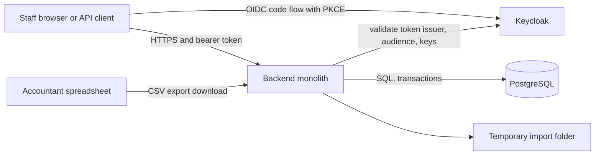
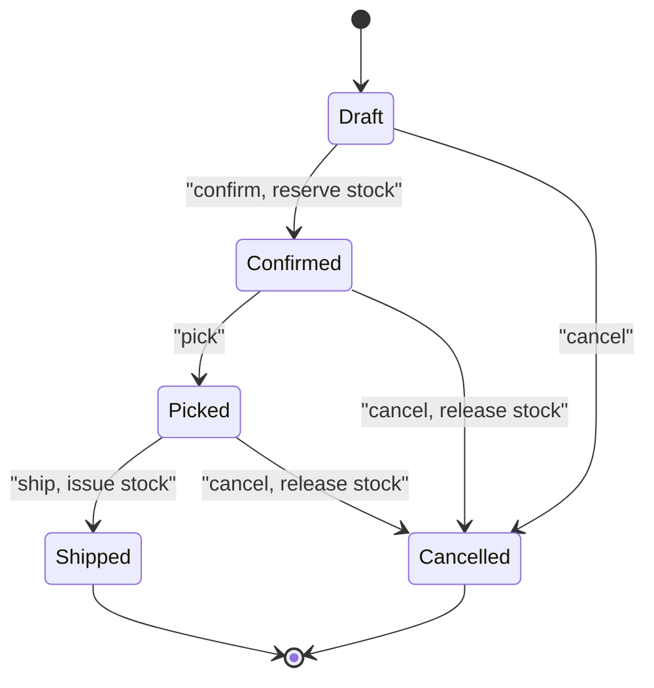
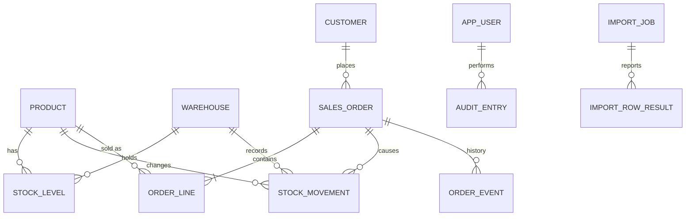

# Practice capstone: Inventory and Orders Back Office

| Field | Value |
|-------|-------|
| Id | P01-inventory-and-orders |
| Level | 201 |
| Sprint length | 4 weeks (about 12 hours per week) |
| Prerequisites | Databases 101 (all), Docker 101 (all), one backend language 101 (Python, C# or Go), Web 101 lessons 08 to 11 if you build the UI |
| Suggested stacks | A: Python + FastAPI + SQLAlchemy/Alembic + PostgreSQL + React. B: ASP.NET Core + EF Core + PostgreSQL + Angular. C: Go + chi + pgx/sqlc + PostgreSQL + server-rendered HTML or React |
| Last updated | 2026-11-23 |

No source code ships with this capstone. This document is the whole brief. You design, build, test and demo it alone.

## 1. The brief

**Client:** Harbor and Pine Supply, a fictional wholesaler of camping and hiking gear with 14 staff, one main warehouse and one small
overflow warehouse. Today they run on three shared spreadsheets: one for stock, one for customer orders, one for monthly reports.
Last quarter two people sold the last 6 tents at the same time, a stock count was overwritten by a copy-paste, and nobody could say who
changed a price.

**Your job:** build their back office. Staff sign in, see current stock per warehouse, record every stock change as a movement, take customer
orders that reserve stock, move orders through picking and shipping, and read simple reports. The owner imports the existing product list
from CSV and exports reports to CSV for the accountant.

**At the end you can demo:** a running system (API plus a small UI or a scripted client) where a warehouse worker receives goods, a sales
user places an order that reserves stock, the order is picked and shipped, stock levels and reports update correctly, a second user trying
to oversell is refused, and a viewer cannot change anything. Everything starts with one command and stops cleanly.

## 2. Goals and non-goals

**Learning goals**
- Design a relational schema with real constraints (keys, checks, foreign keys, unique rules) and justify every index.
- Model stock as an append-only ledger of movements, and keep derived quantities correct under concurrency.
- Implement an order state machine whose illegal transitions are impossible, not just discouraged.
- Use database transactions and locking so two simultaneous requests cannot oversell.
- Build role-based access control with Keycloak (OIDC) and check it on the server for every operation.
- Import and export CSV safely (validation, partial failure reporting, idempotent re-import).
- Write reports with grouped SQL and prove they are fast enough with `EXPLAIN`.

**Non-goals**
- No payments, invoicing, tax calculation, shipping-carrier integration or barcode hardware.
- No customer-facing shop. Customers are records, not users.
- No microservices. One deployable backend (a monolith), one database.
- No multi-currency. One currency, amounts stored as integer minor units.
- No pixel-perfect UI. A plain, accessible UI is enough; the API is the graded product.

## 3. Users and scenarios

| Persona | Role in Keycloak | Needs |
|---------|------------------|-------|
| Mara, owner | `admin` | Manages users, prices, imports the catalogue, reads every report |
| Tomas, warehouse worker | `warehouse` | Receives goods, moves stock between warehouses, picks and ships orders, counts stock |
| Ines, sales rep | `sales` | Creates customers and orders, sees availability, cancels her own draft orders |
| Pavel, accountant | `viewer` | Read-only access to stock value and sales reports, exports CSV |

User stories
1. As Tomas, I want to record goods received against a product and warehouse, so that the stock level goes up and the receipt is traceable.
2. As Tomas, I want to transfer 20 units from the main warehouse to overflow in one action, so that both sides stay consistent even if it fails halfway.
3. As Ines, I want to confirm an order and have the stock reserved, so that nobody else can sell the same units.
4. As Ines, I want a clear error that names the short product when an order cannot be reserved, so that I can offer the customer an alternative.
5. As Tomas, I want to mark an order picked and then shipped, so that reserved stock turns into stock that has left the building.
6. As Mara, I want to import 3,000 products from CSV and get a line-by-line report of what failed, so that I can fix the file and try again without duplicates.
7. As Pavel, I want a stock valuation report and a sales-by-month report as CSV, so that I can open them in a spreadsheet.
8. As Mara, I want to see who changed a price or cancelled an order and when, so that mistakes can be traced.

## 4. Requirements

Priority uses MoSCoW: Must, Should, Could.

| Id | Requirement | Priority | Acceptance criteria |
|----|-------------|----------|---------------------|
| R-01 | Product catalogue with SKU, name, unit, unit cost, unit price, active flag, reorder level | Must | Given a SKU that exists, when a second product is created with the same SKU (case-insensitive), then the API returns 409 and the database unique constraint, not only application code, enforces it |
| R-02 | Two warehouses at minimum, extensible to more by data only | Must | Given a new warehouse row, when stock is received into it, then no code change is needed |
| R-03 | Every stock change is an immutable movement row (receipt, issue, transfer out, transfer in, adjustment, reservation release) | Must | Given any movement, when an UPDATE or DELETE is attempted by the application database user, then it is denied |
| R-04 | On-hand and reserved quantities per product and warehouse are always correct | Must | Given 50 concurrent reserve requests for 10 units, when all finish, then exactly 10 units are reserved and on-hand minus reserved is never negative |
| R-05 | Transfers move stock atomically between two warehouses | Must | Given a transfer where the destination write fails (forced in a test), when the request ends, then source stock is unchanged |
| R-06 | Customers with name, email, phone and shipping address | Must | Given an invalid email, when a customer is created, then the API returns 422 with a problem details body naming the field |
| R-07 | Orders have lines (product, quantity, unit price snapshot) and follow draft, confirmed, picked, shipped, cancelled | Must | Given an order in `shipped`, when any transition is requested, then the API returns 409 and the state is unchanged |
| R-08 | Confirming an order reserves stock for all lines or none | Must | Given an order with two lines where the second is short, when confirmed, then no reservation exists for the first line |
| R-09 | Cancelling a confirmed or picked order releases its reservations | Must | Given a confirmed order, when cancelled, then reserved quantity drops by the order quantity and a release movement is written |
| R-10 | Price on a line is copied at confirmation time and never changes when the catalogue price changes | Must | Given a confirmed order, when the product price changes, then the order total is unchanged |
| R-11 | Low-stock report: products where available quantity is at or below reorder level | Must | Given seed data with 5 known low products, when the report is requested, then exactly those 5 are returned |
| R-12 | Stock valuation report (quantity times unit cost) per warehouse and in total | Must | Given a known seed, when the report runs, then totals match a hand-calculated value to the cent |
| R-13 | Sales report grouped by month and by product, with a date filter | Should | Given orders in two months, when filtered to one month, then only that month is counted; shipped orders only |
| R-14 | Role-based access: admin, warehouse, sales, viewer as in section 3 | Must | Given a token with role `viewer`, when any POST, PUT, PATCH or DELETE is sent, then the API returns 403 |
| R-15 | Warehouse role cannot read unit cost or margin fields | Should | Given a `warehouse` token, when a product is read, then the response has no cost fields (not null, absent) |
| R-16 | CSV product import with per-row validation and a result report | Must | Given a file with 1,000 rows of which 7 are invalid, when imported, then 993 rows are saved and a report lists the 7 row numbers with reasons |
| R-17 | CSV import is idempotent per SKU | Must | Given the same file imported twice, when the second import finishes, then no duplicates exist and the report says "updated" or "unchanged" per row |
| R-18 | CSV export of stock and reports, safe against spreadsheet formula injection | Must | Given a product named `=HYPERLINK("http://x")`, when exported, then the cell is neutralised (for example prefixed so it is text) |
| R-19 | Audit log of price changes, order state changes and imports (who, when, what, old and new value) | Should | Given a price change, when the audit endpoint is read by an admin, then one entry shows old price, new price and the user id |
| R-20 | List endpoints are paginated with a maximum page size | Must | Given `limit=100000`, when requested, then the API caps it or returns 400, and never returns more than 200 rows |
| R-21 | Optimistic concurrency on product and order edits | Should | Given two clients editing the same product, when the second saves with a stale version, then the API returns 412 or 409 and nothing is overwritten |
| R-22 | Errors use RFC 9457 problem details | Must | Given any 4xx or 5xx, then the content type is `application/problem+json` and the body has `type`, `title`, `status` |
| R-23 | One command starts the stack, one command removes it with its data | Must | Given a clean machine with Docker, when the start command runs, then `/health` returns 200 within 60 s; the cleanup leaves 0 containers, volumes and networks of this project |

**Non-functional requirements**

| Id | Requirement | Measure |
|----|-------------|---------|
| N-01 | List and detail endpoints are fast on seed data of 20,000 products, 200,000 movements, 30,000 orders | p95 below 250 ms on a laptop, measured with 200 sequential requests |
| N-02 | Reports are fast | Each report below 1.5 s on the same seed; `EXPLAIN` shows no sequential scan on the largest table for the filtered case |
| N-03 | CSV import throughput | 5,000 rows in under 30 s |
| N-04 | Reproducible environment | Postgres version pinned to a major version; migrations apply from empty to current in under 30 s |
| N-05 | Test coverage of rules | At least 15 automated tests: state machine, reservation, transfer, role checks, CSV edge cases |
| N-06 | No secret in git | `.env.example` only; a scan of the repository for the Keycloak admin password finds nothing |

## 5. Suggested architecture

**Components:** HTTP layer (routing, validation, problem details), application services (one per use case: receive stock, transfer,
confirm order), repository or query layer, database (schema, constraints, optional functions), authentication middleware, CSV module,
report queries, audit writer.

**Decisions you must make and write down (one short paragraph each in your README):**
1. **Where stock quantities live.** Option 1: compute on-hand by summing movements every time. Option 2: keep a `stock_level` summary table updated in the same transaction. Option 3: summary maintained by a database trigger. Trade-off: read speed, write complexity, risk of drift. Whatever you choose, add a check that recomputes from movements and compares.
2. **How to prevent overselling.** Row lock on the stock-level row (`SELECT ... FOR UPDATE`), a conditional `UPDATE ... WHERE available >= qty`, or a `CHECK` constraint plus retry. State which isolation level you rely on.
3. **State machine placement.** Application code only, or a transition table plus a trigger or constraint. Where would an illegal transition slip through?
4. **Business logic in SQL or in code.** Stored procedures for confirm and transfer, or service-layer transactions. Be able to argue both.
5. **Import design.** Stream the file or load it fully; validate everything first or row by row; one transaction or batches.

Hosting hint: Compose with the backend, Postgres and Keycloak. Do not publish Postgres to the host unless you need a client; if you do,
avoid host ports 5432, 8080, 8081, 4200, 5173 and 11434 (used by other Code101 labs). Suggested: API 8110, Keycloak 8180.

## 6. Data model starting point

Entities only. You decide columns, types, constraints and indexes.

| Entity | Purpose and key relationships |
|--------|-------------------------------|
| `product` | Catalogue item; unique SKU |
| `warehouse` | Physical location |
| `stock_level` | Current on-hand and reserved per product and warehouse (if you choose option 2 or 3 in section 5) |
| `stock_movement` | Append-only ledger; references product, warehouse, optional order, optional transfer id |
| `customer` | Buyer record |
| `sales_order` | Header with status, customer, totals, version |
| `order_line` | Product, quantity, price snapshot |
| `order_event` | Every state change with actor and timestamp |
| `app_user` | Local mirror of the Keycloak subject id (no passwords here) |
| `audit_entry` | Who changed what; old and new values |
| `import_job` and `import_row_result` | One CSV import and its per-row outcome |

Design prompts: Which columns must be `NOT NULL`? Which `CHECK` constraints make impossible states impossible (negative quantity,
reserved above on-hand, zero-quantity line)? How do you stop a transfer from using the same warehouse twice? Which queries in section 7
need which index? Money is integer minor units: why?

## 7. API or interface sketch

You write the OpenAPI 3.1 contract first. Paths are a starting point; use a version prefix such as `/api/v1`.

| Resource | Operations | Roles that may write |
|----------|------------|----------------------|
| `/products` | list (filter, search, page), get, create, patch, deactivate | admin |
| `/warehouses` | list, get, create | admin |
| `/stock` | list levels by product or warehouse | read: all |
| `/stock-movements` | list (filter by product, warehouse, date), create receipt or adjustment | warehouse, admin |
| `/transfers` | create (source, destination, product, quantity), get | warehouse, admin |
| `/customers` | list, get, create, patch | sales, admin |
| `/orders` | list, get, create draft, edit lines (draft only) | sales, admin |
| `/orders/{id}/confirm`, `/pick`, `/ship`, `/cancel` | action endpoints; each is one transition | confirm and cancel: sales, admin; pick and ship: warehouse, admin |
| `/reports/low-stock`, `/reports/stock-valuation`, `/reports/sales` | JSON or CSV by `Accept` header or `?format=csv` | read: admin, viewer |
| `/imports/products` | upload CSV, get job, get row results | admin |
| `/audit` | list entries | admin |
| `/health` | liveness and readiness | public |

Contract rules to decide: status codes for each failure (404 versus 403 for an object the user may not see), the shape of the validation
error list, how a client sends the version for optimistic concurrency (`ETag` and `If-Match`, or a `version` field), and the maximum
upload size.

## 8. Security and identity

**What must be protected:** cost and margin data, price changes, the stock ledger, order state, and the right to import.

**Identity design (you draw the sequence diagram in your README):** Keycloak realm with one realm, a confidential client for the backend
(resource server), a public client for the UI using the authorization code flow with PKCE, four realm roles, and a mapper that puts roles
and the audience into the access token. The backend validates signature, issuer, audience and expiry on every request and maps roles to
permissions in one place. Never trust a role sent in a request body.

**Standards that apply**
- OpenID Connect Core and OAuth 2.0 with PKCE (RFC 7636); current threat guidance is OAuth 2.0 Security Best Current Practice (RFC 9700).
- OWASP API Security Top 10 (2023), items that matter here:

| OWASP item | Where it bites in this project | Your control (design it) |
|------------|--------------------------------|---------------------------|
| API1 Broken Object Level Authorization | Reading or cancelling an order by guessing its id | Ownership or role rule on every `/orders/{id}` route; test with a second user |
| API2 Broken Authentication | Weak token checks, long-lived tokens | Full JWT validation, short token lifetime, no tokens in URLs or logs |
| API3 Broken Object Property Level Authorization | Cost fields leaking to warehouse role; mass assignment of `status` or `quantity_reserved` | Separate request and response DTOs, allow-list of writable fields |
| API4 Unrestricted Resource Consumption | Huge CSV, huge page size, expensive reports in a loop | Upload size limit, page cap, report timeout, rate limit on import and reports |
| API5 Broken Function Level Authorization | Viewer calling a write route, sales calling pick | Deny by default; one policy table; tests per role per route |
| API6 Unrestricted Access to Sensitive Business Flows | Scripted bulk create and cancel of orders to lock stock | Limits per user, reservation expiry for stale drafts (stretch) |
| API8 Security Misconfiguration | Open CORS, verbose stack traces, default Keycloak admin credentials | Explicit CORS origins, generic 500 body, secrets from environment |
| API9 Improper Inventory Management | Forgotten test endpoints or old versions | Contract is the inventory; CI check that routes equal contract paths |

Also required: parameterised queries only, least-privilege database user (no DDL, no DELETE on `stock_movement`), CSV formula-injection
neutralising on export, no personal data in logs (mask email and phone), TLS terminated in front of the app in any real deployment.

## 9. Sprint plan

| Week | Phase | Deliverables | Exit criteria (demoable) |
|------|-------|--------------|--------------------------|
| 1 | Walking skeleton and catalogue (R-01, R-02, R-06, R-14, R-20, R-22, R-23) | Compose stack with backend, Postgres, Keycloak; migrations; `/health`; product, warehouse, customer CRUD; token validation and roles; problem details; OpenAPI draft | `docker compose up`, sign in as each role, create a product as admin (201) and as viewer (403); duplicate SKU returns 409; cleanup leaves nothing |
| 2 | Stock ledger (R-03, R-04, R-05, R-21) | Movements, stock levels, receipt, adjustment, transfer, immutability grants, drift check, concurrency test | Receive 100 units, transfer 20, ledger sums match levels; forced failure in a transfer leaves both sides unchanged; the 50-concurrent-reserve test passes (written as a script or test) |
| 3 | Orders (R-07 to R-10, R-15, R-19) | Order drafts and lines, confirm with all-or-nothing reservation, pick, ship, cancel, order events, audit log, field-level hiding for warehouse role | Walk one order draft to shipped on screen or with a script; short stock gives a 409 naming the product; cancelling releases stock; illegal transitions rejected |
| 4 | Reports, CSV, hardening, demo (R-11 to R-13, R-16 to R-18, N-01 to N-06) | Three reports, CSV import and export, indexes and `EXPLAIN` notes, load seed, OWASP checklist, README, demo script | Reports match hand-calculated values; 1,000-row import with 7 bad rows reports exactly 7; p95 measurements recorded; 15 or more tests pass; full demo script runs end to end in under 10 minutes |

Time boxes: if week 2 slips, cut R-21 to Could and keep the ledger correct. Never cut R-04.

## 10. Verification

Smoke checklist (run once from a clean checkout; Docker is temporary):
1. Create `.env` from `.env.example`, run your start command, wait for `/health` to return 200.
2. Get a token for each of the four users; call `GET /products` with each (all 200).
3. As `viewer`, call `POST /products` (403). As `warehouse`, read a product (no cost field).
4. As `warehouse`, receive 10 units of a product into the main warehouse; read stock (on-hand 10).
5. As `sales`, create and confirm an order for 4 units (reserved 4); confirm a second order for 7 units (409).
6. Pick and ship the first order; read stock (on-hand 6, reserved 0).
7. Import the sample CSV with deliberate errors; check the row report; import it again (no duplicates).
8. Download the stock valuation report as CSV and open it in a spreadsheet.
9. Run the cleanup command; confirm no containers, volumes or networks of the project remain (`docker ps -a`, `docker volume ls`, `docker network ls`).

What to measure and record in the README: p95 latency from N-01, report times from N-02, import time from N-03, the `EXPLAIN` output before
and after your most important index.

Demo script: 10 minutes covering stories 1 to 8, including one deliberate failure (oversell) and one forbidden action.

## 11. Grading rubric

| Criterion | Weight | Beginner (1) | Solid (3) | Excellent (5) |
|-----------|--------|--------------|-----------|---------------|
| Correctness of stock and orders | 25% | Happy path works; oversell possible | Reservations correct in single-user tests | Concurrency test proves no oversell; drift check exists; all-or-nothing confirm proven |
| Data design | 15% | Tables exist, few constraints | Keys, checks, foreign keys, sensible indexes | Illegal states impossible in the database; each index justified by `EXPLAIN`; ledger immutable via grants |
| Security and identity | 15% | Login works, roles checked in some routes | Full token validation, role policy in one place, DTO separation | Per-route per-role tests, field-level hiding, OWASP table answered with evidence, no secrets in git |
| API quality | 10% | Works but inconsistent errors | Consistent codes, pagination, problem details | OpenAPI 3.1 contract matches behaviour, concurrency tokens, clear 404 versus 403 policy |
| Tests | 10% | A few happy-path tests | 15 tests covering rules and roles | Tests for concurrency, CSV edge cases and the state machine matrix |
| CSV and reports | 10% | Import works on a clean file | Row-level report, idempotent, export safe | Streaming import, formula-injection tests, reports verified against hand values |
| Operations | 10% | Runs on your machine | One-command start and cleanup, `.env.example`, health check | Pinned versions, migration from empty tested, measured performance, cleanup verified |
| Docs and demo | 5% | README with run steps | README with diagrams and the five design decisions | As-built TDD notes, trade-offs written, demo under 10 minutes |

Total 100%. Pass at 60%. Any oversell found in the demo caps the correctness score at 2.

## 12. Stretch goals

Ranked easiest to hardest.
1. Soft delete and restore for products, with unique SKU still enforced among active rows (partial unique index).
2. Reservation expiry: confirmed orders not picked within 48 hours are flagged or auto-cancelled by a scheduled job.
3. Barcode lookup endpoint and a stock count (cycle count) workflow that produces adjustment movements.
4. Purchase orders and supplier receipts that pre-fill the receive screen.
5. Full-text search on product name and description with a Postgres GIN index and a measured comparison with `ILIKE`.
6. Row-level security in PostgreSQL so warehouse users see only their warehouse, enforced by the database.
7. Outbox table and a worker that publishes "order shipped" events to a log file, with at-least-once delivery and a consumer that is idempotent.
8. Read replica or materialised views for reports, with a refresh strategy and a measured freshness limit.

## 13. Hints and pitfalls

**Common traps**
- Updating a quantity with read-then-write in application code: two requests read 10, both write 6. Use a lock or a conditional update inside a transaction.
- Storing money as floating point. Use integer minor units.
- Letting the client send `status` in a PATCH. State changes are action endpoints.
- Implementing "all or none" reservation with a loop and no transaction.
- Forgetting that a transfer is two movements and one logical operation (share a transfer id).
- Importing a CSV with a UTF-8 byte order mark or a different delimiter and failing silently; follow RFC 4180 and test quotes, commas and newlines inside fields.
- Using the Keycloak admin account for the app. Create a dedicated client and test users.

**Code101 lessons to revisit** (ids are `<track>-101/<lesson number>`; 201 lessons are planned and will extend these)
- databases-101/06 keys and relationships, 07 joining tables, 08 summaries (reports), 09 good design, 10 transactions, 11 indexes and explain, 12 library project (a smaller version of this ledger idea).
- docker-101/04 data that survives, 05 environment and secrets, 06 networks and compose, 07 healthchecks and cleanup, 08 two-service project.
- python-101/08 files and 09 handling errors, csharp-101/08 and 09, go-101/08 and 09 (CSV and error handling in your language).
- web-101/09 DOM and events, 11 TypeScript in the browser (if you build a UI).

**Tier 1 references**
- OWASP API Security Top 10 (2023): https://api-security.owasp.org/editions/2023/en/0x11-t10/
- RFC 9457 Problem Details for HTTP APIs: https://www.rfc-editor.org/info/rfc9457
- RFC 7636 PKCE: https://www.rfc-editor.org/info/rfc7636 and RFC 9700 OAuth 2.0 Security BCP: https://www.rfc-editor.org/info/rfc9700
- RFC 4180 CSV: https://www.rfc-editor.org/info/rfc4180
- Keycloak securing apps: https://www.keycloak.org/securing-apps/overview and production configuration: https://www.keycloak.org/server/configuration-production
- PostgreSQL: explicit locking https://www.postgresql.org/docs/current/explicit-locking.html, transaction isolation https://www.postgresql.org/docs/current/transaction-iso.html, constraints https://www.postgresql.org/docs/current/ddl-constraints.html
- ASP.NET Core best practices (stack B): https://learn.microsoft.com/en-us/aspnet/core/fundamentals/best-practices?view=aspnetcore-10.0
- Angular style guide (stack B): https://angular.dev/style-guide; React: https://react.dev/learn/thinking-in-react

## 14. Deliverables checklist

- [ ] Git repository with a README: what it is, how to start and stop, how to run the smoke checklist
- [ ] OpenAPI 3.1 contract file that matches the running API
- [ ] Migrations that build the database from empty, plus seed data (20,000 products) generated by a script, not committed as a giant file
- [ ] `docker-compose.yml`, Dockerfile, `.env.example`, `.dockerignore`; Keycloak realm export with the four roles and test users (test passwords documented as test-only)
- [ ] Mermaid diagrams: context, ER (your own with columns), order state machine, login sequence
- [ ] Section 5 decision paragraphs (five) and an "as-built" note listing every place you deviated from this TDD and why
- [ ] At least 15 automated tests and the output of one run
- [ ] Performance notes: N-01 to N-03 numbers and one `EXPLAIN` before and after
- [ ] OWASP table from section 8 completed with evidence (test name or file) per row
- [ ] Sample CSV files: clean, with errors, with formula-injection attempts
- [ ] Demo script (steps and expected results) and a short recording or screenshots
- [ ] Cleanup proof: command output showing nothing left in Docker
