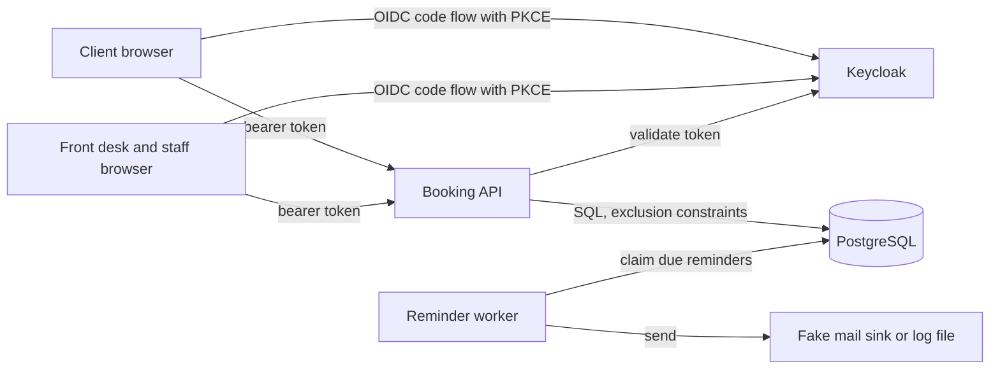
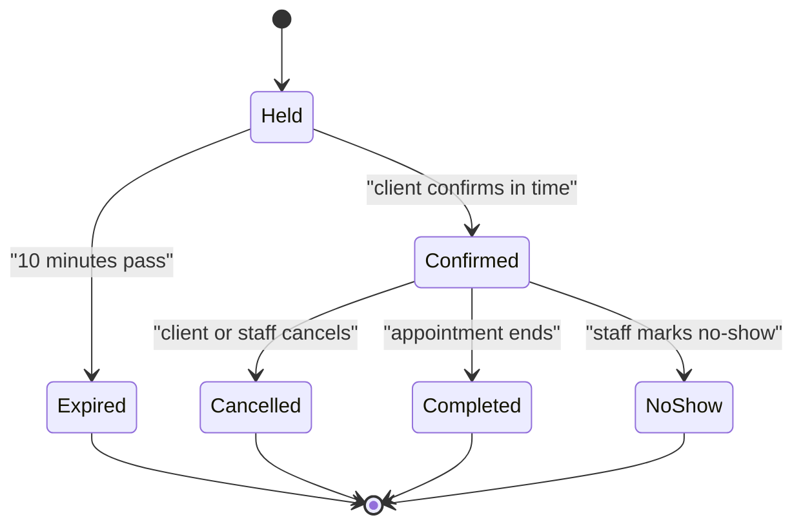
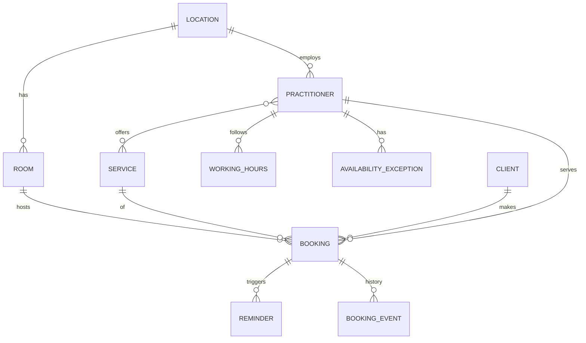

# Practice capstone: Booking and Scheduling for a Studio

| Field | Value |
|-------|-------|
| Id | P02-booking-and-scheduling |
| Level | 201 |
| Sprint length | 4 weeks (about 12 hours per week) |
| Prerequisites | Databases 101 (all, especially transactions and indexes), Docker 101 (all), one backend language 101 (Python, C# or Go), Web 101 lessons 08 to 11 for the calendar UI |
| Suggested stacks | A: ASP.NET Core + EF Core + PostgreSQL + Angular. B: Python + FastAPI + SQLAlchemy + PostgreSQL + React. C: Go + chi + pgx + PostgreSQL + React |
| Last updated | 2026-11-23 |

No source code ships with this capstone. This document is the whole brief. You design, build, test and demo it alone.

## 1. The brief

**Client:** Lumen Physio and Pilates, a fictional studio with 3 locations (Lisbon, Dublin, Vancouver), 9 practitioners, 5 treatment rooms
per location and about 400 appointments a week. Bookings are taken by phone and written into a shared calendar. Last month a practitioner was
booked in two rooms at once, a client in Vancouver received a reminder at 3 a.m., and after the clocks changed in March every Dublin
appointment was shown an hour off.

**Your job:** build the booking system. Clients pick a service, a practitioner (or "any") and a free slot; the system guarantees that a
practitioner, a room or a client is never booked twice at the same time, shows each location's time correctly everywhere, sends reminders
at the right local hour, and gives staff a day and week calendar.

**At the end you can demo:** a client books, reschedules and cancels through the API or a small UI; two clients racing for the last slot
get exactly one winner; a Dublin appointment survives the DST change correctly in a test; reminders are produced at the right moment;
and a front-desk user sees the week calendar for a location.

## 2. Goals and non-goals

**Learning goals**
- Enforce "no overlapping bookings" in the database itself (range types and an exclusion constraint), not only in code.
- Handle time correctly: store instants in UTC, keep the location's IANA time zone, convert at the edges, survive daylight saving changes.
- Compute available slots from recurring rules, exceptions and existing bookings.
- Use transactions and short-lived holds so concurrent users cannot corrupt a schedule.
- Run reliable background work: reminders sent once, even with two workers.
- Protect personal and health-adjacent data with correct object-level authorization.

**Non-goals**
- No payment processing, insurance billing or video consultations.
- No real e-mail or SMS delivery: reminders go to a fake mail sink or a log file.
- No mobile app. A web page or a scripted client is enough.
- No marketplace features (reviews, search by price).

## 3. Users and scenarios

| Persona | Role in Keycloak | Needs |
|---------|------------------|-------|
| Sofia, client | `client` | Browses free slots, books, reschedules, cancels, gets reminders |
| Daniel, practitioner | `practitioner` | Sees only his own calendar, blocks time off, adds a note to an appointment |
| Aoife, front desk | `frontdesk` | Books on behalf of walk-in or phone clients, sees all calendars of her location |
| Rui, owner | `admin` | Manages locations, rooms, services, practitioners, working hours and the cancellation policy |

User stories
1. As Sofia, I want to see free slots for a 45-minute service next Tuesday in my own time zone, so that I can pick one without maths.
2. As Sofia, I want my slot held for 10 minutes while I confirm, so that nobody takes it while I type.
3. As Sofia, I want to reschedule or cancel up to 24 hours before, so that I am not charged the late-cancel fee.
4. As Daniel, I want to block Friday afternoon as time off and have existing bookings flagged, so that I can move them.
5. As Aoife, I want to book a phone client and be told instantly if the practitioner or room is taken, so that I never double-book.
6. As Aoife, I want a day and week view per practitioner and room, so that I can see gaps.
7. As Rui, I want to define weekly hours with exceptions (holiday, extra Saturday), so that availability stays accurate.
8. As Sofia, I want a reminder 24 hours and 2 hours before in my local time, never between 22:00 and 07:00 for the 24-hour one, so that I am not woken.

## 4. Requirements

| Id | Requirement | Priority | Acceptance criteria |
|----|-------------|----------|---------------------|
| R-01 | Locations, rooms, services (duration, buffer after, price), practitioners with the services they offer | Must | Given a service of 45 minutes with a 15-minute buffer, when a booking is created at 10:00, then the practitioner is blocked until 11:00 |
| R-02 | Weekly working hours per practitioner in the location's local time, plus dated exceptions (time off, extra hours) | Must | Given hours Mon to Fri 09:00 to 17:00 and an exception on one Friday, when slots are requested for that Friday, then none are returned |
| R-03 | Slot search by service, date range, optional practitioner, optional location | Must | Given seed data, when slots are requested for one practitioner for 7 days, then only times inside working hours, not overlapping a booking, not in the past are returned, in under 300 ms (p95) |
| R-04 | A practitioner cannot have two overlapping active bookings; enforced by a database exclusion constraint | Must | Given two simultaneous requests for the same practitioner and slot, when both run 200 times in a test, then exactly one succeeds each time and the other gets 409; the constraint exists in the migration |
| R-05 | A room cannot have two overlapping active bookings | Must | Given two different practitioners and the same room and time, when both book, then one gets 409 |
| R-06 | A client cannot hold two overlapping active bookings (any practitioner) | Should | Given a client with a booking 10:00 to 10:45, when she books 10:30 to 11:15, then the API returns 409 |
| R-07 | Cancelled bookings free the slot | Must | Given a cancelled booking, when the same slot is requested again, then it is bookable (constraint applies to active statuses only) |
| R-08 | Booking lifecycle: held, confirmed, cancelled, completed, no-show; held expires after 10 minutes | Must | Given a held booking older than 10 minutes, when slots are queried, then the slot is free again and a confirm attempt returns 410 or 409 with a clear problem type |
| R-09 | Reschedule is atomic: the new slot is taken and the old one released in one transaction | Must | Given a reschedule to a taken slot, when it fails, then the original booking is unchanged |
| R-10 | Cancellation policy: free until 24 hours before the start; later cancellations are marked `late` | Should | Given a booking 23 hours away, when cancelled, then status is cancelled with `late = true` |
| R-11 | All instants are stored as UTC with time zone; API sends ISO 8601 with offset; each location has an IANA zone id | Must | Given a Dublin appointment at 10:00 local on the day clocks change, when read back by a Vancouver user, then the instant is correct and the Dublin local time is still 10:00 |
| R-12 | DST edge cases covered by automated tests: spring-forward gap, fall-back repeated hour, a weekly rule spanning the change | Must | Given a rule "09:00 local", when the week contains a DST change, then the slot is 09:00 local on both sides (the UTC instant differs by 1 hour) |
| R-13 | Reminders: 24 hours and 2 hours before each confirmed booking; each is sent exactly once | Must | Given two worker processes running, when 100 bookings fall due, then 100 reminders per type are recorded, no duplicates |
| R-14 | Quiet hours: a reminder due between 22:00 and 07:00 local is moved to the next 07:00 local, as long as that is still before the appointment | Should | Given a booking at 08:00 local tomorrow, when the 24-hour reminder is due at 08:00 today, then it is not moved; given a booking at 05:00 local, when the 24-hour reminder is due at 05:00 today, then it is sent at 07:00 today and never between 22:00 and 07:00 |
| R-15 | Staff calendar endpoint: day and week, by practitioner, room or location, in the location time zone | Must | Given 20 bookings in a week, when the week view is requested, then all 20 are returned grouped by day with correct local times |
| R-16 | iCalendar feed or file for one booking or one practitioner | Could | Given a booking, when exported, then the `.ics` file parses in a calendar app with the correct time zone |
| R-17 | Role-based and object-level access: client sees own bookings only; practitioner sees own calendar only; front desk sees own location; admin all | Must | Given Sofia's token, when she requests Daniel's calendar or another client's booking id, then 403 or 404 per your documented policy |
| R-18 | Practitioner notes are visible only to that practitioner and admin | Must | Given a client token, when a booking with a note is read, then the note field is absent |
| R-19 | Rate limiting on slot search and hold creation | Should | Given 30 hold requests in 10 seconds from one user, when sent, then the API returns 429 with `Retry-After` after your limit |
| R-20 | Errors use RFC 9457 problem details with stable `type` values (`slot-taken`, `hold-expired`, `outside-hours`) | Must | Given each failure, then the content type is `application/problem+json` and `type` matches your documented list |
| R-21 | One command starts the stack, one removes it | Must | Given a clean machine with Docker, when started, then `/health` is 200 within 60 s; cleanup leaves nothing of this project |

**Non-functional requirements**

| Id | Requirement | Measure |
|----|-------------|---------|
| N-01 | Slot search at scale | Seed: 9 practitioners, 15 rooms, 60,000 historic and future bookings; p95 below 300 ms for a 7-day search |
| N-02 | Booking write | p95 below 150 ms for create-hold and confirm on the seed |
| N-03 | Concurrency | 200 simultaneous attempts on one slot produce exactly 1 success and 199 clean 409 responses, no 500 |
| N-04 | Reminder accuracy | Reminders become due within 60 seconds of the scheduled instant in a test using a fake clock or short intervals |
| N-05 | Tests | At least 20 automated tests including DST, concurrency and role checks |
| N-06 | No secret in git | `.env.example` only |

## 5. Suggested architecture

**Components:** API (slot search, booking, calendar), availability engine (pure function: rules plus exceptions plus bookings gives slots),
booking service (transactions), reminder scheduler and worker (could be a second process or a thread in the same container), authentication
middleware, time zone helper module.

**Decisions you must make and write down:**
1. **Where overlap is prevented.** An exclusion constraint on a time range per practitioner, per room and per client; or a lock row per day; or application checks only. Show why application-only checks fail (race), and what happens with each approach when two requests arrive together.
2. **Slot generation.** Compute slots on the fly from rules, or materialise slot rows per day. Trade-off: flexibility when rules change versus read speed and storage.
3. **Hold design.** A `held` row with `expires_at` and a cleaner job, or an in-database expiry check inside the constraint's `WHERE`. What happens to an expired hold that nobody cleaned?
4. **Time zone strategy.** Which values are "wall clock plus zone" (working hours, recurring rules) and which are "instants" (bookings)? Where do you convert?
5. **Reminder delivery guarantee.** At-least-once with a dedupe key, or claim-and-mark with `FOR UPDATE SKIP LOCKED`. What if the worker dies after sending but before marking?

Hosting hint: Compose with API, worker, Postgres and Keycloak. Keep Postgres unpublished or use an unusual host port; avoid 5432, 8080,
8081, 4200, 5173, 11434. Suggested: API 8120, Keycloak 8180 (stop other labs first if they use it).

## 6. Data model starting point

| Entity | Purpose and key relationships |
|--------|-------------------------------|
| `location` | Name and IANA time zone id |
| `room` | Belongs to a location |
| `practitioner` | Linked to a Keycloak subject; works at a location |
| `service` | Name, duration, buffer, price |
| `practitioner_service` | Which practitioner offers which service |
| `working_hours` | Recurring weekly rule in local wall-clock time |
| `availability_exception` | Dated override: time off or extra hours |
| `client` | Person who books; linked to a Keycloak subject; time zone preference |
| `booking` | Practitioner, room, client, service, status, time range, hold expiry, version |
| `booking_event` | Status changes with actor and instant |
| `reminder` | Booking, kind (24h, 2h), due instant, sent instant, dedupe key |

Design prompts: Which type holds the time range? Which extension do you need so a range and an equality column can live in one exclusion
constraint? Which statuses count as "active" in that constraint? Is the buffer part of the blocked range? How do you store a recurring
rule so a DST change does not shift it?

## 7. API or interface sketch

You write the OpenAPI 3.1 contract first. Use a version prefix such as `/api/v1`.

| Resource | Operations | Who |
|----------|------------|-----|
| `/locations`, `/rooms`, `/services`, `/practitioners` | list, get; create and patch for admin | read: all signed-in; write: admin |
| `/practitioners/{id}/working-hours` and `/exceptions` | list, replace weekly rules, add or remove exception | admin; practitioner for own exceptions |
| `/slots` | search by service, date range, practitioner, location | client, frontdesk, admin |
| `/bookings` | create hold (`POST`), list (own or by filter), get | client for own; frontdesk, admin |
| `/bookings/{id}/confirm`, `/cancel`, `/reschedule`, `/complete`, `/no-show` | one transition per action | per role table in section 8 |
| `/calendar` | day or week view by practitioner, room or location | practitioner (own), frontdesk (location), admin |
| `/bookings/{id}/ics` | iCalendar file | owner, staff |
| `/reminders` | list for diagnostics | admin |
| `/health` | liveness and readiness | public |

Contract rules to decide: do you accept local time plus zone, or instants only, in requests? How is a time zone shown in responses? What
does a hold return (an id, an expiry instant and the price)? Use `Idempotency-Key` on create, or make confirm idempotent by id?

## 8. Security and identity

**What must be protected:** who is a client of which practitioner, appointment times, practitioner notes, contact details, and the integrity
of the schedule. Treat appointment data at a physiotherapy studio as sensitive personal data: collect little, log less, and check the
privacy rules where you would deploy.

**Identity design (draw the sequence diagram):** one Keycloak realm; a public client for the web UI (authorization code flow with PKCE);
realm roles `client`, `practitioner`, `frontdesk`, `admin`; a custom claim or attribute with the user's location id for front desk; client
self-registration enabled for `client` only; practitioners created by admin. The API validates issuer, audience, signature and expiry,
then maps the token subject to a `client` or `practitioner` row.

**Standards that apply**
- OpenID Connect Core, OAuth 2.0 with PKCE (RFC 7636), OAuth 2.0 Security BCP (RFC 9700).
- OWASP API Security Top 10 (2023):

| OWASP item | Where it bites | Your control (design it) |
|------------|----------------|--------------------------|
| API1 Broken Object Level Authorization | Reading or cancelling another client's booking by id; practitioner reading a colleague's calendar | Every `/bookings/{id}` and `/calendar` query is scoped by the caller's identity; tests with two clients |
| API2 Broken Authentication | Token validation gaps, self-registration abuse | Full validation; verified e-mail required before booking (Keycloak setting); short access token life |
| API3 Broken Object Property Level Authorization | Client sets `status`, `price`, `practitioner_note`, `late`; notes leaking to clients | Request DTOs allow-list; response DTO per role |
| API4 Unrestricted Resource Consumption | Slot search over a year, repeated holds | Max range 31 days, max page size, rate limit, max 3 active holds per client |
| API5 Broken Function Level Authorization | Client calling `/complete` or `/no-show` | Policy table per route and role, deny by default |
| API6 Unrestricted Access to Sensitive Business Flows | A bot booking and holding all prime slots to block competitors or resell | Hold limits, short expiry, rate limit, optional CAPTCHA noted as out of scope but described |
| API8 Security Misconfiguration | Permissive CORS, debug endpoints, default admin password | Explicit origins, no debug routes in the image, secrets from environment |

Also required: parameterised queries only; database user without DDL rights; no health notes in application logs; reminder messages contain
time, place and a link, never the note or the service's clinical details.

## 9. Sprint plan

| Week | Phase | Deliverables | Exit criteria (demoable) |
|------|-------|--------------|--------------------------|
| 1 | Walking skeleton and reference data (R-01, R-11, R-17 base, R-20, R-21) | Compose stack, migrations, `/health`, locations, rooms, services, practitioners, Keycloak realm with four roles, token validation, problem details, UTC and zone conventions written down | Start the stack, sign in as admin and create a location with a zone, a room, a service and a practitioner; as client the same POST returns 403; cleanup leaves nothing |
| 2 | Availability and slots (R-02, R-03, R-12, N-01) | Working hours, exceptions, availability engine as a pure module with unit tests, slot search endpoint, DST tests | Slot search for a week returns correct local times; the DST test suite passes; a Friday exception removes that day; p95 recorded |
| 3 | Booking safely (R-04 to R-10, R-18, R-19, N-02, N-03) | Exclusion constraints, hold, confirm, cancel, reschedule, status events, practitioner notes, rate limit, concurrency test | The 200-attempt race test shows exactly one success; reschedule failure leaves the old booking; an expired hold frees the slot; cancel after 24 hours is marked late |
| 4 | Reminders, calendar, hardening, demo (R-13 to R-16, N-04 to N-06) | Reminder scheduler and worker with claim-and-mark, quiet hours, calendar day and week endpoints, optional `.ics`, OWASP table, README, demo script | Two workers produce no duplicate reminders; the calendar view matches 20 seeded bookings; demo script of stories 1 to 8 runs in under 10 minutes; 20 or more tests pass |

Time boxes: if week 2 slips, drop R-16 and keep R-12. Never cut R-04 or R-12.

## 10. Verification

Smoke checklist (once, clean checkout, Docker temporary):
1. Create `.env` from `.env.example`; start the stack; `/health` returns 200.
2. Sign in as each role; `GET /locations` works for all.
3. As `client`, `POST /locations` returns 403.
4. As `client`, search slots for tomorrow for a 45-minute service; pick the first; create a hold (201 with expiry).
5. Confirm the hold; search again: that slot and its buffer are gone.
6. As a second client, try to book the same slot (409 with the `slot-taken` problem type).
7. As `frontdesk`, read the week calendar for the location; the booking appears in local time.
8. Run the concurrency script (200 attempts at one slot); print `1 success, 199 conflicts, 0 errors`.
9. Run the DST test group; all pass.
10. Make a booking due in 2 minutes with shortened reminder offsets; verify one reminder per type in the sink.
11. Cleanup command; confirm no containers, volumes or networks remain.

Measure and record: p95 slot search and booking write times, concurrency result, reminder lateness.

## 11. Grading rubric

| Criterion | Weight | Beginner (1) | Solid (3) | Excellent (5) |
|-----------|--------|--------------|-----------|---------------|
| Double-booking prevention | 25% | Checked in application code only | Exclusion constraint on practitioner; tested sequentially | Constraints for practitioner, room and client; 200-way race test passes; expiry handled in the constraint design |
| Time zone correctness | 20% | Stores local time strings | UTC storage, zone per location, conversion at edges | DST spring-forward and fall-back tests, recurring rules in wall-clock time, documented conventions |
| Availability engine | 10% | Hard-coded hours | Rules and exceptions, buffers | Pure tested module, performance measured, edge cases (midnight crossing, past slots) handled |
| Security and identity | 15% | Login works | Full token validation, object-level checks, DTO split | Per-role per-route tests, notes hidden, hold limits, OWASP table with evidence |
| Reminders and background work | 10% | A loop that sends | Claim-and-mark, quiet hours | Two-worker test, failure window analysed, retries with a limit |
| API and errors | 5% | Inconsistent responses | Consistent codes, problem details, pagination | OpenAPI 3.1 matches behaviour, stable problem types documented |
| Tests | 10% | Happy path | 20 tests including roles | Property-style slot tests, DST matrix, race test automated |
| Docs and operations | 5% | README with run steps | Diagrams, decisions, one-command start and cleanup | As-built notes, measured numbers, cleanup proof |

Total 100%. Pass at 60%. A reproducible double booking caps the first criterion at 1.

## 12. Stretch goals

Ranked easiest to hardest.
1. Waitlist: a client joins a full slot's waitlist and is offered a freed slot for 10 minutes.
2. Group classes: a service with capacity above 1 (Pilates class of 8), with a counter that cannot go below zero under concurrency.
3. Recurring bookings ("every Tuesday for 6 weeks") created atomically, with a partial-failure report listing which weeks conflicted.
4. Practitioner time-off request workflow with admin approval and automatic list of bookings to move.
5. Multi-resource bookings (practitioner plus a special machine) using several exclusion constraints in one transaction.
6. Subscribe-able `.ics` feed per practitioner with a signed, revocable token.
7. A reminder channel abstraction with two implementations (log file, local SMTP sink) and a retry policy with a dead-letter table.
8. Load test with a ramp to 200 concurrent users, a measured bottleneck report and one fix with before and after numbers.

## 13. Hints and pitfalls

**Common traps**
- Checking "is it free?" and then inserting: two requests both see free. Let the constraint reject the loser and translate that error to 409.
- Storing local times without a zone, or adding 24 hours to an instant to mean "same time tomorrow".
- Treating the end of one booking and the start of the next as overlapping; choose half-open ranges that include the start and exclude the end.
- Forgetting that cancelled rows must not block slots (a constraint with a condition on status, or removing the row from the active set).
- Letting reminders compute "now" from the server's local zone. Use UTC instants everywhere.
- Testing DST only on one date. Test spring-forward, fall-back and a location whose zone has a half-hour offset.
- Returning free slots the caller cannot actually book because buffers were ignored.

**Code101 lessons to revisit** (ids are `<track>-101/<lesson number>`; 201 lessons are planned)
- databases-101/06 keys and relationships, 09 good design, 10 transactions, 11 indexes and explain, 12 library project.
- docker-101/05 environment and secrets, 06 networks and compose, 07 healthchecks and cleanup, 08 two-service project (API plus worker).
- python-101/09 handling errors and 11 classes basics; csharp-101/09 and 10; go-101/09 and 10 (errors and types in your language).
- web-101/09 DOM and events and 11 TypeScript in the browser for the calendar page.

**Tier 1 references**
- PostgreSQL range types: https://www.postgresql.org/docs/current/rangetypes.html (includes constraints on ranges and exclusion constraints), btree_gist: https://www.postgresql.org/docs/current/btree-gist.html, date and time types: https://www.postgresql.org/docs/current/datatype-datetime.html
- PostgreSQL explicit locking and `SKIP LOCKED`: https://www.postgresql.org/docs/current/explicit-locking.html and https://www.postgresql.org/docs/current/sql-select.html
- IANA time zone database: https://www.iana.org/time-zones
- RFC 5545 iCalendar: https://www.rfc-editor.org/info/rfc5545
- RFC 9457 Problem Details: https://www.rfc-editor.org/info/rfc9457; RFC 6585 (status 429): https://www.rfc-editor.org/info/rfc6585
- OWASP API Security Top 10 (2023): https://api-security.owasp.org/editions/2023/en/0x11-t10/
- Keycloak securing apps: https://www.keycloak.org/securing-apps/overview; production configuration: https://www.keycloak.org/server/configuration-production
- ASP.NET Core best practices (stack A): https://learn.microsoft.com/en-us/aspnet/core/fundamentals/best-practices?view=aspnetcore-10.0; Angular style guide: https://angular.dev/style-guide

## 14. Deliverables checklist

- [ ] Git repository with README: purpose, start and stop, smoke checklist
- [ ] OpenAPI 3.1 contract that matches the running API, with the problem type list
- [ ] Migrations from empty, including the exclusion constraints, and a seed script (60,000 bookings) not committed as a huge file
- [ ] `docker-compose.yml`, Dockerfile(s), `.env.example`, `.dockerignore`; Keycloak realm export with four roles and test users
- [ ] Mermaid diagrams: context, ER with your columns, booking state machine, login sequence, reminder claim sequence
- [ ] Written decisions for the five items in section 5 and an as-built note on every deviation from this TDD
- [ ] At least 20 automated tests, including the DST suite and the race test, with one run's output
- [ ] Time zone convention page (one page: what is stored, what is sent, where conversion happens)
- [ ] OWASP table from section 8 completed with evidence per row
- [ ] Performance numbers for N-01 to N-04
- [ ] Demo script and a short recording or screenshots
- [ ] Cleanup proof showing no containers, volumes or networks left
