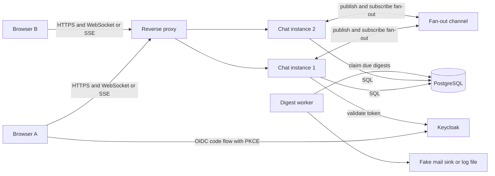
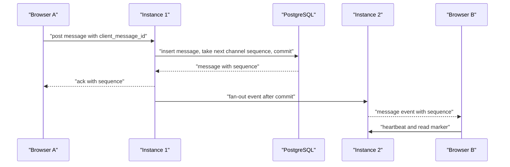
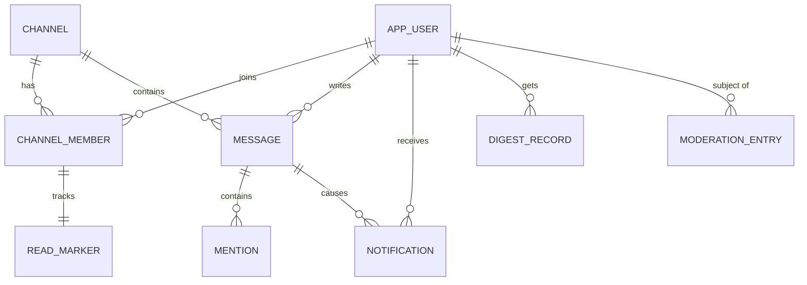

# Practice capstone: Team Chat and Notifications

| Field | Value |
|-------|-------|
| Id | P03-team-chat-and-notifications |
| Level | 201 to 301 (a 201 core in weeks 1 to 4, 301 topics in weeks 5 and 6) |
| Sprint length | 6 weeks (about 12 hours per week) |
| Prerequisites | Databases 101 (all), Docker 101 (all), Web 101 lessons 08 to 11, one backend language 101 (Go, C# or Python); concurrency basics from your language (goroutines and channels, async/await, or asyncio) |
| Suggested stacks | A: Go + chi + a WebSocket library + PostgreSQL + React. B: ASP.NET Core (SignalR or raw WebSockets) + EF Core or Dapper + PostgreSQL + Angular. C: Python + FastAPI (WebSockets or SSE) + PostgreSQL + React |
| Last updated | 2026-11-23 |

No source code ships with this capstone. This document is the whole brief. You design, build, test and demo it alone.

## 1. The brief

**Client:** Brightwater Studios, a fictional 120-person design and animation company spread over four time zones. They pay for a hosted chat
product and want an internal one: private data, no per-seat fees, and notifications that do not bury people. Their rules: channels
(public and private), direct messages, history that loads fast, unread counts that are right, mentions that notify, and a system that
keeps working when a second server is added.

**Your job:** build the chat backend and a small web client. Messages appear on other people's screens within a fraction of a second, survive
reconnects without gaps or duplicates, and old history loads page by page. Abusive clients are slowed down, and you write the notes that explain
how the system would scale across several servers.

**At the end you can demo:** two browsers chatting live; one browser goes offline, comes back and receives exactly the messages it missed;
unread badges and mention notifications update; history scrolls back through 1,000,000 seeded messages smoothly; a flood script is throttled;
and two backend instances behind a reverse proxy deliver messages between users connected to different instances.

## 2. Goals and non-goals

**Learning goals**
- Choose between WebSockets and Server-Sent Events (SSE) and defend the choice with the trade-offs.
- Authenticate a long-lived connection correctly (browsers cannot set arbitrary headers on a WebSocket or `EventSource`).
- Design ordering, deduplication and resume-after-reconnect for a stream of messages.
- Paginate history with a keyset cursor and keep it fast at 1,000,000 rows.
- Maintain unread counts without scanning messages.
- Implement presence with heartbeats and timeouts.
- Apply rate limiting and connection limits, then explain what changes when there are several instances.

**Non-goals**
- No voice, video, screen sharing or file storage (links to files only).
- No end-to-end encryption (describe it in stretch goals).
- No mobile push (Firebase or Apple services); "notification" means in-app plus a fake e-mail digest.
- No federation, bots platform or full-text search engine.
- No production load balancer. A local reverse proxy in Compose is enough.

## 3. Users and scenarios

| Persona | Role in Keycloak | Needs |
|---------|------------------|-------|
| Lena, designer | `member` | Joins channels, chats, reads history, mutes a noisy channel |
| Omar, team lead | `member` plus channel owner | Creates private channels, adds and removes members |
| Yuki, office manager | `moderator` | Deletes abusive messages in any channel, sees a moderation log |
| Priya, platform admin | `admin` | Manages users and rate-limit settings, reads connection metrics |

User stories
1. As Lena, I want to post in `#renders` and see it appear instantly for everyone online, so that the chat feels live.
2. As Lena, I want to lose Wi-Fi for 2 minutes and then see the messages I missed, in order, with no duplicates, so that I can trust the chat.
3. As Lena, I want to scroll up and have older messages load 50 at a time without jumping, so that I can find last week's decision.
4. As Lena, I want a badge showing unread messages per channel and a special mark for mentions, so that I know what needs me.
5. As Omar, I want a private channel only invited members can see or read, so that HR topics stay private.
6. As Lena, I want to see who is online or away, so that I know whether to expect an answer.
7. As Yuki, I want to delete a message and have it vanish for everyone live, with a log entry, so that harassment is handled quickly.
8. As Priya, I want a script that floods a channel to be throttled and the throttling to be visible in metrics, so that one bug cannot take the chat down.

## 4. Requirements

| Id | Requirement | Priority | Acceptance criteria |
|----|-------------|----------|---------------------|
| R-01 | Channels: public and private; direct messages between two users; membership list | Must | Given a private channel, when a non-member requests its messages or subscribes, then the API returns 403 or 404 per your policy and no message content is sent |
| R-02 | Post a message over REST or over the live connection; the server assigns a per-channel increasing sequence number | Must | Given 1,000 messages posted by 10 users concurrently, when read back, then sequence numbers have no duplicates and no gaps, and order matches sequence |
| R-03 | Live delivery of new messages to all connected members of the channel | Must | Given two connected members, when one posts, then the other receives it in under 300 ms (p95, single instance, 200 messages) |
| R-04 | Client-generated message id makes posting idempotent | Must | Given the same `client_message_id` sent twice by one user, when processed, then one message exists and both calls return it |
| R-05 | Resume after reconnect: the client sends the last sequence number it saw per channel (or `Last-Event-ID` for SSE) and receives every later message once | Must | Given a client disconnected for 60 seconds while 50 messages were posted, when it reconnects, then it receives exactly those 50, in order, without duplicates |
| R-06 | Authentication on the live connection with a short-lived credential; expired credentials close the connection | Must | Given a connection opened with an access token that expires in 60 s, when it expires, then the server closes the connection with a documented code or reason and the client reconnects with a new token |
| R-07 | Origin check on WebSocket handshakes (or CORS and cookie rules for SSE) | Must | Given a handshake from `https://evil.example`, when attempted, then it is rejected |
| R-08 | History endpoint with keyset (cursor) pagination, default 50, maximum 100, newest first, stable under new inserts | Must | Given 1,000,000 messages, when pages are requested 20 times in a row, then no message repeats or is skipped, and each page returns in under 100 ms (p95) |
| R-09 | Read markers per user and channel; unread count = messages with sequence above the marker | Must | Given 17 messages after the marker, when the unread API is called, then it returns 17 without scanning the message table; marking read sets the marker to the highest sequence seen and the count becomes 0 |
| R-10 | Mention detection (`@name`) creates a notification for that user if they are a member of the channel | Must | Given a message mentioning a member and a non-member, when posted, then exactly one notification exists |
| R-11 | Notification delivery: in-app event on the live stream if online; digest to a fake e-mail sink if the user has been offline for 15 minutes; one digest per user per 15 minutes | Should | Given 5 mentions while offline, when the digest window closes, then one e-mail record lists all 5 |
| R-12 | Per-channel mute and per-user do-not-disturb | Should | Given a muted channel, when messages arrive, then unread counts still grow but no notification is created |
| R-13 | Presence: online, away (no activity for 5 minutes), offline (no heartbeat for 30 seconds) | Must | Given a client that stops sending heartbeats, when 30 seconds pass, then other users see it as offline within 35 seconds |
| R-14 | Message delete by author or moderator, broadcast as an event; content removed from storage or replaced by a tombstone; audit entry | Must | Given a delete, when it completes, then connected members see the removal and history shows a tombstone with no content |
| R-15 | Rate limiting: 20 messages per 10 seconds per user, 5 connection attempts per minute per user, max 5 concurrent connections per user; limits return 429 with `Retry-After` (REST) or a close or error frame (live) | Must | Given a script posting 100 messages in 2 seconds, when it runs, then at most 20 are accepted per 10 seconds, the rest are rejected, and the server stays below 50 percent CPU |
| R-16 | Message limits: 4,000 characters, rejected above; control characters stripped; output is escaped or sanitised by the client | Must | Given a message containing ``, when displayed in the sample client, then it appears as text and does not run |
| R-17 | Two backend instances share traffic; a message posted on instance A reaches a client connected to instance B | Must | Given two instances behind a proxy, when 100 messages are posted, then all connected clients on both instances receive all 100 |
| R-18 | Graceful shutdown: an instance asked to stop closes connections with a "going away" reason and clients reconnect to the other instance | Should | Given a running chat, when instance A is stopped, then clients are reconnected within 10 seconds with no lost messages |
| R-19 | Errors use RFC 9457 problem details on REST routes; live errors use a documented JSON envelope | Must | Given any REST 4xx or 5xx, then the content type is `application/problem+json` |
| R-20 | One command starts the stack (proxy, two backend instances, Postgres, Keycloak); one command removes it | Must | Given a clean machine with Docker, when started, then `/health` is 200 within 90 s; cleanup leaves nothing of this project |

**Non-functional requirements**

| Id | Requirement | Measure |
|----|-------------|---------|
| N-01 | Concurrent connections on one instance | 1,000 idle plus 100 active connections with memory growth under 300 MB over 10 minutes |
| N-02 | Delivery latency | p95 below 300 ms single instance, below 500 ms across two instances |
| N-03 | History at scale | 1,000,000 message seed; page query p95 below 100 ms; `EXPLAIN` shows an index scan |
| N-04 | Unread API | p95 below 50 ms for a user in 50 channels |
| N-05 | Tests | At least 20 automated tests: sequence, idempotency, resume, permission, rate limit, cursor stability |
| N-06 | No secret in git | `.env.example` only |

## 5. Suggested architecture

**Components:** HTTP API (channels, history, read markers), live gateway (connections, subscriptions, heartbeats), message service
(transactional insert and sequence), fan-out adapter, presence tracker, notification service, digest worker, rate limiter, authentication.

**Decisions you must make and write down:**
1. **WebSocket or SSE.** SSE is one-way and has `Last-Event-ID` resume built into the browser's `EventSource`; WebSocket is two-way and needs your own resume protocol. If you choose SSE, how do clients send messages and heartbeats (REST)? If WebSocket, how do you authenticate the handshake?
2. **Per-channel sequence.** A counter row locked per insert, `max(seq)+1` inside a transaction, or a sequence per channel. Which survives 1,000 concurrent inserts without gaps or deadlocks? When are gaps acceptable?
3. **Fan-out between instances.** PostgreSQL `LISTEN` and `NOTIFY` (payload must stay below 8000 bytes in the default configuration, so send ids, not bodies; notifications are delivered after commit, and a listener that was disconnected misses them), or a message broker such as Redis or NATS in Compose. What do you do when the bus drops an event (hint: the client resumes by sequence).
4. **Unread counts.** Store the last read sequence per user and channel and compute `latest_seq - last_read_seq`; or maintain a counter. What breaks with deletions?
5. **Presence storage.** In memory per instance, in the database, or in a shared cache. What happens to presence when an instance crashes?
6. **Rate-limit state.** In memory per instance (fast, limits multiply with instances) or shared (accurate, needs a store). Write the scaling note.

## 6. Data model starting point

| Entity | Purpose and key relationships |
|--------|-------------------------------|
| `app_user` | Mirror of the Keycloak subject; display name |
| `channel` | Name, kind (public, private, direct), latest sequence |
| `channel_member` | Role (owner, member), muted flag, joined instant |
| `message` | Channel, author, sequence, client message id, body, created instant, deleted instant |
| `read_marker` | Last read sequence per member |
| `mention` | Message and mentioned user |
| `notification` | Recipient, source message, kind, created, delivered, read |
| `digest_record` | Batch of notifications mailed to one user |
| `moderation_entry` | Moderator action on a message |

Design prompts: What unique constraints give idempotent posting (which columns)? Which composite index serves "latest 50 in channel
before sequence N"? Do you partition or index by channel and sequence, and what does your `EXPLAIN` show? How do you represent a direct
message channel so two users have exactly one?

## 7. API or interface sketch

| Resource | Operations | Who |
|----------|------------|-----|
| `/channels` | list mine, create, get, patch | member; owner for patch |
| `/channels/{id}/members` | list, add, remove, mute | owner; member for self-mute |
| `/channels/{id}/messages` | `GET` history with `before` cursor and `limit`; `POST` create with `client_message_id` | members |
| `/messages/{id}` | `DELETE` | author, moderator |
| `/channels/{id}/read` | `PUT` read marker | member |
| `/unread` | counts and mention counts per channel | member |
| `/notifications` | list, mark read, preferences | member |
| `/presence` | `GET` for a channel's members | member |
| `/live` (WebSocket) or `/events` (SSE) | subscribe, resume, heartbeat, typing (optional) | member |
| `/admin/limits`, `/admin/metrics` | read and change limits; connection counts, rate-limit hits | admin |
| `/health` | liveness and readiness (database and bus) | public |

Live protocol you must specify in your README: message envelope (type, id, channel, sequence, payload), client to server types (subscribe,
unsubscribe, post, heartbeat, ack), server to client types (message, deleted, presence, notification, error), close codes and what the
client does for each.

## 8. Security and identity

**What must be protected:** private channel content, the membership list, tokens on long-lived connections, availability of the service.

**Identity design (draw the sequence diagram):** Keycloak realm, public client with authorization code flow and PKCE for the web client,
roles `member`, `moderator`, `admin`. Because a browser cannot set an `Authorization` header on a WebSocket or `EventSource`, pick one:
a short-lived one-time connection ticket obtained over REST with the bearer token and exchanged on connect; or a first message carrying
the token with a short authentication deadline. Never put the long-lived access token in the URL (it is logged by proxies). Handle token
expiry for connections that outlive the token.

**Standards that apply**
- WebSocket protocol, RFC 6455 (the handshake's `Origin` header is how servers apply the browser's origin-based security model), and the OWASP WebSocket Security Cheat Sheet.
- Server-Sent Events as defined in the WHATWG HTML Standard (event stream format and `Last-Event-ID`).
- OpenID Connect Core, OAuth 2.0 with PKCE (RFC 7636), OAuth 2.0 Security BCP (RFC 9700), HTTP 429 (RFC 6585).
- OWASP API Security Top 10 (2023):

| OWASP item | Where it bites | Your control (design it) |
|------------|----------------|--------------------------|
| API1 Broken Object Level Authorization | Subscribing to or reading a private channel by id; deleting someone else's message | Membership check on subscribe, history, post and delete; re-check on membership removal (close subscription) |
| API2 Broken Authentication | Token in URL, no expiry on sockets, ticket replay | One-time tickets with 30-second life, close on token expiry, no tokens in logs |
| API3 Broken Object Property Level Authorization | Client sets `author`, `sequence`, `deleted`; response leaks member emails | Server assigns identity and sequence; DTO allow-lists |
| API4 Unrestricted Resource Consumption | Flooding, huge messages, thousands of connections, giant history requests | Rate limits (R-15), size limit (R-16), page cap, connection cap, ping timeouts, max subscriptions per connection |
| API5 Broken Function Level Authorization | Member calling admin or moderation routes | Deny by default, policy tests per role |
| API6 Unrestricted Access to Sensitive Business Flows | Mention spam to trigger notification e-mail storms, mass channel creation | Digest batching, per-user mention limit, channel creation limit |
| API8 Security Misconfiguration | `Origin` not checked, permissive CORS, proxy buffering breaking SSE, default Keycloak admin | Explicit origin list, proxy settings documented, secrets from environment |
| API9 Improper Inventory Management | Old protocol versions, debug routes | Protocol version in the handshake; contract lists every route and message type |

Also required: cross-site scripting defence in the sample client (render text, never raw HTML), parameterised queries, least-privilege
database user, and no message bodies in logs (log ids and sizes).

## 9. Sprint plan

| Week | Phase | Deliverables | Exit criteria (demoable) |
|------|-------|--------------|--------------------------|
| 1 | Walking skeleton (R-01, R-02, R-04, R-19, R-20 part) | Compose with backend, Postgres, Keycloak; migrations; `/health`; channels, members, post and list messages over REST; sequence design; token validation; problem details | Two users post to a channel via REST and read it back in order; non-member gets 403 or 404; 1,000 concurrent posts test shows no duplicate or missing sequence |
| 2 | Live delivery and resume (R-03, R-05 to R-07, R-16) | WebSocket or SSE gateway, ticket or first-message authentication, origin check, subscribe, envelope spec, resume by sequence, sample web client | Two browsers chat live; kill the network for 60 seconds, reconnect, receive exactly the missed messages once; a bad origin is rejected; p95 latency measured |
| 3 | History and unread (R-08, R-09, N-03, N-04) | Cursor pagination, indexes, 1,000,000 message seed script, read markers, unread endpoint, badges in client | 20 pages with no repeats or gaps under 100 ms; unread count correct after reading and after new posts; `EXPLAIN` saved |
| 4 | Presence and notifications (R-10 to R-14) | Heartbeats, presence states, mentions, notification events, mute and do-not-disturb, digest worker, delete with tombstone and moderation log | Stop a client's heartbeat and see offline in 35 seconds; mention produces one notification; digest batches 5 mentions into one record; delete disappears live |
| 5 | Protection (R-15, R-06 expiry, N-01, N-05) | Rate limiter, connection caps, message caps, close codes, expiry handling, load test script (1,000 connections), metrics endpoint, OWASP table | Flood script throttled and visible in metrics; server stays responsive under 1,000 connections; expiry closes and the client recovers; 20 tests pass |
| 6 | Scale out and demo (R-17, R-18, N-02) | Second instance, reverse proxy, fan-out adapter, graceful shutdown, scaling notes, README, demo script | Users on different instances chat; stop one instance and clients reconnect without loss; cross-instance latency measured; scaling notes written |

Time boxes: if week 4 slips, ship R-12 and R-11 last. Never cut R-05 or R-17.

## 10. Verification

Smoke checklist (once, clean checkout, Docker temporary):
1. Create `.env`; start the stack (proxy, two instances, Postgres, Keycloak); `/health` is 200 for both instances.
2. Obtain tokens for Lena and Omar; Omar creates a private channel and adds Lena.
3. Open two live connections; Omar posts; Lena receives the event with sequence 1.
4. A third user (non-member) tries to subscribe to the private channel and fails.
5. Close Lena's connection, post 5 messages as Omar, reconnect Lena with her last sequence; she receives 5 messages exactly once.
6. Read history with `limit=2` twice using the cursor; no overlap.
7. Check unread for Lena before and after setting the read marker.
8. Run the flood script; confirm 429 or error frames and the metric counter increases.
9. Connect Lena to instance 1 and Omar to instance 2 (check with a debug header or logs); a message from Omar reaches Lena.
10. Cleanup command; confirm no containers, volumes or networks remain.

Measure and record: latency p95 (N-02), 1,000-connection memory, history p95, unread p95, CPU during the flood.

## 11. Grading rubric

| Criterion | Weight | Beginner (1) | Solid (3) | Excellent (5) |
|-----------|--------|--------------|-----------|---------------|
| Realtime correctness | 25% | Live messages work while connected | Resume by sequence, idempotent posting, ordered | No gaps or duplicates under concurrency test; failure cases (bus drop, instance kill) demonstrated |
| Data and pagination | 15% | Offset pagination | Keyset pagination with an index | 1,000,000 rows measured, `EXPLAIN` shown, unread without scanning messages |
| Security and identity | 20% | Token checked on REST only | Ticket or first-message auth, origin check, membership checks | Expiry handling, OWASP table with evidence, per-role tests, no tokens in URLs or logs |
| Resilience and protection | 15% | No limits | Rate limit, size limit, connection cap | Limits tested with a flood script and visible in metrics; graceful shutdown |
| Scale-out | 10% | Single instance only | Two instances share messages | Fan-out failure handled by resume; scaling notes cover limits, presence and rate-limit state |
| Tests | 5% | A few | 20 tests | Concurrency, resume and cursor stability tests automated |
| API and protocol docs | 5% | Informal | Contract and live protocol written | Versioned protocol, close codes table, examples |
| Operations and docs | 5% | Runs locally | One-command start and cleanup | Measured numbers, as-built notes, cleanup proof |

Total 100%. Pass at 60%. A message lost or duplicated in the resume test caps the first criterion at 2.

## 12. Stretch goals

Ranked easiest to hardest.
1. Typing indicators with throttling (at most one event per 3 seconds per user per channel).
2. Emoji reactions with idempotent add and remove and live updates.
3. Threads: replies keep their own sequence and unread count.
4. Edit history: edited messages keep prior versions for moderators, broadcast an edit event.
5. Full-text search with PostgreSQL text search, respecting channel membership, measured against `ILIKE`.
6. Replace the fan-out with a broker (Redis or NATS) and compare latency and failure behaviour with `LISTEN` and `NOTIFY`.
7. Web push or mobile push through a provider's sandbox, with a backoff and dead-letter design.
8. Shard channels across instances by consistent hashing so each channel is owned by one instance; describe failover.
9. An end-to-end encryption design note for direct messages (key exchange, what the server can no longer do).

## 13. Hints and pitfalls

**Common traps**
- Sending the message to subscribers before the database commit: a client may see a message that is later rolled back, or request history that does not contain it yet. Fan out after commit.
- Using `offset` pagination: pages shift when new messages arrive. Use the sequence as the cursor.
- Broadcasting with a lock held on the connection map: one slow client stalls everyone. Give each connection a bounded outgoing queue and drop or close slow consumers.
- Forgetting heartbeats: half-open connections linger for minutes behind proxies.
- Reverse proxies that buffer responses (breaks SSE) or time out idle WebSockets; set the relevant options and document them.
- Counting unread with `COUNT(*)` over messages for each channel on every refresh.
- In-memory rate limiting multiplied by instance count: the real limit becomes 2 times higher; say so.
- Logging full message bodies or tokens.

**Code101 lessons to revisit** (ids are `<track>-101/<lesson number>`; 201 and 301 lessons are planned)
- databases-101/06 keys and relationships, 10 transactions, 11 indexes and explain, 12 library project.
- docker-101/05 environment and secrets, 06 networks and compose, 07 healthchecks and cleanup, 08 two-service project (add the second instance and proxy the same way).
- go-101/09 errors, 10 structs and methods, 11 interfaces and packages; csharp-101/09 to 11; python-101/09 and 11; plus your language's concurrency chapter in the 201 level when it exists.
- web-101/09 DOM and events, 10 and 11 TypeScript for the sample client.

**Tier 1 references**
- RFC 6455 WebSocket protocol: https://www.rfc-editor.org/info/rfc6455; MDN WebSockets API: https://developer.mozilla.org/en-US/docs/Web/API/WebSockets_API
- OWASP WebSocket Security Cheat Sheet: https://cheatsheetseries.owasp.org/cheatsheets/WebSocket_Security_Cheat_Sheet.html
- Server-sent events, WHATWG HTML Standard: https://html.spec.whatwg.org/multipage/server-sent-events.html
- PostgreSQL `NOTIFY`: https://www.postgresql.org/docs/current/sql-notify.html; `LIMIT` and `OFFSET` (why keyset): https://www.postgresql.org/docs/current/queries-limit.html; explicit locking: https://www.postgresql.org/docs/current/explicit-locking.html; `SELECT` with `SKIP LOCKED`: https://www.postgresql.org/docs/current/sql-select.html
- RFC 6585 (429 Too Many Requests): https://www.rfc-editor.org/info/rfc6585; RFC 9457: https://www.rfc-editor.org/info/rfc9457
- RFC 7636 PKCE: https://www.rfc-editor.org/info/rfc7636; RFC 9700: https://www.rfc-editor.org/info/rfc9700
- OWASP API Security Top 10 (2023): https://api-security.owasp.org/editions/2023/en/0x11-t10/
- Keycloak securing apps: https://www.keycloak.org/securing-apps/overview; production configuration: https://www.keycloak.org/server/configuration-production
- ASP.NET Core SignalR (stack B): https://learn.microsoft.com/en-us/aspnet/core/signalr/introduction; ASP.NET Core best practices: https://learn.microsoft.com/en-us/aspnet/core/fundamentals/best-practices?view=aspnetcore-10.0
- Go effective guide for concurrency idioms (stack A): https://go.dev/doc/effective_go

## 14. Deliverables checklist

- [ ] Git repository with README: purpose, start and stop, smoke checklist, ports used
- [ ] OpenAPI 3.1 contract for REST routes and a separate live protocol document (envelope, message types, close codes)
- [ ] Migrations from empty and a seed script for 1,000,000 messages (generated, not committed)
- [ ] `docker-compose.yml` with proxy, two instances, Postgres, Keycloak, optional worker; Dockerfile(s), `.env.example`, `.dockerignore`; realm export with test users
- [ ] Mermaid diagrams: context with two instances, ER with your columns, send and fan-out sequence, login and ticket sequence
- [ ] Written decisions for the six items in section 5 and an as-built note on every deviation
- [ ] At least 20 automated tests and one run's output; flood and 1,000-connection scripts
- [ ] Scaling notes (one page): what breaks first at 10 instances, what state is shared, what you would change at 100,000 users
- [ ] OWASP table from section 8 completed with evidence per row
- [ ] Performance numbers for N-01 to N-04
- [ ] Demo script and a short recording or screenshots
- [ ] Cleanup proof showing no containers, volumes or networks left
