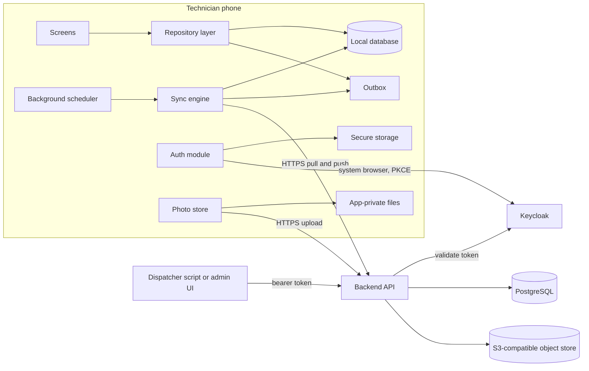
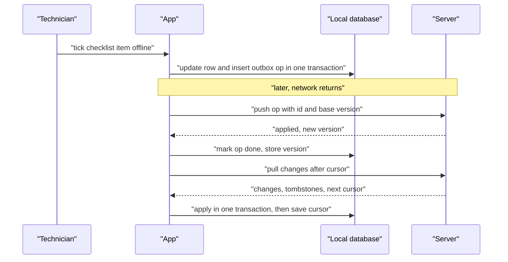
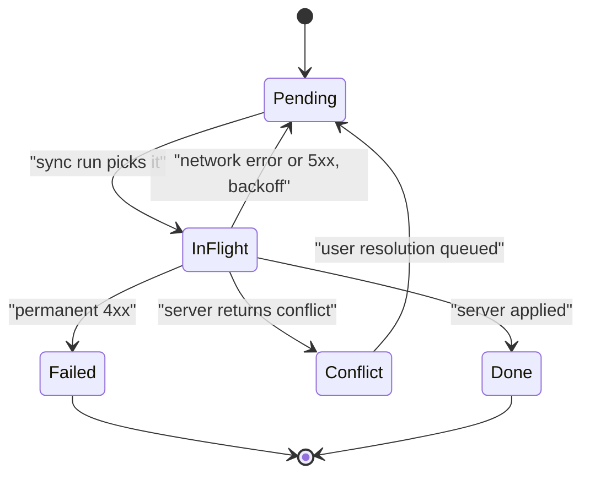
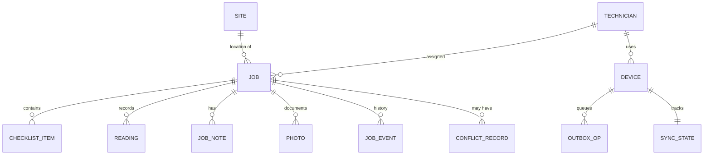

# Practice capstone: Offline-First Field Service App

| Field | Value |
|-------|-------|
| Id | P04-offline-first-field-service |
| Level | 301 |
| Sprint length | 8 weeks (about 14 hours per week) |
| Prerequisites | Flutter 101 or Kotlin + Compose 101 (planned tracks), Databases 101 (all), Docker 101 (all), one backend language 101 (Python, C# or Go), Web 101 lessons 10 and 11 (types, JSON). Recommended: the built capstones `mobile-flutter` or `mobile-kotlin` (planned) for the PKCE login chapter |
| Suggested stacks | A: Flutter + a SQLite package such as drift + ASP.NET Core + PostgreSQL. B: Kotlin + Jetpack Compose + Room + WorkManager + Go + PostgreSQL. C: Flutter + Python FastAPI + PostgreSQL. All use Keycloak and an S3-compatible object store (MinIO) in Compose |
| Last updated | 2026-11-23 |

No source code ships with this capstone. This document is the whole brief. You design, build, test and demo it alone. The backend language is your choice.

## 1. The brief

**Client:** Tidewater Water Services, a fictional regional water utility with 40 field technicians. They inspect meters, replace valves
and photograph installations in basements, pump stations and rural sites where there is often no mobile signal for hours. Today
technicians use paper forms and type them in at the depot the next day. Photos arrive on USB sticks. Twice last year a technician's
repair report was lost, and once two people edited the same job and one version silently disappeared.

**Your job:** build the technician's mobile app and its backend. The app works fully without a connection: the job list, job details,
checklists, readings and photos are on the phone. When a connection returns, the app syncs in the background without losing or duplicating
anything. When the office changes a job that a technician also changed offline, the conflict is detected and resolved by clear rules, never silently.
Login uses the organisation's identity provider with OIDC and PKCE.

**At the end you can demo:** on an emulator or device, with airplane mode on, a technician opens today's jobs, completes a checklist,
records a reading and takes photos; turns the network back on and watches the sync queue drain; a dispatcher's conflicting change is
shown as a conflict with a documented resolution; the access token expires while offline and the app recovers after re-authentication
without losing work; and the backend, Keycloak and object store start and stop with one command.

## 2. Goals and non-goals

**Learning goals**
- Design a local database as the app's source of truth, with the network as a synchroniser.
- Build a durable outbox of operations with idempotency, retries, exponential backoff and ordering rules.
- Pull changes with a server cursor and apply them transactionally.
- Detect and resolve conflicts with explicit, testable policies.
- Upload photos reliably: compress, store, queue, resume, verify.
- Schedule background sync under battery and network constraints on the platform.
- Implement OIDC authorization code flow with PKCE for a native app, and secure token and data storage on the device.
- Prove behaviour under hostile networks (drops, timeouts, duplicates, reordering).

**Non-goals**
- No maps, routing or GPS tracking (a free-text site address is enough).
- No real-time chat or push notification service (pull on sync is enough; push is a stretch goal).
- No full dispatcher web app: a minimal admin API and a scripted client are enough to create jobs and cause conflicts.
- No app-store publishing, signing for release or tablet layouts.
- No multi-tenant support. One organisation.

## 3. Users and scenarios

| Persona | Role in Keycloak | Needs |
|---------|------------------|-------|
| Marta, field technician | `technician` | Works her assigned jobs offline, records readings, takes photos, syncs when possible |
| Jonas, dispatcher | `dispatcher` | Creates and reassigns jobs, sees job status and photos, resolves escalated conflicts |
| Ellen, quality auditor | `auditor` | Read-only access to completed jobs, readings and photos |
| Priya, platform admin | `admin` | Manages users and the revoke-device list |

User stories
1. As Marta, I want today's jobs on my phone before I leave the depot and updated whenever there is signal, so that I never wait for a download in a basement.
2. As Marta, I want to tick checklist items and enter a meter reading offline and see them saved instantly, so that I can trust the app without a signal.
3. As Marta, I want to take up to 8 photos per job offline and see an upload progress per photo later, so that I know evidence reached the office.
4. As Marta, I want a clear indicator of how many changes are waiting to sync and whether the last sync failed, so that I know whether to move to a spot with signal.
5. As Marta, I want to be told when the office changed a job I was editing, see both versions and keep or merge fields, so that nobody's work is lost.
6. As Jonas, I want to reassign a job and have the old technician's app learn it on its next sync, with her completed work preserved, so that dispatch mistakes can be fixed.
7. As Marta, I want to stay signed in for a full shift and be asked to sign in again, not lose data, when my session expires offline, so that work continues.
8. As Priya, I want to revoke a lost phone and know that its data is wiped on next contact and its tokens are rejected, so that customer addresses do not leak.

## 4. Requirements

| Id | Requirement | Priority | Acceptance criteria |
|----|-------------|----------|---------------------|
| R-01 | Sign in with OIDC authorization code flow with PKCE (S256) using the system browser, never an embedded web view | Must | Given a fresh install, when Marta signs in, then the authorization request carries `code_challenge_method=S256`, the app receives the code through its registered redirect URI, and no username or password is ever seen by the app |
| R-02 | Tokens stored in platform secure storage (Android Keystore-backed, iOS Keychain-backed) | Must | Given an emulator build, when app files are inspected, then no token appears in plain text in preferences, databases or logs |
| R-03 | Job list and job detail readable fully offline | Must | Given 50 synced jobs, when airplane mode is on and the app cold starts, then the list appears in under 2 s with all 50 jobs |
| R-04 | The local database is the single source of truth for screens; screens never read network responses directly | Must | Given the network off, when any screen is opened, then it renders from local data with no spinner that depends on the network |
| R-05 | Pull sync with a server cursor: the client sends the last cursor, the server returns changes after it, including deletes as tombstones | Must | Given 500 changed jobs, when pulled over a throttled link (1 Mbps down), then all arrive within 15 s and the cursor advances only after the local transaction commits |
| R-06 | Offline edits (checklist ticks, readings, notes, status changes) go to a durable outbox in the same transaction as the local change | Must | Given the app is killed right after a tick, when restarted, then the tick is in the UI and one outbox entry exists |
| R-07 | Each outbox operation has a unique id (UUID) and the server applies it at most once | Must | Given the same operation id sent 5 times, when processed, then the server state changes once and every response is the same success result |
| R-08 | Outbox drains in order per job and in parallel across jobs; retry with exponential backoff and jitter; a permanent failure (4xx) parks the item as failed with a reason | Must | Given the server returns 500 for 3 attempts then 200, when sync runs, then the operation succeeds on the 4th attempt after increasing delays; given a 422, then it is not retried and is shown to the user |
| R-09 | Optimistic concurrency: every job has a server `version`; each operation carries the base version it was made on | Must | Given a base version that is behind the server's, when the server receives the operation, then it applies your documented merge policy or returns a conflict result, never overwrites silently |
| R-10 | Conflict policy per field group documented and implemented (for example: assignment and schedule are server-wins; readings, checklist and technician notes are technician-wins for her own entries; status follows a state machine) | Must | Given dispatcher reassigns while Marta ticks an item offline, when she syncs, then the tick is kept in the job's history, the assignment change is applied, and the job shows as reassigned |
| R-11 | Conflict screen shows server and local values per conflicting field and lets the user choose; the choice is sent as a new operation | Should | Given a field conflict, when Marta picks "keep mine", then the server holds her value with a higher version, and the audit record names both choices |
| R-12 | Photos captured offline are compressed, stored in app-private storage, referenced from a `photo` row and queued for upload | Must | Given a 4 MB camera image, when saved, then the stored file is at most 1.2 MB, longest side at most 2048 px, and the row has size, checksum and status `pending` |
| R-13 | Photo upload is resumable or retried safely: partial transfers are not counted as done; the server verifies checksum and size | Must | Given the network drops at 50 percent of an upload, when it returns, then the upload completes, the server stores exactly one file with the matching checksum, and the row becomes `uploaded` |
| R-14 | Photo upload limits and validation: JPEG or PNG only, at most 10 MB on the server, 8 photos per job, virus or type sniffing by content not by name | Must | Given a file renamed `.jpg` that is not an image, when uploaded, then the server rejects it with 415 and the app marks the photo failed with a reason |
| R-15 | Background sync with platform scheduling (WorkManager on Android; background tasks on iOS where available), constrained to a connected network and not low battery | Must | Given pending operations and the app in the background, when connectivity returns, then a sync run starts within the platform's allowed window and drains the queue; document the platform limits you observed |
| R-16 | Manual "sync now", visible queue size, last success time and last error | Must | Given 12 pending operations, when the user opens the sync screen, then it shows 12, the oldest age, and per-item status |
| R-17 | Access token expiry handled: the app keeps working offline; on reconnect it refreshes silently; if refresh fails it asks for sign-in without discarding queued work | Must | Given a token that expired 2 hours ago and a valid refresh token, when sync starts, then it refreshes once and continues; given an invalid refresh token, then the queue is preserved, a sign-in screen appears, and after sign-in the queue drains |
| R-18 | Refresh token handling follows current OAuth guidance: rotation or sender constraint for public clients, revocation on logout | Should | Given a refresh token that was already used, when presented again, then Keycloak rejects it (rotation enabled) and your app handles the failure as in R-17 |
| R-19 | Role-based access on the server: technicians see only jobs assigned to them; auditors read only; dispatcher manages jobs | Must | Given Marta's token, when she requests a job assigned to another technician by id, then the server returns 404 or 403 and the cursor feed never contains that job |
| R-20 | Reassignment removes the job from the old technician's device at next pull, after her unsynced operations have been delivered | Must | Given Marta has 2 pending operations on a job that was reassigned, when she syncs, then her operations are accepted (history kept), then the job leaves her list as a tombstone |
| R-21 | Remote revoke and local wipe: a revoked device's next call returns a defined error and the app deletes its database, files and tokens after warning about unsynced items | Should | Given a revoked device id, when it calls the API, then the response is 401 or 403 with a problem type `device-revoked` and the app wipes after the user acknowledges or after unsynced data is exported |
| R-22 | Local database encrypted at rest, with the key held in secure storage | Should | Given the database file copied from the emulator, when opened with a plain SQLite tool, then it cannot be read |
| R-23 | Errors from the server use RFC 9457 problem details; the app maps `type` values to user messages | Must | Given each documented problem type, then the app shows a specific message, not "something went wrong" |
| R-24 | Clock skew tolerance: ordering never depends on the device clock | Must | Given a device clock 3 hours wrong, when it syncs, then ordering and conflict detection still use versions and server time |
| R-25 | One command starts backend, Keycloak, Postgres and object store; one command removes them | Must | Given a clean machine, when started, then `/health` is 200 within 90 s; cleanup leaves nothing of this project |

**Non-functional requirements**

| Id | Requirement | Measure |
|----|-------------|---------|
| N-01 | Cold start to job list (local data, 500 jobs) | Below 2 s on a mid-range emulator profile |
| N-02 | Outbox durability | 0 lost operations in 100 forced app kills at random points (script it) |
| N-03 | Idempotency | Replaying a 200-operation log twice leaves the server state identical to once |
| N-04 | Photo budget | Each photo at most 1.2 MB stored and uploaded; 8 photos upload in under 60 s at 2 Mbps |
| N-05 | Battery and data friendliness | No sync loop more often than every 15 minutes in the background; no upload on metered networks unless the user allows it (setting) |
| N-06 | Tests | At least 25 automated tests: sync engine, conflict policy, outbox retry, idempotency, token expiry flow |
| N-07 | No secret in git | `.env.example` only; no client secret in the app (public client) |

## 5. Suggested architecture

**Decisions you must make and write down:**
1. **Where logic lives.** Repository pattern with the local database as the only thing the UI observes. What streams or flows update the UI?
2. **Operation model.** Send operations ("set checklist item 4 done") or send whole-record states. Operations merge better and are smaller; states are simpler. Which fields use which?
3. **Conflict policy per field group**, stated in a table in your README (see R-10), and how the server knows the base version.
4. **Cursor design.** A global monotonically increasing change number, or per-table timestamps. What goes wrong with timestamps from several writers? How are deletes represented?
5. **Photo transfer.** Upload through your API (multipart or chunked), or upload directly to the object store with a short-lived pre-signed URL issued by the API. Where is the checksum verified, and who is allowed to read a photo afterwards?
6. **Background execution model** on each platform and what you do when the OS delays or kills your work.
7. **Token strategy while offline**: how long can a technician work with expired tokens, and what does the server do with operations that were created before the token expired but arrive after?
8. **Local encryption**: what is encrypted, where the key lives, what happens on factory reset or backup restore.

Hosting hint: Compose with backend, Postgres, Keycloak and an S3-compatible store. Avoid host ports 5432, 8080, 8081, 4200, 5173 and 11434
(other labs). Suggested: API 8140, Keycloak 8180, object store 9140. From an emulator the host machine has a special address, not
`localhost`; check the Android Studio or Flutter documentation for your emulator.

## 6. Data model starting point

| Entity | Where it lives | Purpose |
|--------|----------------|---------|
| `technician`, `site`, `job` | Server and device (subset for the user) | Core work data; `job` carries status, assignment, schedule, version |
| `checklist_item`, `reading`, `job_note` | Server and device | Work the technician produces; each with an id created on the device (UUID) so offline creation works |
| `photo` | Server (metadata) and device (metadata plus file) | Status: pending, uploading, uploaded, failed; checksum; size |
| `job_event` | Server | Append-only history that makes conflict resolution auditable |
| `device` | Server | Registered device, revoke flag, last seen |
| `outbox_op` | Device | Durable queue of operations with id, type, payload, base version, attempts, status |
| `sync_state` | Device | Cursor, last success, last error |
| `conflict_record` | Device and server | Both values, chosen resolution |

Design prompts: Which identifiers are created on the device (and why must they not be auto-increment numbers)? What indexes does the local
database need for the job list screen? How do you migrate the local schema when the app is updated with unsynced data present? How do you store tombstones
and when can the server purge them (what happens to a device that was offline for 30 days)?

## 7. API or interface sketch

You write the OpenAPI 3.1 contract first. Version it (`/api/v1`) and include the minimum supported app version in a response header or endpoint.

| Resource | Operations | Who |
|----------|------------|-----|
| `/auth` (Keycloak, not your API) | authorization, token, refresh, revoke, end-session | all |
| `/devices` | register, get own, revoke (admin) | technician for self; admin |
| `/sync/pull` | `GET` changes after cursor, with limit and `has_more` | technician (own scope) |
| `/sync/push` | `POST` a batch of operations, returns per-operation results (applied, duplicate, conflict, rejected) | technician |
| `/jobs`, `/jobs/{id}` | list, get (read paths for diagnostics and the dispatcher) | per role |
| `/jobs` (dispatcher) | create, assign, reassign, cancel | dispatcher |
| `/jobs/{id}/photos` | create upload session, upload parts or get pre-signed URL, complete | technician owning the job |
| `/jobs/{id}/photos/{photoId}` | get metadata, get short-lived download URL | technician, dispatcher, auditor |
| `/conflicts` | list escalated conflicts, resolve | dispatcher |
| `/health` | liveness and readiness | public |

Contract decisions: batch size limit for push, per-operation result codes, how the server signals "your app is too old", how the problem
types (`device-revoked`, `version-conflict`, `photo-too-large`, `unsupported-media-type`) are documented, and the maximum pull page size.

## 8. Security and identity

**What must be protected:** customer addresses and meter data on the phone, tokens, photos of customer premises, the integrity of the
work record, and the ability to revoke a lost device.

**Identity design (draw the sequence diagram):** Keycloak realm with one public client for the mobile app (no client secret), authorization
code flow with PKCE S256, redirect URI registered exactly (a claimed https link or a private-use scheme as discussed in RFC 8252), system
browser for authorization, refresh token rotation enabled, short access token lifetime, a `technician` role, an `aud` claim for your API. The
backend validates issuer, audience, signature and expiry on every request, maps the subject to a technician and a registered device, and checks the device is not revoked.

**Standards that apply**
- OAuth 2.0 for Native Apps, RFC 8252 (system browser, redirect URIs); PKCE, RFC 7636; OAuth 2.0 Security Best Current Practice, RFC 9700 (refresh tokens for public clients, redirect URI matching); OpenID Connect Core.
- OWASP Mobile Application Security (MASVS) groups such as storage, crypto, auth and network: use them as the checklist for device-side controls.
- OWASP API Security Top 10 (2023):

| OWASP item | Where it bites | Your control (design it) |
|------------|----------------|--------------------------|
| API1 Broken Object Level Authorization | Technician reading another's job, photo or download URL; pull feed leaking unassigned jobs | Every query scoped by assignment; pre-signed URLs only for authorised jobs and expire in minutes; tests with two technicians |
| API2 Broken Authentication | Tokens stored insecurely, refresh token theft, revoked device still working | Secure storage, rotation, device registry check on every call, revocation on logout |
| API3 Broken Object Property Level Authorization | Client setting `assigned_to`, `version` or `status` fields it must not; photos with extra metadata fields | Operation allow-list per role; the server computes versions and ownership |
| API4 Unrestricted Resource Consumption | Giant pushes, 100 MB photos, endless pull loops | Batch cap, photo size cap, page cap, per-device rate limit, `429` handling and backoff in the app |
| API5 Broken Function Level Authorization | Technician calling dispatcher routes | Policy table per role and route; deny by default |
| API6 Unrestricted Access to Sensitive Business Flows | A script creating thousands of devices or completing jobs without visits | Device registration limits, status transition rules, audit |
| API7 Server Side Request Forgery | A URL-based photo import feature (avoid it) or webhooks | Do not fetch user-supplied URLs; if you add one, allow-list hosts |
| API8 Security Misconfiguration | Public object store bucket, default MinIO or Keycloak credentials, verbose errors | Private buckets, secrets from environment, generic error bodies |
| API10 Unsafe Consumption of APIs | Trusting the object store's or Keycloak's responses blindly, trusting client-reported checksums | Verify checksums server-side, validate token claims you use |

Also required on the device: no tokens or personal data in logs, no cleartext HTTP (except explicitly for the local development host with a
documented debug-only exception), screenshots of sensitive screens considered, and database wipe on logout. Certificate pinning is a trade-off
(operations burden versus attack surface): write your decision.

## 9. Sprint plan

| Week | Phase | Deliverables | Exit criteria (demoable) |
|------|-------|--------------|--------------------------|
| 1 | Walking skeleton and login (R-01, R-02, R-19 base, R-23 base, R-25) | Compose stack (API, Postgres, Keycloak, object store); realm export; contract v0; app with PKCE login via system browser; secure token storage; online-only job list | Fresh install signs in, sees only own jobs from the API; token not found in app files; cleanup leaves nothing |
| 2 | Local database and pull sync (R-03 to R-05, N-01) | Local schema and migrations; repository layer; pull with cursor and tombstones; UI reads only local data | Airplane mode: app cold starts and lists 50 jobs in under 2 s; reassigned job disappears after a pull; cursor advances only after commit |
| 3 | Offline writes and the outbox (R-06 to R-08, R-16, N-02, N-03) | Operations model, durable outbox, idempotent push endpoint, retry with backoff and jitter, sync screen, kill test script | Tick items offline, kill the app, restart, sync: server has each change once; 100-kill test shows 0 lost operations; replaying the log twice is harmless |
| 4 | Conflicts (R-09 to R-11, R-20, R-24) | Versions, conflict policy table, server merge, conflict result, conflict screen, reassignment flow, clock-skew test | Scripted dispatcher change during an offline edit produces the documented result; "keep mine" and "keep theirs" both work; device clock set 3 hours wrong changes nothing |
| 5 | Photos (R-12 to R-14, N-04) | Capture or pick, compression, private storage, upload queue, resumable or pre-signed upload, checksum verification, validation, per-photo progress | Take 8 photos offline; reconnect; all upload with exactly one stored object each; a disguised file is rejected with 415; interrupted upload resumes |
| 6 | Background sync and tokens (R-15, R-17, R-18, N-05) | Platform scheduler with constraints, network and battery handling, silent refresh, re-login flow that keeps the queue, rotation, metered-network setting | App in background drains the queue after connectivity returns; expired access token refreshed silently; invalid refresh token leads to sign-in without data loss |
| 7 | Hardening (R-21, R-22, N-07) | Device registry and revoke, local wipe, database encryption, log hygiene, rate limits, OWASP and MASVS checklists | Revoked device receives `device-revoked` and wipes after warning; copied database file unreadable; both checklists completed with evidence |
| 8 | Chaos testing, polish, demo (N-06, all R-xx review) | Network chaos script (drop, delay, duplicate, reorder), test suite of 25 or more tests, performance numbers, README, as-built notes, demo script | Chaos script run passes with no lost or duplicated data; demo of stories 1 to 8 runs in under 12 minutes on an emulator |

Time boxes: if week 5 slips, drop the resumable part and keep checksum verification plus retry. Never cut R-06, R-07, R-09 or R-17.

## 10. Verification

Smoke checklist (once; Docker is temporary; the app runs on one emulator or device):
1. Create `.env` from `.env.example`; start the stack; `/health` returns 200; Keycloak and the object store respond.
2. Run the seed script: 3 technicians, 60 jobs, a dispatcher and an auditor.
3. Install the app; sign in as Marta through the system browser; the job list shows only her jobs.
4. Turn on airplane mode; force-stop and reopen the app; the list still shows (cold start measured).
5. Tick 3 items, record a reading, take 3 photos; the sync screen shows queued items.
6. As dispatcher (script), reassign one job and change another job's schedule; then turn the network on.
7. Watch the queue drain; check the server for exactly one copy of every operation and photo; see the conflict screen for the job you both changed.
8. Replay the push log twice with the helper script; server state is unchanged by the second replay.
9. Expire the access token (short lifetime in a test realm) while offline; reconnect; silent refresh works. Revoke the refresh token; the app asks to sign in and the queue survives.
10. Revoke the device from the admin script; the next sync shows the warning and wipes.
11. Cleanup command; confirm no containers, volumes or networks remain.

Measure and record: cold start time, pull time at 1 Mbps, photo upload time at 2 Mbps, kill-test result, chaos run result.

## 11. Grading rubric

| Criterion | Weight | Beginner (1) | Solid (3) | Excellent (5) |
|-----------|--------|--------------|-----------|---------------|
| Offline-first architecture | 15% | Caches API responses | Local database is the source of truth, UI observes it | Clean repository layer, migrations with pending data, offline cold start measured |
| Sync correctness | 25% | Push on reconnect, duplicates possible | Outbox with ids, idempotent server, retries | Durable under 100 kills, replay harmless, ordering rules proven, cursor safety demonstrated |
| Conflict handling | 15% | Last write wins silently | Versions and a documented policy | Per-field policy tested, conflict UI, audit trail, clock-skew test |
| Photos | 10% | Uploads full-size files when online | Compress, queue, retry, validate | Resumable, checksum verified, content sniffing, storage and URL access controlled |
| Identity and device security | 20% | Login works | PKCE in system browser, secure storage, refresh handled | Rotation, revoke and wipe, encrypted database, MASVS and OWASP tables with evidence |
| Background work | 5% | Manual sync only | Scheduled sync with constraints | Platform limits observed and documented, battery and metered rules tested |
| Tests and chaos | 5% | Few tests | 25 tests | Chaos script and kill test automated |
| Docs and operations | 5% | README | Contract, diagrams, decisions, one-command stack | As-built notes, measured numbers, cleanup proof |

Total 100%. Pass at 60%. Any lost or duplicated operation found in the demo caps sync correctness at 2.

## 12. Stretch goals

Ranked easiest to hardest.
1. Biometric or device-PIN gate before the app opens, with a configurable idle timeout.
2. Export unsynced data as a file before a forced wipe, with encryption to a key the office holds.
3. Delta-compressed pulls (only changed fields) and a measured comparison of bytes transferred.
4. Push notification (provider sandbox) that wakes the app to sync when a job is reassigned.
5. Signature capture on the job and a tamper-evident hash chain in `job_event`.
6. CRDT-style merge for free-text notes (for example a simple operation-based text merge) with a property test.
7. Multi-device per technician (phone and tablet) with per-device cursors and conflict tests across devices.
8. Dispatcher web client (Angular or React) with live updates over SSE and conflict escalation inbox.
9. Certificate pinning with a rotation plan and a tested recovery path, written up as a risk assessment.

## 13. Hints and pitfalls

**Common traps**
- Treating the network as the source of truth and caching responses: the app breaks when the cache is cold and offline.
- Updating the local row and the outbox in two transactions. A crash between them loses or duplicates a change. Use one transaction.
- Advancing the pull cursor before applying changes locally.
- Using auto-increment ids for rows created offline: two devices collide. Create UUIDs on the device.
- Ordering by device time. Clocks are wrong; use versions and server time.
- Retrying 4xx errors forever or retrying without backoff and jitter (a thundering herd after an outage).
- Embedding an in-app browser for login, or storing refresh tokens in shared preferences.
- Uploading original camera files over mobile data; compress and respect the metered-network setting.
- Doing background work as a long-running service: the OS will kill it. Use the platform scheduler and keep each run short and resumable.
- Purging tombstones too early: a device offline longer than your retention must do a full resync, so design that path.

**Code101 lessons to revisit** (ids are `<track>-101/<lesson number>`; Flutter, Kotlin and all 201 and 301 lessons are planned)
- databases-101/06 keys and relationships, 10 transactions, 11 indexes and explain, 12 library project (local and server schema thinking).
- docker-101/05 environment and secrets, 06 networks and compose, 07 healthchecks and cleanup, 08 two-service project (add object store and Keycloak).
- python-101/09 handling errors, csharp-101/09 and 11, go-101/09 and 11: error and retry handling in your backend language.
- web-101/10 and 11 TypeScript lessons for typed JSON contracts.
- Planned Flutter 201 (offline-first and sync, OIDC PKCE login, secure storage) or Kotlin 201 (Room, WorkManager, OIDC) and the built capstones `mobile-flutter` and `mobile-kotlin`.

**Tier 1 references**
- Flutter offline-first guide: https://docs.flutter.dev/app-architecture/design-patterns/offline-first; Flutter architecture recommendations: https://docs.flutter.dev/app-architecture/recommendations
- Android: offline-first data layer https://developer.android.com/topic/architecture/data-layer/offline-first; WorkManager https://developer.android.com/topic/libraries/architecture/workmanager; persistent background work https://developer.android.com/develop/background-work/background-tasks/persistent; Room https://developer.android.com/training/data-storage/room; architecture recommendations https://developer.android.com/topic/architecture/recommendations; security best practices https://source.android.com/docs/security/best-practices
- RFC 8252 OAuth 2.0 for Native Apps: https://www.rfc-editor.org/info/rfc8252; RFC 7636 PKCE: https://www.rfc-editor.org/info/rfc7636; RFC 9700 OAuth 2.0 Security BCP: https://www.rfc-editor.org/info/rfc9700
- OpenID Connect Core 1.0: https://openid.net/specs/openid-connect-core-1_0.html
- OWASP MASVS: https://mas.owasp.org/MASVS/; OWASP API Security Top 10 (2023): https://api-security.owasp.org/editions/2023/en/0x11-t10/; OWASP File Upload Cheat Sheet: https://cheatsheetseries.owasp.org/cheatsheets/File_Upload_Cheat_Sheet.html
- RFC 9457 Problem Details: https://www.rfc-editor.org/info/rfc9457
- Keycloak securing apps: https://www.keycloak.org/securing-apps/overview; production configuration: https://www.keycloak.org/server/configuration-production
- Kotlin conventions (stack B): https://kotlinlang.org/docs/coding-conventions.html; ASP.NET Core best practices (stack A): https://learn.microsoft.com/en-us/aspnet/core/fundamentals/best-practices?view=aspnetcore-10.0

## 14. Deliverables checklist

- [ ] Git repository (app and backend, or two repositories) with README: purpose, how to run the stack and the app, smoke checklist, ports used
- [ ] OpenAPI 3.1 contract with sync semantics, problem types and operation catalogue
- [ ] Conflict policy table and operation catalogue as a one-page document
- [ ] Server migrations and seed script; local database schema and its migration notes
- [ ] `docker-compose.yml`, Dockerfile(s), `.env.example`, `.dockerignore`; Keycloak realm export (public client, PKCE, rotation, test users)
- [ ] Mermaid diagrams: context, sync sequence, outbox state machine, ER with your columns, login sequence
- [ ] Written decisions for the eight items in section 5 and an as-built note on every deviation from this TDD
- [ ] At least 25 automated tests, plus the kill-test and network chaos scripts with one run's output
- [ ] OWASP API Top 10 table and MASVS checklist completed with evidence per row
- [ ] Performance numbers for N-01 to N-05
- [ ] Demo script (airplane-mode scenario) and a screen recording or screenshots
- [ ] Cleanup proof showing no containers, volumes or networks left
