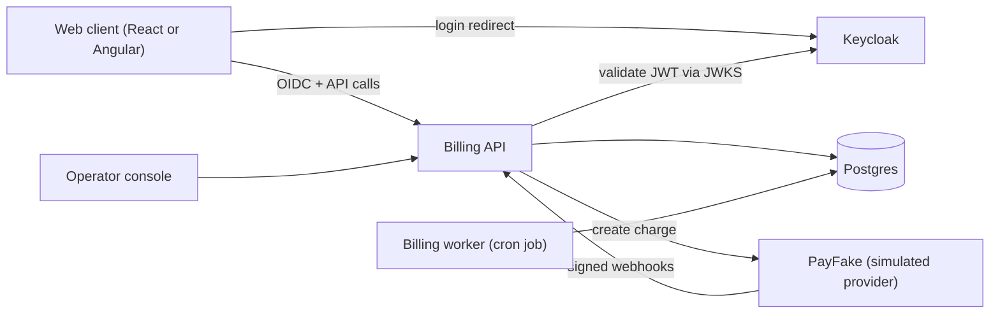
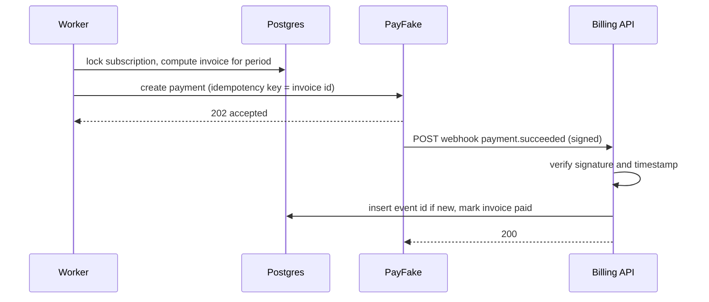

# Practice capstone: Multi-tenant SaaS with subscriptions and metered billing

| Field | Value |
|-------|-------|
| Id | P05-multi-tenant-saas-billing |
| Level | 301 |
| Sprint length | 8 weeks (about 10 to 12 hours per week) |
| Prerequisites | databases-101 (06 keys, 10 transactions, 11 indexes), docker-101 (06 networks and compose, 08 two-service project), one backend track at 101 (python-101, csharp-101, go-101 or rust-101, lesson 12 each) and web-101 (12 personal page). Planned and recommended before you start: the 201 backend of your choice, Databases 201 and the Keycloak chapter of a built capstone |
| Suggested stacks | (A) Python + FastAPI + SQLAlchemy + React; (B) ASP.NET Core + FastEndpoints + EF Core + Angular; (C) Go + chi + pgx + React |
| Last updated | 2026-11-23 |

## 1. The brief

**Client:** *LumenDesk Ltd*, a six-person company that sells a shared inbox and ticketing tool to small shops and clinics. Today every
customer is a separate hand-built install, billing is a spreadsheet, and last month a support agent at one customer saw another customer's
tickets after a copy-paste mistake. LumenDesk wants one platform where many customer companies (**tenants**) share the same running system, are
strictly isolated from each other, subscribe to a **plan**, are billed monthly for a flat fee plus **metered usage**, and receive a correct invoice.

**Who uses it:**

- Tenant staff (owner, billing admin, agent) sign in and manage their own company's subscription, members and invoices.
- LumenDesk operators (platform admins) see every tenant, suspend a tenant and read the audit log, but never read a tenant's tickets.
- A **payment provider** takes the money. You do not integrate a real one: you build a small simulator ("PayFake") that behaves like one,
  including slow answers, duplicate webhooks, out-of-order webhooks and bad signatures.

**What you have at the end (demoable):** a running system where two tenants cannot see each other's data (proved by automated checks that
try to cheat), a plan change with proration, a month-end billing run that produces invoices from recorded usage, payment webhooks that are
verified and idempotent, and an audit trail you can query. You also have an ADR that explains why you chose your isolation strategy.

## 2. Goals and non-goals

**Learning goals**

- Compare and choose a tenant isolation strategy (shared tables with a tenant id and Postgres row-level security, schema per tenant, database per tenant) and defend the choice with evidence.
- Model subscriptions, plans, usage records and invoices so that money is always correct (integer minor units, no float).
- Make every write that touches money **idempotent** (client retries, webhook redelivery, double-clicks).
- Verify webhook signatures and reject replays.
- Design identity for a multi-tenant system and understand the Keycloak trade-offs (realm per tenant, one realm with Organizations).
- Keep an append-only audit log and use it to explain who did what, when, and for which tenant.

**Non-goals**

- No real payment provider, card data or PCI scope. Never store card numbers, even fake ones that look real.
- No tax engine (use one flat tax rate per tenant country, stored as data).
- No ticketing features. The "product" is a stub: one endpoint that records a usage event ("ticket created").
- No Kubernetes, no multi-region, no autoscaling.

## 3. Users and scenarios

| Persona | Description |
|---------|-------------|
| Olivia, tenant owner | Runs a dental clinic, signs the company up, picks a plan, adds colleagues |
| Ben, billing admin | Tenant staff who downloads invoices and updates the payment method |
| Aisha, agent | Tenant staff who only creates tickets (usage); must not see billing |
| Marta, platform operator | LumenDesk employee: suspends non-paying tenants, reads audit, never sees ticket content |
| PayFake | The simulated payment provider, a machine client |

| Id | Story |
|----|-------|
| S1 | As Olivia, I want to sign my company up on the Free plan, so that I can try the product with no card. |
| S2 | As Olivia, I want to upgrade to Team in the middle of the month and be charged only for the rest of the month, so that I pay fairly. |
| S3 | As Aisha, I want ticket creation to keep working at the plan limit with a clear warning, so that my customers are not blocked. |
| S4 | As Ben, I want a monthly invoice with the flat fee, the metered usage, tax and a total I can reconcile, so that my accountant is happy. |
| S5 | As Ben, I want a failed payment to retry and then move the account to "past due", so that nothing is lost silently. |
| S6 | As Marta, I want to suspend a tenant and see every action taken on that tenant, so that I can answer disputes. |
| S7 | As Olivia, I want to be sure another clinic can never see my data, so that I can trust the product. |
| S8 | As a developer, I want webhooks delivered twice or out of order to leave the system in the same final state, so that billing is correct. |

## 4. Requirements

| Id | Requirement | Priority | Acceptance criteria |
|----|-------------|----------|---------------------|
| R-01 | Sign-up creates a tenant, an owner and a Free subscription in one transaction | Must | Given a new email, when sign-up is called, then exactly one tenant, one owner membership and one subscription exist; a forced failure after the tenant insert leaves zero rows |
| R-02 | Every business table is tenant-scoped and isolated by the database, not only by application code | Must | Given tenants A and B with data, when a request authenticated for A reads any table with a raw SQL call using the application role and no tenant filter in the query, then only A's rows come back |
| R-03 | Tenant context comes from the validated token, never from a client-supplied header, path or body field | Must | Given a token for A, when the client sends `X-Tenant-Id: B` or B's id in the body, then the response is 403 or the header is ignored, and the audit log records the attempt |
| R-04 | Plans are data: name, flat monthly price, included usage, overage unit price, currency | Must | Given a plan row change, when the next invoice is generated, then it uses the new price for new subscriptions only; existing subscriptions keep their price until renewal |
| R-05 | Usage events are recorded with an idempotency key | Must | Given the same event key sent 50 times in parallel, then exactly one usage record exists and every call returns the same response |
| R-06 | Plan upgrade and downgrade with proration | Must | Given an upgrade on day 11 of a 30-day period, then the invoice has a credit line for the unused old plan and a charge line for the remaining days of the new plan; amounts are integers and the sum equals the total |
| R-07 | Month-end billing run produces one invoice per active subscription and is safe to re-run | Must | Given the run executed twice for the same period, then each subscription has exactly one invoice for that period |
| R-08 | Invoice lines and totals are computed from integer minor units with a documented rounding rule | Must | Given 1,000 randomised invoices, then the sum of lines plus tax equals the total with zero error |
| R-09 | Payment webhooks verify a signature over the raw body and a timestamp tolerance | Must | Given a valid signature, then 200; a changed body, wrong secret or a timestamp older than 5 minutes gives 401 and no state change |
| R-10 | Webhook processing is idempotent and tolerant to reordering | Must | Given `payment.succeeded` delivered twice, or before `invoice.finalized`, then the final invoice state is "paid" exactly once and no duplicate ledger entry exists |
| R-11 | Failed payments are retried on a schedule and end in "past due" then "suspended" | Should | Given three simulated failures, then the retry times follow the documented schedule and the tenant status changes with an audit entry each time |
| R-12 | Append-only audit log of security-relevant and money-relevant events | Must | Given any invoice, plan or membership change, then an audit row with actor, tenant, action, target, time and request id exists; the application role has no UPDATE or DELETE on the table |
| R-13 | Platform operators can suspend and resume a tenant without seeing tenant content | Must | Given a suspended tenant, then its users get 403 with a problem details body; operators get 403 on tenant ticket and usage detail endpoints |
| R-14 | Roles inside a tenant: owner, billing_admin, agent, with function-level checks | Must | Given an agent token, then every billing endpoint returns 403 |
| R-15 | Errors use RFC 9457 problem details | Should | Given any 4xx, then `Content-Type: application/problem+json` with `type`, `title`, `status`, `detail` |
| R-16 | Rate limits per tenant on usage and sign-up endpoints | Should | Given 200 sign-ups per minute from one address, then 429 with `Retry-After` after the limit; a noisy tenant does not slow another tenant (measured) |
| R-17 | Tenant data export and deletion | Could | Given a deletion request, then within one job all tenant rows are removed or anonymised, invoices are kept in anonymised form for the legal period, and the audit log records the job |
| R-18 | Tenant dashboard: current plan, usage so far, forecast, invoices | Should | Given recorded usage, then the dashboard shows usage within 5 seconds of the event and a forecast that matches the billing run within 1 unit |

**Non-functional requirements**

| Id | Requirement | Target |
|----|-------------|--------|
| N-01 | Usage ingest latency | p95 under 100 ms at 50 requests per second on the author laptop |
| N-02 | Billing run | 5,000 simulated subscriptions in under 60 seconds |
| N-03 | Isolation regression suite | Runs in under 30 seconds and fails the build if any cross-tenant read succeeds |
| N-04 | Secrets | No secret in git; webhook secrets and database passwords come from environment variables |
| N-05 | Time | All timestamps stored in UTC (`timestamptz`); billing periods defined in UTC and documented |

## 5. Suggested architecture

**Components**

| Component | Responsibility |
|-----------|----------------|
| Billing API | Tenants, members, plans, subscriptions, usage, invoices, webhook receiver |
| Billing worker | Month-end run, payment retries, usage rollups; a separate process or a scheduled command that shares the code |
| PayFake | Small HTTP service you write: create payment, controllable outcomes, signed and sometimes duplicated or delayed webhooks |
| Keycloak | Identity provider (Docker, temporary) |
| Postgres | One database; the isolation strategy is your decision |
| Web client | Tenant dashboard and operator console, two small areas |

**Decisions you must make and write down as ADRs (one page each)**

1. **Isolation strategy.** Compare three options and pick one, with a measured argument.

| Option | Strength | Cost |
|--------|----------|------|
| Shared tables + `tenant_id` + row-level security | Cheapest to operate, easy migrations, cross-tenant reporting for operators | One missed policy or one superuser connection leaks everything; noisy neighbours |
| Schema per tenant | Strong logical separation, per-tenant backup possible | Migrations multiply by tenant count; connection and catalog overhead grows |
| Database per tenant | Strongest isolation and per-tenant restore | Highest operational cost; cross-tenant jobs are hard |

2. **How the database learns the tenant** (for example a transaction-local setting written at the start of every transaction and read by policies). Decide what happens with connection pooling, because a session-level setting can leak between requests.
3. **Money model:** integer minor units, one currency per tenant, rounding rule, and where proration is computed.
4. **Identity model:** Keycloak realm per tenant versus one realm with Organizations versus tenant claims only (section 8).
5. **Who triggers billing:** a cron-like worker versus an internal HTTP endpoint; how to make a run restartable.
6. **Webhook handling:** store the raw event first and process later, or process inline.

## 6. Data model starting point

Entities only. You design columns, types, constraints, indexes and the RLS policies.

| Entity | Notes |
|--------|-------|
| Tenant | Company, status (active, past_due, suspended, deleted), country, currency, tax rate reference |
| User | Identity reference (the Keycloak `sub`), not a password |
| Membership | User in a tenant with a role |
| Plan | Versioned; an old version is never edited after it has subscribers |
| Subscription | Tenant, plan version, period start and end, status, pending change |
| UsageEvent | Tenant, metric, quantity, occurred at, idempotency key |
| UsageRollup | Per tenant, metric and day, for fast dashboards |
| Invoice | Tenant, period, status (draft, open, paid, void, uncollectible), totals |
| InvoiceLine | Description, quantity, unit amount, amount, kind (flat, usage, proration, tax) |
| Payment | Attempt against an invoice, provider reference, result |
| WebhookEvent | Provider event id, raw body, received at, processed at, outcome |
| IdempotencyRecord | Key, request fingerprint, stored response |
| AuditEntry | Append-only |
| LedgerEntry (stretch) | Double-entry view of money movements |

Key relationships: a Tenant has many Memberships, Subscriptions (one active), UsageEvents and Invoices; an Invoice has many InvoiceLines and Payments;
a WebhookEvent maps to at most one Payment outcome. Decide which tables are tenant-scoped and which are global (Plan is global, WebhookEvent is
global until matched to a tenant). Justify each.

## 7. API or interface sketch

Write the contract first (OpenAPI 3.1) and generate or hand-write clients from it.

| Resource | Operations | Who |
|----------|------------|-----|
| `/signup` | POST create tenant, owner and Free subscription | anonymous with rate limit |
| `/tenant` | GET own tenant; PATCH name, billing email | owner, billing_admin |
| `/tenant/members` | GET, POST invite, DELETE remove | owner |
| `/plans` | GET list | any signed-in user |
| `/subscription` | GET; POST `/change` with target plan and `Idempotency-Key` | owner, billing_admin |
| `/usage` | POST record event with `Idempotency-Key`; GET summary for period | agent and above (POST), billing_admin (GET detail) |
| `/invoices` | GET list; GET one; GET text export | owner, billing_admin |
| `/payment-method` | PUT simulated token from PayFake | billing_admin |
| `/webhooks/payfake` | POST receiver | PayFake only (signature, no token) |
| `/operator/tenants` | GET list; POST `/{id}/suspend`, `/{id}/resume` | platform operator |
| `/operator/audit` | GET filtered by tenant, actor, action, date | platform operator |
| `/healthz` | GET | anonymous |

Conventions to apply: `Idempotency-Key` header on non-idempotent POSTs (this header is described in an IETF Internet-Draft, not yet an RFC:
use it as a convention and document your exact behaviour: same key with the same body returns the stored response, same key with a different body returns 422),
cursor pagination, RFC 9457 problem details, `ETag` or version fields for optimistic concurrency on subscription changes.

PayFake contract (you design it): `POST /payments` (amount, currency, idempotency key, metadata), `GET /payments/{id}`, a control endpoint to force outcomes
(succeed, fail, delay, duplicate, reorder), and the webhook delivery with a signature header over `timestamp.body`.

## 8. Security and identity

**What is protected:** other tenants' data (the top risk), invoices and amounts, payment webhooks (an attacker who forges one could mark invoices paid),
operator powers, the audit log, secrets.

**Roles and scopes** (design the exact claims yourself)

| Actor | Role | Can | Cannot |
|-------|------|-----|--------|
| Tenant owner | `owner` | Everything inside own tenant | Anything in another tenant, operator endpoints |
| Billing admin | `billing_admin` | Subscription, invoices, payment method | Manage members |
| Agent | `agent` | Record and read own usage | Billing endpoints |
| Platform operator | `platform_operator` | Suspend, resume, read audit and tenant list | Read ticket or usage detail |
| PayFake | none (signature) | Call the webhook receiver | Anything else |

**Keycloak trade-offs to analyse in an ADR** (read the Keycloak Server Administration guide, "Managing organizations", and the production configuration guide):

| Option | For | Against |
|--------|-----|---------|
| Realm per tenant | Per-tenant users, identity providers, branding, password policy and sessions; strongest identity isolation | Each realm has its own issuer and keys, so the API must trust many issuers and validate the issuer against a known list; provisioning and upgrades scale with the tenant count; admin overhead |
| One realm with Organizations | One issuer, one set of keys, one login flow; organisations group members and can link to their own identity provider and email domain | Realm-wide settings are shared by all tenants; check which features exist in your Keycloak version before relying on them |
| One realm, tenant id as a user attribute or group | Simplest | Easy to get wrong; the claim must be mapped and trusted only from the token, and users in two tenants are awkward |

Whatever you choose: validate issuer, audience, expiry and signature on every request (OpenID Connect Core and JWT, RFC 7519 <https://www.rfc-editor.org/rfc/rfc7519>), treat the tenant claim
as the only source of tenant context, use authorization code flow with PKCE (RFC 7636) for the web client, keep tokens out of local storage if you can
(a backend-for-frontend or in-memory tokens), and decide how a user who belongs to two tenants chooses the active one.

**OWASP API Security Top 10 (2023) items that matter here**

| Item | Where it bites you | Your control |
|------|--------------------|--------------|
| API1 Broken Object Level Authorization | `/invoices/{id}` with another tenant's id | RLS plus an ownership test for every id-taking endpoint |
| API2 Broken Authentication | Token validation mistakes, weak operator access | Strict JWT checks, short token life, operator MFA in Keycloak |
| API3 Broken Object Property Level Authorization | Mass assignment on `PATCH /tenant` (status, plan price) | Explicit request DTOs, never bind the entity |
| API4 Unrestricted Resource Consumption | Usage flood, huge export | Per-tenant rate limits, body size limits, pagination caps |
| API5 Broken Function Level Authorization | An agent calls billing, a tenant calls operator routes | Role checks per endpoint, deny by default |
| API6 Unrestricted Access to Sensitive Business Flows | Automated sign-ups to farm the free plan | Sign-up rate limit, email verification |
| API8 Security Misconfiguration | Application connecting as the table owner or a superuser, which bypasses row security | Least-privilege role without BYPASSRLS, `FORCE ROW LEVEL SECURITY` decision documented |
| API9 Improper Inventory Management | Old plan or webhook versions left reachable | Versioned routes, an endpoint inventory in the README |
| API10 Unsafe Consumption of APIs | Trusting webhook content | Signature, timestamp tolerance, schema validation, replay protection by event id |

Postgres note you must test, not assume: row security does not apply to superusers, to roles with `BYPASSRLS`, and by default not to the table owner;
`TRUNCATE` and `REFERENCES` are not subject to it either. Design your roles and migrations so the runtime role is none of these.

## 9. Sprint plan

| Week | Phase | Deliverables | Exit criteria |
|------|-------|--------------|---------------|
| 1 | Walking skeleton (R-01, R-15, N-04) | Repo, Compose with Postgres and Keycloak, health endpoint, sign-up creating tenant, owner and Free subscription, first two ADRs drafted (isolation, money) | `docker compose up` then one sign-up call works; killing the sign-up mid-way leaves no partial rows |
| 2 | Isolation (R-02, R-03, R-14, N-03) | Tenant-scoped tables, chosen isolation strategy, runtime database role, tenant context per request, cross-tenant attack test suite | The "cheating" suite passes: 20 attempts (header, path, body, SQL without filter, pooled connection reuse) all fail to read tenant B |
| 3 | Identity (R-03, R-13, R-14) | Keycloak setup per your ADR, JWT validation, roles, operator access, suspend and resume | Agent token gets 403 on billing; suspended tenant gets a problem details 403; token with wrong issuer or audience is rejected |
| 4 | Plans and usage (R-04, R-05, R-16, N-01) | Plan versions, subscription state, usage ingestion with idempotency, rollups, rate limit | 50 parallel identical usage calls create one row; p95 target measured and written down |
| 5 | Invoices and proration (R-06, R-07, R-08, N-02) | Plan change with proration, billing run, invoice lines, rounding rule, property-style test with random invoices | Billing run twice gives one invoice per subscription; 1,000 random invoices reconcile to zero error |
| 6 | PayFake and webhooks (R-09, R-10) | PayFake service, signature verification on raw body, event store, idempotent processor | Duplicate, delayed, reordered and forged webhooks all end in the correct final state (a table of 8 cases in your README) |
| 7 | Dunning, audit, dashboard (R-11, R-12, R-18, R-17 if time) | Retry schedule, past_due and suspended transitions, append-only audit, tenant dashboard and operator console | Three forced failures produce the documented transitions and audit rows; app role cannot UPDATE the audit table (shown with a failing statement) |
| 8 | Hardening and demo | OWASP walk-through table, backup and restore of the database, README, final ADRs, demo script, load check | Demo runs from a clean clone with one command sequence; every Must requirement has a passing check or a documented gap |

Plan about two hours each week to write tests and notes; the grading rewards them.

## 10. Verification

Verification here follows the Code101 rule: **smoke checks only, Docker temporary and cleaned up**. Your own test suites are part of the deliverable, but the
smoke script below is what proves the environment works from a clean clone.

**Smoke checklist (script it, one command)**

1. Start the stack under a throwaway name: `docker compose -p p05-smoke up -d --wait`. Publish no fixed host ports that other Code101 labs use (5432, 8080, 8081, 5173, 4200, 11434); use for example 55432 for Postgres and 8180 for Keycloak, or do not publish Postgres at all.
2. `GET /healthz` returns 200.
3. Sign up tenant A and tenant B; record one usage event in A; read it as A (200) and as B by id (404 or 403).
4. Send one signed webhook (valid) and one forged webhook (invalid); expect 200 and 401.
5. Run the billing run twice and count invoices (must be equal).
6. Always clean up, even on failure: `docker compose -p p05-smoke down -v --remove-orphans`, then confirm `docker ps -a` and `docker volume ls` show nothing with the `p05-smoke` prefix.

**Demo script (15 minutes):** sign up two tenants, show the cheating suite failing to cross over, upgrade mid-period and show the proration lines, run billing,
replay a duplicate webhook and show one ledger entry, suspend a tenant as operator, show the audit trail, show the ADRs.

**What to measure and record in the README:** usage ingest p95 and throughput (N-01), billing run time for 5,000 subscriptions (N-02), isolation suite run time (N-03),
and the cost of your isolation choice (for example migration time with 50 schemas, or query plans with and without policies).

## 11. Grading rubric

| Criterion | Weight | Beginner (1) | Solid (3) | Excellent (5) |
|-----------|--------|--------------|-----------|---------------|
| Correctness of money | 20% | Floats, totals drift, re-run duplicates invoices | Integer units, reconciles, re-run safe | Property-based reconciliation, documented rounding, ledger view |
| Tenant isolation | 20% | Filters only in application code | Row security or schema isolation with a runtime role that cannot bypass it | Attack suite in CI, pooling leak tested, ADR with measured trade-offs |
| Identity and security | 15% | Tenant id from a header, loose token checks | Validated tokens, roles, OWASP table filled | Operator separation, webhook replay defence, threat notes, secrets handled |
| Idempotency and webhooks | 15% | Duplicates create duplicates | Keys and event ids de-duplicate | Concurrency tested, out-of-order proven, stored raw events replayable |
| Design and ADRs | 10% | No decisions recorded | Four ADRs with options and consequences | ADRs cite sources and measurements and were revised when evidence changed |
| Tests | 10% | A few unit tests | Integration tests for every Must | Tests are the spec: names map to R-ids, run in under 2 minutes |
| Operations | 5% | Works on author machine only | Compose, health checks, smoke script, clean teardown | Backup and restore proven, structured logs with tenant and request id |
| Documentation and polish | 5% | Missing README | README, diagrams, demo script | As-built notes, known gaps, honest limitations |

Passing is 60% of the weighted score; 85% or more is a portfolio-grade result.

## 12. Stretch goals

Ranked from easiest to hardest.

1. Add a CSV export of invoices with correct escaping and a tenant filter (and test for CSV injection in tenant-supplied fields).
2. Per-tenant feature flags driven by the plan (for example SMS notifications only on Business).
3. Annual billing with a discount and a mid-year change.
4. Coupon codes with limits per tenant and a fraud check on redemption counts.
5. A double-entry ledger table and a report proving that debits equal credits for the month.
6. Schema-per-tenant version of the same system behind an interface, with a benchmark comparing it to row-level security.
7. Tenant-specific identity providers using Keycloak Organizations and identity brokering for one demo tenant.
8. Credit notes and refunds that never edit a finalised invoice.
9. Tenant data export and deletion with a verified checklist, then a restore test showing the deleted tenant stays deleted.
10. OpenTelemetry traces across API, worker and PayFake with the tenant id as a span attribute (never as a metric label with unbounded values).

## 13. Hints and pitfalls

**Traps**

- **Pooling and tenant context.** A session-level setting survives on a reused pooled connection. Prefer a transaction-scoped setting and assert it is reset.
- **Owner and superuser bypass.** Developing as the `postgres` user makes every isolation test pass for the wrong reason. Test as the runtime role only.
- **Signature on parsed JSON.** Verify the HMAC over the raw bytes you received, not over re-serialised JSON; compare with a constant-time function.
- **Check-then-insert idempotency.** Two parallel requests both pass the check. Use a unique constraint and handle the conflict.
- **Floats and time zones.** Store money as integers; a month is not always 30 days; daylight saving time must not move a billing boundary (use UTC).
- **Editing finalised invoices.** Correct by adding a credit line to the next invoice or a credit note.
- **Ids in URLs.** Sequential ids invite guessing; use random identifiers and still enforce ownership.
- **Logging secrets.** Webhook secrets and tokens must never appear in logs.

**Where to look in Code101**

| Need | Lesson |
|------|--------|
| Transactions, atomic sign-up | databases-101 lesson 10 |
| Keys, constraints, unique indexes for idempotency | databases-101 lessons 06 and 09 |
| Indexes and reading EXPLAIN for policy cost | databases-101 lesson 11 |
| Compose, networks, healthchecks, teardown | docker-101 lessons 06, 07, 08 |
| Environment variables and secrets | docker-101 lesson 05 |
| Errors, structs and packages for your backend | python-101, csharp-101, go-101 or rust-101 lessons 09 to 11 |
| Forms, fetch and the DOM for the client | web-101 lessons 03, 08, 09 |
| Planned: Keycloak, API craft, outbox and observability chapters | Built capstones and level 201 and 301 tracks (not yet written) |

**Tier 1 references**

- PostgreSQL: Row Security Policies <https://www.postgresql.org/docs/current/ddl-rowsecurity.html>, CREATE POLICY <https://www.postgresql.org/docs/current/sql-createpolicy.html>, Table Partitioning <https://www.postgresql.org/docs/current/ddl-partitioning.html>, INSERT ... ON CONFLICT <https://www.postgresql.org/docs/current/sql-insert.html>
- Keycloak Server Administration guide ("Managing organizations") <https://www.keycloak.org/docs/latest/server_admin/index.html#_managing_organizations>; production configuration <https://www.keycloak.org/server/configuration-production>
- OpenID Connect Core <https://openid.net/specs/openid-connect-core-1_0.html>; PKCE RFC 7636 <https://www.rfc-editor.org/rfc/rfc7636>; OAuth 2.0 RFC 6749 <https://www.rfc-editor.org/rfc/rfc6749>
- RFC 9457 Problem Details <https://www.rfc-editor.org/rfc/rfc9457>; OpenAPI 3.1 <https://spec.openapis.org/oas/v3.1.0>
- Idempotency-Key header Internet-Draft <https://datatracker.ietf.org/doc/draft-ietf-httpapi-idempotency-key-header/> (a draft, may change)
- OWASP API Security Top 10 2023 <https://owasp.org/API-Security/editions/2023/en/0x11-t10/>; OWASP Multi-Tenant Security Cheat Sheet <https://cheatsheetseries.owasp.org/cheatsheets/Multi_Tenant_Security_Cheat_Sheet.html>
- Webhook signing as a real-world model (not a standard): Stripe, "Verify webhook signatures manually" <https://docs.stripe.com/webhooks#verify-manually>

## 14. Deliverables checklist

- [ ] Repository with a README: what it is, how to run, system diagram (Mermaid), how to run the smoke script and the full test suite
- [ ] OpenAPI 3.1 file for the Billing API and a short PayFake contract
- [ ] Four or more ADRs (isolation strategy, identity model, money and proration, webhook handling), each with options, decision, consequences and sources
- [ ] Database migrations, runtime role definition and every row security policy, with a one-paragraph explanation of what each policy blocks
- [ ] Cross-tenant attack test suite and its latest result
- [ ] Billing run reconciliation test and webhook case table (8 or more cases)
- [ ] OWASP API Top 10 table filled in with evidence (test name or file) per row
- [ ] Smoke script that starts Docker under a throwaway project name and always cleans up
- [ ] Measurements: N-01, N-02, N-03 and the cost of your isolation choice
- [ ] Your own as-built notes: what you changed from this TDD and why, known gaps, and what you would do next
- [ ] Demo recording or a 15-minute live demo following the demo script
