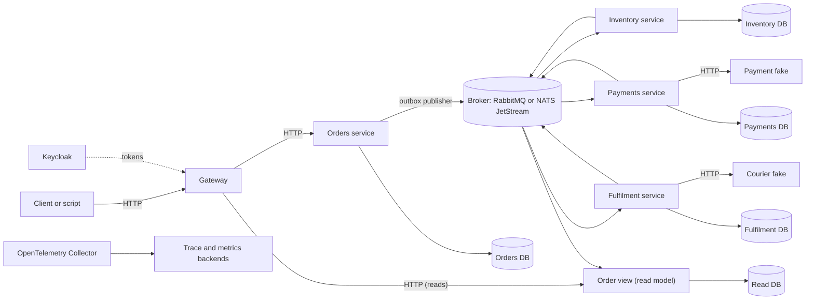
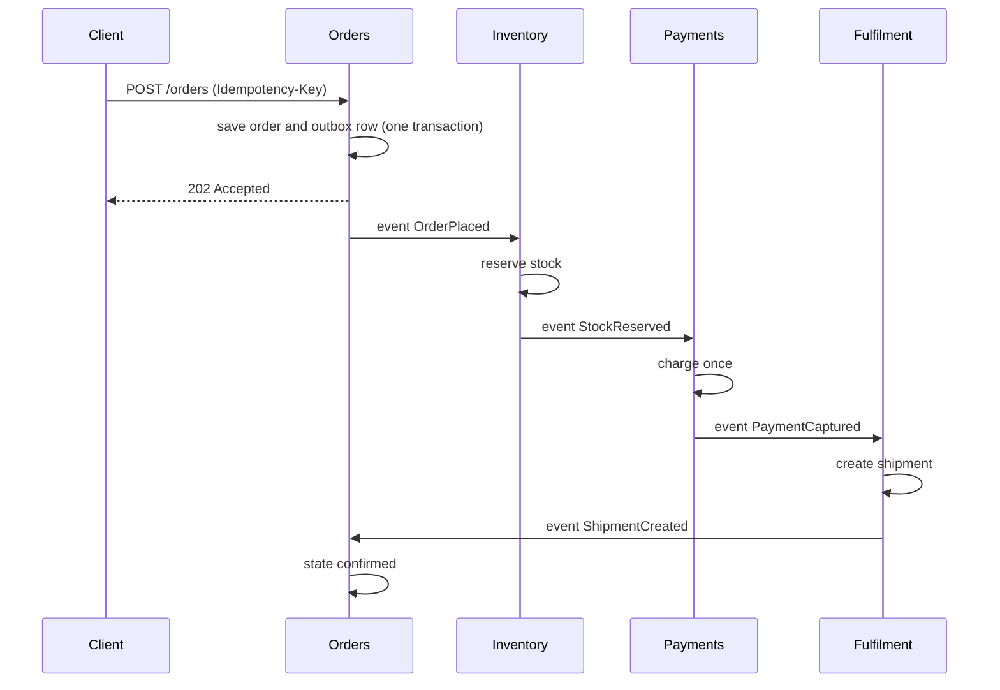

# Practice capstone: Event-driven order processing (microservices)

| Field | Value |
|-------|-------|
| Id | P07-event-driven-order-processing |
| Level | 301 |
| Sprint length | 12 weeks, the longest practice sprint (about 10 to 12 hours per week, 3 months) |
| Prerequisites | docker-101 (all 8 lessons, especially 06 networks and compose, 07 healthchecks and cleanup, 08 two-service project), databases-101 (06, 10 transactions, 11 indexes), one backend track at 101 (lesson 12 project) and strongly recommended its 201 level (HTTP APIs, database access, auth basics) and 301 concurrency lessons when they exist (planned) |
| Suggested stacks | (A) ASP.NET Core + FastEndpoints + RabbitMQ; (B) Go + chi + NATS JetStream; (C) Python + FastAPI + RabbitMQ (or one language for most services and a second for one service to prove the contracts work) |
| Last updated | 2026-11-23 |

## 1. The brief

**Client:** *Saltmarsh Outfitters*, an online shop for outdoor gear. Today one big application takes orders, reserves stock, charges the card
and books the courier inside one database transaction. During last winter's sale the courier API was slow, the whole checkout froze, stock was
reserved twice for the same pair of boots and about 40 orders were charged but never shipped. The team wants to split the system into small
services that talk through events, so that one slow or broken part cannot stop the others, and so that every order always ends in a **clear final
state**: confirmed, or cancelled with the money and stock put back.

**What you build:** a gateway and four services (Orders, Inventory, Payments, Fulfilment) connected by a message broker, plus a read model for
fast order lookups. The payment provider and the courier are simulated by small fakes you control, so you can make them slow, wrong or
duplicate on purpose. You then prove the system survives that with **chaos drills** and write down what you learned.

**What you have at the end (demoable):** one `docker compose` command starts everything; a script places 1,000 orders while you kill services,
restart the broker and inject duplicate messages; afterwards a checker proves that no order is lost, no stock is oversold, no card is charged twice
and every order is in a final state. A trace shows one order travelling through every service. Contract tests fail when a producer changes a message in an incompatible way.

## 2. Goals and non-goals

**Learning goals**

- Decompose by business capability and decide service boundaries and data ownership (one database or schema per service, no shared tables).
- Use a broker correctly: durable queues or streams, publisher confirms or acknowledgements, consumer acks, retries, dead-letter handling.
- Solve the dual-write problem with the **transactional outbox** and consume safely with **idempotent consumers** (inbox table or natural keys).
- Coordinate a distributed business process with a **saga**, including compensation, and compare choreography with orchestration.
- Build a **CQRS** read model fed by events and reason about eventual consistency and rebuilds.
- Make the system observable with **OpenTelemetry** traces, metrics and correlated logs across HTTP and messaging.
- Add resilience (timeouts, retries with backoff and jitter, circuit breaker, bulkheads, backpressure) and prove it by experiment.
- Write and keep **ADRs**, contract tests and a runbook.

**Non-goals**

- No Kubernetes, service mesh, multi-region or cloud deployment (Compose only).
- No real payment, courier or email providers; no card data of any kind.
- No product catalogue, search or storefront UI beyond a minimal page or CLI to place and view orders.
- No exactly-once delivery claims: you design for at-least-once delivery plus idempotency and explain why.

## 3. Users and scenarios

| Persona | Description |
|---------|-------------|
| Chloe, customer | Places an order and checks its status |
| Dev, warehouse operator | Sees which orders are ready to pack and marks them shipped |
| Sana, support agent | Looks up any order and its history, can cancel a not-yet-shipped order |
| Ola, on-call engineer | Gets paged, follows a trace, finds the stuck message, replays it |
| Payment fake and courier fake | Machine participants you control |

| Id | Story |
|----|-------|
| S1 | As Chloe, I want my order accepted instantly and its status to update by itself, so that I do not wait on slow partners. |
| S2 | As Chloe, I want to be charged once and told clearly if an item sold out, so that I can trust the shop. |
| S3 | As the business, I want stock never oversold under heavy parallel orders, so that we do not disappoint customers. |
| S4 | As Sana, I want one fast screen with an order's current state and full timeline, so that I can answer calls in seconds. |
| S5 | As Sana, I want to cancel an order before shipping and have payment refunded and stock released, so that cancellation is safe. |
| S6 | As Dev, I want to see only orders that are paid and reserved and ready for packing, so that I never ship unpaid goods. |
| S7 | As Ola, I want one trace id that follows an order across all services and the broker, so that I find failures fast. |
| S8 | As a developer, I want a failing contract test when I change an event incompatibly, so that I find out before production. |

## 4. Requirements

| Id | Requirement | Priority | Acceptance criteria |
|----|-------------|----------|---------------------|
| R-01 | Gateway is the only public entry; services are not reachable from the host | Must | Given the stack is up, then only the gateway port is published; a direct call to a service port from the host fails |
| R-02 | `POST /orders` is accepted fast and idempotent | Must | Given the same `Idempotency-Key` sent 20 times in parallel, then one order exists and every response has the same order id; response is 202 with a status URL within 150 ms p95 |
| R-03 | Orders service writes order state and an outbox row in one local transaction | Must | Given the broker is down, when 100 orders are placed, then all 100 orders exist, 100 outbox rows are unpublished, and after the broker returns all 100 events are confirmed by the broker and marked sent (a retry may deliver a duplicate, which consumers must ignore) |
| R-04 | Outbox publisher uses publisher confirms (RabbitMQ) or JetStream acknowledgements (NATS) | Must | Given a broker restart during publishing, then no outbox row is marked sent before a confirm, and no event is lost |
| R-05 | Every consumer is idempotent | Must | Given each message type delivered 3 times and in swapped order in a test, then database state equals the state after a single delivery |
| R-06 | Inventory reserves stock without overselling | Must | Given 200 parallel orders for 50 units, then exactly 50 reservations succeed and 150 get an out-of-stock outcome; stock never goes negative |
| R-07 | Payments charge once per order and handle fake provider failures | Must | Given the fake provider times out then succeeds, or reports duplicates, then exactly one charge per order is recorded |
| R-08 | Order saga reaches a final state for every order | Must | Given the failure matrix in section 10 (at least 8 cases), then every order ends in `confirmed` or `cancelled` within 60 seconds of faults ending, with compensation applied |
| R-09 | Cancellation compensates | Must | Given a paid and reserved order cancelled before shipping, then payment is refunded once and stock released once |
| R-10 | Fulfilment prepares shipment only for paid and reserved orders and calls a slow courier fake safely | Must | Given courier latency of 10 seconds, then Orders is unaffected, and the shipment is eventually created once |
| R-11 | CQRS read model for order lookups | Must | Given 1,000 orders, then `GET /orders/{id}` and `GET /orders?customer=` are served from the read model with p95 under 50 ms; dropping the read model and replaying events rebuilds an identical result |
| R-12 | Read model lag is observable | Should | Given a burst of 500 orders, then a metric reports projection lag and p95 lag is under 1 second at 20 orders per second |
| R-13 | Poison messages go to a dead-letter destination with context | Must | Given a malformed message, then it is retried a bounded number of times, moved to a dead-letter queue or stream with reason and trace id, and consumers keep working |
| R-14 | Tracing across HTTP and the broker with W3C trace context | Must | Given one order, then a single trace shows gateway, Orders, outbox publish, consumers in Inventory, Payments and Fulfilment, and the final state change |
| R-15 | Metrics and structured logs | Must | Given load, then each service exposes request rate, error rate, duration, queue depth or consumer lag, outbox backlog; logs are JSON with trace id and order id |
| R-16 | Timeouts, retries with backoff and jitter, and a circuit breaker on every outbound call | Must | Given the payment fake returns 500 for 30 seconds, then the breaker opens, calls fail fast, and recovery closes it; retry storms are absent (measured) |
| R-17 | Backpressure and bounded concurrency | Should | Given a consumer 10 times slower than the producer, then prefetch or max-in-flight limits keep memory flat and queue depth is visible |
| R-18 | Contract tests for HTTP and messages | Must | Given a producer renames a required event field, then the consumer contract test fails in CI before deployment; adding an optional field passes |
| R-19 | Event schemas are versioned and documented | Should | Given events v1 and v2 in flight, then consumers handle both; schemas are in an AsyncAPI or JSON Schema file |
| R-20 | Authentication at the gateway and between services | Must | Given a call without a valid token, then 401; a service-to-service call uses its own client identity, not the end user's token (or a documented exchange) |
| R-21 | Chaos drills documented and repeatable | Must | Given the drill scripts, then at least 6 drills run (kill service mid-saga, broker restart, duplicate flood, slow dependency, database pause, clock skew or delayed message) and each has an expected result and an observed result |
| R-22 | Whole system starts from one Compose file with healthchecks and ordered startup | Must | Given a clean clone, then `docker compose up -d --wait` brings every service to healthy in under 3 minutes on the author machine |
| R-23 | Audit timeline per order | Should | Given any order, then the read model lists each state change with time, service and event id |

**Non-functional requirements**

| Id | Requirement | Target |
|----|-------------|--------|
| N-01 | Throughput | 20 orders per second sustained for 5 minutes on the author laptop with no errors |
| N-02 | End-to-end confirmation time | p95 under 2 seconds at 20 orders per second with healthy fakes |
| N-03 | Recovery | After killing one service, the system returns to normal within 60 seconds of its restart, with the backlog drained |
| N-04 | Consistency checker | After every drill, a checker proves: no lost orders, no negative stock, no double charge, no order stuck in a non-final state |
| N-05 | Resources | Whole stack runs within 8 GB of memory; each container has a memory limit |
| N-06 | Image hygiene | Every service image runs as a non-root user and has a healthcheck |

## 5. Suggested architecture

**Components and ownership**

| Component | Owns | Notes |
|-----------|------|-------|
| Gateway | Routing, authentication, rate limits, request ids | No business logic |
| Orders | Order aggregate, saga state, outbox | Decides the final state |
| Inventory | Stock levels and reservations | Concurrency-sensitive |
| Payments | Charges and refunds, talks to the payment fake | Idempotent on order id |
| Fulfilment | Shipments, courier fake calls, notifications (a log line is enough) | Slow external dependency |
| Order view | Denormalised read model and timeline | Built only from events, can be rebuilt |
| Fakes | Payment and courier simulators with controllable faults | Small HTTP servers you write |
| Observability stack | OpenTelemetry Collector and one trace backend you choose | Temporary containers |

**Decisions you must make and record as ADRs (at least 8)**

1. Service boundaries and data ownership; what you refuse to share.
2. Broker choice: RabbitMQ (exchanges, queues, quorum queues, publisher confirms, consumer acknowledgements, dead-letter exchanges) versus NATS JetStream (streams, durable consumers, explicit acks, redelivery, replay). Consider ordering, replay for rebuilding the read model, operational complexity.
3. Saga style: choreography (events only) versus orchestration (Orders drives steps with commands). Where does the timeout live? Who decides compensation?
4. Outbox implementation: polling publisher versus change data capture (CDC is a stretch goal); batching, ordering per aggregate, cleanup.
5. Idempotent consumer technique: inbox table with unique message id, natural business keys, or both.
6. Message format and schema evolution rules (JSON with a `schema_version`, JSON Schema or AsyncAPI, additive changes only).
7. Read model storage and rebuild strategy.
8. Resilience policy per call: timeout values, retry count, backoff, breaker thresholds, and where retries are forbidden.
9. Service-to-service identity and token strategy.
10. Observability: what is a metric, what is a log, what is a span, and which labels are forbidden (unbounded values such as order id as a metric label).

## 6. Data model starting point

Entities only; each service has its own storage and no service reads another's tables.

| Service | Entities |
|---------|----------|
| Orders | Order, OrderLine, OrderStatusHistory, SagaInstance (if orchestrated), OutboxMessage, IdempotencyRecord |
| Inventory | StockItem, Reservation, ReservationLine, InboxMessage, OutboxMessage |
| Payments | Payment, Refund, ProviderCall, InboxMessage, OutboxMessage |
| Fulfilment | Shipment, ShipmentLine, CourierCall, InboxMessage, OutboxMessage |
| Order view | OrderSummary, OrderTimelineEntry, ProjectionCheckpoint |
| Cross-cutting | DeadLetterRecord (optional, if you store failures yourself) |

Key relationships and prompts: an Order has many lines and one saga state; a Reservation references an order id but not an Orders row (no cross-service foreign keys);
every outgoing event has a stable id, a type, a version, a producer, a timestamp, a correlation id and a trace context; decide the order states and which events cause which transitions,
and draw the state machine (Mermaid `stateDiagram-v2`) as part of your deliverables.

## 7. API or interface sketch

**Public HTTP API (through the gateway)**

| Operation | Notes |
|-----------|-------|
| `POST /orders` | Body: customer reference, lines (sku, quantity). `Idempotency-Key` required. 202 with `Location` |
| `GET /orders/{id}` | From the read model: state and timeline |
| `GET /orders?customer=&status=` | Cursor pagination |
| `POST /orders/{id}/cancel` | Idempotent; 202 or 409 if already shipped |
| `GET /warehouse/ready` | Fulfilment queue for operators |
| `POST /warehouse/shipments/{id}/shipped` | Operator action |
| `GET /healthz`, `GET /readyz` | Per service; readiness includes broker and database |
| Errors | RFC 9457 problem details everywhere |

**Events** (names are suggestions; define each payload and schema version)

| Event | Producer | Consumers |
|-------|----------|-----------|
| OrderPlaced | Orders | Inventory, Order view |
| StockReserved, StockRejected | Inventory | Payments, Orders, Order view |
| PaymentCaptured, PaymentFailed | Payments | Fulfilment, Orders, Order view |
| ShipmentCreated, ShipmentFailed | Fulfilment | Orders, Order view |
| OrderConfirmed, OrderCancelled | Orders | Inventory (release), Payments (refund), Order view |
| RefundCompleted, StockReleased | Payments, Inventory | Orders, Order view |

Fakes: payment fake and courier fake expose an HTTP API plus a control endpoint that sets the mode (ok, slow N seconds, error rate N%, duplicate responses, timeout) so drills are scripted.

## 8. Security and identity

**What is protected:** order data and personal data (names, addresses), payment and refund integrity, the broker (anyone who can publish can forge business events), internal APIs, secrets.

| Actor | Role | Can | Cannot |
|-------|------|-----|--------|
| Customer | `customer` | Create and read own orders, cancel own orders | Other customers' orders, warehouse routes |
| Support | `support` | Read any order summary, request cancellation | Mark shipped, read payment internals |
| Warehouse operator | `warehouse` | Ready queue, mark shipped | Cancel or refund |
| Service | client credentials per service | Publish and consume only its own subjects or queues | Act as an end user |
| Operator | `ops` | Replay dead letters, read traces | Edit orders |

**Identity design prompts (Keycloak, OIDC)**

- One realm, one client per service plus one for the web client; users get the roles above. The gateway validates tokens (issuer, audience, expiry, signature through the realm's keys) and forwards a verified identity to services in a form you design (a signed internal token or a token exchange), never as a plain header the client could set.
- Service-to-service calls use the OAuth 2.0 client credentials grant (RFC 6749 section 4.4). Decide where tokens are cached and how they are refreshed.
- Broker identities: separate users or credentials per service with the narrowest permissions (publish and consume only what is needed). Say what you would add for TLS in production.
- Personal data in events: minimise it (an address id rather than the address) and say why; events are copied into many stores and logs.

**OWASP API Security Top 10 (2023) items that matter here**

| Item | Where it bites you | Control to design |
|------|--------------------|-------------------|
| API1 Broken Object Level Authorization | `GET /orders/{id}` for another customer's order | Ownership check in the read model query, tests with two customers |
| API2 Broken Authentication | Weak token validation at the gateway or services trusting any caller on the network | Validate tokens at the edge and authenticate services |
| API3 Broken Object Property Level Authorization | Returning internal fields (provider references, internal ids) and accepting client-set prices or status | Response DTOs, price comes from the server never the client |
| API4 Unrestricted Resource Consumption | Order floods, huge baskets, replays | Rate limits at the gateway, maximum lines per order, consumer concurrency limits |
| API5 Broken Function Level Authorization | Customer calls warehouse or cancel-as-support routes | Role checks per route, deny by default |
| API6 Unrestricted Access to Sensitive Business Flows | Scripted order or cancel loops to block stock | Limits per customer, holds that expire |
| API7 Server Side Request Forgery | Fulfilment calling a courier URL taken from input | Fixed allow-listed destinations |
| API8 Security Misconfiguration | Broker admin console with default credentials, published internal ports, debug endpoints | Compose review checklist, no default credentials, internal network only |
| API9 Improper Inventory Management | Forgotten old versions and internal routes exposed | Gateway route table is the inventory; versioned events |
| API10 Unsafe Consumption of APIs | Trusting the payment or courier fake's responses and message content | Validate every inbound message and response against its schema, bounded sizes, timeouts |

## 9. Sprint plan

| Week | Phase | Deliverables | Exit criteria |
|------|-------|--------------|---------------|
| 1 | Walking skeleton (R-01, R-22) | Repo layout, Compose with gateway, Orders service and one database, health endpoints, first ADR (boundaries), consistency-checker stub | `docker compose up -d --wait` then `POST /orders` returns 202 and `GET` shows it; only the gateway port is published |
| 2 | Orders service properly (R-02, R-20 partly, N-06) | Order aggregate, state machine diagram, idempotency, problem details, Keycloak and token validation at the gateway, non-root image | 20 parallel identical requests give one order; unauthenticated call gets 401; state diagram committed |
| 3 | Broker and outbox (R-03, R-04) | Broker in Compose, outbox table, polling publisher with confirms, event envelope, ADRs 2 and 4 | Stop the broker, place 100 orders, start the broker: 100 events arrive, none lost; a broker restart mid-publish loses nothing |
| 4 | Inventory (R-05, R-06) | Inventory service, inbox table, atomic reservation, StockReserved and StockRejected, release | 200 parallel orders on 50 units give exactly 50 reservations; each message type delivered 3 times changes state once |
| 5 | Payments and fakes (R-07, R-16 partly) | Payments service, payment fake with control endpoint, provider call idempotency, timeout and retry | Provider times out then succeeds: one charge; provider duplicates: still one charge |
| 6 | The saga (R-08, R-09) | Saga implementation (your chosen style), compensation, order timeouts, failure matrix of 8 cases, consistency checker complete | All matrix cases end in a final state; checker passes; ADR 3 written with the evidence |
| 7 | Fulfilment and read model (R-10, R-11, R-23) | Fulfilment service and courier fake, Order view projection, timeline, rebuild command | Courier at 10 s latency does not slow orders; drop and rebuild gives identical read model (hash compared) |
| 8 | Observability (R-12, R-14, R-15) | OpenTelemetry in every service, Collector and trace backend in Compose, trace context in message headers, metrics, JSON logs, dashboards or saved queries | One order shows one trace across all five processes; projection lag metric visible; ADR 10 written |
| 9 | Resilience (R-13, R-16, R-17) | Timeouts, retry with jitter, circuit breaker, dead-lettering, prefetch limits, bounded concurrency | Fake returns 500 for 30 s: breaker opens and closes as designed; poison message lands in the dead-letter place with context and does not block the queue |
| 10 | Contracts and schemas (R-18, R-19) | HTTP contract tests (gateway to services) and message contract tests, event schemas, compatibility rules, version 2 of one event | Renaming a required field fails the build; adding an optional field passes; v1 and v2 consumed side by side |
| 11 | Chaos drills (R-21, N-01 to N-04) | Drill scripts, expected versus observed table, load script for 20 orders per second, fixes found by the drills | Six drills run under load; checker passes after each; at least two real bugs found and fixed are written up |
| 12 | Hardening and demo (R-20, N-05, remaining Should items) | OWASP walk-through, service-to-service auth finished, broker credentials per service, memory limits, runbook, README, demo | Clean clone to demo in 15 minutes; every Must has a passing check or a recorded gap; ADR set complete |

## 10. Verification

Smoke only for the Code101 verifier; your drills and tests are deliverables on top. Docker is temporary and cleaned up.

**Smoke checklist (script it, one command)**

1. `docker compose -p p07-smoke up -d --wait`. Publish only the gateway on one non-clashing host port such as 8090 (not 5432, 8080, 8081, 5173, 4200 or 11434). Broker management consoles stay unpublished or bound to `127.0.0.1` for development only.
2. `GET /healthz` through the gateway returns 200; `GET /readyz` of each service is healthy (checked inside the Compose network).
3. Place one order with an `Idempotency-Key`; poll until `confirmed` (limit 30 seconds); repeat the same request and confirm the same order id.
4. Run the consistency checker on that order: one reservation, one charge, one shipment, one timeline.
5. Confirm one trace id exists spanning at least four services.
6. Always clean up, even on failure: `docker compose -p p07-smoke down -v --remove-orphans`; confirm no container, network or volume with the prefix remains.

**Failure matrix for R-08 (minimum cases, add your own)**

| Case | Fault | Expected final state |
|------|-------|----------------------|
| 1 | Out of stock | cancelled, nothing charged |
| 2 | Payment declined | cancelled, stock released |
| 3 | Payment provider timeout then success | confirmed, one charge |
| 4 | Courier fails permanently | cancelled, refund issued, stock released |
| 5 | Payments service killed after charge, before publishing | confirmed after restart, one charge |
| 6 | Duplicate `OrderPlaced` delivery | one reservation |
| 7 | Cancel while payment is in flight | cancelled, refund once |
| 8 | Broker restarted during saga | confirmed or cancelled, never stuck |

**Chaos drills (R-21):** kill a service mid-saga; restart the broker under load; duplicate flood (replay the last 1,000 messages); slow dependency (fake at 10 s); pause a database container;
delayed or reordered messages. For each: hypothesis, command, expected, observed, fix. Use plain Docker commands (`stop`, `kill`, `pause`, `restart`) or a small proxy you write; no external chaos platform is required.

**What to measure:** orders per second sustained, confirmation latency p50 and p95, outbox backlog during an outage and drain time, read-model lag, breaker open time, memory per container, and the consistency checker result after each drill.

## 11. Grading rubric

| Criterion | Weight | Beginner (1) | Solid (3) | Excellent (5) |
|-----------|--------|--------------|-----------|---------------|
| Correctness under failure | 20% | Works only on the happy path | Failure matrix passes, checker passes | Checker passes after every drill under load, bugs found by drills are documented |
| Messaging design | 15% | Publish after commit with no guarantee | Outbox, confirms, idempotent consumers, dead-lettering | Ordering, replay and schema evolution reasoned and tested, backlog metrics |
| Saga and consistency | 15% | Distributed transaction attempts or no compensation | Saga with compensation and timeouts | State machine proven by tests, both styles compared with evidence |
| Observability | 10% | Print statements | Traces, metrics and JSON logs with correlation | Dashboards or queries answer the on-call questions, no unbounded metric labels |
| Resilience | 10% | No timeouts | Timeouts, retries with jitter, breaker | Measured behaviour under faults, backpressure shown, retry budget |
| Security and identity | 10% | Services open on the network | Gateway auth, service identities, broker credentials, OWASP table | Least privilege everywhere, data minimisation in events, threat notes |
| Contracts and tests | 10% | Unit tests only | HTTP and message contract tests in the build | Compatibility rules automated, consumer-driven where useful |
| Architecture and ADRs | 5% | No decisions recorded | 8 ADRs with trade-offs | ADRs cite sources, record rejected options and were updated after drills |
| Operations and documentation | 5% | Manual setup | One-command Compose, healthchecks, runbook | Runbook tested by someone else, clean-clone demo, honest as-built notes |

Passing is 60%; 85% or more is portfolio-grade. Because this sprint is 12 weeks, a mid-sprint review at week 6 (saga done) and week 9 (resilience done) is recommended with the same rubric.

## 12. Stretch goals

Ranked from easiest to hardest.

1. A tiny web page that shows an order's live timeline using server-sent events from the read model.
2. A notification service that consumes events and writes emails to a log, with its own idempotency.
3. Grafana dashboards from the metrics with alert rules for backlog and lag.
4. A transactional outbox with change data capture instead of polling (compare latency and complexity).
5. Order holds that expire (stock released after 15 minutes without payment) using delayed messages or a scheduler.
6. Priority lanes: a separate queue for refunds and cancellations that bypasses a flooded order queue.
7. Rate limiting and load shedding at the gateway driven by queue depth.
8. Port one service to a second language and prove compatibility with the contract tests only.
9. A replay tool with a UI for operators to inspect and retry dead letters safely, with an audit log.
10. TLS between services and the broker, and mutual authentication, with certificate rotation notes.
11. A second read model (for the warehouse) built from the same events, to show that read models are cheap and disposable.

## 13. Hints and pitfalls

**Traps**

- **Dual write.** Saving to the database and then publishing leaves a window where a crash loses the event. Use the outbox.
- **Marking an outbox row sent too early.** Only after a confirm or acknowledgement.
- **At-least-once means duplicates.** Every handler must be safe to run twice; a unique constraint on message id is the simplest inbox.
- **Out-of-order events.** Do not assume order across different keys; use state checks and version numbers.
- **Retry storms.** Retries without jitter and limits multiply an outage. Retry only idempotent calls.
- **Unbounded queues.** Lag is a symptom; watch queue depth and consumer lag before memory runs out.
- **Shared database "just for reads".** It silently couples services; use events and the read model.
- **Metric label explosion.** Order id or user id as a metric label breaks the metrics store; put it in traces and logs.
- **Health that lies.** A readiness check that returns OK while the broker is unreachable hides the failure.
- **Depends-on is not ready.** Use healthchecks and `depends_on` with the healthy condition; handle reconnects in code anyway.
- **Hand-waving the saga.** If you cannot draw the state machine including timeouts, it is not designed yet.

**Where to look in Code101**

| Need | Lesson |
|------|--------|
| Containers, Compose, healthchecks, cleanup | docker-101 lessons 03, 06, 07, 08 |
| Environment variables and secrets | docker-101 lesson 05 |
| Transactions, constraints and indexes | databases-101 lessons 06, 10, 11 |
| Errors, structs and interfaces in your language | go-101 lessons 09 to 11, csharp-101 lessons 09 to 11, python-101 lessons 09 to 11, rust-101 lessons 09 to 11 |
| Planned: concurrency, outbox and saga, observability, resilience, Keycloak chapters | Level 201 and 301 tracks and built capstones (not yet written) |

**Tier 1 references**

- Patterns: transactional outbox <https://microservices.io/patterns/data/transactional-outbox.html>, saga <https://microservices.io/patterns/data/saga.html>, CQRS <https://microservices.io/patterns/data/cqrs.html>
- RabbitMQ: consumer acknowledgements and publisher confirms <https://www.rabbitmq.com/docs/confirms>; also read the Quorum Queues and Dead Letter Exchanges guides on the same site
- NATS JetStream <https://docs.nats.io/nats-concepts/jetstream>
- OpenTelemetry: messaging semantic conventions <https://opentelemetry.io/docs/specs/semconv/messaging/>, OTLP <https://opentelemetry.io/docs/specs/otlp/>, Collector <https://opentelemetry.io/docs/collector/>; W3C Trace Context <https://www.w3.org/TR/trace-context/>
- Pact (contract testing, including messages) <https://docs.pact.io/>; AsyncAPI <https://www.asyncapi.com/docs>; OpenAPI 3.1 <https://spec.openapis.org/oas/v3.1.0>
- Docker Compose services reference (healthcheck, depends_on, limits) <https://docs.docker.com/reference/compose-file/services/>
- RFC 9457 <https://www.rfc-editor.org/rfc/rfc9457>; OAuth 2.0 RFC 6749 <https://www.rfc-editor.org/rfc/rfc6749>; OpenID Connect Core <https://openid.net/specs/openid-connect-core-1_0.html>; Keycloak production configuration <https://www.keycloak.org/server/configuration-production>
- OWASP API Security Top 10 2023 <https://owasp.org/API-Security/editions/2023/en/0x11-t10/>
- Google SRE book, monitoring distributed systems (the four golden signals) <https://sre.google/sre-book/monitoring-distributed-systems/>

## 14. Deliverables checklist

- [ ] Repository with README: architecture, how to start, how to run the smoke script, the drills and the consistency checker
- [ ] Mermaid diagrams: context, sequence of the happy path, order state machine, saga failure paths
- [ ] At least 8 ADRs with options, decision, consequences and sources (plus updates made after the drills)
- [ ] One `docker-compose.yml` (and override or profile files you use) with healthchecks, limits, non-root images, an internal network and only the gateway published
- [ ] OpenAPI 3.1 for the public API, event catalogue with schemas (AsyncAPI or JSON Schema), compatibility rules
- [ ] Outbox and inbox tables with migrations in every service that needs them
- [ ] Contract tests for HTTP and messages, and the proof that an incompatible change fails
- [ ] Failure matrix results, drill log (hypothesis, expected, observed, fix) and consistency checker output
- [ ] Observability evidence: one trace screenshot or export across all services, the metric list, a log sample
- [ ] OWASP API Top 10 table with controls and the tests or files that prove them
- [ ] Runbook: how to find a stuck order, replay a dead letter, rebuild the read model, restart safely
- [ ] Smoke script that starts Docker under a throwaway project name and always cleans up
- [ ] As-built notes: what changed from this TDD, measured numbers, known gaps, next steps
- [ ] Demo recording or a 20-minute live demo including one live drill
