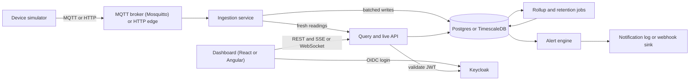
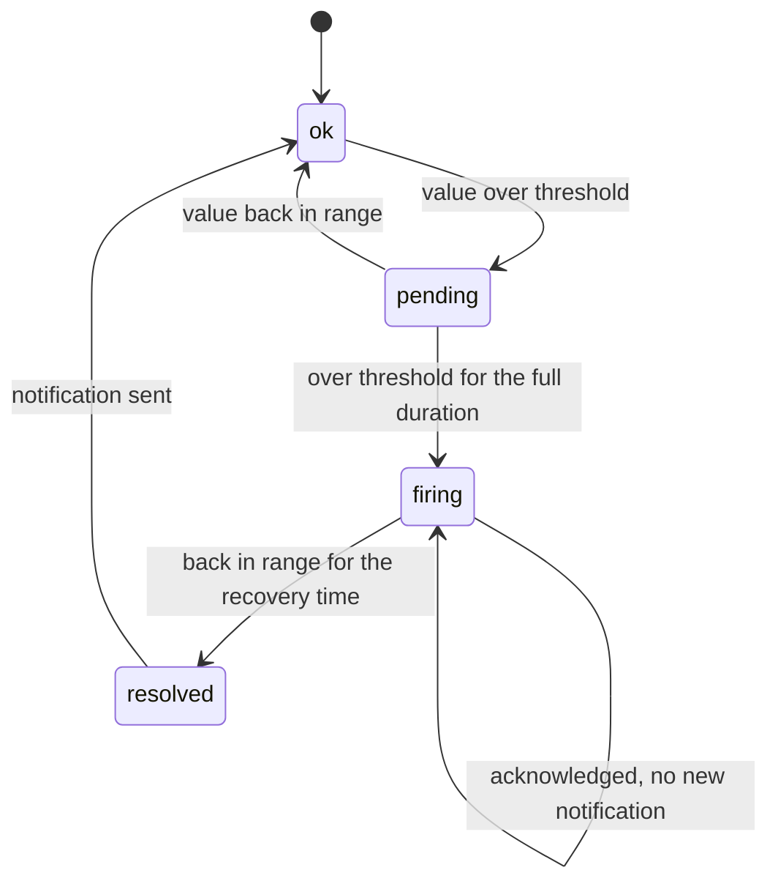

# Practice capstone: IoT telemetry ingestion and live dashboard

| Field | Value |
|-------|-------|
| Id | P08-iot-telemetry-dashboard |
| Level | 301 |
| Sprint length | 8 weeks (about 10 to 12 hours per week) |
| Prerequisites | databases-101 (all 12, especially 06 keys, 08 summaries, 10 transactions, 11 indexes and explain), docker-101 (06 networks and compose, 07 healthchecks and cleanup, 08 two-service project), one backend track at 101 (lesson 12 project; Go and Rust suit the ingest path), web-101 (08 and 09 JavaScript and DOM, 11 TypeScript in the browser). Planned and recommended: Databases 201, the backend 201 and Angular or React 201 |
| Suggested stacks | (A) Go + MQTT client + pgx + TimescaleDB + React; (B) Python + FastAPI + async MQTT client + Postgres native partitioning + Angular; (C) ASP.NET Core background service + MQTT client + TimescaleDB + Angular |
| Last updated | 2026-11-23 |

## 1. The brief

**Client:** *Greenfold Farms*, a vegetable grower with six greenhouses. Each greenhouse has about 50 small sensors (air temperature, humidity,
CO2, soil moisture) on shaky Wi-Fi. Today a technician walks the rows twice a day with a clipboard. Last July a cooling fan failed on a Saturday and
a whole crop of seedlings was lost before anyone noticed. Greenfold wants every reading stored, a live view of each greenhouse, **alerts** when conditions leave
the safe range or when a sensor goes silent, and charts of the last day, month and year without the database growing forever.

**What you build:** a device simulator (you write it), an ingestion service that accepts readings over MQTT (or HTTP), a time-series store
(plain Postgres with partitioning, or TimescaleDB), downsampling and retention jobs, an alert engine, and a live dashboard. The system must keep working when
devices send in bursts after a Wi-Fi outage, send old data, send duplicates, send garbage, or when the database is slow.

**What you have at the end (demoable):** start the stack, launch 300 simulated sensors, watch the dashboard update within seconds, break a sensor and get an alert,
replay an outage burst of 100,000 readings and see the system absorb it without losing data or running out of memory, and show that old raw data is dropped while its
rollups remain. You can explain the storage design with measurements.

## 2. Goals and non-goals

**Learning goals**

- Design a time-series schema, choose between native Postgres partitioning and TimescaleDB, and justify the choice with measurements.
- Build an ingestion path with validation, batching, de-duplication, late and out-of-order data handling, and at-least-once semantics.
- Downsample into rollups, decide which table answers which query, and keep rollups correct when late data arrives.
- Implement alerting with state, hysteresis and de-duplication, including "no data" alerts.
- Apply backpressure and load shedding deliberately and prove the behaviour.
- Push live updates to a browser and keep them authorised per site.
- Authenticate devices and users separately and apply least privilege on the broker.

**Non-goals**

- No real hardware, firmware, OTA updates or radio protocols (the simulator replaces them).
- No machine-learning anomaly detection (stretch goal only).
- No multi-region or clustered brokers or databases.
- No mobile app (the dashboard is a web page).

## 3. Users and scenarios

| Persona | Description |
|---------|-------------|
| Greta, head grower | Watches the live view and wants to be told when a greenhouse is in trouble |
| Joao, technician | Gets alerts, finds the failing sensor, acknowledges the alert |
| Mei, farm owner | Looks at monthly and yearly trends and cost-relevant totals |
| Sensor simulator | Publishes readings; a machine client |
| Admin | Registers devices, sets alert rules and retention |

| Id | Story |
|----|-------|
| S1 | As Greta, I want a live grid of greenhouses with the latest temperature, humidity and CO2, so that I see problems at a glance. |
| S2 | As Greta, I want a temperature chart for the last 24 hours with no gaps hidden, so that I can see the cooling failure pattern. |
| S3 | As Joao, I want an alert when the temperature stays above 35 degrees Celsius for 5 minutes, and one message when it recovers, so that I am not spammed. |
| S4 | As Joao, I want an alert when a sensor has sent nothing for three intervals, so that I find dead batteries quickly. |
| S5 | As Mei, I want month and year charts that load in under a second, so that I can review trends without waiting. |
| S6 | As an admin, I want to register a device and get its credentials once, and disable it instantly if it is stolen, so that the data stays trustworthy. |
| S7 | As a developer, I want a Wi-Fi outage simulation that dumps 100,000 delayed readings at once, so that I know the system copes. |
| S8 | As Mei, I want raw readings older than 30 days removed while the daily summaries remain, so that storage stays small. |

## 4. Requirements

| Id | Requirement | Priority | Acceptance criteria |
|----|-------------|----------|---------------------|
| R-01 | Devices publish readings with a documented payload (device id, metric, value, unit, device timestamp, sequence number) | Must | Given the simulator at 300 devices, 10 second interval, then all readings are stored with correct device, metric and timestamp |
| R-02 | Ingestion validates every message and rejects bad ones without stopping | Must | Given 1% garbage (bad JSON, unknown device, value out of physical range, missing fields), then those are counted in a rejection metric with a reason and the rest are stored |
| R-03 | Duplicate readings are stored once | Must | Given the same message delivered 5 times, then one row exists (unique on device, metric and timestamp) |
| R-04 | Late and out-of-order readings are accepted within a window | Must | Given readings up to 24 hours old, then they are stored in the right place and affect rollups; older ones go to a rejection counter with reason `too_old` |
| R-05 | Ingestion writes in batches | Must | Given 2,000 messages per second, then database writes are batched (size and time based) and the batch policy is documented and measured |
| R-06 | No data loss on consumer restart | Must | Given the ingest service is killed during load and restarted, then every message acknowledged to the device is stored; unacknowledged messages are redelivered (MQTT QoS 1 or HTTP retry) and de-duplicated |
| R-07 | Time-series store is partitioned by time | Must | Given 30 days of data, then queries for the last hour touch only the newest partition or chunk (shown with EXPLAIN) |
| R-08 | Downsampled rollups for 1 minute and 1 hour with min, max, average and count | Must | Given raw data, then a rollup table or continuous aggregate answers a 30-day chart with at most 1,000 points, and its values equal an on-demand calculation from raw data for the same window |
| R-09 | Rollups are corrected when late data arrives | Should | Given a late reading, then the affected rollup bucket changes within 5 minutes |
| R-10 | Query API picks raw or rollup data by time range | Must | Given a range of 1 hour, 24 hours, 30 days and 1 year, then the response has between 60 and 1,000 points and p95 latency under 200 ms for 1 device and under 1 second for a greenhouse aggregate |
| R-11 | Retention policy per resolution | Must | Given raw 30 days, 1-minute rollups 1 year, 1-hour rollups kept, then a nightly job drops expired partitions or chunks without long locks, shown by a test with shifted time |
| R-12 | Alert rules with state | Must | Given a threshold rule with duration and hysteresis, then states `ok`, `pending`, `firing`, `resolved` change as documented and one notification is sent per transition |
| R-13 | "No data" alert | Must | Given a device silent for 3 intervals, then an alert fires within 60 seconds after the third missed interval and resolves when data returns |
| R-14 | Alert acknowledgement and history | Should | Given a firing alert, then a technician can acknowledge it with a note; history shows who and when |
| R-15 | Live dashboard updates | Must | Given a new reading, then the browser shows it within 3 seconds at p95 without page reload, using server-sent events or WebSocket |
| R-16 | Dashboard remains responsive under load | Should | Given 300 devices, then the live view does not render more than 2 updates per second per tile (client or server side coalescing) |
| R-17 | Backpressure and load shedding | Must | Given a producer 10 times faster than the database for 2 minutes, then memory use stays flat, queue depth is visible, and the documented shedding rule applies (for example reject new HTTP with 429 or 503 and `Retry-After`, or slow MQTT acknowledgements, or drop lowest-priority metrics first) |
| R-18 | Reconnect storm handling | Should | Given all 300 devices disconnect and reconnect at the same second, then the system recovers within 60 seconds with no crash and jittered reconnects in the simulator |
| R-19 | Device registry, credentials and instant disable | Must | Given a disabled device, then its new connections are refused and its readings are rejected within 60 seconds |
| R-20 | Per-device topic permissions | Must | Given device A, then it can publish only to its own topic and cannot subscribe to others; a test publishing as A to B's topic fails |
| R-21 | User authentication and site scoping | Must | Given a user assigned to greenhouse 2, then API and live stream return only greenhouse 2; an id from greenhouse 3 returns 404 or 403 |
| R-22 | Observability of the pipeline | Should | Given load, then metrics show messages per second, rejected by reason, batch size, write latency, queue depth, rollup lag, alert evaluation time |
| R-23 | Admin can change alert rules and retention without redeploy | Could | Given a new rule via the API, then it takes effect within 60 seconds and the change is audit-logged |

**Non-functional requirements**

| Id | Requirement | Target |
|----|-------------|--------|
| N-01 | Sustained ingest | 2,000 readings per second for 10 minutes on the author laptop, zero loss, p95 time from publish to stored under 2 seconds |
| N-02 | Burst absorption | 100,000 queued readings drain in under 5 minutes without errors |
| N-03 | Storage | Report bytes per reading for raw and rollups; project one year for 300 devices with 4 metrics at 10 second interval (about 3.8 billion raw readings if never dropped) and show how retention changes it |
| N-04 | Alert latency | Threshold alert fires within 30 seconds after its duration condition is met |
| N-05 | Resources | The whole stack uses under 6 GB of memory; each container has a limit |
| N-06 | Time | Device timestamps are UTC; the server records a receive time as well; clock skew over 5 minutes is flagged |

## 5. Suggested architecture

**Components**

| Component | Responsibility |
|-----------|----------------|
| Simulator | Many virtual devices, configurable interval, jitter, drift, drop-outs, bursts, bad data, reconnect behaviour |
| Broker or edge | Accepts device connections, authenticates and authorises them (Mosquitto in Docker, or an HTTP endpoint if you choose HTTP only) |
| Ingestion service | Subscribes, validates, de-duplicates, batches, writes, acknowledges |
| Database | Raw readings, rollups, registry, rules, alerts |
| Rollup and retention jobs | Downsampling, late-data repair, dropping expired partitions |
| Alert engine | Rule evaluation, state machine, notifications |
| Query and live API | Charts, latest values, live stream, admin |
| Dashboard | Grid, charts, alert list |

**Decisions you must make and record as ADRs**

1. **Ingestion protocol.** MQTT (publish and subscribe, QoS levels 0, 1 and 2 as defined by the OASIS MQTT standard, retained messages, last will, topic ACLs) versus HTTP (simple, stateless, backpressure through status codes). Consider the cost of connections for 300 devices.
2. **Storage engine.** Native Postgres declarative partitioning (you create and drop partitions, possibly with a helper extension) versus TimescaleDB (hypertables, continuous aggregates, retention policies, compression). Decide with a benchmark: insert rate, query time, disk size, operational effort. Check the licence terms of any TimescaleDB feature you rely on in the product documentation before you adopt it.
3. **Keys and de-duplication.** Natural unique key on device, metric and timestamp (and the cost of that index on a huge table) versus de-duplication in the ingest layer; the effect on insert speed.
4. **Batching policy.** Size and time triggers, what is acknowledged to the device and when, what happens to a half-written batch.
5. **Late data window and rollup repair.** How far back, and how rollups are recomputed.
6. **Backpressure and shedding policy.** Which signal slows producers (queue depth, write latency), what is dropped first, what is never dropped (alerts and device status).
7. **Live transport.** Server-sent events versus WebSocket, fan-out and coalescing.
8. **Alert evaluation.** Streaming evaluation in the ingest path versus periodic queries; cost and accuracy.
9. **Device identity.** Username and password per device, client certificates, or tokens; rotation and revocation.

## 6. Data model starting point

Entities only; you design columns, types, partition keys, constraints and indexes.

| Entity | Notes |
|--------|-------|
| Site | A farm location |
| Greenhouse | Belongs to a site |
| Device | Registry entry: greenhouse, kind, status (active, disabled), credentials reference, firmware label, last seen |
| Metric | Name, unit, allowed physical range |
| Reading | Device, metric, device time, receive time, value, quality flag; the largest table |
| RollupMinute, RollupHour | Device and metric, bucket start, min, max, avg, count |
| AlertRule | Scope (device, greenhouse or metric), condition, duration, hysteresis, severity |
| AlertInstance | Rule, scope, state, started, resolved, acknowledged by and at, note |
| Notification | Instance, channel, sent at, result |
| RetentionPolicy | Resolution, keep for |
| UserSiteAccess | Which users may see which greenhouse |
| RejectedMessageSample (optional) | Bounded sample of rejected payloads for debugging |

Key relationships: Site has Greenhouses; Greenhouse has Devices; Device emits Readings for several Metrics; AlertRule produces AlertInstances.
Decide the partition key, whether `Reading` carries a surrogate id (usually it should not), and which indexes are worth their cost at 4 billion rows.

## 7. API or interface sketch

**Device side**

| Interface | Notes |
|-----------|-------|
| MQTT topic `farm/{greenhouse}/{device}/telemetry` | JSON or compact payload; QoS 1 recommended; device can publish only to its own topic |
| MQTT topic `farm/{greenhouse}/{device}/status` | Last will and online message |
| HTTP alternative `POST /ingest/readings` | Batch of readings; 202; 429 or 503 with `Retry-After` under pressure |

**User side**

| Resource | Operations | Notes |
|----------|------------|-------|
| `/sites`, `/greenhouses` | GET | Scoped to the user |
| `/greenhouses/{id}/latest` | GET | Last value per device and metric |
| `/devices/{id}/series?metric=&from=&to=&points=` | GET | Chooses raw or rollup, returns at most `points` |
| `/greenhouses/{id}/series?metric=&agg=` | GET | Aggregate across devices |
| `/stream?greenhouse=` | GET (SSE) or WebSocket | Live readings and alert changes |
| `/alerts` | GET with filters; POST `/{id}/ack` | Technician |
| `/admin/devices` | POST register (returns credentials once), PATCH disable | Admin |
| `/admin/rules`, `/admin/retention` | CRUD | Admin |
| `/healthz`, `/readyz`, `/metrics` | GET | Not public in a real deployment |

Errors use RFC 9457 problem details; timestamps use RFC 3339 in UTC; chart endpoints state their bucket size in the response.

## 8. Security and identity

**What is protected:** the integrity of readings (a forged reading could hide a real fire or trigger false alerts), device credentials, the broker (an open broker lets anyone publish or listen), greenhouse data per site, alert rules, admin functions.

| Actor | Role | Can | Cannot |
|-------|------|-----|--------|
| Device | credentials per device | Connect, publish to its own topics | Subscribe to other topics, publish elsewhere |
| Viewer | `viewer` | Read dashboards for assigned greenhouses | Change anything |
| Technician | `technician` | Viewer rights plus acknowledge alerts | Register devices, change rules |
| Admin | `admin` | Devices, rules, retention for all greenhouses | Read or change anything without an audit entry |
| Ingestion service | service identity | Subscribe to all telemetry, write readings | Anything in the user API |

**Design prompts**

- **Users:** Keycloak with OIDC authorization code and PKCE for the browser, JWT validation in the API (issuer, audience, expiry, signature), roles above, site access from a claim or the database. The SSE or WebSocket connection must be authenticated and re-checked when the token expires; decide how to pass credentials (cookie, short-lived ticket) without putting long-lived tokens in URLs.
- **Devices:** do not reuse human OIDC flows for sensors. Choose per-device broker credentials or client certificates, set per-device topic ACLs, store only password hashes or certificate fingerprints, rotate and revoke. Read the Mosquitto configuration manual for authentication, listeners and ACLs: configure these explicitly and check the defaults of the version you run; never leave an anonymous listener open on a published port.
- **Trust:** a device timestamp and value are untrusted input: validate type, range, size and rate; use the receive time for ordering decisions and keep both.
- **Transport:** say what TLS would protect in production (device to broker, API to browser) even if you run plain text in the sprint; a TLS listener is a stretch goal.

**OWASP API Security Top 10 (2023) items that matter here**

| Item | Where it bites you | Control to design |
|------|--------------------|-------------------|
| API1 Broken Object Level Authorization | `/devices/{id}/series` for a device in another greenhouse | Site scoping check in every query, test with two users |
| API2 Broken Authentication | Weak device credentials, unauthenticated stream endpoint | Per-device secrets, token checks on REST and live stream |
| API3 Broken Object Property Level Authorization | Admin fields (credentials, thresholds) in normal responses | Separate response models per role |
| API4 Unrestricted Resource Consumption | Huge time ranges, `points=1000000`, message floods | Caps on range and points, per-device rate limits, payload size limits, backpressure |
| API5 Broken Function Level Authorization | Viewer calls admin or acknowledge routes | Role checks per route, deny by default |
| API8 Security Misconfiguration | Anonymous broker, published database port, default credentials | Compose review checklist, internal network, credentials from environment |
| API9 Improper Inventory Management | Debug and metrics endpoints left public, old HTTP ingest route | Route inventory and gateway rules |
| API10 Unsafe Consumption of APIs | Trusting device payloads and any webhook sink responses | Strict schema validation, size caps, timeouts on notification calls |

## 9. Sprint plan

| Week | Phase | Deliverables | Exit criteria |
|------|-------|--------------|---------------|
| 1 | Walking skeleton (R-01, R-22 partly) | Compose with broker and database, simulator with 1 device, ingest service storing readings, `latest` endpoint, payload contract, ADR 1 draft | `docker compose up -d --wait`, simulator runs, `GET latest` shows a value less than 15 seconds old; teardown leaves nothing behind |
| 2 | Ingestion pipeline (R-02, R-03, R-04, R-05, R-06) | Validation with rejection reasons, de-duplication, late data window, batching, graceful shutdown, acknowledgement policy | 1% garbage run counted correctly; same message 5 times stored once; kill and restart during load loses nothing |
| 3 | Time-series storage (R-07, N-03) | Partitioned or hypertable schema, indexes, partition creation, load generator for a month of data, benchmark queries and sizes, ADR 2 and 3 with numbers | EXPLAIN shows partition pruning; bytes per reading and projected year computed and written down |
| 4 | Rollups and query API (R-08, R-09, R-10) | 1 minute and 1 hour rollups, late-data repair, series endpoint choosing source by range, point limits | Rollup values equal on-demand calculation from raw; ranges 1 hour to 1 year meet the latency targets |
| 5 | Alerts (R-12, R-13, R-14, N-04) | Rule model, state machine, hysteresis, no-data alerts, notification sink, acknowledgement | Simulator-induced heat spike fires once, resolves once; silenced device fires no-data alert within 60 seconds |
| 6 | Identity and live dashboard (R-15, R-16, R-19, R-20, R-21) | Keycloak login, site scoping, device registry and credentials, topic ACLs, live stream, grid and chart UI | Two users see different greenhouses; device A publishing to B's topic fails; a reading appears in the browser within 3 seconds |
| 7 | Backpressure and retention (R-11, R-17, R-18, N-01, N-02, N-05) | Bounded queues, shedding rule, slow-database experiment, outage burst of 100,000 readings, reconnect storm with and without jitter, retention job | Burst drains in under 5 minutes with flat memory; expired partitions removed while rollups remain; report of what was shed and why |
| 8 | Hardening and demo (R-22, R-23, N-06) | OWASP walk-through, backup and restore, metrics list, README, ADR set, demo script, final benchmark report | Clean-clone demo works in 15 minutes; every Must has a passing check or a recorded gap |

## 10. Verification

Smoke only for the Code101 verifier; your benchmarks and tests are deliverables on top. Docker is temporary and cleaned up.

**Smoke checklist (script it, one command)**

1. `docker compose -p p08-smoke up -d --wait` with a database and a broker. Publish nothing on 5432, 8080, 8081, 5173, 4200 or 11434; use for example 55434 for the database and 18830 for MQTT if you must publish them, or keep both unpublished and run the simulator inside the Compose network.
2. `GET /healthz` returns 200 and the ingest service reports connected to the broker and the database.
3. Run the simulator for 20 devices and 30 seconds; the `latest` endpoint returns a value for each device; the stored count is at least 90% of the expected count.
4. Publish one duplicate and one malformed message; the stored count does not grow and the rejection counter increases by one.
5. Publish as device A to device B's topic: expect the broker to refuse or the message to be dropped and never stored.
6. Fetch a 1 hour series and a 30 day series (30 day uses rollups, can be empty in a smoke run but must return 200 and the bucket size).
7. Always clean up, even on failure: `docker compose -p p08-smoke down -v --remove-orphans`; confirm no container, network or volume with the prefix remains.

**Demo script (15 minutes):** start 300 simulated devices; show the live grid; fail a fan (simulator mode) and watch pending, firing and the notification; silence a device for the no-data alert;
trigger the outage burst and show queue depth and memory; show EXPLAIN pruning and the rollup chart for one year; drop an expired partition and show the rollups intact;
show the user who cannot see greenhouse 3.

**What to measure and record:** sustained readings per second and latency percentiles, burst drain time, batch size and write latency, bytes per reading (raw and rollups), query latency by range, rollup lag,
alert latency, memory and CPU per container, rejected messages by reason.

## 11. Grading rubric

| Criterion | Weight | Beginner (1) | Solid (3) | Excellent (5) |
|-----------|--------|--------------|-----------|---------------|
| Ingestion correctness | 20% | Row per message, duplicates and garbage break it | Validation, batching, de-duplication, restart safe | Late data, clock skew, acknowledgement policy proven by tests and fault injection |
| Time-series storage design | 20% | One big table, slow charts | Partitioning or hypertable, indexes justified, rollups | Benchmarked options, bytes per reading known, retention without long locks, rollup repair |
| Alerting | 10% | Threshold check on each reading, alert storm | State machine with hysteresis and no-data alerts | Acknowledgement, dedupe, tested timelines, alert never dropped under load |
| Backpressure and resilience | 15% | Memory grows until crash | Bounded queues and a shedding rule | Measured behaviour under 10x load and reconnect storm, documented trade-offs |
| Dashboard and live updates | 10% | Page reload to refresh | Live grid and charts, coalescing | Authenticated live stream with expiry handling, accessible and responsive UI |
| Security and identity | 15% | Open broker, shared device password | Per-device credentials and ACLs, OIDC, site scoping, OWASP table | Revocation proven, least privilege everywhere, threat notes on forged readings |
| Operations and documentation | 10% | Works on author machine only | Compose, smoke script, clean teardown, README, ADRs | Backup and restore proven, metrics, honest benchmark report, as-built notes |

Passing is 60%; 85% or more is portfolio-grade.

## 12. Stretch goals

Ranked from easiest to hardest.

1. CSV and PNG export of a chart with the exact bucket size in the file name.
2. Per-metric units and automatic conversion (Celsius to Fahrenheit) at the API.
3. Heat map of a greenhouse by device position.
4. Server-side compression or a compact binary payload and a measured bandwidth saving.
5. Compression of old chunks or partitions (TimescaleDB compression or a native alternative) with before and after sizes.
6. Moving-average anomaly flag (a simple statistical rule, not machine learning) with false-positive analysis.
7. A TLS listener on the broker and client certificates for devices, with a rotation drill.
8. Run two ingestion instances competing for messages safely (shared subscriptions or a queue), and prove no duplicates or loss.
9. Dead-device prediction from battery voltage trend.
10. Replay tool that re-reads stored raw data to recompute rollups after a rule or unit bug fix.

## 13. Hints and pitfalls

**Traps**

- **One insert per message.** It will not reach 2,000 per second. Batch, and in Postgres consider `COPY` or multi-row inserts.
- **Wide unique index on a huge table.** It costs insert speed and disk; measure before and after, and think about partition-local uniqueness (a unique index on a partitioned table must include the partition key).
- **Averages of averages.** Rolling an hourly average from minute averages is only right if you weight by count; store sum and count, or min, max, avg and count.
- **Time zones and buckets.** Bucket in UTC and convert in the UI; daylight saving makes local days 23 or 25 hours long.
- **Late data and finished rollups.** Decide how a late reading updates a closed bucket.
- **Alerts on stale data.** A frozen value is not a healthy value; the no-data rule must exist.
- **Alert storms.** Without duration and hysteresis, a value hovering at the threshold sends hundreds of messages.
- **Unbounded in-memory queue.** It converts a slow database into an out-of-memory crash; bound it and choose what to do when full.
- **Reconnect storms.** All devices retry at once after an outage; simulate exponential backoff with jitter.
- **Open broker.** Anyone on the network can publish fake fire alarms or read data. Configure listener, authentication and ACLs explicitly.
- **High-cardinality metric labels.** Device id as a metric label for 300 devices is okay, for 3 million is not; state your limit.
- **Charts with a million points.** Cap points on the server.

**Where to look in Code101**

| Need | Lesson |
|------|--------|
| Aggregations (min, max, average, count, group by) | databases-101 lesson 08 |
| Keys, constraints, design | databases-101 lessons 06 and 09 |
| Transactions for batch writes | databases-101 lesson 10 |
| Indexes and EXPLAIN for partition pruning | databases-101 lesson 11 |
| Compose, healthchecks, cleanup | docker-101 lessons 06, 07, 08 |
| Files, errors and project structure in your language | go-101, rust-101, python-101, csharp-101 lessons 08, 09, 12 |
| Fetch, DOM updates and charts in the browser | web-101 lessons 08, 09, 11 |
| Planned: concurrency, observability, Keycloak chapters, Databases 201 | Not yet written; use the references below |

**Tier 1 references**

- PostgreSQL: table partitioning <https://www.postgresql.org/docs/current/ddl-partitioning.html>, INSERT ... ON CONFLICT <https://www.postgresql.org/docs/current/sql-insert.html>
- TimescaleDB documentation <https://docs.timescale.com/>; Docker image <https://hub.docker.com/r/timescale/timescaledb>
- MQTT Version 5.0, OASIS Standard <https://docs.oasis-open.org/mqtt/mqtt/v5.0/mqtt-v5.0.html> (QoS levels, retained messages, last will, shared subscriptions); Mosquitto documentation <https://mosquitto.org/documentation/> and configuration manual <https://mosquitto.org/man/mosquitto-conf-5.html>
- Keycloak production configuration <https://www.keycloak.org/server/configuration-production>; OpenID Connect Core <https://openid.net/specs/openid-connect-core-1_0.html>; PKCE RFC 7636 <https://www.rfc-editor.org/rfc/rfc7636>
- RFC 9457 Problem Details <https://www.rfc-editor.org/rfc/rfc9457>; RFC 9110 HTTP semantics (429, 503 and `Retry-After`) <https://www.rfc-editor.org/rfc/rfc9110>
- OWASP API Security Top 10 2023 <https://owasp.org/API-Security/editions/2023/en/0x11-t10/>
- OpenTelemetry metrics and Collector <https://opentelemetry.io/docs/collector/>; Docker Compose services reference <https://docs.docker.com/reference/compose-file/services/>
- Google SRE book, monitoring distributed systems (alert design, symptoms versus causes) <https://sre.google/sre-book/monitoring-distributed-systems/>

## 14. Deliverables checklist

- [ ] Repository with README: architecture, how to start, how to run the simulator, smoke script, benchmarks and tests
- [ ] Mermaid diagrams: system context, ingestion data flow, alert state machine (the two above are a starting point)
- [ ] ADRs (protocol, storage engine with benchmark, keys and de-duplication, batching, late data, backpressure policy, live transport, device identity) with numbers
- [ ] Simulator with documented modes (normal, drift, drop-out, burst, garbage, reconnect storm)
- [ ] Migrations for raw, rollups, registry, alerts, retention; partition or chunk management documented
- [ ] Payload contract (JSON Schema) and the OpenAPI 3.1 file for the user API
- [ ] Broker configuration (listeners, authentication, ACLs) and the proof that a device cannot publish to another's topic
- [ ] Benchmark report: throughput, latency, bytes per reading, query latency by range, burst drain, memory, with the exact machine described
- [ ] Alert test timelines (heat spike, hovering value, silent device) with expected and observed
- [ ] OWASP API Top 10 table with controls and evidence
- [ ] Smoke script that starts Docker under a throwaway project name and always cleans up
- [ ] Backup and restore notes proven once
- [ ] As-built notes: what changed from this TDD, known gaps, next steps
- [ ] Demo recording or 15-minute live demo following the demo script
