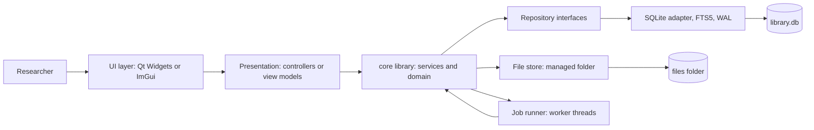
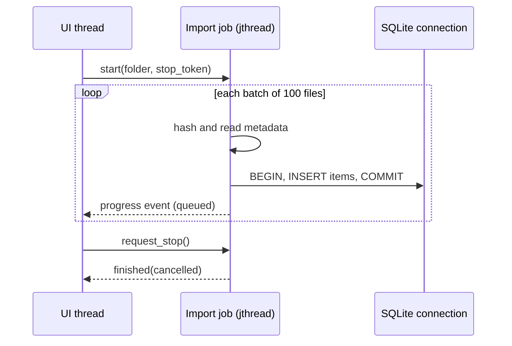
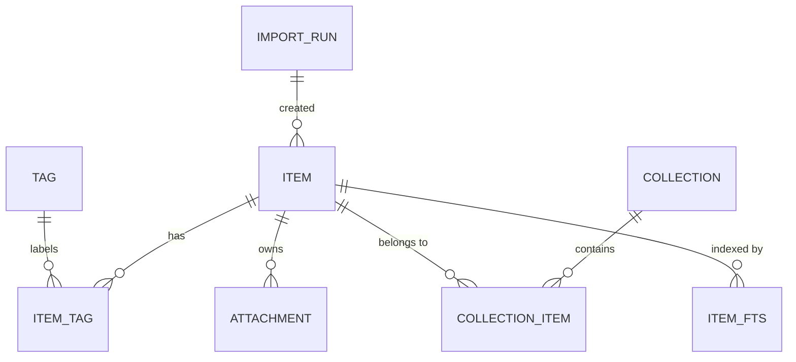

# Practice capstone: Fieldnotes Library (C++ desktop app)

| Field | Value |
|-------|-------|
| Id | P09-cpp-desktop-app |
| Level | 201 to 301 |
| Sprint length | 6 weeks (about 12 hours per week) |
| Prerequisites | C++ 101 (toolchain, CMake, RAII, `std::string`/`vector`), C++ 201 (modern C++, smart pointers, Qt or Dear ImGui, SQLite, sanitizers). Databases 101 lessons 06 (keys), 09 (good design), 10 (transactions), 11 (indexes). C# 101 lesson 09 (handling errors) for the error-strategy discussion |
| Suggested stacks | A: C++20 + Qt 6 Widgets + Qt SQL or raw SQLite + CMake + vcpkg. B: C++20 + Dear ImGui (Win32/DX11 or SDL3 backend) + SQLite C API + CMake + vcpkg. Test framework: Catch2 or GoogleTest in both |
| Last updated | 2026-11-23 |

## 1. The brief

**Client:** Marlow and Finch Research Collective, three oral-history researchers who work in archives, libraries and villages with no reliable internet.
They collect interview recordings (audio files), photos of documents and typed notes. Today everything lives in nested folders and a spreadsheet,
and they lose track of which recording belongs to which interview.

**Product:** *Fieldnotes Library*, a **local-first** Windows desktop app. Everything is stored on the laptop in one SQLite database plus a managed
folder of imported files. No account, no server, no telemetry. The researcher can:

- import a folder of files (audio, images, text, PDF) without freezing the window,
- write notes (plain text or Markdown), attach files to them, and tag and group them into collections,
- search across note text and metadata in under 100 ms on 20 000 items,
- back up the whole library to one file and restore it,
- install the app with a normal Windows installer.

**At the end you can demo:** import 2 000 files with a live progress bar and a Cancel button, search "weaver 1974" and get hits instantly,
edit a note, quit and relaunch with everything intact, run the sanitizer build and static analysis with zero findings, and install the app on a clean
Windows 11 user profile from a single installer file.

## 2. Goals and non-goals

**Learning goals**

- Modern C++ ownership: RAII wrappers for every handle (SQLite, file, thread), `std::unique_ptr` by default, no naked `new`/`delete`.
- Separation of concerns with MVC or MVVM: the core library has no GUI headers and is fully testable without a window.
- Persistence with SQLite: schema design, migrations (`PRAGMA user_version`), transactions, FTS5 full-text search, WAL mode.
- Background work: worker threads, cancellation (`std::jthread` and `std::stop_token`), thread-safe hand-off to the UI thread.
- Professional build: CMake targets and presets, vcpkg manifest mode, warnings as errors, sanitizers, clang-tidy and MSVC `/analyze`.
- Shipping: an installer, versioned, with a published SHA-256 checksum.

**Non-goals:** cloud sync, multi-user editing, mobile apps, media playback engines (open files with the OS default handler),
rich-text editing, plugins (stretch only), cross-platform builds (Windows 11 is the target; keep platform code behind one interface).

## 3. Users and scenarios

| Persona | Needs |
|---------|-------|
| Ines, field researcher | Fast capture, works offline, never loses data, imports a whole memory card at once |
| Tomas, archivist | Consistent tags, search across everything, exports for the collective's report |
| Ada, the collective's IT volunteer | Simple install, backups she can verify, no admin rights needed |

| Id | Story |
|----|-------|
| US-1 | As Ines, I want to import a folder so that every file becomes a library item with its date and size recorded. |
| US-2 | As Ines, I want to cancel a long import so that I can stop a mistaken import without closing the app. |
| US-3 | As Ines, I want to write a note and attach files to it so that a recording and its transcript stay together. |
| US-4 | As Tomas, I want tags and collections so that I can group items by village, year and topic. |
| US-5 | As Tomas, I want full-text search with a result snippet so that I can find a phrase without remembering where it is. |
| US-6 | As Ada, I want one-click backup and restore so that a dead laptop does not mean lost research. |
| US-7 | As Ada, I want an installer that needs no admin rights so that I can install it on locked-down machines. |
| US-8 | As Ines, I want the app to open a damaged or foreign file safely so that a bad import never crashes it. |

## 4. Requirements

| Id | Requirement | Priority | Acceptance criteria |
|----|-------------|----------|---------------------|
| R-01 | Library core is a static library with no GUI includes | Must | `core` target links without Qt or ImGui; `tests` run with no window |
| R-02 | Items: create, read, update, delete notes and file items | Must | Given a note, when edited and the app restarts, then the new text is shown |
| R-03 | Import a folder recursively on a worker thread | Must | 2 000 files import in under 60 s; UI stays responsive (no frame or event-loop stall over 100 ms) |
| R-04 | Cancel an import | Must | Cancel stops within 1 s; items already committed stay, a partial batch is rolled back; no leaked thread |
| R-05 | Duplicate detection by SHA-256 of content | Should | Importing the same file twice yields one item and a "skipped duplicate" count |
| R-06 | Tags and collections (many-to-many) | Must | One item has 3 tags; deleting a tag removes only the link rows |
| R-07 | Full-text search over note text, titles and tags | Must | 20 000 items, query returns first page in under 100 ms (median of 20 runs) |
| R-08 | Schema versioning with forward-only migrations | Must | Opening a v1 database with the v2 app upgrades it; opening a v3 database with the v2 app refuses with a clear message |
| R-09 | Backup to a single file and restore | Must | Restore of a backup reproduces identical item counts and search results |
| R-10 | Safe handling of untrusted files | Must | Unreadable, zero-byte, 2 GB and path-traversal names never crash or write outside the library folder |
| R-11 | Windows installer, per-user, no admin rights | Must | Installs to `%LOCALAPPDATA%\Programs\FieldnotesLibrary`, adds a Start menu entry, uninstall leaves user data unless the user opts in |
| R-12 | Sanitizer and static-analysis gates | Must | ASan build passes the unit tests; clang-tidy and `/analyze` report zero new warnings against the committed baseline |
| R-13 | Logging to a rotating local file | Should | Log capped at 5 files x 1 MB, no personal note text in logs |
| R-14 | Keyboard-first UI with undo for note edits | Could | Ctrl+Z reverts the last 20 edits per note |
| R-15 | Export a collection to a folder of Markdown files | Could | Exported names are sanitised and unique |

**Non-functional targets**

| Id | Target |
|----|--------|
| NF-1 | Cold start to usable window under 2 s with 20 000 items (SSD, release build) |
| NF-2 | Resident memory under 250 MB while browsing 20 000 items (virtualised list, thumbnails capped) |
| NF-3 | Zero data loss on forced kill during import: database passes `PRAGMA integrity_check` afterwards |
| NF-4 | Warning level `/W4` (MSVC) or `-Wall -Wextra -Wpedantic` with warnings as errors in the `ci` preset |
| NF-5 | Core library line coverage reported (target 70 percent, not gated) |

## 5. Suggested architecture

**Components (modules, one CMake target each, dependency direction one way)**

| Target | Contents | May depend on |
|--------|----------|---------------|
| `fl_common` | Result/expected types, logging, small utilities, RAII handle wrapper | nothing |
| `fl_core` | Domain types, services (`ImportService`, `SearchService`, `BackupService`), repository interfaces | `fl_common` |
| `fl_sqlite` | SQLite repository implementations, migrations | `fl_core` |
| `fl_platform` | Per-user paths, "open with default app", file locking (`win32` folder, one interface) | `fl_common` |
| `fl_ui` | Windows, models, views | `fl_core` |
| `apps/fieldnotes` | `main`, composition root, wiring | everything |
| `tests` | Unit tests per module, integration tests with a temp database | modules under test |

**Decisions you must make and defend in an ADR (keep each under one page)**

| Decision | Options and trade-offs |
|----------|------------------------|
| UI toolkit | **Qt 6**: retained-mode widgets, model/view classes, SQL module, accessibility, installer tooling, rich docs; large dependency and licensing obligations. **Dear ImGui**: tiny, immediate-mode (MIT), fast to start, you build lists, text editing and accessibility yourself; weaker for form-heavy apps |
| Error strategy | Exceptions inside a module and `std::expected` (C++23) or a small `Result<T>` at module boundaries, translated at the UI edge |
| MVC or MVVM | Qt favours model/view with signals; ImGui favours a presenter that exposes plain state each frame. Pick one and keep the rule: views never touch SQLite |
| SQLite access | Raw C API behind RAII wrappers (best for learning, more code) or Qt SQL (less code, ties the data layer to Qt, which breaks R-01 unless wrapped) |
| Thread hand-off | Qt: queued signals. ImGui: a mutex-protected event queue drained once per frame. Never touch widgets from a worker |
| Where thumbnails come from | Skip for MVP (icons by file type) or a bounded cache generated by a low-priority job |

**Qt licensing note.** Qt is dual licensed: commercial, or the Qt Community Edition under LGPL or GPL, and you may not mix the two in one project
(source: Qt licensing overview, Tier 1 below). For this learning sprint, link Qt dynamically under LGPLv3 and keep a `THIRD_PARTY_NOTICES.md`.
A closed-source product that statically links Qt would need a commercial license. Read the obligations before you ship anything beyond this exercise.
Dear ImGui is MIT licensed: keep its copyright notice in your notices file.

## 6. Data model starting point

You design columns, types, constraints and indexes. Start from these entities.

| Entity | Purpose | Design prompts |
|--------|---------|----------------|
| `item` | A note or an imported file. Kind, title, body, created, modified, content hash, relative path | Surrogate or natural key? Store paths relative to the library root. Which columns are NOT NULL? |
| `tag`, `item_tag` | Unique, case-insensitive tag names, many-to-many link | `COLLATE NOCASE` unique index; cascade rules; `PRAGMA foreign_keys` is off by default |
| `collection`, `collection_item` | Named groups with an optional sort order | Should a collection nest? Justify your answer |
| `attachment` | File linked to a note (path, size, media type, hash) | One table with `item` or a separate one? Write both and compare |
| `item_fts` | FTS5 virtual table over title, body, tags | External-content table versus contentless; keeping it in sync with triggers |
| `import_run` | One row per import: started, finished, counts, status | Needed for R-04 and for support questions |
| `schema_meta` or `user_version` | Migration level | Migrations are numbered, forward-only, each in one transaction |

Pragmas to decide on and document: `foreign_keys=ON`, `journal_mode=WAL` (SQLite documents that WAL needs all processes on one host and does not work over a network
filesystem, which is fine for a local-first app), `synchronous`, `busy_timeout`.

## 7. API or interface sketch

Internal interfaces of the core library. You write the signatures; these are the verbs.

| Interface | Operations (names only) |
|-----------|-------------------------|
| `ItemRepository` | add, get, update, remove, list(page, filter, sort), count |
| `TagRepository` | ensure, rename, remove, attach, detach, list_for_item |
| `SearchService` | query(text, filters, page) returning snippets and ranks; reindex |
| `ImportService` | start(folder, options) returning a handle; progress events; cancel; summary |
| `BackupService` | create(target_path); restore(source_path) with validation first |
| `Migrator` | current_version, migrate_to(latest), refuse_newer |
| `Clock`, `FileSystem` | Small seams so tests can fake time and disk |
| UI events | `ImportProgress{done,total,skipped}`, `ImportFinished{status}`, `ItemChanged{id}` |

Sketch the **user-facing screens** on paper first: library list and filters, note editor, import dialog with progress, settings (library folder, backup),
about (version, licenses).

## 8. Security and identity

There are no accounts; the protected assets are the researcher's data and the integrity of the installed program.

| Concern | Prompts and requirements |
|---------|---------------------------|
| Untrusted file names and paths | Reject or sanitise `..`, absolute paths, reserved Windows names (`CON`, `NUL`), trailing dots and spaces, and alternate data stream syntax (`:`). Resolve with `std::filesystem::weakly_canonical` and check the result stays under the library root before any write |
| Safe file handling | Copy imports to a temp name in the same folder, flush, then rename into place; never overwrite an existing item file; cap file size read into memory; stream hashes in chunks |
| SQL | Prepared statements with bound parameters only. A test must prove `'); DROP TABLE item;--` as a title is stored as text. FTS5 query syntax is user input: escape or quote it so a bad query returns an error, not a crash |
| Parsing | Any parser you write (Markdown export, backup manifest) works on `std::span` or `string_view`, checks lengths before indexing, and has one fuzz or table-driven test with hostile inputs |
| Backup and restore | Restore validates the file (SQLite header, `PRAGMA integrity_check`, schema version) in a temp copy before replacing the live database; keep the previous database as `.bak` |
| Privacy | No network code at all. Logs never contain note bodies or full home-directory paths |
| Installer and update integrity | Publish the installer with a SHA-256 file; show how to verify with `Get-FileHash`. Stretch: code signing with `signtool`. Do not build an auto-updater in this sprint; if you add one, it must verify a signature, never only a checksum served from the same host |
| Build hardening | Keep MSVC `/GS`, `/guard:cf` and `/sdl` on in release; treat sanitizer reports as release blockers (see the memory-safety skill) |
| Dependency hygiene | vcpkg versions pinned with a baseline in `vcpkg.json`; list every dependency and its license in `THIRD_PARTY_NOTICES.md` |

## 9. Sprint plan

| Week | Phase | Deliverables | Requirements | Exit criteria (demo) |
|------|-------|--------------|--------------|----------------------|
| 1 | Walking skeleton | Repo layout, `CMakePresets.json`, `vcpkg.json`, one `core` function with a test, empty app window, CI-style script `scripts\check.ps1` (configure, build, test) | R-01, R-12 (start) | `cmake --preset dev` then build and `ctest` pass on a clean clone; the window opens and shows the core's version string |
| 2 | Data layer | SQLite RAII wrappers, schema v1, migrator, item repository, tag repository, tests against a temp database | R-02, R-06, R-08 | Create 3 items and 2 tags in a test, restart the process, data is still there; opening a "newer" database is refused |
| 3 | Library UI | List with paging or virtualisation, filter by tag and collection, note editor, MVC/MVVM wiring, save on edit | R-02, R-06, R-14 (optional) | Browse 20 000 generated items without lag (scroll 60 FPS target); edit and persist a note |
| 4 | Import and search | Import service on a worker thread, progress and cancel, SHA-256 duplicate check, FTS5 index, search box | R-03, R-04, R-05, R-07, R-10 | Demo import of 2 000 files with cancel at 50 percent; search timing printed by a benchmark target |
| 5 | Safety and quality | Backup and restore, logging, ASan preset, UBSan where supported, clang-tidy and `/analyze` clean, hostile-input tests, TSan or Application Verifier note for the thread code | R-09, R-10, R-12, R-13 | Sanitizer run is green; a deliberately injected use-after-free is caught (then removed); hostile-file test list passes |
| 6 | Ship | Installer (CPack or an installer tool), version stamping, About dialog and notices, user guide (1 page), demo script rehearsed, as-built TDD notes | R-11, all Must items | Install on a clean Windows user profile, run the demo script, uninstall; checksum verification shown |

Hours guide: week 1 setup is the biggest risk (vcpkg first run can take 20 to 40 minutes for Qt); start the dependency build on day one.

## 10. Verification

Smoke checks only. The learner records the result of each in `docs\verification.md`.

| Check | How | Pass condition |
|-------|-----|----------------|
| Clean build | New clone, `cmake --preset dev`, `cmake --build --preset dev` | Zero errors, zero warnings (warnings as errors) |
| Unit tests | `ctest --preset dev` | All pass; test count printed and greater than 0 |
| Sanitizer | `cmake --preset asan` build and `ctest --preset asan` (MSVC `/fsanitize=address` or clang-cl) | No ASan report |
| Static analysis | clang-tidy target and MSVC `/analyze` build | Zero new findings against the baseline file |
| Import timing | Generator script creates 2 000 small files in a scratch folder (not in the repo) | Under 60 s; UI event latency under 100 ms |
| Search timing | Benchmark target on a 20 000 row generated database | Median under 100 ms |
| Kill test | Kill the process during import, reopen | `PRAGMA integrity_check` returns `ok` |
| Installer | Install, launch, uninstall on a throwaway Windows user | Entry points exist, data retained or removed per the user choice |

Measure with `std::chrono::steady_clock` for timings and the Windows Performance Monitor or Task Manager for memory. No Docker is needed in this sprint.

## 11. Grading rubric

| Criterion | Weight | Beginner (1) | Solid (3) | Excellent (5) |
|-----------|--------|--------------|-----------|---------------|
| Correctness | 20 | Core stories work on the happy path | All Must requirements pass their acceptance checks | Plus edge cases (cancel races, duplicates, damaged files) covered by tests |
| Design | 15 | UI code talks to SQLite directly | Core library is GUI-free, layers one-way | ADRs justify each decision, interfaces are small and fakeable |
| Memory and C++ quality | 15 | Raw `new`/`delete` or `fopen` in places | RAII everywhere, ownership visible in signatures | Rule of zero, no tidy findings suppressed without a reason, `[[nodiscard]]` and `const` used well |
| Concurrency | 10 | UI freezes during import | Worker thread with cancel, no races reported | Clean shutdown in every state, TSan or equivalent review documented |
| Security and safety | 10 | Some validation | Hostile-input tests pass, parameterised SQL, safe paths | Backup validation, fuzz or property tests, supply-chain notes |
| Tests and analysis | 10 | A few tests | Unit and integration tests, ASan and static analysis in a single script | Coverage report, regression test for every bug found |
| Operations and packaging | 10 | Runs from the build folder | Installer works, checksum published | Versioned, signed (stretch), uninstall clean, logs rotate |
| Docs and polish | 10 | Short README | README, diagrams, user guide, notices | As-built TDD notes, accessible keyboard flow, helpful errors |

## 12. Stretch goals

Ranked from easier to harder.

1. Thumbnails generated by a low-priority job with a bounded cache and cancellation.
2. Dark mode and a high-contrast check; keyboard shortcuts for every command.
3. Command pattern for undo and redo of note edits across sessions.
4. Export a collection as a static HTML site with escaped content.
5. Plugin interface for importers (a stable C ABI with a version field; see the c-cpp-interop skill).
6. Encrypt the database with SQLCipher or a per-library password; document the key-handling decisions and recovery story.
7. libFuzzer harness for the backup manifest parser using MSVC `/fsanitize=fuzzer`, run for 10 minutes with a seed corpus.
8. Sign the installer and executable with `signtool`, and add a signed update-check design (document only).
9. Port the platform layer to Linux and build with GCC and Clang in WSL (Ubuntu) to prove the layering.

## 13. Hints and pitfalls

**Traps**

- Mixing SQLite connections between threads: give each thread its own connection (WAL allows a reader while a writer works) or serialise access; never share one `sqlite3*` freely.
- Calling UI code from the worker thread; send events instead.
- `foreign_keys` is OFF by default in SQLite and must be enabled per connection.
- Forgetting that `std::filesystem::path` to UTF-8 conversions are different on Windows; test a file called `café – 1974.txt`.
- Detached threads, or a `jthread` that outlives the objects it references.
- Holding raw pointers into a `std::vector` that the UI reallocates.
- vcpkg builds not found by CMake: pass the vcpkg toolchain file in the preset, not on your command line.
- Over-engineering: finish the Must requirements before any plugin or encryption work.

**Where to look in Code101**

| Need | Lesson |
|------|--------|
| Keys, relationships | Databases 101 lesson 06 (`06-keys-and-relationships.md`) |
| Schema design | Databases 101 lesson 09 (`09-good-design.md`) |
| Transactions | Databases 101 lesson 10 (`10-transactions.md`) |
| Indexes and EXPLAIN | Databases 101 lesson 11 (`11-indexes-and-explain.md`) |
| Files and errors in another language | C# 101 lessons 08 and 09; Rust 101 lesson 10 (ownership, a useful contrast to RAII) |
| Project shape | `c-cpp-project-structure`, `cpp-core-guidelines`, `memory-safety`, `c-cpp-testing-and-analysis` skills in the Claude templates repository |

C and C++ 101 lessons are not written yet; the skills above are the working references.

**Tier 1 references**

- C++ Core Guidelines: https://isocpp.github.io/CppCoreGuidelines/CppCoreGuidelines
- CMake presets: https://cmake.org/cmake/help/latest/manual/cmake-presets.7.html
- vcpkg manifest mode: https://learn.microsoft.com/en-us/vcpkg/concepts/manifest-mode
- MSVC AddressSanitizer: https://learn.microsoft.com/en-us/cpp/sanitizers/asan
- MSVC `/analyze`: https://learn.microsoft.com/en-us/cpp/build/reference/analyze-code-analysis
- MSVC `/fsanitize` (address and fuzzer options): https://learn.microsoft.com/en-us/cpp/build/reference/fsanitize
- SQLite WAL: https://www.sqlite.org/wal.html and FTS5: https://www.sqlite.org/fts5.html
- Qt licensing overview: https://www.qt.io/development/qt-framework/qt-licensing
- Dear ImGui (MIT license): https://github.com/ocornut/imgui
- CPack generators (WiX, NSIS, ZIP): https://cmake.org/cmake/help/latest/cpack_gen/wix.html. Check the licence terms of whichever installer tool you pick.
- SEI CERT C++ coding standard: https://wiki.sei.cmu.edu/confluence/display/cplusplus

## 14. Deliverables checklist

- [ ] Repository with the layout in section 5, `CMakePresets.json` (`dev`, `asan`, `ci`), `vcpkg.json` with a baseline, `.clang-format`, `.clang-tidy`.
- [ ] `README.md`: what it is, prerequisites, build, test, run, install, screenshots.
- [ ] Diagrams: context, import sequence, ER diagram of your final schema (Mermaid files in `docs\`).
- [ ] ADRs for the decisions in section 5 (at least 5).
- [ ] `docs\verification.md` with the results of every smoke check in section 10.
- [ ] Tests: unit, integration (temp database), hostile-input list; test count recorded.
- [ ] `THIRD_PARTY_NOTICES.md` and the licensing decision (Qt LGPL, GPL, commercial, or ImGui MIT) written down.
- [ ] Installer file plus its SHA-256 checksum file and the verification command.
- [ ] As-built notes: a copy of this TDD with what changed and why (requirements met, missed, deferred).
- [ ] A 5-minute demo script and a recording or live run.
