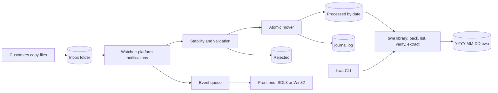
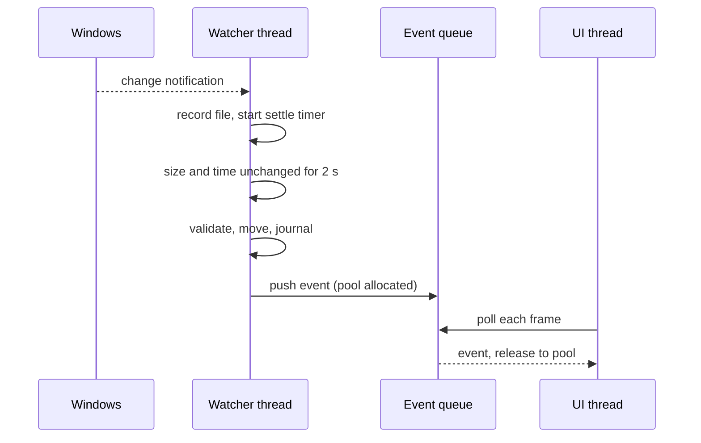
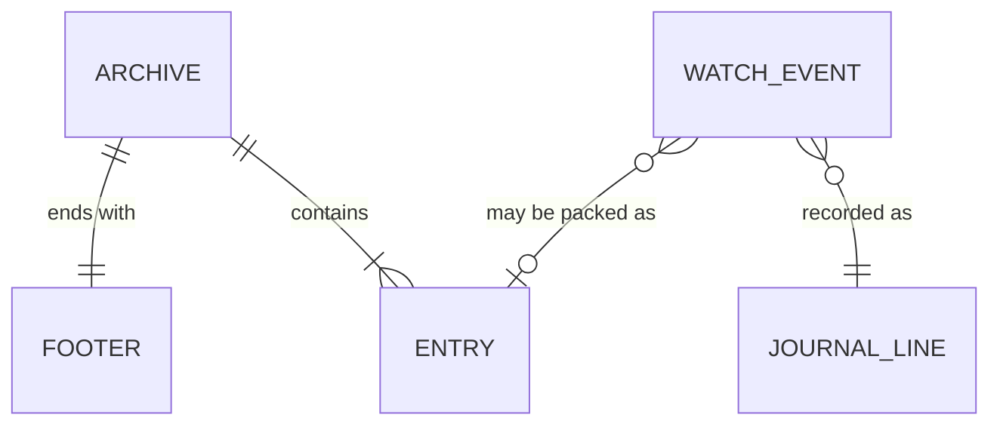

# Practice capstone: Hot Folder Archiver (C systems utility)

| Field | Value |
|-------|-------|
| Id | P10-c-systems-utility |
| Level | 201 |
| Sprint length | 4 weeks (about 10 hours per week) |
| Prerequisites | C 101 (toolchain, pointers, arrays and strings, structs, `malloc`/`free`, files, headers and CMake), C 201 (error-handling patterns, undefined behaviour, ASan, SDL or Win32 event loop, unit testing). Go 101 lesson 08 (`08-files.md`) and Rust 101 lesson 10 (`10-ownership-and-borrowing.md`) are useful contrasts for file handling and ownership |
| Suggested stacks | A: C17 + CMake + MSVC + SDL3 front end. B: C17 + CMake + MSVC + plain Win32 front end (no dependencies). C: C17 + CMake + GCC in WSL (Ubuntu) + GTK 4 front end. Test framework: Unity (the ThrowTheSwitch C test framework, not the game engine) or CMocka |
| Last updated | 2026-11-23 |

## 1. The brief

**Client:** Brightwater Print and Pack, a 12-person print shop. Customers drop finished artwork (PDF, TIFF, PNG) into a shared `Inbox` folder on the
shop's Windows PC. Files arrive half-copied, with odd names, sometimes twice, and the operator cannot tell what is ready for the press.
At month end someone zips the processed folders by hand and has twice lost a job file.

**Product:** *Hot Folder Archiver* (`bwarch`), a small utility with two parts.

1. A **C library and CLI** (`bwa`) that writes, lists, verifies and extracts a simple archive format (`.bwa`) with per-file checksums.
2. A **watcher with a small desktop front end** that watches the `Inbox`, waits until a file has stopped changing, validates its name and type,
   moves it to `Processed\YYYY-MM-DD\`, appends a line to an append-only journal, and shows a live event list and counters.

**At the end you can demo:** copy 50 files into the Inbox (some bad, some large, one duplicate name), watch them appear in the window as they settle,
see rejected files moved to `Rejected\` with a reason, press "Pack today" to create `2026-11-30.bwa`, run `bwa verify` and `bwa list`, flip one byte in the
archive and watch `verify` fail with the entry name, and run everything under AddressSanitizer with no report.

## 2. Goals and non-goals

**Learning goals**

- Careful C: one owner per allocation, one cleanup path (`goto cleanup`), status-code APIs, opaque structs, no VLAs, no unchecked `strcpy`.
- Own a binary file format: fixed-width integers, endianness, length validation, checksums, atomic writes.
- Write a **small allocator** (arena and fixed-size pool) and see where it helps and where it hides bugs.
- A **portability layer**: one header, a Windows implementation, a POSIX stub or implementation behind it.
- An event loop and a worker thread with a thread-safe queue.
- Tooling: CMake targets, warnings as errors, ASan and UBSan, static analysis, a test-first loop.

**Non-goals:** compression (store entries uncompressed; deflate is a stretch), encryption, networked inbox, a database, a polished GUI, installer work,
cross-platform GUI parity (the UI is thin and Windows-first).

## 3. Users and scenarios

| Persona | Needs |
|---------|-------|
| Rosa, press operator | Sees at a glance which files are ready, which were rejected and why |
| Kwame, shop owner | Month-end archive he can verify and hand to an auditor |
| Lena, the freelance sysadmin | Small, dependency-light tool; logs she can read; safe against weird file names |

| Id | Story |
|----|-------|
| US-1 | As Rosa, I want a file to be processed only after it has finished copying so that I never send a half-file to the press. |
| US-2 | As Rosa, I want rejected files moved aside with a reason so that I can ask the customer for a fix. |
| US-3 | As Kwame, I want a day's files packed into one archive so that month-end backup is one copy command. |
| US-4 | As Kwame, I want `verify` to say exactly which entry is damaged so that I can restore it from the customer. |
| US-5 | As Lena, I want an append-only journal so that I can answer "what happened to job 4412?" |
| US-6 | As Lena, I want the tool to refuse hostile names and truncated archives so that a bad file cannot damage the PC. |
| US-7 | As Rosa, I want the window to stay responsive during a large burst of files so that I can pause the watcher. |
| US-8 | As Lena, I want the library callable from a script so that I can build a nightly report in Python or C#. (Stretch) |

## 4. Requirements

| Id | Requirement | Priority | Acceptance criteria |
|----|-------------|----------|---------------------|
| R-01 | Archive format v1 with magic, version, entry count, table of contents (TOC), per-entry CRC-32 | Must | `bwa pack` of 3 files then `bwa list` shows names and sizes; the format is documented in `docs\FORMAT.md` |
| R-02 | `bwa verify` detects corruption | Must | Flip any single byte in the entry data, TOC or footer: verify exits non-zero and names the failing part |
| R-03 | `bwa extract` is path-safe | Must | Entries named `..\x`, `C:\x`, `/etc/x`, or with a `:` stream are rejected; nothing is written outside the target folder |
| R-04 | All lengths and offsets from the archive are validated before use | Must | A truncated file, a TOC offset past end of file and an entry size of `0xFFFFFFFFFFFFFFFF` all fail cleanly (exit 2, no crash, no huge allocation) |
| R-05 | Watcher detects new files in `Inbox` using the platform notification API | Must | A copied file raises one event within 1 s of the copy starting |
| R-06 | Stability check: process a file only when size and modified time are unchanged for 2 s | Must | A 200 MB file copied slowly is processed once, after the copy ends |
| R-07 | Validation: name allowlist and extension allowlist, size limit 2 GB, non-empty | Must | `report 1.pdf`, `a..pdf`, `con.pdf`, `x.exe`, zero-byte files go to `Rejected\` with a reason code |
| R-08 | Atomic move into `Processed\YYYY-MM-DD\`; name clash gets a numeric suffix, never overwrites | Must | Two files with the same name give `job.pdf` and `job (2).pdf`; no file is lost |
| R-09 | Append-only journal, one line per event, flushed per line | Must | After killing the process mid-burst, the journal has only whole lines and every processed file has a line |
| R-10 | Own allocator used for event records | Must | Arena and pool allocator have unit tests; a build flag swaps in plain `malloc` for comparison |
| R-11 | Portability layer | Must | No `windows.h` outside `src\plat\win32\`; a POSIX stub compiles (compile-only check in WSL is enough) |
| R-12 | Desktop front end shows status, last 50 events, counters and Pause/Resume | Must | Window stays responsive (event loop iterates at least every 50 ms) during a burst of 500 files |
| R-13 | Sanitizer and warning gates | Must | `/W4 /WX` (or `-Wall -Wextra -Wpedantic -Werror`); ASan and UBSan tests pass |
| R-14 | Signal-safe, clean shutdown | Should | Closing the window stops the worker within 1 s and flushes the journal; no thread left running |
| R-15 | Shared library with a stable C API | Could | Exports `bwa_open`, `bwa_verify`, `bwa_close`; used from Python `ctypes` or C# P/Invoke in a 20-line script |

**Non-functional targets**

| Id | Target |
|----|--------|
| NF-1 | `bwa pack` of 1 GB in 20 files in under 15 s on an SSD; peak memory under 16 MB (streaming, fixed buffer) |
| NF-2 | `bwa verify` of that archive in under 10 s |
| NF-3 | Idle watcher uses under 1 percent CPU and under 20 MB resident |
| NF-4 | 100 percent of `malloc`/`calloc` results are checked; static analysis finds no null-dereference warnings |
| NF-5 | No dynamic allocation in the event hot path after start-up (verified by counting allocator calls in a test) |

## 5. Suggested architecture

**Modules (one CMake target each; dependencies point down only)**

| Target | Contents | Depends on |
|--------|----------|------------|
| `bw_base` | Status codes, checked arithmetic, string helpers, CRC-32, arena and pool allocators | nothing |
| `bw_plat` | `plat_watch_*`, `plat_move_atomic`, `plat_file_stat`, `plat_sleep`, `plat_thread_*`, `plat_mutex_*` | `bw_base` |
| `bw_archive` | Writer, reader, verifier, extractor | `bw_base`, `bw_plat` |
| `bw_watcher` | Settle logic, validation rules, mover, journal | `bw_base`, `bw_plat` |
| `apps/bwa` | CLI front end | `bw_archive` |
| `apps/bwarch` | SDL3 or Win32 window, wiring | `bw_watcher`, `bw_archive` |
| `tests` | One test file per module | module under test |

**Decisions to record (short ADRs)**

| Decision | Trade-offs |
|----------|------------|
| Front end toolkit | **SDL3**: easy event loop, small, no widgets (draw lists yourself; text via the SDL3 debug-text call or SDL3_ttf, check the SDL3 wiki for your version). **Win32**: zero dependencies, verbose message loop, native look. **GTK 4**: real widgets, best on Linux, awkward to install on Windows, a good fit if you choose the WSL option |
| Watching strategy | `ReadDirectoryChangesW` (events, buffer overflow possible, must rescan) versus polling every second (simple, wasteful, never misses). Real tools combine both: events plus a periodic rescan |
| Archive layout | Stream entries then write the TOC at the end (single pass writing) versus TOC first (easy reading). Footer with TOC offset and its own CRC |
| Integers | Fixed-width little-endian, written byte by byte (no struct dumping, so no padding or alignment surprises) |
| Allocator design | Arena (bump pointer, free all at once) for per-scan scratch; pool (free list of fixed-size blocks) for event records. Where is each safe? How do you detect double free or use after reset? |
| Hash for dedupe | CRC-32 detects accidental damage only. For identity or tamper evidence use SHA-256 from the OS crypto API (Windows CNG `BCrypt*`) or a vetted library. Do not invent a hash |

## 6. Data model starting point

No database. Design these in-memory and on-disk structures.

| Structure | Purpose | Design prompts |
|-----------|---------|----------------|
| Archive header | Magic bytes, format version, flags, entry count | How does a reader reject a future version safely? Reserved fields must be zero |
| Entry (TOC row) | Name length, name bytes (UTF-8), data offset, size, CRC-32, modified time | Maximum name length (suggest 255 bytes); how do you reject embedded NUL and invalid UTF-8? |
| Footer | TOC offset, TOC size, TOC CRC-32, magic | Why the footer is read first when opening |
| `bw_event` | Kind (`seen`, `settled`, `moved`, `rejected`, `error`), timestamp, name, reason code | Fixed-size record so a pool can hold it; name truncated safely with a flag |
| Journal line | `time <tab> kind <tab> name <tab> reason`, UTF-8, `\n` terminated | Names are escaped so a tab or newline in a name cannot forge a line |
| Settings file | Inbox path, Processed path, settle seconds, size limit | Plain `key=value`; validate every value; defaults when missing |

## 7. API or interface sketch

C API sketch (names and intent only). Public symbols are prefixed `bw_`; every function returns `bw_status`.

| Function | Intent |
|----------|--------|
| `bw_arena_create` / `bw_arena_alloc` / `bw_arena_reset` / `bw_arena_destroy` | Bump allocator with alignment and overflow checks |
| `bw_pool_create` / `bw_pool_acquire` / `bw_pool_release` / `bw_pool_destroy` | Fixed-size block pool, detects double release |
| `bwa_writer_open` / `bwa_writer_add_file` / `bwa_writer_close` | Write to a temp name, rename on success |
| `bwa_reader_open` / `bwa_reader_entry` / `bwa_reader_close` | Validates header, footer and TOC on open |
| `bwa_verify` | Streams every entry through CRC-32, reports the first or all failures |
| `bwa_extract` | Extracts one or all entries below a target directory, path-safe |
| `plat_watch_open` / `plat_watch_next` / `plat_watch_close` | Blocking next event with a timeout; returns `overflow` so callers rescan |
| `plat_move_atomic` | Rename or `MoveFileExW` within one volume; reports cross-volume as an error |
| `bw_queue_push` / `bw_queue_pop` | Mutex-protected ring buffer between the worker and the UI |

CLI contract:

| Command | Output and exit code |
|---------|----------------------|
| `bwa pack <archive> <files...>` | Prints one line per entry; 0 on success, 1 usage error, 2 failure |
| `bwa list <archive>` | Name, size, CRC per line; 2 if the archive is invalid |
| `bwa verify <archive>` | `OK` or `FAIL <entry or part>`; 2 on any failure |
| `bwa extract <archive> <folder> [name]` | 0, or 2 with the rejected entry name |

## 8. Security and identity

No accounts. The threats are hostile file names, hostile archives and corrupted state.

| Concern | Prompts and requirements |
|---------|---------------------------|
| Untrusted archive | Treat every field as hostile (CERT C rules INT30-C, ARR30-C). Check `offset <= file_size && length <= file_size - offset` instead of `offset + length <= file_size`. Cap entry count and name length before allocating |
| Path traversal ("zip slip") | Reject absolute paths, drive letters, `..` segments, backslash and slash mixes, `:` (NTFS alternate data streams), reserved device names (`CON`, `NUL`, `COM1`), trailing dots and spaces. After joining, canonicalise and re-check that the result stays under the target folder |
| Time-of-check to time-of-use | Open the file first, then query it by handle (`fstat`-style or `GetFileInformationByHandle`) rather than checking the path and opening later. Do not follow symbolic links or junctions out of the Inbox without a decision (write it in an ADR) |
| Atomic and durable writes | Write to `name.tmp` in the destination folder, flush, then rename. A crash leaves either the old state or the new, never a half file |
| Integer safety | Use unsigned 64-bit sizes, checked add and multiply helpers, no signed overflow, explicit casts at the 32/64-bit boundary |
| Memory safety | Every allocation checked; every error path frees through one exit; no `gets`, `strcpy`, `sprintf`; use `snprintf` and explicit lengths (memory-safety skill) |
| Journal integrity | Append only, one `write` per line; escape control characters in names. A journal is evidence of events, not proof against an administrator; say so in the README |
| Checksums vs signatures | CRC-32 catches accidents, not attackers. Document that, and show where a SHA-256 manifest would be used |
| Least privilege | Runs as a normal user; needs write access only to its own folders; never needs admin |
| Distribution integrity | Publish the zip with a SHA-256 file and show `Get-FileHash` verification. Optional hardening flags: `/GS`, `/guard:cf`, `/sdl`, `/DYNAMICBASE`, `/NXCOMPAT` |

## 9. Sprint plan

| Week | Phase | Deliverables | Requirements | Exit criteria (demo) |
|------|-------|--------------|--------------|----------------------|
| 1 | Skeleton and archive format | Repo layout, CMake with warnings as errors, `bw_base` (status, checked math, CRC-32), `docs\FORMAT.md`, writer and reader, `bwa pack` and `bwa list`, first tests | R-01, R-13 (start) | Pack 3 files, list them, test suite green on a clean clone; format doc matches the bytes in a hex dump |
| 2 | Hostile input and allocators | `verify`, `extract` with path rules, truncated-file tests, arena and pool allocators with tests, ASan and UBSan runs | R-02, R-03, R-04, R-10, R-13 | Corrupt-byte loop flips every byte of a small archive and verify fails each time; hostile name list passes; allocator tests green under ASan |
| 3 | Portability and watcher | `bw_plat` interface, Windows watcher with rescan, settle logic, validation rules, atomic mover, journal, event queue | R-05 to R-09, R-11 | Copy a large file slowly into the Inbox: one event, processed after settling; kill test leaves a valid journal |
| 4 | Front end and ship | SDL3 or Win32 window, Pause/Resume, counters, "Pack today", clean shutdown, README, as-built notes, release zip with checksum | R-12, R-14, all Must items | The full demo from section 1 runs without edits; ASan build is clean |

Week 3 is the riskiest; if the watcher slips, ship polling first and add notifications after.

## 10. Verification

Smoke checks only; record results in `docs\verification.md`.

| Check | How | Pass condition |
|-------|-----|----------------|
| Clean build | `cmake --preset dev`, `cmake --build --preset dev` on a new clone | No warnings (`/W4 /WX`) |
| Tests | `ctest --preset dev` | All pass and the count is greater than 0 |
| Sanitizers | Preset using MSVC `/fsanitize=address` (or clang-cl, or GCC in WSL with `-fsanitize=address,undefined`) | No report |
| Static analysis | MSVC `/analyze` and clang-tidy (`bugprone-*`, `clang-analyzer-*`) | No new findings |
| Round trip | `bwa pack`, `bwa verify`, `bwa extract`, compare hashes of originals and extracted files with `Get-FileHash` | Identical |
| Corruption | Script flips each byte of a 2 KB archive in turn | Verify fails every time, no crash |
| Hostile names | List of 20 bad names | All rejected, nothing written outside the target |
| Burst | Script copies 500 small files into the Inbox | 500 journal lines, no lost file, UI responsive |
| Allocation count | Test counts allocator calls while processing 1 000 events | Zero heap calls after warm-up |

No Docker is needed; if you test on Linux, use WSL, not containers.

## 11. Grading rubric

| Criterion | Weight | Beginner (1) | Solid (3) | Excellent (5) |
|-----------|--------|--------------|-----------|---------------|
| Correctness | 20 | Pack and list work on good input | All Must requirements pass | Race cases (partial copy, duplicate names, overflow of the notification buffer) handled and tested |
| C quality and memory | 20 | Leaks or unchecked `malloc` | Single cleanup path, every allocation checked, sanitizers clean | Ownership documented per function, no suppressions, allocator misuse is detected |
| Format and robustness | 15 | Trusts file contents | Validates all lengths and offsets | Fuzz-style loop and documented limits |
| Portability design | 10 | `windows.h` everywhere | Clean `plat` boundary, stub compiles | POSIX implementation passes the same tests |
| Security | 10 | Some name checks | Path rules, atomic writes, TOCTOU decision recorded | Threat model table with a test for every row |
| Tests and tooling | 10 | A few tests | Unit tests, sanitizer and analysis presets | Regression test for every bug found, scripts run all gates |
| UI and concurrency | 10 | UI blocks | Responsive UI, queue, clean shutdown | Back-pressure and overflow handled visibly |
| Docs | 5 | README | README, FORMAT.md, diagrams | ADRs and as-built notes |

## 12. Stretch goals

Ranked from easier to harder.

1. Pack the archive with deflate using a vetted library (zlib via vcpkg) and record the speed and size trade-off.
2. Add a SHA-256 manifest entry produced through Windows CNG (`BCryptHash`), verified by `bwa verify --strong`.
3. Build the library as a DLL and call `bwa_verify` from Python with `ctypes` (declare `argtypes` and `restype`, use `c_char_p` with UTF-8 bytes, return status codes, never pass Python-owned buffers that C keeps).
4. Call the same DLL from C# with P/Invoke (`LibraryImport` or `DllImport`, `CharSet`/UTF-8 marshalling, `SafeHandle` for the reader handle).
5. Implement the POSIX watcher with `inotify` and run the shared test suite in WSL; compare event semantics with Windows.
6. Add a libFuzzer target for `bwa_reader_open` using MSVC `/fsanitize=fuzzer` (or clang), seed it with valid archives, and run it for 10 minutes; fix every crash and keep the inputs as regression tests.
7. Replace the mutex queue with a single-producer single-consumer ring buffer using C11 atomics (`<stdatomic.h>`), proving it with a stress test and ThreadSanitizer under clang in WSL.
8. Memory-map the archive for reading (`CreateFileMapping` and `MapViewOfFile`); defend against the file shrinking while mapped (structured exception handling or a copy).
9. Add `/guard:cf` and Control Flow Guard checks plus a hardened release build, and write a one-page review of what each flag protects against.

## 13. Hints and pitfalls

**Traps**

- `ReadDirectoryChangesW` can overflow its buffer under a burst; the result is "something changed", so rescan the folder. Report events are not guaranteed to be one per file.
- A "created" event arrives when the copy starts, not when it ends. Never process on the first event.
- Writing structs to disk with `fwrite` bakes in padding and endianness. Encode fields byte by byte.
- `MoveFileExW` across volumes is copy-and-delete, not atomic; keep Processed on the same volume as Inbox or handle it explicitly.
- `strncpy` does not always NUL-terminate; prefer `snprintf` or a length-carrying string type.
- An arena that is reset while pointers into it still exist is a use-after-free that ASan will not see unless you poison the memory yourself (the ASan interface header `sanitizer/asan_interface.h` offers manual poisoning; check that your compiler's ASan ships it).
- Do not let one thread free what another thread's queue still holds.
- Windows file names are UTF-16 internally; decide where UTF-8 to UTF-16 conversion lives (only in `plat`).

**Where to look in Code101**

| Need | Lesson |
|------|--------|
| File handling and errors in another language | Go 101 lesson 08 and 09 (`08-files.md`, `09-errors.md`), Python 101 lesson 08 |
| Ownership, a contrast to manual C ownership | Rust 101 lesson 10 (`10-ownership-and-borrowing.md`) |
| Structs and interfaces as a design contrast | Go 101 lesson 11, C# 101 lesson 10 |
| Skills for C | `c-coding-standard`, `memory-safety`, `c-cpp-project-structure`, `c-cpp-testing-and-analysis`, `c-cpp-interop` in the Claude templates repository |

C 101 lessons are not written yet; the skills above are the working references.

**Tier 1 references**

- CMU C Coding Standard: https://users.ece.cmu.edu/~eno/coding/CCodingStandard.html
- SEI CERT C Coding Standard: https://wiki.sei.cmu.edu/confluence/display/c
- `ReadDirectoryChangesW`: https://learn.microsoft.com/en-us/windows/win32/api/winbase/nf-winbase-readdirectorychangesw
- MSVC AddressSanitizer: https://learn.microsoft.com/en-us/cpp/sanitizers/asan
- MSVC `/fsanitize` (address, fuzzer): https://learn.microsoft.com/en-us/cpp/build/reference/fsanitize
- MSVC `/analyze`: https://learn.microsoft.com/en-us/cpp/build/reference/analyze-code-analysis
- SDL3 wiki: https://wiki.libsdl.org/SDL3/FrontPage
- Python `ctypes`: https://docs.python.org/3/library/ctypes.html
- .NET native interoperability (P/Invoke): https://learn.microsoft.com/en-us/dotnet/standard/native-interop/pinvoke
- CMake presets: https://cmake.org/cmake/help/latest/manual/cmake-presets.7.html

## 14. Deliverables checklist

- [ ] Repository with the module layout in section 5, `CMakePresets.json` (`dev`, `asan`, `ci`), `.clang-format`, `.clang-tidy`.
- [ ] `README.md`: what it does, build, run, CLI help, settings, limits, threat notes.
- [ ] `docs\FORMAT.md`: byte-level archive spec with a worked hex example.
- [ ] Diagrams: context, watcher sequence, archive layout (Mermaid files in `docs\`).
- [ ] ADRs: front end, watching strategy, allocator design, symlink policy, hash choice.
- [ ] `docs\verification.md` with the result of every smoke check in section 10.
- [ ] Tests: unit per module, hostile-input list, byte-flip loop; test count recorded.
- [ ] Release zip (executables, README, licenses) plus SHA-256 file.
- [ ] As-built notes: this TDD with what changed and why.
- [ ] A 5-minute demo script and a recording or live run.
