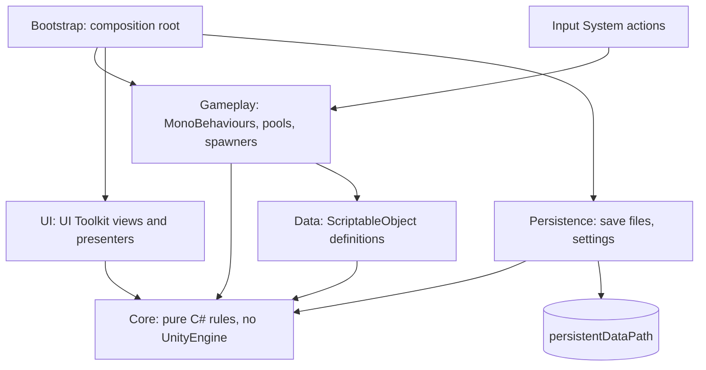
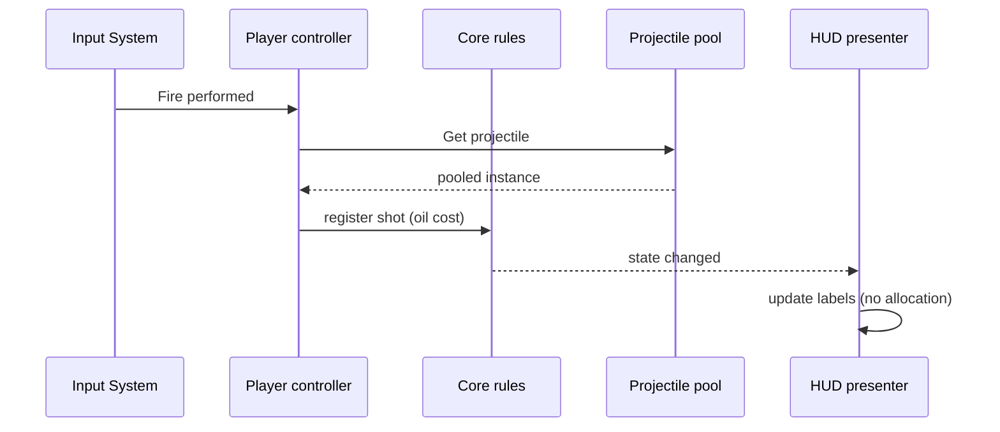
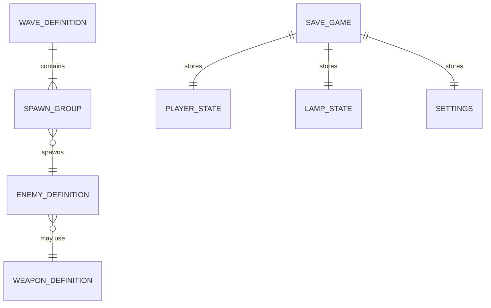

# Practice capstone: Lamplight (Unity vertical slice)

| Field | Value |
|-------|-------|
| Id | P11-unity-vertical-slice |
| Level | 201 to 301 |
| Sprint length | 8 weeks (about 12 hours per week) |
| Prerequisites | C# 101 (all lessons; especially 09 `handling-errors`, 10 `classes-and-objects`, 11 `null-safety-and-records`), Unity 101 (editor, GameObjects, C# scripting, physics, input, UI), Unity 201 (ScriptableObjects, UI Toolkit, Input System, Shader Graph intro, testing). Design Patterns 101 (SOLID) |
| Suggested stacks | A: Unity 6 LTS (6000.x) + URP 2D + Input System + UI Toolkit. B: Unity 6 LTS + URP 3D (top-down camera) + same packages. C: either, plus Addressables and R3/UniTask as stretch. All three run **locally in the Unity Editor and as a Windows standalone player** |
| Last updated | 2026-11-23 |

> **Local only. Never Docker.** Unity runs on the author's Windows 11 machine in the Editor and as a Windows standalone build. This capstone has no Compose file,
> no container, and no CI container step. Anything that looks like "run Unity in Docker" is out of scope and must not be added.

## 1. The brief

**Client:** Tidepool Games, a two-person indie studio preparing a pitch to a small publisher. The publisher asked for a **10-minute vertical slice**:
one polished level that shows the core loop, the look, the UI, saving, and that it runs smoothly on a mid-range PC.

**Game concept (fixed so scope is clear; art and theme are yours):** *Lamplight*. The player guards a lighthouse lamp through one stormy night.
Drifting spirits approach in waves. The player moves around the lamp, shoots bolts of light, and collects "oil" to keep the lamp burning. If the lamp goes
dark or the player dies, the night is lost. Three enemy types, two weapons, five waves, one boss-like final wave.

**Choose 2D (top-down, URP 2D renderer) or 3D (top-down camera, URP).** The data, architecture and requirements are identical; only the movement and physics components differ.

**At the end you can demo:** launch a Windows build, see a title screen, start a night, fight five waves with a UI Toolkit HUD, die or win, see a result screen,
quit and relaunch to continue from the save, rebind a key, and open the Profiler capture that proves the frame-time and allocation budgets.

## 2. Goals and non-goals

**Learning goals**

- Clean architecture in Unity: pure C# rules separated from MonoBehaviours with assembly definitions, composition root, no singleton soup.
- Data-driven design with ScriptableObjects (authored, read-only definitions) separate from runtime state.
- Input System with action maps and rebinding; UI Toolkit for HUD and menus (UXML, USS, presenter).
- Object pooling with `UnityEngine.Pool`; measuring that it helps.
- A Shader Graph effect with exposed properties and a Custom Function node optional.
- Save and load with a versioned, validated file format.
- Profiling with budgets, and a scripted build pipeline.
- A playtest plan carried out with real people, and decisions made from the results.

**Non-goals:** multiplayer, procedural generation, DOTS/ECS, console builds, store submission, a large content pipeline, anti-cheat.

## 3. Users and scenarios

| Persona | Needs |
|---------|-------|
| Priya, publisher's producer | A smooth 10-minute build that starts fast and does not crash |
| Marcus, keyboard-and-mouse player | Responsive controls, readable HUD, rebinding |
| Yuki, gamepad player | Full gamepad play, menus navigable with a pad |
| Dev (you and your partner) | Tunable data without code changes; fast iteration; a build you can reproduce |

| Id | Story |
|----|-------|
| US-1 | As Marcus, I want to move and aim with mouse and keyboard so that the game feels responsive. |
| US-2 | As Yuki, I want to play and navigate menus with a gamepad so that I never need the keyboard. |
| US-3 | As Priya, I want a clear HUD (health, lamp oil, wave, score) so that I understand the state at a glance. |
| US-4 | As Priya, I want to quit and resume the same night so that a demo can be interrupted. |
| US-5 | As a designer, I want to change enemy speed or wave composition in assets so that I can balance without touching code. |
| US-6 | As Marcus, I want to rebind keys so that the game fits my hands. |
| US-7 | As Priya, I want the game to hold 60 FPS in the heaviest wave so that it feels professional. |
| US-8 | As a tester, I want a pause menu with restart and quit so that I can leave any time. |

## 4. Requirements

| Id | Requirement | Priority | Acceptance criteria |
|----|-------------|----------|---------------------|
| R-01 | Assembly definitions split the code (Core, Data, Gameplay, UI, Persistence, Bootstrap, Tests) | Must | `Core` has "No Engine References" enabled and compiles with no `UnityEngine` using; no assembly cycle; Editor code is Editor-only |
| R-02 | Enemy, weapon and wave definitions are ScriptableObjects | Must | Changing an enemy's speed asset changes play with no code edit; two enemy instances never share mutable state |
| R-03 | Player movement and aim via Input System action maps | Must | Keyboard/mouse and gamepad both work; no use of the legacy Input Manager API |
| R-04 | Combat rules (damage, health, lamp oil drain) live in pure C# | Must | At least 15 EditMode tests cover damage, death, oil drain, wave progression |
| R-05 | Three enemy types with distinct behaviour | Must | Chaser, Drifter (slow, tanky), Sprinter (fast, weak); each defined by data and one behaviour class |
| R-06 | Five waves, final wave with an elite enemy | Must | Wave table is data; completing wave 5 shows a win screen |
| R-07 | Object pooling for projectiles, enemies and hit effects | Must | After warm-up, a 3-minute fight creates no new pooled GameObjects (Profiler counter or pool statistics); no double release |
| R-08 | HUD built with UI Toolkit (UXML + USS) driven by a presenter | Must | Health, oil, wave, score update without per-frame allocations; HUD scales at 1280x720 and 3840x2160 |
| R-09 | Menus: title, pause, settings, result; fully navigable by gamepad and keyboard | Must | Tab/arrow and D-pad focus works; Cancel closes the topmost panel |
| R-10 | Key rebinding with persistence | Should | Rebinding Fire survives a restart; conflicting binding is reported; Cancel aborts safely |
| R-11 | Save/load a night in progress (wave, player and lamp state, settings, bindings) | Must | Quit mid-wave, relaunch, choose Continue: the same wave and values restore; a corrupted save shows "Save damaged" and starts a new game |
| R-12 | Shader Graph effect on a visible element | Must | Enemy dissolve on death or lamp glow, with exposed properties set per material instance or via property block; works in the player build |
| R-13 | Audio: music loop, 6 effects, a mixer with master/music/sfx volume in settings | Should | Volumes persist; no audible clicks on pooled sounds |
| R-14 | Performance budgets met (section 4 NFs) | Must | Evidence: Profiler captures on a development player, saved in `docs\perf\` |
| R-15 | Scripted Windows build | Must | `Build.ps1` calls Unity in batch mode and produces `Builds\Lamplight-<version>\`; version string appears on the title screen |
| R-16 | Playtest with at least 5 people and a written report | Must | Report with data, top 5 problems, 3 changes made because of them |
| R-17 | Pause and focus handling | Should | Losing window focus pauses; held input resets on focus return |
| R-18 | Localisation-ready strings | Could | All UI text in one table; a second language switchable at runtime |

**Non-functional targets (measure on a Windows development player, 1920x1080, Mono or IL2CPP noted in the report)**

| Id | Target |
|----|--------|
| NF-1 | Heaviest wave (about 60 active enemies, 40 projectiles): average frame time at most 16.6 ms and the 99th percentile at most 20 ms over a 60 s capture |
| NF-2 | Main thread CPU time at most 8 ms per frame in the same capture (leaves headroom for weaker PCs) |
| NF-3 | Managed allocations during steady-state gameplay: 0 bytes per frame (check the Profiler's GC Allocated In Frame counter); allocation allowed only during loading and menus |
| NF-4 | Cold start to title screen under 5 s; scene load to playable under 3 s |
| NF-5 | Draw calls under 300 and set-pass calls under 60 in the heaviest wave (Frame Debugger or Rendering Statistics) |
| NF-6 | Build folder under 300 MB; process memory under 1.5 GB after 10 minutes of play |
| NF-7 | No exceptions or errors in `Player.log` during a full run |

## 5. Suggested architecture

**Assemblies and the allowed dependency directions**

| Assembly | Contents | References |
|----------|----------|------------|
| `Lamplight.Core` | `Health`, `Lamp`, `WaveProgress`, `DamageRules`, interfaces (`IClock`, `ISaveStore`) | nothing (no engine references) |
| `Lamplight.Data` | `EnemyDefinition`, `WeaponDefinition`, `WaveDefinition` ScriptableObjects | `Core` |
| `Lamplight.Gameplay` | Player, enemy behaviours, spawner, pools, projectile, effects | `Core`, `Data`, Input System |
| `Lamplight.UI` | UXML/USS assets, views, presenters | `Core` |
| `Lamplight.Persistence` | DTOs, JSON serializer, atomic file store, migrations | `Core` |
| `Lamplight.Bootstrap` | Scene entry point, wiring | all runtime assemblies |
| `Lamplight.Core.Tests` (EditMode), `Lamplight.Gameplay.Tests` (PlayMode) | Tests | the assembly under test |

**Decisions to record as short ADRs**

| Decision | Trade-offs |
|----------|------------|
| 2D or 3D | 2D: faster art, simpler physics, cheaper to hit budgets. 3D: more visual impact, lights and shadow cost, camera work |
| Wiring | Manual composition in `Bootstrap` (simplest) versus a DI container (more setup, helpful at scale). Either way: no static singletons for game state |
| Events | C# events or a ScriptableObject event channel versus a reactive library. Decide who unsubscribes and when |
| Enemy AI | One `MonoBehaviour` per type versus a data-driven strategy object. Keep decisions out of `Update` where you can |
| Pool granularity | One pool per prefab with keyed lookup; define reset rules (health, velocity, trails, subscriptions, tweens) and what happens at scene unload |
| Save format | JSON via `JsonUtility` or `System.Text.Json`-style library versus a binary format. JSON is debuggable and diffable; cost is size and parse time |
| Physics | Rigidbody-driven versus kinematic with overlap queries; fixed timestep and interpolation consequences |
| Render pipeline | URP is required for Shader Graph here; document the quality settings you use |

## 6. Data model starting point

You design fields, ranges and validation. Names only.

| Entity | Kind | Design prompts |
|--------|------|----------------|
| `EnemyDefinition` | ScriptableObject (read-only at runtime) | Max health, speed, contact damage, score value, prefab reference, behaviour id. Which fields get `[Min]` or `[Range]`? Validate in `OnValidate` without side effects |
| `WeaponDefinition` | ScriptableObject | Damage, fire rate, projectile prefab, oil cost, pierce count |
| `WaveDefinition` | ScriptableObject | Ordered spawn groups (enemy, count, spawn interval, delay), wave bonus |
| `SpawnGroup` | `[Serializable]` class inside the wave | Why is this not its own asset? |
| Runtime state (`Health`, `LampState`, `WaveProgress`) | Plain C# classes in Core | Never write into ScriptableObjects at runtime: Editor play sessions can leave the asset changed |
| `SaveGame` DTO | Plain serializable class | `schemaVersion`, `savedAtUtc`, wave index, player position and health, lamp oil, score, input binding overrides, settings; a version number you can migrate |
| `Settings` DTO | Plain serializable class | Volumes (0 to 1), fullscreen, resolution, language id |

## 7. API or interface sketch

Interfaces between assemblies (names and intent; you write the C#).

| Interface or type | Intent |
|-------------------|--------|
| `IClock` | Time source so rules are testable without `Time.time` |
| `IDamageable` | Receive damage with source and amount; returns whether it died |
| `ISaveStore` | `TryLoad(out SaveGame)`, `Save(SaveGame)`, `Delete()`; atomic, never throws to callers |
| `IWavePlan` | Current wave data, next spawn instruction, completion check |
| `IPoolable` | `OnLease()` and `OnRelease()` reset hooks |
| `IGameEvents` | State-changed notifications consumed by the HUD presenter |
| Input actions | Map `Gameplay`: Move (Vector2), Aim (Vector2 or pointer), Fire (button), Pause; map `UI`: Navigate, Submit, Cancel; Rebind via `PerformInteractiveRebinding` |
| `BuildScript.Build()` | Static Editor method for `-executeMethod`; reads version, sets scenes, writes the player |

UI screens (sketch on paper first): title, HUD, pause, settings (audio, controls, display), result (win/lose, score, retry).

## 8. Security and identity

A single-player offline game has no accounts. The assets to protect are the player's save files and machine, and the integrity of what you ship.

| Concern | Prompts and requirements |
|---------|---------------------------|
| Save file validation | Treat the save as untrusted input: size cap (for example 256 KB) before reading, catch parse exceptions, check `schemaVersion`, clamp every numeric field to its legal range, reject NaN and infinity, fall back to a new game with a clear message |
| Safe file handling | Only read and write under `Application.persistentDataPath`; fixed file names (never a name from user input); write to a temp file then replace, keep one `.bak` |
| Serialization safety | Do not use `BinaryFormatter` (Microsoft documents it as insecure and it is removed from modern .NET); do not deserialize types named inside the file |
| Tamper resistance honesty | A checksum or hash of the save catches corruption, not a determined cheater. Say so; do not claim anti-cheat |
| Settings and bindings | Binding overrides are JSON strings from disk: validate length and catch load failures; a bad override must not break input |
| Debug features | Cheat keys, debug HUD and development console exist only when `DEVELOPMENT_BUILD` or `UNITY_EDITOR` is defined; the release build check proves they are gone |
| Logging and privacy | No personal data collected or logged. Playtest sessions: get consent, record only anonymous observations, store notes without names |
| Build and update integrity | Zip the build, publish a SHA-256 file, and verify with `Get-FileHash`. No auto-updater in this sprint; if added later it must verify a signature |
| Third-party content | Keep a `CREDITS.md` with every asset, licence and source. Use CC0 or permissively licensed art and audio; the Code101 `assets\art` icon set (CC0) is suitable for HUD icons. Check the current Unity licence terms for your studio size before you ship commercially |
| Packages | Pin package versions in `Packages\manifest.json` and `packages-lock.json`; commit both |

## 9. Sprint plan

| Week | Phase | Deliverables | Requirements | Exit criteria (demo) |
|------|-------|--------------|--------------|----------------------|
| 1 | Walking skeleton | Unity 6 project with URP, Git repo with Unity `.gitignore` and LFS for large assets, assembly definitions, bootstrap scene, player moves with Input System, a Windows standalone build runs | R-01, R-03 (movement), R-15 (manual build) | A built `.exe` launches, the player moves with keyboard and gamepad, `Player.log` has no errors |
| 2 | Data and rules | ScriptableObject definitions, pure C# combat and lamp rules, 15 EditMode tests, a test scene driven by data | R-02, R-04 | Tests green in the Test Runner; editing an enemy asset changes behaviour in play |
| 3 | Enemies, waves, pooling | Three enemy types, wave runner, projectile and enemy pools, pool statistics overlay (dev builds) | R-05, R-06, R-07 | Fight all five waves; statistics show zero new instances after warm-up; first Profiler capture saved as the baseline |
| 4 | UI Toolkit HUD and menus | UXML/USS HUD, presenter, title, pause, result screens, gamepad navigation | R-08, R-09, R-17 | Complete a run using only a gamepad; HUD checked at two resolutions |
| 5 | Save, settings, rebinding | Versioned save with validation and backup, settings, audio mixer, rebinding UI | R-10, R-11, R-13 | Quit mid-wave and continue; corrupt the save by hand and see the recovery message |
| 6 | Look and feel | Shader Graph effect, particle hit effects (pooled), camera shake with an off switch, audio polish | R-12 | Effect visible in the player build with per-instance properties; no hitches when it first appears (warm shaders) |
| 7 | Performance | Profiling sessions, fixes ranked by evidence, budget report, dev-build overlays off in release | R-14, NF-1 to NF-6 | Captures before and after in `docs\perf\`; budget table filled in with measured numbers |
| 8 | Build, playtest, ship | `Build.ps1` with batch-mode build, playtest with 5 people, three fixes from the report, release zip with checksum, `CREDITS.md`, as-built notes | R-15, R-16, all Must items | Clean build from a fresh clone; playtest report; the 10-minute demo runs end to end |

Hours guide: week 1 absorbs install and licence set-up (Unity Hub, editor version, activation). Pin the exact editor version in `ProjectSettings\ProjectVersion.txt` and in the README.

## 10. Verification

Smoke checks only. Unity is **local**: run it from the Editor or the Windows player, never in a container. Record results in `docs\verification.md`.

| Check | How | Pass condition |
|-------|-----|----------------|
| Compile and import | Open the project in the pinned editor version, or run Unity in batch mode with `-batchmode -quit -projectPath` and read the log | No compile errors or warnings you did not accept |
| EditMode tests | Test Runner (EditMode), or batch mode with `-runTests -testPlatform EditMode` and an XML result file | Failed 0; the XML shows tests discovered (greater than 0) |
| PlayMode smoke | One PlayMode test loads the game scene, spawns wave 1 and finishes without exceptions | Passes |
| Build | `powershell -File Build.ps1` (calls Unity with `-batchmode -executeMethod`) | Executable exists, version string matches, process exit code 0 |
| Player run | Launch the build, play one full night, quit | `Player.log` has no errors; exit is clean |
| Budgets | Development build with Profiler attached, 60 s capture in the heaviest wave; read frame time, GC Allocated In Frame, draw calls | NF-1 to NF-5 values recorded and met |
| Save round trip | Save, quit, relaunch, continue; then corrupt the file | Restore matches; corruption handled |
| Checksum | `Get-FileHash -Algorithm SHA256` on the zip | Matches the published value |

Frame time is read from the Profiler (or `ProfilerRecorder`, which works in Editor and players) and from your own capture script, not from the Editor stats window alone.
Editor numbers are not evidence; capture on a development player. Close other heavy applications first and note the machine specs in the report.

## 11. Grading rubric

| Criterion | Weight | Beginner (1) | Solid (3) | Excellent (5) |
|-----------|--------|--------------|-----------|---------------|
| Gameplay and completeness | 15 | Core loop works in the Editor | Five waves, win and lose, all Must features in a build | Feels polished: feedback, audio, readable difficulty curve |
| Architecture | 20 | Logic inside MonoBehaviours, singletons | Asmdefs enforce layers, pure C# rules, composition root | Clear ADRs, interfaces only where variation exists, no cycles, tests prove the boundaries |
| Data-driven design | 10 | Constants in scripts | ScriptableObject definitions, runtime state separate | Validation, designer-friendly inspectors, balance sheet |
| Performance | 15 | Not measured | Budgets met with captures | Before and after evidence, root causes explained, no per-frame allocations in any system |
| UI and input | 10 | Mouse only, IMGUI or ad hoc UI | UI Toolkit HUD, pad and keyboard navigation | Rebinding, focus handling, accessibility options (text size, reduced shake) |
| Save and robustness | 10 | Save works on happy path | Versioned, validated, atomic | Migration test, corruption tests, safe fallbacks everywhere |
| Tests and build | 10 | Manual testing only | EditMode and PlayMode tests, scripted build | Tests in a single script with the build; repeatable from a clean clone |
| Playtest and docs | 10 | Informal feedback | Plan, 5 testers, report | Findings drove measured changes; README, diagrams, as-built notes |

## 12. Stretch goals

Ranked from easier to harder.

1. Accessibility pack: colour-blind-safe palette check, text scale slider, hold-to-toggle options, reduced screen shake.
2. Second Shader Graph effect (screen-space vignette or heat distortion) with a quality switch and a measured GPU cost.
3. Addressables for waves and enemy prefabs with a loading screen; record the memory difference.
4. Replay system: record inputs per night and replay deterministically (needs fixed-step simulation and seeded randomness).
5. Custom Editor tooling: an inspector for waves that shows total enemy count and estimated duration; a menu item that validates all definitions (see the Unity editor tools skills).
6. Burst and Jobs for enemy steering if the profile shows the main thread bound there (measure first; keep the managed version for comparison).
7. IL2CPP build, compare size, start-up time and frame time against Mono, and fix any stripping problems.
8. Controller haptics and adaptive audio mix driven by the lamp's oil level.
9. A local leaderboard file with entry validation, plus a clear note about why it is not cheat-proof.

## 13. Hints and pitfalls

**Traps**

- Writing to a ScriptableObject at runtime: in the Editor the change persists in the asset and hides bugs; in a build it vanishes. Keep runtime state in plain C# objects.
- `Instantiate` and `Destroy` in the hot path; pool them and measure with the Profiler, not by guessing.
- Allocations from LINQ, string concatenation for HUD labels, closures in `Update`, `GetComponent` in loops, and `foreach` over some collections. Cache references; reuse `StringBuilder` or only update labels when the value changes.
- Subscribing to events in `OnEnable` and forgetting to unsubscribe in `OnDisable`; pooled objects especially.
- Input System callbacks fire for the lifetime of the action asset: disable maps when you leave a screen, and reset held input when the window loses focus.
- Shader variants missing in a build: test the player, not just the Editor. First-use hitches come from shader compilation; warm up or pre-collect variants.
- UI Toolkit: query elements once per tree, not every frame; unregister callbacks on detach; ListView rows reused by the control must be unbound.
- Comparing Editor performance with player performance; Editor overhead is large. Deep profiling changes timings; note when you used it.
- Scene or asset references stored in the save: save ids and names, never object references.
- Time scale: pausing with `Time.timeScale = 0` stops `FixedUpdate` and scaled time but not unscaled UI animations; decide which systems use unscaled time.
- Git and Unity: commit `.meta` files, never commit `Library\`, `Temp\`, `Logs\` or `Builds\`; use LFS for large binaries.

**Where to look in Code101**

| Need | Lesson |
|------|--------|
| Classes, objects, null safety | C# 101 lessons 10 and 11 (`10-classes-and-objects.md`, `11-null-safety-and-records.md`) |
| Errors and exceptions | C# 101 lesson 09 (`09-handling-errors.md`) |
| Files and JSON thinking | C# 101 lesson 08 (`08-files.md`) |
| SOLID and patterns | Design Patterns + SOLID 101 (planned) |
| Unity skills | `unity-clean-architecture`, `unity-scriptable-objects`, `unity-input-system`, `unity-ui-toolkit`, `unity-object-pooling`, `unity-testing`, `unity-optimization`, `unity-shader-graph` in the Claude templates repository |

Unity 101 and 201 lessons are not written yet; the skills above are the working references.

**Tier 1 references**

- Unity User Manual and Scripting Reference (6000.x): https://docs.unity3d.com/6000.0/Documentation/Manual/
- Input System package: https://docs.unity3d.com/Packages/com.unity.inputsystem@1.14/manual/index.html
- UI Toolkit: https://docs.unity3d.com/Manual/UIElements.html
- Assembly definitions: https://docs.unity3d.com/Manual/assembly-definition-files.html
- ScriptableObject: https://docs.unity3d.com/Manual/class-ScriptableObject.html
- `ObjectPool<T>`: https://docs.unity3d.com/ScriptReference/Pool.ObjectPool_1.html
- Profiler and `ProfilerRecorder`: https://docs.unity3d.com/Manual/Profiler.html and https://docs.unity3d.com/ScriptReference/Unity.Profiling.ProfilerRecorder.html
- Editor command line arguments (batch mode, `-executeMethod`, `-runTests`): https://docs.unity3d.com/6000.0/Documentation/Manual/EditorCommandLineArguments.html
- `BuildPipeline.BuildPlayer`: https://docs.unity3d.com/ScriptReference/BuildPipeline.BuildPlayer.html
- Unity Test Framework: https://docs.unity3d.com/Packages/com.unity.test-framework@latest/
- Shader Graph: https://docs.unity3d.com/Packages/com.unity.shadergraph@latest/
- BinaryFormatter security guide (Microsoft): https://learn.microsoft.com/en-us/dotnet/standard/serialization/binaryformatter-security-guide

## 14. Deliverables checklist

- [ ] Unity project (pinned editor version) with the assemblies in section 5, committed `Packages\manifest.json` and `packages-lock.json`, a Unity `.gitignore`.
- [ ] `README.md`: concept, editor version, how to open, run, test, build, controls, known issues.
- [ ] Diagrams: assembly dependencies, gameplay sequence, ER of data (Mermaid in `docs\`).
- [ ] ADRs for the decisions in section 5 (at least 5).
- [ ] ScriptableObject assets for three enemies, two weapons, five waves.
- [ ] Tests: EditMode and PlayMode, counts recorded.
- [ ] `docs\perf\` with Profiler captures (before and after) and the filled budget table.
- [ ] `Build.ps1`, the Windows build zip and its SHA-256 file.
- [ ] `docs\playtest.md`: plan, consent note, results, top problems, changes made.
- [ ] `CREDITS.md` with every third-party asset and licence.
- [ ] As-built notes: this TDD with what changed and why.
- [ ] A 10-minute demo run (live or recorded).
