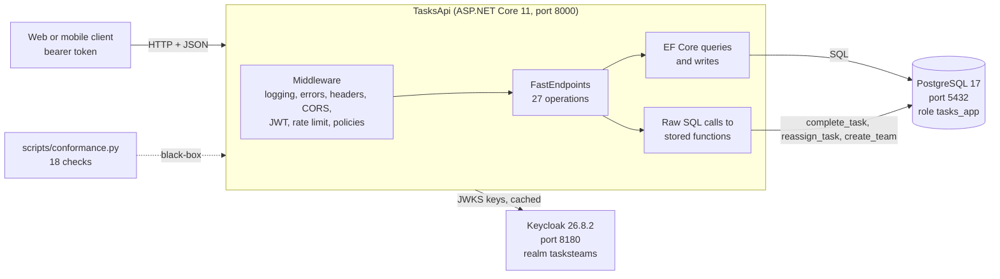

# Backend ASP.NET Core: the Tasks and Teams API in C#

This capstone implements the whole [platform contract](../platform/README.md) with **ASP.NET Core 11**, **FastEndpoints** (one class per operation), **EF Core 11 with Npgsql**, the platform's Postgres **stored functions**, **Keycloak** token validation and **Docker**. It is one of four interchangeable backends (Python, ASP.NET, Go, Rust): it is conformant because `python scripts/conformance.py` prints `18 passed, 0 failed` against it, so any web or mobile client works with it unchanged.

| Part | Chapter |
|------|---------|
| Solution, FastEndpoints, `/health`, problem details, validation errors | [01 The ASP.NET Core skeleton](tutorials/phase-1-skeleton/01-skeleton.md) |
| All 27 operations on EF Core, stored functions, ETag, `If-Match`, cursors, filters, idempotency | [02 Data access](tutorials/phase-2-data/02-data-access.md) |
| Keycloak tokens, scopes, realm roles, team membership (404 and 403) | [03 Identity](tutorials/phase-3-identity/03-identity.md) |
| Multi-stage non-root image, Compose override on the platform network | [04 Run and ship](tutorials/phase-4-run-and-ship/04-run-and-ship.md) |
| OWASP API Top 10 walk-through, rate limits, headers, CORS, logging | [05 Hardening](tutorials/phase-5-hardening/05-hardening.md) |
| Design | [TDD.md](TDD.md), [GLOSSARY.md](GLOSSARY.md) |

## System diagram



## How to run it against the platform stack
You need Docker (Linux containers), Python 3.10+ and, for the host build, the .NET SDK 11.0.100 or newer. Host ports 5432, 8180 and 8000 must be free (one backend at a time).

1. Take the finished project: unzip `backend-dotnet-phase-5-hardening.zip` and open `05-hardening/code` (or `source/phase-5-hardening/05-hardening/code` in the repository). It already contains the platform files (`db/`, `keycloak/`, `docker-compose.yml`, `scripts/conformance.py`, `openapi.yaml`), copied unchanged from the platform capstone.
2. Create the local environment file (fake values only):
   ```powershell
   Copy-Item .env.example .env
   ```
   On macOS and Linux: `cp .env.example .env`.
3. Build the image and start Postgres, Keycloak and the API. Compose merges `docker-compose.yml` (the platform) with `docker-compose.override.yml` (the `api` service) by itself:
   ```powershell
   docker compose -p backend up -d --build --wait
   ```
4. Check it and run the conformance script:
   ```powershell
   python scripts/conformance.py
   ```
   Expected last line: `18 passed, 0 failed`.
5. Look around: `python scripts/call.py --as alice GET /v1/teams`, `python scripts/show_token.py bob`. Logs: `docker compose -p backend logs -f api`.
6. Stop and remove everything, including the database volume:
   ```powershell
   docker compose -p backend down -v --remove-orphans
   docker image rm code101/tasksteams-backend-dotnet:1.0
   ```

To run the API on the host instead (for debugging), start only the infrastructure with `docker compose -p backend up -d --wait db keycloak`, then `cd src/TasksApi` and `dotnet run`. The default settings in `appsettings.json` point at `127.0.0.1:5432` and `127.0.0.1:8180`.

To point a web or mobile client at this backend, keep the default `API_BASE_URL` (`http://localhost:8000`). The clients sign in with the realm clients `tasks-web` and `tasks-mobile` from the platform.

## Phase packs
| Pack | What it holds | Conformance result |
|------|---------------|--------------------|
| `backend-dotnet-phase-1-skeleton.zip` | solution, health, stubs, problem details | not run (needs the stack); `health` answered by hand |
| `backend-dotnet-phase-2-data.zip` | all 27 operations, stand-in sign-in | 15 passed, 3 failed |
| `backend-dotnet-phase-3-identity.zip` | real token validation | 17 passed, 1 failed |
| `backend-dotnet-phase-4-run-and-ship.zip` | Dockerfile, Compose override | 17 passed, 1 failed |
| `backend-dotnet-phase-5-hardening.zip` | rate limits, headers, CORS, logging | **18 passed, 0 failed** |

## Status
Verified on 2026-11-23 (Windows 11, .NET SDK 11.0.100, Docker 29.9.3, Compose 5.7.0, Python 3.15.2) with `python scripts/verify_labs.py capstones/backend-dotnet`: every chapter builds, its lab runs once and everything is removed afterwards.

## Contract notes (for the platform maintainers)
Things found while implementing the contract that the platform capstone may want to settle:
- **`If-None-Match`:** the platform TDD (R-12) says teams, projects and tasks answer 304; `openapi.yaml` defines it on `GET /v1/tasks/{taskId}` only. This backend follows the OpenAPI file.
- **Body size:** the TDD sets a 1 MB limit (API4) but no status code or problem type. This backend answers `413` with type `.../problems/payload-too-large`.
- **Path and query parse errors:** `400` is listed for "bad query parameter"; a malformed path id (not a UUID) is not mentioned. This backend answers 400 for both.
- **`tasks_app` password:** `schema.sql` creates the role with a fixed password, but `.env.example` has no variable for it. This backend adds `TASKS_APP_PASSWORD` to its own `.env.example`.
- **Unknown JSON fields** (`additionalProperties: false`) have no stated status; this backend answers 400.
- **Demoting the last lead** through `PUT /members/{userId}` is not mentioned (only removal gives 409); this backend answers 409 with `code: last_lead` for both.
