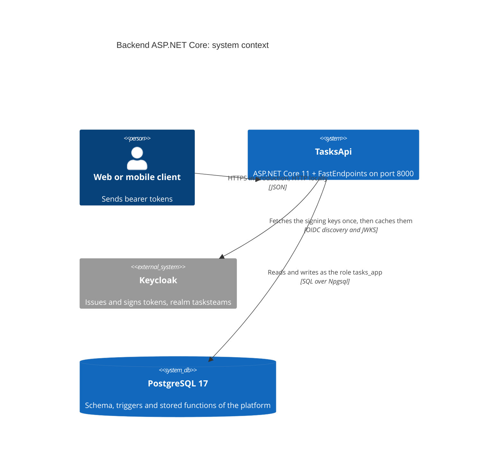
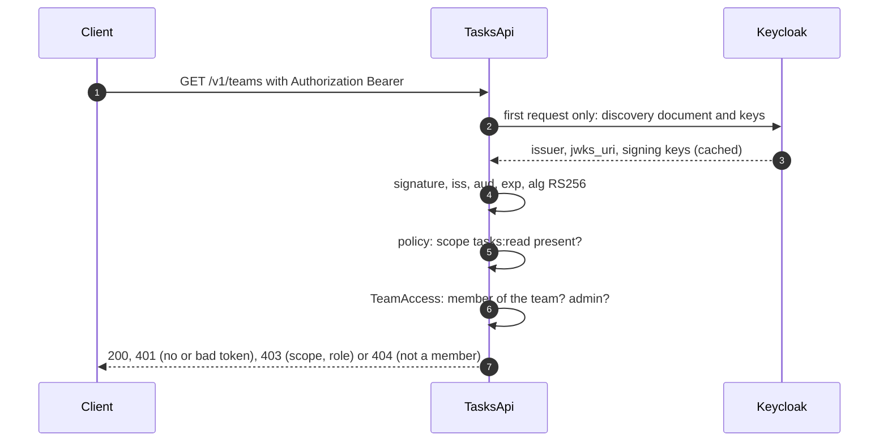

# TDD: Backend ASP.NET Core (Tasks and Teams)

| Field | Value |
|-------|-------|
| Id | backend-dotnet |
| Level | 201 |
| Status | Verified (all five chapters pass `scripts/verify_labs.py`; chapter 5 passes `18 passed, 0 failed` on 2026-11-23) |
| Depends on | platform |
| Stack | .NET 11.0.0 / SDK 11.0.100 (`net11.0`, Standard Term Support, supported until 14 November 2028), ASP.NET Core 11, FastEndpoints 9.0.0 (REPR, FluentValidation 12.2.0), EF Core 11.0.0 with Npgsql.EntityFrameworkCore.PostgreSQL 11.0.0, Microsoft.AspNetCore.Authentication.JwtBearer 11.0.0, Docker images `mcr.microsoft.com/dotnet/sdk:11.0.100-alpine3.24` and `mcr.microsoft.com/dotnet/aspnet:11.0.0-alpine3.24`. Versions checked against nuget.org, MCR and the official docs on 2026-11-23 |
| Estimated learner time | 5 chapters, about 8 hours (90 + 150 + 90 + 75 + 75 minutes) |
| Last updated | 2026-11-23 |

## 1. Purpose and learning goals
This capstone implements the whole platform contract ([platform TDD](../platform/TDD.md), [openapi.yaml](source/phase-5-hardening/05-hardening/code/openapi.yaml)) with ASP.NET Core. It is one of four interchangeable backends: the same conformance script must print `18 passed, 0 failed` against it, so every web and mobile client works with it unchanged.

Skills gained:
1. Structure an API by feature with FastEndpoints (REPR): one class per operation with its request, validator and handler.
2. Return RFC 9457 problem details for every failure and map database errors (SQLSTATE) to HTTP statuses.
3. Use EF Core against an existing database (database first) and decide what stays in EF and what is a stored function.
4. Apply optimistic concurrency end to end: row `version`, strong `ETag`, `If-Match`, 412 and 428.
5. Page with keyset cursors, filter safely, and make creates idempotent with `Idempotency-Key`.
6. Validate Keycloak access tokens (issuer, audience, signature, expiry) and combine scope, realm role and team membership.
7. Ship a non-root, multi-stage Docker image that joins the platform network.
8. Harden the API against the OWASP API Security Top 10: rate limits, headers, size limits, logging without secrets.

## 2. Scope
**In scope:** the 27 operations of the contract; the `TasksApi` project; the Dockerfile and a Compose override that adds the `api` service to the platform stack; the five chapters; this TDD and the README.
**Out of scope:** changing the contract, the schema or the realm (copied unchanged from the platform capstone); a web or mobile client; EF Core migrations (the database owns the schema); a message queue, cache or shared rate-limit store; TLS termination (a reverse proxy does that in production); automated tests (the lessons teach testing elsewhere, here verification is a smoke run).
**Assumptions:** Docker is running; ports 5432, 8180 and 8000 are free; the platform stack (Postgres 17, Keycloak 26.8.2) is the one started by the Compose file in the pack.
**Constraints:** all passwords are fake and local; the API connects as the limited role `tasks_app`; a user who is not a member of a team gets 404 for its objects.

## 3. Requirements
Ids are the platform's requirement ids (see platform TDD section 3); the second column says what this backend must do.

| Id | Requirement in this backend | Priority | Acceptance check | Phase |
|----|-----------------------------|----------|------------------|-------|
| R-01 | Implements every operation and schema of `openapi.yaml` (27 endpoint classes) | Must | the log says `Registered 27 endpoints`; conformance | 1, 2 |
| R-02 | `GET /health` is public and reports the database (`up` or `down`, 503 when down) | Must | check `health` | 1, 2 |
| R-03 | `GET /v1/me` returns the caller, roles, scopes and teams; the `users` row is created on first use | Must | check `me` | 2, 3 |
| R-04 | Teams and memberships: list, create (admin, through `create_team`), read, patch, delete (admin), members with `lead` and `member` | Must | checks `create team`, `cleanup` | 2 |
| R-05 | Projects belong to a team; the key is unique per team (409) | Must | check `create project` | 2 |
| R-06 | Tasks: create, read, patch, delete, complete and reassign (stored functions) | Must | checks `create task`, `update with If-Match` | 2 |
| R-07 | Comments: list, create, delete (author, lead or admin) | Must | smoke run of the lessons | 2 |
| R-08 | Every write sets `app.current_user_id` in its transaction so the audit trigger names the actor; admins read the audit log | Must | check `audit log` | 2 |
| R-09 | All errors are `application/problem+json`, including 404 for unknown routes, 405, 415 and 500 (one exception: a rejected `Host` header is answered by the framework with a small HTML 400 before our code runs) | Must | checks `problem details shape`, `401 without token` | 1 |
| R-10 | Opaque keyset cursors (`limit`, `cursor`, `page.nextCursor`); a bad cursor is 400 | Must | check `cursor pagination` | 2 |
| R-11 | Task filters (`status`, `priority`, `assigneeId`, `dueBefore`, `dueAfter`, `q`) and sorts (`createdAt`, `-createdAt`, `dueDate`) | Should | smoke run of chapter 2 | 2 |
| R-12 | Strong ETag = quoted `version`; `If-Match` gives 412 when stale and 428 when missing; `If-None-Match` on a task gives 304 | Must | checks `get task with ETag`, `stale If-Match` | 2 |
| R-13 | `Idempotency-Key` on the four create operations; replays carry `Idempotent-Replayed: true` | Must | check `create task with Idempotency-Key` | 2 |
| R-14 | `RateLimit-Limit`, `RateLimit-Remaining`, `RateLimit-Reset` on every response; 429 with `Retry-After` | Should | check `me` (headers) | 5 |
| R-15 | `/v1` prefix on every route except `/health` | Must | route table | 1 |
| R-16 | Uses the schema as it is (constraints, triggers); no migration touches it | Must | `db/schema.sql` is byte-identical to the platform | 2 |
| R-17 | `complete_task`, `reassign_task` and `create_team` are called as stored functions with raw SQL | Must | chapter 2 SQL log | 2 |
| R-18 | The `sub` claim is the user id; seed users match Keycloak users | Must | check `token for alice` | 3 |
| R-20 | Validates `iss`, `aud` (string or list), `exp`, signature (RS256 only); requires scope and realm role per route | Must | checks `401 without token`, `403 for member on admin route` | 3 |
| R-21 | Compose override adds `api` to the platform network `tasksteams-net`, published on `127.0.0.1:8000` | Must | `docker compose up -d --build --wait` | 4 |
| R-23 | Connects as `tasks_app` only | Should | connection string | 2 |
| R-24 | Each chapter has a runnable pack, a `verify.json` and a lesson text that matches the code | Must | `python scripts/verify_labs.py capstones/backend-dotnet` | 1-5 |

| Non-functional requirement | Target |
|----------------------------|--------|
| Response time | p95 under 200 ms for read and list on the seed data (the conformance run takes well under 1 second per check) |
| Image | non-root user (`uid=1654(app)`), read-only root file system, no Linux capabilities, `no-new-privileges` |
| Request limits | body 1 MB, headers 32 KB, header timeout 15 s, page size at most 100 |
| Rate limit | 100 requests per 60 seconds per user, 30 per client address when anonymous; `/health` is exempt |
| Logging | one JSON line per request with method, path (no query), status, time, user id, trace id; never tokens, bodies or passwords |
| Portability | Windows, macOS and Linux (host build) and a Linux container |

## 4. Architecture
Context (C4 level 1):



The request pipeline inside the process (middleware in the order a request meets it):

```mermaid
flowchart LR
    REQ["HTTP request"] --> LOG["Request logging"]
    LOG --> EXC["Exception handler<br/>(problem details)"]
    EXC --> SC["Status code pages"]
    SC --> SEC["Security headers"]
    SEC --> CORS["CORS"]
    CORS --> AUTHN["JWT authentication"]
    AUTHN --> RL["Rate limit"]
    RL --> AUTHZ["Authorization policy<br/>(scope + role)"]
    AUTHZ --> PROV["User provisioning"]
    PROV --> FE["FastEndpoints<br/>bind, validate, handle"]
    FE --> DB[("PostgreSQL")]
```



Components:

| Component | Responsibility |
|-----------|----------------|
| `Features/<Area>/<Operation>Endpoint.cs` | One operation: request class, validator, endpoint. Thin: authorize, call data code, shape the response |
| `Data` | `TasksDbContext`, entities, expression projections to DTOs, the idempotency helper, `LIKE` escaping |
| `Security` | `CurrentUser` from claims, policies (scope and role), `TeamAccess` (404 or 403 by membership), JWT setup, rate limiter, security headers, user provisioning |
| `Common` | Problem details, the exception handler, `DbErrors` (SQLSTATE mapping), ETag helpers, keyset paging, merge-patch `Optional<T>` |
| `Contracts` | The response DTO records, named after the OpenAPI schemas |

Decisions (ADR style):

| Decision | Alternatives | Consequences |
|----------|--------------|--------------|
| FastEndpoints (REPR) | Controllers; Minimal APIs | One class per operation, easy to find; a framework dependency; do not mix styles |
| EF Core for reads and simple writes, raw SQL for the three stored functions | EF only; Dapper only; stored functions for everything | Strongly typed queries and change tracking where they help; atomic rules stay in the database once for all four backends |
| Database first, no EF migrations | `dotnet ef migrations` over the platform schema | The platform owns the schema (baseline 0001). EF migrations would try to create tables that exist and could not express the triggers and functions. Later changes become numbered SQL files in the platform |
| Version column as the EF concurrency token | A hash of the body; a separate `rowversion` | The DB trigger already increments `version`; EF adds `WHERE version = @expected`, so the check and the update are one atomic statement |
| Keyset cursor with `(createdAt, id)` | Offset paging | Stable while rows are added; no random page jump; cursor is opaque base64url JSON |
| Idempotency key row written inside the create transaction | A separate transaction; an in-memory cache | A crash cannot leave a key without its result; concurrent duplicates wait on the primary key |
| Own fixed-window limiter | `AddRateLimiter` | The built-in limiter cannot report remaining requests and reset time on success; in memory means per instance |
| Single project with folders | Clean-architecture class libraries | The domain is small and the rules live in the database; fewer moving parts. Dependencies still point one way |
| Alpine runtime image, `InvariantGlobalization` | Debian (noble) image with ICU | Smaller image; no culture data needed |

EF Core versus stored functions:

| Operation | Implementation | Why |
|-----------|----------------|-----|
| All GET and list operations | EF Core `AsNoTracking` queries with expression projections | Read only, typed, one SELECT per call |
| Create project, task, comment; add and change members; patch team, project, task; deletes | EF Core change tracking or `ExecuteDelete`, inside a write transaction | Simple single-table writes; the triggers add `version`, `updated_at` and the audit row |
| Create team (team plus first lead) | `SELECT * FROM create_team(...)` | Two inserts that must succeed together |
| Complete task | `SELECT * FROM complete_task(...)` | Locks the row (`FOR UPDATE`), checks the version and the rules, idempotent for done tasks |
| Reassign task | `SELECT * FROM reassign_task(...)` | Locks the row, checks version, status and that the assignee belongs to the team |
| Idempotency keys, user provisioning, `set_config` | `ExecuteSql` with parameters | Statements EF Core has no model for (`ON CONFLICT`, `set_config`) |

## 5. Domain and data model
The data model is the platform's ([platform TDD section 5](../platform/TDD.md)); this capstone does not change it. The mapping is:

| Table | Entity class | Notes |
|-------|--------------|-------|
| `users` | `User` | Row created on the first request of a new Keycloak user (`INSERT ... ON CONFLICT DO NOTHING`) |
| `teams` | `Team` | `version`, `created_at`, `updated_at` generated by the database (EF reads them back with `RETURNING`) |
| `team_members` | `TeamMember` | Composite key `(team_id, user_id)` |
| `projects`, `tasks` | `Project`, `TaskItem` | `TaskItem` avoids the name clash with `System.Threading.Tasks.Task` |
| `comments` | `Comment` | Navigation to `Author` for the projection |
| `audit_log` | `AuditEntry` | Read only for the API (the role has no UPDATE or DELETE right) |
| `idempotency_keys` | `IdempotencyKey` | Written with SQL; read with EF |

Column names are `snake_case`; one loop in `OnModelCreating` converts the property names. **Migration strategy:** none in this capstone. The schema is the platform baseline `db/schema.sql`, run once by Compose on an empty volume. A schema change is a new numbered file in the platform capstone, never an EF migration. **Seed data:** `db/seed.sql` from the platform (three users, two teams, three projects, eight tasks, three comments).

## 6. API design
The contract is [openapi.yaml](source/phase-5-hardening/05-hardening/code/openapi.yaml); the table in the [platform TDD section 6](../platform/TDD.md) lists method, path, access and statuses. This backend adds the class that implements each operation and the policy that guards it. Policies: `Read` = scope `tasks:read`; `Write` = `tasks:write`; `AdminWrite` = `tasks:write` and role `admin`; `AdminOnly` = `tasks:admin` and role `admin`. The team level (`member`, `lead`) is checked in `TeamAccess`.

| Operation | Endpoint class | Policy | Team level |
|-----------|----------------|--------|------------|
| `GET /health` | `HealthEndpoint` | anonymous | none |
| `GET /v1/me`, `GET /v1/users` | `MeEndpoint`, `ListUsersEndpoint` | Read | none |
| `GET /v1/teams`, `GET /v1/teams/{id}` | `ListTeamsEndpoint`, `GetTeamEndpoint` | Read | member (admin sees all) |
| `POST /v1/teams` | `CreateTeamEndpoint` | AdminWrite | none |
| `PATCH /v1/teams/{id}` | `UpdateTeamEndpoint` | Write | lead |
| `DELETE /v1/teams/{id}` | `DeleteTeamEndpoint` | AdminOnly | none |
| `GET`, `PUT`, `DELETE` members | `ListMembersEndpoint`, `PutMemberEndpoint`, `RemoveMemberEndpoint` | Read, Write, Write | member, lead, lead |
| projects: list, get | `ListProjectsEndpoint`, `GetProjectEndpoint` | Read | member |
| projects: create, patch, delete | `CreateProjectEndpoint`, `UpdateProjectEndpoint`, `DeleteProjectEndpoint` | Write | lead |
| tasks: list, get | `ListTasksEndpoint`, `GetTaskEndpoint` | Read | member |
| tasks: create, patch, complete | `CreateTaskEndpoint`, `UpdateTaskEndpoint`, `CompleteTaskEndpoint` | Write | member |
| tasks: delete, reassign | `DeleteTaskEndpoint`, `ReassignTaskEndpoint` | Write | lead |
| comments: list, create | `ListCommentsEndpoint`, `CreateCommentEndpoint` | Read, Write | member |
| comments: delete | `DeleteCommentEndpoint` | Write | author, otherwise lead |
| `GET /v1/audit-log` | `ListAuditEndpoint` | AdminOnly | none |

**Error mapping.** `DbErrors.Map` turns database errors into problems; anything it does not know is a 500 with a neutral text.

| Source | HTTP status and `type` | Detail shown |
|--------|------------------------|--------------|
| SQLSTATE `TS404` (function: not found) | 404 `not-found` | the function's message |
| SQLSTATE `TS409` (rule violated, for example cancelled task) | 409 `conflict` | the function's message |
| SQLSTATE `TS412` (stale version) | 412 `precondition-failed` | the function's message (current version) |
| SQLSTATE `TS422` (invalid input, for example assignee not in team) | 422 `validation-error` | the function's message |
| `23505` unique violation | 409 `conflict` | "A resource with the same name or key already exists." |
| `23503` foreign key violation | 422 `validation-error` | "A referenced resource does not exist." |
| `23514` check violation | 422 `validation-error` | "A value breaks a rule of the database." |
| `DbUpdateConcurrencyException` (UPDATE `WHERE version = @expected` found no row) | 412 `precondition-failed` | "The resource changed since you read it." |
| validator rule failed | 422 `validation-error` with `errors[]` (JSON Pointer) | the rule's message |
| malformed JSON, unknown field, bad route or query value, bad cursor, bad `limit` | 400 `bad-request` | generic text, no parser details |
| body over 1 MB | 413 `payload-too-large` (not in the contract list) | "The request body is larger than the 1 MB limit." |

**Other contract behaviour.** Pagination, ETag, merge patch, idempotency, versioning: [platform TDD section 6](../platform/TDD.md). Implementation notes: the cursor is `base64url({"value": sortValue, "id": id})`; `PATCH` bodies are bound to `Optional<T>` so absent and `null` differ; the ETag is also checked inside the `UPDATE` (see ADR); idempotent replays return the stored JSON with status 201.

## 7. Identity and security design
Token validation in `JwtSetup` (steps as in the platform TDD section 7): metadata and keys from `Auth:MetadataAddress` (inside Docker `http://keycloak:8080/...`), issuer compared with `Auth:Issuer` (`http://localhost:8180/realms/tasksteams`, which differs from the address the API calls), audience `tasks-api` (a string or a list both pass), lifetime with 30 seconds skew, `RS256` only, signed tokens required, `MapInboundClaims = false` so claim names stay as Keycloak sends them.



| Rule | Where | Result |
|------|-------|--------|
| No token, bad signature, wrong issuer or audience, expired | `JwtSetup` `OnChallenge` | 401 problem, `WWW-Authenticate: Bearer realm="tasksteams"` plus `error="invalid_token"` when a token was sent |
| Scope or realm role missing | `TokenRequirementHandler`, `ProblemAuthorizationHandler` | 403 problem naming the missing scope or role |
| Not a member of the team | `TeamAccess.RequireTeamAsync` | 404 (ids cannot be probed) |
| Member but not lead for a lead-only operation | `TeamAccess` | 403 |
| Admin realm role | `CurrentUser.IsAdmin` | passes the team checks; still needs the scope |

OWASP API Security Top 10 (2023) mapped to this code (chapter 5 walks through each row):

| Risk | Mitigation in this backend |
|------|----------------------------|
| API1 Broken object level authorization | `TeamAccess` is called by every operation that takes a team, project, task or comment id; non-members get 404 |
| API2 Broken authentication | `JwtSetup` validation rules; no password handling in the API; tokens never logged |
| API3 Broken object property level authorization | Request classes contain only writable fields; `UnmappedMemberHandling.Disallow` rejects others; `Optional<T>` patches only listed fields |
| API4 Unrestricted resource consumption | `limit` at most 100, Kestrel body and header limits, rate limiter, field length validators |
| API5 Broken function level authorization | Policies per endpoint (`AdminWrite`, `AdminOnly`); a member's token with the admin scope is still refused |
| API6 Unrestricted access to sensitive business flows | Team creation is admin only; `Idempotency-Key` stops duplicate creates; archived projects take no new tasks |
| API7 Server-side request forgery | The only outgoing call is the metadata and key fetch from the configured address |
| API8 Security misconfiguration | Security headers, no `Server` header, no stack traces, exact CORS origins, `AllowedHosts`, non-root read-only container, loopback ports. `RequireHttpsMetadata` is `false` only for the local http Keycloak |
| API9 Improper inventory management | 27 endpoint classes equal the 27 operations (the startup log counts them); `/v1` prefix |
| API10 Unsafe consumption of APIs | Tokens are trusted only from the configured issuer; request JSON is validated before use |

Threat model summary. **Assets:** tasks and comments, identities, the audit trail. **Entry points:** port 8000, the database credentials in the environment, the Keycloak address. **Top threats:** stolen or replayed token (short lifetime, audience check), privilege escalation (scope and role intersection, team membership), lost update (ETag inside the UPDATE), duplicate create on retry (idempotency keys), brute-force or scraping (rate limit), injection (parameterised SQL only; `LIKE` input is escaped), information leak through errors (neutral 500), container breakout (non-root, read-only, no capabilities).

## 8. Project structure
```text
capstones/backend-dotnet/
  README.md  TDD.md  GLOSSARY.md
  tutorials/phase-N-slug/NN-slug.md             five chapters
  source/phase-N-slug/PACK-README.md
  source/phase-N-slug/NN-slug/{code, exercise/{starter,solution}, verify.json}
  code/ (the finished project, chapter 5)
    global.json  TasksApi.slnx  Dockerfile  docker-compose.yml  docker-compose.override.yml  .env.example
    openapi.yaml  db/  keycloak/  scripts/{conformance.py, call.py, show_token.py}  requests/
    src/TasksApi/
      Program.cs  appsettings.json  TasksApi.csproj
      Common/  Contracts/  Data/  Security/
      Features/{Platform, Teams, Members, Projects, Tasks, Comments, Audit}/
```
Layering rule: `Features` may use `Data`, `Security`, `Common` and `Contracts`; `Data` uses `Common` only for problem exceptions; nothing uses `Features`. Naming: endpoint classes are `<Verb><Thing>Endpoint`, requests `<Verb><Thing>Request`, validators `<Verb><Thing>Validator`, in the same file. JSON is `camelCase`, database columns `snake_case`.

| Variable (environment or `appsettings.json` key) | Default | Meaning |
|--------------------------------------------------|---------|---------|
| `Urls` | `http://127.0.0.1:8000` (container: `http://0.0.0.0:8000`) | Where Kestrel listens |
| `ConnectionStrings__Default` | `Host=127.0.0.1;...;Username=tasks_app;Password=tasks_app_local_only` | Database connection (a secret in real systems) |
| `Auth__Issuer` | `http://localhost:8180/realms/tasksteams` | Expected `iss` |
| `Auth__MetadataAddress` | `http://127.0.0.1:8180/realms/tasksteams/.well-known/openid-configuration` | Where keys come from |
| `Auth__Audience`, `Auth__RequireHttpsMetadata` | `tasks-api`, `false` locally | Expected `aud`; allow http metadata |
| `RateLimit__AuthenticatedLimit`, `AnonymousLimit`, `WindowSeconds` | 100, 30, 60 | Rate limits |
| `Cors__Origins__0`, `__1` | `http://localhost:4200`, `http://localhost:5173` | Allowed browser origins |
| `API_PORT`, `TASKS_APP_PASSWORD` (Compose `.env`) | `8000`, `tasks_app_local_only` | Published port and database password for the container |

## 9. Delivery plan (phases)
| Phase | Title | Chapters | Requirement ids | Exit check (smoke) | Source pack |
|-------|-------|----------|-----------------|--------------------|-------------|
| 1 | Skeleton | 01 The ASP.NET Core skeleton | R-09, R-15; part of R-01 to R-03 | `GET /health` answers `{"status":"ok","version":"1.0.0"}`; an empty team name gives a 422 problem | `backend-dotnet-phase-1-skeleton.zip` |
| 2 | Data | 02 Data access with EF Core and stored functions | R-01 to R-08, R-10 to R-13, R-16, R-17, R-23 | conformance: 15 passed, 3 failed (no sign-in, no rate-limit headers yet) | `backend-dotnet-phase-2-data.zip` |
| 3 | Identity | 03 Keycloak tokens, scopes and roles | R-03, R-18, R-20 | conformance: 17 passed, 1 failed (rate-limit headers) | `backend-dotnet-phase-3-identity.zip` |
| 4 | Run and ship | 04 Docker image and Compose | R-21 | the API runs as `uid=1654(app)` in Compose; conformance 17 passed, 1 failed | `backend-dotnet-phase-4-run-and-ship.zip` |
| 5 | Hardening | 05 OWASP walk-through, limits, headers, logging | R-14 and the non-functional table | conformance: 18 passed, 0 failed | `backend-dotnet-phase-5-hardening.zip` |

Each pack holds the whole project at the end of its phase, so a learner can start at any phase.

## 10. Verification plan
Smoke only, Docker temporary (`python scripts/verify_labs.py capstones/backend-dotnet`). Every `verify.json` sets `"exclusive": "tasksteams"` so only one lab at a time uses ports 5432, 8180 and 8000. Chapter 1 builds the project, starts it on the host and calls it with `curl` (health, the stub, a created team and six kinds of failure). Chapters 2 and 3 start Postgres and Keycloak under `docker compose -p {project} up -d --wait`, run the API on the host and run `scripts/conformance.py` once, expecting the partial results above. Chapters 4 and 5 run `docker compose -p {project} up -d --build --wait`, chapter 4 checks the container user, and both run the conformance script (17 passed in chapter 4, 18 in chapter 5); chapter 5 also checks the rate-limit, security and CORS headers, a refused token, a 413 and a refused `Host`. The exercise solutions of chapters 1, 2, 3 and 5 are built once (`dotnet build`); the one of chapter 4 is checked with `docker compose config`. `cleanup` always runs `docker compose -p {project} down -v --remove-orphans` and removes the image `code101/tasksteams-backend-dotnet:1.0`. No `dotnet test` and no unit tests are run. A backend is conformant when the final chapter prints `18 passed, 0 failed`.

## 11. Deployment and operations
| Item | Value |
|------|-------|
| Compose | `docker-compose.yml` (platform: `db`, `keycloak`) plus `docker-compose.override.yml` (adds `api`), project name chosen by `-p` |
| Ports | `127.0.0.1:8000` API, `127.0.0.1:8180` Keycloak, `127.0.0.1:5432` Postgres (host-port table of the platform) |
| Network | `tasksteams-net`, shared with the platform services |
| Health | Container health check `wget http://127.0.0.1:8000/health`; `GET /health` is 503 when the database is down |
| Logs | `docker compose -p <name> logs -f api` shows JSON lines; one per request plus warnings for 403, 429 and rejected tokens |
| Secrets | `.env` (Git-ignored, created from `.env.example`); production values come from a secret store |
| Backup | `docker compose -p <name> exec -T db pg_dump -U tasks_admin tasksteams > backup.sql` |

## 12. Risks, open questions, decisions
| Risk or question | Impact | Mitigation / decision |
|------------------|--------|-----------------------|
| `appsettings.json` beats `ASPNETCORE_URLS`, so the container listened on 127.0.0.1 only | Published port unreachable | The image sets `Urls`, the same key (found while writing chapter 4; shown in Common mistakes) |
| The in-memory rate limiter is per instance and keys on the client address | Behind a proxy all users share one address when anonymous | Documented; use forwarded headers and a shared store in production |
| `RequireHttpsMetadata: false` | Keys fetched over http could be tampered with | Local development only; chapter 5 and the table of this TDD say to set `true` with an https issuer |
| FastEndpoints reports route and query binding failures as validation failures (422) | Contract says 400 | `ProblemResponses.ValidationProblem` maps failures without an error code to 400 |
| EF Core 11 and Npgsql 11 are new (GA November 2026) | Few community answers | Versions pinned; the code uses only long-stable APIs |
| Body over 1 MB answers 413 | The contract lists no 413 | See "Contract notes" in the README; 413 is the correct HTTP status |
| Open: `If-None-Match` on teams and projects | The platform TDD mentions it for all three resources, the OpenAPI file only for tasks | Implemented where the OpenAPI file has it (tasks) |

## 13. References
- .NET and .NET Core support policy: https://dotnet.microsoft.com/platform/support/policy/dotnet-core
- ASP.NET Core best practices: https://learn.microsoft.com/aspnet/core/fundamentals/best-practices
- FastEndpoints documentation: https://fast-endpoints.com/docs/get-started
- EF Core raw SQL queries and `ExecuteSql`: https://learn.microsoft.com/ef/core/querying/sql-queries
- EF Core concurrency tokens: https://learn.microsoft.com/ef/core/saving/concurrency
- Npgsql EF Core provider: https://www.npgsql.org/efcore/
- JWT bearer authentication in ASP.NET Core: https://learn.microsoft.com/aspnet/core/security/authentication/
- RFC 9457 Problem Details, RFC 9110 (ETag, If-Match, 412, 304), RFC 6585 (428, 429), RFC 7396 (JSON Merge Patch), RFC 6901 (JSON Pointer): https://www.rfc-editor.org/
- OWASP API Security Top 10 2023: https://owasp.org/API-Security/editions/2023/en/0x11-t10/
- Docker: multi-stage builds https://docs.docker.com/build/building/multi-stage/ and Compose merge https://docs.docker.com/compose/how-tos/multiple-compose-files/merge/
- Platform contract: [../platform/TDD.md](../platform/TDD.md)
