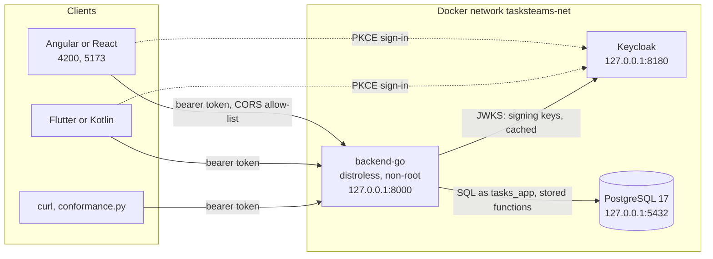

# Backend Go: the Tasks and Teams API in Go

A Go implementation of the [platform contract](../platform/README.md): all 27 operations, RFC 9457 problem details, ETag and `If-Match`, keyset pagination, idempotency keys, Keycloak token validation with roles and scopes, rate limits and an audit trail written by the database. It passes the platform's conformance script (`18 passed, 0 failed`), so any web client works with it, and so do the Flutter and Kotlin apps.

| Part | Where | Chapter |
|------|-------|---------|
| Design | [TDD.md](TDD.md): requirements R-01 to R-21, diagrams, security design, phase plan | all |
| Skeleton | config, router, problem details, validation, graceful shutdown | [01](tutorials/phase-1-skeleton/01-skeleton.md) |
| Data | `pgxpool`, the store, teams, members, projects | [02](tutorials/phase-2-data/02-store-and-teams.md) |
| Data | tasks, stored functions, comments, audit trail | [03](tutorials/phase-2-data/03-tasks-and-procedures.md) |
| Data | idempotency keys | [04](tutorials/phase-2-data/04-idempotency.md) |
| Identity | Keycloak JWT validation, JWKS cache, roles and scopes | [05](tutorials/phase-3-identity/05-jwt-and-roles.md) |
| Run and ship | multi-stage Dockerfile, Compose override, healthcheck | [06](tutorials/phase-4-run-and-ship/06-docker.md) |
| Hardening | rate limits, headers, CORS, body limit, logging, OWASP walk-through | [07](tutorials/phase-5-hardening/07-hardening.md) |
| Terms | [GLOSSARY.md](GLOSSARY.md) | |

## System diagram



Inside the service: `cmd/api` wires `internal/http` (routes, middleware, DTOs), `internal/store` (every SQL statement, transactions with the acting user), `internal/auth` (JWT and JWKS), `internal/problem` and `internal/config`. See the TDD, section 4.

## Run it against the platform stack

The finished project is in `source/phase-5-hardening/07-hardening/code`. It contains byte-identical copies of the platform files (`docker-compose.yml`, `.env.example`, `db/`, `keycloak/`, `scripts/conformance.py`), so one folder starts everything. You need Docker (Linux containers), Python 3.10+ and ports 5432, 8000 and 8180 free (run one backend at a time).

**PowerShell or bash (folder `07-hardening/code`)**
```bash
cp .env.example .env
docker compose -p tasksteams up -d --build --wait
python scripts/conformance.py
```
(PowerShell: `Copy-Item .env.example .env`.) The last command prints `18 passed, 0 failed`. The first start downloads images and Keycloak takes up to a minute. Stop and delete everything with:
```bash
docker compose -p tasksteams down -v --remove-orphans --rmi local
```

**Develop on the host instead.** Start only the infrastructure and run the API with `go run`; it uses the same defaults as the container:
```bash
docker compose -p tasksteams up -d --wait db keycloak
go run ./cmd/api
```
**Is the platform capstone's own stack already running?** Stop it first (`docker compose -p platform down -v --remove-orphans` in its folder): it uses the same ports and the same network name `tasksteams-net`.

Settings (environment variables, all optional for local use):

| Variable | Default | Meaning |
|----------|---------|---------|
| `LISTEN_ADDR` | `127.0.0.1:8000` | address of the API (`0.0.0.0:8000` in the image) |
| `DATABASE_URL` | the platform's local `tasks_app` URL | PostgreSQL connection |
| `KEYCLOAK_ISSUER`, `KEYCLOAK_AUDIENCE`, `KEYCLOAK_JWKS_URL` | realm `tasksteams`, `tasks-api`, the realm's certs URL | token validation |
| `CORS_ORIGINS` | `http://localhost:4200,http://localhost:5173` | allowed browser origins |
| `RATE_LIMIT_PER_MINUTE`, `RATE_LIMIT_ANONYMOUS_PER_MINUTE` | `100`, `30` | request budgets |
| `MAX_BODY_BYTES` | `1048576` | body limit |
| `LOG_LEVEL`, `LOG_FORMAT` | `info`, `text` (`json` in the image) | logging |

Clients choose this backend with their `API_BASE_URL` (default `http://localhost:8000`).

## How to work through it

1. Read the [TDD](TDD.md) sections 3, 4, 6 and 7 (about 25 minutes).
2. Do the seven chapters in order. Each phase pack contains the whole project at that point, so you may start at any phase; the text of a chapter shows every new or changed file in full and names the files that did not change.
3. Compare your own run with the conformance numbers below.

| Phase | Pack | Chapters | Time | Conformance of that phase |
|-------|------|----------|------|---------------------------|
| 1 Skeleton | `backend-go-phase-1-skeleton.zip` | 01 | 90 min | 6 passed, 12 failed |
| 2 Data | `backend-go-phase-2-data.zip` | 02, 03, 04 | 120 + 120 + 60 min | 6 passed, 12 failed (the sign-in stand-in cannot satisfy token checks) |
| 3 Identity | `backend-go-phase-3-identity.zip` | 05 | 120 min | 17 passed, 1 failed (`me` needs the rate limit headers) |
| 4 Run and ship | `backend-go-phase-4-run-and-ship.zip` | 06 | 90 min | 17 passed, 1 failed |
| 5 Hardening | `backend-go-phase-5-hardening.zip` | 07 | 120 min | **18 passed, 0 failed** |

## Status
Verified on 2026-11-23 (Windows 11, Go 1.27.4, Docker 29.9.3, Compose 5.7.0, Python 3.15.2, curl 8.22.0): `python scripts/verify_labs.py capstones/backend-go` passes all seven chapters; the conformance runs shown in the chapters are real; every container, volume, network and image created by the checks is removed afterwards.
