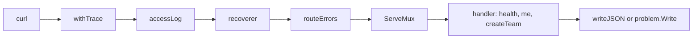

# 01. The skeleton: config, router, problem details and validation

## Why it matters
A restaurant has a front door, a menu and a way to say "sorry, we do not serve that" before it has a single recipe. The skeleton is that front door: it starts, answers `GET /health`, speaks one error language for every failure and refuses bad requests politely. Every later chapter hangs a feature on this frame, so the frame has to be right before the first feature exists.

## What you will build
A Go service that starts on `127.0.0.1:8000`, shuts down cleanly on Ctrl+C and implements the first resources of the [platform contract](../../../platform/TDD.md): `GET /health`, a stubbed `GET /v1/me` and the validation of `POST /v1/teams`. Every error, even an unknown path, is an RFC 9457 `application/problem+json` document with a trace id. There is no database yet; the platform stack is not needed for this chapter.

Conformance after this chapter (platform script, real run with the platform Keycloak and Postgres running): **6 passed, 12 failed**. The four infrastructure checks, `health` and `problem details shape` pass; everything that needs a database or real tokens waits for the next chapters.

## Before you start
- Go 1.27 (`go version` prints `go version go1.27.4 ...`). Go 101 phase 3 taught structs, interfaces and packages; this chapter uses them without re-teaching.
- `curl` 8 (Windows 10/11 ship `curl.exe`; macOS and Linux have `curl`). **In Windows PowerShell 5.1 always type `curl.exe`**: plain `curl` is an alias of `Invoke-WebRequest` (see Common mistakes).
- A terminal in an empty folder. Source pack: unzip `backend-go-phase-1-skeleton.zip` and open `01-skeleton/code` to compare, or build the project by following the steps.

## Steps
### Step 1. Create the module
**Where:** a new folder `tasksteams-go` (any place). Open a terminal there. If you are lost, the text before the `>` or `$` shows the current folder; `cd` back to it.

```bash
mkdir tasksteams-go
cd tasksteams-go
go mod init example.com/tasksteams
```
`go mod init` creates `go.mod`. A **module** is a folder tree with a `go.mod` file at its root; the module path (`example.com/tasksteams`) is the prefix of every import of your own packages. `example.com` is a name reserved for examples, so it can never clash with a real site.

**File: `go.mod`**
```text
module example.com/tasksteams

go 1.27.4
```
The `go` line is the language version the code needs; Go 1.27.4 wrote its own version. There are no `require` lines yet because this chapter uses only the standard library.

### Step 2. Plan the folders
```text
tasksteams-go/
  go.mod
  cmd/api/main.go            the program: wires everything and starts the server
  internal/config/           environment variables to a Config value
  internal/problem/          RFC 9457 problem details
  internal/http/             the HTTP layer (package name httpapi)
  requests/                  JSON bodies for curl
```
Go treats everything under `internal/` as private to this module: other modules cannot import it. Dependencies point one way, `cmd` to `http` to `problem` and `config`; nothing imports `cmd`. The directory is called `http` (as the TDD plans) but its package clause says `package httpapi`, so it never clashes with the standard library's `net/http`; `main.go` imports it with an explicit alias.

Create the folders:
```bash
mkdir -p cmd/api internal/config internal/problem internal/http requests
```
(Windows PowerShell: `New-Item -ItemType Directory -Force cmd/api, internal/config, internal/problem, internal/http, requests`.)

### Step 3. Configuration
Settings come from environment variables, the [twelve-factor](https://12factor.net/config) way, so the same binary runs on your laptop and in Docker. A missing variable falls back to a safe local default; an unusable value stops the program at start-up, not at the first request.

**File: `internal/config/config.go`**
```go
// Package config reads the settings of the service from environment variables.
package config

import (
	"fmt"
	"log/slog"
	"os"
	"strings"
)

// Config holds every setting the service needs. It is built once at start-up and never changed.
type Config struct {
	ListenAddr string
	LogLevel   slog.Level
	LogFormat  string
}

// Load reads the environment and returns an error for a value it cannot use.
func Load() (Config, error) {
	cfg := Config{
		ListenAddr: env("LISTEN_ADDR", "127.0.0.1:8000"),
		LogFormat:  env("LOG_FORMAT", "text"),
	}
	if err := cfg.LogLevel.UnmarshalText([]byte(env("LOG_LEVEL", "info"))); err != nil {
		return Config{}, fmt.Errorf("LOG_LEVEL: %w", err)
	}
	if cfg.LogFormat != "text" && cfg.LogFormat != "json" {
		return Config{}, fmt.Errorf("LOG_FORMAT must be text or json, got %q", cfg.LogFormat)
	}
	return cfg, nil
}

// env returns the variable when it is set and not blank, otherwise the fallback.
func env(key, fallback string) string {
	if value, ok := os.LookupEnv(key); ok && strings.TrimSpace(value) != "" {
		return value
	}
	return fallback
}
```
`Config` is a plain struct that is built once and never changed. `slog.Level` already knows how to parse `info`, `debug`, `warn` and `error` (`UnmarshalText`), so there is no parsing code to write. `env` treats an empty variable like a missing one, because an empty `LISTEN_ADDR=` in a `.env` file is almost always a mistake, not a wish.

### Step 4. Problem details
Every error of the API has the same shape ([RFC 9457](https://www.rfc-editor.org/info/rfc9457)): a `type` URI, a `title`, the HTTP `status`, a `detail` sentence, the `instance` (the request path) and, as extensions, a `traceId` and a list of field `errors`. Clients write one error handler instead of twenty.

**File: `internal/problem/problem.go`**
```go
// Package problem implements RFC 9457 problem details: the one error format of the API.
package problem

import (
	"context"
	"encoding/json"
	"log/slog"
	"net/http"
)

// BaseType is the prefix of every problem type URI; the contract fixes it.
const BaseType = "https://code101.example/problems/"

// FieldError points at one invalid field of a request body with a JSON Pointer (RFC 6901).
type FieldError struct {
	Pointer string `json:"pointer"`
	Detail  string `json:"detail"`
}

// Problem is the response body and also an error value, so a handler can return it.
type Problem struct {
	Type     string       `json:"type"`
	Title    string       `json:"title"`
	Status   int          `json:"status"`
	Detail   string       `json:"detail,omitempty"`
	Instance string       `json:"instance,omitempty"`
	TraceID  string       `json:"traceId,omitempty"`
	Code     string       `json:"code,omitempty"`
	Errors   []FieldError `json:"errors,omitempty"`
	Header   http.Header  `json:"-"` // extra response headers such as WWW-Authenticate or Retry-After
}

func (p *Problem) Error() string { return p.Title + ": " + p.Detail }

// New builds a problem whose type is BaseType plus the slug.
func New(status int, slug, title, detail string) *Problem {
	return &Problem{Type: BaseType + slug, Title: title, Status: status, Detail: detail}
}

// WithCode adds the optional machine-readable code, for example "last_lead".
func (p *Problem) WithCode(code string) *Problem {
	p.Code = code
	return p
}

// WithHeader adds a response header and returns the problem for chaining.
func (p *Problem) WithHeader(key, value string) *Problem {
	if p.Header == nil {
		p.Header = http.Header{}
	}
	p.Header.Set(key, value)
	return p
}

func BadRequest(detail string) *Problem {
	return New(http.StatusBadRequest, "bad-request", "Bad request", detail)
}

func Unauthorized(detail string) *Problem {
	return New(http.StatusUnauthorized, "unauthorized", "Unauthorized", detail).
		WithHeader("WWW-Authenticate", `Bearer realm="tasksteams"`)
}

func Forbidden(detail string) *Problem {
	return New(http.StatusForbidden, "forbidden", "Forbidden", detail)
}

func NotFound(detail string) *Problem {
	return New(http.StatusNotFound, "not-found", "Not found", detail)
}

func Conflict(detail string) *Problem {
	return New(http.StatusConflict, "conflict", "Conflict", detail)
}

func PreconditionFailed(detail string) *Problem {
	return New(http.StatusPreconditionFailed, "precondition-failed", "Precondition failed", detail)
}

func PreconditionRequired(detail string) *Problem {
	return New(http.StatusPreconditionRequired, "precondition-required", "Precondition required", detail)
}

func Validation(detail string, errs ...FieldError) *Problem {
	p := New(http.StatusUnprocessableEntity, "validation-error", "Validation failed", detail)
	p.Errors = errs
	return p
}

func Internal() *Problem {
	return New(http.StatusInternalServerError, "internal-error", "Internal server error", "The server failed to handle the request.")
}

type traceKey struct{}

// WithTraceID stores the request's trace id so Write can put it in the body.
func WithTraceID(ctx context.Context, id string) context.Context {
	return context.WithValue(ctx, traceKey{}, id)
}

// TraceID returns the trace id stored by WithTraceID, or an empty string.
func TraceID(ctx context.Context) string {
	id, _ := ctx.Value(traceKey{}).(string)
	return id
}

// Write sends the problem as application/problem+json. The instance is the request path.
func Write(w http.ResponseWriter, r *http.Request, p *Problem) {
	body := *p // a copy: the same *Problem value may be shared by several requests
	body.Instance = r.URL.Path
	body.TraceID = TraceID(r.Context())
	for key, values := range p.Header {
		for _, value := range values {
			w.Header().Add(key, value)
		}
	}
	payload, err := json.Marshal(body)
	if err != nil {
		slog.Error("encode problem", "error", err)
		http.Error(w, "internal error", http.StatusInternalServerError)
		return
	}
	w.Header().Set("Content-Type", "application/problem+json")
	w.WriteHeader(p.Status)
	if _, err := w.Write(payload); err != nil {
		slog.Debug("write problem", "error", err)
	}
}
```
Points to notice:
- `*Problem` has an `Error()` method, so it is also a Go `error`. Handlers can return it or write it.
- `Header` carries `json:"-"`: it is data for the response headers (`WWW-Authenticate`, `Retry-After`), not for the body.
- `Write` copies the struct (`body := *p`) before it fills in the instance and the trace id. The constructors return a new `*Problem` each time, but a copy keeps `Write` safe even if someone shares one.
- The trace id travels in the request context (`WithTraceID`, `TraceID`). A **context** is a bag of request-scoped values that Go passes down every call; the key type `traceKey struct{}` is private, so no other package can collide with it.

### Step 5. Reading and writing JSON
**File: `internal/http/respond.go`**
```go
package httpapi

import (
	"encoding/json"
	"errors"
	"io"
	"log/slog"
	"mime"
	"net/http"
	"reflect"
	"strings"

	"example.com/tasksteams/internal/problem"
)

// writeJSON encodes body and sends it with the given status.
func writeJSON(w http.ResponseWriter, r *http.Request, status int, body any) {
	payload, err := json.Marshal(body)
	if err != nil {
		slog.Error("encode response", "error", err)
		problem.Write(w, r, problem.Internal())
		return
	}
	w.Header().Set("Content-Type", "application/json")
	w.WriteHeader(status)
	if _, err := w.Write(payload); err != nil {
		slog.Debug("write response", "error", err)
	}
}

// decodeJSON reads exactly one JSON object from the body into dst. It rejects unknown fields,
// wrong types and trailing data, and returns the matching problem instead of an error.
func decodeJSON(r *http.Request, dst any) *problem.Problem {
	mediaType, _, err := mime.ParseMediaType(r.Header.Get("Content-Type"))
	if err != nil || (mediaType != "application/json" && mediaType != "application/merge-patch+json") {
		return problem.BadRequest("Content-Type must be application/json.")
	}
	decoder := json.NewDecoder(r.Body)
	decoder.DisallowUnknownFields()
	if err := decoder.Decode(dst); err != nil {
		return decodeProblem(err)
	}
	if _, err := decoder.Token(); !errors.Is(err, io.EOF) {
		return problem.BadRequest("The body must contain exactly one JSON value.")
	}
	return nil
}

// decodeProblem turns an encoding/json error into a 400 (not JSON) or a 422 (JSON, wrong shape).
func decodeProblem(err error) *problem.Problem {
	var syntaxErr *json.SyntaxError
	var typeErr *json.UnmarshalTypeError
	switch {
	case errors.As(err, &typeErr):
		return problem.Validation("One or more fields are invalid.", problem.FieldError{
			Pointer: "/" + strings.ReplaceAll(typeErr.Field, ".", "/"),
			Detail:  "must be of type " + jsonType(typeErr.Type),
		})
	case errors.As(err, &syntaxErr), errors.Is(err, io.EOF), errors.Is(err, io.ErrUnexpectedEOF):
		return problem.BadRequest("The request body is not valid JSON.")
	}
	if field, ok := strings.CutPrefix(err.Error(), "json: unknown field "); ok {
		return problem.Validation("One or more fields are invalid.", problem.FieldError{
			Pointer: "/" + strings.Trim(field, `"`),
			Detail:  "is not a known field",
		})
	}
	return problem.BadRequest("The request body could not be read.")
}

func jsonType(t reflect.Type) string {
	switch t.Kind() {
	case reflect.String:
		return "string"
	case reflect.Bool:
		return "boolean"
	case reflect.Slice, reflect.Array:
		return "array"
	case reflect.Struct, reflect.Map:
		return "object"
	default:
		return "number"
	}
}
```
`decodeJSON` is strict on purpose: it refuses a body that is not JSON (`400`), a JSON value of the wrong type (`422` with a pointer to the field), a field the contract does not know (`DisallowUnknownFields`, `422`) and anything after the first value (`400`). `writeJSON` marshals first and writes second, so a marshalling failure can still become a clean 500 instead of a half-written body.

### Step 6. Validation
**File: `internal/http/validate.go`**
```go
package httpapi

import (
	"fmt"
	"regexp"
	"slices"
	"strings"
	"time"
	"unicode/utf8"

	"example.com/tasksteams/internal/problem"
)

var uuidPattern = regexp.MustCompile(`^[0-9a-fA-F]{8}-[0-9a-fA-F]{4}-[0-9a-fA-F]{4}-[0-9a-fA-F]{4}-[0-9a-fA-F]{12}$`)

func isUUID(value string) bool { return uuidPattern.MatchString(value) }

// validator collects every field error of a request, so the client sees all of them at once.
type validator struct {
	errs []problem.FieldError
}

func (v *validator) add(pointer, detail string) {
	v.errs = append(v.errs, problem.FieldError{Pointer: pointer, Detail: detail})
}

// text trims the value, checks its length in characters (not bytes) and returns the trimmed text.
func (v *validator) text(pointer, value string, min, max int) string {
	value = strings.TrimSpace(value)
	if n := utf8.RuneCountInString(value); n < min || n > max {
		if min == 0 {
			v.add(pointer, fmt.Sprintf("must be at most %d characters", max))
		} else {
			v.add(pointer, fmt.Sprintf("must be between %d and %d characters", min, max))
		}
	}
	return value
}

func (v *validator) oneOf(pointer, value string, allowed ...string) {
	if !slices.Contains(allowed, value) {
		v.add(pointer, "must be one of: "+strings.Join(allowed, ", "))
	}
}

func (v *validator) matches(pointer, value string, pattern *regexp.Regexp, detail string) {
	if !pattern.MatchString(value) {
		v.add(pointer, detail)
	}
}

func (v *validator) uuid(pointer, value string) {
	if !isUUID(value) {
		v.add(pointer, "must be a UUID")
	}
}

// date parses a calendar date such as 2027-06-30.
func (v *validator) date(pointer, value string) (time.Time, bool) {
	parsed, err := time.Parse(time.DateOnly, value)
	if err != nil {
		v.add(pointer, "must be a date such as 2027-06-30")
		return time.Time{}, false
	}
	return parsed, true
}

// result returns nil when every check passed, otherwise the 422 problem with all errors.
func (v *validator) result() *problem.Problem {
	if len(v.errs) == 0 {
		return nil
	}
	return problem.Validation("One or more fields are invalid.", v.errs...)
}
```
A validator collects **every** error instead of stopping at the first one, so a client fixes a form in one round trip. Lengths are counted in characters (`utf8.RuneCountInString`), the same unit as the database `CHECK (length(...))`. `text` returns the trimmed value, so callers store what they validated. The `oneOf`, `uuid`, `date` and `matches` helpers are used by later chapters; they live here so that the whole toolbox is in one place.

### Step 7. Middleware
A **middleware** is a function that takes a handler and returns a handler that does something before or after it. Three are needed now.

**File: `internal/http/middleware.go`**
```go
package httpapi

import (
	"context"
	"crypto/rand"
	"encoding/hex"
	"log/slog"
	"net/http"
	"runtime/debug"
	"strings"
	"time"

	"example.com/tasksteams/internal/problem"
)

type middleware func(http.Handler) http.Handler

// chain wraps h so that the first middleware in the list runs first (it is the outermost).
func chain(h http.Handler, outer ...middleware) http.Handler {
	for i := len(outer) - 1; i >= 0; i-- {
		h = outer[i](h)
	}
	return h
}

// requestInfo is created once per request so later middleware can add facts for the access log.
type requestInfo struct {
	traceID string
	userID  string
}

type infoKey struct{}

func infoFrom(ctx context.Context) *requestInfo {
	if info, ok := ctx.Value(infoKey{}).(*requestInfo); ok {
		return info
	}
	return &requestInfo{}
}

// withTrace gives every request a trace id: the one from a valid W3C traceparent header, or a new one.
func withTrace(next http.Handler) http.Handler {
	return http.HandlerFunc(func(w http.ResponseWriter, r *http.Request) {
		id := traceIDFrom(r)
		ctx := context.WithValue(r.Context(), infoKey{}, &requestInfo{traceID: id})
		ctx = problem.WithTraceID(ctx, id)
		w.Header().Set("X-Trace-Id", id)
		next.ServeHTTP(w, r.WithContext(ctx))
	})
}

func traceIDFrom(r *http.Request) string {
	if parts := strings.Split(r.Header.Get("Traceparent"), "-"); len(parts) == 4 && len(parts[1]) == 32 {
		if _, err := hex.DecodeString(parts[1]); err == nil && parts[1] != strings.Repeat("0", 32) {
			return strings.ToLower(parts[1])
		}
	}
	var raw [16]byte
	_, _ = rand.Read(raw[:])
	return hex.EncodeToString(raw[:])
}

// statusWriter remembers the status and size of the response for the access log.
type statusWriter struct {
	http.ResponseWriter
	status int
	bytes  int
}

func (w *statusWriter) WriteHeader(status int) {
	if w.status == 0 {
		w.status = status
	}
	w.ResponseWriter.WriteHeader(status)
}

func (w *statusWriter) Write(b []byte) (int, error) {
	if w.status == 0 {
		w.status = http.StatusOK
	}
	n, err := w.ResponseWriter.Write(b)
	w.bytes += n
	return n, err
}

// Unwrap lets http.ResponseController reach the real writer.
func (w *statusWriter) Unwrap() http.ResponseWriter { return w.ResponseWriter }

// accessLog writes one structured line per request, after it finished. It never logs headers or bodies.
func (s *Server) accessLog(next http.Handler) http.Handler {
	return http.HandlerFunc(func(w http.ResponseWriter, r *http.Request) {
		start := time.Now()
		sw := &statusWriter{ResponseWriter: w}
		next.ServeHTTP(sw, r)
		if sw.status == 0 {
			sw.status = http.StatusOK
		}
		level := slog.LevelInfo
		switch {
		case sw.status >= 500:
			level = slog.LevelError
		case sw.status >= 400:
			level = slog.LevelWarn
		case r.URL.Path == "/health":
			level = slog.LevelDebug
		}
		info := infoFrom(r.Context())
		attrs := []slog.Attr{
			slog.String("method", r.Method),
			slog.String("path", r.URL.Path),
			slog.Int("status", sw.status),
			slog.Int("bytes", sw.bytes),
			slog.Float64("duration_ms", float64(time.Since(start).Microseconds())/1000),
			slog.String("trace_id", info.traceID),
		}
		if info.userID != "" {
			attrs = append(attrs, slog.String("user_id", info.userID))
		}
		s.logger.LogAttrs(r.Context(), level, "request", attrs...)
	})
}

// recoverer turns a panic in a handler into a logged 500 problem, so one bad request cannot kill the process.
func (s *Server) recoverer(next http.Handler) http.Handler {
	return http.HandlerFunc(func(w http.ResponseWriter, r *http.Request) {
		defer func() {
			rec := recover()
			if rec == nil {
				return
			}
			if rec == http.ErrAbortHandler {
				panic(rec)
			}
			s.logger.Error("panic in handler", "panic", rec, "trace_id", infoFrom(r.Context()).traceID, "stack", string(debug.Stack()))
			if sw, ok := w.(*statusWriter); !ok || sw.status == 0 {
				problem.Write(w, r, problem.Internal())
			}
		}()
		next.ServeHTTP(w, r)
	})
}
```
- `withTrace` gives every request a 128-bit trace id (the one from a valid W3C `traceparent` header, otherwise a random one), puts it in the context and in the `X-Trace-Id` response header. One id ties the client's error, the problem body and the log line together.
- `accessLog` logs one structured line after the request. It sees the status through `statusWriter`, a thin `ResponseWriter` wrapper that remembers `WriteHeader`. It logs method, path, status, size, duration and trace id, **never headers or bodies**, so a token or a password cannot leak into the log. Health probes log at debug level so they do not drown the log.
- `recoverer` turns a panic in a handler into a logged 500 problem. `http.ErrAbortHandler` is re-panicked on purpose: it is the standard library's way to abort a response.
- `chain(h, a, b, c)` wraps from the inside out so that `a` runs first. The order matters: `withTrace` must be outermost so the others can read the trace id.

### Step 8. The first handlers
**File: `internal/http/health.go`**
```go
package httpapi

import "net/http"

type healthDTO struct {
	Status   string `json:"status"`
	Version  string `json:"version"`
	Database string `json:"database,omitempty"`
}

// health answers without a token. This first version only proves the process is up.
func (s *Server) health(w http.ResponseWriter, r *http.Request) {
	writeJSON(w, r, http.StatusOK, healthDTO{Status: "ok", Version: apiVersion})
}
```
**File: `internal/http/me.go`**
```go
package httpapi

import "net/http"

type meTeamDTO struct {
	TeamID string `json:"teamId"`
	Name   string `json:"name"`
	Role   string `json:"role"`
}

type meDTO struct {
	ID          string      `json:"id"`
	Username    string      `json:"username"`
	Email       string      `json:"email"`
	DisplayName string      `json:"displayName"`
	Roles       []string    `json:"roles"`
	Scopes      []string    `json:"scopes"`
	Teams       []meTeamDTO `json:"teams"`
}

// me is a stub: it always answers as the seed user alice. Chapters 02 and 05 replace it with the real caller.
func (s *Server) me(w http.ResponseWriter, r *http.Request) {
	writeJSON(w, r, http.StatusOK, meDTO{
		ID:          "a11ce000-0000-4000-8000-000000000001",
		Username:    "alice",
		Email:       "alice@tasksteams.test",
		DisplayName: "Alice Admin",
		Roles:       []string{"admin"},
		Scopes:      []string{"tasks:read", "tasks:write", "tasks:admin"},
		Teams:       []meTeamDTO{}, // an empty slice encodes as [], a nil slice would encode as null
	})
}
```
The stub of `/v1/me` always answers as the seed user alice. Look at `Teams: []meTeamDTO{}`: in Go an empty slice encodes as `[]` but a nil slice encodes as `null`, and clients must never get `null` where the contract says array (see Common mistakes).

**File: `internal/http/teams.go`**
```go
package httpapi

import (
	"net/http"

	"example.com/tasksteams/internal/problem"
)

// teamCreateDTO is the request body of POST /v1/teams (schema TeamCreate in the contract).
type teamCreateDTO struct {
	Name        string `json:"name"`
	Description string `json:"description"`
	LeadUserID  string `json:"leadUserId"`
}

func (d *teamCreateDTO) validate() *problem.Problem {
	var v validator
	d.Name = v.text("/name", d.Name, 1, 80)
	d.Description = v.text("/description", d.Description, 0, 500)
	if d.LeadUserID != "" {
		v.uuid("/leadUserId", d.LeadUserID)
	}
	return v.result()
}

// createTeam validates the request. Storing the team needs the database, which arrives in chapter 02.
func (s *Server) createTeam(w http.ResponseWriter, r *http.Request) {
	var dto teamCreateDTO
	if p := decodeJSON(r, &dto); p != nil {
		problem.Write(w, r, p)
		return
	}
	if p := dto.validate(); p != nil {
		problem.Write(w, r, p)
		return
	}
	problem.Write(w, r, problem.New(http.StatusNotImplemented, "not-implemented", "Not implemented",
		"The request is valid, but teams are stored from chapter 02 on."))
}
```
`teamCreateDTO` is a **DTO** (data transfer object): the exact shape of the request body, separate from whatever the database row will look like. Validation runs on the DTO. The valid case answers `501 Not Implemented` for now, which is honest: the request is fine, the feature is missing.

### Step 9. The server and its routes
**File: `internal/http/server.go`**
```go
package httpapi

import (
	"log/slog"
	"net/http"

	"example.com/tasksteams/internal/problem"
)

// apiVersion is reported by /health. It follows the contract version.
const apiVersion = "1.0.0"

// Server holds what the handlers share and the finished handler chain.
type Server struct {
	logger  *slog.Logger
	handler http.Handler
}

// NewServer registers every route and wraps them in the middleware chain.
func NewServer(logger *slog.Logger) *Server {
	s := &Server{logger: logger}
	mux := http.NewServeMux()
	mux.HandleFunc("GET /health", s.health)
	mux.HandleFunc("GET /v1/me", s.me)
	mux.HandleFunc("POST /v1/teams", s.createTeam)
	s.handler = chain(routeErrors(mux), withTrace, s.accessLog, s.recoverer)
	return s
}

// Handler returns the handler to give to http.Server.
func (s *Server) Handler() http.Handler { return s.handler }

// routeErrors replaces the plain-text 404 and 405 answers of http.ServeMux with problem details.
func routeErrors(mux *http.ServeMux) http.Handler {
	return http.HandlerFunc(func(w http.ResponseWriter, r *http.Request) {
		handler, pattern := mux.Handler(r)
		if pattern != "" {
			mux.ServeHTTP(w, r) // ServeHTTP, not handler.ServeHTTP: only the mux fills in the path values
			return
		}
		probe := &statusProbe{header: http.Header{}}
		handler.ServeHTTP(probe, r) // the mux's own "not found" or "method not allowed" handler
		if probe.status == http.StatusMethodNotAllowed {
			problem.Write(w, r, problem.New(http.StatusMethodNotAllowed, "method-not-allowed", "Method not allowed",
				"This path does not support "+r.Method+".").WithHeader("Allow", probe.header.Get("Allow")))
			return
		}
		problem.Write(w, r, problem.NotFound("There is no such path."))
	})
}

// statusProbe is a ResponseWriter that keeps the status and headers and throws the body away.
type statusProbe struct {
	header http.Header
	status int
}

func (p *statusProbe) Header() http.Header         { return p.header }
func (p *statusProbe) Write(b []byte) (int, error) { return len(b), nil }
func (p *statusProbe) WriteHeader(status int)      { p.status = status }
```
`http.NewServeMux` understands patterns with a method and wildcards since Go 1.22, for example `GET /health` and later `GET /v1/teams/{teamId}`. The mux answers an unknown path with a plain-text `404` and a wrong method with a plain-text `405`; `routeErrors` asks the mux which of the two it would send (`mux.Handler(r)` returns an empty pattern for both) and answers with a problem document instead. It must call `mux.ServeHTTP` for matched routes, not the handler it got back, because only `ServeHTTP` fills in the path values.

### Step 10. The program
**File: `cmd/api/main.go`**
```go
// Command api is the Tasks and Teams backend written in Go.
package main

import (
	"context"
	"errors"
	"fmt"
	"log/slog"
	"net/http"
	"os"
	"os/signal"
	"syscall"
	"time"

	"example.com/tasksteams/internal/config"
	httpapi "example.com/tasksteams/internal/http"
)

func main() {
	if err := run(); err != nil {
		fmt.Fprintln(os.Stderr, "fatal:", err)
		os.Exit(1)
	}
}

func run() error {
	cfg, err := config.Load()
	if err != nil {
		return err
	}
	logger := newLogger(cfg)
	slog.SetDefault(logger)

	// ctx is cancelled by Ctrl+C (os.Interrupt) or by `docker stop` (SIGTERM).
	ctx, stop := signal.NotifyContext(context.Background(), os.Interrupt, syscall.SIGTERM)
	defer stop()

	srv := &http.Server{
		Addr:              cfg.ListenAddr,
		Handler:           httpapi.NewServer(logger).Handler(),
		ReadHeaderTimeout: 5 * time.Second,
		ReadTimeout:       15 * time.Second,
		WriteTimeout:      30 * time.Second,
		IdleTimeout:       60 * time.Second,
		ErrorLog:          slog.NewLogLogger(logger.Handler(), slog.LevelWarn),
	}

	serveErr := make(chan error, 1)
	go func() {
		logger.Info("listening", "addr", cfg.ListenAddr)
		serveErr <- srv.ListenAndServe()
	}()

	select {
	case err := <-serveErr:
		return err // ListenAndServe only returns before Shutdown when it failed, for example "address already in use"
	case <-ctx.Done():
		logger.Info("shutting down", "reason", "signal received")
	}

	shutdownCtx, cancel := context.WithTimeout(context.Background(), 10*time.Second)
	defer cancel()
	if err := srv.Shutdown(shutdownCtx); err != nil && !errors.Is(err, http.ErrServerClosed) {
		return fmt.Errorf("graceful shutdown: %w", err)
	}
	logger.Info("stopped")
	return nil
}

func newLogger(cfg config.Config) *slog.Logger {
	opts := &slog.HandlerOptions{Level: cfg.LogLevel}
	if cfg.LogFormat == "json" {
		return slog.New(slog.NewJSONHandler(os.Stdout, opts))
	}
	return slog.New(slog.NewTextHandler(os.Stdout, opts))
}
```
`run` returns an error and `main` prints it and exits with 1: deferred calls (such as `stop`) only run when a function returns, and `os.Exit` skips them, so all work lives in `run`. `signal.NotifyContext` gives a context that is cancelled by Ctrl+C or by `docker stop` (SIGTERM). The server runs in a goroutine; the `select` waits for either a server failure (for example "address already in use") or the signal. On a signal `srv.Shutdown` stops accepting connections and waits up to ten seconds for running requests, a **graceful shutdown**: nobody gets a connection reset in the middle of an answer. The four timeouts protect the server from slow clients; without `ReadHeaderTimeout` one client sending a byte per minute can hold a connection forever.

### Step 11. Request files and `.gitignore`
`curl` sends a file with `--data-binary @file`. Files avoid the quoting trouble of typing JSON into a terminal (it differs between PowerShell, cmd and bash).

**File: `requests/team-valid.json`**
```json
{"name": "Demo Team", "description": "Created with curl"}
```
**File: `requests/team-invalid.json`**
```json
{"name": ""}
```
**File: `.gitignore`**
```text
bin/
*.exe
.env
```

### Step 12. Format and check
```bash
gofmt -l .
go vet ./...
```
Both print nothing when all is well. `gofmt` is Go's one official code style, `go vet` finds suspicious code the compiler accepts.

## Run it
**Terminal 1 (folder `tasksteams-go`)**
```bash
go run ./cmd/api
```
Expected output (the times differ):
```text
time=2026-11-23T10:34:21.726+02:00 level=INFO msg=listening addr=127.0.0.1:8000
```

**Terminal 2.** Each command adds `-s` (quiet) and `-w "\nHTTP %{http_code}\n"` (print the status code after the body).

1. Health:
```bash
curl -s -w "\nHTTP %{http_code}\n" http://127.0.0.1:8000/health
```
```text
{"status":"ok","version":"1.0.0"}
HTTP 200
```

2. The stub of `/v1/me`:
```bash
curl -s -w "\nHTTP %{http_code}\n" http://127.0.0.1:8000/v1/me
```
```text
{"id":"a11ce000-0000-4000-8000-000000000001","username":"alice","email":"alice@tasksteams.test","displayName":"Alice Admin","roles":["admin"],"scopes":["tasks:read","tasks:write","tasks:admin"],"teams":[]}
HTTP 200
```

3. An invalid team (`team-invalid.json` is `{"name": ""}`):
```bash
curl -s -w "\nHTTP %{http_code}\n" -X POST -H "Content-Type: application/json" --data-binary @requests/team-invalid.json http://127.0.0.1:8000/v1/teams
```
```text
{"type":"https://code101.example/problems/validation-error","title":"Validation failed","status":422,"detail":"One or more fields are invalid.","instance":"/v1/teams","traceId":"c9c222142c2003ce1749085d72323263","errors":[{"pointer":"/name","detail":"must be between 1 and 80 characters"}]}
HTTP 422
```
The `pointer` is a JSON Pointer ([RFC 6901](https://www.rfc-editor.org/info/rfc6901)) to the field, so a client can mark the right input box.

4. A valid team is not stored yet:
```bash
curl -s -w "\nHTTP %{http_code}\n" -X POST -H "Content-Type: application/json" --data-binary @requests/team-valid.json http://127.0.0.1:8000/v1/teams
```
```text
{"type":"https://code101.example/problems/not-implemented","title":"Not implemented","status":501,"detail":"The request is valid, but teams are stored from chapter 02 on.","instance":"/v1/teams","traceId":"7c3541e381cadd110adc107bae619af2"}
HTTP 501
```

5. An unknown path and a wrong method also answer in problem details:
```bash
curl -s -w "\nHTTP %{http_code}\n" http://127.0.0.1:8000/v1/nothing
curl -s -w "\nHTTP %{http_code}\n" -X DELETE http://127.0.0.1:8000/v1/me
```
```text
{"type":"https://code101.example/problems/not-found","title":"Not found","status":404,"detail":"There is no such path.","instance":"/v1/nothing","traceId":"768c09bfeb7cea0ac6174429ea33927e"}
HTTP 404
```
```text
{"type":"https://code101.example/problems/method-not-allowed","title":"Method not allowed","status":405,"detail":"This path does not support DELETE.","instance":"/v1/me","traceId":"7a3d8d71c69463588300f1e9105ee1da"}
HTTP 405
```

6. A POST without a JSON content type:
```bash
curl -s -w "\nHTTP %{http_code}\n" -X POST -d name=x http://127.0.0.1:8000/v1/teams
```
```text
{"type":"https://code101.example/problems/bad-request","title":"Bad request","status":400,"detail":"Content-Type must be application/json.","instance":"/v1/teams","traceId":"cd3e784ff7ee737c87e52d2f2168dd9f"}
HTTP 400
```

7. A client-supplied trace id is kept (the `X-Trace-Id` header answers with it):
```bash
curl -s -i -H "traceparent: 00-4bf92f3577b34da6a3ce929d0e0e4736-00f067aa0ba902b7-01" http://127.0.0.1:8000/health
```
```text
HTTP/1.1 200 OK
Content-Type: application/json
X-Trace-Id: 4bf92f3577b34da6a3ce929d0e0e4736
Date: Mon, 23 Nov 2026 08:34:22 GMT
Content-Length: 33

{"status":"ok","version":"1.0.0"}
HTTP 200
```

8. Terminal 1 now holds the access log (first lines shown). Compare the `trace_id` values with the problem documents above:
```text
time=2026-11-23T10:34:21.726+02:00 level=INFO msg=listening addr=127.0.0.1:8000
time=2026-11-23T10:34:22.204+02:00 level=INFO msg=request method=GET path=/v1/me status=200 bytes=205 duration_ms=0 trace_id=46eaae4910dd177c2a7e4374366a2fef
time=2026-11-23T10:34:22.224+02:00 level=WARN msg=request method=POST path=/v1/teams status=422 bytes=290 duration_ms=0 trace_id=c9c222142c2003ce1749085d72323263
time=2026-11-23T10:34:22.241+02:00 level=ERROR msg=request method=POST path=/v1/teams status=501 bytes=240 duration_ms=0 trace_id=7c3541e381cadd110adc107bae619af2
time=2026-11-23T10:34:22.259+02:00 level=WARN msg=request method=GET path=/v1/nothing status=404 bytes=190 duration_ms=0 trace_id=768c09bfeb7cea0ac6174429ea33927e
time=2026-11-23T10:34:22.278+02:00 level=WARN msg=request method=DELETE path=/v1/me status=405 bytes=215 duration_ms=0 trace_id=7a3d8d71c69463588300f1e9105ee1da
time=2026-11-23T10:34:22.296+02:00 level=WARN msg=request method=POST path=/v1/teams status=400 bytes=208 duration_ms=0 trace_id=cd3e784ff7ee737c87e52d2f2168dd9f
time=2026-11-23T10:34:22.331+02:00 level=WARN msg=request method=POST path=/v1/teams status=400 bytes=205 duration_ms=0 trace_id=ef7c22008ab813d3ddbe8275f2575e3a
```

9. Stop the server with Ctrl+C. The graceful shutdown logs:
```text
time=2026-11-23T10:48:22.856+02:00 level=INFO msg=listening addr=127.0.0.1:8000
time=2026-11-23T10:48:24.348+02:00 level=INFO msg="shutting down" reason="signal received"
time=2026-11-23T10:48:24.348+02:00 level=INFO msg=stopped
```

### Conformance (optional now, required in chapter 07)
With the platform stack running (see the platform capstone) and this server on port 8000, `python scripts/conformance.py` from the platform folder prints:
```text
PASS  keycloak discovery (issuer matches, PKCE S256 offered)
PASS  token for alice (iss, aud tasks-api, sub, role admin, three scopes)
PASS  token for bob (role member only)
PASS  postgres reachable (127.0.0.1:5432 answers the Postgres protocol)
PASS  health (200, status ok, no token needed)
FAIL  me: header RateLimit-Limit missing or not a number
FAIL  create team: expected HTTP 201, got 501: {"type":"https://code101.example/problems/not-implemented","title":"Not implemented","status":501,"detail":"The request is valid, but teams are stored from chapter 02 on.","instance":"/v1/teams","trac
FAIL  create project: needs the result of an earlier check (team)
FAIL  create task with Idempotency-Key: needs the result of an earlier check (project)
FAIL  get task with ETag: needs the result of an earlier check (task)
FAIL  update with If-Match: needs the result of an earlier check (task)
FAIL  stale If-Match gives 412: needs the result of an earlier check (task)
FAIL  cursor pagination: needs the result of an earlier check (project)
FAIL  401 without token: expected HTTP 401, got 200: {"id":"a11ce000-0000-4000-8000-000000000001","username":"alice","email":"alice@tasksteams.test","displayName":"Alice Admin","roles":["admin"],"scopes":["tasks:read","tasks:write","tasks:admin"],"teams
FAIL  403 for member on admin route: expected HTTP 403, got 404: {"type":"https://code101.example/problems/not-found","title":"Not found","status":404,"detail":"There is no such path.","instance":"/v1/audit-log","traceId":"97efb8654d7917e8d49409d5c8ab0880"}
PASS  problem details shape (422 with errors[/name], 404 with type, title and status)
FAIL  audit log: needs the result of an earlier check (task)
FAIL  cleanup: needs the result of an earlier check (team)
6 passed, 12 failed
```

## How it works

1. `main` loads the `Config`, builds the logger and the server and starts listening.
2. A request enters the outermost middleware, `withTrace`, which stores the trace id in the context.
3. `accessLog` starts a stopwatch and wraps the response writer; `recoverer` guards against panics.
4. `routeErrors` hands the request to the `ServeMux`. A match runs a handler; a miss becomes a 404 or 405 problem.
5. The handler decodes and validates the body, then answers with `writeJSON` or `problem.Write`.
6. On the way out `accessLog` writes its line with the final status.

New terms: **module** (a versioned tree of packages with a `go.mod`), **middleware** (a handler wrapper), **context** (request-scoped values and cancellation), **DTO** (the exact shape of a request or response body), **problem details** (RFC 9457 error documents), **JSON Pointer** (a path such as `/name` into a JSON document), **graceful shutdown** (stop accepting work, finish what is running), **structured logging** (log lines made of key and value pairs). They are in the [glossary](../../GLOSSARY.md).

Why this, not that:

| Decision | Alternative | Consequence |
|----------|-------------|-------------|
| Standard library `net/http` with Go 1.22 patterns | chi, gin, echo | No dependency to update; method and path wildcards are built in. Missing: route groups and built-in middleware, which this project writes in 150 lines |
| Hand-written validation | a tag-based validation library | Error text and JSON pointers match the contract exactly; a little more code per DTO |
| `log/slog` (JSON in containers, text on a laptop) | zap, zerolog | Standard library, structured, fast enough; handlers are swappable |
| Problem details written by one function | `http.Error` here and there | One shape for clients; the trace id is always present |

## Try it
**Exercise.** The contract says a project key is 2 to 10 characters, a capital letter first, then capitals or digits. Copy `exercise/starter/main.go` to a new folder, run `go mod init exercise`, and make `validateProjectKey` return one `FieldError` with pointer `/key` for a bad key.

**File: `exercise/starter/main.go`**
```go
package main

import (
	"fmt"
	"regexp"
)

// FieldError mirrors problem.FieldError of the project.
type FieldError struct {
	Pointer string
	Detail  string
}

var keyPattern = regexp.MustCompile(`^[A-Z][A-Z0-9]{1,9}$`)

// validateProjectKey checks the key of a new project (schema ProjectCreate in the contract).
// TODO: return one FieldError with the pointer "/key" and the detail "invalid key" when the key does not match
// keyPattern, and nil when it does.
func validateProjectKey(key string) []FieldError {
	return nil
}

func main() {
	for _, key := range []string{"PLAT", "plat", "P", "TOOLONGKEY1", "A1"} {
		errs := validateProjectKey(key)
		if len(errs) == 0 {
			fmt.Printf("%-12s ok\n", key)
			continue
		}
		fmt.Printf("%-12s %s %s\n", key, errs[0].Pointer, errs[0].Detail)
	}
}
```
Run `go run .`. Before you change anything every key prints `ok`.

<details><summary>Solution</summary>

**File: `exercise/solution/main.go`**
```go
package main

import (
	"fmt"
	"regexp"
)

// FieldError mirrors problem.FieldError of the project.
type FieldError struct {
	Pointer string
	Detail  string
}

var keyPattern = regexp.MustCompile(`^[A-Z][A-Z0-9]{1,9}$`)

// validateProjectKey checks the key of a new project (schema ProjectCreate in the contract).
func validateProjectKey(key string) []FieldError {
	if keyPattern.MatchString(key) {
		return nil
	}
	return []FieldError{{Pointer: "/key", Detail: "invalid key"}}
}

func main() {
	for _, key := range []string{"PLAT", "plat", "P", "TOOLONGKEY1", "A1"} {
		errs := validateProjectKey(key)
		if len(errs) == 0 {
			fmt.Printf("%-12s ok\n", key)
			continue
		}
		fmt.Printf("%-12s %s %s\n", key, errs[0].Pointer, errs[0].Detail)
	}
}
```
The regular expression anchors (`^` and `$`) make the whole string match, not a part of it; without them `aPLAT` would pass, because `PLAT` is found inside it. Output:
```text
PLAT         ok
plat         /key invalid key
P            /key invalid key
TOOLONGKEY1  /key invalid key
A1           ok
```
</details>

## Check yourself
1. Why does `main` call `run()` instead of doing the work itself?
   <details><summary>Answer</summary>`os.Exit` ends the process without running deferred functions. In `run` the `defer stop()` calls run when it returns; `main` only prints the error and exits.</details>
2. What is the difference between a 400 and a 422 here?
   <details><summary>Answer</summary>400: the body is not valid JSON at all (or the wrong content type). 422: it is valid JSON but a field breaks a rule; the answer lists the fields in `errors`.</details>
3. Why is `routeErrors` needed if the mux already answers 404 and 405?
   <details><summary>Answer</summary>The mux answers in plain text. The contract says every error is problem details, so clients can use one error parser.</details>
4. Why is the trace id also an HTTP header and not only part of the body?
   <details><summary>Answer</summary>Successful responses have no problem body. The header lets a client report the id of any request, and the log line carries the same id.</details>

## Common mistakes
| Symptom or error text | Cause | Fix |
|---|---|---|
| `Cannot process command because of one or more missing mandatory parameters: Uri.` (Windows PowerShell 5.1) | `curl` is an alias of `Invoke-WebRequest` | Type `curl.exe`, never `curl` |
| `{"type":".../bad-request","title":"Bad request","status":400,"detail":"The request body is not valid JSON.",...}` although the JSON looks right | Windows PowerShell 5.1 removes the double quotes inside `-d '{"name":""}'` | Put the body in a file and use `--data-binary @file` |
| `fatal: listen tcp 127.0.0.1:8000: bind: Only one usage of each socket address (protocol/network address/port) is normally permitted.` | Another program, or an older run of this one, still owns port 8000 | Stop it (Ctrl+C in its terminal) or set `LISTEN_ADDR=127.0.0.1:8001` |
| `fatal: LOG_LEVEL: slog: level string "loud": unknown name` | The value is not `debug`, `info`, `warn` or `error` | Fix the variable; this is the fail-at-start-up behaviour on purpose |
| `.\main.go:5:2: "strings" imported and not used` | Go refuses an import that nothing uses | Delete the import (or use it) |
| `.\main.go:6:2: declared and not used: status` | Go refuses a local variable that is never read | Use it or write `_ = status` while you work |
| `.\main.go:9:1: missing return` | A function with a result has a path that ends without `return` | Return on every path |
| `"teams":null` where the client expects `[]` | A nil slice encodes as `null`, an empty slice as `[]` | Initialise with `[]T{}` or `make([]T, 0)` |
| `Content-Type must be application/json.` (HTTP 400) | `curl -d` sends `application/x-www-form-urlencoded` | Add `-H "Content-Type: application/json"` |

The two Go outputs (`null`, `[]`) come from this program:
```text
{"teams":null}
{"teams":[]}
```
and the three compiler messages from these runs:
```text
# mistake
.\main.go:5:2: "strings" imported and not used
```
```text
# mistake
.\main.go:6:2: declared and not used: status
```
```text
# mistake
.\main.go:9:1: missing return
```

## Best practice
Answer every failure with one error format that carries a stable `type`, the status, a human `detail` and a trace id, and log the same trace id on the server. Source: RFC 9457 Problem Details for HTTP APIs https://www.rfc-editor.org/info/rfc9457 and Go `net/http` ServeMux patterns https://pkg.go.dev/net/http#ServeMux

## Next lesson
02. The data layer, teams and projects: a `pgxpool` connection pool, a store package with every SQL statement, `set_config('app.current_user_id')` per write transaction, cursor pagination, ETag and `If-Match`, with a development stand-in for sign-in until chapter 05.
