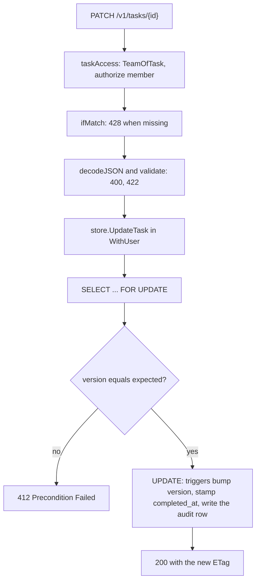

# 03. Tasks, stored functions, comments and the audit trail

## Why it matters
In a kitchen the head chef does not teach every waiter how to carve the roast: the carving station does it, one way, every time. The platform database has such stations: `complete_task` and `reassign_task` lock a row, check the version, apply the rules and write the audit entry in one step. Your Go code walks to the station and says what it wants. The same station serves the Python, .NET and Rust backends, so the rule exists once.

## What you will build
Everything left in the contract except identity checks: tasks (list with filters and sorting, create, read, merge-patch, delete), `complete` and `reassign` through stored functions, comments (list, create, delete by author, lead or admin) and the admin-only audit trail.

Conformance after this chapter (real run): **6 passed, 12 failed**, as in chapter 02: the sign-in stand-in still hides every token-based check.

## Before you start
- Chapter 02 done, or unzip `backend-go-phase-2-data.zip` and open `03-tasks-and-procedures/code`. This folder is the whole project; files that did not change since chapter 02 are listed in `verify.json` under `skip_lesson_check` and are not repeated below.
- Docker running; port 5432 free; the database from chapter 02 started again: `cp .env.example .env` (PowerShell: `Copy-Item .env.example .env`) and `docker compose -p tasksteams up -d --wait db`.

## Steps
### Step 1. How the stored functions report problems
Open `db/schema.sql` (platform file) and find `complete_task`. It raises `TS404` (no such task), `TS412` (the version is not the expected one), `TS409` (a cancelled task cannot be completed) and calls `set_config('app.current_user_id', ...)` before it updates. `mapError` from chapter 02 already turns these codes into `store.Error` kinds. Only one thing changes in the store: an error can now point at a request field.

**File: `internal/store/errors.go`**
```go
package store

import (
	"errors"
	"fmt"

	"github.com/jackc/pgx/v5"
	"github.com/jackc/pgx/v5/pgconn"
)

// Kind says which problem type the HTTP layer should answer with.
type Kind int

const (
	KindNotFound  Kind = iota + 1 // 404
	KindConflict                  // 409
	KindStale                     // 412
	KindInvalid                   // 422
	KindBadCursor                 // 400
)

// Error is the only error type the HTTP layer needs to understand. Anything else is a 500.
type Error struct {
	Kind    Kind
	Message string
	Code    string // optional machine-readable code, for example last_lead
	Field   string // optional JSON Pointer of the request field that caused a KindInvalid error
}

func (e *Error) Error() string { return e.Message }

func notFound(what string) *Error { return &Error{Kind: KindNotFound, Message: what + " not found."} }

func stale(current int) *Error {
	return &Error{Kind: KindStale, Message: fmt.Sprintf("The resource changed since you read it (current version %d).", current)}
}

// ErrBadCursor is returned when a cursor cannot be decoded.
var ErrBadCursor = &Error{Kind: KindBadCursor, Message: "The cursor is not valid."}

// conflictMessages names the unique constraints a client can run into.
var conflictMessages = map[string]string{
	"teams_name_key":           "A team with this name already exists.",
	"projects_team_id_key_key": "A project with this key already exists in the team.",
}

// mapError translates a pgx error into a store.Error. The functions of the schema raise custom SQLSTATE codes
// (TS404, TS409, TS412, TS422) and the constraints raise the standard ones.
func mapError(err error) error {
	if err == nil {
		return nil
	}
	var known *Error
	if errors.As(err, &known) {
		return err
	}
	if errors.Is(err, pgx.ErrNoRows) {
		return &Error{Kind: KindNotFound, Message: "Not found."}
	}
	var pgErr *pgconn.PgError
	if !errors.As(err, &pgErr) {
		return err
	}
	switch pgErr.Code {
	case "TS404":
		return &Error{Kind: KindNotFound, Message: pgErr.Message}
	case "TS409":
		return &Error{Kind: KindConflict, Message: pgErr.Message}
	case "TS412":
		return &Error{Kind: KindStale, Message: pgErr.Message}
	case "TS422":
		return &Error{Kind: KindInvalid, Message: pgErr.Message}
	case "23505": // unique_violation
		message, ok := conflictMessages[pgErr.ConstraintName]
		if !ok {
			message = "A resource with the same unique value already exists."
		}
		return &Error{Kind: KindConflict, Message: message}
	case "23503": // foreign_key_violation
		return &Error{Kind: KindInvalid, Message: "A referenced resource does not exist."}
	case "23514": // check_violation
		return &Error{Kind: KindInvalid, Message: "A value is outside the allowed range."}
	}
	return err
}
```
`Field` holds a JSON Pointer such as `/assigneeId`. `storeProblem` copies it into the problem's `errors[]`, so a client can highlight the input.

**File: `internal/http/errors.go`**
```go
package httpapi

import (
	"errors"
	"net/http"

	"example.com/tasksteams/internal/problem"
	"example.com/tasksteams/internal/store"
)

// storeProblem maps a store error to the problem it stands for. Errors the store does not know become a
// 500 whose body says nothing about the cause; the cause goes to the log with the trace id.
func (s *Server) storeProblem(r *http.Request, err error) *problem.Problem {
	var se *store.Error
	if !errors.As(err, &se) {
		s.logger.Error("request failed", "error", err, "trace_id", problem.TraceID(r.Context()))
		return problem.Internal()
	}
	var p *problem.Problem
	switch se.Kind {
	case store.KindNotFound:
		p = problem.NotFound(se.Message)
	case store.KindConflict:
		p = problem.Conflict(se.Message)
	case store.KindStale:
		p = problem.PreconditionFailed(se.Message)
	case store.KindInvalid:
		p = problem.Validation(se.Message)
		if se.Field != "" {
			p.Errors = []problem.FieldError{{Pointer: se.Field, Detail: se.Message}}
		}
	case store.KindBadCursor:
		p = problem.BadRequest(se.Message)
	default:
		return problem.Internal()
	}
	if se.Code != "" {
		p.WithCode(se.Code)
	}
	return p
}

// fail writes the problem for a store error.
func (s *Server) fail(w http.ResponseWriter, r *http.Request, err error) {
	problem.Write(w, r, s.storeProblem(r, err))
}
```

### Step 2. Tasks in the store
**File: `internal/store/tasks.go`**
```go
package store

import (
	"context"
	"time"

	"github.com/jackc/pgx/v5"
)

// Task is a row of the tasks table.
type Task struct {
	ID          string
	ProjectID   string
	Title       string
	Description string
	Status      string
	Priority    string
	AssigneeID  *string
	DueDate     *time.Time
	CompletedAt *time.Time
	CreatedBy   string
	Version     int
	CreatedAt   time.Time
	UpdatedAt   time.Time
}

// The column order must match the fields of Task, because pgx scans by position.
// It also matches the column order of the tasks table, so "SELECT * FROM complete_task(...)" fits as well.
const taskColumns = `t.id, t.project_id, t.title, t.description, t.status, t.priority, t.assignee_id, t.due_date,
	t.completed_at, t.created_by, t.version, t.created_at, t.updated_at`

func (s *Store) GetTask(ctx context.Context, id string) (Task, error) {
	task, err := collectOne[Task](ctx, s.pool, "SELECT "+taskColumns+" FROM tasks t WHERE t.id = $1", id)
	return task, translateNoRows(err, "Task")
}

// TeamOfTask finds the team that owns a task, for the authorization check.
func (s *Store) TeamOfTask(ctx context.Context, taskID string) (string, error) {
	var teamID string
	err := s.pool.QueryRow(ctx,
		"SELECT p.team_id FROM tasks t JOIN projects p ON p.id = t.project_id WHERE t.id = $1", taskID).Scan(&teamID)
	return teamID, translateNoRows(mapError(err), "Task")
}

// TaskFilter holds the optional filters of a task list.
type TaskFilter struct {
	ProjectID  string
	Statuses   []string
	Priorities []string
	AssigneeID string
	DueBefore  *time.Time // inclusive
	DueAfter   *time.Time // inclusive
	Title      string     // case-insensitive substring
	Sort       string     // -createdAt, createdAt or dueDate
	Page       PageParams
}

func (s *Store) ListTasks(ctx context.Context, f TaskFilter) (Page[Task], error) {
	cursor, err := decodeCursor(f.Page.Cursor, "tasks:"+f.Sort, uuidID)
	if err != nil {
		return Page[Task]{}, err
	}
	var b builder
	b.where("t.project_id = " + b.arg(f.ProjectID))
	if len(f.Statuses) > 0 {
		b.where("t.status = ANY(" + b.arg(f.Statuses) + ")")
	}
	if len(f.Priorities) > 0 {
		b.where("t.priority = ANY(" + b.arg(f.Priorities) + ")")
	}
	if f.AssigneeID != "" {
		b.where("t.assignee_id = " + b.arg(f.AssigneeID))
	}
	if f.DueBefore != nil {
		b.where("t.due_date <= " + b.arg(*f.DueBefore))
	}
	if f.DueAfter != nil {
		b.where("t.due_date >= " + b.arg(*f.DueAfter))
	}
	if f.Title != "" {
		b.where("t.title ILIKE " + b.arg(likeContains(f.Title)))
	}
	var order string
	if f.Sort == "dueDate" {
		order = " ORDER BY t.due_date NULLS LAST, t.id"
		if err := afterDue(&b, cursor); err != nil {
			return Page[Task]{}, err
		}
	} else {
		desc := f.Sort == "-createdAt"
		order = orderBy("t.created_at", "t.id", desc)
		b.afterTime("t.created_at", "t.id", desc, cursor)
	}
	sql := "SELECT " + taskColumns + " FROM tasks t" + b.whereSQL() + order + " LIMIT " + b.arg(f.Page.Limit+1)
	items, err := collect[Task](ctx, s.pool, sql, b.args...)
	if err != nil {
		return Page[Task]{}, err
	}
	return finishPage(items, f.Page.Limit, func(t Task) Cursor {
		c := Cursor{Sort: "tasks:" + f.Sort, Time: t.CreatedAt, ID: t.ID}
		if t.DueDate != nil {
			c.Due = t.DueDate.Format(time.DateOnly)
		}
		return c
	}), nil
}

// afterDue adds the keyset condition for ORDER BY due_date NULLS LAST, id. A cursor with an empty Due
// sits inside the block of tasks without a due date, which comes last.
func afterDue(b *builder, c *Cursor) error {
	if c == nil {
		return nil
	}
	if c.Due == "" {
		b.where("(t.due_date IS NULL AND t.id > " + b.arg(c.ID) + ")")
		return nil
	}
	due, err := time.Parse(time.DateOnly, c.Due)
	if err != nil {
		return ErrBadCursor
	}
	b.where("(t.due_date IS NULL OR (t.due_date, t.id) > (" + b.arg(due) + ", " + b.arg(c.ID) + "))")
	return nil
}

// TaskInput is the data of a new task.
type TaskInput struct {
	Title       string
	Description string
	Priority    string
	AssigneeID  *string
	DueDate     *time.Time
}

var errAssignee = &Error{Kind: KindInvalid, Field: "/assigneeId", Message: "The assignee must be a member of the project's team."}

// assigneeBelongs reports whether the user is a member of the team that owns the project.
func assigneeBelongs(ctx context.Context, q querier, projectID, userID string) error {
	var ok bool
	err := q.QueryRow(ctx, `SELECT EXISTS (SELECT 1 FROM projects p JOIN team_members m ON m.team_id = p.team_id
		WHERE p.id = $1 AND m.user_id = $2)`, projectID, userID).Scan(&ok)
	if err != nil {
		return err
	}
	if !ok {
		return errAssignee
	}
	return nil
}

func (s *Store) CreateTask(ctx context.Context, actorID, projectID string, in TaskInput) (Task, error) {
	var task Task
	err := s.WithUser(ctx, actorID, func(tx pgx.Tx) error {
		if in.AssigneeID != nil {
			if err := assigneeBelongs(ctx, tx, projectID, *in.AssigneeID); err != nil {
				return err
			}
		}
		var err error
		task, err = collectOne[Task](ctx, tx, `INSERT INTO tasks AS t (project_id, title, description, priority, assignee_id, due_date, created_by)
			VALUES ($1, $2, $3, $4, $5, $6, $7) RETURNING `+taskColumns,
			projectID, in.Title, in.Description, in.Priority, in.AssigneeID, in.DueDate, actorID)
		return err
	})
	return task, err
}

// TaskPatch holds a JSON Merge Patch. For assignee and due date a nil pointer is ambiguous, so the Set flags
// tell "leave it" from "clear it".
type TaskPatch struct {
	Title       *string
	Description *string
	Status      *string
	Priority    *string
	SetAssignee bool
	AssigneeID  *string
	SetDueDate  bool
	DueDate     *time.Time
}

// UpdateTask applies a patch to the locked row if its version is still expected (0 skips the check).
func (s *Store) UpdateTask(ctx context.Context, actorID, id string, expected int, patch TaskPatch) (Task, error) {
	var task Task
	err := s.WithUser(ctx, actorID, func(tx pgx.Tx) error {
		current, err := collectOne[Task](ctx, tx, "SELECT "+taskColumns+" FROM tasks t WHERE t.id = $1 FOR UPDATE", id)
		if err != nil {
			return translateNoRows(err, "Task")
		}
		if expected != 0 && current.Version != expected {
			return stale(current.Version)
		}
		next := current
		if patch.Title != nil {
			next.Title = *patch.Title
		}
		if patch.Description != nil {
			next.Description = *patch.Description
		}
		if patch.Status != nil {
			next.Status = *patch.Status
		}
		if patch.Priority != nil {
			next.Priority = *patch.Priority
		}
		if patch.SetAssignee {
			next.AssigneeID = patch.AssigneeID
			if next.AssigneeID != nil {
				if err := assigneeBelongs(ctx, tx, current.ProjectID, *next.AssigneeID); err != nil {
					return err
				}
			}
		}
		if patch.SetDueDate {
			next.DueDate = patch.DueDate
		}
		task, err = collectOne[Task](ctx, tx, `UPDATE tasks AS t SET title = $2, description = $3, status = $4, priority = $5,
			assignee_id = $6, due_date = $7 WHERE t.id = $1 RETURNING `+taskColumns,
			id, next.Title, next.Description, next.Status, next.Priority, next.AssigneeID, next.DueDate)
		return err
	})
	return task, err
}

// DeleteTask removes a task; when expected is not 0 the version must match.
func (s *Store) DeleteTask(ctx context.Context, actorID, id string, expected int) error {
	return s.WithUser(ctx, actorID, func(tx pgx.Tx) error {
		var version int
		if err := tx.QueryRow(ctx, "SELECT version FROM tasks WHERE id = $1 FOR UPDATE", id).Scan(&version); err != nil {
			return translateNoRows(mapError(err), "Task")
		}
		if expected != 0 && version != expected {
			return stale(version)
		}
		_, err := tx.Exec(ctx, "DELETE FROM tasks WHERE id = $1", id)
		return err
	})
}

// expectedArg turns "no precondition" (0) into SQL NULL, which the stored functions read as "skip the check".
func expectedArg(expected int) *int {
	if expected == 0 {
		return nil
	}
	return &expected
}

// CompleteTask calls the complete_task stored function, which locks the row, checks the version and the rules.
func (s *Store) CompleteTask(ctx context.Context, actorID, id string, expected int) (Task, error) {
	var task Task
	err := s.WithUser(ctx, actorID, func(tx pgx.Tx) error {
		var err error
		task, err = collectOne[Task](ctx, tx, "SELECT * FROM complete_task($1, $2, $3)", id, actorID, expectedArg(expected))
		return err
	})
	return task, err
}

// ReassignTask calls the reassign_task stored function. A nil assignee unassigns the task.
func (s *Store) ReassignTask(ctx context.Context, actorID, id string, assigneeID *string, expected int) (Task, error) {
	var task Task
	err := s.WithUser(ctx, actorID, func(tx pgx.Tx) error {
		var err error
		task, err = collectOne[Task](ctx, tx, "SELECT * FROM reassign_task($1, $2, $3, $4)", id, assigneeID, actorID, expectedArg(expected))
		return err
	})
	return task, err
}
```
- `taskColumns` has the same order as the fields of `Task` **and** as the columns of the `tasks` table, so `SELECT * FROM complete_task(...)` (a function that returns a table row) scans into the same struct.
- `ListTasks` builds the `WHERE` clause from the optional filters. `status = ANY($3)` receives a Go `[]string` as one array parameter, never as text pasted into SQL. `ILIKE $n` with `likeContains` uses the `pg_trgm` index on the title.
- Sorting by `dueDate` needs `NULLS LAST` and a keyset condition that handles the block of tasks without a due date (`afterDue`): a cursor with an empty `Due` sits inside that block, so the next page continues with `id >`.
- `UpdateTask` reads the locked row, applies the patch field by field to a copy in Go and writes all editable columns back. The `Set` flags of `TaskPatch` tell "leave it" (field absent) from "clear it" (field `null`) for the assignee and the due date.
- `assigneeBelongs` is the same rule `reassign_task` enforces in the database, checked early for `create` and `update` so the client gets a field-level `422`.
- `CompleteTask` and `ReassignTask` do not decide anything. They pass `expected` (the version from `If-Match`; `NULL` skips the check) and the actor to the function and return the row it returns.

### Step 3. Comments and the audit trail in the store
**File: `internal/store/comments.go`**
```go
package store

import (
	"context"
	"time"

	"github.com/jackc/pgx/v5"
)

// Comment is a comment with the public profile of its author.
type Comment struct {
	ID                string
	TaskID            string
	AuthorID          string
	AuthorUsername    string
	AuthorDisplayName string
	Body              string
	CreatedAt         time.Time
}

const commentColumns = "c.id, c.task_id, c.author_id, u.username, u.display_name, c.body, c.created_at"

// ListComments returns the comments of a task, oldest first.
func (s *Store) ListComments(ctx context.Context, taskID string, page PageParams) (Page[Comment], error) {
	cursor, err := decodeCursor(page.Cursor, "comments", uuidID)
	if err != nil {
		return Page[Comment]{}, err
	}
	var b builder
	b.where("c.task_id = " + b.arg(taskID))
	b.afterTime("c.created_at", "c.id", false, cursor)
	sql := "SELECT " + commentColumns + " FROM comments c JOIN users u ON u.id = c.author_id" + b.whereSQL() +
		orderBy("c.created_at", "c.id", false) + " LIMIT " + b.arg(page.Limit+1)
	items, err := collect[Comment](ctx, s.pool, sql, b.args...)
	if err != nil {
		return Page[Comment]{}, err
	}
	return finishPage(items, page.Limit, func(c Comment) Cursor {
		return Cursor{Sort: "comments", Time: c.CreatedAt, ID: c.ID}
	}), nil
}

func (s *Store) CreateComment(ctx context.Context, actorID, taskID, body string) (Comment, error) {
	var comment Comment
	err := s.WithUser(ctx, actorID, func(tx pgx.Tx) error {
		var id string
		if err := tx.QueryRow(ctx, "INSERT INTO comments (task_id, author_id, body) VALUES ($1, $2, $3) RETURNING id",
			taskID, actorID, body).Scan(&id); err != nil {
			return err
		}
		var err error
		comment, err = collectOne[Comment](ctx, tx, "SELECT "+commentColumns+" FROM comments c JOIN users u ON u.id = c.author_id WHERE c.id = $1", id)
		return err
	})
	return comment, err
}

// CommentOwner returns the team that owns a comment and the id of its author, for the authorization check.
func (s *Store) CommentOwner(ctx context.Context, commentID string) (teamID, authorID string, err error) {
	err = s.pool.QueryRow(ctx, `SELECT p.team_id, c.author_id FROM comments c
		JOIN tasks t ON t.id = c.task_id JOIN projects p ON p.id = t.project_id WHERE c.id = $1`, commentID).Scan(&teamID, &authorID)
	return teamID, authorID, translateNoRows(mapError(err), "Comment")
}

func (s *Store) DeleteComment(ctx context.Context, actorID, id string) error {
	return s.WithUser(ctx, actorID, func(tx pgx.Tx) error {
		tag, err := tx.Exec(ctx, "DELETE FROM comments WHERE id = $1", id)
		if err != nil {
			return err
		}
		if tag.RowsAffected() == 0 {
			return notFound("Comment")
		}
		return nil
	})
}
```
**File: `internal/store/audit.go`**
```go
package store

import (
	"context"
	"strconv"
	"time"
)

// AuditEntry is one row of the audit trail. Details is the JSON the trigger wrote.
type AuditEntry struct {
	ID         int64
	OccurredAt time.Time
	ActorID    *string
	Action     string
	EntityType string
	EntityID   string
	Details    []byte
}

// AuditFilter holds the optional filters of the audit list.
type AuditFilter struct {
	EntityType string
	EntityID   string
	ActorID    string
	From       *time.Time // inclusive
	To         *time.Time // exclusive
	Page       PageParams
}

// ListAudit returns audit entries, newest first.
func (s *Store) ListAudit(ctx context.Context, f AuditFilter) (Page[AuditEntry], error) {
	cursor, err := decodeCursor(f.Page.Cursor, "audit", numberID)
	if err != nil {
		return Page[AuditEntry]{}, err
	}
	var b builder
	if f.EntityType != "" {
		b.where("a.entity_type = " + b.arg(f.EntityType))
	}
	if f.EntityID != "" {
		b.where("a.entity_id = " + b.arg(f.EntityID))
	}
	if f.ActorID != "" {
		b.where("a.actor_id = " + b.arg(f.ActorID))
	}
	if f.From != nil {
		b.where("a.occurred_at >= " + b.arg(*f.From))
	}
	if f.To != nil {
		b.where("a.occurred_at < " + b.arg(*f.To))
	}
	b.afterTime("a.occurred_at", "a.id", true, cursor)
	sql := "SELECT a.id, a.occurred_at, a.actor_id, a.action, a.entity_type, a.entity_id, a.details FROM audit_log a" +
		b.whereSQL() + orderBy("a.occurred_at", "a.id", true) + " LIMIT " + b.arg(f.Page.Limit+1)
	items, err := collect[AuditEntry](ctx, s.pool, sql, b.args...)
	if err != nil {
		return Page[AuditEntry]{}, err
	}
	return finishPage(items, f.Page.Limit, func(e AuditEntry) Cursor {
		return Cursor{Sort: "audit", Time: e.OccurredAt, ID: strconv.FormatInt(e.ID, 10)}
	}), nil
}
```
`CommentOwner` returns the team and the author of a comment in one query, which the delete rule needs. The audit list uses the numeric `id` as the tie-breaker, so its cursor check is `numberID` instead of `uuidID`; `Details` is the raw JSON the trigger wrote, passed through untouched.

### Step 4. Telling "absent" from "null"
JSON Merge Patch (RFC 7396) gives `null` the meaning "remove this field", and an absent field the meaning "leave it". A Go `*string` cannot show the difference: both decode to `nil`. A small generic type can.

**File: `internal/http/optional.go`**
```go
package httpapi

import "encoding/json"

// optional tells three cases apart that a plain pointer cannot: the JSON field is absent, it is null,
// or it has a value. JSON Merge Patch (RFC 7396) needs this: absent means "leave it", null means "clear it".
type optional[T any] struct {
	Set   bool // the field was present in the body
	Value *T   // nil when the field was null
}

// UnmarshalJSON runs only for fields that are present, so Set is true whenever it runs.
func (o *optional[T]) UnmarshalJSON(data []byte) error {
	o.Set = true
	if string(data) == "null" {
		o.Value = nil
		return nil
	}
	var value T
	if err := json.Unmarshal(data, &value); err != nil {
		return err
	}
	o.Value = &value
	return nil
}
```
`encoding/json` calls `UnmarshalJSON` **only for fields that are present** in the body, so `Set` is true exactly when the client sent the key. `optional[T any]` is a **generic type**: `optional[string]` and `optional[int]` are different types made from one definition.

### Step 5. The task handlers
**File: `internal/http/tasks.go`**
```go
package httpapi

import (
	"net/http"
	"slices"
	"strings"
	"time"

	"example.com/tasksteams/internal/auth"
	"example.com/tasksteams/internal/problem"
	"example.com/tasksteams/internal/store"
)

var (
	taskStatuses   = []string{"todo", "in_progress", "blocked", "done", "cancelled"}
	taskPriorities = []string{"low", "medium", "high", "urgent"}
)

type taskDTO struct {
	ID          string     `json:"id"`
	ProjectID   string     `json:"projectId"`
	Title       string     `json:"title"`
	Description string     `json:"description"`
	Status      string     `json:"status"`
	Priority    string     `json:"priority"`
	AssigneeID  *string    `json:"assigneeId"`
	DueDate     *string    `json:"dueDate"`
	CompletedAt *time.Time `json:"completedAt"`
	CreatedBy   string     `json:"createdBy"`
	Version     int        `json:"version"`
	CreatedAt   time.Time  `json:"createdAt"`
	UpdatedAt   time.Time  `json:"updatedAt"`
}

func toTaskDTO(t store.Task) taskDTO {
	dto := taskDTO{
		ID: t.ID, ProjectID: t.ProjectID, Title: t.Title, Description: t.Description, Status: t.Status,
		Priority: t.Priority, AssigneeID: t.AssigneeID, CreatedBy: t.CreatedBy, Version: t.Version,
		CreatedAt: t.CreatedAt.UTC(), UpdatedAt: t.UpdatedAt.UTC(),
	}
	if t.DueDate != nil {
		due := t.DueDate.Format(time.DateOnly)
		dto.DueDate = &due
	}
	if t.CompletedAt != nil {
		done := t.CompletedAt.UTC()
		dto.CompletedAt = &done
	}
	return dto
}

type taskCreateDTO struct {
	Title       string  `json:"title"`
	Description string  `json:"description"`
	Priority    string  `json:"priority"`
	AssigneeID  *string `json:"assigneeId"`
	DueDate     *string `json:"dueDate"`
}

// validate checks the body and returns the store input; the problem is nil when everything is valid.
func (d *taskCreateDTO) validate() (store.TaskInput, *problem.Problem) {
	var v validator
	in := store.TaskInput{Priority: "medium", AssigneeID: d.AssigneeID}
	in.Title = v.text("/title", d.Title, 1, 200)
	in.Description = v.text("/description", d.Description, 0, 10000)
	if d.Priority != "" {
		v.oneOf("/priority", d.Priority, taskPriorities...)
		in.Priority = d.Priority
	}
	if d.AssigneeID != nil {
		v.uuid("/assigneeId", *d.AssigneeID)
	}
	if d.DueDate != nil {
		if due, ok := v.date("/dueDate", *d.DueDate); ok {
			in.DueDate = &due
		}
	}
	return in, v.result()
}

type taskUpdateDTO struct {
	Title       *string          `json:"title"`
	Description *string          `json:"description"`
	Status      *string          `json:"status"`
	Priority    *string          `json:"priority"`
	AssigneeID  optional[string] `json:"assigneeId"`
	DueDate     optional[string] `json:"dueDate"`
}

func (d *taskUpdateDTO) validate() (store.TaskPatch, *problem.Problem) {
	var v validator
	patch := store.TaskPatch{Title: d.Title, Description: d.Description, Status: d.Status, Priority: d.Priority}
	if d.Title == nil && d.Description == nil && d.Status == nil && d.Priority == nil && !d.AssigneeID.Set && !d.DueDate.Set {
		v.add("", "send at least one field to change")
	}
	if d.Title != nil {
		*d.Title = v.text("/title", *d.Title, 1, 200)
	}
	if d.Description != nil {
		*d.Description = v.text("/description", *d.Description, 0, 10000)
	}
	if d.Status != nil {
		v.oneOf("/status", *d.Status, taskStatuses...)
	}
	if d.Priority != nil {
		v.oneOf("/priority", *d.Priority, taskPriorities...)
	}
	if d.AssigneeID.Set {
		patch.SetAssignee, patch.AssigneeID = true, d.AssigneeID.Value
		if d.AssigneeID.Value != nil {
			v.uuid("/assigneeId", *d.AssigneeID.Value)
		}
	}
	if d.DueDate.Set {
		patch.SetDueDate = true
		if d.DueDate.Value != nil {
			if due, ok := v.date("/dueDate", *d.DueDate.Value); ok {
				patch.DueDate = &due
			}
		}
	}
	return patch, v.result()
}

type reassignDTO struct {
	AssigneeID optional[string] `json:"assigneeId"`
}

func (d *reassignDTO) validate() *problem.Problem {
	var v validator
	switch {
	case !d.AssigneeID.Set:
		v.add("/assigneeId", "is required; send null to unassign")
	case d.AssigneeID.Value != nil:
		v.uuid("/assigneeId", *d.AssigneeID.Value)
	}
	return v.result()
}

func (s *Server) registerTasks(mux *http.ServeMux) {
	s.handle(mux, "GET /v1/projects/{projectId}/tasks", auth.ScopeRead, s.listTasks)
	s.handle(mux, "POST /v1/projects/{projectId}/tasks", auth.ScopeWrite, s.createTask)
	s.handle(mux, "GET /v1/tasks/{taskId}", auth.ScopeRead, s.getTask)
	s.handle(mux, "PATCH /v1/tasks/{taskId}", auth.ScopeWrite, s.updateTask)
	s.handle(mux, "DELETE /v1/tasks/{taskId}", auth.ScopeWrite, s.deleteTask)
	s.handle(mux, "POST /v1/tasks/{taskId}/complete", auth.ScopeWrite, s.completeTask)
	s.handle(mux, "POST /v1/tasks/{taskId}/reassign", auth.ScopeWrite, s.reassignTask)
}

// taskAccess finds the team of the task in the URL and checks that the caller may act on it.
func (s *Server) taskAccess(w http.ResponseWriter, r *http.Request, need teamLevel) (taskID string, ok bool) {
	taskID, ok = pathID(w, r, "taskId")
	if !ok {
		return "", false
	}
	teamID, err := s.store.TeamOfTask(r.Context(), taskID)
	if err != nil {
		s.fail(w, r, err)
		return "", false
	}
	return taskID, s.authorize(w, r, teamID, need, "task")
}

// queryDate reads an optional date parameter such as dueBefore.
func queryDate(r *http.Request, name string) (*time.Time, *problem.Problem) {
	raw := r.URL.Query().Get(name)
	if raw == "" {
		return nil, nil
	}
	date, err := time.Parse(time.DateOnly, raw)
	if err != nil {
		return nil, problem.BadRequest(name + " must be a date such as 2027-06-30.")
	}
	return &date, nil
}

// queryEnum reads a repeatable parameter such as status and checks every value.
func queryEnum(r *http.Request, name string, allowed []string) ([]string, *problem.Problem) {
	values := r.URL.Query()[name]
	for _, value := range values {
		if !slices.Contains(allowed, value) {
			return nil, problem.BadRequest(name + " must be one of: " + strings.Join(allowed, ", ") + ".")
		}
	}
	return values, nil
}

func (s *Server) listTasks(w http.ResponseWriter, r *http.Request) {
	projectID, ok := pathID(w, r, "projectId")
	if !ok {
		return
	}
	teamID, err := s.store.TeamOfProject(r.Context(), projectID)
	if err != nil {
		s.fail(w, r, err)
		return
	}
	if !s.authorize(w, r, teamID, levelMember, "project") {
		return
	}
	filter := store.TaskFilter{ProjectID: projectID}
	var p *problem.Problem
	if filter.Page, p = pageParams(r); p != nil {
		problem.Write(w, r, p)
		return
	}
	if filter.Sort, p = sortParam(r, "-createdAt", "createdAt", "dueDate"); p != nil {
		problem.Write(w, r, p)
		return
	}
	if filter.Statuses, p = queryEnum(r, "status", taskStatuses); p != nil {
		problem.Write(w, r, p)
		return
	}
	if filter.Priorities, p = queryEnum(r, "priority", taskPriorities); p != nil {
		problem.Write(w, r, p)
		return
	}
	if filter.DueBefore, p = queryDate(r, "dueBefore"); p != nil {
		problem.Write(w, r, p)
		return
	}
	if filter.DueAfter, p = queryDate(r, "dueAfter"); p != nil {
		problem.Write(w, r, p)
		return
	}
	if filter.Title, p = textParam(r, "q", 100); p != nil {
		problem.Write(w, r, p)
		return
	}
	if filter.AssigneeID = r.URL.Query().Get("assigneeId"); filter.AssigneeID != "" && !isUUID(filter.AssigneeID) {
		problem.Write(w, r, problem.BadRequest("assigneeId must be a UUID."))
		return
	}
	result, err := s.store.ListTasks(r.Context(), filter)
	if err != nil {
		s.fail(w, r, err)
		return
	}
	writeJSON(w, r, http.StatusOK, toPage(result, filter.Page.Limit, toTaskDTO))
}

func (s *Server) createTask(w http.ResponseWriter, r *http.Request) {
	projectID, ok := pathID(w, r, "projectId")
	if !ok {
		return
	}
	teamID, err := s.store.TeamOfProject(r.Context(), projectID)
	if err != nil {
		s.fail(w, r, err)
		return
	}
	if !s.authorize(w, r, teamID, levelMember, "project") {
		return
	}
	var dto taskCreateDTO
	if p := decodeJSON(r, &dto); p != nil {
		problem.Write(w, r, p)
		return
	}
	input, p := dto.validate()
	if p != nil {
		problem.Write(w, r, p)
		return
	}
	task, err := s.store.CreateTask(r.Context(), auth.FromContext(r.Context()).ID, projectID, input)
	if err != nil {
		s.fail(w, r, err)
		return
	}
	w.Header().Set("Location", s.publicURL+"/v1/tasks/"+task.ID)
	respondEntity(w, r, http.StatusCreated, task.Version, toTaskDTO(task))
}

func (s *Server) getTask(w http.ResponseWriter, r *http.Request) {
	id, ok := s.taskAccess(w, r, levelMember)
	if !ok {
		return
	}
	task, err := s.store.GetTask(r.Context(), id)
	if err != nil {
		s.fail(w, r, err)
		return
	}
	respondEntity(w, r, http.StatusOK, task.Version, toTaskDTO(task))
}

func (s *Server) updateTask(w http.ResponseWriter, r *http.Request) {
	id, ok := s.taskAccess(w, r, levelMember)
	if !ok {
		return
	}
	expected, p := ifMatch(r, true)
	if p != nil {
		problem.Write(w, r, p)
		return
	}
	var dto taskUpdateDTO
	if p := decodeJSON(r, &dto); p != nil {
		problem.Write(w, r, p)
		return
	}
	patch, p := dto.validate()
	if p != nil {
		problem.Write(w, r, p)
		return
	}
	task, err := s.store.UpdateTask(r.Context(), auth.FromContext(r.Context()).ID, id, expected, patch)
	if err != nil {
		s.fail(w, r, err)
		return
	}
	respondEntity(w, r, http.StatusOK, task.Version, toTaskDTO(task))
}

func (s *Server) deleteTask(w http.ResponseWriter, r *http.Request) {
	id, ok := s.taskAccess(w, r, levelLead)
	if !ok {
		return
	}
	expected, p := ifMatch(r, false)
	if p != nil {
		problem.Write(w, r, p)
		return
	}
	if err := s.store.DeleteTask(r.Context(), auth.FromContext(r.Context()).ID, id, expected); err != nil {
		s.fail(w, r, err)
		return
	}
	w.WriteHeader(http.StatusNoContent)
}

// completeTask hands the work to the complete_task stored function: the rules live in the database.
func (s *Server) completeTask(w http.ResponseWriter, r *http.Request) {
	id, ok := s.taskAccess(w, r, levelMember)
	if !ok {
		return
	}
	expected, p := ifMatch(r, true)
	if p != nil {
		problem.Write(w, r, p)
		return
	}
	task, err := s.store.CompleteTask(r.Context(), auth.FromContext(r.Context()).ID, id, expected)
	if err != nil {
		s.fail(w, r, err)
		return
	}
	respondEntity(w, r, http.StatusOK, task.Version, toTaskDTO(task))
}

func (s *Server) reassignTask(w http.ResponseWriter, r *http.Request) {
	id, ok := s.taskAccess(w, r, levelLead)
	if !ok {
		return
	}
	expected, p := ifMatch(r, true)
	if p != nil {
		problem.Write(w, r, p)
		return
	}
	var dto reassignDTO
	if p := decodeJSON(r, &dto); p != nil {
		problem.Write(w, r, p)
		return
	}
	if p := dto.validate(); p != nil {
		problem.Write(w, r, p)
		return
	}
	task, err := s.store.ReassignTask(r.Context(), auth.FromContext(r.Context()).ID, id, dto.AssigneeID.Value, expected)
	if err != nil {
		s.fail(w, r, err)
		return
	}
	respondEntity(w, r, http.StatusOK, task.Version, toTaskDTO(task))
}
```
- The DTOs: `taskCreateDTO`, `taskUpdateDTO`, `reassignDTO`, each with a `validate` method that returns the store input and the collected errors. A `PATCH` with no field at all is a `422` ("send at least one field"), like `minProperties: 1` in the OpenAPI file.
- `taskAccess` and the checks in `listTasks` and `createTask` look up the team of the task or project and call `authorize`: create, read, update and complete need a **member**; reassign and delete need a **lead**; admins pass everywhere.
- `listTasks` reads every filter with its own small helper and answers `400` for a bad value (`status=wip`), because a bad query parameter is the caller's mistake in the URL, while a bad body field is a `422`.
- `If-Match` is required for update, complete and reassign (`428` without it), optional for delete.

### Step 6. Comments and audit handlers
**File: `internal/http/comments.go`**
```go
package httpapi

import (
	"net/http"
	"time"

	"example.com/tasksteams/internal/auth"
	"example.com/tasksteams/internal/problem"
	"example.com/tasksteams/internal/store"
)

type commentDTO struct {
	ID        string    `json:"id"`
	TaskID    string    `json:"taskId"`
	Author    userDTO   `json:"author"`
	Body      string    `json:"body"`
	CreatedAt time.Time `json:"createdAt"`
}

func toCommentDTO(c store.Comment) commentDTO {
	return commentDTO{
		ID: c.ID, TaskID: c.TaskID, Body: c.Body, CreatedAt: c.CreatedAt.UTC(),
		Author: userDTO{ID: c.AuthorID, Username: c.AuthorUsername, DisplayName: c.AuthorDisplayName},
	}
}

type commentCreateDTO struct {
	Body string `json:"body"`
}

func (d *commentCreateDTO) validate() *problem.Problem {
	var v validator
	d.Body = v.text("/body", d.Body, 1, 2000)
	return v.result()
}

func (s *Server) registerComments(mux *http.ServeMux) {
	s.handle(mux, "GET /v1/tasks/{taskId}/comments", auth.ScopeRead, s.listComments)
	s.handle(mux, "POST /v1/tasks/{taskId}/comments", auth.ScopeWrite, s.createComment)
	s.handle(mux, "DELETE /v1/comments/{commentId}", auth.ScopeWrite, s.deleteComment)
}

func (s *Server) listComments(w http.ResponseWriter, r *http.Request) {
	taskID, ok := s.taskAccess(w, r, levelMember)
	if !ok {
		return
	}
	page, p := pageParams(r)
	if p != nil {
		problem.Write(w, r, p)
		return
	}
	result, err := s.store.ListComments(r.Context(), taskID, page)
	if err != nil {
		s.fail(w, r, err)
		return
	}
	writeJSON(w, r, http.StatusOK, toPage(result, page.Limit, toCommentDTO))
}

func (s *Server) createComment(w http.ResponseWriter, r *http.Request) {
	taskID, ok := s.taskAccess(w, r, levelMember)
	if !ok {
		return
	}
	var dto commentCreateDTO
	if p := decodeJSON(r, &dto); p != nil {
		problem.Write(w, r, p)
		return
	}
	if p := dto.validate(); p != nil {
		problem.Write(w, r, p)
		return
	}
	comment, err := s.store.CreateComment(r.Context(), auth.FromContext(r.Context()).ID, taskID, dto.Body)
	if err != nil {
		s.fail(w, r, err)
		return
	}
	w.Header().Set("Location", s.publicURL+"/v1/comments/"+comment.ID)
	writeJSON(w, r, http.StatusCreated, toCommentDTO(comment))
}

// deleteComment lets the author, a team lead or an admin delete a comment.
func (s *Server) deleteComment(w http.ResponseWriter, r *http.Request) {
	id, ok := pathID(w, r, "commentId")
	if !ok {
		return
	}
	teamID, authorID, err := s.store.CommentOwner(r.Context(), id)
	if err != nil {
		s.fail(w, r, err)
		return
	}
	principal := auth.FromContext(r.Context())
	if !s.authorize(w, r, teamID, levelMember, "comment") {
		return
	}
	if authorID != principal.ID && !s.authorize(w, r, teamID, levelLead, "comment") {
		return
	}
	if err := s.store.DeleteComment(r.Context(), principal.ID, id); err != nil {
		s.fail(w, r, err)
		return
	}
	w.WriteHeader(http.StatusNoContent)
}
```
`deleteComment` runs two checks: the caller must be a member (a stranger gets 404), and unless they are the author they must also be a lead (else 403). Admins pass both.

**File: `internal/http/audit.go`**
```go
package httpapi

import (
	"encoding/json"
	"net/http"
	"slices"
	"time"

	"example.com/tasksteams/internal/auth"
	"example.com/tasksteams/internal/problem"
	"example.com/tasksteams/internal/store"
)

type auditDTO struct {
	ID         int64           `json:"id"`
	OccurredAt time.Time       `json:"occurredAt"`
	ActorID    *string         `json:"actorId"`
	Action     string          `json:"action"`
	EntityType string          `json:"entityType"`
	EntityID   string          `json:"entityId"`
	Details    json.RawMessage `json:"details"`
}

func toAuditDTO(e store.AuditEntry) auditDTO {
	return auditDTO{
		ID: e.ID, OccurredAt: e.OccurredAt.UTC(), ActorID: e.ActorID, Action: e.Action, EntityType: e.EntityType,
		EntityID: e.EntityID, Details: json.RawMessage(e.Details),
	}
}

func (s *Server) registerAudit(mux *http.ServeMux) {
	s.handle(mux, "GET /v1/audit-log", auth.ScopeAdmin, s.listAudit)
}

// queryUUID reads an optional UUID parameter.
func queryUUID(r *http.Request, name string) (string, *problem.Problem) {
	value := r.URL.Query().Get(name)
	if value != "" && !isUUID(value) {
		return "", problem.BadRequest(name + " must be a UUID.")
	}
	return value, nil
}

// queryTime reads an optional RFC 3339 timestamp parameter.
func queryTime(r *http.Request, name string) (*time.Time, *problem.Problem) {
	raw := r.URL.Query().Get(name)
	if raw == "" {
		return nil, nil
	}
	instant, err := time.Parse(time.RFC3339, raw)
	if err != nil {
		return nil, problem.BadRequest(name + " must be a timestamp such as 2027-06-30T12:00:00Z.")
	}
	return &instant, nil
}

// listAudit is for admins only: both the realm role and the tasks:admin scope are required.
func (s *Server) listAudit(w http.ResponseWriter, r *http.Request) {
	if _, ok := requireAdmin(w, r); !ok {
		return
	}
	var f store.AuditFilter
	var p *problem.Problem
	if f.Page, p = pageParams(r); p != nil {
		problem.Write(w, r, p)
		return
	}
	if f.EntityType = r.URL.Query().Get("entityType"); f.EntityType != "" &&
		!slices.Contains([]string{"team", "member", "project", "task", "comment"}, f.EntityType) {
		problem.Write(w, r, problem.BadRequest("entityType must be one of: team, member, project, task, comment."))
		return
	}
	if f.EntityID, p = queryUUID(r, "entityId"); p != nil {
		problem.Write(w, r, p)
		return
	}
	if f.ActorID, p = queryUUID(r, "actorId"); p != nil {
		problem.Write(w, r, p)
		return
	}
	if f.From, p = queryTime(r, "from"); p != nil {
		problem.Write(w, r, p)
		return
	}
	if f.To, p = queryTime(r, "to"); p != nil {
		problem.Write(w, r, p)
		return
	}
	result, err := s.store.ListAudit(r.Context(), f)
	if err != nil {
		s.fail(w, r, err)
		return
	}
	writeJSON(w, r, http.StatusOK, toPage(result, f.Page.Limit, toAuditDTO))
}
```
The audit route needs the scope `tasks:admin` (the route table) **and** the realm role `admin` (`requireAdmin`). The effective right is the intersection.

### Step 7. Register the routes
**File: `internal/http/server.go`**
```go
package httpapi

import (
	"log/slog"
	"net/http"

	"example.com/tasksteams/internal/auth"
	"example.com/tasksteams/internal/problem"
	"example.com/tasksteams/internal/store"
)

// apiVersion is reported by /health. It follows the contract version.
const apiVersion = "1.0.0"

// Deps is everything the HTTP layer needs from the outside. main builds it once.
type Deps struct {
	Logger    *slog.Logger
	Store     *store.Store
	Auth      auth.Authenticator
	PublicURL string // absolute base URL for Location headers, for example http://localhost:8000
}

// Server holds what the handlers share and the finished handler chain.
type Server struct {
	logger    *slog.Logger
	store     *store.Store
	auth      auth.Authenticator
	publicURL string
	handler   http.Handler
}

// NewServer registers every route and wraps them in the middleware chain.
func NewServer(d Deps) *Server {
	s := &Server{logger: d.Logger, store: d.Store, auth: d.Auth, publicURL: d.PublicURL}
	mux := http.NewServeMux()
	mux.HandleFunc("GET /health", s.health)
	s.handle(mux, "GET /v1/me", auth.ScopeRead, s.me)
	s.handle(mux, "GET /v1/users", auth.ScopeRead, s.listUsers)
	s.registerTeams(mux)
	s.registerMembers(mux)
	s.registerProjects(mux)
	s.registerTasks(mux)
	s.registerComments(mux)
	s.registerAudit(mux)
	s.handler = chain(routeErrors(mux), withTrace, s.accessLog, s.recoverer, s.authenticate)
	return s
}

// Handler returns the handler to give to http.Server.
func (s *Server) Handler() http.Handler { return s.handler }

// routeErrors replaces the plain-text 404 and 405 answers of http.ServeMux with problem details.
func routeErrors(mux *http.ServeMux) http.Handler {
	return http.HandlerFunc(func(w http.ResponseWriter, r *http.Request) {
		handler, pattern := mux.Handler(r)
		if pattern != "" {
			mux.ServeHTTP(w, r) // ServeHTTP, not handler.ServeHTTP: only the mux fills in the path values
			return
		}
		probe := &statusProbe{header: http.Header{}}
		handler.ServeHTTP(probe, r) // the mux's own "not found" or "method not allowed" handler
		if probe.status == http.StatusMethodNotAllowed {
			problem.Write(w, r, problem.New(http.StatusMethodNotAllowed, "method-not-allowed", "Method not allowed",
				"This path does not support "+r.Method+".").WithHeader("Allow", probe.header.Get("Allow")))
			return
		}
		problem.Write(w, r, problem.NotFound("There is no such path."))
	})
}

// statusProbe is a ResponseWriter that keeps the status and headers and throws the body away.
type statusProbe struct {
	header http.Header
	status int
}

func (p *statusProbe) Header() http.Header         { return p.header }
func (p *statusProbe) Write(b []byte) (int, error) { return len(b), nil }
func (p *statusProbe) WriteHeader(status int)      { p.status = status }
```
Only three lines are new: `registerTasks`, `registerComments`, `registerAudit`.

### Step 8. Request files
**File: `requests/task-create.json`**
```json
{"title": "Write the Go chapter", "priority": "high", "dueDate": "2027-03-15"}
```
**File: `requests/task-invalid.json`**
```json
{"title": "", "priority": "huge", "dueDate": "tomorrow"}
```
**File: `requests/task-patch.json`**
```json
{"status": "in_progress", "assigneeId": "ca401000-0000-4000-8000-000000000003"}
```
**File: `requests/task-clear.json`**
```json
{"assigneeId": null, "dueDate": null}
```
**File: `requests/reassign.json`**
```json
{"assigneeId": "b0b00000-0000-4000-8000-000000000002"}
```
**File: `requests/reassign-alice.json`**
```json
{"assigneeId": "a11ce000-0000-4000-8000-000000000001"}
```
**File: `requests/comment-create.json`**
```json
{"body": "Looks good to me."}
```
One header file per ETag keeps the commands identical on every shell (the version grows with every change, so the file names count up):
**File: `requests/if-match-2.txt`**
```text
If-Match: "2"
```
**File: `requests/if-match-3.txt`**
```text
If-Match: "3"
```
**File: `requests/if-match-4.txt`**
```text
If-Match: "4"
```
**File: `requests/if-match-5.txt`**
```text
If-Match: "5"
```

### Step 9. Check and run
```bash
gofmt -l .
go vet ./...
go run ./cmd/api
```

#### The `.gitignore` of this chapter (unchanged from chapter 01)
The same `.gitignore` as in chapter 01, shown again so you can check your copy.

<details>
<summary><code>.gitignore</code> (same as chapter 01)</summary>

**File: `.gitignore`**
```text
bin/
*.exe
.env
```

- `bin/`: compiled programs; rebuilt on every machine.
- `*.exe`: Windows programs that `go build` writes next to the source.
- `.env`: your local settings. Never commit it; `.env.example` is the committed template.

`.git` itself is never listed: Git does not track its own folder.
</details>

## Run it
Headers of the three seed users are as in chapter 02. Platform Launch (PLAT) has id `9a000000-0000-4000-8000-000000000001`. `TASK_ID` below stands for the id the first command returns; the sample outputs come from one real run, so your ids and times differ.

0. The API is up and reaches the database:
```bash
curl -s -w "\nHTTP %{http_code}\n" http://127.0.0.1:8000/health
```
```text
{"status":"ok","version":"1.0.0","database":"up"}
HTTP 200
```

1. Create a task, then try an invalid one:
```bash
curl -s -i -X POST -H "X-Dev-User: a11ce000-0000-4000-8000-000000000001" -H "X-Dev-Roles: admin" -H "Content-Type: application/json" --data-binary @requests/task-create.json http://127.0.0.1:8000/v1/projects/9a000000-0000-4000-8000-000000000001/tasks
curl -s -w "\nHTTP %{http_code}\n" -X POST -H "X-Dev-User: a11ce000-0000-4000-8000-000000000001" -H "X-Dev-Roles: admin" -H "Content-Type: application/json" --data-binary @requests/task-invalid.json http://127.0.0.1:8000/v1/projects/9a000000-0000-4000-8000-000000000001/tasks
```
```text
HTTP/1.1 201 Created
Content-Type: application/json
Etag: "1"
Location: http://localhost:8000/v1/tasks/8b0cee60-23e1-4c6b-b811-b9f8f9c98153
X-Trace-Id: 0ddf2306f78138a296c17b8fef78bd9e
Date: Mon, 23 Nov 2026 08:38:41 GMT
Content-Length: 385

{"id":"8b0cee60-23e1-4c6b-b811-b9f8f9c98153","projectId":"9a000000-0000-4000-8000-000000000001","title":"Write the Go chapter","description":"","status":"todo","priority":"high","assigneeId":null,"dueDate":"2027-03-15","completedAt":null,"createdBy":"a11ce000-0000-4000-8000-000000000001","version":1,"createdAt":"2026-11-23T08:38:41.497721Z","updatedAt":"2026-11-23T08:38:41.497721Z"}
```
```text
{"type":"https://code101.example/problems/validation-error","title":"Validation failed","status":422,"detail":"One or more fields are invalid.","instance":"/v1/projects/9a000000-0000-4000-8000-000000000001/tasks","traceId":"c641f4e4dfc778cc1d2f01d3f26d69ea","errors":[{"pointer":"/title","detail":"must be between 1 and 200 characters"},{"pointer":"/priority","detail":"must be one of: low, medium, high, urgent"},{"pointer":"/dueDate","detail":"must be a date such as 2027-06-30"}]}
HTTP 422
```
All three errors come back at once, each with its own pointer.

2. Filter, sort and page. Bob lists the open tasks sorted by due date, two per page (a task without a due date would come last):
```bash
curl -s -w "\nHTTP %{http_code}\n" -H "X-Dev-User: b0b00000-0000-4000-8000-000000000002" "http://127.0.0.1:8000/v1/projects/9a000000-0000-4000-8000-000000000001/tasks?limit=2&sort=dueDate&status=todo&status=in_progress"
```
```text
{"items":[{"id":"7a500000-0000-4000-8000-000000000003","projectId":"9a000000-0000-4000-8000-000000000001","title":"Configure Keycloak","description":"Realm, clients, roles and users.","status":"in_progress","priority":"urgent","assigneeId":"ca401000-0000-4000-8000-000000000003","dueDate":"2027-02-05","completedAt":null,"createdBy":"a11ce000-0000-4000-8000-000000000001","version":1,"createdAt":"2026-11-23T08:38:36.147899Z","updatedAt":"2026-11-23T08:38:36.147899Z"},{"id":"7a500000-0000-4000-8000-000000000004","projectId":"9a000000-0000-4000-8000-000000000001","title":"Run the conformance script","description":"All checks green on every backend.","status":"todo","priority":"medium","assigneeId":null,"dueDate":"2027-02-19","completedAt":null,"createdBy":"b0b00000-0000-4000-8000-000000000002","version":1,"createdAt":"2026-11-23T08:38:36.147899Z","updatedAt":"2026-11-23T08:38:36.147899Z"}],"page":{"limit":2,"nextCursor":"eyJzIjoidGFza3M6ZHVlRGF0ZSIsInQiOiIyMDI2LTExLTIzVDA4OjM4OjM2LjE0Nzg5OVoiLCJkIjoiMjAyNy0wMi0xOSIsImkiOiI3YTUwMDAwMC0wMDAwLTQwMDAtODAwMC0wMDAwMDAwMDAwMDQifQ"}}
HTTP 200
```
Paste `nextCursor` into the same URL (`&cursor=...`) for page 2:
```text
{"items":[{"id":"8b0cee60-23e1-4c6b-b811-b9f8f9c98153","projectId":"9a000000-0000-4000-8000-000000000001","title":"Write the Go chapter","description":"","status":"todo","priority":"high","assigneeId":null,"dueDate":"2027-03-15","completedAt":null,"createdBy":"a11ce000-0000-4000-8000-000000000001","version":1,"createdAt":"2026-11-23T08:38:41.497721Z","updatedAt":"2026-11-23T08:38:41.497721Z"}],"page":{"limit":2,"nextCursor":null}}
HTTP 200
```
A text and priority filter, and a bad status value:
```bash
curl -s -w "\nHTTP %{http_code}\n" -H "X-Dev-User: b0b00000-0000-4000-8000-000000000002" "http://127.0.0.1:8000/v1/projects/9a000000-0000-4000-8000-000000000001/tasks?q=CONF&priority=medium"
curl -s -w "\nHTTP %{http_code}\n" -H "X-Dev-User: b0b00000-0000-4000-8000-000000000002" "http://127.0.0.1:8000/v1/projects/9a000000-0000-4000-8000-000000000001/tasks?status=wip"
```
```text
{"items":[{"id":"7a500000-0000-4000-8000-000000000004","projectId":"9a000000-0000-4000-8000-000000000001","title":"Run the conformance script","description":"All checks green on every backend.","status":"todo","priority":"medium","assigneeId":null,"dueDate":"2027-02-19","completedAt":null,"createdBy":"b0b00000-0000-4000-8000-000000000002","version":1,"createdAt":"2026-11-23T08:38:36.147899Z","updatedAt":"2026-11-23T08:38:36.147899Z"}],"page":{"limit":25,"nextCursor":null}}
HTTP 200
```
```text
{"type":"https://code101.example/problems/bad-request","title":"Bad request","status":400,"detail":"status must be one of: todo, in_progress, blocked, done, cancelled.","instance":"/v1/projects/9a000000-0000-4000-8000-000000000001/tasks","traceId":"ac4d25be923618dc30737f492a129ccb"}
HTTP 400
```

3. Read the task, then ask again with the ETag you hold:
```bash
curl -s -i -H "X-Dev-User: b0b00000-0000-4000-8000-000000000002" http://127.0.0.1:8000/v1/tasks/TASK_ID
curl -s -w "\nHTTP %{http_code}\n" -H "X-Dev-User: b0b00000-0000-4000-8000-000000000002" -H @requests/if-none-match-1.txt http://127.0.0.1:8000/v1/tasks/TASK_ID
```
```text
HTTP/1.1 200 OK
Content-Type: application/json
Etag: "1"
X-Trace-Id: cf4e6b515ef123a39b7c8b0ed2da3a09
Date: Mon, 23 Nov 2026 08:38:41 GMT
Content-Length: 385

{"id":"8b0cee60-23e1-4c6b-b811-b9f8f9c98153","projectId":"9a000000-0000-4000-8000-000000000001","title":"Write the Go chapter","description":"","status":"todo","priority":"high","assigneeId":null,"dueDate":"2027-03-15","completedAt":null,"createdBy":"a11ce000-0000-4000-8000-000000000001","version":1,"createdAt":"2026-11-23T08:38:41.497721Z","updatedAt":"2026-11-23T08:38:41.497721Z"}
```
```text
HTTP 304
```
`304 Not Modified` has no body: the client keeps its copy.

4. Change the task. Bob (a member) may update it; the version moves 1 to 2 to 3, and `null` clears fields:
```bash
curl -s -w "\nHTTP %{http_code}\n" -X PATCH -H "X-Dev-User: a11ce000-0000-4000-8000-000000000001" -H "X-Dev-Roles: admin" -H "Content-Type: application/json" --data-binary @requests/task-patch.json http://127.0.0.1:8000/v1/tasks/TASK_ID
curl -s -w "\nHTTP %{http_code}\n" -X PATCH -H "X-Dev-User: b0b00000-0000-4000-8000-000000000002" -H "Content-Type: application/json" -H @requests/if-match-1.txt --data-binary @requests/task-patch.json http://127.0.0.1:8000/v1/tasks/TASK_ID
curl -s -w "\nHTTP %{http_code}\n" -X PATCH -H "X-Dev-User: b0b00000-0000-4000-8000-000000000002" -H "Content-Type: application/json" -H @requests/if-match-1.txt --data-binary @requests/task-patch.json http://127.0.0.1:8000/v1/tasks/TASK_ID
curl -s -w "\nHTTP %{http_code}\n" -X PATCH -H "X-Dev-User: b0b00000-0000-4000-8000-000000000002" -H "Content-Type: application/json" -H @requests/if-match-2.txt --data-binary @requests/task-clear.json http://127.0.0.1:8000/v1/tasks/TASK_ID
```
```text
{"type":"https://code101.example/problems/precondition-required","title":"Precondition required","status":428,"detail":"Send If-Match with the ETag you last read.","instance":"/v1/tasks/8b0cee60-23e1-4c6b-b811-b9f8f9c98153","traceId":"7175b03f57fe05fe340955fe50035d20"}
HTTP 428
```
```text
{"id":"8b0cee60-23e1-4c6b-b811-b9f8f9c98153","projectId":"9a000000-0000-4000-8000-000000000001","title":"Write the Go chapter","description":"","status":"in_progress","priority":"high","assigneeId":"ca401000-0000-4000-8000-000000000003","dueDate":"2027-03-15","completedAt":null,"createdBy":"a11ce000-0000-4000-8000-000000000001","version":2,"createdAt":"2026-11-23T08:38:41.497721Z","updatedAt":"2026-11-23T08:38:41.813481Z"}
HTTP 200
```
```text
{"type":"https://code101.example/problems/precondition-failed","title":"Precondition failed","status":412,"detail":"The resource changed since you read it (current version 2).","instance":"/v1/tasks/8b0cee60-23e1-4c6b-b811-b9f8f9c98153","traceId":"fe7a6e2420831687b910a0819d524278"}
HTTP 412
```
```text
{"id":"8b0cee60-23e1-4c6b-b811-b9f8f9c98153","projectId":"9a000000-0000-4000-8000-000000000001","title":"Write the Go chapter","description":"","status":"in_progress","priority":"high","assigneeId":null,"dueDate":null,"completedAt":null,"createdBy":"a11ce000-0000-4000-8000-000000000001","version":3,"createdAt":"2026-11-23T08:38:41.497721Z","updatedAt":"2026-11-23T08:38:41.861864Z"}
HTTP 200
```
The second PATCH used `If-Match: "1"` again: the task is at version 2 and the answer is `412`. The fourth sent `{"assigneeId": null, "dueDate": null}` and both fields were cleared, while title and status were left alone.

5. Reassign and complete through the stored functions:
```bash
curl -s -w "\nHTTP %{http_code}\n" -X POST -H "X-Dev-User: b0b00000-0000-4000-8000-000000000002" -H "Content-Type: application/json" -H @requests/if-match-3.txt --data-binary @requests/reassign.json http://127.0.0.1:8000/v1/tasks/TASK_ID/reassign
curl -s -w "\nHTTP %{http_code}\n" -X POST -H "X-Dev-User: a11ce000-0000-4000-8000-000000000001" -H "X-Dev-Roles: admin" -H "Content-Type: application/json" -H @requests/if-match-3.txt --data-binary @requests/reassign.json http://127.0.0.1:8000/v1/tasks/TASK_ID/reassign
curl -s -w "\nHTTP %{http_code}\n" -X POST -H "X-Dev-User: b0b00000-0000-4000-8000-000000000002" -H @requests/if-match-4.txt http://127.0.0.1:8000/v1/tasks/TASK_ID/complete
curl -s -w "\nHTTP %{http_code}\n" -X POST -H "X-Dev-User: b0b00000-0000-4000-8000-000000000002" -H @requests/if-match-5.txt http://127.0.0.1:8000/v1/tasks/TASK_ID/complete
curl -s -w "\nHTTP %{http_code}\n" -X POST -H "X-Dev-User: a11ce000-0000-4000-8000-000000000001" -H "X-Dev-Roles: admin" -H "Content-Type: application/json" -H @requests/if-match-5.txt --data-binary @requests/reassign.json http://127.0.0.1:8000/v1/tasks/TASK_ID/reassign
```
```text
{"type":"https://code101.example/problems/forbidden","title":"Forbidden","status":403,"detail":"Only a team lead or an admin can do this.","instance":"/v1/tasks/8b0cee60-23e1-4c6b-b811-b9f8f9c98153/reassign","traceId":"caf4e5f02ab5e24b242eb2775175423a"}
HTTP 403
```
```text
{"id":"8b0cee60-23e1-4c6b-b811-b9f8f9c98153","projectId":"9a000000-0000-4000-8000-000000000001","title":"Write the Go chapter","description":"","status":"in_progress","priority":"high","assigneeId":"b0b00000-0000-4000-8000-000000000002","dueDate":null,"completedAt":null,"createdBy":"a11ce000-0000-4000-8000-000000000001","version":4,"createdAt":"2026-11-23T08:38:41.497721Z","updatedAt":"2026-11-23T08:38:41.909167Z"}
HTTP 200
```
```text
{"id":"8b0cee60-23e1-4c6b-b811-b9f8f9c98153","projectId":"9a000000-0000-4000-8000-000000000001","title":"Write the Go chapter","description":"","status":"done","priority":"high","assigneeId":"b0b00000-0000-4000-8000-000000000002","dueDate":null,"completedAt":"2026-11-23T08:38:41.935892Z","createdBy":"a11ce000-0000-4000-8000-000000000001","version":5,"createdAt":"2026-11-23T08:38:41.497721Z","updatedAt":"2026-11-23T08:38:41.935892Z"}
HTTP 200
```
```text
{"id":"8b0cee60-23e1-4c6b-b811-b9f8f9c98153","projectId":"9a000000-0000-4000-8000-000000000001","title":"Write the Go chapter","description":"","status":"done","priority":"high","assigneeId":"b0b00000-0000-4000-8000-000000000002","dueDate":null,"completedAt":"2026-11-23T08:38:41.935892Z","createdBy":"a11ce000-0000-4000-8000-000000000001","version":5,"createdAt":"2026-11-23T08:38:41.497721Z","updatedAt":"2026-11-23T08:38:41.935892Z"}
HTTP 200
```
```text
{"type":"https://code101.example/problems/conflict","title":"Conflict","status":409,"detail":"a done task cannot be reassigned","instance":"/v1/tasks/8b0cee60-23e1-4c6b-b811-b9f8f9c98153/reassign","traceId":"163604736281d31996f0128a60749bb2"}
HTTP 409
```
Bob is a member, not a lead: `403`. Alice (admin) reassigns: version 4. Completing sets `status` to `done` and `completedAt` (the schema's trigger stamps it): version 5. Completing a done task again is allowed and returns it unchanged. Reassigning a done task is the database rule `TS409`, which arrives as `409 Conflict` with the database's own sentence.

6. The assignee must belong to the team. Task `7a500000-0000-4000-8000-000000000008` belongs to the Mobile Team, and alice is not a member of it:
```bash
curl -s -w "\nHTTP %{http_code}\n" -X POST -H "X-Dev-User: a11ce000-0000-4000-8000-000000000001" -H "X-Dev-Roles: admin" -H "Content-Type: application/json" -H @requests/if-match-1.txt --data-binary @requests/reassign-alice.json http://127.0.0.1:8000/v1/tasks/7a500000-0000-4000-8000-000000000008/reassign
curl -s -w "\nHTTP %{http_code}\n" -X PATCH -H "X-Dev-User: a11ce000-0000-4000-8000-000000000001" -H "X-Dev-Roles: admin" -H "Content-Type: application/json" -H @requests/if-match-1.txt --data-binary @requests/reassign-alice.json http://127.0.0.1:8000/v1/tasks/7a500000-0000-4000-8000-000000000008
```
```text
{"type":"https://code101.example/problems/validation-error","title":"Validation failed","status":422,"detail":"user a11ce000-0000-4000-8000-000000000001 is not a member of the project team","instance":"/v1/tasks/7a500000-0000-4000-8000-000000000008/reassign","traceId":"46a1d2129671576458630a6fb71dbefd"}
HTTP 422
```
```text
{"type":"https://code101.example/problems/validation-error","title":"Validation failed","status":422,"detail":"The assignee must be a member of the project's team.","instance":"/v1/tasks/7a500000-0000-4000-8000-000000000008","traceId":"c7168f672e6a2a719ec57a6ad2bb1077","errors":[{"pointer":"/assigneeId","detail":"The assignee must be a member of the project's team."}]}
HTTP 422
```
The stored function reports `TS422` (no field), the early check in `UpdateTask` points at `/assigneeId`.

7. Comments:
```bash
curl -s -w "\nHTTP %{http_code}\n" -H "X-Dev-User: ca401000-0000-4000-8000-000000000003" http://127.0.0.1:8000/v1/tasks/7a500000-0000-4000-8000-000000000003/comments
curl -s -i -X POST -H "X-Dev-User: b0b00000-0000-4000-8000-000000000002" -H "Content-Type: application/json" --data-binary @requests/comment-create.json http://127.0.0.1:8000/v1/tasks/TASK_ID/comments
curl -s -w "\nHTTP %{http_code}\n" -X DELETE -H "X-Dev-User: ca401000-0000-4000-8000-000000000003" http://127.0.0.1:8000/v1/comments/COMMENT_ID
curl -s -w "\nHTTP %{http_code}\n" -X DELETE -H "X-Dev-User: b0b00000-0000-4000-8000-000000000002" http://127.0.0.1:8000/v1/comments/COMMENT_ID
```
```text
{"items":[{"id":"c0000000-0000-4000-8000-000000000001","taskId":"7a500000-0000-4000-8000-000000000003","author":{"id":"a11ce000-0000-4000-8000-000000000001","username":"alice","displayName":"Alice Admin"},"body":"Remember to turn on brute-force protection.","createdAt":"2026-11-23T08:38:36.153177Z"},{"id":"c0000000-0000-4000-8000-000000000002","taskId":"7a500000-0000-4000-8000-000000000003","author":{"id":"ca401000-0000-4000-8000-000000000003","username":"carol","displayName":"Carol Member"},"body":"Done in the realm file, checking the token lifetimes next.","createdAt":"2026-11-23T08:38:36.153177Z"}],"page":{"limit":25,"nextCursor":null}}
HTTP 200
```
```text
HTTP/1.1 201 Created
Content-Type: application/json
Location: http://localhost:8000/v1/comments/adf481e8-dd12-4d55-af90-575c769c9d6d
X-Trace-Id: c6ac6ec7a7dee35caebf1dea55fea163
Date: Mon, 23 Nov 2026 08:38:42 GMT
Content-Length: 261

{"id":"adf481e8-dd12-4d55-af90-575c769c9d6d","taskId":"8b0cee60-23e1-4c6b-b811-b9f8f9c98153","author":{"id":"b0b00000-0000-4000-8000-000000000002","username":"bob","displayName":"Bob Member"},"body":"Looks good to me.","createdAt":"2026-11-23T08:38:42.033304Z"}
```
```text
{"type":"https://code101.example/problems/forbidden","title":"Forbidden","status":403,"detail":"Only a team lead or an admin can do this.","instance":"/v1/comments/adf481e8-dd12-4d55-af90-575c769c9d6d","traceId":"faad3c2d1fbb60f9fb387b2e94af8fac"}
HTTP 403
```
```text
HTTP 204
```
Carol is a member but neither the author nor a lead of Platform Team: `403`. Bob wrote it: `204`.

8. The audit trail (admins only) and the two refusals:
```bash
curl -s -w "\nHTTP %{http_code}\n" -H "X-Dev-User: b0b00000-0000-4000-8000-000000000002" http://127.0.0.1:8000/v1/audit-log
curl -s -w "\nHTTP %{http_code}\n" -H "X-Dev-User: a11ce000-0000-4000-8000-000000000001" -H "X-Dev-Roles: admin" "http://127.0.0.1:8000/v1/audit-log?entityType=task&entityId=TASK_ID&limit=2"
curl -s -w "\nHTTP %{http_code}\n" -H "X-Dev-User: a11ce000-0000-4000-8000-000000000001" -H "X-Dev-Roles: admin" "http://127.0.0.1:8000/v1/audit-log?entityType=nope"
```
```text
{"type":"https://code101.example/problems/forbidden","title":"Forbidden","status":403,"detail":"The admin role is required.","instance":"/v1/audit-log","traceId":"9c162fbe9b972f4049bcf48c3f301772"}
HTTP 403
```
```text
{"items":[{"id":26,"occurredAt":"2026-11-23T08:38:41.935892Z","actorId":"b0b00000-0000-4000-8000-000000000002","action":"update","entityType":"task","entityId":"8b0cee60-23e1-4c6b-b811-b9f8f9c98153","details":{"status":"done","completed_at":"2026-11-23T08:38:41.935892+00:00"}},{"id":25,"occurredAt":"2026-11-23T08:38:41.909167Z","actorId":"a11ce000-0000-4000-8000-000000000001","action":"update","entityType":"task","entityId":"8b0cee60-23e1-4c6b-b811-b9f8f9c98153","details":{"assignee_id":"b0b00000-0000-4000-8000-000000000002"}}],"page":{"limit":2,"nextCursor":"eyJzIjoiYXVkaXQiLCJ0IjoiMjAyNi0xMS0yM1QwODozODo0MS45MDkxNjdaIiwiaSI6IjI1In0"}}
HTTP 200
```
```text
{"type":"https://code101.example/problems/bad-request","title":"Bad request","status":400,"detail":"entityType must be one of: team, member, project, task, comment.","instance":"/v1/audit-log","traceId":"db4ecd8a3e518c0479f66ef0e8f89fa2"}
HTTP 400
```
Every change made in this chapter is in the trail with the right `actorId`, because each write ran inside `WithUser`. `details` is the new row for a create, the **changed columns only** for an update and the old row for a delete.

9. Delete rules and the invisible team. A member may not delete, a lead may, and a user outside the team sees only `404`:
```bash
curl -s -w "\nHTTP %{http_code}\n" -X DELETE -H "X-Dev-User: b0b00000-0000-4000-8000-000000000002" http://127.0.0.1:8000/v1/tasks/TASK_ID
curl -s -w "\nHTTP %{http_code}\n" -X DELETE -H "X-Dev-User: a11ce000-0000-4000-8000-000000000001" -H "X-Dev-Roles: admin" http://127.0.0.1:8000/v1/tasks/TASK_ID
curl -s -w "\nHTTP %{http_code}\n" -H "X-Dev-User: a11ce000-0000-4000-8000-000000000001" -H "X-Dev-Roles: admin" http://127.0.0.1:8000/v1/tasks/TASK_ID
```
```text
{"type":"https://code101.example/problems/forbidden","title":"Forbidden","status":403,"detail":"Only a team lead or an admin can do this.","instance":"/v1/tasks/8b0cee60-23e1-4c6b-b811-b9f8f9c98153","traceId":"cb4e1aec85b2744c6d53728b6586addf"}
HTTP 403
```
```text
HTTP 204
```
```text
{"type":"https://code101.example/problems/not-found","title":"Not found","status":404,"detail":"Task not found.","instance":"/v1/tasks/8b0cee60-23e1-4c6b-b811-b9f8f9c98153","traceId":"060bcf5d3d752a6f0726ab22f131ef44"}
HTTP 404
```
To see a stranger, create a new team and project as alice (chapter 02, steps 5 and 10) and list its tasks as bob:
```text
{"type":"https://code101.example/problems/not-found","title":"Not found","status":404,"detail":"The project does not exist.","instance":"/v1/projects/ad218bd1-3b95-4e77-823c-1bafdfa8598d/tasks","traceId":"d4968f2597c37b6ed34ccce9e162cf74"}
HTTP 404
```

Stop the server (Ctrl+C) and clean up with `docker compose -p tasksteams down -v --remove-orphans`.

Conformance after this chapter (platform script):
```text
PASS  keycloak discovery (issuer matches, PKCE S256 offered)
PASS  token for alice (iss, aud tasks-api, sub, role admin, three scopes)
PASS  token for bob (role member only)
PASS  postgres reachable (127.0.0.1:5432 answers the Postgres protocol)
PASS  health (200, status ok, no token needed)
FAIL  me: expected HTTP 200, got 401: {"type":"https://code101.example/problems/unauthorized","title":"Unauthorized","status":401,"detail":"A bearer access token is required.","instance":"/v1/me","traceId":"e64186b743907cd77f1493ff8a5fc27
FAIL  create team: expected HTTP 201, got 401: {"type":"https://code101.example/problems/unauthorized","title":"Unauthorized","status":401,"detail":"A bearer access token is required.","instance":"/v1/teams","traceId":"4bfcd2d54314b0a709f8d68a2826
FAIL  create project: needs the result of an earlier check (team)
FAIL  create task with Idempotency-Key: needs the result of an earlier check (project)
FAIL  get task with ETag: needs the result of an earlier check (task)
FAIL  update with If-Match: needs the result of an earlier check (task)
FAIL  stale If-Match gives 412: needs the result of an earlier check (task)
FAIL  cursor pagination: needs the result of an earlier check (project)
PASS  401 without token (401 problem details with a Bearer challenge)
FAIL  403 for member on admin route: expected HTTP 403, got 401: {"type":"https://code101.example/problems/unauthorized","title":"Unauthorized","status":401,"detail":"A bearer access token is required.","instance":"/v1/audit-log","traceId":"4dc285e28aafb2a0081396fa
FAIL  problem details shape: expected HTTP 422, got 401: {"type":"https://code101.example/problems/unauthorized","title":"Unauthorized","status":401,"detail":"A bearer access token is required.","instance":"/v1/teams","traceId":"59a250cbf93273f7ee23d8615f60
FAIL  audit log: needs the result of an earlier check (task)
FAIL  cleanup: needs the result of an earlier check (team)
6 passed, 12 failed
```

## How it works

- **Where each rule lives.** Format and shape rules (lengths, enums, dates) live in the Go validators because they produce field-level errors. Rules about data that can change under you (version, "last lead", "done tasks cannot be reassigned", "assignee in the team") live in the database, because only the database can check them atomically with the write.
- **Status mapping.** `TS404` to 404, `TS409` and `23505` to 409, `TS412` to 412, `TS422`, `23503` and `23514` to 422. A handler never sees a SQLSTATE.
- **Sorting without surprises.** `ORDER BY due_date NULLS LAST, id` is total and stable, so the keyset condition `(due_date, id) > (…)` never skips or repeats a row.
- **Authorization is not the database's job here.** The API connects as one role (`tasks_app`) for all users, so *team membership checks live in the application*. A production system with high assurance could add Postgres row-level security as a second line; the platform schema leaves that out.

New terms: **stored function**, **generic type**, **merge patch**, **row lock** (`FOR UPDATE`), **audit trail**, **object-level authorization**. See the [glossary](../../GLOSSARY.md).

## Try it
**Exercise.** `etagMatches` decides whether `If-None-Match` names the current ETag: a comma separated list of values, an optional `W/` weak prefix, and `*`. Implement it.

**File: `exercise/starter/main.go`**
```go
package main

import "fmt"

// etagMatches implements the weak comparison of If-None-Match: the header is a comma separated list of ETags,
// each may start with W/, and * matches everything.
// TODO: return true when header names etag (compare without the W/ prefix) or is *.
func etagMatches(header, etag string) bool {
	return false
}

func main() {
	cases := []struct{ header, etag string }{
		{`"3"`, `"3"`},
		{`W/"3"`, `"3"`},
		{`"2", "3"`, `"3"`},
		{`*`, `"3"`},
		{`"4"`, `"3"`},
		{``, `"3"`},
	}
	for _, c := range cases {
		fmt.Printf("If-None-Match: %-10s ETag: %s -> %t\n", c.header, c.etag, etagMatches(c.header, c.etag))
	}
}
```

<details><summary>Solution</summary>

**File: `exercise/solution/main.go`**
```go
package main

import (
	"fmt"
	"strings"
)

// etagMatches implements the weak comparison of If-None-Match: the header is a comma separated list of ETags,
// each may start with W/, and * matches everything.
func etagMatches(header, etag string) bool {
	for _, candidate := range strings.Split(header, ",") {
		candidate = strings.TrimPrefix(strings.TrimSpace(candidate), "W/")
		if candidate == "*" || candidate == etag {
			return true
		}
	}
	return false
}

func main() {
	cases := []struct{ header, etag string }{
		{`"3"`, `"3"`},
		{`W/"3"`, `"3"`},
		{`"2", "3"`, `"3"`},
		{`*`, `"3"`},
		{`"4"`, `"3"`},
		{``, `"3"`},
	}
	for _, c := range cases {
		fmt.Printf("If-None-Match: %-10s ETag: %s -> %t\n", c.header, c.etag, etagMatches(c.header, c.etag))
	}
}
```
The weak comparison ignores the `W/` prefix because `If-None-Match` only asks "is my copy still current?". `If-Match` uses the strong comparison, which is why a weak ETag can never satisfy it. Output:
```text
If-None-Match: "3"        ETag: "3" -> true
If-None-Match: W/"3"      ETag: "3" -> true
If-None-Match: "2", "3"   ETag: "3" -> true
If-None-Match: *          ETag: "3" -> true
If-None-Match: "4"        ETag: "3" -> false
If-None-Match:            ETag: "3" -> false
```
</details>

## Check yourself
1. Why can the `PATCH` handler not use `*string` for `assigneeId`?
   <details><summary>Answer</summary>`nil` would mean both "the client sent null" and "the client did not send the field". Merge patch gives them opposite meanings, so `optional[T]` records whether the key was present.</details>
2. Which layer decides that a done task cannot be reassigned, and why there?
   <details><summary>Answer</summary>The database function `reassign_task`. It locks the row and checks the state in the same transaction, so no other request can change the state between the check and the write.</details>
3. A member who is not the author deletes a comment: which status, and what changes for a team lead?
   <details><summary>Answer</summary>403. A lead (or an admin) may delete any comment of their team.</details>
4. Why does `listTasks` answer 400 for `status=wip` but `createTask` answers 422 for `priority: "huge"`?
   <details><summary>Answer</summary>A query parameter is part of the URL (a malformed request), a body field is content the server could parse but must reject by rule. The contract uses 400 for the first and 422 for the second.</details>

## Common mistakes
| Symptom or error text | Cause | Fix |
|---|---|---|
| `git status` lists `.env`, `bin/` or a `.exe` file as new files, or a password appears in a commit | `.gitignore` is missing, or it was created after the files were already tracked | Create the `.gitignore` shown above; for files already tracked run `git rm --cached .env` (and `git rm -r --cached bin`), commit, and replace any real secret that was ever committed |
| `The resource changed since you read it (current version 2).` (412) | You sent the ETag of an older version | `GET` the task again, use the new `ETag` |
| `Send If-Match with the ETag you last read.` (428) | The header is missing | Add `-H @requests/if-match-N.txt` with the current version |
| `task changed (current version 5)` (412 from `complete`) | The stored function compared your `If-Match` with the row | Same fix: the sentence comes from the database function |
| `a done task cannot be reassigned` (409) | The rule `TS409` of `reassign_task` | Reopen the task first with a `PATCH` of `status` |
| `user a11ce000-... is not a member of the project team` (422) | The assignee belongs to another team | Add the user to the team (`PUT /members/{userId}`) or pick a member |
| `internal\http\audit.go:7:2: "strings" imported and not used` | An import left behind after an edit (a real message from writing this chapter) | Delete the import; `go vet ./...` finds these before you run |

## Best practice
Put rules that must hold at the same instant as a write inside the transaction that writes (a stored function or a locked row), and map their errors to HTTP in one place. Source: PostgreSQL 17 documentation, explicit locking https://www.postgresql.org/docs/17/explicit-locking.html and RFC 7396 JSON Merge Patch https://www.rfc-editor.org/info/rfc7396

## Next lesson
04. Idempotency keys: make `POST` creates safe to retry.
