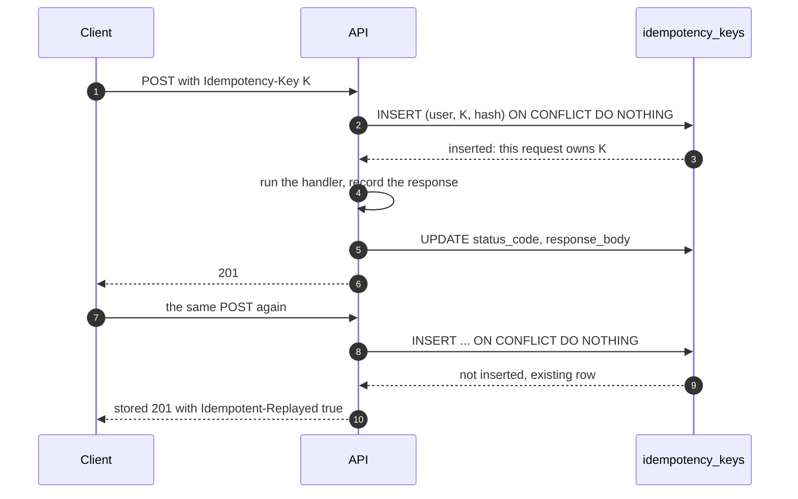

# 04. Idempotency keys: safe retries for creates

## Why it matters
You press the lift button, nothing lights up, so you press it again. The lift still comes once. A `POST` that creates a task is not like that: a phone on a bad network sends the request, never sees the answer and sends it again, and now there are two tasks. An **idempotency key** is the button that remembers it was already pressed.

## What you will build
Support for the `Idempotency-Key` header on the four creates of the contract (team, project, task, comment): the first request with a key runs and its response is stored for 24 hours; the same key with the same body replays the stored response with `Idempotent-Replayed: true`; the same key with a different body is `422`; the same key while the first request is still running is `409`.

Conformance after this chapter (real run): still **6 passed, 12 failed** with the sign-in stand-in. The check `create task with Idempotency-Key` passes for real in chapter 05, when tokens work.

## Before you start
- Chapter 03 done, or unzip `backend-go-phase-2-data.zip` and open `04-idempotency/code`. Only the files below are new or changed; everything else is in `skip_lesson_check`.
- Start the database as in chapter 02 (`cp .env.example .env`, `docker compose -p tasksteams up -d --wait db`).

## Steps
### Step 1. The protocol

The table `idempotency_keys` comes from the platform schema: primary key `(user_id, key)`, so keys are private to the caller; `request_hash`; `status_code` and `response_body` (null while the first request runs); `expires_at` 24 hours after creation.

### Step 2. The store side
**File: `internal/store/idempotency.go`**
```go
package store

import "context"

// IdempotencyRecord is what the database remembers about an Idempotency-Key.
type IdempotencyRecord struct {
	RequestHash string
	StatusCode  *int   // nil while the first request is still running
	Response    []byte // the stored response envelope, nil while the first request is still running
}

// ClaimKey tries to become the one request that owns (user, key). claimed is true for the owner. Any other request
// gets the existing record back and must replay it, reject it or ask the client to wait.
func (s *Store) ClaimKey(ctx context.Context, userID, key, requestHash string) (claimed bool, existing IdempotencyRecord, err error) {
	for range 3 { // the owner may release the key between our INSERT and our SELECT, so look again
		// A key older than 24 hours no longer counts; remove it so the INSERT below can succeed.
		if _, err := s.pool.Exec(ctx, "DELETE FROM idempotency_keys WHERE user_id = $1 AND key = $2 AND expires_at <= now()", userID, key); err != nil {
			return false, existing, mapError(err)
		}
		tag, err := s.pool.Exec(ctx, `INSERT INTO idempotency_keys (user_id, key, request_hash) VALUES ($1, $2, $3)
			ON CONFLICT (user_id, key) DO NOTHING`, userID, key, requestHash)
		if err != nil {
			return false, existing, mapError(err)
		}
		if tag.RowsAffected() == 1 {
			return true, existing, nil
		}
		existing, err = collectOne[IdempotencyRecord](ctx, s.pool,
			"SELECT request_hash, status_code, response_body FROM idempotency_keys WHERE user_id = $1 AND key = $2", userID, key)
		if err == nil {
			return false, existing, nil
		}
	}
	return false, existing, &Error{Kind: KindConflict, Message: "The Idempotency-Key is being released; retry in a moment."}
}

// FinishKey stores the response of the owner so later requests with the same key can replay it.
func (s *Store) FinishKey(ctx context.Context, userID, key string, status int, response []byte) error {
	_, err := s.pool.Exec(ctx, "UPDATE idempotency_keys SET status_code = $3, response_body = $4 WHERE user_id = $1 AND key = $2",
		userID, key, status, response)
	return mapError(err)
}

// ReleaseKey forgets a key whose request failed, so the client can fix the request and send it again.
func (s *Store) ReleaseKey(ctx context.Context, userID, key string) error {
	_, err := s.pool.Exec(ctx, "DELETE FROM idempotency_keys WHERE user_id = $1 AND key = $2", userID, key)
	return mapError(err)
}
```
`ClaimKey` first deletes an expired row with the same key, then tries `INSERT ... ON CONFLICT DO NOTHING`. `RowsAffected() == 1` means "you own the key". The insert is its own short transaction on purpose: it must be **visible to other requests immediately**, not only when the create commits, otherwise two parallel retries could both think they own the key. `FinishKey` stores the response; `ReleaseKey` forgets a key, which is what happens after a failed request so that the client can fix the body and reuse the key. The loop handles the tiny window where the owner releases the key between our `INSERT` and our `SELECT`.

### Step 3. The HTTP side
**File: `internal/http/idempotency.go`**
```go
package httpapi

import (
	"bytes"
	"context"
	"crypto/sha256"
	"encoding/hex"
	"encoding/json"
	"io"
	"maps"
	"net/http"

	"example.com/tasksteams/internal/auth"
	"example.com/tasksteams/internal/problem"
)

// idempotentRoutes are the creates that honour the Idempotency-Key header. handle wraps exactly these.
var idempotentRoutes = map[string]bool{
	"POST /v1/teams":                      true,
	"POST /v1/teams/{teamId}/projects":    true,
	"POST /v1/projects/{projectId}/tasks": true,
	"POST /v1/tasks/{taskId}/comments":    true,
}

// recorder is a ResponseWriter that keeps the response in memory instead of sending it.
type recorder struct {
	header http.Header
	status int
	body   bytes.Buffer
}

func (r *recorder) Header() http.Header { return r.header }

func (r *recorder) WriteHeader(status int) {
	if r.status == 0 {
		r.status = status
	}
}

func (r *recorder) Write(b []byte) (int, error) {
	if r.status == 0 {
		r.status = http.StatusOK
	}
	return r.body.Write(b)
}

// storedResponse is the envelope saved in idempotency_keys.response_body. The status is in its own column.
type storedResponse struct {
	Location string          `json:"location,omitempty"`
	ETag     string          `json:"etag,omitempty"`
	Body     json.RawMessage `json:"body"`
}

// idempotent makes a create safe to retry. The first request with a key runs normally and its response is stored.
// A repeat with the same key and the same body gets the stored response and Idempotent-Replayed: true.
// The same key with another body is a 422; the same key while the first request still runs is a 409.
func (s *Server) idempotent(next http.HandlerFunc) http.HandlerFunc {
	return func(w http.ResponseWriter, r *http.Request) {
		key := r.Header.Get("Idempotency-Key")
		if key == "" {
			next(w, r)
			return
		}
		if len(key) < 8 || len(key) > 128 {
			problem.Write(w, r, problem.BadRequest("Idempotency-Key must be 8 to 128 characters."))
			return
		}
		body, err := io.ReadAll(http.MaxBytesReader(w, r.Body, 1<<20))
		if err != nil {
			problem.Write(w, r, problem.BadRequest("The request body could not be read."))
			return
		}
		r.Body = io.NopCloser(bytes.NewReader(body)) // the handler reads the body again
		userID := auth.FromContext(r.Context()).ID
		sum := sha256.Sum256(append([]byte(r.Method+" "+r.URL.Path+"\n"), body...))
		hash := hex.EncodeToString(sum[:])

		claimed, existing, err := s.store.ClaimKey(r.Context(), userID, key, hash)
		if err != nil {
			s.fail(w, r, err)
			return
		}
		if !claimed {
			s.answerFromRecord(w, r, existing.RequestHash == hash, existing.StatusCode, existing.Response)
			return
		}

		finished := false
		defer func() {
			if !finished { // a panic or a store error: let the client try again
				_ = s.store.ReleaseKey(context.WithoutCancel(r.Context()), userID, key)
			}
		}()
		rec := &recorder{header: http.Header{}}
		next(rec, r)
		if rec.status >= 200 && rec.status < 300 {
			envelope, _ := json.Marshal(storedResponse{Location: rec.header.Get("Location"), ETag: rec.header.Get("ETag"), Body: rec.body.Bytes()})
			if err := s.store.FinishKey(context.WithoutCancel(r.Context()), userID, key, rec.status, envelope); err != nil {
				s.logger.Error("store idempotency response", "error", err, "trace_id", problem.TraceID(r.Context()))
			} else {
				finished = true
			}
		} else {
			_ = s.store.ReleaseKey(context.WithoutCancel(r.Context()), userID, key)
			finished = true // failures are not remembered: the client may fix the request and reuse the key
		}
		maps.Copy(w.Header(), rec.header)
		w.WriteHeader(rec.status)
		_, _ = w.Write(rec.body.Bytes())
	}
}

// answerFromRecord answers a request that did not claim the key.
func (s *Server) answerFromRecord(w http.ResponseWriter, r *http.Request, sameRequest bool, status *int, response []byte) {
	switch {
	case !sameRequest:
		problem.Write(w, r, problem.Validation("The Idempotency-Key was already used with a different request."))
	case status == nil:
		problem.Write(w, r, problem.Conflict("A request with this Idempotency-Key is still in progress."))
	default:
		var stored storedResponse
		if err := json.Unmarshal(response, &stored); err != nil {
			s.logger.Error("read stored idempotency response", "error", err, "trace_id", problem.TraceID(r.Context()))
			problem.Write(w, r, problem.Internal())
			return
		}
		w.Header().Set("Content-Type", "application/json")
		w.Header().Set("Idempotent-Replayed", "true")
		if stored.Location != "" {
			w.Header().Set("Location", stored.Location)
		}
		if stored.ETag != "" {
			w.Header().Set("ETag", stored.ETag)
		}
		w.WriteHeader(*status)
		_, _ = w.Write(stored.Body)
	}
}
```
- `idempotentRoutes` names the four creates; `handle` wraps only those. Handlers know nothing about idempotency.
- The request is identified by a **SHA-256 hash of method, path and body**. The same key must mean the same request, so a client that reuses a key by mistake for a different create gets `422` instead of someone else's response.
- `recorder` is a `ResponseWriter` that keeps the status, headers and body in memory. The handler writes into it; afterwards the middleware stores the interesting part (status, `Location`, `ETag`, body) and copies everything to the real response.
- Only **2xx responses are remembered**. A `422` or `409` is not stored: it describes a request that failed, and the client should be able to fix it and retry with the same key (the second half of the demo below).
- The `defer` releases the key if the handler panics or the store fails, so a crashed request does not block the key for 24 hours. `context.WithoutCancel` keeps the release alive even when the client has already disconnected.
- Trade-off: the stored response goes into a `jsonb` column, which normalises the JSON (key order, spaces). The replay is the same document, not the same bytes. Storing the bytes would need a `text` column; the platform schema chose `jsonb`.

### Step 4. Register it
`handle` in `authz.go` is the only existing file that changes: two lines wrap a route when its pattern is in `idempotentRoutes`.
**File: `internal/http/authz.go`**
```go
package httpapi

import (
	"net/http"
	"strings"

	"example.com/tasksteams/internal/auth"
	"example.com/tasksteams/internal/problem"
)

// authenticate runs on every /v1 request. It never rejects: it records who the caller is, or why the credentials
// were refused, and leaves the 401 to the route (see handle), so that /health and unknown paths stay open.
func (s *Server) authenticate(next http.Handler) http.Handler {
	return http.HandlerFunc(func(w http.ResponseWriter, r *http.Request) {
		if !strings.HasPrefix(r.URL.Path, "/v1/") {
			next.ServeHTTP(w, r)
			return
		}
		principal, err := s.auth.Authenticate(r)
		if err != nil {
			s.logger.Warn("authentication failed", "reason", err.Error(), "trace_id", problem.TraceID(r.Context()))
		}
		if principal != nil {
			infoFrom(r.Context()).userID = principal.ID
		}
		next.ServeHTTP(w, r.WithContext(auth.NewContext(r.Context(), principal, err)))
	})
}

// handle registers a route that needs a signed-in caller whose token carries the given scope.
func (s *Server) handle(mux *http.ServeMux, pattern, scope string, h http.HandlerFunc) {
	if idempotentRoutes[pattern] {
		h = s.idempotent(h)
	}
	mux.HandleFunc(pattern, func(w http.ResponseWriter, r *http.Request) {
		principal := auth.FromContext(r.Context())
		if principal == nil {
			p := problem.Unauthorized("A bearer access token is required.")
			if auth.FailureFromContext(r.Context()) != nil {
				p = problem.Unauthorized("The access token is invalid or expired.").
					WithHeader("WWW-Authenticate", `Bearer realm="tasksteams", error="invalid_token"`)
			}
			problem.Write(w, r, p)
			return
		}
		if !principal.HasScope(scope) {
			problem.Write(w, r, problem.Forbidden("The token needs the scope "+scope+"."))
			return
		}
		h(w, r)
	})
}

// requireAdmin answers 403 unless the caller has the admin realm role.
func requireAdmin(w http.ResponseWriter, r *http.Request) (*auth.Principal, bool) {
	principal := auth.FromContext(r.Context())
	if !principal.IsAdmin() {
		problem.Write(w, r, problem.Forbidden("The admin role is required."))
		return nil, false
	}
	return principal, true
}

type teamLevel int

const (
	levelMember teamLevel = iota // any member of the team
	levelLead                    // a lead of the team
)

// authorize decides whether the caller may act on a team's objects. what names the object for the message.
//
// A caller who is not in the team gets 404, the same answer as for an id that does not exist, so ids cannot be probed.
// A member who lacks the lead role gets 403: they already know the object exists. Admins pass for every team.
func (s *Server) authorize(w http.ResponseWriter, r *http.Request, teamID string, need teamLevel, what string) bool {
	principal := auth.FromContext(r.Context())
	access, err := s.store.TeamAccess(r.Context(), teamID, principal.ID)
	if err != nil {
		s.fail(w, r, err)
		return false
	}
	switch {
	case !access.Exists, access.Role == "" && !principal.IsAdmin():
		problem.Write(w, r, problem.NotFound("The "+what+" does not exist."))
		return false
	case need == levelLead && access.Role != "lead" && !principal.IsAdmin():
		problem.Write(w, r, problem.Forbidden("Only a team lead or an admin can do this."))
		return false
	}
	return true
}
```

### Step 5. Check and run
```bash
gofmt -l .
go vet ./...
go run ./cmd/api
```

#### The `.gitignore` of this chapter (unchanged from chapter 01)
The same `.gitignore` as in chapter 01, shown again so you can check your copy.

<details>
<summary><code>.gitignore</code> (same as chapter 01)</summary>

**File: `.gitignore`**
```text
bin/
*.exe
.env
```

- `bin/`: compiled programs; rebuilt on every machine.
- `*.exe`: Windows programs that `go build` writes next to the source.
- `.env`: your local settings. Never commit it; `.env.example` is the committed template.

`.git` itself is never listed: Git does not track its own folder.
</details>

## Run it
In a second terminal. First check that the API reaches the database:
```bash
curl -s -w "\nHTTP %{http_code}\n" http://127.0.0.1:8000/health
```
```text
{"status":"ok","version":"1.0.0","database":"up"}
HTTP 200
```
Alice creates a task with the key `demo-key-0001` (`task-create.json` is the file from chapter 03):
```bash
curl -s -i -X POST -H "X-Dev-User: a11ce000-0000-4000-8000-000000000001" -H "X-Dev-Roles: admin" -H "Content-Type: application/json" -H "Idempotency-Key: demo-key-0001" --data-binary @requests/task-create.json http://127.0.0.1:8000/v1/projects/9a000000-0000-4000-8000-000000000001/tasks
```
```text
HTTP/1.1 201 Created
Content-Type: application/json
Etag: "1"
Location: http://localhost:8000/v1/tasks/be5be100-a0cf-4dab-89f7-13a6bc1fa22d
X-Trace-Id: 9ffa33abd8a74a8c2ddeecdf984bd547
Date: Mon, 23 Nov 2026 08:39:57 GMT
Content-Length: 385

{"id":"be5be100-a0cf-4dab-89f7-13a6bc1fa22d","projectId":"9a000000-0000-4000-8000-000000000001","title":"Write the Go chapter","description":"","status":"todo","priority":"high","assigneeId":null,"dueDate":"2027-03-15","completedAt":null,"createdBy":"a11ce000-0000-4000-8000-000000000001","version":1,"createdAt":"2026-11-23T08:39:57.543912Z","updatedAt":"2026-11-23T08:39:57.543912Z"}
```
Send **the same command again**:
```text
HTTP/1.1 201 Created
Content-Type: application/json
Etag: "1"
Idempotent-Replayed: true
Location: http://localhost:8000/v1/tasks/be5be100-a0cf-4dab-89f7-13a6bc1fa22d
X-Trace-Id: 33c9c5f7e3aa8000e75087d3f26c8353
Date: Mon, 23 Nov 2026 08:39:57 GMT
Content-Length: 410

{"id": "be5be100-a0cf-4dab-89f7-13a6bc1fa22d", "title": "Write the Go chapter", "status": "todo", "dueDate": "2027-03-15", "version": 1, "priority": "high", "createdAt": "2026-11-23T08:39:57.543912Z", "createdBy": "a11ce000-0000-4000-8000-000000000001", "projectId": "9a000000-0000-4000-8000-000000000001", "updatedAt": "2026-11-23T08:39:57.543912Z", "assigneeId": null, "completedAt": null, "description": ""}
```
The status, the `Location` and the id are the same, `Idempotent-Replayed: true` says "this is a replay", and no second task exists. Note the body: it is the same task, with the keys in the order `jsonb` stores them.

The same key with a different body, and a key that is too short:
```bash
curl -s -w "\nHTTP %{http_code}\n" -X POST -H "X-Dev-User: a11ce000-0000-4000-8000-000000000001" -H "X-Dev-Roles: admin" -H "Content-Type: application/json" -H "Idempotency-Key: demo-key-0001" --data-binary @requests/task-patch.json http://127.0.0.1:8000/v1/projects/9a000000-0000-4000-8000-000000000001/tasks
curl -s -w "\nHTTP %{http_code}\n" -X POST -H "X-Dev-User: a11ce000-0000-4000-8000-000000000001" -H "X-Dev-Roles: admin" -H "Content-Type: application/json" -H "Idempotency-Key: abc" --data-binary @requests/task-create.json http://127.0.0.1:8000/v1/projects/9a000000-0000-4000-8000-000000000001/tasks
```
```text
{"type":"https://code101.example/problems/validation-error","title":"Validation failed","status":422,"detail":"The Idempotency-Key was already used with a different request.","instance":"/v1/projects/9a000000-0000-4000-8000-000000000001/tasks","traceId":"f6ce22e6c767e07c4a832383345c95bc"}
HTTP 422
```
```text
{"type":"https://code101.example/problems/bad-request","title":"Bad request","status":400,"detail":"Idempotency-Key must be 8 to 128 characters.","instance":"/v1/projects/9a000000-0000-4000-8000-000000000001/tasks","traceId":"a527f53168fb3b8755a084323cefbe6d"}
HTTP 400
```

A failed request does not burn its key. First an invalid body, then the corrected body with the **same** key `demo-key-0002`:
```bash
curl -s -w "\nHTTP %{http_code}\n" -X POST -H "X-Dev-User: a11ce000-0000-4000-8000-000000000001" -H "X-Dev-Roles: admin" -H "Content-Type: application/json" -H "Idempotency-Key: demo-key-0002" --data-binary @requests/task-invalid.json http://127.0.0.1:8000/v1/projects/9a000000-0000-4000-8000-000000000001/tasks
curl -s -w "\nHTTP %{http_code}\n" -X POST -H "X-Dev-User: a11ce000-0000-4000-8000-000000000001" -H "X-Dev-Roles: admin" -H "Content-Type: application/json" -H "Idempotency-Key: demo-key-0002" --data-binary @requests/task-create.json http://127.0.0.1:8000/v1/projects/9a000000-0000-4000-8000-000000000001/tasks
```
```text
{"type":"https://code101.example/problems/validation-error","title":"Validation failed","status":422,"detail":"One or more fields are invalid.","instance":"/v1/projects/9a000000-0000-4000-8000-000000000001/tasks","traceId":"3574b06df32963a4da2a4340becbaa49","errors":[{"pointer":"/title","detail":"must be between 1 and 200 characters"},{"pointer":"/priority","detail":"must be one of: low, medium, high, urgent"},{"pointer":"/dueDate","detail":"must be a date such as 2027-06-30"}]}
HTTP 422
```
```text
{"id":"94cfe825-2eb7-4286-992d-b73e14ccfa75","projectId":"9a000000-0000-4000-8000-000000000001","title":"Write the Go chapter","description":"","status":"todo","priority":"high","assigneeId":null,"dueDate":"2027-03-15","completedAt":null,"createdBy":"a11ce000-0000-4000-8000-000000000001","version":1,"createdAt":"2026-11-23T08:39:57.679391Z","updatedAt":"2026-11-23T08:39:57.679391Z"}
HTTP 201
```

Look at the database (two keys, two stored responses) and count the tasks the whole demo created: two, although `task-create.json` was sent three times:
```bash
docker compose -p tasksteams exec -T db psql -U tasks_admin -d tasksteams -c "SELECT key, status_code, left(request_hash, 12) AS hash FROM idempotency_keys ORDER BY key"
docker compose -p tasksteams exec -T db psql -U tasks_admin -d tasksteams -tA -c "SELECT count(*) FROM tasks WHERE title = 'Write the Go chapter'"
```
```text
      key      | status_code |     hash
---------------+-------------+--------------
 demo-key-0001 |         201 | 9b9eef0dea21
 demo-key-0002 |         201 | 9b9eef0dea21
(2 rows)
```
```text
2
```
Both keys carry the same hash because both valid requests were the same `POST` with the same file.

Clean up: Ctrl+C, then `docker compose -p tasksteams down -v --remove-orphans`.

Conformance after this chapter (platform script):
```text
PASS  keycloak discovery (issuer matches, PKCE S256 offered)
PASS  token for alice (iss, aud tasks-api, sub, role admin, three scopes)
PASS  token for bob (role member only)
PASS  postgres reachable (127.0.0.1:5432 answers the Postgres protocol)
PASS  health (200, status ok, no token needed)
FAIL  me: expected HTTP 200, got 401: {"type":"https://code101.example/problems/unauthorized","title":"Unauthorized","status":401,"detail":"A bearer access token is required.","instance":"/v1/me","traceId":"06318cf9c26fc3aca421a8fd2212f4b
FAIL  create team: expected HTTP 201, got 401: {"type":"https://code101.example/problems/unauthorized","title":"Unauthorized","status":401,"detail":"A bearer access token is required.","instance":"/v1/teams","traceId":"48a3771cc1de6f36c9e366567dcb
FAIL  create project: needs the result of an earlier check (team)
FAIL  create task with Idempotency-Key: needs the result of an earlier check (project)
FAIL  get task with ETag: needs the result of an earlier check (task)
FAIL  update with If-Match: needs the result of an earlier check (task)
FAIL  stale If-Match gives 412: needs the result of an earlier check (task)
FAIL  cursor pagination: needs the result of an earlier check (project)
PASS  401 without token (401 problem details with a Bearer challenge)
FAIL  403 for member on admin route: expected HTTP 403, got 401: {"type":"https://code101.example/problems/unauthorized","title":"Unauthorized","status":401,"detail":"A bearer access token is required.","instance":"/v1/audit-log","traceId":"3f54e633773a7716d655c460
FAIL  problem details shape: expected HTTP 422, got 401: {"type":"https://code101.example/problems/unauthorized","title":"Unauthorized","status":401,"detail":"A bearer access token is required.","instance":"/v1/teams","traceId":"e1df9eaa37376a652483296c5c32
FAIL  audit log: needs the result of an earlier check (task)
FAIL  cleanup: needs the result of an earlier check (team)
6 passed, 12 failed
```

## How it works
- **Idempotent** means "doing it twice has the same effect as doing it once". `GET`, `PUT` and `DELETE` are idempotent by definition of HTTP; `POST` is not, which is why the key exists. The header is described by an IETF draft (draft-ietf-httpapi-idempotency-key-header); the contract pins the current form.
- **Scope.** The primary key is `(user_id, key)`: two users can use the same key text without interfering, and one user can never read another user's stored response.
- **Failure modes.** (1) The server dies after the create but before `FinishKey`: the key stays "in progress" and later retries get `409` until it expires (24 hours); a cleanup job calling `purge_expired_idempotency_keys()` removes old rows, and a stricter design would put the create and the key update into one transaction. (2) Two retries race: only one `INSERT` succeeds, the other gets `409`. (3) The client sends the same key for a different request: `422`.
- **Cost.** One extra round trip before and after each keyed create, and one row per key for 24 hours.

New terms: **idempotency**, **idempotency key**, **request hash**, **replay**. See the [glossary](../../GLOSSARY.md).

## Try it
**Exercise.** The request hash decides whether a repeated key is the *same* request. Write `requestHash(method, path, body)`: SHA-256 of the method, a space, the path, a newline and the body, as lowercase hex.

**File: `exercise/starter/main.go`**
```go
package main

import (
	"crypto/sha256"
	"encoding/hex"
	"fmt"
)

// requestHash identifies a request for the Idempotency-Key check: the same key may only be reused for the same request.
// TODO: hash the method, a space, the path, a newline and the body with SHA-256 and return the hex text.
func requestHash(method, path string, body []byte) string {
	_ = sha256.Sum256 // remove this line once you use the packages
	_ = hex.EncodeToString
	return ""
}

func main() {
	first := requestHash("POST", "/v1/teams", []byte(`{"name":"A"}`))
	again := requestHash("POST", "/v1/teams", []byte(`{"name":"A"}`))
	otherBody := requestHash("POST", "/v1/teams", []byte(`{"name":"B"}`))
	otherPath := requestHash("POST", "/v1/projects", []byte(`{"name":"A"}`))
	fmt.Println("first       ", first)
	fmt.Println("same request", first == again)
	fmt.Println("other body  ", first == otherBody)
	fmt.Println("other path  ", first == otherPath)
}
```

<details><summary>Solution</summary>

**File: `exercise/solution/main.go`**
```go
package main

import (
	"crypto/sha256"
	"encoding/hex"
	"fmt"
)

// requestHash identifies a request for the Idempotency-Key check: the same key may only be reused for the same request.
func requestHash(method, path string, body []byte) string {
	sum := sha256.Sum256(append([]byte(method+" "+path+"\n"), body...))
	return hex.EncodeToString(sum[:])
}

func main() {
	first := requestHash("POST", "/v1/teams", []byte(`{"name":"A"}`))
	again := requestHash("POST", "/v1/teams", []byte(`{"name":"A"}`))
	otherBody := requestHash("POST", "/v1/teams", []byte(`{"name":"B"}`))
	otherPath := requestHash("POST", "/v1/projects", []byte(`{"name":"A"}`))
	fmt.Println("first       ", first)
	fmt.Println("same request", first == again)
	fmt.Println("other body  ", first == otherBody)
	fmt.Println("other path  ", first == otherPath)
}
```
The path is part of the hash so that the same key cannot be replayed against a different resource, and the newline separates path and body so that `/a` + `bc` and `/ab` + `c` cannot produce the same input. Output:
```text
first        b692f082278108794800f8fd4047755fea0d884e25831b8094934dc621032a32
same request true
other body   false
other path   false
```
</details>

## Check yourself
1. Why is the key stored in its own transaction instead of together with the create?
   <details><summary>Answer</summary>Other requests must see the claim at once. If the claim were part of the create's transaction it would only appear at commit, and two parallel retries could both create the task.</details>
2. Why are failed responses not stored?
   <details><summary>Answer</summary>A client that gets 422 should be able to fix the body and retry with the same key. Remembering the failure would force it to invent a new key and defeat the retry safety of the first request.</details>
3. What happens when two different users send the same key?
   <details><summary>Answer</summary>Nothing special: the key is scoped by user, so each owns its own row.</details>

## Common mistakes
| Symptom or error text | Cause | Fix |
|---|---|---|
| `git status` lists `.env`, `bin/` or a `.exe` file as new files, or a password appears in a commit | `.gitignore` is missing, or it was created after the files were already tracked | Create the `.gitignore` shown above; for files already tracked run `git rm --cached .env` (and `git rm -r --cached bin`), commit, and replace any real secret that was ever committed |
| `Idempotency-Key must be 8 to 128 characters.` (400) | The key is shorter than 8 or longer than 128 characters | Use a UUID |
| `The Idempotency-Key was already used with a different request.` (422) | The same key was sent with another path or body | Use a new key for a new request |
| `A request with this Idempotency-Key is still in progress.` (409) | The first request has not finished (or the process died during it) | Wait and retry; after 24 hours the key expires |
| The replay has the same data but another key order | `response_body` is `jsonb`, which does not keep key order | Compare parsed JSON, not text |

## Best practice
Make every non-idempotent create retry-safe with a client-chosen key, scope the key to the caller, bind it to a hash of the request, and expire it. Source: IETF draft, The Idempotency-Key HTTP Header Field https://datatracker.ietf.org/doc/draft-ietf-httpapi-idempotency-key-header/ and RFC 9110 section 9.2.2 Idempotent Methods https://www.rfc-editor.org/info/rfc9110

## Next lesson
05. Identity: validate Keycloak access tokens (signature, issuer, audience, expiry), read roles and scopes, and remove the development stand-in.
