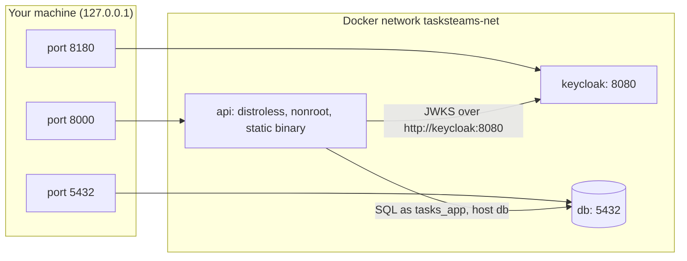

# 06. Run and ship: a multi-stage Dockerfile, a Compose override and a healthcheck

## Why it matters
A moving company does not ship the workshop with the furniture. A Go program compiles to a single file, so the image you ship can contain **only that file**: no compiler, no shell, no package manager, nothing an attacker could use after a break-in and almost nothing to patch. This chapter builds that image and starts the whole stack (database, Keycloak, API) with one command.

## What you will build
- A multi-stage `Dockerfile`: build a static binary in a Go image, copy it into a `distroless` image that runs as a non-root user (about 23 MB).
- A `.dockerignore` that keeps secrets and noise out of the build context.
- `docker-compose.override.yml`, which adds the `api` service to the platform stack, joins the network `tasksteams-net`, publishes `127.0.0.1:8000` and checks health.
- A `healthcheck` subcommand in the binary, because the final image has no shell and no `curl`.

Conformance after this chapter (real run through Docker): **17 passed, 1 failed**, the same single failure as chapter 05 (`RateLimit` headers, chapter 07).

## Before you start
- Chapter 05 done, or unzip `backend-go-phase-4-run-and-ship.zip` and open `06-docker/code`.
- Docker running in Linux-container mode; ports 5432, 8000 and 8180 free (stop `go run` servers and other stacks).
- **Image tags.** The Go image is `golang:1.27.4-alpine3.24`. On 2026-11-23 Docker Hub has the tags `1.27`, `1.27.4` and `1.27.4-alpine3.24`, so the version this project builds with exists; if you read this later, pick the newest `1.x.y-alpine3.z` tag and keep `go.mod` in step. The runtime image is `gcr.io/distroless/static-debian13:nonroot`; the tag `nonroot` exists on that image. A tag moves over time: for a release pin the image **digest** (`image@sha256:...`) and update it on purpose.

## Steps
### Step 1. The Dockerfile
**File: `Dockerfile`**
```dockerfile
# Stage 1: build a static binary. This stage is thrown away; only the file it produces is copied on.
FROM golang:1.27.4-alpine3.24 AS build
WORKDIR /src

# Copy the module files first: this layer is cached until go.mod or go.sum changes.
COPY go.mod go.sum ./
RUN go mod download

COPY . .
# CGO_ENABLED=0 gives a static binary with no C library. -trimpath removes local file paths from the binary,
# -s -w remove the symbol table and debug information.
RUN CGO_ENABLED=0 GOOS=linux go build -trimpath -ldflags="-s -w" -o /out/api ./cmd/api

# Stage 2: the runtime image. "static" holds only CA certificates, time zone data and a passwd entry,
# with no shell and no package manager, and "nonroot" runs as user 65532.
FROM gcr.io/distroless/static-debian13:nonroot
COPY --from=build /out/api /app/api
USER nonroot:nonroot
EXPOSE 8000
ENV LISTEN_ADDR=0.0.0.0:8000 LOG_FORMAT=json
ENTRYPOINT ["/app/api"]
```
- **Stage 1 (`build`).** `golang:1.27.4-alpine3.24` brings the compiler. `WORKDIR /src` is the working folder inside the image. Copying only `go.mod` and `go.sum` first and running `go mod download` creates a layer that Docker **caches** until a module changes, so editing a `.go` file does not download everything again. Then the sources are copied and compiled.
- `CGO_ENABLED=0` makes a **static binary**: it does not need a C library, so it runs in an image that has none. `GOOS=linux` is what the container is. `-trimpath` removes your local file paths from the binary, `-ldflags="-s -w"` strips the symbol table and debug information (a smaller file; stack traces still show function names).
- **Stage 2.** `distroless/static-debian13` holds CA certificates, time zone data and a passwd entry, and nothing else: no shell, no `apt`. `:nonroot` runs as user 65532; `USER nonroot:nonroot` states it explicitly so a reader (and a scanner) sees it. `COPY --from=build` takes only the binary out of the first stage; the compiler and sources are left behind and never shipped.
- `ENV LISTEN_ADDR=0.0.0.0:8000` makes the server listen on all interfaces **inside the container** (the default `127.0.0.1` would be unreachable from outside the container). `LOG_FORMAT=json` gives one JSON object per log line for log collectors. `ENTRYPOINT ["/app/api"]` uses the **exec form** (a JSON array), so the program is process 1 and receives `SIGTERM` directly: that is what makes the graceful shutdown of chapter 01 work under `docker stop`.

### Step 2. `.dockerignore`
**File: `.dockerignore`**
```text
.git
.gitignore
.dockerignore
.env
.env.example
Dockerfile
docker-compose.yml
docker-compose.override.yml
bin/
*.exe
requests/
scripts/
db/
keycloak/
```
The build context is everything `docker build` sends to Docker; `.dockerignore` removes entries. Leaving `.env`, `.git` and the SQL and realm files out makes the context small, the build fast and keeps secrets out of the image layers. Be careful with patterns: if you list `go.sum` here the build fails (see Common mistakes).

### Step 3. The Compose override
**File: `docker-compose.override.yml`**
```yaml
# Adds the Go API to the platform stack of docker-compose.yml. Compose merges this file automatically,
# so `docker compose up` starts db, keycloak and api together on the network tasksteams-net.
services:
  api:
    build:
      context: .
    depends_on:
      db:
        condition: service_healthy
      keycloak:
        condition: service_healthy
    environment:
      LISTEN_ADDR: 0.0.0.0:8000
      LOG_FORMAT: json
      # Disposable local password of the platform database; inside the network the host is the service name "db".
      DATABASE_URL: postgres://tasks_app:tasks_app_local_only@db:5432/tasksteams
      PUBLIC_URL: http://localhost:8000
      # The issuer is what the token says (the browser-facing address); the keys are fetched over the internal network.
      KEYCLOAK_ISSUER: http://localhost:${KEYCLOAK_PORT:-8180}/realms/tasksteams
      KEYCLOAK_AUDIENCE: tasks-api
      KEYCLOAK_JWKS_URL: http://keycloak:8080/realms/tasksteams/protocol/openid-connect/certs
    ports:
      - "127.0.0.1:8000:8000"
    healthcheck:
      test: ["CMD", "/app/api", "healthcheck"]
      interval: 5s
      timeout: 4s
      retries: 10
      start_period: 3s
    networks:
      - tasksteams
```
- Compose reads `docker-compose.yml` **and** `docker-compose.override.yml` automatically and merges them. `docker compose up` in this folder therefore starts `db`, `keycloak` and `api` as one project. (You can also name the files: `docker compose -f docker-compose.yml -f docker-compose.override.yml up`.)
- `build: context: .` builds the `Dockerfile` of this folder. The image gets the name `<project>-api`.
- `depends_on` with `condition: service_healthy` starts `api` only when the database and Keycloak are healthy.
- `environment`: inside the network the database host is the **service name** `db` (not `localhost`; inside the container `localhost` is the API itself). The token issuer is the **browser-facing** address `http://localhost:8180/realms/tasksteams`, because that is what Keycloak writes into tokens (the platform file sets `KC_HOSTNAME`); the signing keys are fetched over the internal network from `http://keycloak:8080/...`. Two different addresses for one Keycloak is the most common Docker identity bug, and this is the fix.
- `ports: "127.0.0.1:8000:8000"` publishes the API to your machine only.
- `networks: [tasksteams]` attaches the service to the platform network, which the base file names `tasksteams-net`. A backend of another stack can join the same way with an `external` network of that name.
- `healthcheck` runs the binary's own `healthcheck` subcommand every 5 seconds; `up --wait` returns when it passes.

### Step 4. The `healthcheck` subcommand
The final image has no shell and no `curl`, so the container cannot run `curl localhost:8000/health`. The binary does it itself.
**File: `cmd/api/main.go`**
```go
// Command api is the Tasks and Teams backend written in Go.
package main

import (
	"context"
	"errors"
	"fmt"
	"log/slog"
	"net"
	"net/http"
	"os"
	"os/signal"
	"syscall"
	"time"

	"example.com/tasksteams/internal/auth"
	"example.com/tasksteams/internal/config"
	httpapi "example.com/tasksteams/internal/http"
	"example.com/tasksteams/internal/store"
)

func main() {
	if len(os.Args) > 1 && os.Args[1] == "healthcheck" {
		os.Exit(healthcheck())
	}
	if err := run(); err != nil {
		fmt.Fprintln(os.Stderr, "fatal:", err)
		os.Exit(1)
	}
}

func run() error {
	cfg, err := config.Load()
	if err != nil {
		return err
	}
	logger := newLogger(cfg)
	slog.SetDefault(logger)

	// ctx is cancelled by Ctrl+C (os.Interrupt) or by `docker stop` (SIGTERM).
	ctx, stop := signal.NotifyContext(context.Background(), os.Interrupt, syscall.SIGTERM)
	defer stop()

	db, err := store.Open(ctx, cfg.DatabaseURL)
	if err != nil {
		return err
	}
	defer db.Close()

	verifier := auth.NewJWT(cfg.Issuer, cfg.Audience, auth.NewJWKS(cfg.JWKSURL), db)
	logger.Info("token validation", "issuer", cfg.Issuer, "audience", cfg.Audience, "jwks_url", cfg.JWKSURL)

	srv := &http.Server{
		Addr: cfg.ListenAddr,
		Handler: httpapi.NewServer(httpapi.Deps{
			Logger:    logger,
			Store:     db,
			Auth:      verifier,
			PublicURL: cfg.PublicURL,
		}).Handler(),
		ReadHeaderTimeout: 5 * time.Second,
		ReadTimeout:       15 * time.Second,
		WriteTimeout:      30 * time.Second,
		IdleTimeout:       60 * time.Second,
		ErrorLog:          slog.NewLogLogger(logger.Handler(), slog.LevelWarn),
	}

	serveErr := make(chan error, 1)
	go func() {
		logger.Info("listening", "addr", cfg.ListenAddr)
		serveErr <- srv.ListenAndServe()
	}()

	select {
	case err := <-serveErr:
		return err // ListenAndServe only returns before Shutdown when it failed, for example "address already in use"
	case <-ctx.Done():
		logger.Info("shutting down", "reason", "signal received")
	}

	shutdownCtx, cancel := context.WithTimeout(context.Background(), 10*time.Second)
	defer cancel()
	if err := srv.Shutdown(shutdownCtx); err != nil && !errors.Is(err, http.ErrServerClosed) {
		return fmt.Errorf("graceful shutdown: %w", err)
	}
	logger.Info("stopped")
	return nil
}

// healthcheck is what `api healthcheck` runs. The final image has no shell and no curl, so the container's
// HEALTHCHECK calls the binary itself: it asks /health on the local port and exits 0 (healthy) or 1.
func healthcheck() int {
	cfg, err := config.Load()
	if err != nil {
		fmt.Fprintln(os.Stderr, "healthcheck:", err)
		return 1
	}
	_, port, err := net.SplitHostPort(cfg.ListenAddr)
	if err != nil {
		fmt.Fprintln(os.Stderr, "healthcheck:", err)
		return 1
	}
	client := &http.Client{Timeout: 3 * time.Second}
	resp, err := client.Get("http://" + net.JoinHostPort("127.0.0.1", port) + "/health")
	if err != nil {
		fmt.Fprintln(os.Stderr, "healthcheck:", err)
		return 1
	}
	defer resp.Body.Close()
	if resp.StatusCode != http.StatusOK {
		fmt.Fprintln(os.Stderr, "healthcheck: status", resp.StatusCode)
		return 1
	}
	return 0
}

func newLogger(cfg config.Config) *slog.Logger {
	opts := &slog.HandlerOptions{Level: cfg.LogLevel}
	if cfg.LogFormat == "json" {
		return slog.New(slog.NewJSONHandler(os.Stdout, opts))
	}
	return slog.New(slog.NewTextHandler(os.Stdout, opts))
}
```
`main` checks `os.Args` first: `api healthcheck` loads the same configuration, asks `http://127.0.0.1:<port>/health` with a 3-second timeout and exits `0` (healthy) or `1`. The port comes from `LISTEN_ADDR`, so it follows the configuration; `net.SplitHostPort` and `net.JoinHostPort` handle the `:8000`, `0.0.0.0:8000` and `[::]:8000` shapes (the exercise below).

### Step 5. Build and start everything
```bash
cp .env.example .env
docker compose -p tasksteams up -d --build --wait
```
(PowerShell: `Copy-Item .env.example .env`.) `--build` builds the image, `--wait` returns when every service with a health check is healthy; the first run downloads the base images and Keycloak takes up to a minute. Expected (the last lines):
```text
 Container tasksteams-db-1 Started
 Container tasksteams-db-1 Waiting
 Container tasksteams-keycloak-1 Started
 Container tasksteams-keycloak-1 Waiting
 Container tasksteams-db-1 Healthy
 Container tasksteams-keycloak-1 Healthy
 Container tasksteams-api-1 Starting
 Container tasksteams-api-1 Started
 Container tasksteams-api-1 Waiting
 Container tasksteams-db-1 Waiting
 Container tasksteams-keycloak-1 Waiting
 Container tasksteams-db-1 Healthy
 Container tasksteams-keycloak-1 Healthy
 Container tasksteams-api-1 Healthy
```
Look at the stack:
```bash
docker compose -p tasksteams ps
docker image ls tasksteams-api
```
```text
SERVICE    STATUS                    PORTS
api        Up 3 seconds (healthy)    127.0.0.1:8000->8000/tcp
db         Up 29 seconds (healthy)   127.0.0.1:5432->5432/tcp
keycloak   Up 29 seconds (healthy)   127.0.0.1:8180->8080/tcp
```
```text
tasksteams-api 23.3MB
```
23.3 MB for a service with a database driver, a JWT library and a web server. A `golang` image alone is more than a gigabyte.

## Run it
1. Who runs the process, and what is its entry point?
```bash
docker inspect --format "user={{.Config.User}} entrypoint={{.Config.Entrypoint}}" tasksteams-api-1
```
```text
user=nonroot:nonroot entrypoint=[/app/api]
```

2. The JSON log and the health endpoint:
```bash
docker compose -p tasksteams logs api --no-log-prefix
curl -s -w "\nHTTP %{http_code}\n" http://127.0.0.1:8000/health
```
```text
{"time":"2026-11-23T08:43:28.830279918Z","level":"INFO","msg":"token validation","issuer":"http://localhost:8180/realms/tasksteams","audience":"tasks-api","jwks_url":"http://keycloak:8080/realms/tasksteams/protocol/openid-connect/certs"}
{"time":"2026-11-23T08:43:28.830507655Z","level":"INFO","msg":"listening","addr":"0.0.0.0:8000"}
```
```text
{"status":"ok","version":"1.0.0","database":"up"}
HTTP 200
```

3. The healthcheck by hand, and proof that there is no shell to break into:
```bash
docker compose -p tasksteams exec api /app/api healthcheck
docker compose -p tasksteams exec api sh -c "echo hi"
```
`healthcheck` prints nothing and exits 0. The second command fails:
```text
OCI runtime exec failed: exec failed: unable to start container process: exec: "sh": executable file not found in $PATH
```

4. Conformance from the host:
```bash
python scripts/conformance.py
```
```text
PASS  keycloak discovery (issuer matches, PKCE S256 offered)
PASS  token for alice (iss, aud tasks-api, sub, role admin, three scopes)
PASS  token for bob (role member only)
PASS  postgres reachable (127.0.0.1:5432 answers the Postgres protocol)
PASS  health (200, status ok, no token needed)
FAIL  me: header RateLimit-Limit missing or not a number
PASS  create team (201, Location and ETag set, team 36d5ac18-aa97-4ef1-b2a2-14d69a300266)
PASS  create project (201, project 64943dd1-24e5-46ff-8af8-fb93fae62dee)
PASS  create task with Idempotency-Key (created once, replay returned the same task, other body gave 422)
PASS  get task with ETag (ETag "1", If-None-Match gave 304)
PASS  update with If-Match (200, version 1 -> 2)
PASS  stale If-Match gives 412 (stale If-Match gave 412, missing If-Match gave 428)
PASS  cursor pagination (2 + 1 tasks, no overlap, last page has nextCursor null)
PASS  401 without token (401 problem details with a Bearer challenge)
PASS  403 for member on admin route (bob (member) gets 403 on the audit log and on creating a team)
PASS  problem details shape (422 with errors[/name], 404 with type, title and status)
PASS  audit log (task create and update are in the audit trail)
PASS  cleanup (team deleted, then 404)
17 passed, 1 failed
```

5. Graceful stop. `docker stop` (and `docker compose stop`) send `SIGTERM`, the program logs and exits cleanly instead of being killed after 10 seconds:
```bash
docker compose -p tasksteams stop api
docker compose -p tasksteams logs api --no-log-prefix
```
```text
 Container tasksteams-api-1 Stopping
 Container tasksteams-api-1 Stopped
{"time":"2026-11-23T08:43:33.598628999Z","level":"INFO","msg":"shutting down","reason":"signal received"}
{"time":"2026-11-23T08:43:33.598796537Z","level":"INFO","msg":"stopped"}
 Container tasksteams-keycloak-1 Removing
 Container tasksteams-keycloak-1 Removed
 Volume tasksteams_pg_data Removing
 Network tasksteams-net Removing
 Volume tasksteams_pg_data Removed
 Image tasksteams-api:latest Removing
 Image tasksteams-api:latest Removed
 Network tasksteams-net Removed
```

6. Clean up. `--rmi local` also deletes the image built for this project:
```bash
docker compose -p tasksteams down -v --remove-orphans --rmi local
```
Compose prints `Removing` and `Removed` for the containers, the volume `tasksteams_pg_data`, the image `tasksteams-api` and the network. Check `docker ps -a`, `docker volume ls` and `docker network ls`: nothing of the project is left.

## How it works

- **Layers and cache.** Each `Dockerfile` instruction is a layer; Docker reuses a layer when its inputs are unchanged. Dependencies change rarely, code changes often, so dependencies come first.
- **Why a static binary matters for the runtime image.** `distroless/static` has no C library. A binary built with cgo would fail at start with a "not found" error that is really a missing loader.
- **Least privilege at the image level.** Non-root user, no shell, no package manager, read-only capable (chapter 07 turns that on), one small file.
- **Secrets.** The only secret-like value, the database password, is a disposable local one in the Compose file. In a real deployment it comes from a secret store (Docker/Kubernetes secrets, a vault) as an environment variable or a mounted file, never baked into an image or committed.
- **Trade-offs.** `distroless` images cannot be debugged with a shell; use `docker debug`, an ephemeral debug sidecar, or the `:debug-nonroot` tag when you must. `alpine` is the usual alternative (a tiny shell and `apk`, a bit larger, with a package manager that attracts CVE scanners). `scratch` is smaller still but has no CA certificates or time zones, so TLS calls and time zone lookups need them copied in.

New terms: **image**, **layer**, **multi-stage build**, **build context**, **static binary**, **non-root user**, **distroless**, **healthcheck**, **Compose override**. See the [glossary](../../GLOSSARY.md).

## Try it
**Exercise.** Implement `healthURL(listenAddr)`: return `http://127.0.0.1:<port>/health` for any `host:port` address and `""` when there is no port.

**File: `exercise/starter/main.go`**
```go
package main

import "fmt"

// healthURL turns a LISTEN_ADDR value into the address the container healthcheck calls on its own host.
// TODO: split the address with net.SplitHostPort, keep only the port and return
// "http://127.0.0.1:<port>/health" (use net.JoinHostPort so that the result is correct). Return "" when the
// address has no port.
func healthURL(listenAddr string) string {
	return ""
}

func main() {
	for _, addr := range []string{":8000", "0.0.0.0:8000", "127.0.0.1:9000", "[::]:8080", "8000"} {
		fmt.Printf("%-16q -> %q\n", addr, healthURL(addr))
	}
}
```

<details><summary>Solution</summary>

**File: `exercise/solution/main.go`**
```go
package main

import (
	"fmt"
	"net"
)

// healthURL turns a LISTEN_ADDR value into the address the container healthcheck calls on its own host.
func healthURL(listenAddr string) string {
	_, port, err := net.SplitHostPort(listenAddr)
	if err != nil {
		return ""
	}
	return "http://" + net.JoinHostPort("127.0.0.1", port) + "/health"
}

func main() {
	for _, addr := range []string{":8000", "0.0.0.0:8000", "127.0.0.1:9000", "[::]:8080", "8000"} {
		fmt.Printf("%-16q -> %q\n", addr, healthURL(addr))
	}
}
```
`net.JoinHostPort` adds the brackets for IPv6 hosts when needed; building the string with `+ ":" +` is a classic bug. Output:
```text
":8000"          -> "http://127.0.0.1:8000/health"
"0.0.0.0:8000"   -> "http://127.0.0.1:8000/health"
"127.0.0.1:9000" -> "http://127.0.0.1:9000/health"
"[::]:8080"      -> "http://127.0.0.1:8080/health"
"8000"           -> ""
```
</details>

## Check yourself
1. Why copy `go.mod` and `go.sum` before the rest of the source?
   <details><summary>Answer</summary>So the `go mod download` layer is cached until a dependency changes. Edits to `.go` files only rebuild the layers after it.</details>
2. Why must the API listen on `0.0.0.0` in the container but only on `127.0.0.1` on the host port mapping?
   <details><summary>Answer</summary>Inside the container's own network namespace `127.0.0.1` is the container itself, so Docker's port forwarding could not reach it. The *published* port is bound to `127.0.0.1` on the host, so only your machine reaches it.</details>
3. Why is the issuer `http://localhost:8180/...` while the JWKS URL is `http://keycloak:8080/...`?
   <details><summary>Answer</summary>The issuer is a name inside the token, fixed by Keycloak's hostname setting and used by browsers. The key download is a server-to-server call on the Docker network.</details>
4. What does `docker stop` send, and why does `ENTRYPOINT` use the exec form?
   <details><summary>Answer</summary>`SIGTERM`, then `SIGKILL` after a timeout. The exec form makes the Go program process 1, so it receives the signal; with a shell form the shell would get it and not pass it on.</details>

## Common mistakes
| Symptom or error text | Cause | Fix |
|---|---|---|
| `level=warning msg="The \"POSTGRES_DB\" variable is not set. Defaulting to a blank string."` | There is no `.env` next to the Compose file | `cp .env.example .env` |
| `ERROR: failed to build: failed to solve: failed to compute cache key: failed to calculate checksum of ref ...: "/go.sum": not found` | `go.sum` is listed in `.dockerignore`, so `COPY go.mod go.sum ./` finds nothing | Remove it from `.dockerignore` |
| `docker: Error response from daemon: ports are not available: exposing port TCP 127.0.0.1:8000 -> 127.0.0.1:0: listen tcp4 127.0.0.1:8000: bind: Only one usage of each socket address (protocol/network address/port) is normally permitted.` | A program (a `go run` server, another stack) already uses port 8000 | Stop it, or change the left side of `ports` |
| `OCI runtime exec failed: exec failed: unable to start container process: exec: "sh": executable file not found in $PATH` | `exec ... sh` in a distroless container | By design; use `docker compose exec api /app/api healthcheck`, or a debug image |
| `token rejected: token has invalid claims: token has invalid issuer` in the container log | `KEYCLOAK_ISSUER` was set to the internal address `http://keycloak:8080/...` | Keep the issuer `http://localhost:8180/realms/tasksteams` |

The captured outputs of rows 1 to 3:
```text
time="2026-11-23T10:42:56+02:00" level=warning msg="The \"POSTGRES_DB\" variable is not set. Defaulting to a blank string."
time="2026-11-23T10:42:56+02:00" level=warning msg="The \"POSTGRES_USER\" variable is not set. Defaulting to a blank string."
```
```text
#9 ERROR: failed to calculate checksum of ref n9b3gf7xk4jllvuyu3sg527w0::p97ol40mb826ivta9and8nzbq: "/go.sum": not
found
ERROR: failed to build: failed to solve: failed to compute cache key: failed to calculate checksum of ref
n9b3gf7xk4jllvuyu3sg527w0::p97ol40mb826ivta9and8nzbq: "/go.sum": not found
```
```text
docker: Error response from daemon: ports are not available: exposing port TCP 127.0.0.1:8000 -> 127.0.0.1:0: listen tcp4 127.0.0.1:8000: bind: Only one usage of each socket address (protocol/network address/port) is normally permitted.

Run 'docker run --help' for more information
```

## Best practice
Build in one stage, run in another: ship a static binary in a minimal non-root image, order layers so dependencies cache, pin versions, keep secrets out of the context and the image, and give the container its own health check. Source: Docker documentation, Multi-stage builds https://docs.docker.com/build/building/multi-stage/ and Building best practices https://docs.docker.com/build/building/best-practices/ and the distroless images https://github.com/GoogleContainerTools/distroless

## Next lesson
07. Hardening: rate limiting, security headers, CORS, body-size limits, redacted logs and the OWASP API Top 10 walk-through. The final phase passes all 18 conformance checks.
