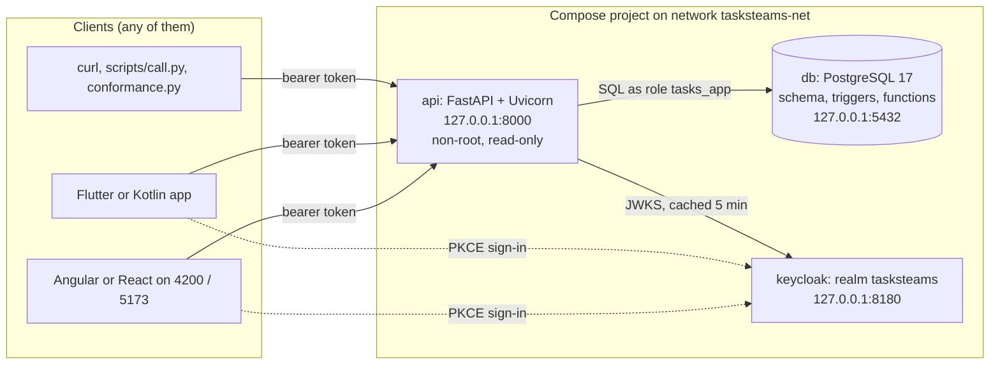

# Backend in Python (FastAPI)

The reference backend of the "Tasks and Teams" capstones: a FastAPI service that implements the [platform contract](../platform/README.md) exactly and passes `python scripts/conformance.py` with **18 passed, 0 failed**. It reads and writes the platform Postgres (stored functions, audit trigger), validates Keycloak tokens, runs in a non-root container and is hardened (rate limits, security headers, OWASP API Top 10 walk-through). The Go, ASP.NET and Rust backends implement the same contract, so every client works with any of them.

| Part | Where | Chapter |
|------|-------|---------|
| Layout, settings, JSON logs, RFC 9457 problem details, DTOs | `app/main.py`, `errors.py`, `schemas.py`, `middleware.py` | [01](tutorials/phase-1-skeleton/01-skeleton.md) |
| SQLAlchemy Core repositories, stored functions, ETag, cursors, filters, idempotency, team access | `app/repositories/*`, `routers/*`, `access.py`, `idempotency.py` | [02](tutorials/phase-2-data/02-data.md) |
| Keycloak token validation (RS256, JWKS cache, `iss`, `aud`, `exp`), scopes and roles | `app/tokens.py`, `auth.py` | [03](tutorials/phase-3-identity/03-identity.md) |
| Multi-stage non-root image, Compose override | `Dockerfile`, `docker-compose.override.yml` | [04](tutorials/phase-4-run-and-ship/04-run-and-ship.md) |
| Rate limits, security headers, CORS, body limit, security logging, backup | `ratelimit.py`, `middleware.py`, override file | [05](tutorials/phase-5-hardening/05-hardening.md) |
| Design | [TDD.md](TDD.md): requirements R-01 to R-24, diagrams, error mapping, security, phase plan | all |

## System diagram



## Run it against the platform stack
You need Docker with Compose v2, and free host ports 5432, 8180 and 8000 (one backend at a time). The finished project is the `code` folder of the last pack, `source/phase-5-hardening/05-hardening/code` (or `backend-python-phase-5-hardening.zip`):

```text
cd capstones/backend-python/source/phase-5-hardening/05-hardening/code
copy .env.example .env                  (macOS and Linux: cp .env.example .env)
docker compose up -d --build --wait     (Postgres, Keycloak and the API; the first start takes about a minute)
python scripts/conformance.py           expect: 18 passed, 0 failed
python scripts/call.py GET /v1/me --user bob
docker compose down -v --remove-orphans --rmi local
```

The folder already contains the unchanged platform files (`docker-compose.yml`, `db/`, `keycloak/`, `scripts/conformance.py`), copied byte for byte from `capstones/platform`. To point a client at this backend use `API_BASE_URL=http://localhost:8000`.

## How to work through it
1. Read the [TDD](TDD.md) sections 3, 4 and 6 (about 25 minutes).
2. Do the five chapters in order. Each phase pack holds the whole project at the end of that phase, so you can start at any phase.
3. Compare with the other backends once they exist: the contract, the schema and the conformance script are identical, only the language changes.

| Phase | Pack | Chapter | Time | Conformance |
|-------|------|---------|------|-------------|
| 1 Skeleton | `backend-python-phase-1-skeleton.zip` | 01 Layout, problem details, DTOs | 90 min | not run (no database yet) |
| 2 Data | `backend-python-phase-2-data.zip` | 02 Repositories, functions, ETag, cursors, idempotency | 180 min | 17 passed, 1 failed |
| 3 Identity | `backend-python-phase-3-identity.zip` | 03 Token validation, scopes and roles | 90 min | 17 passed, 1 failed |
| 4 Run and ship | `backend-python-phase-4-run-and-ship.zip` | 04 Dockerfile and Compose override | 60 min | 17 passed, 1 failed |
| 5 Hardening | `backend-python-phase-5-hardening.zip` | 05 Limits, headers, logging, OWASP, backup | 75 min | **18 passed, 0 failed** |

The one failing check before chapter 05 is `me`: the `RateLimit-*` headers are added in the hardening phase.

## Status
Verified on 2026-11-23 (Windows 11, Docker 29.9.3, Compose 5.7.0, host Python 3.15.2, container Python 3.14.10): all five chapters pass `python scripts/verify_labs.py capstones/backend-python`, the finished pack passes 18 of 18 conformance checks, and every temporary container, volume, network and image is removed afterwards. Library versions (FastAPI 0.165.0, SQLAlchemy 2.1.9, psycopg 3.3.9, PyJWT 2.15.1, Pydantic 2.14.4) are pinned in `requirements.txt`.
