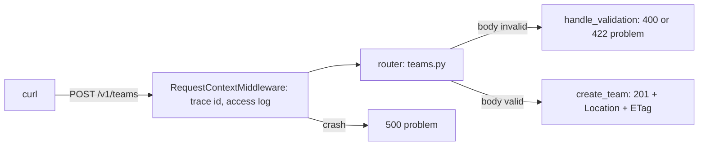

# 01. Skeleton: layout, problem details and DTOs

## Why it matters
A restaurant that serves a perfect dish on a dirty table still loses its guests. The same is true for an API: before any business logic, callers judge it by its manners. Does it answer in a predictable format? Does it say exactly which field was wrong? Can the operator find one request in the logs? This chapter builds those manners first, so every later chapter only adds behaviour on top of a skeleton that already behaves.

## What you will build
A FastAPI service with the final project layout, settings read from the environment, one JSON log line per request, every error answered as RFC 9457 problem details, and the request and response DTOs (data transfer objects) for the whole contract. Three endpoints work: `GET /health`, `GET /v1/me` (a stub that always answers as alice) and `POST /v1/teams` (validates the body and answers like the real endpoint, but stores nothing). There is no database and no Docker yet.

Conformance state at the end of this chapter: the `health` check would pass; the others need a database, tokens and the platform stack, which arrive in chapters 02 and 03. The platform script is therefore not run here.



## Before you start
- Python 3.12 or newer (`python --version`; on macOS and Linux often `python3`). The lessons in `tutorials/python` cover the language; this chapter assumes you know functions, classes, type hints and `pip`.
- The platform capstone read at least up to its OpenAPI chapter: [platform TDD](../../../platform/TDD.md), sections 3 and 6.
- A terminal. On Windows use PowerShell; on macOS and Linux a normal shell. The text before the `>` or `$` is the folder you are in.
- Source pack: unzip `backend-python-phase-1-skeleton.zip` (Windows: right-click, Extract All; macOS: double-click; Linux: `unzip`) and open `01-skeleton/code`. You can compare your files with it, or copy it. The steps below create every file by hand, in the order that teaches best.

## Steps
### Step 1. Create the project folder and a virtual environment
A **virtual environment** is a private copy of Python for one project, so its packages never collide with other projects. Run these commands in the folder where you keep code:

```powershell
# Windows PowerShell
mkdir tasksteams-api
cd tasksteams-api
python -m venv .venv
.venv\Scripts\Activate.ps1
```

```bash
# macOS and Linux
mkdir tasksteams-api && cd tasksteams-api
python3 -m venv .venv
source .venv/bin/activate
```

Expected result: the prompt now starts with `(.venv)`. Every command in this chapter runs inside the `tasksteams-api` folder with the environment active. If you close the terminal, `cd` back and run the last line again (`.venv\Scripts\Activate.ps1` or `source .venv/bin/activate`).

### Step 2. Pin the dependencies
`requirements.txt` lists the exact versions this chapter was verified with. A pinned file means everyone gets the same behaviour, today and in a year.

**File: `requirements.txt`**
```text
fastapi==0.165.0
uvicorn==0.54.0
pydantic==2.14.4
pydantic-settings==2.16.3
```

| Package | What it is for |
|---------|----------------|
| `fastapi` | the web framework: routing, dependency injection, OpenAPI |
| `uvicorn` | the server that speaks HTTP and calls the application |
| `pydantic` | data models with validation (v2); FastAPI uses it for every body and response |
| `pydantic-settings` | reads settings from environment variables into a typed class |

Install them:

```text
(.venv) tasksteams-api> python -m pip install -r requirements.txt
```

Expected result (the last line; downloading messages come before it):

```text
Successfully installed annotated-doc-0.0.7 annotated-types-0.8.0 anyio-4.16.0 click-8.5.1 fastapi-0.165.0 h11-0.16.0 idna-3.20 opentelemetry-api-1.45.2 pydantic-2.14.4 pydantic-core-2.50.5 pydantic-settings-2.16.3 python-dotenv-1.2.4 starlette-1.10.0 typing-extensions-4.16.0 typing-inspection-0.4.5 uvicorn-0.54.0
```

Most packages in that list are dependencies of the four you asked for; Starlette is the toolkit under FastAPI.

### Step 3. Describe the project
`pyproject.toml` is the standard place for project metadata. We do not build a wheel of the service, so it has no `[build-system]`; it records the name, the minimum Python and the allowed dependency ranges (the exact pins live in `requirements.txt`).

**File: `pyproject.toml`**
```toml
[project]
name = "tasksteams-api"
version = "1.0.0"
description = "Tasks and Teams API, the Python backend of the Code101 capstones"
requires-python = ">=3.12"
dependencies = [
    "fastapi>=0.165,<0.166",
    "uvicorn>=0.54,<0.55",
    "pydantic>=2.14,<3",
    "pydantic-settings>=2.16,<3",
]
```

### Step 4. Keep secrets and clutter out of Git, and document the settings
`.gitignore` tells Git what never to commit: the virtual environment, the real `.env` file and Python's compiled caches.

**File: `.gitignore`**
```text
.venv/
.env
__pycache__/
*.pyc
```

`.env.example` lists every setting with a harmless value. You copy it to `.env`, which Git ignores, and change it there. The real values of a production system never go into the repository.

**File: `.env.example`**
```text
# Disposable local practice only. Copy to .env (Git ignores it). Never put real secrets in this file.
LOG_LEVEL=INFO
PUBLIC_BASE_URL=http://localhost:8000
ENABLE_DOCS=true
```

Copy it now:

```powershell
# Windows PowerShell
Copy-Item .env.example .env
```

```bash
# macOS and Linux
cp .env.example .env
```

### Step 5. Create the packages
Python treats a folder with an `__init__.py` file as a package. Create two empty files and the folders around them:

```powershell
# Windows PowerShell
mkdir app\routers
New-Item app\__init__.py, app\routers\__init__.py -ItemType File
```

```bash
# macOS and Linux
mkdir -p app/routers
touch app/__init__.py app/routers/__init__.py
```

Both files stay empty on purpose, so there is no content to show.

### Step 6. Read settings from the environment
Create `app/config.py`:

**File: `app/config.py`**
```python
from functools import lru_cache

from pydantic_settings import BaseSettings, SettingsConfigDict


class Settings(BaseSettings):
    """Every setting comes from an environment variable of the same name (LOG_LEVEL, PUBLIC_BASE_URL, ...)."""

    model_config = SettingsConfigDict(env_file=".env", extra="ignore")

    service_version: str = "1.0.0"
    log_level: str = "INFO"
    public_base_url: str = "http://localhost:8000"
    enable_docs: bool = True


@lru_cache
def get_settings() -> Settings:
    return Settings()
```

`Settings` is a Pydantic model whose fields are filled from environment variables with the same name in upper case (`LOG_LEVEL`) and from the `.env` file. A value of the wrong type fails at start-up with a clear message instead of misbehaving later. `get_settings()` is wrapped in `lru_cache`, so the object is built once; routes receive it with `Depends(get_settings)`, which also lets a test swap it. `extra="ignore"` lets the same `.env` hold other programs' variables (Docker Compose reads it too, from chapter 02).

### Step 7. Structured logging
Create `app/logging_config.py`:

**File: `app/logging_config.py`**
```python
import contextvars
import json
import logging
import sys
from datetime import datetime, timezone

trace_id_var: contextvars.ContextVar[str] = contextvars.ContextVar("trace_id", default="-")


class JsonFormatter(logging.Formatter):
    """One JSON object per line, so a log collector can parse it without regular expressions."""

    def format(self, record: logging.LogRecord) -> str:
        entry = {
            "time": datetime.fromtimestamp(record.created, timezone.utc).isoformat(timespec="milliseconds"),
            "level": record.levelname,
            "logger": record.name,
            "message": record.getMessage(),
            "traceId": trace_id_var.get(),
        }
        entry.update(getattr(record, "fields", {}))
        if record.exc_info:
            entry["exception"] = self.formatException(record.exc_info)
        return json.dumps(entry, default=str)


def configure_logging(level: str) -> None:
    handler = logging.StreamHandler(sys.stdout)
    handler.setFormatter(JsonFormatter())
    root = logging.getLogger()
    root.handlers[:] = [handler]
    root.setLevel(level.upper())
    for name in ("uvicorn", "uvicorn.error"):  # let uvicorn's own messages use the JSON format too
        logging.getLogger(name).handlers.clear()
        logging.getLogger(name).propagate = True
    logging.getLogger("uvicorn.access").disabled = True  # RequestContextMiddleware writes the access line


def log_fields(**fields: object) -> dict[str, dict[str, object]]:
    """Use as logger.info("message", extra=log_fields(userId=...)) to add JSON members to a log line."""
    return {"fields": fields}
```

Every log record becomes one JSON object on one line. A log collector can index `level`, `traceId` or `status` without a regular expression. `trace_id_var` is a **context variable**: a value that belongs to the current request even when other requests run at the same time, so any `logger.info(...)` call deep inside the code carries the trace id of the request that caused it. `log_fields(...)` is the small helper for adding extra members to one line.

### Step 8. Problem details
RFC 9457 defines one JSON shape for HTTP errors, with the media type `application/problem+json`. Clients write one error handler instead of one per endpoint. Create `app/errors.py`:

**File: `app/errors.py`**
```python
from fastapi import FastAPI, Request
from fastapi.exceptions import RequestValidationError
from fastapi.responses import JSONResponse
from starlette.exceptions import HTTPException as StarletteHTTPException

from app.logging_config import trace_id_var

PROBLEM_BASE = "https://code101.example/problems/"

# status -> (last part of the problem type URI, title)
PROBLEMS: dict[int, tuple[str, str]] = {
    400: ("bad-request", "Bad request"),
    401: ("unauthorized", "Unauthorized"),
    403: ("forbidden", "Forbidden"),
    404: ("not-found", "Not found"),
    405: ("method-not-allowed", "Method not allowed"),
    409: ("conflict", "Conflict"),
    412: ("precondition-failed", "Precondition failed"),
    413: ("payload-too-large", "Payload too large"),
    422: ("validation-error", "Validation failed"),
    428: ("precondition-required", "Precondition required"),
    429: ("rate-limited", "Too many requests"),
    500: ("internal-error", "Internal server error"),
    503: ("service-unavailable", "Service unavailable"),
}


class ProblemError(Exception):
    """Raise this anywhere; the handler below turns it into an RFC 9457 response."""

    def __init__(self, status: int, detail: str, *, code: str | None = None,
                 errors: list[dict[str, str]] | None = None, headers: dict[str, str] | None = None) -> None:
        super().__init__(detail)
        self.status = status
        self.detail = detail
        self.code = code
        self.errors = errors
        self.headers = headers


def bad_request(detail: str) -> ProblemError:
    return ProblemError(400, detail)


def unauthorized(detail: str, headers: dict[str, str] | None = None) -> ProblemError:
    return ProblemError(401, detail, headers={"WWW-Authenticate": 'Bearer realm="tasksteams"', **(headers or {})})


def forbidden(detail: str) -> ProblemError:
    return ProblemError(403, detail)


def not_found(detail: str = "The resource was not found.") -> ProblemError:
    return ProblemError(404, detail)


def conflict(detail: str, code: str | None = None) -> ProblemError:
    return ProblemError(409, detail, code=code)


def problem_response(path: str, status: int, detail: str, *, code: str | None = None,
                     errors: list[dict[str, str]] | None = None,
                     headers: dict[str, str] | None = None) -> JSONResponse:
    slug, title = PROBLEMS.get(status, ("error", "Error"))
    body: dict[str, object] = {
        "type": PROBLEM_BASE + slug,
        "title": title,
        "status": status,
        "detail": detail,
        "instance": path,
        "traceId": trace_id_var.get(),
    }
    if code:
        body["code"] = code
    if errors:
        body["errors"] = errors
    return JSONResponse(body, status_code=status, media_type="application/problem+json", headers=headers)


def json_pointer(loc: tuple[object, ...]) -> str:
    """('body', 'dueDate') -> '/dueDate' (RFC 6901: ~ becomes ~0 and / becomes ~1)."""
    return "".join("/" + str(part).replace("~", "~0").replace("/", "~1") for part in loc[1:])


async def handle_problem(request: Request, exc: ProblemError) -> JSONResponse:
    return problem_response(request.url.path, exc.status, exc.detail, code=exc.code, errors=exc.errors, headers=exc.headers)


async def handle_validation(request: Request, exc: RequestValidationError) -> JSONResponse:
    errors = exc.errors()
    path = request.url.path
    if any(error["type"] == "json_invalid" for error in errors):
        return problem_response(path, 400, "The request body is not valid JSON.")
    outside_body = [error for error in errors if error["loc"][0] != "body"]
    if outside_body:  # a bad query parameter, path value or header is a 400, not a 422
        first = outside_body[0]
        name = ".".join(str(part) for part in first["loc"][1:])
        return problem_response(path, 400, f"The {first['loc'][0]} parameter '{name}' is invalid: {first['msg']}.")
    details = [{"pointer": json_pointer(error["loc"]), "detail": error["msg"].removeprefix("Value error, ")} for error in errors]
    return problem_response(path, 422, "One or more fields are invalid.", errors=details)


async def handle_http_exception(request: Request, exc: StarletteHTTPException) -> JSONResponse:
    detail = "No such route." if exc.status_code == 404 else str(exc.detail)
    return problem_response(request.url.path, exc.status_code, detail, headers=dict(exc.headers or {}))


def register_error_handlers(app: FastAPI) -> None:
    app.add_exception_handler(ProblemError, handle_problem)
    app.add_exception_handler(RequestValidationError, handle_validation)
    app.add_exception_handler(StarletteHTTPException, handle_http_exception)
```

Read it from the top:

- `PROBLEMS` maps a status code to the last part of the problem `type` URI and a title. The platform contract fixes these names.
- `ProblemError` is an exception any layer can raise. The small functions (`not_found`, `conflict`, ...) keep the call sites short: `raise not_found("The team was not found.")`.
- `problem_response` builds the body: `type`, `title`, `status`, `detail`, `instance` (the request path) and `traceId`, plus optional `code` and `errors`. The `media_type` argument makes the header `application/problem+json`.
- `json_pointer` converts Pydantic's location `("body", "dueDate")` into the JSON Pointer `/dueDate` (RFC 6901), which tells a client exactly which field is wrong.
- `handle_validation` decides between **400 and 422**: a request that is not even valid JSON, or a bad query, path or header value, is a malformed request (400). A body that is valid JSON but contains a wrong field is well formed but unprocessable (422) and lists every wrong field in `errors`.
- `handle_http_exception` covers unknown routes (404) and wrong methods (405), which Starlette raises itself, so they also come out as problem details.

We register no handler for plain `Exception`: the middleware in the next step turns crashes into a 500 problem, because a handler registered for `Exception` runs outside the middleware and would lose the trace id.

### Step 9. Trace ids, access log and crashes
Create `app/middleware.py`:

**File: `app/middleware.py`**
```python
import logging
import time
import uuid

from starlette.datastructures import MutableHeaders
from starlette.types import ASGIApp, Message, Receive, Scope, Send

from app.errors import problem_response
from app.logging_config import log_fields, trace_id_var

logger = logging.getLogger("tasksteams.access")


class RequestContextMiddleware:
    """Gives each request a trace id, writes one access log line and turns a crash into a 500 problem.

    It is a plain ASGI middleware (not BaseHTTPMiddleware) so it adds almost no overhead and sees every response.
    """

    def __init__(self, app: ASGIApp) -> None:
        self.app = app

    async def __call__(self, scope: Scope, receive: Receive, send: Send) -> None:
        if scope["type"] != "http":
            await self.app(scope, receive, send)
            return
        trace_id = uuid.uuid4().hex
        token = trace_id_var.set(trace_id)
        started = time.perf_counter()
        status = 500
        response_started = False

        async def send_with_trace(message: Message) -> None:
            nonlocal status, response_started
            if message["type"] == "http.response.start":
                response_started = True
                status = message["status"]
                MutableHeaders(scope=message)["X-Trace-Id"] = trace_id
            await send(message)

        try:
            await self.app(scope, receive, send_with_trace)
        except Exception:
            logger.exception("unhandled error")
            if not response_started:
                status = 500
                response = problem_response(scope["path"], 500, "An unexpected error occurred.")
                await response(scope, receive, send_with_trace)
        finally:
            fields = {
                "method": scope["method"],
                "path": scope["path"],
                "status": status,
                "durationMs": round((time.perf_counter() - started) * 1000, 1),
                "userId": scope.get("state", {}).get("user_id"),
            }
            logger.info("request", extra=log_fields(**fields))
            trace_id_var.reset(token)
```

This is a **pure ASGI middleware**: a class with `__call__(scope, receive, send)`. It wraps `send` so it can add the header `X-Trace-Id` to every response, remembers the status code, and writes one access log line when the request ends. A crash inside the application is logged with its stack trace (only in the log) and the client gets a 500 problem whose `detail` never contains internals. The access line records the path, never the query string or a body, which may hold personal data.

### Step 10. The DTOs
A **DTO** (data transfer object) is a class that describes exactly what crosses the HTTP boundary. It is not the database row and not a domain object: keeping them apart means a new database column never leaks into the API by accident. Create `app/schemas.py`:

**File: `app/schemas.py`**
```python
from datetime import date, datetime
from typing import Annotated, Any, ClassVar, Generic, Literal, TypeVar
from uuid import UUID

from pydantic import BaseModel, ConfigDict, Field, StringConstraints, field_validator, model_validator
from pydantic.alias_generators import to_camel

Role = Literal["admin", "member"]
TeamRole = Literal["lead", "member"]
TaskStatus = Literal["todo", "in_progress", "blocked", "done", "cancelled"]
TaskPriority = Literal["low", "medium", "high", "urgent"]
AuditEntityType = Literal["team", "member", "project", "task", "comment"]

TeamName = Annotated[str, StringConstraints(strip_whitespace=True, min_length=1, max_length=80)]
ProjectKey = Annotated[str, StringConstraints(pattern=r"^[A-Z][A-Z0-9]{1,9}$")]
ProjectName = Annotated[str, StringConstraints(strip_whitespace=True, min_length=1, max_length=120)]
TaskTitle = Annotated[str, StringConstraints(strip_whitespace=True, min_length=1, max_length=200)]
CommentBody = Annotated[str, StringConstraints(strip_whitespace=True, min_length=1, max_length=2000)]
TeamDescription = Annotated[str, Field(max_length=500)]
ProjectDescription = Annotated[str, Field(max_length=2000)]
TaskDescription = Annotated[str, Field(max_length=10000)]

T = TypeVar("T")


class ApiModel(BaseModel):
    """Response DTOs: Python names are snake_case, JSON names are camelCase."""

    model_config = ConfigDict(alias_generator=to_camel, validate_by_name=True, validate_by_alias=True, from_attributes=True)


class RequestModel(BaseModel):
    """Request DTOs accept only the camelCase names and reject unknown members (additionalProperties: false)."""

    model_config = ConfigDict(alias_generator=to_camel, extra="forbid")


class PatchModel(RequestModel):
    """JSON Merge Patch (RFC 7396): send only what changes; null clears a field only where the contract allows it."""

    nullable: ClassVar[frozenset[str]] = frozenset()

    @field_validator("*", mode="before")
    @classmethod
    def reject_null(cls, value: Any, info: Any) -> Any:
        if value is None and info.field_name not in cls.nullable:
            raise ValueError("null is not allowed for this field")
        return value

    @model_validator(mode="after")
    def require_one_field(self) -> "PatchModel":
        if not self.model_fields_set:
            raise ValueError("at least one field is required")
        return self


# Requests -------------------------------------------------------------------

class TeamCreate(RequestModel):
    name: TeamName
    description: TeamDescription = ""
    lead_user_id: UUID | None = None


class TeamUpdate(PatchModel):
    name: TeamName | None = None
    description: TeamDescription | None = None


class MemberPut(RequestModel):
    role: TeamRole


class ProjectCreate(RequestModel):
    key: ProjectKey
    name: ProjectName
    description: ProjectDescription = ""


class ProjectUpdate(PatchModel):
    name: ProjectName | None = None
    description: ProjectDescription | None = None
    archived: bool | None = None


class TaskCreate(RequestModel):
    title: TaskTitle
    description: TaskDescription = ""
    priority: TaskPriority = "medium"
    assignee_id: UUID | None = None
    due_date: date | None = None


class TaskUpdate(PatchModel):
    nullable: ClassVar[frozenset[str]] = frozenset({"assignee_id", "due_date"})

    title: TaskTitle | None = None
    description: TaskDescription | None = None
    status: TaskStatus | None = None
    priority: TaskPriority | None = None
    assignee_id: UUID | None = None
    due_date: date | None = None


class ReassignRequest(RequestModel):
    assignee_id: UUID | None


class CommentCreate(RequestModel):
    body: CommentBody


# Responses ------------------------------------------------------------------

class Health(ApiModel):
    status: Literal["ok", "degraded"]
    version: str | None = None
    database: Literal["up", "down"] | None = None


class PageInfo(ApiModel):
    limit: int
    next_cursor: str | None


class Page(ApiModel, Generic[T]):
    items: list[T]
    page: PageInfo


class UserSummary(ApiModel):
    id: UUID
    username: str
    display_name: str


class TeamRef(ApiModel):
    team_id: UUID
    name: str
    role: TeamRole


class Me(ApiModel):
    id: UUID
    username: str
    email: str
    display_name: str
    roles: list[Role]
    scopes: list[str]
    teams: list[TeamRef]


class Team(ApiModel):
    id: UUID
    name: str
    description: str
    member_count: int
    created_by: UUID
    version: int
    created_at: datetime
    updated_at: datetime


class Member(ApiModel):
    user_id: UUID
    username: str
    display_name: str
    role: TeamRole
    joined_at: datetime


class Project(ApiModel):
    id: UUID
    team_id: UUID
    key: str
    name: str
    description: str
    archived: bool
    version: int
    created_at: datetime
    updated_at: datetime


class Task(ApiModel):
    id: UUID
    project_id: UUID
    title: str
    description: str
    status: TaskStatus
    priority: TaskPriority
    assignee_id: UUID | None
    due_date: date | None
    completed_at: datetime | None
    created_by: UUID
    version: int
    created_at: datetime
    updated_at: datetime


class Comment(ApiModel):
    id: UUID
    task_id: UUID
    author: UserSummary
    body: str
    created_at: datetime


class AuditEntry(ApiModel):
    id: int
    occurred_at: datetime
    actor_id: UUID | None
    action: Literal["create", "update", "delete"]
    entity_type: AuditEntityType
    entity_id: UUID
    details: dict[str, Any]
```

How the pieces fit:

- `ApiModel` is the base of **response** DTOs: Python field names stay `snake_case` (`due_date`), JSON names become `camelCase` (`dueDate`) through `alias_generator=to_camel`. `validate_by_name=True` lets us build a DTO from a database row whose keys are snake case; FastAPI writes the aliases when it serializes the answer.
- `RequestModel` is the base of **request** DTOs. It accepts only the camelCase names and `extra="forbid"` rejects unknown members: this is `additionalProperties: false` from the contract, and it is why the invalid example below reports `colour`.
- `PatchModel` implements JSON Merge Patch (RFC 7396) validation for `PATCH`: at least one field, and `null` only for the fields the contract allows (`nullable`). Which fields were sent is later read with `model_dump(exclude_unset=True)`.
- `Annotated[str, StringConstraints(...)]` names a reusable constraint: `TeamName` strips spaces and requires 1 to 80 characters, like the database `CHECK`.
- `Page[T]` is a generic page: `items` and `page.nextCursor`.

We define all DTOs now, although only `TeamCreate`, `Team`, `Me` and `Health` are used in this chapter. The other chapters add behaviour, not new shapes.

### Step 11. The first three endpoints
Create `app/routers/health.py`. `GET /health` is public and tells operators the service is alive. `response_model_exclude_none=True` leaves out `database`, which we cannot report yet.

**File: `app/routers/health.py`**
```python
from fastapi import APIRouter, Depends

from app.config import Settings, get_settings
from app.schemas import Health

router = APIRouter(tags=["Platform"])


@router.get("/health", response_model=Health, response_model_exclude_none=True)
def get_health(settings: Settings = Depends(get_settings)) -> Health:
    return Health(status="ok", version=settings.service_version)
```

Create `app/routers/me.py`. A **stub** answers like the real thing with fixed data, so clients can start working. `response_model=Me` makes FastAPI validate and serialize the answer through the DTO.

**File: `app/routers/me.py`**
```python
from uuid import UUID

from fastapi import APIRouter

from app.schemas import Me

router = APIRouter(prefix="/v1", tags=["Platform"])

ALICE_ID = UUID("a11ce000-0000-4000-8000-000000000001")


@router.get("/me", response_model=Me)
def get_me() -> Me:
    """Stub for phase 1: always alice. Phase 2 reads the real user, phase 3 the real token."""
    return Me(
        id=ALICE_ID,
        username="alice",
        email="alice@tasksteams.test",
        display_name="Alice Admin",
        roles=["admin"],
        scopes=["tasks:read", "tasks:write", "tasks:admin"],
        teams=[],
    )
```

Create `app/routers/teams.py`. `body: TeamCreate` makes FastAPI parse and validate the JSON body before the function runs. `status_code=201` is the success status of a create, `Location` points at the new resource and `ETag` is the quoted version, as the contract requires. Nothing is stored: the returned `Team` is built in memory and its `id` changes with every call.

**File: `app/routers/teams.py`**
```python
from datetime import datetime, timezone
from uuid import uuid4

from fastapi import APIRouter, Depends, Response

from app.config import Settings, get_settings
from app.routers.me import ALICE_ID
from app.schemas import Team, TeamCreate

router = APIRouter(prefix="/v1/teams", tags=["Teams"])


@router.post("", response_model=Team, status_code=201)
def create_team(body: TeamCreate, response: Response, settings: Settings = Depends(get_settings)) -> Team:
    """Stub for phase 1: checks the DTO and answers like the real endpoint, but stores nothing."""
    now = datetime.now(timezone.utc)
    team = Team(
        id=uuid4(),
        name=body.name,
        description=body.description,
        member_count=1,
        created_by=ALICE_ID,
        version=1,
        created_at=now,
        updated_at=now,
    )
    response.headers["Location"] = f"{settings.public_base_url.rstrip('/')}/v1/teams/{team.id}"
    response.headers["ETag"] = f'"{team.version}"'
    return team
```

### Step 12. Put the application together
Create `app/main.py`:

**File: `app/main.py`**
```python
from fastapi import FastAPI

from app.config import get_settings
from app.errors import register_error_handlers
from app.logging_config import configure_logging
from app.middleware import RequestContextMiddleware
from app.routers import health, me, teams


def create_app() -> FastAPI:
    settings = get_settings()
    configure_logging(settings.log_level)
    app = FastAPI(
        title="Tasks and Teams API",
        version=settings.service_version,
        docs_url="/docs" if settings.enable_docs else None,
        redoc_url=None,
        openapi_url="/openapi.json" if settings.enable_docs else None,
    )
    app.add_middleware(RequestContextMiddleware)
    register_error_handlers(app)
    app.include_router(health.router)
    app.include_router(me.router)
    app.include_router(teams.router)
    return app


app = create_app()
```

`create_app()` is an **application factory**: it builds the `FastAPI` object, adds the middleware, registers the error handlers and includes the routers. The last line, `app = create_app()`, is the object Uvicorn imports as `app.main:app`. `ENABLE_DOCS` switches the interactive documentation (`/docs`) on or off, which chapter 05 uses.

### Step 13. Request files for curl
Typing JSON into a shell differs between PowerShell, cmd and bash, so we keep request bodies in files and send them with `--data-binary @file`. Create the folder `requests` with two files.

**File: `requests/team-valid.json`**
```json
{
  "name": "Platform Team Two",
  "description": "A team created from a file."
}
```

`requests/team-invalid.json` breaks two rules on purpose: an empty name and a member the contract does not know.

**File: `requests/team-invalid.json`**
```json
{
  "name": "",
  "colour": "red"
}
```

## Run it
Start the server (leave this terminal open):

```text
(.venv) tasksteams-api> python -m uvicorn app.main:app --port 8000
```

Expected output (the times and the process number differ on your machine):

```text
{"time": "2026-11-23T07:58:15.942+00:00", "level": "INFO", "logger": "uvicorn.error", "message": "Started server process [24840]", "traceId": "-"}
{"time": "2026-11-23T07:58:15.942+00:00", "level": "INFO", "logger": "uvicorn.error", "message": "Waiting for application startup.", "traceId": "-"}
{"time": "2026-11-23T07:58:15.943+00:00", "level": "INFO", "logger": "uvicorn.error", "message": "Application startup complete.", "traceId": "-"}
{"time": "2026-11-23T07:58:15.943+00:00", "level": "INFO", "logger": "uvicorn.error", "message": "Uvicorn running on http://127.0.0.1:8000 (Press CTRL+C to quit)", "traceId": "-"}
```

Open a **second** terminal in the same folder (the checks below only need `curl`). On Windows PowerShell write `curl.exe` instead of `curl`, because plain `curl` is an alias of a different command.

**1. Health**

```text
tasksteams-api> curl -s -i http://127.0.0.1:8000/health
```

```text
HTTP/1.1 200 OK
date: Mon, 23 Nov 2026 07:58:15 GMT
server: uvicorn
content-length: 33
content-type: application/json
x-trace-id: 76568a9c692c41c68efe620f8329a8d9

{"status":"ok","version":"1.0.0"}
```

**2. A valid create** answers 201 with `location` and `etag` headers:

```text
tasksteams-api> curl -s -i -X POST http://127.0.0.1:8000/v1/teams -H "Content-Type: application/json" --data-binary @requests/team-valid.json
```

```text
HTTP/1.1 201 Created
date: Mon, 23 Nov 2026 07:58:15 GMT
server: uvicorn
content-length: 279
content-type: application/json
location: http://localhost:8000/v1/teams/54fa4570-8ac0-4233-900e-da421e202762
etag: "1"
x-trace-id: 1359f5fc587b425b92486aeeaefcc611

{"id":"54fa4570-8ac0-4233-900e-da421e202762","name":"Platform Team Two","description":"A team created from a file.","memberCount":1,"createdBy":"a11ce000-0000-4000-8000-000000000001","version":1,"createdAt":"2026-11-23T07:58:16.370544Z","updatedAt":"2026-11-23T07:58:16.370544Z"}
```

**3. An invalid create** answers 422 with one entry per wrong field:

```text
tasksteams-api> curl -s -i -X POST http://127.0.0.1:8000/v1/teams -H "Content-Type: application/json" --data-binary @requests/team-invalid.json
```

```text
HTTP/1.1 422 Unprocessable Content
date: Mon, 23 Nov 2026 07:58:15 GMT
server: uvicorn
content-length: 358
content-type: application/problem+json
x-trace-id: 374edb3dfc7c4c0280ad3aad2734fa25

{"type":"https://code101.example/problems/validation-error","title":"Validation failed","status":422,"detail":"One or more fields are invalid.","instance":"/v1/teams","traceId":"374edb3dfc7c4c0280ad3aad2734fa25","errors":[{"pointer":"/name","detail":"String should have at least 1 character"},{"pointer":"/colour","detail":"Extra inputs are not permitted"}]}
```

**4. Not even JSON, an unknown route, a wrong method**

```text
tasksteams-api> curl -s -X POST http://127.0.0.1:8000/v1/teams -H "Content-Type: application/json" -d "{bad json"
{"type":"https://code101.example/problems/bad-request","title":"Bad request","status":400,"detail":"The request body is not valid JSON.","instance":"/v1/teams","traceId":"31a89e4bf7ce46fdaf5e6463a26501bd"}

tasksteams-api> curl -s http://127.0.0.1:8000/v1/nothing
{"type":"https://code101.example/problems/not-found","title":"Not found","status":404,"detail":"No such route.","instance":"/v1/nothing","traceId":"008ece55800c4ad2b7855f7bef480a55"}

tasksteams-api> curl -s -i -X DELETE http://127.0.0.1:8000/health
HTTP/1.1 405 Method Not Allowed
date: Mon, 23 Nov 2026 07:58:15 GMT
server: uvicorn
allow: GET
content-length: 200
content-type: application/problem+json
x-trace-id: 5b02671e90d44f868cbf9ad579948025

{"type":"https://code101.example/problems/method-not-allowed","title":"Method not allowed","status":405,"detail":"Method Not Allowed","instance":"/health","traceId":"5b02671e90d44f868cbf9ad579948025"}
```

**5. The log.** Go back to the first terminal: each request wrote one line. The `traceId` in the line is the same as the `x-trace-id` header and the `traceId` in the problem body, so a user can send you one id and you find the request.

```text
{"time": "2026-11-23T07:58:16.411+00:00", "level": "INFO", "logger": "tasksteams.access", "message": "request", "traceId": "374edb3dfc7c4c0280ad3aad2734fa25", "method": "POST", "path": "/v1/teams", "status": 422, "durationMs": 0.8, "userId": null}
```

Stop the server with Ctrl+C. You can also open the interactive documentation FastAPI generates from your code, `http://127.0.0.1:8000/docs`, while the server runs.

## How it works
A request enters Uvicorn, which calls the `app` object. The middleware assigns a trace id, then Starlette matches the URL to a route. FastAPI reads the function signature: the `body: TeamCreate` parameter becomes "parse JSON, validate with this DTO"; `Depends(get_settings)` becomes "call this function and pass the result". If validation fails, FastAPI raises `RequestValidationError` and our `handle_validation` answers. If the function returns, FastAPI converts the returned object through `response_model` into JSON using the **camelCase aliases**. The middleware adds the trace header and writes the access line on the way out.

New terms: **DTO** (the shape that crosses the HTTP boundary); **problem details** (the RFC 9457 error format); **JSON Pointer** (a path such as `/name` to a spot in a JSON document); **context variable** (a per-request value that works across function calls); **ASGI** (the Python standard interface between a server like Uvicorn and an application); **application factory** (a function that builds the app).

Why this, not that:

| Choice | Alternative | Why we chose this |
|--------|-------------|-------------------|
| Plain `def` route functions | `async def` | The database driver and the JWT library block. FastAPI runs plain `def` routes in a thread pool, so blocking calls never stall other requests, and the code stays simple (decision D1 in the TDD) |
| Pure ASGI middleware | `BaseHTTPMiddleware` or `@app.middleware("http")` | We must edit headers of every response including errors, and a handler for `Exception` would lose the trace id. A pure ASGI class is also faster |
| Pydantic DTO classes | dictionaries and `if` checks | One declaration gives parsing, validation, the error locations and the OpenAPI schema |
| 400 and 422 as two different problems | 422 for everything FastAPI says by default | The platform contract separates "I cannot read your request" from "I read it and a field is wrong" |
| Stubs first | wait for the database | Client teams can start from a real URL and a real error format today |

## Try it
Exercise: **build a problem body yourself.** Copy `exercise/starter/problem.py` into a folder of your own and finish the three TODOs: add the statuses 412 and 428 to `PROBLEMS`, and write `problem_body(status, detail, instance)` so it returns the dictionary the API sends (keys `type`, `title`, `status`, `detail`, `instance`, in this order). Run it with `python problem.py`; the two lines it prints must show the type URIs `.../precondition-failed` and `.../precondition-required`.

**File: `exercise/starter/problem.py`**
```python
"""Exercise 1: problem details.

Finish problem_body() so it builds the same JSON object our API sends for an error (RFC 9457).
Run:  python problem.py
"""
import json

PROBLEM_BASE = "https://code101.example/problems/"

# status -> (last part of the type, title)
PROBLEMS = {
    404: ("not-found", "Not found"),
    409: ("conflict", "Conflict"),
    # TODO 1: add 412 with ("precondition-failed", "Precondition failed")
    # TODO 2: add 428 with ("precondition-required", "Precondition required")
}


def problem_body(status, detail, instance):
    # TODO 3: look the status up in PROBLEMS and return a dict with the keys
    # type, title, status, detail, instance (in this order); type is PROBLEM_BASE plus the slug
    raise NotImplementedError


if __name__ == "__main__":
    print(json.dumps(problem_body(412, "The task changed since you read it.", "/v1/tasks/1")))
    print(json.dumps(problem_body(428, "The If-Match header is required.", "/v1/tasks/1")))
```

<details><summary>Solution</summary>

**File: `exercise/solution/problem.py`**
```python
"""Exercise 1: problem details (solution).

Run:  python problem.py
"""
import json

PROBLEM_BASE = "https://code101.example/problems/"

# status -> (last part of the type, title)
PROBLEMS = {
    404: ("not-found", "Not found"),
    409: ("conflict", "Conflict"),
    412: ("precondition-failed", "Precondition failed"),
    428: ("precondition-required", "Precondition required"),
}


def problem_body(status, detail, instance):
    slug, title = PROBLEMS[status]
    return {
        "type": PROBLEM_BASE + slug,
        "title": title,
        "status": status,
        "detail": detail,
        "instance": instance,
    }


if __name__ == "__main__":
    print(json.dumps(problem_body(412, "The task changed since you read it.", "/v1/tasks/1")))
    print(json.dumps(problem_body(428, "The If-Match header is required.", "/v1/tasks/1")))
```

`PROBLEMS[status]` gives the slug and the title; the dictionary keeps the key order of the contract, and `json.dumps` prints it on one line. Expected output:

```text
{"type": "https://code101.example/problems/precondition-failed", "title": "Precondition failed", "status": 412, "detail": "The task changed since you read it.", "instance": "/v1/tasks/1"}
{"type": "https://code101.example/problems/precondition-required", "title": "Precondition required", "status": 428, "detail": "The If-Match header is required.", "instance": "/v1/tasks/1"}
```

</details>

## Check yourself
1. Why is a request with the body `{bad json` a 400 but a body with an empty `name` a 422? <details><summary>Answer</summary>The first cannot be read as JSON at all (the request is malformed); the second is valid JSON whose content breaks a rule, so the server understood it but cannot process it. The contract and RFC 9110 use the two codes for these two situations.</details>
2. What does `extra="forbid"` give the API besides tidy data? <details><summary>Answer</summary>It stops clients from sending fields they should not control (mass assignment, OWASP API3) and it tells a client with a typo (`colour`) immediately instead of silently ignoring it.</details>
3. Where does the `traceId` in an error body come from, and why is it useful? <details><summary>Answer</summary>The middleware creates it per request and stores it in a context variable; `problem_response` reads it. The same id is in the log line and the `X-Trace-Id` header, so a support request can be matched to one log entry.</details>
4. Why do request DTOs use only camelCase while response DTOs accept both? <details><summary>Answer</summary>Requests come from outside and must follow the contract exactly; responses are built by our own code from database rows with snake case keys, so they need `validate_by_name`.</details>

## Common mistakes
| Symptom or error text | Cause | Fix |
|---|---|---|
| `ModuleNotFoundError: No module named 'app'` (a long traceback from `uvicorn\importer.py`) | You started Uvicorn in the wrong folder: it imports `app.main` relative to the current folder | `cd` into the folder that contains the `app` folder, then run the command again |
| `ModuleNotFoundError: No module named 'fastapi'` | The environment is not active, or the packages are not installed | Run `.venv\Scripts\Activate.ps1` (or `source .venv/bin/activate`), then `python -m pip install -r requirements.txt` |
| `[Errno 10048] error while attempting to bind on address ('127.0.0.1', 8000): [winerror 10048] only one usage of each socket address (protocol/network address/port) is normally permitted` (macOS and Linux say the address is already in use) | Another program, perhaps your previous server, uses port 8000 | Stop the other server with Ctrl+C, or start this one with `--port 8001` and change the URLs |
| A POST without the header returns 422 with `"pointer":"","detail":"Input should be a valid dictionary or object to extract fields from"` | `curl -d` sends `application/x-www-form-urlencoded` unless you add `-H "Content-Type: application/json"`, so the body was not read as JSON | Add the header |
| 422 with `"pointer":"/description","detail":"Input should be a valid string"` | The value has the wrong type (a number where text is required) | Send `"5"` as text, or fix the client |
| `curl` in PowerShell prints a table of headers or asks for parameters | In Windows PowerShell `curl` is an alias for `Invoke-WebRequest` | Type `curl.exe` |

## Best practice
Make errors part of the design, not an afterthought: one error shape, a machine-readable pointer for field errors and an id that links the answer to the log. Source: RFC 9457 Problem Details for HTTP APIs https://www.rfc-editor.org/info/rfc9457 and FastAPI, Handling Errors https://fastapi.tiangolo.com/tutorial/handling-errors/

## Next lesson
02. Data: connect to the platform Postgres, write repositories, call the stored functions and add ETag, `If-Match`, cursor pagination, filters and idempotency keys. Chapter 02 also starts the platform stack with Docker Compose, so have Docker running.
