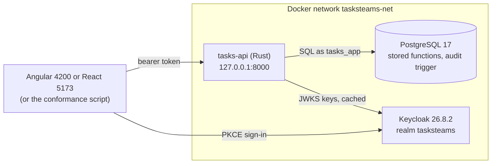

# Backend (Rust): Axum, SQLx and Keycloak

A complete, conformant implementation of the "Tasks and Teams" [platform contract](../platform/README.md) in Rust. It serves the same 27 operations as the Python, ASP.NET and Go backends, so any web client works with it. (The mobile clients are taught against the other three backends.) Design: [TDD.md](TDD.md).

| Item | Value |
|------|-------|
| Stack | Rust 1.100, Axum 0.8, Tokio, SQLx 0.9 (runtime queries), jsonwebtoken 12, tower-http 0.7, Docker |
| Result | `python scripts/conformance.py` prints **`18 passed, 0 failed`** (phase 5) |
| Image | `code101/tasks-api-rust:local`, 13 MB of content, distroless, non-root |
| Time | 5 chapters, about 8 hours |

## System diagram



## Chapters

| Phase | Chapter | You build | Conformance |
|-------|---------|-----------|-------------|
| 1 Skeleton | [01 Skeleton and problem details](tutorials/phase-1-skeleton/01-skeleton.md) | `Cargo.toml`, config, router, `/health`, `AppError`, validation | 6 of 18 |
| 2 Data | [02 Data and stored functions](tutorials/phase-2-data/02-data-and-stored-functions.md) | SQLx pool, store module, stored functions, ETag, cursors, idempotency | 17 of 18 |
| 3 Identity | [03 Keycloak token validation](tutorials/phase-3-identity/03-keycloak-token-validation.md) | cached JWKS, claims, scope and role checks | 17 of 18 |
| 4 Run and ship | [04 Docker image and Compose](tutorials/phase-4-run-and-ship/04-docker-image-and-compose.md) | multi-stage Dockerfile, Compose override, health check | 17 of 18 |
| 5 Hardening | [05 Hardening and OWASP](tutorials/phase-5-hardening/05-hardening-and-owasp.md) | rate limits, CORS, security headers, OWASP table | **18 of 18** |

Each phase pack (`source/phase-N-slug/`, zipped as `backend-rust-phase-N-slug.zip`) holds the whole project at that point, so you can start at any phase. The `me` check of the conformance script needs the `RateLimit-*` headers, which is why phases 2 to 4 stop at 17.

## Run it against the platform stack (the finished project)

Needs Docker, Python 3.10+ and free host ports 5432, 8000 and 8180. Take the folder `source/phase-5-hardening/05-hardening-and-owasp/code` (or the unzipped pack).

**Terminal (that folder)**
```text
cp .env.example .env            (Windows PowerShell: Copy-Item .env.example .env)
docker compose -p backend up -d --build --wait
python scripts/conformance.py
```
Expected last line: `18 passed, 0 failed`. The first build takes a few minutes (it compiles all crates); later builds that only change `src/` take under a minute.

Try the API by hand with the helper script (the same on Windows, macOS and Linux):
```text
python scripts/api.py GET /health
python scripts/api.py --as alice GET /v1/me
python scripts/api.py --as alice GET /v1/teams
```

Stop and remove everything:
```text
docker compose -p backend down -v --remove-orphans
docker image rm code101/tasks-api-rust:local
```

To use another backend instead, stop this one first: all backends use port 8000 and the same database.

## Run the API on your host (phases 1 to 3, or while you edit code)
```text
docker compose -p backend up -d --wait db keycloak
cargo run
```
`cargo run` reads `.env` (copied from `.env.example`) and listens on `127.0.0.1:8000`.

## Which clients work with it
Angular and React: yes, set `API_BASE_URL` to `http://localhost:8000` (CORS allows ports 4200 and 5173). Flutter and Kotlin: use the ASP.NET, Python or Go backend.

## Status
Verified on 2026-11-23 (Windows 11, Rust 1.100.0, Docker 29.9.3, Compose 5.7.0, Python 3.15.2): every phase compiles and runs, the conformance results above are real, and all temporary containers, networks, volumes and images are removed afterwards.
