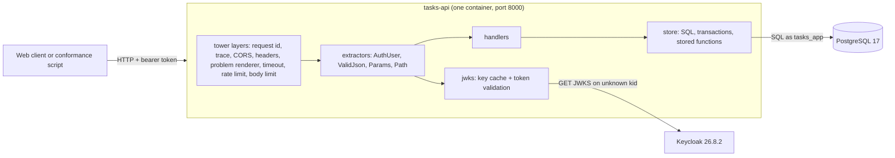
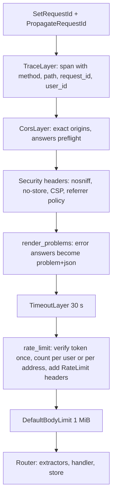
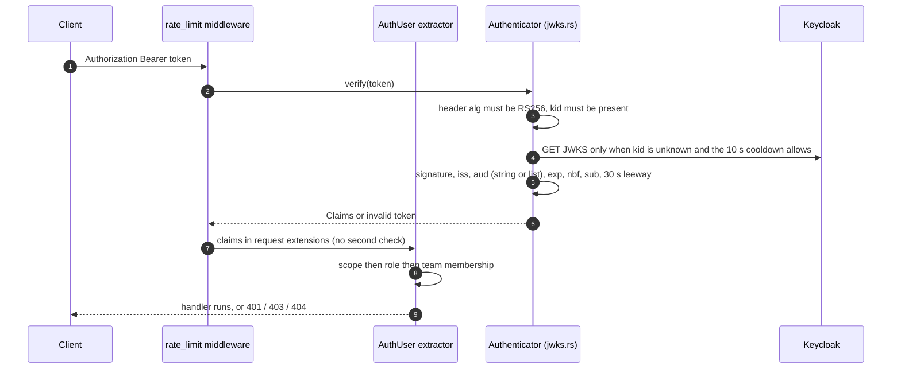

# TDD: Rust backend (Axum, SQLx)

| Field | Value |
|-------|-------|
| Id | backend-rust |
| Level | 301 |
| Status | Verified (all 5 phases smoke-checked on 2026-11-23; final phase passes `18 passed, 0 failed`) |
| Depends on | `platform` (contract, database, Keycloak realm, Compose file, conformance script) |
| Stack | Rust 1.100.0 stable, edition 2024; axum 0.8.9, tokio 1.54.1, sqlx 0.9.1 (PostgreSQL, runtime queries), tower 0.5.3, tower-http 0.7.1, jsonwebtoken 12.0.0 (`rust_crypto`), reqwest 0.13.5 (JWKS fetch), serde 1.0.229, tracing 0.1.44, Docker images `rust:1.100.0-slim-trixie` and `gcr.io/distroless/cc-debian13:nonroot`. Versions and APIs checked against the crate sources and docs on 2026-11-23 |
| Estimated learner time | 5 chapters, about 8 hours in total (60 + 180 + 90 + 75 + 90 minutes) |
| Last updated | 2026-11-23 |

## 1. Purpose and learning goals
This capstone builds a **conformant implementation of the platform contract in Rust**: all 27 operations of [openapi.yaml](../platform/source/phase-4-conformance/04-conformance-script/code/openapi.yaml), backed by the platform Postgres and its stored functions, protected by Keycloak tokens, shipped as a 13 MB non-root image. It serves the web clients (Angular, React) and anyone who wants to compare backends; the mobile clients are taught against the other three backends.

Skills gained:
1. Structure an Axum service as library plus binary: router, extractors, middleware, shared state.
2. Model every failure as one error type that implements `IntoResponse` and renders RFC 9457 problem details.
3. Talk to Postgres with SQLx runtime queries, `QueryBuilder`, transactions and stored functions, without a database at compile time.
4. Implement ETag and `If-Match`, keyset (cursor) pagination, filters and idempotency keys.
5. Validate Keycloak JWTs by hand: cached JWKS, `RS256` only, `iss`, `aud` (string or list), `exp`, scopes and roles.
6. Build a small, cached, multi-stage Docker image that runs as a non-root user without a shell.
7. Harden an API: rate limits with `RateLimit-*` headers, CORS, security headers, body and time limits, security logging.
8. Prove the result with the platform conformance script (18 checks).

## 2. Scope
**In scope:** the Rust crate `tasks-api` (library `tasks_api` plus binary), `Dockerfile`, `.dockerignore`, `docker-compose.override.yml`, `.env.example`, `scripts/api.py` (a small HTTP client for the lessons), five chapters, five phase packs, five tiny exercises.
**Out of scope:** TLS termination (a reverse proxy does it), a distributed rate limiter, database migrations (the platform `schema.sql` is the baseline and is not edited), compile-time-checked `sqlx::query!` macros, unit-test suites (the lessons mention them; verification is a smoke test), Authentik (appendix mapping below), mobile clients.
**Assumptions:** the platform stack (Postgres 17, Keycloak 26.8.2) runs from the platform `docker-compose.yml`; the API listens on port 8000; Windows, macOS or Linux with Docker and Rust.
**Constraints:** the contract files are copied byte for byte and never edited; fake local passwords only; verification is a smoke test and Docker is temporary and cleaned up.

## 3. Requirements
Ids R-01 to R-24 are the platform ids (see the platform TDD); R-25 and above belong to this capstone.

| Id | Requirement | Priority | Acceptance check | Phase |
|----|-------------|----------|------------------|-------|
| R-02 | `GET /health` is public and reports the database (`ok`/`degraded`, 200/503) | Must | conformance `health` | 1, 2 |
| R-03 | `GET /v1/me` returns caller, roles, scopes, teams; the user row is created on first use | Must | `me` (needs R-14 headers too) | 1, 2, 3 |
| R-04 | Teams and memberships: list, create (admin, via `create_team`), read, patch, delete, members; last lead protected | Must | `create team`, `cleanup` | 2 |
| R-05 | Projects per team, key unique per team | Must | `create project` | 2 |
| R-06 | Tasks, `complete` and `reassign` call the stored functions | Must | `create task`, `update with If-Match` | 2 |
| R-07 | Comments: list, create, delete by author, lead or admin | Must | smoke script in chapter 02 | 2 |
| R-08 | Every write transaction sets `app.current_user_id`; admins read the audit log | Must | `audit log` | 2 |
| R-09 | All errors are `application/problem+json` with `type`, `title`, `status`, `instance`, `traceId`, `errors[]` | Must | `problem details shape`, `401 without token` | 1 |
| R-10 | Opaque keyset cursors, `limit` 1 to 100, bad cursor gives 400 | Must | `cursor pagination` | 2 |
| R-11 | Task filters (`status`, `priority`, `assigneeId`, `dueBefore`, `dueAfter`, `q`) and sorts | Should | chapter 02 smoke script | 2 |
| R-12 | Strong ETag = quoted version; 412 stale, 428 missing, 304 on `If-None-Match` | Must | `get task with ETag`, `stale If-Match` | 2 |
| R-13 | `Idempotency-Key` on creates: replay, mismatch 422, in progress 409 | Must | `create task with Idempotency-Key` | 2 |
| R-14 | `RateLimit-Limit/Remaining/Reset` on every answer, 429 with `Retry-After` | Should | `me` | 5 |
| R-15 | Every route lives under `/v1` (except `/health`) | Must | route table in section 6 | 1, 2 |
| R-20 | Tokens are validated (signature, `iss`, `aud`, `exp`, `nbf`); scope **and** role are required; non-members get 404 | Must | `401 without token`, `403 for member on admin route` | 3 |
| R-21 | The API joins `tasksteams-net` and publishes `127.0.0.1:8000` | Must | `docker compose up -d --build --wait` | 4 |
| R-22 | The conformance script prints `18 passed, 0 failed` | Must | `python scripts/conformance.py` | 5 |
| R-23 | The API connects as `tasks_app` and cannot change the schema or the audit log | Should | the connection string; chapter 02 | 2 |
| R-24 | Each chapter has a runnable pack, a `verify.json` and a lesson text that matches the code | Must | `python scripts/verify_labs.py capstones/backend-rust` | 1-5 |
| R-25 | Image: multi-stage, pinned tags, dependency layer cached, non-root, no shell, healthcheck | Must | `docker inspect` user, `ps` shows healthy | 4 |
| R-26 | Configuration only from environment variables; no secret in source, image or logs | Must | `.env.example`, log review | 1, 4 |
| R-27 | CORS for exact origins, security headers, 1 MiB body limit, 30 s timeout | Must | chapter 05 probes | 5 |
| R-28 | JSON logs with request id and user id; refused requests logged at WARN; never a token or a body | Must | log lines in chapter 05 | 1, 5 |
| R-29 | Graceful shutdown on SIGTERM and Ctrl+C | Should | `docker compose down` returns fast | 1 |
| R-30 | The crate compiles without a database (no `query!` macros, no `DATABASE_URL` at build time) | Must | `docker build` runs on a machine without Postgres | 2, 4 |

| Non-functional requirement | Target |
|----------------------------|--------|
| Latency | p95 under 200 ms for list and read on the seed data (the code does one to three queries per request) |
| Image | under 20 MB (measured: 13.4 MB content); rebuild after a source edit under 60 s with a warm cache (measured: 25 s) |
| Start | ready (`/health` 200) within 3 seconds of `docker compose up --wait` once Postgres and Keycloak are healthy |
| Memory | the idle process stays far below 50 MB (not measured in the smoke test; reported as an open item) |
| Portability | Windows, macOS, Linux; Rust code has no platform branches except the SIGTERM handler (`cfg(unix)`) |

## 4. Architecture


| Component | Responsibility |
|-----------|----------------|
| `app.rs` | Builds the `Router` and the layer stack |
| `extract.rs`, `auth.rs` | Turn a request into typed values (`ValidJson<T>`, `Params`, `AuthUser`); every rejection is an `AppError` |
| `handlers/` | One function per operation: check scope and role, call the store, shape the response |
| `store/` | The only code that writes SQL; returns models or `AppError`; owns transactions and the actor |
| `jwks.rs` | Cached signing keys and token validation |
| `error.rs` | `AppError`, problem details, SQLSTATE mapping, the `render_problems` middleware |
| `ratelimit.rs` | Fixed-window counters and the rate-limit middleware |

Request pipeline (outermost first; the order is a design decision):



Decisions (ADR style):

| Decision | Alternatives | Consequences |
|----------|--------------|--------------|
| Axum 0.8 on Tokio | actix-web, Rocket, Poem | Tower middleware ecosystem and `tower-http`; extractors are plain traits; handlers are async functions |
| Library plus binary crate | One binary crate | Items of the library are public API, so the compiler does not flag unused variants while the chapters grow the code; a test crate could link it |
| SQLx runtime queries (`query_as`, `QueryBuilder`) | `query!` macros with `.sqlx` offline data; Diesel; SeaORM | No database at build time (R-30), reproducible Docker build; SQL mistakes show at runtime, so the smoke script matters. SQLx 0.9 only accepts `&'static str` SQL: the column lists are `concat!` macros |
| Stored functions for atomic rules | Rules in Rust | The rule exists once for four backends; the API passes the version and the actor |
| One `AppError` implementing `IntoResponse`, rendered by one middleware | Return `Response` in each handler | A handler returns `Result<T, AppError>` and uses `?`; `instance` and `traceId` are added in one place |
| Own bearer validation with `jsonwebtoken` | `axum-jwt` style crates, introspection | Every rule is visible and teachable; local validation costs no network hop |
| Fixed-window in-memory rate limiter | `tower_governor`, Redis | No dependency, easy to read; per process only (see risks) |
| `distroless/cc` runtime | `scratch` with musl, `debian:slim`, `alpine` | glibc build with the default target, no shell, about 2 MB base, runs as `nonroot`; the health check is a subcommand because there is no `curl` |
| `reqwest` without TLS features for JWKS | `rustls` feature | The JWKS URL is plain HTTP inside the Compose network; for an `https` issuer turn on the `rustls` feature (one line) |

## 5. Domain and data model
The data model is the platform one ([TDD section 5](../platform/TDD.md)); this capstone adds no table and no migration. The crate maps rows to structs with `#[derive(sqlx::FromRow, Serialize)]` and `#[serde(rename_all = "camelCase")]`.

| Struct (`models.rs`) | Table / source | Notes |
|----------------------|----------------|-------|
| `Team`, `Project`, `Task` | `teams`, `projects`, `tasks` | `version` is the ETag; `Task.status` and `priority` are text with `CHECK` in Postgres, enums (`TaskStatus`, `TaskPriority`) at the request edge |
| `Member`, `UserSummary` | `team_members` + `users` | `role` is `lead` or `member` |
| `Comment` (`CommentRow`) | `comments` + `users` | The row is flat, the response nests `author` |
| `AuditEntry` | `audit_log` | `details` is `jsonb` read as `serde_json::Value` |
| `Created`, idempotency envelope | `idempotency_keys.response_body` | Location, ETag and body of the first answer |

Custom SQLSTATE codes raised by the stored functions map to problem types:

| SQLSTATE | Meaning | `AppError` | Status | Problem `type` suffix |
|----------|---------|------------|--------|-----------------------|
| `TS404` | not found | `NotFound` | 404 | `not-found` |
| `TS409` | rule violated | `Conflict` | 409 | `conflict` |
| `TS412` | stale version | `PreconditionFailed` | 412 | `precondition-failed` |
| `TS422` | invalid input | `Unprocessable` | 422 | `validation-error` |
| `23505` | unique violation | `Conflict` | 409 | `conflict` |
| `23503` | foreign key violation | `Unprocessable` | 422 | `validation-error` |
| `23514` | check violation | `Unprocessable` | 422 | `validation-error` |
| anything else | unexpected | `Internal` (logged, detail hidden) | 500 | `internal-error` |

## 6. API design
The 27 operations, paths, DTOs and status codes are exactly those of the [platform TDD section 6](../platform/TDD.md); this table adds how the Rust code answers them.

| Concern | Rust implementation |
|---------|---------------------|
| Routes | `Router::route("/v1/teams/{team_id}", get(..).patch(..).delete(..))`; Axum 0.8 captures use braces, a colon gives a startup panic |
| Body | `ValidJson<T>`: raw bytes, `serde_json` (`deny_unknown_fields`), then `Validate`. Not JSON gives 400, wrong or unknown field 422 with `errors[]` pointers |
| Query | `Params`: a list of pairs, so `status=a&status=b` works; each bad value is a 400 naming the parameter |
| Merge patch | `Option<Option<T>>` with a `deserialize_with` helper: absent stays, `null` clears; SQL uses `COALESCE` and `CASE WHEN $flag` |
| ETag | `"<version>"`; updates run `UPDATE ... WHERE id = $1 AND version = $2`, no row means 404 or 412 (one extra `SELECT`) |
| Pagination | cursor = base64url of `[sortKey, id]`; `ORDER BY key, id LIMIT n+1`; the extra row decides `nextCursor` |
| Idempotency | `INSERT ... ON CONFLICT DO NOTHING` claims the key; request hash = SHA-256 of path and canonical body; 24 h expiry from the table default |
| Problem details | `AppError` builds a `Problem` and stores it in the response extensions; `render_problems` writes the body with `instance` and `traceId` |
| Access rule | non-member: 404 (same text as a missing id); member without lead role: 403; admin role passes every team check |
| Rate limit | 100 per 60 s per user, 30 per 60 s per client address (configurable); keys use verified claims only |

Contract notes found while building (reported, not changed): the contract has no 413 problem type (this API answers 413 `payload-too-large`) and no 408; a `PUT` of the last lead to `member` is refused with 409 `last_lead` like the delete (the contract names only the delete).

## 7. Identity and security design
Token validation follows the platform sequence diagram. Rust specifics:



| Rule | Where |
|------|-------|
| 401 without or with a bad token, `WWW-Authenticate: Bearer realm="tasksteams"` (`error="invalid_token"` for a bad token) | `AppError::Unauthorized`, `InvalidToken` |
| 403 when the scope is missing (`tasks:read`, `tasks:write`, `tasks:admin`) | `AuthUser::require_scope` |
| 403 when the role is missing (admin routes) or the team role is too low (lead routes) | `require_admin`, `Access::require_lead` |
| 404 for a team, project, task or comment the caller may not see | `Store::team_access`, `hide()` |
| Effective permission = scope AND role | every admin handler calls both |

Secrets: `.env` is git-ignored, `.env.example` holds fake values; the production values come from a secret store. The database role is `tasks_app` (no DDL, no update or delete on `audit_log`). Logs never contain tokens or bodies; the 5xx detail sent to clients is fixed text. CORS allows exactly `http://localhost:4200` and `http://localhost:5173`.

OWASP API Security Top 10 (2023) mapping, with the code that answers each risk (the full walk-through is chapter 05):

| Risk | Mitigation in this code |
|------|-------------------------|
| API1 Broken object level authorization | `team_access` before every object read or write; non-members get 404 |
| API2 Broken authentication | `Authenticator`: RS256 only, `iss`, `aud`, `exp`, `nbf`, cached JWKS with refetch cooldown; the phase 2 "read the token without checking" shortcut is shown to be exploitable and removed |
| API3 Broken object property level authorization | DTOs with `deny_unknown_fields`; `id`, `version`, timestamps are never read from a body |
| API4 Unrestricted resource consumption | `limit` max 100, body 1 MiB, 30 s timeout, pool of 10 with a 5 s acquire timeout, bounded rate-limit map |
| API5 Broken function level authorization | scope plus role per handler; bob with `tasks:admin` is still refused |
| API6 Unrestricted access to sensitive business flows | `Idempotency-Key` on creates; team creation is admin-only |
| API7 Server-side request forgery | the only outgoing request is the JWKS fetch from `JWKS_URL` (configuration, not input) |
| API8 Security misconfiguration | distroless, non-root, read-only root filesystem, `cap_drop: ALL`, no wildcard CORS, security headers, problem details without internals |
| API9 Improper inventory management | the router holds exactly the contract routes; anything else is a 404 problem |
| API10 Unsafe consumption of APIs | tokens and keys come only from the configured issuer and JWKS endpoint |

Authentik appendix: keep `TOKEN_ISSUER`, `JWKS_URL` and `TOKEN_AUDIENCE`; map the Authentik provider's issuer, its JWKS URL and an audience mapper; map group claims to `realm_access.roles` or change the `Claims` struct and `AuthUser::from`. No other code changes.

## 8. Project structure
```text
capstones/backend-rust/
  README.md  TDD.md
  tutorials/phase-N-slug/NN-slug.md
  source/phase-N-slug/PACK-README.md
  source/phase-N-slug/NN-slug/{code, exercise/{starter,solution}, verify.json}
  code/                               the whole project at the end of the phase
    Cargo.toml  Cargo.lock  rustfmt.toml  .gitignore  .env.example
    Dockerfile  .dockerignore  docker-compose.override.yml          (phase 4+)
    docker-compose.yml  db/  keycloak/  scripts/conformance.py      copies from the platform, never edited
    scripts/api.py                                                   lesson helper
    src/main.rs  lib.rs  config.rs  state.rs  app.rs  error.rs  extract.rs  validation.rs
    src/models.rs  auth.rs  jwks.rs  http.rs  ratelimit.rs
    src/handlers/{mod,health,me,users,teams,members,projects,tasks,comments,audit}.rs
    src/store/{mod,page,users,teams,projects,tasks,comments,audit,idempotency}.rs
```
Layering and dependency direction: `main` -> `app` -> `handlers` -> `store` -> Postgres; `extract`, `auth`, `http`, `models` and `error` are shared and depend on nothing above them. Handlers never contain SQL; the store never builds an HTTP response. Naming: JSON `camelCase`, columns `snake_case`, modules singular nouns, one handler function per operation named like the `operationId` in snake case.

| Variable | Default | Used for |
|----------|---------|----------|
| `DATABASE_URL` | none (required) | Postgres connection as `tasks_app` |
| `BIND_ADDR` | `127.0.0.1:8000` (`0.0.0.0:8000` in the container) | listen address |
| `PUBLIC_BASE_URL` | `http://localhost:8000` | absolute `Location` headers |
| `TOKEN_ISSUER`, `TOKEN_AUDIENCE`, `JWKS_URL` | `http://localhost:8180/realms/tasksteams`, `tasks-api`, the realm certs URL | token validation; in Docker the JWKS URL is `http://keycloak:8080/...` while the issuer stays `localhost:8180` |
| `CORS_ORIGINS` | the two web origins | exact allowed origins |
| `RATE_LIMIT_USER`, `RATE_LIMIT_ANON`, `RATE_LIMIT_WINDOW_SECS` | 100, 30, 60 | limiter |
| `RUST_LOG` | `info` | log filter |

## 9. Delivery plan (phases)
| Phase | Title | Chapters | Requirement ids | Exit check (smoke) | Source pack |
|-------|-------|----------|-----------------|--------------------|-------------|
| 1 | Skeleton | 01 Skeleton and problem details | R-02, R-09, R-15, R-26, R-28, R-29 | `/health` 200, validation 422 as problem+json; conformance 6 passed | `backend-rust-phase-1-skeleton.zip` |
| 2 | Data | 02 Data and stored functions | R-03 to R-08, R-10 to R-13, R-23, R-30 | conformance 17 passed (only R-14 missing) | `backend-rust-phase-2-data.zip` |
| 3 | Identity | 03 Keycloak token validation | R-03, R-20 | forged token 401, bob 403 on audit log; conformance 17 passed | `backend-rust-phase-3-identity.zip` |
| 4 | Run and ship | 04 Docker image and Compose | R-21, R-25 | `up -d --build --wait` healthy; conformance 17 passed | `backend-rust-phase-4-run-and-ship.zip` |
| 5 | Hardening | 05 Hardening and OWASP | R-14, R-22, R-27, R-28 | **conformance 18 passed, 0 failed** | `backend-rust-phase-5-hardening.zip` |

Each phase pack holds the whole project at that point, so a learner may start at any phase. Unchanged files are shown in full in the chapter that introduced them and listed in `skip_lesson_check`.

## 10. Verification plan
Smoke only, Docker temporary, `"requires": ["docker", "cargo"]`, `"exclusive": "tasksteams"` (the labs share ports 8000, 8180 and 5432). Phases 1 to 3 start Postgres and Keycloak with `docker compose -p {project} up -d --wait`, run the API with `cargo run` in the background, probe `/health`, run `python scripts/conformance.py` once and compare the pass count. Phases 4 and 5 run `docker compose -p {project} up -d --build --wait` (`"timeout": 900`, cold Rust builds are slow), probe, run the conformance script once and expect `18 passed, 0 failed` in phase 5. Each lesson also runs its exercise solution with `cargo run`. `cleanup` always runs `docker compose -p {project} down -v --remove-orphans` and, for phases 4 and 5, `docker image rm code101/tasks-api-rust:local`. No `cargo test`, no clippy, no format check. Command: `python scripts/verify_labs.py capstones/backend-rust`.

## 11. Deployment and operations
| Item | Value |
|------|-------|
| Compose | platform `docker-compose.yml` (services `db`, `keycloak`, network `tasksteams-net`) plus `docker-compose.override.yml` (service `api`), merged automatically |
| Ports | `127.0.0.1:8000` (API), 8180 (Keycloak), 5432 (Postgres): see the platform host-port table |
| Image | `code101/tasks-api-rust:local`, two stages, `nonroot`, read-only root file system, no capabilities, `no-new-privileges` |
| Health | `tasks-api healthcheck` (GET `/health` on loopback, 200 required); Compose waits for it |
| Logs | JSON lines on stdout: `docker compose -p backend logs -f api`; fields `request_id`, `user_id`, `status`, `latency_ms` |
| Shutdown | SIGTERM triggers a graceful shutdown (in-flight requests finish) |
| Backups | platform: `pg_dump` through `docker compose exec db` |

## 12. Risks, open questions, decisions
| Risk or question | Impact | Mitigation / decision |
|------------------|--------|-----------------------|
| The in-memory rate limiter counts per process | With N replicas the limit is N times larger | Documented; production uses a shared store (Redis) or the proxy |
| Behind a reverse proxy every client has the proxy address | Anonymous clients share one budget | Documented; trusting `X-Forwarded-For` needs an allow-list of proxies and is out of scope |
| A crashed create leaves its idempotency key "in progress" for 24 hours | The client gets 409 for that key | Documented; a new key works; a production system adds a lock timeout |
| `reqwest` without TLS | `https` issuers need the `rustls` feature | Documented in the chapter; one line in `Cargo.toml` |
| Cargo 1.100 changed the layout of `target/` | Old Dockerfile tricks that delete fingerprints silently ship a stub | The Dockerfile uses `touch` on the sources instead (found and fixed while building) |
| SQLx 0.9 rejects non-literal SQL | Learners coming from 0.8 hit a compile error | The chapter shows the real error and the `concat!` macros that fix it |
| Memory use was not measured | NFR table has an open item | Left open; a later measurement chapter may add it |
| Open: add a unit-test chapter | Scope | Default: out of scope here, see the Rust 201 testing lessons |

## 13. References
- Axum 0.8 documentation: https://docs.rs/axum/0.8.9/axum/ and the changelog https://github.com/tokio-rs/axum/blob/main/axum/CHANGELOG.md
- SQLx 0.9 documentation and changelog (SqlSafeStr, QueryBuilder): https://docs.rs/sqlx/0.9.1/sqlx/ and https://github.com/launchbadge/sqlx/blob/main/CHANGELOG.md
- jsonwebtoken 12 (crypto providers, `Validation`, `JwkSet`): https://docs.rs/jsonwebtoken/12.0.0/jsonwebtoken/
- tower-http 0.7 (`trace`, `cors`, `request-id`, `set-header`, `timeout`): https://docs.rs/tower-http/0.7.1/tower_http/
- Tokio graceful shutdown: https://tokio.rs/tokio/topics/shutdown
- Docker: multi-stage builds https://docs.docker.com/build/building/multi-stage/ and Compose merge https://docs.docker.com/compose/how-tos/multiple-compose-files/merge/
- Distroless images: https://github.com/GoogleContainerTools/distroless
- RFC 9457 Problem Details: https://www.rfc-editor.org/info/rfc9457; RFC 9110 (ETag, If-Match): https://www.rfc-editor.org/info/rfc9110; RFC 7396 JSON Merge Patch: https://www.rfc-editor.org/info/rfc7396; RFC 8725 JWT best practices: https://www.rfc-editor.org/info/rfc8725
- Keycloak securing applications and JWKS: https://www.keycloak.org/docs/latest/securing_apps/
- OWASP API Security Top 10 2023: https://owasp.org/API-Security/editions/2023/en/0x11-t10/
- PostgreSQL 17 documentation (errors, SQLSTATE, privileges): https://www.postgresql.org/docs/17/
- Platform capstone: [TDD](../platform/TDD.md), [README](../platform/README.md)
