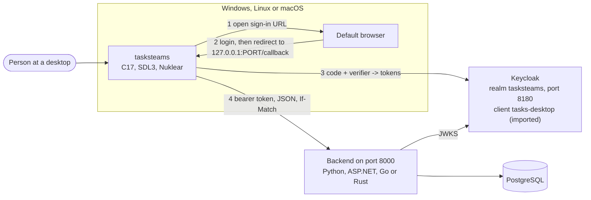

# Desktop client in C17 (SDL3, Nuklear, libcurl, cJSON)

A native desktop client for the shared "Tasks and Teams" platform, written in plain C17. It signs in with OAuth 2.0
authorization code + PKCE in the system browser (loopback redirect, RFC 8252), keeps tokens in memory only, lists teams,
projects and tasks, and creates, edits (`If-Match`, merge patch), completes and deletes tasks, with RFC 9457 problem details,
cursor pagination, a conflict view for 412 and a clean, leak-checked shutdown. Requirement ids are `D-xx` (see [TDD](TDD.md)).

**Status: written (not run).** The repository owner stopped all execution while this capstone was authored. Every chapter
carries `verified: not yet run`, nothing was compiled, no pack was built, no server was started. Commands in the lessons and the
pack READMEs are instructions for a later, authorised run. Expected outputs are derived by reading the code; where the exact text
comes from a tool or a server, the lesson says "typical".

## System diagram

## Chapters and complete phase snapshots
| Chapter | Tutorial | Source pack | Time |
|---|---|---|---|
| 01 Setup and window | [01](tutorials/phase-1-setup/01-setup-and-window.md) | desktop-c-phase-1-setup.zip | 90 min |
| 02 HTTP and JSON client | [02](tutorials/phase-2-http-json/02-http-and-json.md) | desktop-c-phase-2-http-json.zip | 150 min |
| 03 Auth: PKCE in the system browser | [03](tutorials/phase-3-auth/03-auth-pkce.md) | desktop-c-phase-3-auth.zip | 150 min |
| 04 Screens and state | [04](tutorials/phase-4-screens/04-screens-and-state.md) | desktop-c-phase-4-screens.zip | 180 min |
| 05 Hardening and packaging | [05](tutorials/phase-5-ship/05-hardening-and-packaging.md) | desktop-c-phase-5-ship.zip | 120 min |

Each `source/phase-N-slug` folder holds a `PACK-README.md` and `NN-slug/{code, exercise/starter, exercise/solution, verify.json}`.
`code` is the whole app at that point (a complete snapshot, not a patch). The exercises are small standard-library-only C files
that you compile with one command. Zips are generated by the repository pack builder into `dist/packs`; none is committed.

## What is included
- A CMake 3.21 project with presets (`default`, `asan`, `release`), a vcpkg manifest (`sdl3`, `curl`, `cjson`, `openssl`) and Nuklear
  v4.13.4 with its official SDL3 renderer, fetched by `FetchContent`.
- Eleven small modules: `util` (counted allocation, bounds-checked text, buffers, secure zero), `config`, `http`, `model`, `api`,
  `pkce`, `loopback`, `auth`, `jobs`, `store`, `ui`, plus `log` in chapter 05.
- One worker thread with bounded queues and an ownership rule for every job (`run`, `done`, `release`).
- PKCE S256, discovery with issuer check, a one-shot loopback listener, single-flight refresh with rotation, back-channel sign-out.
- A Keycloak client file, `keycloak/tasks-desktop-client.json`, because the platform realm has no loopback client (see below).
- A redacting logger, a leak report (counted allocator plus cJSON hooks), hardening flags, a sanitizer preset, install rules and a CPack zip.

## Start reading
1. [TDD.md](TDD.md): requirements `D-01` to `D-30`, architecture, security design, phase plan and the readiness checklist.
2. [VERSIONS.md](VERSIONS.md) and [GLOSSARY.md](GLOSSARY.md); [_STATE.md](_STATE.md) for the status of every chapter.
3. Prerequisites in short: C 101 lessons 01 and 05 to 12 (compiler, CMake, functions, strings, pointers, structs, headers, memory,
   files), platform primers 01 to 04 (Git, HTTP, OpenAPI, OAuth), and the platform plus one backend running. Recommendations, not gates.

## Platform finding (the platform was not edited)
The realm of the platform capstone has `tasks-web` and `tasks-mobile` but no client for a loopback redirect. This capstone ships the
missing public client as an import file and explains each line in chapter 03. For the platform's v1.1 backlog (section 12.1 of its
TDD) the suggested change is to add the same client to `realm-tasksteams.json`. Until then, a `docker compose down -v` re-imports the
realm without it and the client must be imported again.

## Design clarifications and limits
1. Tokens are memory-only on purpose. Production storage (Credential Manager, Keychain, Secret Service) is described in chapter 05, not built.
2. Nuklear draws its own widgets, so screen readers cannot see them (D-28). The app is keyboard- and mouse-usable and shows status as words, but it is not accessible to blind users.
3. The Windows route is MSVC Build Tools (C 101 lesson 01, route B). vcpkg with MinGW is untested here.
4. `FetchContent` with `SOURCE_SUBDIR` pointing at a missing folder is used to skip Nuklear's own `CMakeLists.txt`; chapter 01 lists a fallback if your CMake complains.
5. The `/sdl` and `/guard:cf` flags, the MSVC AddressSanitizer block and the `$<TARGET_RUNTIME_DLLS:...>` install rule were written from the official documentation and not run.
6. No unit tests are shipped; the verifier steps are builds and the standard-library exercises.

## Still not run
Everything: configure and build on any OS, the exercises, the browser sign-in, refresh after five minutes, conflict handling against a
real backend, the sanitizer and release builds, the CPack zip, the performance and memory targets of the TDD.
