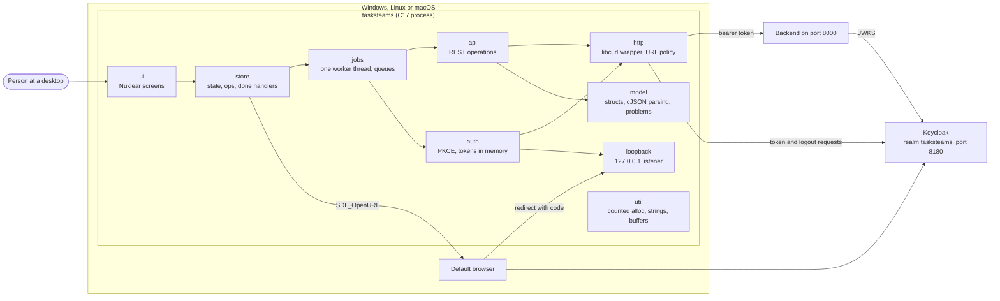
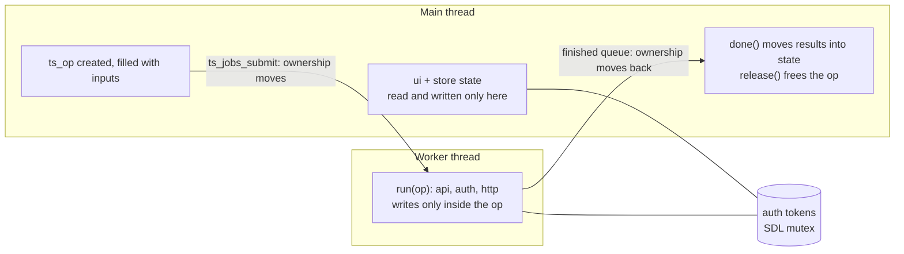
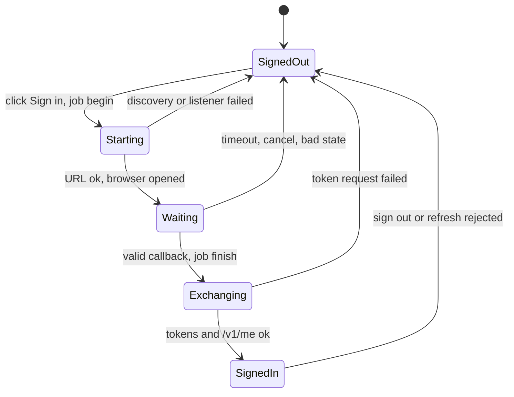
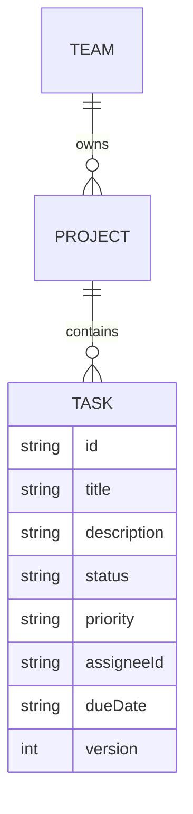
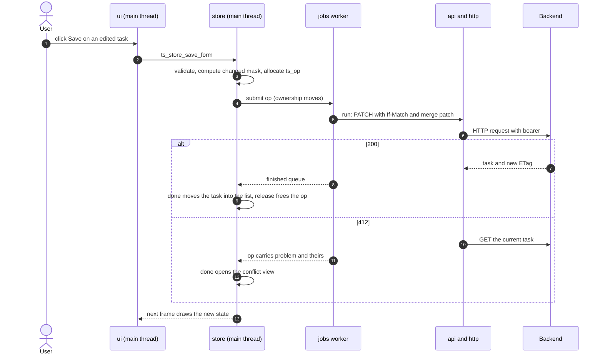
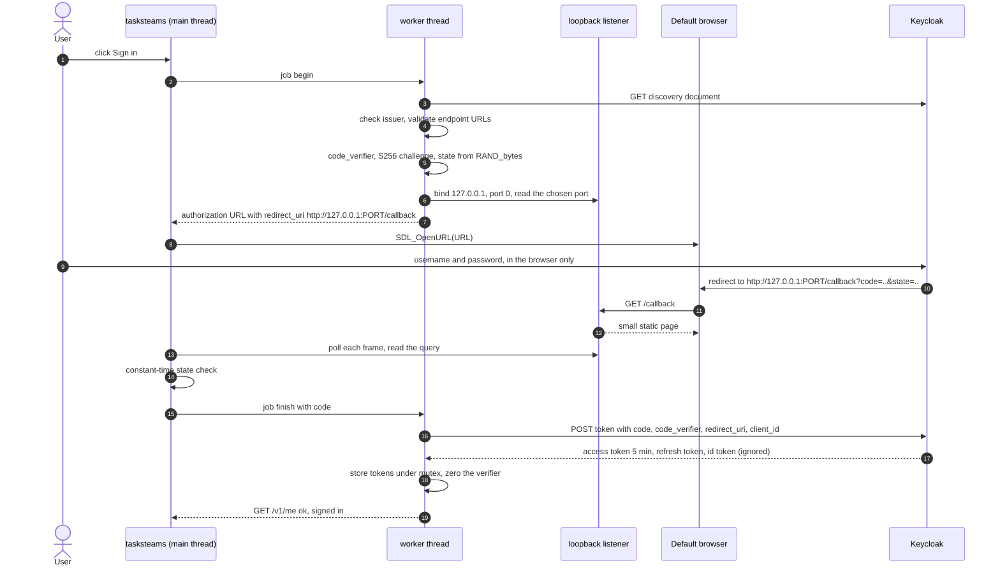

# TDD: Desktop client in C17 (Tasks and Teams)

| Field | Value |
|-------|-------|
| Id | desktop-c |
| Level | 201 (secure C, native desktop, OAuth 2.0 for native apps) |
| Status | Draft (design written 2026-11-23; nothing built or run yet) |
| Depends on | platform (contract, Keycloak realm `tasksteams`) and any one backend on port 8000: backend-python, backend-dotnet, backend-go or backend-rust (a desktop app has no Rust restriction) |
| Stack | C17 (`-std=c17`, extensions off), CMake 3.21 or newer, vcpkg manifest mode (`sdl3`, `curl`, `cjson`, `openssl`), Nuklear v4.13.4 with its official SDL3 renderer backend (fetched by CMake `FetchContent`). Versions read from the official vcpkg, SDL, Nuklear and curl pages on 2026-11-23; nothing was compiled |
| Estimated learner time | 5 chapters, about 11.5 hours (90 + 150 + 150 + 180 + 120 minutes) |
| Last updated | 2026-11-23 |

## 1. Purpose and learning goals
The app is the native desktop client of "Tasks and Teams": a signed-in person browses teams and projects, works a task list, creates, edits, completes and deletes tasks, and sees every API error as the platform's RFC 9457 problem details. It is written in plain C on purpose: every allocation has an owner, every string copy is bounds-checked and every network byte is treated as untrusted. The contract is the [platform TDD](../platform/TDD.md); this document repeats none of it. Requirement ids are `D-xx`.

Skills gained:
1. Structure a C17 program as small modules with a header each, one owner per heap block and a documented lifetime for every pointer (SEI CERT MEM30-C, MEM31-C).
2. Write bounds-checked string and buffer code (no `strcpy`, `strcat`, `sprintf`, `gets`), check every size computation for overflow (INT30-C) and never pass external text as a format string (FIO30-C).
3. Build with CMake presets and a vcpkg manifest, with warnings on, and with sanitizers and hardening flags in later builds.
4. Draw a GUI with SDL3 and the Nuklear immediate-mode library, keeping all UI state on one thread.
5. Call a REST API with libcurl (TLS verification on, timeouts, response caps, no redirects) and parse JSON with cJSON without trusting any field.
6. Sign in with OAuth 2.0 authorization code + PKCE in the system browser using a loopback redirect (RFC 8252), keep tokens in memory only and refresh them safely.
7. Use `ETag`/`If-Match`, JSON Merge Patch, `Idempotency-Key`, cursor pagination and problem details from the client side.
8. Shut down cleanly (cancel, join, free) and prove it with a counting allocator and AddressSanitizer/LeakSanitizer; package the app with CPack.

## 2. Scope
**In scope:** one desktop executable (Windows, Linux, macOS; developed and described for Windows 11 with MSVC and for Linux with gcc), sign-in and sign-out, teams and projects view, task list with status filter and "Load more", create, edit (If-Match, merge patch), complete, delete, a conflict view for 412, ProblemDetails display, a counted allocator, logging with redaction, a sanitizer preset, an install/CPack zip, five chapters and phase packs.
**Out of scope:** comments, member management, audit log, offline cache and outbox (the mobile twins teach those), persisting tokens (the tokens are memory-only by design), code signing certificates, an auto-updater, screen-reader support (Nuklear draws its own widgets and exposes no accessibility tree, see D-28), a Unix-socket or named-pipe single-instance lock, localisation, Authentik.
**Assumptions:** the platform is running (`docker compose -p platform up -d --wait` from the platform capstone) and one backend answers on port 8000; a C compiler and CMake from C 101 lesson 01; Git; vcpkg cloned and bootstrapped (the chapter shows it); a default browser; learners work on Windows, Linux or macOS.
**Constraints:** the realm of the platform has clients `tasks-web` and `tasks-mobile` but **no loopback client**, and this capstone must not edit the platform. It therefore ships `keycloak/tasks-desktop-client.json` (a public client `tasks-desktop`, redirect `http://127.0.0.1/*`, PKCE S256, no direct grants) that the learner imports in the Keycloak admin console, and records the gap in section 12 as a candidate for the platform v1.1 backlog. Docker is used only for the platform and the backend; the app is a native process. Ports used: 8000 (API), 8180 (Keycloak) and one operating-system-chosen ephemeral port on `127.0.0.1` for the redirect; 8080, 8081 and 11434 are never used.

## 3. Requirements
`[build]` checks are compile, link and static search checks; `[manual]` checks need the running platform, a browser and a person. Nothing has been run yet: every check below is a plan, not a result.

| Id | Requirement | Priority | Acceptance check | Phase |
|----|-------------|----------|------------------|-------|
| D-01 | The project configures and builds from a clean checkout with `cmake --preset default` and `cmake --build --preset default` using a vcpkg manifest and `-std=c17` with extensions off and warnings on (`-Wall -Wextra -Wpedantic`, `/W4`) | Must | `[build]` both commands exit 0 with no warning in `src/` | 1 |
| D-02 | An SDL3 window with a Nuklear UI opens, redraws every frame, follows resizing and display scale and closes on the window button without a crash | Must | `[manual]` window shows the three config values and a frame counter that grows | 1 |
| D-03 | Configuration comes from environment variables (`TASKS_API_BASE`, `TASKS_OIDC_ISSUER`, `TASKS_OIDC_CLIENT`) copied with a bounds-checked function; too-long values fall back to the defaults | Must | `[build]` a search of `src/` for `strcpy`, `strcat`, `sprintf(`, `gets(`, `strncpy` finds nothing | 1 |
| D-04 | Every heap block comes from `ts_malloc`, `ts_calloc`, `ts_realloc` or `ts_strdup` (counted); each function that returns or takes a pointer states who frees it | Must | `[build]` a search for bare `malloc(`, `calloc(`, `realloc(`, `free(` finds them only in `util.c` | 1, 5 |
| D-05 | HTTP uses libcurl with TLS peer and host verification on, TLS 1.2 minimum, redirects off, protocols limited to http and https, connect timeout 5 s, total timeout 20 s, response body cap 4 MiB; plain `http://` is allowed only for `localhost`, `127.0.0.1` and `[::1]` | Must | `[manual]` pointing `TASKS_API_BASE` at `http://example.com` is refused with a policy message | 2 |
| D-06 | No network call runs on the UI thread: one worker thread runs jobs from a bounded queue, results return to the main thread, and only the main thread touches UI state | Must | `[manual]` the frame counter keeps growing while a slow request runs | 2 |
| D-07 | JSON is parsed with cJSON; every field is type-checked, missing or wrong-typed fields give an empty value or a parse error, strings are copied with bounds, unknown fields are ignored | Must | `[manual]` a body `{}` for a task is rejected with "could not read" and no crash | 2 |
| D-08 | Error responses are parsed as problem details: `type`, `title`, `status`, `detail`, `traceId`, 422 `errors[]` with pointers, `Retry-After`; each problem `type` of the platform TDD maps to one user message and an unknown type shows the `title` | Must | `[manual]` an unauthenticated call shows the `unauthorized` message and the status 401 | 2, 4 |
| D-09 | Sign-in uses authorization code + PKCE (S256) in the system browser with client `tasks-desktop` and a loopback redirect `http://127.0.0.1:<port>/callback` on an ephemeral port (RFC 8252); the app never sees the password and has no embedded web view | Must | `[manual]` the browser opens Keycloak, login ends on a "you can close this tab" page and the app shows the user name | 3 |
| D-10 | The loopback listener binds only to `127.0.0.1`, accepts one connection at a time, reads at most 2 KiB, answers only `GET /callback`, never reflects input, closes after the first valid callback and after 180 s; `state` is compared in constant time and a missing or different `state` aborts sign-in | Must | `[manual]` opening `http://127.0.0.1:<port>/callback?code=x&state=y` by hand shows a failed sign-in, not a session | 3 |
| D-11 | Tokens live only in memory under a mutex, are zeroed before they are freed, never appear in logs, messages or files; a refresh happens at most once at a time, 60 s before expiry or after one 401, and the rotated refresh token replaces the old one before the new access token is used | Must | `[build]` tokens are held only in `auth.c`; `[manual]` the access token lifetime is 5 minutes in the realm, so a 6-minute idle call must still succeed | 3 |
| D-12 | Sign-out wipes the tokens at once and then ends the Keycloak session with a back-channel logout request (best effort); the UI shows the signed-out screen even if that request fails | Must | `[manual]` after sign-out the sign-in button shows and the old refresh token is rejected by Keycloak | 3 |
| D-13 | The scope list is `openid profile email tasks:read tasks:write`, defined once; there is no client secret, no password grant and no admin scope in the app | Must | `[build]` the scope string appears once in `src/` | 3 |
| D-14 | Discovery is fetched from `<issuer>/.well-known/openid-configuration`, its `issuer` must equal the configured issuer exactly, and every endpoint passes the URL policy before use or before the browser is opened | Must | `[manual]` a wrong `TASKS_OIDC_ISSUER` gives an issuer-mismatch message | 3 |
| D-15 | A teams view lists `GET /v1/teams` (limit 100) and, for the selected team, `GET /v1/teams/{id}/projects` | Must | `[manual]` alice sees Platform Team and Mobile Team, carol sees Mobile Team | 4 |
| D-16 | The task list shows `GET /v1/projects/{id}/tasks` with limit 25, a status filter and a "Load more" button that sends `page.nextCursor` unchanged (the app never builds or parses a cursor) | Must | `[manual]` with more than 25 tasks the button appends the next page | 4 |
| D-17 | Create sends an `Idempotency-Key` generated when the form opens, so a double click or retry replays instead of duplicating | Must | `[manual]` two quick clicks on Save create one task | 4 |
| D-18 | Edit sends `If-Match: "<version>"` and a JSON Merge Patch with only the changed fields; clearing the due date sends `null` | Must | `[manual]` changing only the title sends only `title` (seen in the backend's request log or a local proxy; the app itself never logs bodies) | 4 |
| D-19 | A task can be completed (`POST /complete`, `If-Match`) and deleted (`DELETE`, `If-Match`); a 403 for a non-lead delete is shown as a problem | Must | `[manual]` bob deleting a task shows the `forbidden` message | 4 |
| D-20 | A 412 on edit loads the current server task and shows "mine" and "theirs" per field with "Keep mine" (re-send with the new version) and "Take theirs" | Must | `[manual]` edit the same task from the platform script and the app; the loser sees both versions | 4 |
| D-21 | Create and edit are validated against the OpenAPI limits (title 1 to 200 characters, description up to 10000, enum values, date format) before any request; errors use the same field display as 422 | Should | `[manual]` an empty title shows a field message without a request | 4 |
| D-22 | A response for a team, project or filter that is no longer selected is dropped and freed | Should | `[manual]` clicking two projects quickly shows the second one's tasks | 4 |
| D-23 | Shutdown is clean: running transfers are cancelled, the worker is joined, every owned block is freed, and at exit the counted allocator and the cJSON hooks report zero outstanding blocks (debug builds); the `asan` preset reports no leak | Must | `[manual]` stderr ends with `allocations outstanding: 0` and the sanitizer run is silent | 5 |
| D-24 | Logging goes through one function that redacts bearer tokens, `code`, `code_verifier`, `access_token`, `refresh_token` values; request lines log method, path and status only | Must | `[manual]` a debug session log contains no `eyJ` (the start of a JWT) | 5 |
| D-25 | Release builds use hardening flags (stack protector, `_FORTIFY_SOURCE`, PIE, full RELRO, `/GS`, `/guard:cf`, `/sdl`) and a sanitizer preset exists (`-fsanitize=address,undefined`) | Should | `[build]` the `release` and `asan` presets configure and build | 5 |
| D-26 | `cmake --install` and `cpack` produce a zip with the executable, its runtime libraries, the Keycloak client file, the notices file and no secrets, build paths or debug symbols | Must | `[build]` the zip lists exactly those files | 5 |
| D-27 | The chapter text explains what changes for production: HTTPS everywhere, the platform secure storage for a refresh token (Windows Credential Manager or DPAPI, macOS Keychain, Linux Secret Service), code signing and update delivery | Must | `[build]` section present in chapter 05 | 5 |
| D-28 | Text is at least 16 logical pixels, follows the display scale, status is shown as words and never by colour alone, every action is a labelled button (no icon-only controls); the lack of a screen-reader tree in Nuklear is stated as a known limit | Should | `[manual]` readable at 150 percent display scale | 4, 5 |
| D-29 | The app works unchanged against the Python, ASP.NET, Go and Rust backends (contract only; the backend is chosen with `TASKS_API_BASE`) | Must | `[manual]` the same sign-in and task flow against each backend that passes `18 passed, 0 failed` | 4 |
| D-30 | The platform files are not edited; the one missing realm client ships as an importable JSON file with line-by-line explanation | Must | `[build]` `git status` shows changes only under `capstones/desktop-c` | 3 |

| Non-functional requirement | Target |
|----------------------------|--------|
| Frame time | UI thread never blocks on I/O; a frame with a 25-row list should stay well under 16 ms on a mid-range laptop (to be measured, not claimed) |
| Memory | no unbounded growth: response cap 4 MiB, job queue 16, one task page of 25 plus appended pages the user asked for |
| Security | no token or authorization code in logs, files or error text; TLS verification never disabled; no `strcpy` family |
| Portability | one code base for Windows (MSVC), Linux (gcc or clang) and macOS (clang); platform code only in `loopback.c` |
| Reproducibility | dependency versions come from the vcpkg baseline written by `vcpkg x-update-baseline`, Nuklear from tag `v4.13.4` |
| Accessibility | see D-28; keyboard use limited to what Nuklear provides |

## 4. Architecture
Context and containers (C4 levels 1 and 2 in one picture; the platform TDD owns the rest):



| Module | Responsibility | Depends on |
|--------|----------------|------------|
| `util` | counted allocation, bounds-checked copy and format, growable buffer, secure zero and compare, clock | SDL (atomics, ticks) |
| `config` | environment settings with defaults | util |
| `nk_api.h`, `nk_impl.c` | the Nuklear and SDL3 renderer configuration and its single implementation file (compiled without warnings) | SDL, Nuklear |
| `http` | one blocking request function over libcurl, URL policy, percent encoding, cancel flag, response caps | util, libcurl |
| `model` | structs for health, me, teams, projects, tasks, problem details; cJSON parsing; the generic vector; draft validation | util, cJSON |
| `api` | one function per REST operation, bearer injection, one 401 retry, problem parsing | http, model |
| `pkce`, `loopback` | random bytes, SHA-256, base64url; the loopback server | OpenSSL, sockets |
| `auth` | discovery, authorization URL, code exchange, refresh, revoke, token storage under a mutex | http, model, pkce, loopback |
| `jobs` | worker thread, bounded queues, main-thread pump | SDL threads |
| `store` | application state, one `ts_op` struct per job, `run` and `done` handlers, shutdown order | everything above |
| `ui` | Nuklear drawing and click handling (`ui.c` shell and signed-out panel, `ui_work.c` the three columns), calls store functions | store |
| `log` (chapter 05) | redacting logger | util |

Threads and ownership (the rule that keeps this program free of data races):



Rules: (1) a `ts_op` has exactly one owner at a time and is never touched by two threads at once; (2) the worker reads `store->api` and `store->auth` only, never UI state; (3) `done` may take an output by moving it into the store and zeroing the op's copy, and `release` always runs once and frees whatever is left; (4) the token strings are the only memory shared between threads and are guarded by a mutex.

Sign-in state machine (all transitions on the main thread):



Decisions (ADR style):

| Decision | Alternatives | Consequences |
|----------|--------------|--------------|
| **SDL3 + Nuklear** for window and GUI | Dear ImGui (C++), GTK or Win32 (one OS each), raylib | Nuklear is a single-header C library with an official SDL3 renderer backend; immediate mode keeps UI state in plain structs. Costs: no accessibility tree, basic widgets, default bitmap font |
| **libcurl** with one blocking call per request on a worker thread | `curl_multi` on the main thread, raw sockets, WinHTTP/NSURLSession | The blocking call reads like straight-line code and is easy to teach; `curl_multi` would remove the thread but turn every API function into a state machine. The cost is one thread and the ownership rules above |
| **cJSON** | jansson, json-c, hand-written parser | Small, one allocation hook, easy to read; every accessor returns a pointer into the tree, so the lesson on lifetimes is real. cJSON is not hardened against huge nesting by us: the 4 MiB cap and its built-in nesting limit are the defences |
| **OpenSSL** only for `RAND_bytes` and SHA-256 | hand-written SHA-256, OS random APIs, libsodium | Never hand-write cryptography; OpenSSL is already a curl dependency on Linux. Costs one more vcpkg package on Windows |
| **Loopback redirect with an ephemeral port** (RFC 8252 section 7.3) | custom URI scheme registration, device flow, embedded web view | No installer or registry change, works on all three systems, and Keycloak accepts any port for `http://127.0.0.1/*`. Costs a small socket server and a browser that can reach `127.0.0.1` |
| **Memory-only tokens** | encrypted file, OS credential store | Nothing to steal from disk, nothing to migrate; the user signs in again after each start. Production would store only a refresh token in the OS store (section 7) |
| **vcpkg manifest + CMake preset** for compiled libraries, **FetchContent** for Nuklear | all FetchContent, Conan, system packages | vcpkg builds SDL3, curl, cJSON, OpenSSL for the platform triplet; Nuklear is header-only and its SDL3 backend is not in the vcpkg port, so a pinned git tag is fetched. Two mechanisms, both pinned |
| **Counted allocator** wrappers | rely only on sanitizers or Valgrind | Works on every OS and in the lesson text ("outstanding: 0"); sanitizers are added in chapter 05 as the second net |

## 5. Domain and data model
The desktop app has no database and no cache: the server is the source of truth and the screens hold the last response. Entities mirror the platform [data model](../platform/TDD.md) (section 5); only the fields below are read.



| C type | Fields kept | Storage rule |
|--------|-------------|--------------|
| `ts_health` | `status`, `database`, `version` | inline bounded arrays |
| `ts_me` | `id`, `username`, `displayName`, `email`, roles joined as text | inline bounded arrays |
| `ts_team` | `id`, `name`, `description`, `memberCount`, `version` | inline, read-only display, truncation allowed |
| `ts_project` | `id`, `key`, `name`, `archived`, `version` | inline, read-only display |
| `ts_task` | `id`, `projectId`, `title` (808 bytes = 200 characters in UTF-8), `description` (owned `char *`, any length), `status`, `priority`, `assigneeId`, `dueDate`, `completedAt`, `version` | titles never truncate (they are edited and sent back); the description is heap-allocated so a 10000-character text is lossless |
| `ts_page` | a `ts_vec` of items and the opaque `nextCursor` (256 bytes, empty = last page) | the vector owns its items; a page is freed with its element destructor |
| `ts_problem` | `status`, `type`, `title`, `detail`, `traceId`, `Retry-After`, up to 6 field errors | inline, copied, never points into a response |
| `ts_task_draft` | title, description (4095 bytes), status, priority, due date text | the form buffer; `original` copy decides the changed-field mask |

Rule for all strings: a field that is displayed only may be truncated at a UTF-8 boundary; a field that the user edits and the app sends back must either fit completely or make the form read-only. **Data lifecycle:** nothing is written to disk. **Migration and seed:** none (the platform seed gives alice, bob and carol).



## 6. API design
The app only consumes the API: every row is an operation of the [platform contract](../platform/TDD.md) (section 6). Base URL from `TASKS_API_BASE` (default `http://localhost:8000`), paths under `/v1`.

| Screen part | Operation | Headers the app sends | Success | Failures handled |
|-------------|-----------|-----------------------|---------|------------------|
| Connection panel | `GET /health` | none | 200 | 503, transport errors |
| Header | `GET /v1/me` | bearer | 200 | 401 |
| Teams | `GET /v1/teams?limit=100` | bearer | 200 | 401, 429 |
| Projects | `GET /v1/teams/{id}/projects` | bearer | 200 | 404 (not a member) |
| Task list | `GET /v1/projects/{id}/tasks?limit=25&status=..&cursor=..` | bearer | 200 | 400 (bad cursor: reload page 1) |
| Task form (open) | `GET /v1/tasks/{id}` | bearer | 200 | 404 |
| Create | `POST /v1/projects/{id}/tasks` | bearer, `Idempotency-Key`, `Content-Type: application/json` | 201 | 409, 422 |
| Edit | `PATCH /v1/tasks/{id}` | bearer, `If-Match: "<version>"`, `Content-Type: application/json` | 200 | 412, 422, 428 (a bug: never send without) |
| Complete | `POST /v1/tasks/{id}/complete` | bearer, `If-Match` | 200 | 409, 412 |
| Delete | `DELETE /v1/tasks/{id}` | bearer, `If-Match` | 204 | 403, 404, 412 |

Client rules: ids are checked against `[A-Za-z0-9-]{1,36}` before they enter a URL (no path injection from a server value), query values are percent-encoded, `If-Match` is the quoted `version` of the task the user saw, the merge patch contains only changed keys (`null` for a cleared due date), the `Idempotency-Key` is a random UUID created when the "new task" form opens and reused for every retry of that form, the cursor is passed through untouched, headers are matched case-insensitively (platform section 12.1), a 401 triggers exactly one forced refresh and one retry, redirects are never followed, 5xx and transport errors are shown with a "try again" hint (there is no automatic retry in this app). Error bodies become `ts_problem` (type suffix selects the message); unknown types show the `title`.

## 7. Identity and security design
Realm `tasksteams`, issuer `http://localhost:8180/realms/tasksteams`, public client `tasks-desktop` (imported from this capstone), PKCE S256, direct grants off, redirect `http://127.0.0.1/*` (Keycloak ignores the port of a loopback redirect, see section 13). Sign-in follows RFC 8252: external user agent, no embedded web view.



Refresh: the API layer asks `ts_auth_token(force)` before each call; under a refresh mutex it refreshes when fewer than 60 s remain or when forced after a 401, swaps the rotated refresh token in under the data mutex, and keeps the old tokens when only the network failed. A refusal (`invalid_grant`) wipes the tokens and sets an "expired" flag that the UI turns into the sign-in screen.

| Topic | Rule |
|-------|------|
| Scopes | `openid profile email tasks:read tasks:write`. No `tasks:admin`, no `offline_access` (nothing is persisted, so nothing needs to outlive the session) |
| ID token | received, never stored and never trusted for decisions; the user's name comes from `/v1/me`. Production code that uses ID-token claims must validate signature, `iss`, `aud`, `exp` and `nonce` |
| Token storage | memory only, in two heap strings guarded by a mutex, zeroed with `ts_secure_zero` before `ts_free`; the response buffers and the cJSON tree that carried a token are wiped or freed immediately. Known limits: libcurl's header list and cJSON strings are freed by the libraries without zeroing, swap files and crash dumps may contain tokens, so no claim of "unrecoverable" is made |
| Production storage | only a refresh token, in the operating-system store: Windows Credential Manager (`CredWriteW`) or DPAPI (`CryptProtectData`), macOS Keychain (Security framework), Linux Secret Service (libsecret). Add `offline_access` only then |
| Redirect listener | `127.0.0.1` only (never `0.0.0.0`), port chosen by the OS, one connection, 2 KiB request cap, exact path `/callback`, GET only, static response with `Cache-Control: no-store` and `Referrer-Policy: no-referrer`, closed after the first valid request or 180 s. A local process that learns the code still lacks the `code_verifier` |
| URL policy | `https://` anywhere; `http://` only for `localhost`, `127.0.0.1`, `[::1]`; no userinfo (`user@`) in the authority; checked for every API call, discovery, token endpoint and before `SDL_OpenURL` (stops `file:` and custom schemes coming from a poisoned discovery document) |
| TLS | verification and host check on, TLS 1.2 minimum, the OS or library certificate store; the lesson says plainly that local `http` is a development convenience and that production issuer and API must be `https` with valid certificates; certificate pinning is not used |
| Logging | one function, redaction of token-like values, request lines carry method, path and status only; never request or response bodies |
| Supply chain | vcpkg baseline commit written by the tool and committed, Nuklear tag pinned, third-party notices shipped |

Common C weaknesses and where this design answers them:

| Weakness | Mitigation here |
|----------|-----------------|
| CWE-120 and CWE-121/122 buffer overflow (CERT STR31-C, ARR38-C) | `ts_copy`, `ts_setf`, `ts_catf`, `ts_buf`; no unbounded libc string function; compile with warnings; sanitizer preset |
| CWE-190 integer overflow (INT30-C) | size arithmetic checked before every allocation and buffer growth |
| CWE-415 double free and CWE-416 use after free (MEM30-C) | one owner per block, move-then-zero, free functions that reset the struct, ASan run |
| CWE-401 missing release (MEM31-C) | counted allocator at exit plus LeakSanitizer |
| CWE-134 format string (FIO30-C) | every format string is a literal; external text is only an argument |
| CWE-295 improper certificate validation | verification never switched off; policy blocks cleartext except loopback |
| CWE-312 cleartext storage and CWE-532 secrets in logs | memory-only tokens, redacting logger |
| Local port hijack or code injection | PKCE, `state`, loopback binding, one-shot listener |

Threat model summary. **Assets:** access and refresh tokens, task data, the user's session in the browser. **Entry points:** the loopback port, HTTP responses (headers and JSON), environment variables, the discovery document, the web page shown in the browser. **Top threats and answers:** stolen code (PKCE, `state`, short code life, loopback only), malicious JSON (type checks, caps, bounded copies), malicious server redirect (redirects off), poisoned discovery (issuer equality, URL policy), crash from bad input (sanitizers, fuzz-style tests suggested in chapter 05), token leakage through logs (redaction), lost update (If-Match), duplicate create (Idempotency-Key).

## 8. Project structure
```text
capstones/desktop-c/
  README.md  TDD.md  VERSIONS.md  GLOSSARY.md  _BRIEF.md  _STATE.md
  tutorials/phase-N-slug/NN-slug.md                  five chapters
  source/phase-N-slug/PACK-README.md
  source/phase-N-slug/NN-slug/{code, exercise/{starter,solution}, verify.json}
  source/phase-5-ship/05-hardening-and-packaging/code/   the finished app
    CMakeLists.txt  CMakePresets.json  vcpkg.json  .gitignore
    src/
      main.c  nk_api.h  nk_impl.c
      util.h util.c  config.h config.c  log.h log.c
      http.h http.c  model.h model.c  api.h api.c
      pkce.h pkce.c  loopback.h loopback.c  auth.h auth.c
      jobs.h jobs.c  store.h store.c  ui.h ui.c ui_work.c
    keycloak/tasks-desktop-client.json
    packaging/THIRD-PARTY-NOTICES.md
```
Layering: `util <- config, http, model, jobs, pkce, loopback, log`; `http, model <- api`; `http, model, pkce, loopback <- auth`; `api, auth, jobs <- store`; `store <- ui`; `main` knows `store`, `ui` and the Nuklear/SDL glue only. Naming: `ts_` prefix for every external symbol, `ts_thing_verb` for functions, `ts_thing` for types, `TS_` for macros, `static` for everything private. A function that returns a heap pointer says so in its header comment ("caller frees with ts_free"); a function that takes ownership says "takes ownership of". Configuration: environment variables `TASKS_API_BASE` (default `http://localhost:8000`), `TASKS_OIDC_ISSUER` (default `http://localhost:8180/realms/tasksteams`), `TASKS_OIDC_CLIENT` (default `tasks-desktop`), `TASKS_LOG` (`1` = log requests, chapter 05). No `.env` file is read and none is shipped.

## 9. Delivery plan (phases)
| Phase | Title | Chapter | Requirement ids | Exit check (compile and look, no server needed) | Source pack |
|-------|-------|---------|-----------------|--------------------------------------------------|-------------|
| 1 | Setup and window | 01 CMake, vcpkg, SDL3, Nuklear, safe strings, counted allocator | D-01 to D-04 | `cmake --preset default` and `cmake --build --preset default` succeed; the window opens | `desktop-c-phase-1-setup.zip` |
| 2 | HTTP and JSON client | 02 libcurl wrapper, URL policy, cJSON models, problem details, worker thread | D-05 to D-08 | build succeeds; "Test connection" shows the health result; "Call /v1/me" shows a 401 problem | `desktop-c-phase-2-http-json.zip` |
| 3 | Auth (PKCE) | 03 discovery, PKCE, loopback server, tokens, refresh, sign-out, Keycloak client import | D-09 to D-14, D-30 | build succeeds; the browser opens the Keycloak login page | `desktop-c-phase-3-auth.zip` |
| 4 | Screens and state | 04 teams, projects, tasks, forms, If-Match, idempotency, conflicts, pagination | D-15 to D-22, D-28, D-29 | build succeeds; alice sees her teams and tasks | `desktop-c-phase-4-screens.zip` |
| 5 | Hardening and packaging | 05 logging, redaction, hardening flags, sanitizers, leak report, install and CPack, production notes | D-23 to D-27 | `release` and `asan` presets build; the allocation report ends at 0; the zip lists the expected files | `desktop-c-phase-5-ship.zip` |

Each pack contains the whole app at the end of that phase; the exercises are small standard-library-only C files you compile with one command.

## 10. Verification plan
Per the repository owner's rule for this authoring block **nothing has been run**: no build, no test, no server, no pack build. The plan for a later, explicitly authorised run:
1. Phase 1 to 5: from each `code` folder, `cmake --preset default` then `cmake --build --preset default` (phase 5 also `release` and `asan`). The exit check is the exit code.
2. Exercises: `gcc -std=c17 -Wall -Wextra -o exercise exercise.c` on the solution folder and compare the printed lines with the chapter.
3. Manual run (learner, always): start the platform and one backend under the temporary project `platform`, import the Keycloak client, run `tasksteams`, sign in as carol, open Mobile Team, create, edit and complete a task, then close the window and read the allocation report. Clean up: close the app, `docker compose -p platform down -v --remove-orphans`.
4. Conformance: the app is conformant when it only uses operations of `openapi.yaml` and behaves the same against each backend that reports `18 passed, 0 failed` from `scripts/conformance.py`.
5. Static searches of D-03, D-04, D-13 with `grep`/`Select-String` are cheap and can run anywhere.

## 11. Deployment and operations
There is no server component. Build outputs: `tasksteams` (or `tasksteams.exe`) plus runtime libraries. Distribution: `cpack -G ZIP` zip (chapter 05); real distribution needs code signing (Authenticode on Windows, Developer ID and notarisation on macOS, a signed package or AppImage on Linux), an update channel and an installer that registers nothing outside its folder (the loopback redirect needs no registry change). Logs: stderr, off by default, `TASKS_LOG=1` enables redacted request lines. Health: the "Test connection" button calls `/health`. Backups: none, the app stores no user data. Host ports: only the ephemeral loopback port is opened by the app, and only while a sign-in is waiting.

## 12. Risks, open questions, decisions
| Risk or question | Impact | Mitigation / decision |
|------------------|--------|-----------------------|
| The platform realm has no loopback client | Sign-in fails with "Invalid client" until the client is imported | Ship `tasks-desktop-client.json` and import steps; propose the client for the platform v1.1 backlog (section 12.1 of the platform TDD); the platform is not edited |
| Keycloak redirect matching for loopback ports | Sign-in fails with "Invalid parameter: redirect_uri" | Register `http://127.0.0.1/*`; Keycloak documents and implements the RFC 8252 any-port rule for loopback addresses (see references); fallback is to fix one port in the client and `ts_loopback_open` |
| Nuklear's SDL3 backend lives in the git repo, not in the vcpkg port | Needs `FetchContent` and network access at configure time | Pin tag `v4.13.4`; the lesson lists the offline alternative (download the tag and use `FETCHCONTENT_SOURCE_DIR_NUKLEAR`) |
| `FetchContent` with `SOURCE_SUBDIR` set to a missing folder to skip Nuklear's own `CMakeLists.txt` | Relies on documented but uncommon behaviour | If configure complains, replace with `FetchContent_Populate` as shown in the chapter's Common mistakes |
| vcpkg on MSYS2/MinGW | Triplet and toolchain mismatches | The Windows route in this capstone is MSVC Build Tools (C 101 lesson 01 route B); MinGW is untested |
| Blocking libcurl call cannot be interrupted instantly | Slow exit | `CURLOPT_XFERINFOFUNCTION` polls a cancel flag; connect timeout 5 s caps the rest |
| Browser cannot reach `127.0.0.1` (proxy or strict policy) | Sign-in never completes | The waiting screen shows the URL, the port and a Cancel button; time-out after 180 s |
| Another local process connects to the loopback port | Noise or a code injection attempt | State check, PKCE, one valid callback closes the listener |
| Default bitmap font lacks non-Latin glyphs | Names show as boxes | Documented; a TTF could be loaded with Nuklear font baking (exercise) |
| No screen-reader support | Not accessible to blind users | Stated in D-28 and chapter 04; a production app needs a toolkit with accessibility support |
| Open: Authorization Code with `offline_access` and OS secure storage | Would add three OS-specific code paths | Out of scope; described in chapter 05 |

## 13. References
- RFC 8252 OAuth 2.0 for Native Apps (loopback redirects, section 7.3, 8.3): https://www.rfc-editor.org/info/rfc8252
- RFC 7636 PKCE: https://www.rfc-editor.org/info/rfc7636; RFC 9700 OAuth 2.0 Security Best Current Practice: https://www.rfc-editor.org/info/rfc9700
- OpenID Connect Core 1.0 and Discovery 1.0: https://openid.net/specs/openid-connect-core-1_0.html, https://openid.net/specs/openid-connect-discovery-1_0.html
- Keycloak documentation, securing applications and server administration (clients, redirect URIs, logout): https://www.keycloak.org/docs/latest/server_admin/ ; the loopback any-port behaviour is discussed in https://github.com/keycloak/keycloak/issues/39880 and https://github.com/keycloak/keycloak/issues/25637
- RFC 9457 Problem Details, RFC 7396 JSON Merge Patch, RFC 9110 HTTP Semantics: https://www.rfc-editor.org/info/rfc9457, https://www.rfc-editor.org/info/rfc7396, https://www.rfc-editor.org/info/rfc9110
- SDL3 wiki (SDL_CreateWindowAndRenderer, SDL_OpenURL, threads, atomics): https://wiki.libsdl.org/SDL3/FrontPage
- Nuklear and its SDL3 renderer demo: https://github.com/Immediate-Mode-UI/Nuklear (tag v4.13.4, `demo/sdl3_renderer`)
- libcurl easy interface and options (`CURLOPT_PROTOCOLS_STR`, `CURLOPT_XFERINFOFUNCTION`): https://curl.se/libcurl/c/
- cJSON: https://github.com/DaveGamble/cJSON
- vcpkg manifests and baselines: https://learn.microsoft.com/en-us/vcpkg/concepts/manifest-mode ; CMake presets and FetchContent: https://cmake.org/cmake/help/latest/manual/cmake-presets.7.html, https://cmake.org/cmake/help/latest/module/FetchContent.html
- SEI CERT C Coding Standard (STR31-C, ARR38-C, INT30-C, MEM30-C, MEM31-C, FIO30-C): https://wiki.sei.cmu.edu/confluence/display/c/SEI+CERT+C+Coding+Standard
- CWE entries cited above: https://cwe.mitre.org/
- AddressSanitizer and LeakSanitizer: https://clang.llvm.org/docs/AddressSanitizer.html ; MSVC AddressSanitizer: https://learn.microsoft.com/en-us/cpp/sanitizers/asan

## 14. Readiness checklist
Recommendations, not gates: skip what you already know. Ids are lesson numbers of the C 101 track (`tutorials/c/101-zero-to-hero`, read as "c/101 lesson NN") and the platform primers (`capstones/platform/tutorials/phase-0-primers`, read as "platform primer NN").

| You should be able to | Recommended lesson |
|-----------------------|--------------------|
| install a C compiler and CMake and build a hello program | c/101 lesson 01 |
| declare variables and use `printf` | c/101 lesson 02 |
| write `if`, `switch` and loops | c/101 lessons 03 and 04 |
| write and call functions with parameters and return values | c/101 lesson 05 |
| use arrays and NUL-terminated strings and explain why an array does not know its size | c/101 lesson 06 |
| use pointers, pass by pointer and read `const char *` | c/101 lesson 07 |
| define and pass `struct` values and pointers to structs | c/101 lesson 08 |
| split code into `.h` and `.c` files with include guards | c/101 lesson 09 |
| use `malloc` and `free` and explain a leak and a use-after-free | c/101 lesson 10 |
| read and write files and check return values | c/101 lesson 11 |
| finish a multi-file C program | c/101 lesson 12 |
| explain what a request, a response, a status code and a header are | platform primer 02 (HTTP and REST) |
| read a path and a schema in an OpenAPI file | platform primer 03 |
| explain code, token, scope and PKCE in your own words | platform primer 04 (OAuth 2, OIDC and Keycloak) |
| clone a repository and keep secrets out of Git | platform primer 01 (Git and GitHub) |
| start the platform (`docker compose -p platform up -d --wait`) and run one backend | platform README and one backend capstone (Docker installed as that README says) |

Also helpful: some Windows PowerShell or a Unix shell, and a place for a 3 GB vcpkg build cache (the first configure builds SDL3, curl and OpenSSL, which can take a long time).
