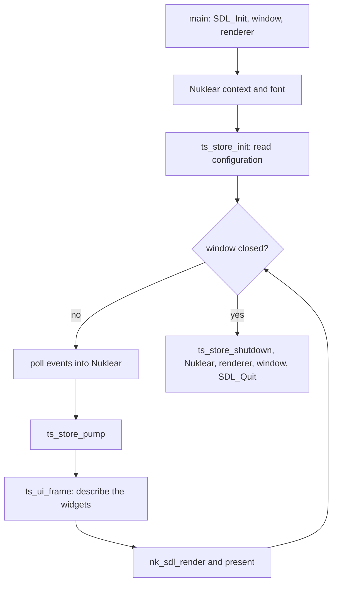

# 01. Setup and window

> **Draft: written but not yet run.** The code and the expected output in this lesson were prepared by reading the code and the official documentation. They have not been executed yet. If something does not behave as described, trust your tool's real output and report it.

## What you will be able to do
- Configure and build a C17 program with a CMake preset and a vcpkg manifest, and explain what each file of the setup does.
- Open an SDL3 window that draws a Nuklear user interface every frame and closes cleanly.
- Copy text with a function that cannot overflow and explain why `strcpy` is not used anywhere in this project.
- Explain what the counted allocator counts and what "owner" means for a heap block.

## Recap
1. In C 101 lesson 06, what does `strlen("api")` return and how many bytes does the array holding it need? <details><summary>Answer</summary>3, and 4 bytes: the terminating `'\0'` needs a place too.</details>
2. In C 101 lesson 10, what is a memory leak? <details><summary>Answer</summary>A heap block that nobody can free any more because the last pointer to it is gone.</details>
3. In C 101 lesson 09, why does a header have an include guard? <details><summary>Answer</summary>So including it twice in one file does not declare things twice.</details>

## Why it matters
A native program is a promise: it runs on a stranger's machine, with that person's files and sign-in, and it must not crash on bad input. C gives you full control and no safety net, so the habits start on day one: a build that warns about everything, string functions that know the size of their target, and a rule that every heap block has exactly one owner. This chapter lays the floor that the other four stand on.

## What you will build
A window titled "Tasks and Teams" that shows the three configuration values (API address, identity issuer, client id), a counter of drawn frames and a text field that echoes what you type. There is no network code yet. Requirements: D-01 to D-04 of the [design](../../TDD.md).



## Before you start
- **Time:** about 90 minutes; the first configure builds SDL3, curl and OpenSSL and can take much longer (a coffee break, not an error).
- **C 101 lesson 01** done: a C compiler and CMake work in your terminal. On Windows use route B of that lesson (Build Tools for Visual Studio, workload "Desktop development with C++") because vcpkg targets the Microsoft compiler best; run these commands from a normal PowerShell, CMake finds Visual Studio itself. MinGW with vcpkg is possible but untested here.
- **Git** installed (platform primer 01). Network access: vcpkg and CMake download sources.
- **vcpkg**, a C library manager. It lives outside the project. Windows PowerShell:

**File: terminal (not a saved file)**
```powershell
git clone https://github.com/microsoft/vcpkg.git "$HOME\vcpkg"
& "$HOME\vcpkg\bootstrap-vcpkg.bat" -disableMetrics
$env:VCPKG_ROOT = "$HOME\vcpkg"
```
Linux or macOS:
```bash
git clone https://github.com/microsoft/vcpkg.git "$HOME/vcpkg"
"$HOME/vcpkg/bootstrap-vcpkg.sh" -disableMetrics
export VCPKG_ROOT="$HOME/vcpkg"
```
`VCPKG_ROOT` is set for this terminal only; reopen it and you must set it again (or add it to your user environment). On Linux vcpkg builds SDL3 and may stop with a message that lists operating-system packages it needs (typically X11, Wayland or audio development packages and `pkg-config`); install them with your package manager and run the command again.
- **Working folder.** Every file is shown in full below, so you can type them yourself. The finished code is in the repository under `capstones/desktop-c/source/phase-1-setup/01-setup-and-window/code`. Create a folder and open it in your editor:

**File: terminal (not a saved file)**
```powershell
New-Item -ItemType Directory -Force -Path "$HOME/code101/desktop-c/app/src" | Out-Null
Set-Location "$HOME/code101/desktop-c/app"
Get-Location
```
Expected result: the location ends in `app`. On Linux or macOS use `mkdir -p "$HOME/code101/desktop-c/app/src"` and `cd "$HOME/code101/desktop-c/app"`. Save every file with Ctrl+S (Cmd+S on macOS).

## Steps
### Step 1. `vcpkg.json`, the dependency list
Where: `app/`. vcpkg is in **manifest mode**: this file names the libraries, and CMake plus the vcpkg toolchain install exactly those for your platform inside the build folder.

**File: `vcpkg.json`**
```json
{
  "$schema": "https://raw.githubusercontent.com/microsoft/vcpkg-tool/main/docs/vcpkg.schema.json",
  "name": "tasksteams-desktop",
  "version-string": "0.1.0",
  "description": "Tasks and Teams native desktop client in C17 with SDL3 and Nuklear",
  "dependencies": [
    "sdl3",
    "curl",
    "cjson",
    "openssl"
  ]
}
```
- `$schema` lets editors check the file. `name` must be lowercase letters, digits and hyphens.
- `dependencies` is the complete list for the whole capstone: `sdl3` (window, input, threads, timer), `curl` (HTTP, chapter 02), `cjson` (JSON, chapter 02) and `openssl` (random numbers and SHA-256 for PKCE, chapter 03). Listing them now means the long first build happens once.
- There is no `builtin-baseline` yet. The baseline pins every library to a vcpkg snapshot so that your build and a friend's use the same versions. Step 2 adds it with a command, because the value is a commit hash that must come from your vcpkg checkout, not from a lesson.

### Step 2. Add the baseline
**Command (from `app/`, Windows):**
```powershell
& "$env:VCPKG_ROOT\vcpkg.exe" x-update-baseline --add-initial-baseline
```
**Command (Linux or macOS):**
```bash
"$VCPKG_ROOT/vcpkg" x-update-baseline --add-initial-baseline
```
Expected result (typical): `vcpkg.json` now has an extra `"builtin-baseline"` line with 40 hexadecimal characters. Commit that line to Git; never type it by hand.

### Step 3. `CMakePresets.json`, the build recipe
A **preset** stores configure options in a file so everybody types the same two short commands.

**File: `CMakePresets.json`**
```json
{
  "version": 3,
  "cmakeMinimumRequired": { "major": 3, "minor": 21, "patch": 0 },
  "configurePresets": [
    {
      "name": "default",
      "displayName": "Debug build with vcpkg",
      "binaryDir": "${sourceDir}/build/default",
      "toolchainFile": "$env{VCPKG_ROOT}/scripts/buildsystems/vcpkg.cmake",
      "cacheVariables": { "CMAKE_BUILD_TYPE": "Debug" }
    }
  ],
  "buildPresets": [
    { "name": "default", "configurePreset": "default", "configuration": "Debug" }
  ]
}
```
- `version: 3` is the preset format that CMake 3.21 understands.
- `binaryDir` keeps every generated file in `build/default` (ignored by Git).
- `toolchainFile` is how vcpkg plugs into CMake: it reads `vcpkg.json` and installs the libraries before your `find_package` calls. `$env{VCPKG_ROOT}` is why that variable matters.
- `CMAKE_BUILD_TYPE` is used by single-configuration generators (Makefiles, Ninja); Visual Studio ignores it and the build preset's `configuration` decides.

### Step 4. `CMakeLists.txt`, the project
**File: `CMakeLists.txt`**
```cmake
cmake_minimum_required(VERSION 3.21)
project(tasksteams_desktop LANGUAGES C)

set(CMAKE_C_STANDARD 17)
set(CMAKE_C_STANDARD_REQUIRED ON)
set(CMAKE_C_EXTENSIONS OFF)

# Nuklear is one header plus an SDL3 renderer header in the same git repository.
# SOURCE_SUBDIR points at a folder that does not exist, so CMake downloads the
# repository but does not run Nuklear's own CMakeLists.txt.
include(FetchContent)
FetchContent_Declare(
  nuklear
  GIT_REPOSITORY https://github.com/Immediate-Mode-UI/Nuklear.git
  GIT_TAG        v4.13.4
  GIT_SHALLOW    TRUE
  SOURCE_SUBDIR  no-cmake-here
)
FetchContent_MakeAvailable(nuklear)

find_package(SDL3 CONFIG REQUIRED)

add_executable(tasksteams
  src/main.c
  src/util.c
  src/config.c
  src/store.c
  src/ui.c
  src/nk_impl.c
)

target_include_directories(tasksteams PRIVATE src)
target_include_directories(tasksteams SYSTEM PRIVATE
  ${nuklear_SOURCE_DIR}
  ${nuklear_SOURCE_DIR}/demo/sdl3_renderer
)
target_link_libraries(tasksteams PRIVATE SDL3::SDL3)
if(UNIX)
  target_link_libraries(tasksteams PRIVATE m)
endif()

if(MSVC)
  target_compile_options(tasksteams PRIVATE /W4 /utf-8 /external:W0)
  target_compile_definitions(tasksteams PRIVATE _CRT_SECURE_NO_WARNINGS)
  set_source_files_properties(src/nk_impl.c PROPERTIES COMPILE_OPTIONS /w)
else()
  target_compile_options(tasksteams PRIVATE -Wall -Wextra -Wpedantic)
  set_source_files_properties(src/nk_impl.c PROPERTIES COMPILE_OPTIONS -w)
endif()
```
- `CMAKE_C_EXTENSIONS OFF` gives `-std=c17`, not the compiler's private dialect, so the code stays portable.
- `FetchContent` downloads Nuklear at **configure** time from the pinned tag `v4.13.4`. The SDL3 renderer for Nuklear is in the repository's `demo/sdl3_renderer` folder, not in vcpkg's `nuklear` package; that is why this one library does not come from vcpkg.
- `SYSTEM` marks the Nuklear folders as "not our code": warnings inside them are not shown.
- `find_package(SDL3 CONFIG REQUIRED)` finds the library vcpkg built; `SDL3::SDL3` is its target. On Unix `m` is the maths library that Nuklear's font code needs.
- Warnings are on for our code (`-Wall -Wextra -Wpedantic`, MSVC `/W4`). Nuklear's single implementation file `nk_impl.c` is compiled with warnings off (`-w`, `/w`) because it is third-party code. `/utf-8` makes MSVC read our sources as UTF-8; `_CRT_SECURE_NO_WARNINGS` silences Microsoft's advice about `getenv`, which we use safely.

### Step 5. `.gitignore`
**File: `.gitignore`**
```text
build/
vcpkg_installed/
CMakeUserPresets.json
*.o
*.obj
*.exe
*.pdb
*.log
.env
```
Build outputs, downloaded libraries and any `.env` file never go into Git.

### Step 6. `src/util.h`, the contract of the helper module
Read the comments: they say who frees what. Create `src/` files in order; save each.

**File: `src/util.h`**
```c
#ifndef TS_UTIL_H
#define TS_UTIL_H

#include <stdbool.h>
#include <stddef.h>
#include <stdint.h>

/* Counted allocation: every heap block of this program comes from here.
   ts_free(NULL) is allowed. ts_alloc_outstanding() is the number of live blocks. */
void *ts_malloc(size_t n);
void *ts_calloc(size_t count, size_t size);
void *ts_realloc(void *p, size_t n); /* on failure returns NULL and p stays valid */
void ts_free(void *p);
long ts_alloc_outstanding(void);

/* Returns a copy the caller frees with ts_free, or NULL (s is NULL or no memory). */
char *ts_strdup(const char *s);

/* Bounds-checked text. dst is always NUL-terminated when cap > 0.
   Each function returns false when the text did not fit (the result is cut at a
   UTF-8 character boundary) or when an argument is unusable. */
bool ts_copy(char *dst, size_t cap, const char *src);
bool ts_setf(char *dst, size_t cap, const char *fmt, ...);
bool ts_catf(char *dst, size_t cap, const char *fmt, ...);

/* Secrets: zero memory the compiler may not skip, free a secret string, compare in constant time. */
void ts_secure_zero(void *p, size_t n);
void ts_secure_free(char *s);
bool ts_secure_equal(const char *a, const char *b);

/* Milliseconds from a monotonic clock. */
uint64_t ts_now_ms(void);

/* Growable byte buffer, always NUL-terminated once it holds data.
   The buffer owns data; ts_buf_take hands the block to the caller (free with ts_free). */
typedef struct {
    char *data;
    size_t len;
    size_t cap;
} ts_buf;

void ts_buf_init(ts_buf *b);
bool ts_buf_append(ts_buf *b, const void *p, size_t n, size_t max_total); /* max_total 0 = no limit */
bool ts_buf_appends(ts_buf *b, const char *s);
const char *ts_buf_cstr(const ts_buf *b);
char *ts_buf_take(ts_buf *b);
void ts_buf_free(ts_buf *b);
void ts_buf_wipe(ts_buf *b); /* zero the contents, then free */

#endif
```

### Step 7. `src/util.c`, the implementation
**File: `src/util.c`**
```c
#include "util.h"

#include <SDL3/SDL.h>
#include <stdarg.h>
#include <stdio.h>
#include <stdlib.h>
#include <string.h>

static SDL_AtomicInt g_live_blocks;

void *ts_malloc(size_t n) {
    void *p = malloc(n == 0 ? 1 : n);
    if (p != NULL) SDL_AddAtomicInt(&g_live_blocks, 1);
    return p;
}

void *ts_calloc(size_t count, size_t size) {
    void *p = (count == 0 || size == 0) ? calloc(1, 1) : calloc(count, size);
    if (p != NULL) SDL_AddAtomicInt(&g_live_blocks, 1);
    return p;
}

void *ts_realloc(void *p, size_t n) {
    void *q = realloc(p, n == 0 ? 1 : n);
    if (q != NULL && p == NULL) SDL_AddAtomicInt(&g_live_blocks, 1);
    return q;
}

void ts_free(void *p) {
    if (p == NULL) return;
    SDL_AddAtomicInt(&g_live_blocks, -1);
    free(p);
}

long ts_alloc_outstanding(void) {
    return (long)SDL_GetAtomicInt(&g_live_blocks);
}

char *ts_strdup(const char *s) {
    if (s == NULL) return NULL;
    size_t n = strlen(s) + 1;
    char *p = ts_malloc(n);
    if (p != NULL) memcpy(p, s, n);
    return p;
}

bool ts_copy(char *dst, size_t cap, const char *src) {
    if (dst == NULL || cap == 0) return false;
    if (src == NULL) {
        dst[0] = '\0';
        return false;
    }
    size_t n = strlen(src);
    if (n < cap) {
        memcpy(dst, src, n + 1);
        return true;
    }
    /* Too long: keep cap - 1 bytes, then step back so no UTF-8 character is cut in half. */
    size_t keep = cap - 1;
    while (keep > 0 && ((unsigned char)src[keep] & 0xC0) == 0x80) keep--;
    memcpy(dst, src, keep);
    dst[keep] = '\0';
    return false;
}

static size_t text_length(const char *s, size_t cap) {
    const char *end = memchr(s, '\0', cap);
    return end != NULL ? (size_t)(end - s) : cap;
}

static bool format_at(char *dst, size_t cap, size_t at, const char *fmt, va_list ap) {
    if (dst == NULL || cap == 0 || at >= cap) return false;
    int n = vsnprintf(dst + at, cap - at, fmt, ap);
    if (n < 0) {
        dst[at] = '\0';
        return false;
    }
    return (size_t)n < cap - at;
}

bool ts_setf(char *dst, size_t cap, const char *fmt, ...) {
    va_list ap;
    va_start(ap, fmt);
    bool ok = format_at(dst, cap, 0, fmt, ap);
    va_end(ap);
    return ok;
}

bool ts_catf(char *dst, size_t cap, const char *fmt, ...) {
    if (dst == NULL || cap == 0) return false;
    size_t at = text_length(dst, cap);
    if (at >= cap) return false; /* dst was not terminated: refuse to guess */
    va_list ap;
    va_start(ap, fmt);
    bool ok = format_at(dst, cap, at, fmt, ap);
    va_end(ap);
    return ok;
}

void ts_secure_zero(void *p, size_t n) {
    volatile unsigned char *v = p;
    while (n-- > 0) *v++ = 0;
}

void ts_secure_free(char *s) {
    if (s == NULL) return;
    ts_secure_zero(s, strlen(s));
    ts_free(s);
}

bool ts_secure_equal(const char *a, const char *b) {
    if (a == NULL || b == NULL) return false;
    size_t la = strlen(a), lb = strlen(b);
    size_t n = la < lb ? la : lb;
    unsigned char diff = (unsigned char)(la != lb);
    for (size_t i = 0; i < n; i++) diff |= (unsigned char)(a[i] ^ b[i]);
    return diff == 0;
}

uint64_t ts_now_ms(void) {
    return (uint64_t)SDL_GetTicks();
}

void ts_buf_init(ts_buf *b) {
    b->data = NULL;
    b->len = 0;
    b->cap = 0;
}

bool ts_buf_append(ts_buf *b, const void *p, size_t n, size_t max_total) {
    if (n == 0) return true;
    if (n > SIZE_MAX - b->len - 1) return false;
    if (max_total != 0 && b->len + n > max_total) return false;
    size_t need = b->len + n + 1;
    if (need > b->cap) {
        size_t cap = b->cap != 0 ? b->cap : 256;
        while (cap < need) {
            if (cap > SIZE_MAX / 2) return false;
            cap *= 2;
        }
        char *grown = ts_realloc(b->data, cap);
        if (grown == NULL) return false; /* b->data is still valid and still owned by b */
        b->data = grown;
        b->cap = cap;
    }
    memcpy(b->data + b->len, p, n);
    b->len += n;
    b->data[b->len] = '\0';
    return true;
}

bool ts_buf_appends(ts_buf *b, const char *s) {
    return ts_buf_append(b, s, strlen(s), 0);
}

const char *ts_buf_cstr(const ts_buf *b) {
    return b->data != NULL ? b->data : "";
}

char *ts_buf_take(ts_buf *b) {
    char *d = b->data;
    b->data = NULL;
    b->len = 0;
    b->cap = 0;
    return d;
}

void ts_buf_free(ts_buf *b) {
    ts_free(b->data);
    ts_buf_init(b);
}

void ts_buf_wipe(ts_buf *b) {
    if (b->data != NULL) ts_secure_zero(b->data, b->cap);
    ts_buf_free(b);
}
```
This is the most important file of the chapter; walk through it in "How it works".

### Step 8. `src/config.h` and `src/config.c`
**File: `src/config.h`**
```c
#ifndef TS_CONFIG_H
#define TS_CONFIG_H

/* The client id and scopes are fixed by the Keycloak client in keycloak/tasks-desktop-client.json. */
#define TS_CLIENT_ID_DEFAULT "tasks-desktop"
#define TS_SCOPES "openid profile email tasks:read tasks:write"

typedef struct {
    char api_base[256];
    char issuer[256];
    char client_id[64];
} ts_config;

/* Fills cfg from the environment. A missing or too-long value falls back to the default. */
void ts_config_load(ts_config *cfg);

#endif
```
**File: `src/config.c`**
```c
#include "config.h"

#include <stdlib.h>
#include <string.h>

#include "util.h"

static void from_env(char *dst, size_t cap, const char *name, const char *fallback) {
    const char *value = getenv(name);
    if (value != NULL && value[0] != '\0' && ts_copy(dst, cap, value)) return;
    ts_copy(dst, cap, fallback); /* the fallbacks are short literals and always fit */
}

static void trim_trailing_slashes(char *s) {
    size_t n = strlen(s);
    while (n > 0 && s[n - 1] == '/') s[--n] = '\0';
}

void ts_config_load(ts_config *cfg) {
    from_env(cfg->api_base, sizeof cfg->api_base, "TASKS_API_BASE", "http://localhost:8000");
    from_env(cfg->issuer, sizeof cfg->issuer, "TASKS_OIDC_ISSUER", "http://localhost:8180/realms/tasksteams");
    from_env(cfg->client_id, sizeof cfg->client_id, "TASKS_OIDC_CLIENT", TS_CLIENT_ID_DEFAULT);
    trim_trailing_slashes(cfg->api_base);
}
```
`TS_SCOPES` is defined once here and used from chapter 03 on (requirement D-13).

### Step 9. `src/nk_api.h` and `src/nk_impl.c`
**File: `src/nk_api.h`**
```c
#ifndef TS_NK_API_H
#define TS_NK_API_H

/* One place that configures Nuklear. Every file that uses Nuklear includes this header,
   and only nk_impl.c defines NK_IMPLEMENTATION before including it. */
#include <SDL3/SDL.h>

#define NK_INCLUDE_FIXED_TYPES
#define NK_INCLUDE_STANDARD_BOOL
#define NK_INCLUDE_STANDARD_VARARGS
#define NK_INCLUDE_FONT_BAKING
#define NK_INCLUDE_DEFAULT_FONT
#define NK_INCLUDE_COMMAND_USERDATA
#define NK_INCLUDE_VERTEX_BUFFER_OUTPUT

#include "nuklear.h"
#include "nuklear_sdl3_renderer.h"

#endif
```
**File: `src/nk_impl.c`**
```c
/* The only file that compiles Nuklear and its SDL3 renderer backend (see CMakeLists.txt). */
#define NK_IMPLEMENTATION
#define NK_SDL3_RENDERER_IMPLEMENTATION
#include "nk_api.h"
```
Nuklear is a **single-header library**: the header holds the declarations, and the definitions appear in exactly one `.c` file that defines `NK_IMPLEMENTATION` first. The `NK_INCLUDE_*` lines switch on the features the SDL3 renderer needs (command user data, vertex buffer output) and the ones we use (font baking, the built-in font, `nk_labelf`).

### Step 10. `src/store.h`, `src/store.c`
The **store** is the one struct that holds all application state. In this chapter it holds the configuration, a frame counter and the keyboard test text.

**File: `src/store.h`**
```c
#ifndef TS_STORE_H
#define TS_STORE_H

#include <stdbool.h>

#include "config.h"

/* All application state. Only the main thread reads or writes it. */
typedef struct {
    ts_config cfg;
    unsigned long frames;
    char echo[64];
} ts_store;

bool ts_store_init(ts_store *st);
void ts_store_pump(ts_store *st); /* once per frame, before drawing */
void ts_store_shutdown(ts_store *st);

#endif
```
**File: `src/store.c`**
```c
#include "store.h"

#include <string.h>

bool ts_store_init(ts_store *st) {
    memset(st, 0, sizeof *st);
    ts_config_load(&st->cfg);
    return true;
}

void ts_store_pump(ts_store *st) {
    st->frames++;
}

void ts_store_shutdown(ts_store *st) {
    (void)st;
}
```

### Step 11. `src/ui.h`, `src/ui.c`
**File: `src/ui.h`**
```c
#ifndef TS_UI_H
#define TS_UI_H

#include "nk_api.h"
#include "store.h"

/* Builds the whole UI for one frame. w and h are the logical window size. */
void ts_ui_frame(struct nk_context *nk, ts_store *st, float w, float h);

#endif
```
**File: `src/ui.c`**
```c
#include "ui.h"

void ts_ui_frame(struct nk_context *nk, ts_store *st, float w, float h) {
    if (nk_begin(nk, "Tasks and Teams", nk_rect(0, 0, w, h), NK_WINDOW_NO_SCROLLBAR)) {
        nk_layout_row_dynamic(nk, 36, 1);
        nk_label(nk, "Tasks and Teams: desktop client", NK_TEXT_LEFT);

        nk_layout_row_dynamic(nk, 26, 1);
        nk_labelf(nk, NK_TEXT_LEFT, "API base: %s", st->cfg.api_base);
        nk_labelf(nk, NK_TEXT_LEFT, "Issuer: %s", st->cfg.issuer);
        nk_labelf(nk, NK_TEXT_LEFT, "Client id: %s", st->cfg.client_id);
        nk_labelf(nk, NK_TEXT_LEFT, "Frames drawn: %lu", st->frames);

        nk_label(nk, "Keyboard test (at most 63 bytes fit):", NK_TEXT_LEFT);
        nk_edit_string_zero_terminated(nk, NK_EDIT_FIELD, st->echo, (int)sizeof st->echo, nk_filter_default);
        nk_labelf(nk, NK_TEXT_LEFT, "You typed: %s", st->echo);
    }
    nk_end(nk);
}
```
Nuklear is **immediate mode**: there are no widget objects. Every frame the code says "a row of height 26 with one column, a label, a text field" and Nuklear works out the pixels and the clicks. The state (`echo`) lives in our struct. Note that every format string is a literal and the external text (`api_base`) is only an argument: never write `nk_labelf(nk, flags, st->cfg.api_base)`.

### Step 12. `src/main.c`
**File: `src/main.c`**
```c
#include <stdio.h>
#include <stdlib.h>

#include "nk_api.h"
#include "store.h"
#include "ui.h"

#define WINDOW_WIDTH 1100
#define WINDOW_HEIGHT 720

int main(int argc, char **argv) {
    (void)argc;
    (void)argv;

    int exit_code = EXIT_FAILURE;
    SDL_Window *window = NULL;
    SDL_Renderer *renderer = NULL;
    struct nk_context *nk = NULL;
    ts_store store;
    bool store_ready = false;
    float scale = 1.0f;

    if (!SDL_Init(SDL_INIT_VIDEO)) {
        fprintf(stderr, "SDL_Init failed: %s\n", SDL_GetError());
        return EXIT_FAILURE;
    }
    if (!SDL_CreateWindowAndRenderer("Tasks and Teams", WINDOW_WIDTH, WINDOW_HEIGHT, SDL_WINDOW_RESIZABLE,
                                     &window, &renderer)) {
        fprintf(stderr, "Window creation failed: %s\n", SDL_GetError());
        goto cleanup;
    }
    SDL_SetRenderVSync(renderer, 1);

    scale = SDL_GetWindowDisplayScale(window);
    if (scale < 1.0f) scale = 1.0f; /* 0 means "unknown" */
    SDL_SetRenderScale(renderer, scale, scale);

    nk = nk_sdl_init(window, renderer, nk_sdl_allocator());
    if (nk == NULL) {
        fprintf(stderr, "Nuklear initialisation failed\n");
        goto cleanup;
    }
    {
        /* Bake the built-in font at the physical size, then draw it at the logical size:
           the text stays sharp on high-DPI displays. */
        struct nk_font_config font_config = nk_font_config(0);
        struct nk_font_atlas *atlas = nk_sdl_font_stash_begin(nk);
        struct nk_font *font = nk_font_atlas_add_default(atlas, 16.0f * scale, &font_config);
        nk_sdl_font_stash_end(nk);
        if (font != NULL) {
            font->handle.height /= scale;
            nk_style_set_font(nk, &font->handle);
        }
    }

    if (!ts_store_init(&store)) {
        fprintf(stderr, "Could not start the application\n");
        goto cleanup;
    }
    store_ready = true;

    bool running = true;
    while (running) {
        SDL_Event event;
        nk_input_begin(nk);
        while (SDL_PollEvent(&event)) {
            if (event.type == SDL_EVENT_QUIT) running = false;
            SDL_ConvertEventToRenderCoordinates(renderer, &event);
            nk_sdl_handle_event(nk, &event);
        }
        nk_input_end(nk);

        ts_store_pump(&store);

        int pixel_w = 0, pixel_h = 0;
        SDL_GetCurrentRenderOutputSize(renderer, &pixel_w, &pixel_h);
        ts_ui_frame(nk, &store, (float)pixel_w / scale, (float)pixel_h / scale);
        nk_sdl_update_TextInput(nk);

        SDL_SetRenderDrawColor(renderer, 24, 28, 36, 255);
        SDL_RenderClear(renderer);
        nk_sdl_render(nk, NK_ANTI_ALIASING_ON);
        SDL_RenderPresent(renderer);
    }
    exit_code = EXIT_SUCCESS;

cleanup:
    if (store_ready) ts_store_shutdown(&store);
    if (nk != NULL) nk_sdl_shutdown(nk);
    if (renderer != NULL) SDL_DestroyRenderer(renderer);
    if (window != NULL) SDL_DestroyWindow(window);
    SDL_Quit();
    return exit_code;
}
```

### Step 13. Configure, build and run
**Command (from `app/`, Windows or Linux or macOS):**
```powershell
cmake --preset default
cmake --build --preset default
```
The first command downloads Nuklear, then lets vcpkg build the four libraries (long the first time) and generates the build files. The second compiles our eight `.c` files and links. Expected result (typical): both commands end without the word `error`; there is no warning from files under `src/` except possibly in `nk_impl.c`, which has warnings switched off.

**Command (Windows):**
```powershell
.\build\default\Debug\tasksteams.exe
```
**Command (Linux or macOS):**
```bash
./build/default/tasksteams
```
A runtime library that is not found on Windows (a message about a missing DLL) is normally fixed by vcpkg's "applocal" step, which copies the DLLs next to the program when the toolchain file is used; see Common mistakes.

## Run it
Predict first: what will "Frames drawn" show a second after the window opens, and what will "You typed" show before you type? <details><summary>Answer</summary>The counter grows by about the display's refresh rate per second (vsync is on, so typically 60 or more per second); "You typed:" is followed by nothing because `echo` was zeroed by `memset` in `ts_store_init`.</details>

Expected result (described, not a screenshot): a dark window titled "Tasks and Teams" with the heading, the three configuration lines (defaults `http://localhost:8000`, `http://localhost:8180/realms/tasksteams`, `tasks-desktop`), a growing frame counter and a text field. Click in the field and type: the echo line follows you; after 63 bytes nothing more is accepted. Close the window with its button: the program ends and the terminal prompt returns.

Now run it with another API address. Windows PowerShell:
```powershell
$env:TASKS_API_BASE = "http://localhost:9000/"
.\build\default\Debug\tasksteams.exe
```
The API line shows `http://localhost:9000` (the trailing slash is removed). Clear it afterwards with `Remove-Item Env:TASKS_API_BASE`.

## How it works
1. **`main`** follows the diagram at the top: initialise SDL, create a window and a renderer, make a Nuklear context, bake a font, then loop until the user closes the window. The `goto cleanup` pattern is the C idiom for "every exit path runs the same cleanup in reverse order of creation"; each resource is `NULL` or `false` until it exists, so the cleanup code can test it.
2. **High-DPI.** `SDL_GetWindowDisplayScale` tells how many physical pixels one logical pixel has (1.5 on a 150 percent display). The renderer scale makes our logical coordinates fill the window, and the font is baked large and drawn small so it stays sharp.
3. **One loop, one thread.** `nk_input_begin`, the event loop and `nk_input_end` hand the keyboard and mouse to Nuklear; `ts_store_pump` updates state; `ts_ui_frame` describes the screen; `nk_sdl_render` turns the description into triangles. Nothing in the UI blocks.
4. **`ts_copy`** is the heart of the safe-string idea. It takes the size of the destination, never writes past it, always leaves a terminated string and *tells* the caller when it had to cut. The cut backs up over UTF-8 continuation bytes (`10xxxxxx`) so a character like "é" is never split in half. `strcpy(dst, src)` has no size parameter, so it cannot be made safe.
5. **The counted allocator.** `ts_malloc` and friends call the C library and add one to an atomic counter; `ts_free` subtracts one. At the end of a clean run the counter must be 0. From chapter 05 the program prints the number when it exits. Only blocks that *we* own go through these functions; blocks inside Nuklear, SDL, curl and cJSON are accounted for in later chapters by hooks.
6. **`ts_buf`** shows the ownership vocabulary used everywhere: `ts_buf_init` makes an empty buffer, `ts_buf_append` grows it (checking for overflow in `n > SIZE_MAX - len - 1`, and keeping the old block alive if `realloc` fails), `ts_buf_take` hands the memory to someone else, `ts_buf_free` releases it.
7. **Misconception:** "`sizeof dst` always gives the size". It does for an array declared in the same scope (`char echo[64]`), but inside a function that received a pointer it is the size of the pointer (8). That is why every function above takes `cap` as a separate parameter.

## Try it
Starter and solution are in `exercise/starter/exercise.c` and `exercise/solution/exercise.c`; they use only the standard library.
1. **Guided.** Open `exercise/starter/exercise.c` and complete the four TODOs of `join_path`. Compile and run: `gcc -std=c17 -Wall -Wextra -o exercise exercise.c` (MSVC: `cl /W4 /std:c17 exercise.c` from a Developer PowerShell). The starter prints `join failed` and `BUG: truncated text accepted`; your version must print the two lines of the expected output below.
2. **Change.** In `ui.c` add `nk_labelf(nk, NK_TEXT_LEFT, "Allocations outstanding: %ld", ts_alloc_outstanding());` (add `#include "util.h"`). Predict the number before you run. <details><summary>Answer</summary>0: nothing in this chapter calls `ts_malloc`; Nuklear and SDL use their own allocator.</details>
3. **Stretch.** Our `ts_copy` returns `false` and leaves a *cut* string when the text is too long, while the exercise's `join_path` leaves an *empty* string. Which is the safer default for a file path, and which for a window title? Write down your rule and apply it to one function.

Expected output of the exercise solution (derived from the code):
```text
join ok: api/tasks
join too long: rejected, dst is empty
```

<details><summary>Solution</summary>

**File: `exercise/solution/exercise.c`**
```c
#include <stdbool.h>
#include <stdio.h>
#include <string.h>

/* Join dir and file with one '/'.
   Return true only when the whole result fits in dst (capacity cap, terminator included).
   On any failure dst must be left as an empty string, never as cut-off text. */
static bool join_path(char *dst, size_t cap, const char *dir, const char *file) {
    if (dst == NULL || cap == 0) return false;
    dst[0] = '\0';
    if (dir == NULL || file == NULL) return false;
    int n = snprintf(dst, cap, "%s/%s", dir, file);
    if (n < 0 || (size_t)n >= cap) {
        dst[0] = '\0';
        return false;
    }
    return true;
}

int main(void) {
    char big[16];
    char small[8] = "x";

    if (join_path(big, sizeof big, "api", "tasks")) {
        printf("join ok: %s\n", big);
    } else {
        printf("join failed\n");
    }

    if (!join_path(small, sizeof small, "api", "tasks") && small[0] == '\0') {
        printf("join too long: rejected, dst is empty\n");
    } else {
        printf("BUG: truncated text accepted\n");
    }
    return 0;
}
```
`snprintf` returns the length the text *would* have had, so `n >= cap` is the truncation test. The starter file is the same file with the four function-body lines replaced by TODO comments; its `main` is identical.
</details>

## Check yourself
1. Why is there no `builtin-baseline` in the lesson's `vcpkg.json` listing? <details><summary>Answer</summary>It is a commit hash of your own vcpkg checkout and is written by `vcpkg x-update-baseline`; a copied hash would pin libraries to a snapshot you did not choose.</details>
2. Predict: `char buf[4]; ts_copy(buf, sizeof buf, "abcdef");` returns what, and what is in `buf`? <details><summary>Answer</summary>`false`, and `buf` holds `abc` followed by `'\0'`.</details>
3. Find the bug: `static char *name(void) { char tmp[32]; ts_copy(tmp, sizeof tmp, "alice"); return tmp; }` <details><summary>Answer</summary>It returns the address of a local array that ends when the function returns (use after scope). Return a `ts_strdup` copy and document that the caller frees it, or take a destination buffer as a parameter.</details>
4. Why is `nk_impl.c` compiled with warnings off while `ui.c` is not? <details><summary>Answer</summary>It contains third-party code we do not maintain; our own code must stay warning-free so a new warning is a real signal.</details>

## Common mistakes
| Symptom or error text (typical) | Cause | Fix |
|---|---|---|
| CMake says it could not find a package configuration file for SDL3 | `VCPKG_ROOT` is not set in this terminal, so the toolchain file was not used | Set `VCPKG_ROOT`, delete the `build` folder, run `cmake --preset default` again |
| Configure stops with a long vcpkg message listing packages | Linux system packages for SDL3 are missing | Install what the message names, run the same command again |
| Configure fails inside `FetchContent` about a missing `CMakeLists.txt` in `no-cmake-here` | A CMake version that insists on a file there | Replace the `FetchContent_MakeAvailable` call with `FetchContent_Populate(nuklear)` or download the tag by hand and set `-DFETCHCONTENT_SOURCE_DIR_NUKLEAR=<folder>` |
| Compile error: `nuklear_sdl3_renderer.h: No such file` | The `demo/sdl3_renderer` include path is missing or the download failed | Check the second path in `target_include_directories` and the `build/default/_deps/nuklear-src` folder |
| The program starts and a window does not appear on Linux over SSH or in a container | No display available | Run it on the desktop session; SDL3 needs a window system |
| The program exits at once on Windows with a message about a missing DLL | The runtime libraries are not next to the executable | Build with the preset (vcpkg copies them); do not copy the executable elsewhere without its DLLs |
| `warning: ... ` lines in `src/*.c` | A real issue in code you typed | Fix it; warnings are on to catch typos and risky conversions |

## Best practice
Make the safe path the short path: one bounds-checked copy function that every file uses beats a style guide that asks people to be careful. Source: SEI CERT C Coding Standard, STR31-C "Guarantee that storage for strings has sufficient space for character data and the null terminator", https://wiki.sei.cmu.edu/confluence/display/c/STR31-C.+Guarantee+that+storage+for+strings+has+sufficient+space+for+character+data+and+the+null+terminator

## Going further
- Read the SDL3 [main loop and window docs](https://wiki.libsdl.org/SDL3/FrontPage) and the vcpkg [manifest mode](https://learn.microsoft.com/en-us/vcpkg/concepts/manifest-mode) page.
- Nuklear's SDL3 demo (`demo/sdl3_renderer/main.c` in the downloaded `_deps/nuklear-src`) is the source of the font handling and shows the widgets we use later.
- Next chapters use this floor: [02](../phase-2-http-json/02-http-and-json.md) adds HTTP and JSON.

## Summary
- You configured a C17 project with a CMake preset, a vcpkg manifest and a pinned Nuklear tag.
- You opened an SDL3 window, drew a Nuklear UI every frame and shut everything down in reverse order.
- You wrote a bounds-checked copy, formatted-append functions and a growable buffer, and learned why none of them can overflow.
- You added a counted allocator and the rule "one owner per block, stated in the header".

## Next lesson
02. HTTP and JSON: a libcurl wrapper with a URL policy, cJSON models, problem details and a worker thread that keeps the window responsive.
