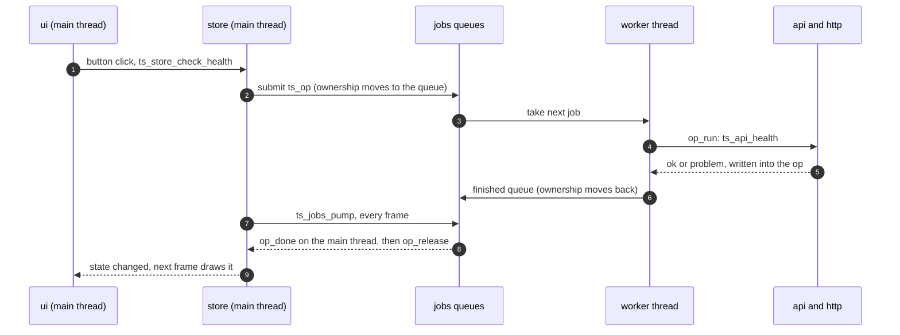

# 02. HTTP and JSON client

> **Draft: written but not yet run.** The code and the expected output in this lesson were prepared by reading the code and the official documentation. They have not been executed yet. If something does not behave as described, trust your tool's real output and report it.

## What you will be able to do
- Send an HTTP request with libcurl through one function that enforces TLS, timeouts, size caps and a URL policy.
- Turn JSON from a server into C structs without trusting a single field, and say who frees each block.
- Show an RFC 9457 problem details answer as one readable sentence plus field errors.
- Run slow work on a worker thread and hand the result back to the UI thread without a data race.

## Recap
1. In chapter 01, what does `ts_copy` return when the text is too long, and what is left in the destination? <details><summary>Answer</summary>`false`; a terminated string cut at a character boundary.</details>
2. What is a status code 404 versus 401? (platform primer 02) <details><summary>Answer</summary>404 means the thing was not found (or you may not see it); 401 means you are not signed in or your token is not valid.</details>

## Why it matters
Every byte that arrives from the network is written by someone else. A native client that trusts it (a string with no end, a number out of range, a 2 GB body) is a crash or an exploit waiting. This chapter builds the only door through which network data enters the program, and puts all the checks in that one doorway. It also keeps the window alive: a request that takes 20 seconds must not freeze the screen.

## What you will build
The connection panel: a "Test connection" button that calls `GET /health` and shows `status`, `database` and `version`, and a "Call GET /v1/me without a token" button that proves the error path by showing the 401 problem. The code also contains every API function the later chapters need (teams, projects, tasks) but no screen uses them yet. Requirements D-05 to D-08.



## Before you start
- **Chapter 01 done** and building. Keep the same `app` folder; this chapter replaces four files from chapter 01 (`CMakeLists.txt`, `src/store.h`, `src/store.c`, `src/ui.c`) and adds eight new ones. Unchanged files are listed in Step 1.
- **Time:** about 150 minutes in two sittings (break after Step 7).
- **A backend (optional for the first run).** Start the platform and one backend as its README says (`docker compose -p platform up -d --wait` in the platform capstone, then a backend capstone's run command). Without it the buttons show a "could not complete the request" problem, which is the transport error path and also worth seeing.
- The finished code is in `capstones/desktop-c/source/phase-2-http-json/02-http-and-json/code`.

## Steps
### Step 1. What stays and what changes
Keep these chapter 01 files byte for byte: `vcpkg.json`, `CMakePresets.json`, `.gitignore`, `src/util.h`, `src/util.c`, `src/config.h`, `src/config.c`, `src/nk_api.h`, `src/nk_impl.c`, `src/main.c`, `src/ui.h`. Replace: `CMakeLists.txt`, `src/store.h`, `src/store.c`, `src/ui.c`. New: `src/http.h`, `src/http.c`, `src/model.h`, `src/model.c`, `src/api.h`, `src/api.c`, `src/jobs.h`, `src/jobs.c`. `main.c` does not change because all new behaviour sits behind `ts_store_init`, `ts_store_pump` and `ts_store_shutdown`: that is what the store boundary is for.

### Step 2. `CMakeLists.txt`
New lines: `find_package` for curl and cJSON, a small block that picks the right cJSON target name, four more source files and two more libraries.

**File: `CMakeLists.txt`**
```cmake
cmake_minimum_required(VERSION 3.21)
project(tasksteams_desktop LANGUAGES C)

set(CMAKE_C_STANDARD 17)
set(CMAKE_C_STANDARD_REQUIRED ON)
set(CMAKE_C_EXTENSIONS OFF)

# Nuklear is one header plus an SDL3 renderer header in the same git repository.
# SOURCE_SUBDIR points at a folder that does not exist, so CMake downloads the
# repository but does not run Nuklear's own CMakeLists.txt.
include(FetchContent)
FetchContent_Declare(
  nuklear
  GIT_REPOSITORY https://github.com/Immediate-Mode-UI/Nuklear.git
  GIT_TAG        v4.13.4
  GIT_SHALLOW    TRUE
  SOURCE_SUBDIR  no-cmake-here
)
FetchContent_MakeAvailable(nuklear)

find_package(SDL3 CONFIG REQUIRED)
find_package(CURL CONFIG REQUIRED)
find_package(cJSON CONFIG REQUIRED)
# vcpkg's cJSON exports the target "cjson"; upstream's own config names it "cJSON::cJSON".
if(TARGET cjson)
  set(TS_CJSON_TARGET cjson)
elseif(TARGET cJSON::cJSON)
  set(TS_CJSON_TARGET cJSON::cJSON)
else()
  message(FATAL_ERROR "cJSON was found but exports neither cjson nor cJSON::cJSON")
endif()

add_executable(tasksteams
  src/main.c
  src/util.c
  src/config.c
  src/http.c
  src/model.c
  src/api.c
  src/jobs.c
  src/store.c
  src/ui.c
  src/nk_impl.c
)

target_include_directories(tasksteams PRIVATE src)
target_include_directories(tasksteams SYSTEM PRIVATE
  ${nuklear_SOURCE_DIR}
  ${nuklear_SOURCE_DIR}/demo/sdl3_renderer
)
target_link_libraries(tasksteams PRIVATE SDL3::SDL3 CURL::libcurl ${TS_CJSON_TARGET})
if(UNIX)
  target_link_libraries(tasksteams PRIVATE m)
endif()

if(MSVC)
  target_compile_options(tasksteams PRIVATE /W4 /utf-8 /external:W0)
  target_compile_definitions(tasksteams PRIVATE _CRT_SECURE_NO_WARNINGS)
  set_source_files_properties(src/nk_impl.c PROPERTIES COMPILE_OPTIONS /w)
else()
  target_compile_options(tasksteams PRIVATE -Wall -Wextra -Wpedantic)
  set_source_files_properties(src/nk_impl.c PROPERTIES COMPILE_OPTIONS -w)
endif()
```
`find_package(CURL CONFIG REQUIRED)` gives the imported target `CURL::libcurl`. The `if(TARGET ...)` block is defensive: the cJSON package from vcpkg and the one built from upstream name their target differently, and a clear message beats a linker error.

### Step 3. `src/http.h`, the contract of the doorway
Read the comments first: they are the rules. `ts_http_request` is **borrowed** input (pointers only valid during the call), `ts_http_response` **owns** its body.

**File: `src/http.h`**
```c
#ifndef TS_HTTP_H
#define TS_HTTP_H

#include <stdbool.h>
#include <stddef.h>

#include "util.h"

typedef enum { TS_HTTP_GET, TS_HTTP_POST, TS_HTTP_PATCH, TS_HTTP_DELETE } ts_method;

/* Everything the caller wants sent. All pointers are borrowed and only read during ts_http_send. */
typedef struct {
    ts_method method;
    const char *url;
    const char *bearer;          /* access token, or NULL */
    const char *if_match;        /* quoted ETag such as "3", or NULL */
    const char *idempotency_key; /* or NULL */
    const char *content_type;    /* or NULL: application/json */
    const char *body;            /* or NULL */
    size_t body_len;
} ts_http_request;

/* The answer. The response owns body; ts_http_response_free releases it. */
typedef struct {
    long status;           /* 0 when no HTTP answer arrived */
    ts_buf body;
    char etag[64];
    char content_type[96];
    long retry_after_s;    /* -1 when the header is absent */
    char error[160];       /* transport error text when status is 0 */
} ts_http_response;

bool ts_http_global_init(void);
void ts_http_global_cleanup(void);
void ts_http_cancel_all(void); /* running and later transfers fail at once; used at shutdown */

/* https anywhere; http only to localhost, 127.0.0.1 and [::1]; no user@host. */
bool ts_http_url_allowed(const char *url);

void ts_http_response_init(ts_http_response *r);
void ts_http_response_free(ts_http_response *r); /* releases the body and resets r for reuse */

/* Blocking. true = an HTTP answer arrived (any status, see res->status); false = transport
   failure or policy refusal (res->error says why). res must have been initialised. */
bool ts_http_send(const ts_http_request *req, ts_http_response *res);

/* Percent-encoding. ts_url_encode returns a new string the caller frees with ts_free.
   ts_url_decode works in place (and turns '+' into a space, as in form data). */
char *ts_url_encode(const char *s);
void ts_url_decode(char *s);

#endif
```

### Step 4. `src/http.c`
**File: `src/http.c`**
```c
#include "http.h"

#include <SDL3/SDL.h>
#include <ctype.h>
#include <curl/curl.h>
#include <stdint.h>
#include <stdio.h>
#include <stdlib.h>
#include <string.h>

#define MAX_BODY_BYTES (4u * 1024u * 1024u)
#define MAX_REQUEST_BYTES (64u * 1024u)

static SDL_AtomicInt g_cancel;

bool ts_http_global_init(void) {
    return curl_global_init(CURL_GLOBAL_DEFAULT) == CURLE_OK;
}

void ts_http_global_cleanup(void) {
    curl_global_cleanup();
}

void ts_http_cancel_all(void) {
    SDL_SetAtomicInt(&g_cancel, 1);
}

static bool equals_nocase(const char *a, const char *b) {
    while (*a != '\0' && *b != '\0') {
        if (tolower((unsigned char)*a) != tolower((unsigned char)*b)) return false;
        a++;
        b++;
    }
    return *a == *b;
}

bool ts_http_url_allowed(const char *url) {
    if (url == NULL) return false;
    if (strncmp(url, "https://", 8) == 0) return url[8] != '\0';
    if (strncmp(url, "http://", 7) != 0) return false;

    const char *authority = url + 7;
    size_t alen = strcspn(authority, "/?#");
    if (alen == 0 || memchr(authority, '@', alen) != NULL) return false;

    size_t hlen;
    if (authority[0] == '[') {
        const char *close = memchr(authority, ']', alen);
        if (close == NULL) return false;
        hlen = (size_t)(close - authority) + 1;
    } else {
        const char *colon = memchr(authority, ':', alen);
        hlen = colon != NULL ? (size_t)(colon - authority) : alen;
    }
    char host[64];
    if (hlen == 0 || hlen >= sizeof host) return false;
    memcpy(host, authority, hlen);
    host[hlen] = '\0';
    return equals_nocase(host, "localhost") || strcmp(host, "127.0.0.1") == 0 || strcmp(host, "[::1]") == 0;
}

void ts_http_response_init(ts_http_response *r) {
    memset(r, 0, sizeof *r);
    r->retry_after_s = -1;
}

void ts_http_response_free(ts_http_response *r) {
    ts_buf_free(&r->body);
    ts_http_response_init(r);
}

static bool header_value(const char *line, size_t n, const char *name, char *out, size_t cap) {
    size_t name_len = strlen(name);
    if (n <= name_len || line[name_len] != ':') return false;
    for (size_t i = 0; i < name_len; i++) {
        if (tolower((unsigned char)line[i]) != tolower((unsigned char)name[i])) return false;
    }
    const char *v = line + name_len + 1;
    const char *end = line + n;
    while (v < end && (*v == ' ' || *v == '\t')) v++;
    while (end > v && (end[-1] == '\r' || end[-1] == '\n' || end[-1] == ' ')) end--;
    size_t len = (size_t)(end - v);
    if (len >= cap) len = cap - 1;
    memcpy(out, v, len);
    out[len] = '\0';
    return true;
}

static size_t on_header(char *line, size_t size, size_t nitems, void *userdata) {
    ts_http_response *r = userdata;
    size_t n = size * nitems;
    char value[128];
    if (header_value(line, n, "ETag", value, sizeof value)) {
        ts_copy(r->etag, sizeof r->etag, value);
    } else if (header_value(line, n, "Content-Type", value, sizeof value)) {
        ts_copy(r->content_type, sizeof r->content_type, value);
    } else if (header_value(line, n, "Retry-After", value, sizeof value)) {
        char *end = NULL;
        long seconds = strtol(value, &end, 10);
        if (end != value && seconds >= 0 && seconds <= 86400) r->retry_after_s = seconds;
    }
    return n;
}

static size_t on_body(char *data, size_t size, size_t nmemb, void *userdata) {
    ts_buf *body = userdata;
    size_t n = size * nmemb;
    /* Returning less than n makes curl stop with CURLE_WRITE_ERROR: the 4 MiB cap. */
    return ts_buf_append(body, data, n, MAX_BODY_BYTES) ? n : 0;
}

static int on_progress(void *userdata, curl_off_t dltotal, curl_off_t dlnow, curl_off_t ultotal, curl_off_t ulnow) {
    (void)userdata;
    (void)dltotal;
    (void)dlnow;
    (void)ultotal;
    (void)ulnow;
    return SDL_GetAtomicInt(&g_cancel) != 0 ? 1 : 0; /* non-zero aborts the transfer */
}

/* Adds "name: prefix value". The temporary line may contain a token, so it is wiped. */
static bool add_header(struct curl_slist **list, const char *name, const char *prefix, const char *value) {
    size_t n = strlen(name) + strlen(prefix) + strlen(value) + 3;
    char *line = ts_malloc(n);
    if (line == NULL) return false;
    if (!ts_setf(line, n, "%s: %s%s", name, prefix, value)) {
        ts_secure_free(line);
        return false;
    }
    struct curl_slist *grown = curl_slist_append(*list, line);
    ts_secure_free(line); /* curl copied it; this copy may hold a token */
    if (grown == NULL) return false;
    *list = grown;
    return true;
}

static void fail(ts_http_response *res, const char *text) {
    ts_copy(res->error, sizeof res->error, text);
    res->status = 0;
}

bool ts_http_send(const ts_http_request *req, ts_http_response *res) {
    if (!ts_http_url_allowed(req->url)) {
        fail(res, "Blocked: use https, or http to localhost only.");
        return false;
    }
    if (req->body_len > MAX_REQUEST_BYTES) {
        fail(res, "Request body is too large.");
        return false;
    }
    if (SDL_GetAtomicInt(&g_cancel) != 0) {
        fail(res, "Cancelled.");
        return false;
    }
    CURL *h = curl_easy_init();
    if (h == NULL) {
        fail(res, "Could not start a transfer.");
        return false;
    }

    struct curl_slist *headers = NULL;
    bool ok = add_header(&headers, "Accept", "", "application/json");
    if (ok && req->bearer != NULL) ok = add_header(&headers, "Authorization", "Bearer ", req->bearer);
    if (ok && req->if_match != NULL) ok = add_header(&headers, "If-Match", "", req->if_match);
    if (ok && req->idempotency_key != NULL) ok = add_header(&headers, "Idempotency-Key", "", req->idempotency_key);
    if (ok && (req->method == TS_HTTP_POST || req->method == TS_HTTP_PATCH)) {
        ok = add_header(&headers, "Content-Type", "", req->content_type != NULL ? req->content_type : "application/json");
    }
    if (!ok) {
        curl_slist_free_all(headers);
        curl_easy_cleanup(h);
        fail(res, "Out of memory while building the request.");
        return false;
    }

    curl_easy_setopt(h, CURLOPT_URL, req->url);
    curl_easy_setopt(h, CURLOPT_HTTPHEADER, headers);
    curl_easy_setopt(h, CURLOPT_USERAGENT, "TasksTeamsDesktop/1.0");
    curl_easy_setopt(h, CURLOPT_NOSIGNAL, 1L);
    curl_easy_setopt(h, CURLOPT_FOLLOWLOCATION, 0L);
    curl_easy_setopt(h, CURLOPT_PROTOCOLS_STR, "http,https");
    curl_easy_setopt(h, CURLOPT_CONNECTTIMEOUT_MS, 5000L);
    curl_easy_setopt(h, CURLOPT_TIMEOUT_MS, 20000L);
    curl_easy_setopt(h, CURLOPT_ACCEPT_ENCODING, ""); /* let curl decode gzip; the 4 MiB cap counts decoded bytes */
    /* TLS: verification is on by default; the next three lines only make that visible. */
    curl_easy_setopt(h, CURLOPT_SSL_VERIFYPEER, 1L);
    curl_easy_setopt(h, CURLOPT_SSL_VERIFYHOST, 2L);
    curl_easy_setopt(h, CURLOPT_SSLVERSION, (long)CURL_SSLVERSION_TLSv1_2);
    curl_easy_setopt(h, CURLOPT_WRITEFUNCTION, on_body);
    curl_easy_setopt(h, CURLOPT_WRITEDATA, &res->body);
    curl_easy_setopt(h, CURLOPT_HEADERFUNCTION, on_header);
    curl_easy_setopt(h, CURLOPT_HEADERDATA, res);
    curl_easy_setopt(h, CURLOPT_NOPROGRESS, 0L);
    curl_easy_setopt(h, CURLOPT_XFERINFOFUNCTION, on_progress);

    switch (req->method) {
    case TS_HTTP_GET:
        break;
    case TS_HTTP_POST:
        curl_easy_setopt(h, CURLOPT_POST, 1L);
        break;
    case TS_HTTP_PATCH:
        curl_easy_setopt(h, CURLOPT_CUSTOMREQUEST, "PATCH");
        break;
    case TS_HTTP_DELETE:
        curl_easy_setopt(h, CURLOPT_CUSTOMREQUEST, "DELETE");
        break;
    }
    if (req->method == TS_HTTP_POST || req->method == TS_HTTP_PATCH) {
        curl_easy_setopt(h, CURLOPT_POSTFIELDS, req->body != NULL ? req->body : "");
        curl_easy_setopt(h, CURLOPT_POSTFIELDSIZE_LARGE, (curl_off_t)req->body_len);
    }

    CURLcode rc = curl_easy_perform(h);
    bool got_answer = false;
    if (rc == CURLE_OK) {
        long status = 0;
        curl_easy_getinfo(h, CURLINFO_RESPONSE_CODE, &status);
        res->status = status;
        got_answer = true;
    } else if (rc == CURLE_ABORTED_BY_CALLBACK) {
        fail(res, "Cancelled.");
    } else if (rc == CURLE_WRITE_ERROR) {
        fail(res, "The response was too large or memory ran out.");
    } else {
        fail(res, curl_easy_strerror(rc));
    }

    curl_slist_free_all(headers);
    curl_easy_cleanup(h);
    return got_answer;
}

static bool is_unreserved(unsigned char c) {
    return isalnum(c) || c == '-' || c == '.' || c == '_' || c == '~';
}

char *ts_url_encode(const char *s) {
    size_t len = strlen(s);
    if (len > (SIZE_MAX - 1) / 3) return NULL; /* 3 * len + 1 would wrap around */
    char *out = ts_malloc(len * 3 + 1);
    if (out == NULL) return NULL;
    static const char hex[] = "0123456789ABCDEF";
    size_t o = 0;
    for (size_t i = 0; i < len; i++) {
        unsigned char c = (unsigned char)s[i];
        if (is_unreserved(c)) {
            out[o++] = (char)c;
        } else {
            out[o++] = '%';
            out[o++] = hex[c >> 4];
            out[o++] = hex[c & 15];
        }
    }
    out[o] = '\0';
    return out;
}

static int hex_value(char c) {
    if (c >= '0' && c <= '9') return c - '0';
    if (c >= 'a' && c <= 'f') return c - 'a' + 10;
    if (c >= 'A' && c <= 'F') return c - 'A' + 10;
    return -1;
}

void ts_url_decode(char *s) {
    char *w = s;
    for (const char *r = s; *r != '\0'; r++) {
        if (*r == '%' && hex_value(r[1]) >= 0 && hex_value(r[2]) >= 0) {
            *w++ = (char)(hex_value(r[1]) * 16 + hex_value(r[2]));
            r += 2;
        } else if (*r == '+') {
            *w++ = ' ';
        } else {
            *w++ = *r;
        }
    }
    *w = '\0';
}
```
Things to notice before moving on (explained again in "How it works"): the policy check comes first; the transfer is never allowed to follow a redirect; every limit is a named number; the temporary header line that may hold a token is wiped; and `(SIZE_MAX - 1) / 3` guards the multiplication.

### Step 5. `src/model.h`
The structs are the program's vocabulary. Notice which fields are inline arrays (bounded, copied) and which one is a pointer (`description`, owned).

**File: `src/model.h`**
```c
#ifndef TS_MODEL_H
#define TS_MODEL_H

#include <stdbool.h>
#include <stddef.h>

#include "util.h"

#define TS_ID_LEN 40
#define TS_TITLE_LEN 808     /* 200 characters at up to 4 bytes each, plus the terminator */
#define TS_DESC_FORM_LEN 4096
#define TS_CURSOR_LEN 256

/* ---- A small generic vector. It owns its items and the destructor says how to free one. ---- */
typedef void (*ts_free_item_fn)(void *item);

typedef struct {
    void *items;
    size_t len;
    size_t cap;
    size_t elem_size;
    ts_free_item_fn free_item; /* may be NULL for plain structs */
} ts_vec;

void ts_vec_init(ts_vec *v, size_t elem_size, ts_free_item_fn free_item);
bool ts_vec_push(ts_vec *v, const void *elem); /* copies the bytes: the caller must not free elem again */
void *ts_vec_at(const ts_vec *v, size_t i);
void ts_vec_remove(ts_vec *v, size_t i);       /* frees item i and closes the gap */
void ts_vec_free(ts_vec *v);

/* ---- Problem details (RFC 9457) ---- */
#define TS_PROBLEM_FIELDS 6

typedef struct {
    char pointer[64];
    char detail[128];
} ts_field_error;

typedef struct {
    long status; /* HTTP status; 0 = no answer arrived (transport failure) */
    char type[128];
    char title[128];
    char detail[256];
    char trace_id[64];
    long retry_after_s; /* -1 = none */
    ts_field_error fields[TS_PROBLEM_FIELDS];
    int field_count;
} ts_problem;

void ts_problem_clear(ts_problem *p);
void ts_problem_transport(ts_problem *p, const char *text);
void ts_problem_add_field(ts_problem *p, const char *pointer, const char *detail);
void ts_problem_parse(const char *body, size_t len, long status, const char *content_type, long retry_after_s,
                      ts_problem *p);
void ts_problem_message(const ts_problem *p, char *out, size_t cap); /* one user-facing sentence */

/* ---- Domain records. Display-only text is bounded and may be cut; edited text never is. ---- */
typedef struct {
    char status[16];
    char database[16];
    char version[32];
} ts_health;

typedef struct {
    char id[TS_ID_LEN];
    char username[64];
    char display_name[128];
    char email[128];
    char roles[96];
} ts_me;

typedef struct {
    char id[TS_ID_LEN];
    char name[96];
    char description[512];
    int member_count;
    long version;
} ts_team;

typedef struct {
    char id[TS_ID_LEN];
    char key[16];
    char name[128];
    bool archived;
    long version;
} ts_project;

typedef struct {
    char id[TS_ID_LEN];
    char project_id[TS_ID_LEN];
    char title[TS_TITLE_LEN];
    char *description; /* owned: freed by ts_task_free */
    char status[16];
    char priority[16];
    char assignee_id[TS_ID_LEN];
    char due_date[16];
    char completed_at[40];
    long version;
} ts_task;

void ts_task_free(ts_task *t); /* frees description and resets t to zero */
bool ts_task_clone(ts_task *dst, const ts_task *src);

typedef struct {
    ts_vec items;
    char next_cursor[TS_CURSOR_LEN]; /* opaque; empty = last page */
} ts_page;

void ts_page_init_teams(ts_page *p);
void ts_page_init_projects(ts_page *p);
void ts_page_init_tasks(ts_page *p);
void ts_page_free(ts_page *p);

/* Parsers: json is not NUL-terminated (len bytes). true = parsed; the out value then owns its memory.
   On false nothing is owned by out. */
bool ts_parse_health(const char *json, size_t len, ts_health *out);
bool ts_parse_me(const char *json, size_t len, ts_me *out);
bool ts_parse_team_page(const char *json, size_t len, ts_page *out);
bool ts_parse_project_page(const char *json, size_t len, ts_page *out);
bool ts_parse_task_page(const char *json, size_t len, ts_page *out);
bool ts_parse_task(const char *json, size_t len, ts_task *out);

/* ---- The task form's data and its checks ---- */
typedef struct {
    char title[TS_TITLE_LEN];
    char description[TS_DESC_FORM_LEN];
    char status[16];
    char priority[16];
    char due_date[16]; /* "" = none */
} ts_task_draft;

#define TS_F_TITLE 1u
#define TS_F_DESCRIPTION 2u
#define TS_F_STATUS 4u
#define TS_F_PRIORITY 8u
#define TS_F_DUE 16u

extern const char *const TS_STATUSES[5];
extern const char *const TS_PRIORITIES[4];

/* Copies a task into a draft. false = the description did not fit the form buffer. */
bool ts_draft_from_task(ts_task_draft *d, const ts_task *t);
/* Checks only the fields in mask against the OpenAPI limits. false fills err like a 422. */
bool ts_draft_validate(const ts_task_draft *d, unsigned mask, ts_problem *err);

#endif
```

### Step 6. `src/model.c`
**File: `src/model.c`**
```c
#include "model.h"

#include <cjson/cJSON.h>
#include <stdint.h>
#include <string.h>

const char *const TS_STATUSES[5] = {"todo", "in_progress", "blocked", "done", "cancelled"};
const char *const TS_PRIORITIES[4] = {"low", "medium", "high", "urgent"};

/* ---------------------------------------------------------------- vector */

void ts_vec_init(ts_vec *v, size_t elem_size, ts_free_item_fn free_item) {
    v->items = NULL;
    v->len = 0;
    v->cap = 0;
    v->elem_size = elem_size;
    v->free_item = free_item;
}

bool ts_vec_push(ts_vec *v, const void *elem) {
    if (v->len == v->cap) {
        if (v->cap > SIZE_MAX / 2) return false;
        size_t cap = v->cap != 0 ? v->cap * 2 : 8;
        if (cap > SIZE_MAX / v->elem_size) return false;
        void *grown = ts_realloc(v->items, cap * v->elem_size);
        if (grown == NULL) return false; /* v->items is untouched and still owned by v */
        v->items = grown;
        v->cap = cap;
    }
    memcpy((char *)v->items + v->len * v->elem_size, elem, v->elem_size);
    v->len++;
    return true;
}

void *ts_vec_at(const ts_vec *v, size_t i) {
    return i < v->len ? (char *)v->items + i * v->elem_size : NULL;
}

void ts_vec_remove(ts_vec *v, size_t i) {
    if (i >= v->len) return;
    char *base = v->items;
    if (v->free_item != NULL) v->free_item(base + i * v->elem_size);
    memmove(base + i * v->elem_size, base + (i + 1) * v->elem_size, (v->len - i - 1) * v->elem_size);
    v->len--;
}

void ts_vec_free(ts_vec *v) {
    if (v->free_item != NULL) {
        for (size_t i = 0; i < v->len; i++) v->free_item((char *)v->items + i * v->elem_size);
    }
    ts_free(v->items);
    v->items = NULL;
    v->len = 0;
    v->cap = 0;
}

/* ---------------------------------------------------------------- JSON helpers */

static void get_str(const cJSON *obj, const char *key, char *dst, size_t cap) {
    const cJSON *item = cJSON_GetObjectItemCaseSensitive(obj, key);
    if (cJSON_IsString(item) && item->valuestring != NULL) {
        ts_copy(dst, cap, item->valuestring); /* display text: a cut is acceptable here */
    } else {
        dst[0] = '\0';
    }
}

static long get_long(const cJSON *obj, const char *key) {
    const cJSON *item = cJSON_GetObjectItemCaseSensitive(obj, key);
    if (!cJSON_IsNumber(item)) return 0;
    double d = item->valuedouble;
    return (d >= 0.0 && d <= 2147483647.0) ? (long)d : 0;
}

static bool get_bool(const cJSON *obj, const char *key) {
    return cJSON_IsTrue(cJSON_GetObjectItemCaseSensitive(obj, key));
}

/* ---------------------------------------------------------------- problem details */

static const struct {
    const char *suffix;
    const char *text;
} MESSAGES[] = {
    {"bad-request", "The request was not understood. Reload and try again."},
    {"unauthorized", "Your session has ended. Sign in again."},
    {"forbidden", "You are not allowed to do that."},
    {"not-found", "That item no longer exists, or you cannot see it."},
    {"conflict", "That conflicts with existing data (a duplicate or a broken rule)."},
    {"precondition-failed", "Someone else changed this item. Review their version before saving."},
    {"validation-error", "Some fields are not valid."},
    {"precondition-required", "The app did not send a version (a bug). Reload and try again."},
    {"rate-limited", "Too many requests. Wait a moment."},
    {"payload-too-large", "The request is too large."},
    {"internal-error", "The server failed. Try again later and quote the trace id."},
};

void ts_problem_clear(ts_problem *p) {
    memset(p, 0, sizeof *p);
    p->retry_after_s = -1;
}

void ts_problem_transport(ts_problem *p, const char *text) {
    ts_problem_clear(p);
    ts_copy(p->detail, sizeof p->detail, text);
}

void ts_problem_add_field(ts_problem *p, const char *pointer, const char *detail) {
    if (p->field_count >= TS_PROBLEM_FIELDS) return;
    ts_field_error *f = &p->fields[p->field_count++];
    ts_copy(f->pointer, sizeof f->pointer, pointer);
    ts_copy(f->detail, sizeof f->detail, detail);
}

void ts_problem_parse(const char *body, size_t len, long status, const char *content_type, long retry_after_s,
                      ts_problem *p) {
    ts_problem_clear(p);
    p->status = status;
    p->retry_after_s = retry_after_s;

    cJSON *root = NULL;
    if (content_type != NULL && strstr(content_type, "json") != NULL) root = cJSON_ParseWithLength(body, len);
    if (root != NULL) {
        get_str(root, "type", p->type, sizeof p->type);
        get_str(root, "title", p->title, sizeof p->title);
        get_str(root, "detail", p->detail, sizeof p->detail);
        get_str(root, "traceId", p->trace_id, sizeof p->trace_id);
        const cJSON *errors = cJSON_GetObjectItemCaseSensitive(root, "errors");
        const cJSON *e;
        cJSON_ArrayForEach(e, errors) {
            char pointer[64], detail[128];
            get_str(e, "pointer", pointer, sizeof pointer);
            get_str(e, "detail", detail, sizeof detail);
            ts_problem_add_field(p, pointer, detail);
        }
    }
    cJSON_Delete(root); /* NULL is allowed */
    if (p->title[0] == '\0') ts_setf(p->title, sizeof p->title, "HTTP %ld", status);
}

void ts_problem_message(const ts_problem *p, char *out, size_t cap) {
    if (p->status == 0) {
        ts_setf(out, cap, "Could not complete the request: %s", p->detail);
        return;
    }
    const char *slash = strrchr(p->type, '/');
    const char *suffix = slash != NULL ? slash + 1 : p->type;
    const char *text = NULL;
    for (size_t i = 0; i < sizeof MESSAGES / sizeof MESSAGES[0]; i++) {
        if (strcmp(suffix, MESSAGES[i].suffix) == 0) {
            text = MESSAGES[i].text;
            break;
        }
    }
    ts_setf(out, cap, "%s (HTTP %ld)", text != NULL ? text : p->title, p->status);
    if (p->retry_after_s >= 0) ts_catf(out, cap, " Try again in %ld s.", p->retry_after_s);
}

/* ---------------------------------------------------------------- records */

void ts_task_free(ts_task *t) {
    ts_free(t->description);
    memset(t, 0, sizeof *t);
}

bool ts_task_clone(ts_task *dst, const ts_task *src) {
    *dst = *src; /* copies the pointer too: replace it by a private copy */
    dst->description = ts_strdup(src->description != NULL ? src->description : "");
    if (dst->description == NULL) {
        memset(dst, 0, sizeof *dst);
        return false;
    }
    return true;
}

static void task_free_item(void *item) {
    ts_task_free(item);
}

void ts_page_init_teams(ts_page *p) {
    ts_vec_init(&p->items, sizeof(ts_team), NULL);
    p->next_cursor[0] = '\0';
}

void ts_page_init_projects(ts_page *p) {
    ts_vec_init(&p->items, sizeof(ts_project), NULL);
    p->next_cursor[0] = '\0';
}

void ts_page_init_tasks(ts_page *p) {
    ts_vec_init(&p->items, sizeof(ts_task), task_free_item);
    p->next_cursor[0] = '\0';
}

void ts_page_free(ts_page *p) {
    ts_vec_free(&p->items);
    p->next_cursor[0] = '\0';
}

/* ---------------------------------------------------------------- parsers */

static bool team_from_json(const cJSON *o, void *out) {
    ts_team *t = out;
    memset(t, 0, sizeof *t);
    if (!cJSON_IsObject(o)) return false;
    get_str(o, "id", t->id, sizeof t->id);
    get_str(o, "name", t->name, sizeof t->name);
    get_str(o, "description", t->description, sizeof t->description);
    t->member_count = (int)get_long(o, "memberCount");
    t->version = get_long(o, "version");
    return t->id[0] != '\0';
}

static bool project_from_json(const cJSON *o, void *out) {
    ts_project *p = out;
    memset(p, 0, sizeof *p);
    if (!cJSON_IsObject(o)) return false;
    get_str(o, "id", p->id, sizeof p->id);
    get_str(o, "key", p->key, sizeof p->key);
    get_str(o, "name", p->name, sizeof p->name);
    p->archived = get_bool(o, "archived");
    p->version = get_long(o, "version");
    return p->id[0] != '\0';
}

static bool task_from_json(const cJSON *o, void *out) {
    ts_task *t = out;
    memset(t, 0, sizeof *t);
    if (!cJSON_IsObject(o)) return false;
    get_str(o, "id", t->id, sizeof t->id);
    get_str(o, "projectId", t->project_id, sizeof t->project_id);
    get_str(o, "title", t->title, sizeof t->title);
    get_str(o, "status", t->status, sizeof t->status);
    get_str(o, "priority", t->priority, sizeof t->priority);
    get_str(o, "assigneeId", t->assignee_id, sizeof t->assignee_id);
    get_str(o, "dueDate", t->due_date, sizeof t->due_date);
    get_str(o, "completedAt", t->completed_at, sizeof t->completed_at);
    t->version = get_long(o, "version");
    const cJSON *d = cJSON_GetObjectItemCaseSensitive(o, "description");
    t->description = ts_strdup(cJSON_IsString(d) && d->valuestring != NULL ? d->valuestring : "");
    if (t->description == NULL) return false;
    if (t->id[0] == '\0' || t->version < 1) { /* the app cannot work with a task without id and version */
        ts_task_free(t);
        return false;
    }
    return true;
}

typedef bool (*item_parse_fn)(const cJSON *o, void *out);

static bool parse_page(const char *json, size_t len, ts_page *page, item_parse_fn parse_item) {
    cJSON *root = cJSON_ParseWithLength(json, len);
    if (root == NULL) return false;
    const cJSON *items = cJSON_GetObjectItemCaseSensitive(root, "items");
    bool ok = cJSON_IsArray(items);
    if (ok) {
        const cJSON *it;
        cJSON_ArrayForEach(it, items) {
            union {
                ts_team team;
                ts_project project;
                ts_task task;
            } scratch;
            if (!parse_item(it, &scratch)) {
                ok = false;
                break;
            }
            if (!ts_vec_push(&page->items, &scratch)) {
                if (page->items.free_item != NULL) page->items.free_item(&scratch);
                ok = false;
                break;
            }
            /* scratch was moved into the vector: it must not be freed again */
        }
    }
    if (ok) {
        const cJSON *info = cJSON_GetObjectItemCaseSensitive(root, "page");
        const cJSON *next = cJSON_GetObjectItemCaseSensitive(info, "nextCursor");
        if (cJSON_IsString(next) && next->valuestring != NULL) {
            ok = ts_copy(page->next_cursor, sizeof page->next_cursor, next->valuestring);
        }
    }
    cJSON_Delete(root);
    if (!ok) ts_page_free(page);
    return ok;
}

bool ts_parse_team_page(const char *json, size_t len, ts_page *out) {
    ts_page_init_teams(out);
    return parse_page(json, len, out, team_from_json);
}

bool ts_parse_project_page(const char *json, size_t len, ts_page *out) {
    ts_page_init_projects(out);
    return parse_page(json, len, out, project_from_json);
}

bool ts_parse_task_page(const char *json, size_t len, ts_page *out) {
    ts_page_init_tasks(out);
    return parse_page(json, len, out, task_from_json);
}

bool ts_parse_task(const char *json, size_t len, ts_task *out) {
    cJSON *root = cJSON_ParseWithLength(json, len);
    if (root == NULL) return false;
    bool ok = task_from_json(root, out);
    cJSON_Delete(root);
    return ok;
}

bool ts_parse_health(const char *json, size_t len, ts_health *out) {
    memset(out, 0, sizeof *out);
    cJSON *root = cJSON_ParseWithLength(json, len);
    if (root == NULL) return false;
    get_str(root, "status", out->status, sizeof out->status);
    get_str(root, "database", out->database, sizeof out->database);
    get_str(root, "version", out->version, sizeof out->version);
    bool ok = cJSON_IsObject(root) && out->status[0] != '\0';
    cJSON_Delete(root);
    return ok;
}

bool ts_parse_me(const char *json, size_t len, ts_me *out) {
    memset(out, 0, sizeof *out);
    cJSON *root = cJSON_ParseWithLength(json, len);
    if (root == NULL) return false;
    get_str(root, "id", out->id, sizeof out->id);
    get_str(root, "username", out->username, sizeof out->username);
    get_str(root, "displayName", out->display_name, sizeof out->display_name);
    get_str(root, "email", out->email, sizeof out->email);
    const cJSON *role;
    cJSON_ArrayForEach(role, cJSON_GetObjectItemCaseSensitive(root, "roles")) {
        if (cJSON_IsString(role) && role->valuestring != NULL) {
            ts_catf(out->roles, sizeof out->roles, "%s%s", out->roles[0] != '\0' ? ", " : "", role->valuestring);
        }
    }
    bool ok = cJSON_IsObject(root) && out->id[0] != '\0';
    cJSON_Delete(root);
    return ok;
}

/* ---------------------------------------------------------------- drafts */

bool ts_draft_from_task(ts_task_draft *d, const ts_task *t) {
    memset(d, 0, sizeof *d);
    ts_copy(d->title, sizeof d->title, t->title);
    ts_copy(d->status, sizeof d->status, t->status);
    ts_copy(d->priority, sizeof d->priority, t->priority);
    ts_copy(d->due_date, sizeof d->due_date, t->due_date);
    return ts_copy(d->description, sizeof d->description, t->description != NULL ? t->description : "");
}

static size_t utf8_length(const char *s) {
    size_t n = 0;
    for (; *s != '\0'; s++) {
        if (((unsigned char)*s & 0xC0) != 0x80) n++;
    }
    return n;
}

static bool in_list(const char *value, const char *const *list, size_t count) {
    for (size_t i = 0; i < count; i++) {
        if (strcmp(value, list[i]) == 0) return true;
    }
    return false;
}

static bool is_date(const char *s) {
    if (strlen(s) != 10) return false;
    for (int i = 0; i < 10; i++) {
        if (i == 4 || i == 7) {
            if (s[i] != '-') return false;
        } else if (s[i] < '0' || s[i] > '9') {
            return false;
        }
    }
    int month = (s[5] - '0') * 10 + (s[6] - '0');
    int day = (s[8] - '0') * 10 + (s[9] - '0');
    return month >= 1 && month <= 12 && day >= 1 && day <= 31;
}

bool ts_draft_validate(const ts_task_draft *d, unsigned mask, ts_problem *err) {
    ts_problem_clear(err);
    err->status = 422;
    ts_copy(err->type, sizeof err->type, "https://code101.example/problems/validation-error");
    ts_copy(err->title, sizeof err->title, "Some fields are not valid");

    if ((mask & TS_F_TITLE) != 0) {
        size_t n = utf8_length(d->title);
        if (n < 1 || n > 200) ts_problem_add_field(err, "/title", "Use 1 to 200 characters.");
    }
    if ((mask & TS_F_STATUS) != 0 && !in_list(d->status, TS_STATUSES, 5)) {
        ts_problem_add_field(err, "/status", "Choose one of the listed statuses.");
    }
    if ((mask & TS_F_PRIORITY) != 0 && !in_list(d->priority, TS_PRIORITIES, 4)) {
        ts_problem_add_field(err, "/priority", "Choose one of the listed priorities.");
    }
    if ((mask & TS_F_DUE) != 0 && d->due_date[0] != '\0' && !is_date(d->due_date)) {
        ts_problem_add_field(err, "/dueDate", "Use the form YYYY-MM-DD, or leave it empty.");
    }
    if (err->field_count == 0) {
        ts_problem_clear(err);
        return true;
    }
    return false;
}
```
The draft helpers at the end are used in chapter 04; they are here because they are model code (pure data checks).

### Step 7. `src/api.h` and `src/api.c`
`ts_api` is a tiny object: a base URL and an optional **token provider** function. In this chapter the provider is `NULL` (nobody is signed in); chapter 03 plugs one in without touching `api.c`.

**File: `src/api.h`**
```c
#ifndef TS_API_H
#define TS_API_H

#include <stdbool.h>

#include "http.h"
#include "model.h"

/* Returns a bearer token as a new string (free with ts_secure_free), or NULL when there is none.
   force_refresh asks for a fresh token after a 401. May be called from the worker thread. */
typedef char *(*ts_token_fn)(void *ctx, bool force_refresh);

typedef struct {
    const char *base; /* "http://localhost:8000": borrowed, outlives the api */
    ts_token_fn token;
    void *token_ctx;
} ts_api;

/* Ownership for every function below: on true the out value belongs to the caller
   (ts_page_free, ts_task_free); on false nothing is owned and err describes the problem. */
bool ts_api_health(const ts_api *api, ts_health *out, ts_problem *err);
bool ts_api_me(const ts_api *api, ts_me *out, ts_problem *err);
bool ts_api_list_teams(const ts_api *api, ts_page *out, ts_problem *err);
bool ts_api_list_projects(const ts_api *api, const char *team_id, ts_page *out, ts_problem *err);
/* status may be NULL or "" for all; cursor may be NULL or "" for the first page and is passed through untouched. */
bool ts_api_list_tasks(const ts_api *api, const char *project_id, const char *status, const char *cursor,
                       ts_page *out, ts_problem *err);
bool ts_api_get_task(const ts_api *api, const char *task_id, ts_task *out, ts_problem *err);
bool ts_api_create_task(const ts_api *api, const char *project_id, const ts_task_draft *draft,
                        const char *idempotency_key, ts_task *out, ts_problem *err);
/* mask names the changed fields (TS_F_*): only those go into the merge patch. */
bool ts_api_update_task(const ts_api *api, const char *task_id, long version, const ts_task_draft *draft,
                        unsigned mask, ts_task *out, ts_problem *err);
bool ts_api_complete_task(const ts_api *api, const char *task_id, long version, ts_task *out, ts_problem *err);
bool ts_api_delete_task(const ts_api *api, const char *task_id, long version, ts_problem *err);

/* An id from the server is only put into a URL after this check: 1 to 36 of [A-Za-z0-9-]. */
bool ts_valid_id(const char *s);

#endif
```
**File: `src/api.c`**
```c
#include "api.h"

#include <cjson/cJSON.h>
#include <ctype.h>
#include <string.h>

#define TS_URL_MAX 2048

bool ts_valid_id(const char *s) {
    if (s == NULL) return false;
    size_t n = strlen(s);
    if (n == 0 || n > 36) return false;
    for (size_t i = 0; i < n; i++) {
        if (!isalnum((unsigned char)s[i]) && s[i] != '-') return false;
    }
    return true;
}

static bool bad_url(ts_problem *err) {
    ts_problem_transport(err, "The address or an id is not valid.");
    return false;
}

static bool out_of_memory(ts_problem *err) {
    ts_problem_transport(err, "Out of memory.");
    return false;
}

/* One request with the bearer token. After a 401 it asks for a fresh token and tries once more.
   true = a 2xx answer is in res (the caller frees it). false = err is filled and res is already freed. */
static bool call(const ts_api *api, ts_http_request req, ts_http_response *res, ts_problem *err) {
    for (int attempt = 0; attempt < 2; attempt++) {
        char *token = api->token != NULL ? api->token(api->token_ctx, attempt == 1) : NULL;
        req.bearer = token;
        bool answered = ts_http_send(&req, res);
        ts_secure_free(token);
        if (!answered) {
            ts_problem_transport(err, res->error);
            ts_http_response_free(res);
            return false;
        }
        if (res->status == 401 && attempt == 0 && api->token != NULL) {
            ts_http_response_free(res);
            continue;
        }
        break;
    }
    if (res->status >= 200 && res->status < 300) return true;
    ts_problem_parse(ts_buf_cstr(&res->body), res->body.len, res->status, res->content_type, res->retry_after_s, err);
    ts_http_response_free(res);
    return false;
}

static bool finish(bool parsed, ts_http_response *res, ts_problem *err) {
    ts_http_response_free(res);
    if (!parsed) ts_problem_transport(err, "The server sent an answer the app could not read.");
    return parsed;
}

/* Builds the JSON text of a draft for the fields in mask. Free the result with cJSON_free. */
static char *draft_json(const ts_task_draft *d, unsigned mask) {
    cJSON *o = cJSON_CreateObject();
    if (o == NULL) return NULL;
    bool ok = true;
    if (ok && (mask & TS_F_TITLE) != 0) ok = cJSON_AddStringToObject(o, "title", d->title) != NULL;
    if (ok && (mask & TS_F_DESCRIPTION) != 0) ok = cJSON_AddStringToObject(o, "description", d->description) != NULL;
    if (ok && (mask & TS_F_STATUS) != 0) ok = cJSON_AddStringToObject(o, "status", d->status) != NULL;
    if (ok && (mask & TS_F_PRIORITY) != 0) ok = cJSON_AddStringToObject(o, "priority", d->priority) != NULL;
    if (ok && (mask & TS_F_DUE) != 0) {
        /* JSON Merge Patch: null clears the date, a string sets it */
        ok = (d->due_date[0] != '\0' ? cJSON_AddStringToObject(o, "dueDate", d->due_date)
                                     : cJSON_AddNullToObject(o, "dueDate")) != NULL;
    }
    char *text = ok ? cJSON_PrintUnformatted(o) : NULL;
    cJSON_Delete(o);
    return text;
}

bool ts_api_health(const ts_api *api, ts_health *out, ts_problem *err) {
    ts_api open = *api;
    open.token = NULL; /* /health is public: never send the token there */
    char url[TS_URL_MAX];
    if (!ts_setf(url, sizeof url, "%s/health", api->base)) return bad_url(err);
    ts_http_response res;
    ts_http_response_init(&res);
    if (!call(&open, (ts_http_request){.method = TS_HTTP_GET, .url = url}, &res, err)) return false;
    return finish(ts_parse_health(ts_buf_cstr(&res.body), res.body.len, out), &res, err);
}

bool ts_api_me(const ts_api *api, ts_me *out, ts_problem *err) {
    char url[TS_URL_MAX];
    if (!ts_setf(url, sizeof url, "%s/v1/me", api->base)) return bad_url(err);
    ts_http_response res;
    ts_http_response_init(&res);
    if (!call(api, (ts_http_request){.method = TS_HTTP_GET, .url = url}, &res, err)) return false;
    return finish(ts_parse_me(ts_buf_cstr(&res.body), res.body.len, out), &res, err);
}

bool ts_api_list_teams(const ts_api *api, ts_page *out, ts_problem *err) {
    char url[TS_URL_MAX];
    if (!ts_setf(url, sizeof url, "%s/v1/teams?limit=100", api->base)) return bad_url(err);
    ts_http_response res;
    ts_http_response_init(&res);
    if (!call(api, (ts_http_request){.method = TS_HTTP_GET, .url = url}, &res, err)) return false;
    return finish(ts_parse_team_page(ts_buf_cstr(&res.body), res.body.len, out), &res, err);
}

bool ts_api_list_projects(const ts_api *api, const char *team_id, ts_page *out, ts_problem *err) {
    char url[TS_URL_MAX];
    if (!ts_valid_id(team_id) || !ts_setf(url, sizeof url, "%s/v1/teams/%s/projects", api->base, team_id)) {
        return bad_url(err);
    }
    ts_http_response res;
    ts_http_response_init(&res);
    if (!call(api, (ts_http_request){.method = TS_HTTP_GET, .url = url}, &res, err)) return false;
    return finish(ts_parse_project_page(ts_buf_cstr(&res.body), res.body.len, out), &res, err);
}

bool ts_api_list_tasks(const ts_api *api, const char *project_id, const char *status, const char *cursor,
                       ts_page *out, ts_problem *err) {
    char url[TS_URL_MAX];
    if (!ts_valid_id(project_id) ||
        !ts_setf(url, sizeof url, "%s/v1/projects/%s/tasks?limit=25", api->base, project_id)) {
        return bad_url(err);
    }
    if (status != NULL && status[0] != '\0') {
        char *encoded = ts_url_encode(status);
        if (encoded == NULL) return out_of_memory(err);
        bool fits = ts_catf(url, sizeof url, "&status=%s", encoded);
        ts_free(encoded);
        if (!fits) return bad_url(err);
    }
    if (cursor != NULL && cursor[0] != '\0') {
        char *encoded = ts_url_encode(cursor); /* the cursor is opaque: encoded, never parsed */
        if (encoded == NULL) return out_of_memory(err);
        bool fits = ts_catf(url, sizeof url, "&cursor=%s", encoded);
        ts_free(encoded);
        if (!fits) return bad_url(err);
    }
    ts_http_response res;
    ts_http_response_init(&res);
    if (!call(api, (ts_http_request){.method = TS_HTTP_GET, .url = url}, &res, err)) return false;
    return finish(ts_parse_task_page(ts_buf_cstr(&res.body), res.body.len, out), &res, err);
}

bool ts_api_get_task(const ts_api *api, const char *task_id, ts_task *out, ts_problem *err) {
    char url[TS_URL_MAX];
    if (!ts_valid_id(task_id) || !ts_setf(url, sizeof url, "%s/v1/tasks/%s", api->base, task_id)) {
        return bad_url(err);
    }
    ts_http_response res;
    ts_http_response_init(&res);
    if (!call(api, (ts_http_request){.method = TS_HTTP_GET, .url = url}, &res, err)) return false;
    return finish(ts_parse_task(ts_buf_cstr(&res.body), res.body.len, out), &res, err);
}

bool ts_api_create_task(const ts_api *api, const char *project_id, const ts_task_draft *draft,
                        const char *idempotency_key, ts_task *out, ts_problem *err) {
    char url[TS_URL_MAX];
    if (!ts_valid_id(project_id) ||
        !ts_setf(url, sizeof url, "%s/v1/projects/%s/tasks", api->base, project_id)) {
        return bad_url(err);
    }
    unsigned mask = TS_F_TITLE | TS_F_DESCRIPTION | TS_F_PRIORITY;
    if (draft->due_date[0] != '\0') mask |= TS_F_DUE;
    char *body = draft_json(draft, mask);
    if (body == NULL) return out_of_memory(err);

    ts_http_response res;
    ts_http_response_init(&res);
    bool ok = call(api,
                   (ts_http_request){.method = TS_HTTP_POST,
                                     .url = url,
                                     .idempotency_key = idempotency_key,
                                     .body = body,
                                     .body_len = strlen(body)},
                   &res, err);
    cJSON_free(body); /* memory from cJSON is freed by cJSON */
    if (!ok) return false;
    return finish(ts_parse_task(ts_buf_cstr(&res.body), res.body.len, out), &res, err);
}

bool ts_api_update_task(const ts_api *api, const char *task_id, long version, const ts_task_draft *draft,
                        unsigned mask, ts_task *out, ts_problem *err) {
    char url[TS_URL_MAX];
    char etag[32];
    if (!ts_valid_id(task_id) || !ts_setf(url, sizeof url, "%s/v1/tasks/%s", api->base, task_id) ||
        !ts_setf(etag, sizeof etag, "\"%ld\"", version)) {
        return bad_url(err);
    }
    char *body = draft_json(draft, mask);
    if (body == NULL) return out_of_memory(err);

    ts_http_response res;
    ts_http_response_init(&res);
    bool ok = call(api,
                   (ts_http_request){.method = TS_HTTP_PATCH,
                                     .url = url,
                                     .if_match = etag,
                                     .content_type = "application/merge-patch+json",
                                     .body = body,
                                     .body_len = strlen(body)},
                   &res, err);
    cJSON_free(body);
    if (!ok) return false;
    return finish(ts_parse_task(ts_buf_cstr(&res.body), res.body.len, out), &res, err);
}

bool ts_api_complete_task(const ts_api *api, const char *task_id, long version, ts_task *out, ts_problem *err) {
    char url[TS_URL_MAX];
    char etag[32];
    if (!ts_valid_id(task_id) || !ts_setf(url, sizeof url, "%s/v1/tasks/%s/complete", api->base, task_id) ||
        !ts_setf(etag, sizeof etag, "\"%ld\"", version)) {
        return bad_url(err);
    }
    ts_http_response res;
    ts_http_response_init(&res);
    if (!call(api, (ts_http_request){.method = TS_HTTP_POST, .url = url, .if_match = etag}, &res, err)) return false;
    return finish(ts_parse_task(ts_buf_cstr(&res.body), res.body.len, out), &res, err);
}

bool ts_api_delete_task(const ts_api *api, const char *task_id, long version, ts_problem *err) {
    char url[TS_URL_MAX];
    char etag[32];
    if (!ts_valid_id(task_id) || !ts_setf(url, sizeof url, "%s/v1/tasks/%s", api->base, task_id) ||
        !ts_setf(etag, sizeof etag, "\"%ld\"", version)) {
        return bad_url(err);
    }
    ts_http_response res;
    ts_http_response_init(&res);
    if (!call(api, (ts_http_request){.method = TS_HTTP_DELETE, .url = url, .if_match = etag}, &res, err)) return false;
    ts_http_response_free(&res);
    return true;
}
```

### Step 8. `src/jobs.h` and `src/jobs.c`
**File: `src/jobs.h`**
```c
#ifndef TS_JOBS_H
#define TS_JOBS_H

#include <SDL3/SDL.h>
#include <stdbool.h>
#include <stddef.h>

#define TS_JOBS_MAX 16

/* A job is a heap context plus three functions:
   run     - on the worker thread; may block; touches only ctx (and read-only shared objects)
   done    - on the main thread, from ts_jobs_pump; takes what it needs out of ctx
   release - on the main thread right after done (or at shutdown); frees what is left of ctx
   Ownership of ctx moves to the queue on a successful submit, to the worker while run executes,
   and to the main thread again in done and release. Nobody touches ctx while someone else owns it. */
typedef void (*ts_job_run_fn)(void *ctx);
typedef void (*ts_job_done_fn)(void *ctx, void *user);
typedef void (*ts_job_release_fn)(void *ctx);

typedef struct {
    ts_job_run_fn run;
    ts_job_done_fn done;
    ts_job_release_fn release;
    void *ctx;
} ts_job;

typedef struct {
    SDL_Thread *thread;
    SDL_Mutex *lock;
    SDL_Condition *wake;
    ts_job waiting[TS_JOBS_MAX];
    size_t waiting_head, waiting_len;
    ts_job finished[TS_JOBS_MAX];
    size_t finished_head, finished_len;
    size_t in_flight; /* waiting + running + finished and not yet pumped */
    bool stopping;
    void *user; /* handed to every done function */
} ts_jobs;

bool ts_jobs_start(ts_jobs *j, void *user);
/* true = the queue owns job.ctx now. false = queue full (or stopped): the caller still owns it. */
bool ts_jobs_submit(ts_jobs *j, ts_job job);
/* Main thread: runs done and release for every finished job. Returns how many. */
int ts_jobs_pump(ts_jobs *j);
size_t ts_jobs_in_flight(ts_jobs *j);
/* Stops the worker (call ts_http_cancel_all first), joins it and releases unfinished jobs without done. */
void ts_jobs_stop(ts_jobs *j);

#endif
```
**File: `src/jobs.c`**
```c
#include "jobs.h"

#include <string.h>

static int worker_main(void *data) {
    ts_jobs *j = data;
    SDL_LockMutex(j->lock);
    for (;;) {
        while (j->waiting_len == 0 && !j->stopping) SDL_WaitCondition(j->wake, j->lock);
        if (j->stopping) break;

        ts_job job = j->waiting[j->waiting_head];
        j->waiting_head = (j->waiting_head + 1) % TS_JOBS_MAX;
        j->waiting_len--;

        SDL_UnlockMutex(j->lock); /* never hold the lock while the job blocks on the network */
        job.run(job.ctx);
        SDL_LockMutex(j->lock);

        j->finished[(j->finished_head + j->finished_len) % TS_JOBS_MAX] = job;
        j->finished_len++;
    }
    SDL_UnlockMutex(j->lock);
    return 0;
}

bool ts_jobs_start(ts_jobs *j, void *user) {
    memset(j, 0, sizeof *j);
    j->user = user;
    j->lock = SDL_CreateMutex();
    j->wake = SDL_CreateCondition();
    if (j->lock != NULL && j->wake != NULL) j->thread = SDL_CreateThread(worker_main, "jobs", j);
    if (j->thread == NULL) {
        if (j->wake != NULL) SDL_DestroyCondition(j->wake);
        if (j->lock != NULL) SDL_DestroyMutex(j->lock);
        memset(j, 0, sizeof *j);
        return false;
    }
    return true;
}

bool ts_jobs_submit(ts_jobs *j, ts_job job) {
    bool accepted = false;
    SDL_LockMutex(j->lock);
    if (!j->stopping && j->in_flight < TS_JOBS_MAX) {
        j->waiting[(j->waiting_head + j->waiting_len) % TS_JOBS_MAX] = job;
        j->waiting_len++;
        j->in_flight++;
        accepted = true;
        SDL_SignalCondition(j->wake);
    }
    SDL_UnlockMutex(j->lock);
    return accepted;
}

int ts_jobs_pump(ts_jobs *j) {
    int count = 0;
    for (;;) {
        SDL_LockMutex(j->lock);
        if (j->finished_len == 0) {
            SDL_UnlockMutex(j->lock);
            return count;
        }
        ts_job job = j->finished[j->finished_head];
        j->finished_head = (j->finished_head + 1) % TS_JOBS_MAX;
        j->finished_len--;
        j->in_flight--;
        SDL_UnlockMutex(j->lock);

        if (job.done != NULL) job.done(job.ctx, j->user);
        if (job.release != NULL) job.release(job.ctx);
        count++;
    }
}

size_t ts_jobs_in_flight(ts_jobs *j) {
    SDL_LockMutex(j->lock);
    size_t n = j->in_flight;
    SDL_UnlockMutex(j->lock);
    return n;
}

void ts_jobs_stop(ts_jobs *j) {
    if (j->thread == NULL) return;
    SDL_LockMutex(j->lock);
    j->stopping = true;
    SDL_BroadcastCondition(j->wake);
    SDL_UnlockMutex(j->lock);
    SDL_WaitThread(j->thread, NULL);
    j->thread = NULL;

    /* The worker is gone: this thread owns every queue again. */
    while (j->waiting_len > 0) {
        ts_job job = j->waiting[j->waiting_head];
        j->waiting_head = (j->waiting_head + 1) % TS_JOBS_MAX;
        j->waiting_len--;
        if (job.release != NULL) job.release(job.ctx);
    }
    while (j->finished_len > 0) {
        ts_job job = j->finished[j->finished_head];
        j->finished_head = (j->finished_head + 1) % TS_JOBS_MAX;
        j->finished_len--;
        if (job.release != NULL) job.release(job.ctx);
    }
    j->in_flight = 0;
    SDL_DestroyCondition(j->wake);
    SDL_DestroyMutex(j->lock);
    j->wake = NULL;
    j->lock = NULL;
}
```

### Step 9. `src/store.h`, `src/store.c`, `src/ui.c`
The store now owns the job queue and the API object. Every network action follows one pattern: allocate an op, fill its inputs, submit, and let `op_done` apply the result.

**File: `src/store.h`**
```c
#ifndef TS_STORE_H
#define TS_STORE_H

#include <stdbool.h>

#include "api.h"
#include "config.h"
#include "jobs.h"
#include "model.h"

/* All application state. Only the main thread reads or writes it.
   The worker thread sees only the ts_op it was given and the read-only api member. */
typedef struct {
    ts_config cfg;
    ts_jobs jobs;
    ts_api api;
    unsigned long frames;

    ts_health health;
    bool have_health;

    ts_problem problem;
    bool has_problem;
    char message[256]; /* the sentence shown for the last problem */
} ts_store;

bool ts_store_init(ts_store *st);
void ts_store_pump(ts_store *st); /* once per frame: runs finished jobs' done handlers */
void ts_store_shutdown(ts_store *st);

bool ts_store_busy(ts_store *st);
bool ts_store_check_health(ts_store *st);
bool ts_store_call_me(ts_store *st); /* without a token on purpose: shows the 401 problem */
void ts_store_dismiss_problem(ts_store *st);

#endif
```
**File: `src/store.c`**
```c
#include "store.h"

#include <string.h>

#include "http.h"

typedef enum { OP_HEALTH, OP_ME } ts_op_kind;

/* One job's inputs and outputs. Allocated on the main thread, filled by the worker,
   read by done on the main thread, freed by release. */
typedef struct {
    ts_store *st;
    ts_op_kind kind;
    bool ok;
    ts_problem problem;
    ts_health health;
    ts_me me;
} ts_op;

static void op_run(void *ctx) {
    ts_op *op = ctx; /* worker thread: touches only op and the read-only api */
    const ts_api *api = &op->st->api;
    switch (op->kind) {
    case OP_HEALTH:
        op->ok = ts_api_health(api, &op->health, &op->problem);
        break;
    case OP_ME:
        op->ok = ts_api_me(api, &op->me, &op->problem);
        break;
    }
}

static void show_problem(ts_store *st, const ts_problem *p) {
    st->problem = *p;
    st->has_problem = true;
    ts_problem_message(p, st->message, sizeof st->message);
}

static void op_done(void *ctx, void *user) {
    ts_op *op = ctx; /* main thread */
    ts_store *st = user;
    if (!op->ok) {
        show_problem(st, &op->problem);
        return;
    }
    st->has_problem = false;
    switch (op->kind) {
    case OP_HEALTH:
        st->health = op->health;
        st->have_health = true;
        break;
    case OP_ME:
        ts_setf(st->message, sizeof st->message, "Signed in as %s", op->me.display_name);
        break;
    }
}

static void op_release(void *ctx) {
    ts_secure_zero(ctx, sizeof(ts_op)); /* an op may carry user data: wipe before freeing */
    ts_free(ctx);
}

static bool submit(ts_store *st, ts_op_kind kind) {
    ts_op *op = ts_calloc(1, sizeof *op);
    if (op == NULL) return false;
    op->st = st;
    op->kind = kind;
    ts_job job = {.run = op_run, .done = op_done, .release = op_release, .ctx = op};
    if (!ts_jobs_submit(&st->jobs, job)) {
        op_release(op); /* not accepted: we still own it */
        ts_problem busy;
        ts_problem_transport(&busy, "Too many requests are waiting. Try again in a moment.");
        show_problem(st, &busy);
        return false;
    }
    return true;
}

bool ts_store_init(ts_store *st) {
    memset(st, 0, sizeof *st);
    ts_config_load(&st->cfg);
    if (!ts_http_global_init()) return false;
    st->api.base = st->cfg.api_base;
    if (!ts_jobs_start(&st->jobs, st)) {
        ts_http_global_cleanup();
        return false;
    }
    return true;
}

void ts_store_pump(ts_store *st) {
    st->frames++;
    ts_jobs_pump(&st->jobs);
}

void ts_store_shutdown(ts_store *st) {
    ts_http_cancel_all(); /* a running transfer stops at once */
    ts_jobs_stop(&st->jobs);
    ts_http_global_cleanup();
}

bool ts_store_busy(ts_store *st) {
    return ts_jobs_in_flight(&st->jobs) > 0;
}

bool ts_store_check_health(ts_store *st) {
    return submit(st, OP_HEALTH);
}

bool ts_store_call_me(ts_store *st) {
    return submit(st, OP_ME);
}

void ts_store_dismiss_problem(ts_store *st) {
    st->has_problem = false;
}
```
**File: `src/ui.c`**
```c
#include "ui.h"

static void problem_panel(struct nk_context *nk, ts_store *st) {
    nk_layout_row_dynamic(nk, 52, 1);
    nk_label_wrap(nk, st->message);
    nk_layout_row_dynamic(nk, 26, 1);
    if (st->problem.detail[0] != '\0') nk_labelf(nk, NK_TEXT_LEFT, "Detail: %s", st->problem.detail);
    if (st->problem.trace_id[0] != '\0') nk_labelf(nk, NK_TEXT_LEFT, "Trace id: %s", st->problem.trace_id);
    for (int i = 0; i < st->problem.field_count; i++) {
        nk_labelf(nk, NK_TEXT_LEFT, "Field %s: %s", st->problem.fields[i].pointer, st->problem.fields[i].detail);
    }
    if (nk_button_label(nk, "Dismiss")) ts_store_dismiss_problem(st);
}

void ts_ui_frame(struct nk_context *nk, ts_store *st, float w, float h) {
    if (nk_begin(nk, "Tasks and Teams", nk_rect(0, 0, w, h), NK_WINDOW_NO_SCROLLBAR)) {
        nk_layout_row_dynamic(nk, 36, 1);
        nk_label(nk, "Tasks and Teams: connection check", NK_TEXT_LEFT);

        nk_layout_row_dynamic(nk, 26, 1);
        nk_labelf(nk, NK_TEXT_LEFT, "API base: %s", st->cfg.api_base);
        nk_labelf(nk, NK_TEXT_LEFT, "Frames drawn: %lu (the window never freezes)", st->frames);

        nk_layout_row_dynamic(nk, 34, 2);
        if (nk_button_label(nk, "Test connection (GET /health)")) ts_store_check_health(st);
        if (nk_button_label(nk, "Call GET /v1/me without a token")) ts_store_call_me(st);

        nk_layout_row_dynamic(nk, 26, 1);
        if (ts_store_busy(st)) nk_label(nk, "Working...", NK_TEXT_LEFT);
        if (st->have_health) {
            nk_labelf(nk, NK_TEXT_LEFT, "Health: status %s, database %s, version %s", st->health.status,
                      st->health.database, st->health.version);
        }
        if (st->has_problem) problem_panel(nk, st);
    }
    nk_end(nk);
}
```

### Step 10. Build and run
**Command (from `app/`):**
```powershell
cmake --preset default
cmake --build --preset default
```
Both commands re-run quickly because the libraries were built in chapter 01. Expected result (typical): the build ends without errors and without warnings from `src/`. Then run the program as in chapter 01.

## Run it
With the platform and a backend running: click **Test connection**. Predict first: what appears and what does the counter do while the request runs? <details><summary>Answer</summary>The counter keeps growing (the request runs on the worker thread), "Working..." shows for a moment, then a line like `Health: status ok, database up, version ...` appears (typical; the version text depends on the backend).</details>

Click **Call GET /v1/me without a token**: no token is sent, so the backend should answer 401 with problem details. Typical result: the sentence `Your session has ended. Sign in again. (HTTP 401)` (the `unauthorized` message of the table in `model.c`), possibly with a detail line and a trace id. Click **Dismiss**.

Without a backend: both buttons show `Could not complete the request:` followed by libcurl's own text (typically "Could not connect to server" or similar, the exact words come from libcurl).

Now try the policy: set the address to a plain-http host that is not local and start the app.
```powershell
$env:TASKS_API_BASE = "http://example.com"
.\build\default\Debug\tasksteams.exe
```
Click **Test connection**. Expected: `Could not complete the request: Blocked: use https, or http to localhost only.` (text from `ts_http_send`). Remove it again with `Remove-Item Env:TASKS_API_BASE`.

## How it works
1. **One doorway.** Every HTTP call in the program ends in `ts_http_send`. It refuses URLs the policy does not allow, caps the request (64 KiB) and the response (4 MiB), sets connect and total timeouts, switches redirects off (a malicious server could otherwise send the bearer token to another host), restricts the protocols to http and https, keeps certificate checks on and demands TLS 1.2 or newer. A reviewer reads one function to know the network behaviour.
2. **Ownership of the response.** `ts_http_response` owns `body` (a `ts_buf`). `ts_http_response_free` frees the buffer and *resets* the struct, so calling it twice or reusing the struct is safe. In `call()` the pattern "free, then `continue`" for the 401 retry relies on that.
3. **Return-value conventions.** `ts_http_send` returns `true` when *an HTTP answer arrived*, whatever its status; `call()` turns non-2xx answers into a `ts_problem` and frees the response; the `ts_api_*` functions return `true` only when the caller now owns a parsed value. The comment in `api.h` states the rule once: "on true the out value belongs to the caller; on false nothing is owned".
4. **Never trust JSON.** `get_str` checks `cJSON_IsString` before touching `valuestring`; `get_long` rejects numbers that are negative or too large; a task without `id` or a `version` below 1 is *rejected*, because the app cannot update it safely; `nextCursor` that does not fit its 256 bytes makes the whole page fail rather than carry a broken cursor. Unknown fields are ignored on purpose (additive API changes stay in v1).
5. **Moves and the generic vector.** `ts_vec_push` copies the bytes of an item. For a `ts_task`, which contains an owned pointer, that is a *move*: after the push the local copy must not be freed. `parse_page` shows both sides of the rule: on push failure it frees the local copy, on success it does not. `ts_task_clone` is the opposite operation, an explicit deep copy.
6. **The worker thread.** `ts_jobs` keeps two small ring buffers, *waiting* and *finished*, under one mutex. The worker sleeps on a condition variable, takes a job, **releases the lock while it runs**, and puts the job into *finished*. The main thread calls `ts_jobs_pump` every frame, which runs `done` and `release` on its own thread. The only thing that crosses threads is the pointer to the op, and only one thread owns it at a time, so there is no data race even though the op has no lock of its own. `in_flight` counts all three stages so that the queue can never overflow.
7. **Shutdown order.** `ts_store_shutdown` first raises the cancel flag (a transfer in progress stops at its next progress callback), then joins the worker, then cleans up libcurl. Reverse the order and the worker could call into a cleaned-up library.
8. **Misconception:** "a `const char *` parameter means the function keeps the string". It does not: `ts_http_request` pointers are only valid during `ts_http_send`; anything that must live longer is copied (`ts_copy`, `ts_strdup`).

## Try it
The exercise is a standard-library-only file, so you can run it without the app.
1. **Guided.** `exercise/starter/exercise.c`: implement `url_encode` so that every write is checked against the remaining room. Compile with `gcc -std=c17 -Wall -Wextra -o exercise exercise.c`. The starter prints three "rejected" lines; yours prints the expected output below.
2. **Change.** In the app, add `"&sort=dueDate"` handling: extend `ts_api_list_tasks` with a `sort` parameter that is percent-encoded and appended like `status`. Which file must you change besides `api.c`, and why? <details><summary>Answer</summary>`api.h` (the declaration) and every caller; the compiler lists them for you.</details>
3. **Stretch.** `ts_problem_message` shows one sentence per `type`. Add the `last_lead` code (an extension member named `code` in the problem) as a new field of `ts_problem` and decide: does it belong in `ts_problem` or in a separate "extensions" struct? Write your reasoning in two sentences.

Expected output of the exercise solution (derived from the code):
```text
plain: a%20b%26c
utf8: %C3%A9
tight: rejected (5 bytes of room), out is ""
```

<details><summary>Solution</summary>

**File: `exercise/solution/exercise.c`**
```c
#include <ctype.h>
#include <stdbool.h>
#include <stdio.h>
#include <string.h>

/* Percent-encode s into out (capacity cap, terminator included).
   Keep A-Z a-z 0-9 - . _ ~ as they are; write every other byte as %XX with capital hex digits.
   Return true only when everything fits; on failure out must be "". */
static bool url_encode(const char *s, char *out, size_t cap) {
    static const char hex[] = "0123456789ABCDEF";
    if (out == NULL || cap == 0) return false;
    out[0] = '\0';
    if (s == NULL) return false;

    size_t o = 0;
    for (const unsigned char *p = (const unsigned char *)s; *p != '\0'; p++) {
        bool keep = isalnum(*p) || *p == '-' || *p == '.' || *p == '_' || *p == '~';
        size_t need = keep ? 1 : 3;
        if (need > cap - 1 - o) { /* cap - 1 - o never wraps: o <= cap - 1 here */
            out[0] = '\0';
            return false;
        }
        if (keep) {
            out[o++] = (char)*p;
        } else {
            out[o++] = '%';
            out[o++] = hex[*p >> 4];
            out[o++] = hex[*p & 15];
        }
    }
    out[o] = '\0';
    return true;
}

static void show(const char *label, const char *input, size_t cap) {
    char buf[32] = "";
    if (cap > sizeof buf) cap = sizeof buf;
    if (url_encode(input, buf, cap)) {
        printf("%s: %s\n", label, buf);
    } else {
        printf("%s: rejected (%zu bytes of room), out is \"%s\"\n", label, cap, buf);
    }
}

int main(void) {
    show("plain", "a b&c", 32);
    show("utf8", "\xC3\xA9", 32);
    show("tight", "a b&c", 5);
    return 0;
}
```
The check `need > cap - 1 - o` compares against the room left *before* writing, and never subtracts below zero, because `o` never exceeds `cap - 1`. The starter has the same `main` and `show` and an empty `url_encode` body with four TODO comments.
</details>

## Check yourself
1. Why is `CURLOPT_FOLLOWLOCATION` set to 0? <details><summary>Answer</summary>A redirect could send the request, with its `Authorization` header, to a host the URL policy never approved.</details>
2. `ts_vec_push(&page->items, &scratch)` succeeded. What must `parse_page` do with `scratch`'s `description` pointer afterwards? <details><summary>Answer</summary>Nothing: ownership moved into the vector; freeing it would be a double free later.</details>
3. Predict: the UI thread calls `ts_store_check_health` ten times in one frame. What happens to the last ones? <details><summary>Answer</summary>The queue holds at most 16 jobs in flight, so ten fit; ten HTTP calls run one after another. At seventeen the submit fails and the user sees "Too many requests are waiting".</details>
4. Find the bug: `char *t = ts_strdup(token); ts_http_send(&req_with_bearer_t, &res); return;` <details><summary>Answer</summary>`t` is never freed (a leak) and a token copy stays in memory; use `ts_secure_free(t)`.</details>

## Common mistakes
| Symptom or error text (typical) | Cause | Fix |
|---|---|---|
| `fatal error: cjson/cJSON.h: No such file or directory` | cJSON headers are under `cjson/` in vcpkg; or the package was not found | Use `#include <cjson/cJSON.h>`; re-run `cmake --preset default` |
| Link error `undefined reference to curl_...` | `CURL::libcurl` missing from `target_link_libraries` | Copy the `target_link_libraries` line of Step 2 |
| The window freezes during a request | A network call was made on the main thread | Only `op_run` may call `ts_api_*`; everything else uses `ts_store_*` |
| Health shows nothing and no error | The click did not reach the store, or the job is still waiting | Check that the button handler calls `ts_store_check_health`; the "Working..." label shows while a job is in flight |
| `Could not connect to server` | No backend on the configured port | Start a backend, or set `TASKS_API_BASE` |
| A crash on exit | `ts_store_shutdown` order changed, or an op was used after `release` | Keep cancel, join, cleanup in that order; never read an op after `done` returns |

## Best practice
Put every network rule (policy, limits, timeouts, redirects) into one function, and have every other function call it. Source: OWASP Application Security Verification Standard, section V12 "Files and Resources" and V9 "Communication" (limits and TLS requirements), https://owasp.org/www-project-application-security-verification-standard/

## Going further
- libcurl [easy options](https://curl.se/libcurl/c/curl_easy_setopt.html): read the entries for the ten options we set.
- RFC 9457 [problem details](https://www.rfc-editor.org/info/rfc9457): the members `type`, `title`, `status`, `detail`, `instance`.
- Chapter 03 uses this doorway for the token endpoint and adds the token provider to `ts_api`.

## Summary
- You wrote one HTTP function with TLS verification, timeouts, size caps, no redirects and a URL policy.
- You parsed JSON into bounded structs, moved owned pointers into a generic vector and cloned them when a copy was needed.
- You mapped problem details to one sentence and a list of field errors.
- You ran blocking calls on a worker thread and moved ownership of each job between threads with a queue.

## Next lesson
03. Auth (PKCE): discovery, the code challenge, a loopback listener, token storage in memory and refresh.
