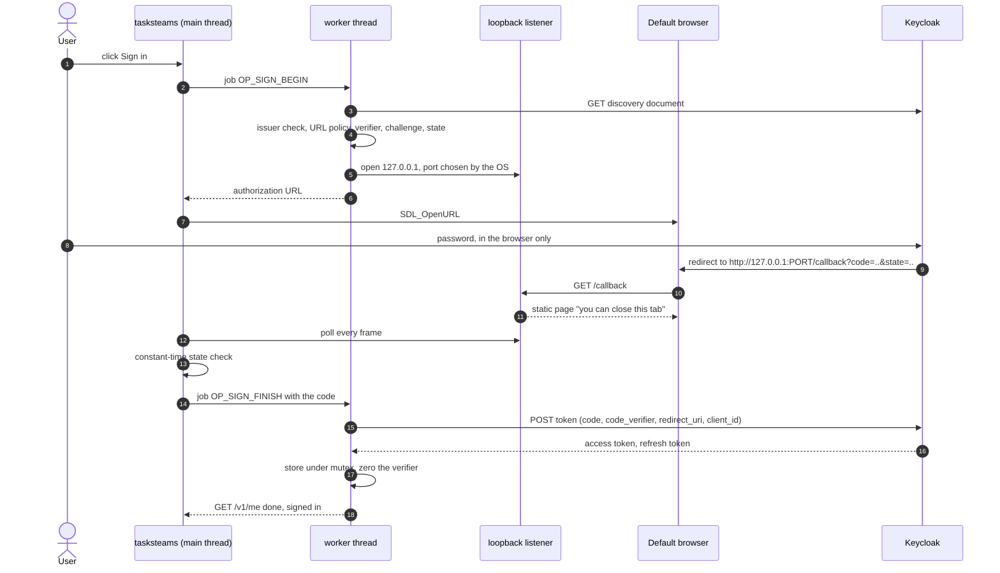

# 03. Auth: authorization code with PKCE in the system browser

> **Draft: written but not yet run.** The code and the expected output in this lesson were prepared by reading the code and the official documentation. They have not been executed yet. If something does not behave as described, trust your tool's real output and report it.

## What you will be able to do
- Explain why a native app signs in through the system browser with a loopback redirect, and what PKCE protects.
- Write the pieces of the flow in C: random values, SHA-256, base64url, a one-shot listener on `127.0.0.1`, a form-encoded token request.
- Keep tokens in memory only: a mutex, copies with a clear owner, zeroing before free, one refresh at a time.
- Import the `tasks-desktop` client into the platform's Keycloak without editing a platform file.

## Recap
1. In chapter 02, who frees the response of `ts_http_send`? <details><summary>Answer</summary>The caller, with `ts_http_response_free`; the function that turns a non-2xx answer into a problem frees it for you.</details>
2. In platform primer 04, what are the three parties of the authorization code flow? <details><summary>Answer</summary>The client (our app), the authorization server (Keycloak) and the resource server (the API); the user agent (browser) carries the user between them.</details>

## Why it matters
An app that asks for the password itself teaches users to type it into anything that looks right, and it can steal it. The standard answer for native apps (RFC 8252) is: open the system browser, let the identity server ask for the password there, and receive only a short-lived **code** back. Because other programs on the same computer can see ports and URLs, the code is useless without a secret that never left the app: that is **PKCE**. The code you write here is the part of the flow that lives in your process; every line is a place where a secret can leak.

## What you will build
The account panel from the chapter 02 window becomes a real sign-in. Click **Sign in with the browser**, finish the login in your default browser, return to the app, see your name and roles, call `GET /v1/me` with the token, and sign out. Requirements D-09 to D-14 and D-30.



## Before you start
- **Chapters 01 and 02 done.** This chapter replaces `CMakeLists.txt`, `src/store.h`, `src/store.c` and `src/ui.c`, and adds six `.c`/`.h` pairs and one JSON file. Every other file stays byte for byte as it was after chapter 02: `vcpkg.json`, `CMakePresets.json`, `.gitignore`, `src/util.*`, `src/config.*`, `src/nk_api.h`, `src/nk_impl.c`, `src/main.c`, `src/ui.h`, `src/http.*`, `src/model.*`, `src/api.*`, `src/jobs.*`.
- **The platform running** (Keycloak on port 8180) and one backend on 8000, as in chapter 02. Keycloak starts with the realm `tasksteams`; the test users are alice, bob and carol with the fake passwords listed in the platform TDD, section 7 (local practice only).
- **Time:** about 150 minutes, two sittings (break after Step 6). The browser part (Step 11) needs the platform.
- Finished code: `capstones/desktop-c/source/phase-3-auth/03-auth-pkce/code`.

## Steps
### Step 1. Why a new Keycloak client, and the file that creates it
The platform realm contains `tasks-web` (redirects to `localhost:4200` and `5173`) and `tasks-mobile` (a custom scheme), but **no client for a loopback redirect**. We do not edit the platform: this capstone ships the missing client as an importable file. Create the folder `keycloak` next to `src` and add:

**File: `keycloak/tasks-desktop-client.json`**
```json
{
  "clientId": "tasks-desktop",
  "name": "Tasks desktop client (C17, SDL3)",
  "description": "Public client for the native desktop capstone: code flow with PKCE and a loopback redirect (RFC 8252).",
  "enabled": true,
  "protocol": "openid-connect",
  "publicClient": true,
  "standardFlowEnabled": true,
  "implicitFlowEnabled": false,
  "directAccessGrantsEnabled": false,
  "serviceAccountsEnabled": false,
  "fullScopeAllowed": true,
  "redirectUris": ["http://127.0.0.1/*"],
  "webOrigins": [],
  "attributes": {
    "pkce.code.challenge.method": "S256"
  },
  "defaultClientScopes": ["basic", "profile", "email", "roles", "tasks:read", "tasks:write", "tasks-api-audience"],
  "optionalClientScopes": ["tasks:admin", "offline_access"]
}
```
Line by line:
- `clientId` is what the app sends as `client_id`; it must equal `TS_CLIENT_ID_DEFAULT` in `config.h`.
- `publicClient: true` means "no client secret": a desktop program cannot keep a secret, so none exists. PKCE replaces it.
- `standardFlowEnabled: true` is the authorization code flow. `implicitFlowEnabled`, `directAccessGrantsEnabled` (the password grant) and `serviceAccountsEnabled` are all off: the app has exactly one way in.
- `redirectUris: ["http://127.0.0.1/*"]` allows a redirect to the loopback IP with **any port**. Keycloak ignores the port when it compares a loopback redirect (RFC 8252 section 7.3 asks authorization servers to do this because the app lets the OS choose a free port). The path part is matched, so a redirect to another host or to `localhost` is still refused. The `*` lets the path vary; the app always uses `/callback`.
- `pkce.code.challenge.method: S256` makes Keycloak require PKCE with SHA-256 for this client. The plain method is refused.
- `defaultClientScopes` mirrors `tasks-mobile`: the profile and roles information, `tasks:read`, `tasks:write` and the audience scope `tasks-api-audience` that puts `tasks-api` into the token's `aud` (the backend rejects tokens without it). `optionalClientScopes` lists scopes the app may ask for; the app asks for none of them.

### Step 2. Import the client (once)
1. Open `http://localhost:8180`, choose **Administration Console** and sign in with the platform's `.env` values for `KEYCLOAK_ADMIN` and `KEYCLOAK_ADMIN_PASSWORD` (the example file uses `kcadmin` and `kcadmin_local_only`, disposable local values).
2. Pick the realm **tasksteams** in the top-left realm selector. Open **Clients**, then **Import client**.
3. Choose **Browse**, select `keycloak/tasks-desktop-client.json`, check that the fields are filled in, then **Save**.
Expected result (typical): the client `tasks-desktop` appears in the client list. If you start the platform again with `down -v` the realm is re-imported from its own file and your client is gone: import it again.

### Step 3. `CMakeLists.txt`
Changes: OpenSSL, three new source files, the Windows socket library, and a per-file POSIX feature macro for `loopback.c`.

**File: `CMakeLists.txt`**
```cmake
cmake_minimum_required(VERSION 3.21)
project(tasksteams_desktop LANGUAGES C)

set(CMAKE_C_STANDARD 17)
set(CMAKE_C_STANDARD_REQUIRED ON)
set(CMAKE_C_EXTENSIONS OFF)

# Nuklear is one header plus an SDL3 renderer header in the same git repository.
# SOURCE_SUBDIR points at a folder that does not exist, so CMake downloads the
# repository but does not run Nuklear's own CMakeLists.txt.
include(FetchContent)
FetchContent_Declare(
  nuklear
  GIT_REPOSITORY https://github.com/Immediate-Mode-UI/Nuklear.git
  GIT_TAG        v4.13.4
  GIT_SHALLOW    TRUE
  SOURCE_SUBDIR  no-cmake-here
)
FetchContent_MakeAvailable(nuklear)

find_package(SDL3 CONFIG REQUIRED)
find_package(CURL CONFIG REQUIRED)
find_package(cJSON CONFIG REQUIRED)
find_package(OpenSSL REQUIRED)
# vcpkg's cJSON exports the target "cjson"; upstream's own config names it "cJSON::cJSON".
if(TARGET cjson)
  set(TS_CJSON_TARGET cjson)
elseif(TARGET cJSON::cJSON)
  set(TS_CJSON_TARGET cJSON::cJSON)
else()
  message(FATAL_ERROR "cJSON was found but exports neither cjson nor cJSON::cJSON")
endif()

add_executable(tasksteams
  src/main.c
  src/util.c
  src/config.c
  src/http.c
  src/model.c
  src/api.c
  src/pkce.c
  src/loopback.c
  src/auth.c
  src/jobs.c
  src/store.c
  src/ui.c
  src/nk_impl.c
)

target_include_directories(tasksteams PRIVATE src)
target_include_directories(tasksteams SYSTEM PRIVATE
  ${nuklear_SOURCE_DIR}
  ${nuklear_SOURCE_DIR}/demo/sdl3_renderer
)
target_link_libraries(tasksteams PRIVATE SDL3::SDL3 CURL::libcurl OpenSSL::Crypto ${TS_CJSON_TARGET})
if(UNIX)
  target_link_libraries(tasksteams PRIVATE m)
  # loopback.c uses POSIX sockets, which -std=c17 hides unless this is defined for that file only
  set_source_files_properties(src/loopback.c PROPERTIES COMPILE_DEFINITIONS _POSIX_C_SOURCE=200809L)
endif()
if(WIN32)
  target_link_libraries(tasksteams PRIVATE ws2_32)
endif()

if(MSVC)
  target_compile_options(tasksteams PRIVATE /W4 /utf-8 /external:W0)
  target_compile_definitions(tasksteams PRIVATE _CRT_SECURE_NO_WARNINGS)
  set_source_files_properties(src/nk_impl.c PROPERTIES COMPILE_OPTIONS /w)
else()
  target_compile_options(tasksteams PRIVATE -Wall -Wextra -Wpedantic)
  set_source_files_properties(src/nk_impl.c PROPERTIES COMPILE_OPTIONS -w)
endif()
```
`OpenSSL::Crypto` is only libcrypto (random numbers and hashing), not the TLS part: libcurl does its own TLS. `ws2_32` is Windows' socket library.

### Step 4. `src/pkce.h` and `src/pkce.c`
Three small tools and one struct. The verifier is 32 random bytes written as 43 base64url characters (RFC 7636 asks for 43 to 128). The challenge is the base64url of the SHA-256 of the verifier's ASCII text. The `state` is another random value that ties the browser's answer to this attempt.

**File: `src/pkce.h`**
```c
#ifndef TS_PKCE_H
#define TS_PKCE_H

#include <stdbool.h>
#include <stddef.h>

/* Fills out with n bytes from the operating system's cryptographic generator (via OpenSSL). */
bool ts_random_bytes(void *out, size_t n);
bool ts_sha256(const void *data, size_t n, unsigned char out[32]);

/* Base64url without padding (RFC 4648 section 5). Returns the number of characters written
   (the text is NUL-terminated), or 0 when n is 0 or cap is too small. */
size_t ts_base64url(const void *data, size_t n, char *out, size_t cap);

/* A random version 4 UUID in text form (36 characters plus the terminator). */
bool ts_random_uuid(char out[37]);

/* The three secrets of one sign-in attempt (RFC 7636 and RFC 6749). */
typedef struct {
    char verifier[64];  /* 43 characters: base64url of 32 random bytes */
    char challenge[48]; /* base64url of SHA-256(verifier) */
    char state[48];     /* 32 characters: base64url of 24 random bytes */
} ts_pkce;

bool ts_pkce_new(ts_pkce *p);

#endif
```
**File: `src/pkce.c`**
```c
#include "pkce.h"

#include <limits.h>
#include <openssl/evp.h>
#include <openssl/rand.h>
#include <string.h>

#include "util.h"

bool ts_random_bytes(void *out, size_t n) {
    if (n == 0 || n > INT_MAX) return false;
    return RAND_bytes(out, (int)n) == 1;
}

bool ts_sha256(const void *data, size_t n, unsigned char out[32]) {
    unsigned int len = 0;
    return EVP_Digest(data, n, out, &len, EVP_sha256(), NULL) == 1 && len == 32;
}

size_t ts_base64url(const void *data, size_t n, char *out, size_t cap) {
    static const char alphabet[] = "ABCDEFGHIJKLMNOPQRSTUVWXYZabcdefghijklmnopqrstuvwxyz0123456789-_";
    const unsigned char *in = data;
    if (n == 0 || out == NULL) return 0;
    size_t full = n / 3;
    size_t rest = n % 3;
    size_t need = full * 4 + (rest == 0 ? 0 : rest + 1);
    if (full > (SIZE_MAX - 2) / 4 || cap < need + 1) return 0;

    size_t o = 0;
    for (size_t i = 0; i < full * 3; i += 3) {
        uint32_t v = ((uint32_t)in[i] << 16) | ((uint32_t)in[i + 1] << 8) | in[i + 2];
        out[o++] = alphabet[(v >> 18) & 63];
        out[o++] = alphabet[(v >> 12) & 63];
        out[o++] = alphabet[(v >> 6) & 63];
        out[o++] = alphabet[v & 63];
    }
    if (rest == 1) {
        uint32_t v = (uint32_t)in[n - 1] << 16;
        out[o++] = alphabet[(v >> 18) & 63];
        out[o++] = alphabet[(v >> 12) & 63];
    } else if (rest == 2) {
        uint32_t v = ((uint32_t)in[n - 2] << 16) | ((uint32_t)in[n - 1] << 8);
        out[o++] = alphabet[(v >> 18) & 63];
        out[o++] = alphabet[(v >> 12) & 63];
        out[o++] = alphabet[(v >> 6) & 63];
    }
    out[o] = '\0';
    return o;
}

bool ts_random_uuid(char out[37]) {
    unsigned char b[16];
    if (!ts_random_bytes(b, sizeof b)) return false;
    b[6] = (unsigned char)((b[6] & 0x0F) | 0x40); /* version 4 */
    b[8] = (unsigned char)((b[8] & 0x3F) | 0x80); /* variant 10 */
    return ts_setf(out, 37, "%02x%02x%02x%02x-%02x%02x-%02x%02x-%02x%02x-%02x%02x%02x%02x%02x%02x", b[0], b[1], b[2],
                   b[3], b[4], b[5], b[6], b[7], b[8], b[9], b[10], b[11], b[12], b[13], b[14], b[15]);
}

bool ts_pkce_new(ts_pkce *p) {
    unsigned char verifier_bytes[32];
    unsigned char state_bytes[24];
    unsigned char digest[32];

    memset(p, 0, sizeof *p);
    bool ok = ts_random_bytes(verifier_bytes, sizeof verifier_bytes) &&
              ts_base64url(verifier_bytes, sizeof verifier_bytes, p->verifier, sizeof p->verifier) > 0 &&
              ts_sha256(p->verifier, strlen(p->verifier), digest) &&
              ts_base64url(digest, sizeof digest, p->challenge, sizeof p->challenge) > 0 &&
              ts_random_bytes(state_bytes, sizeof state_bytes) &&
              ts_base64url(state_bytes, sizeof state_bytes, p->state, sizeof p->state) > 0;

    ts_secure_zero(verifier_bytes, sizeof verifier_bytes);
    ts_secure_zero(state_bytes, sizeof state_bytes);
    ts_secure_zero(digest, sizeof digest);
    if (!ok) ts_secure_zero(p, sizeof *p);
    return ok;
}
```
`ts_random_uuid` is used from chapter 04 for the `Idempotency-Key`; it sits here because it needs the same random source.

### Step 5. `src/loopback.h` and `src/loopback.c`
The listener is polled from the UI loop: every call returns at once, so there is no second thread and no lock. It answers only `GET /callback`, reads at most 2 KiB, never copies request text into a response, and gives up after 3 seconds per connection and 180 seconds overall.

**File: `src/loopback.h`**
```c
#ifndef TS_LOOPBACK_H
#define TS_LOOPBACK_H

#include <stdbool.h>
#include <stddef.h>

/* A one-shot web server for the OAuth redirect (RFC 8252, section 7.3).
   It listens on 127.0.0.1 only, on a port the operating system picks, and is polled from the UI loop
   (no thread). The object is created by ts_loopback_open and released with ts_loopback_close. */
typedef struct ts_loopback ts_loopback;

typedef enum { TS_LB_PENDING, TS_LB_DONE, TS_LB_FAILED, TS_LB_TIMEOUT } ts_lb_state;

/* path is the only path that is answered, for example "/callback". NULL on failure. */
ts_loopback *ts_loopback_open(const char *path, int *port_out);

/* Never blocks. On TS_LB_DONE, query holds the text after '?' of the request line (still percent-encoded). */
ts_lb_state ts_loopback_poll(ts_loopback *lb, char *query, size_t query_cap);

void ts_loopback_close(ts_loopback *lb); /* NULL is allowed */

#endif
```
**File: `src/loopback.c`**
```c
#include "loopback.h"

#include <stdint.h>
#include <stdio.h>
#include <string.h>

#include "util.h"

#ifdef _WIN32
#include <winsock2.h>
#include <ws2tcpip.h>
typedef SOCKET ts_sock;
#define TS_BAD_SOCK INVALID_SOCKET
static void sock_close(ts_sock s) { closesocket(s); }
static bool sock_nonblocking(ts_sock s) {
    u_long on = 1;
    return ioctlsocket(s, FIONBIO, &on) == 0;
}
static bool would_block(void) { return WSAGetLastError() == WSAEWOULDBLOCK; }
#else
#include <arpa/inet.h>
#include <errno.h>
#include <fcntl.h>
#include <netinet/in.h>
#include <sys/socket.h>
#include <unistd.h>
typedef int ts_sock;
#define TS_BAD_SOCK (-1)
static void sock_close(ts_sock s) { close(s); }
static bool sock_nonblocking(ts_sock s) {
    int flags = fcntl(s, F_GETFL, 0);
    return flags >= 0 && fcntl(s, F_SETFL, flags | O_NONBLOCK) == 0;
}
static bool would_block(void) { return errno == EAGAIN || errno == EWOULDBLOCK; }
#endif

#ifndef MSG_NOSIGNAL
#define MSG_NOSIGNAL 0
#endif

#define OVERALL_TIMEOUT_MS 180000u
#define CONNECTION_TIMEOUT_MS 3000u

struct ts_loopback {
    ts_sock listener;
    ts_sock conn;
    char request[2048];
    size_t request_len;
    char path[32];
    uint64_t deadline_ms;
    uint64_t conn_deadline_ms;
#ifdef _WIN32
    bool wsa_started;
#endif
};

/* Static pages: nothing from the request is ever copied into a response. */
static const char PAGE_OK[] =
    "<!doctype html><html><head><meta charset=\"utf-8\"><title>Signed in</title></head>"
    "<body><p>Sign-in finished. You can close this tab and return to the application.</p></body></html>";
static const char PAGE_NOT_FOUND[] = "<!doctype html><html><body><p>Not found.</p></body></html>";
static const char PAGE_BAD[] = "<!doctype html><html><body><p>Bad request.</p></body></html>";

static void reply(ts_sock s, int code, const char *reason, const char *body) {
    char head[384];
    size_t body_len = strlen(body);
    int n = snprintf(head, sizeof head,
                     "HTTP/1.1 %d %s\r\nContent-Type: text/html; charset=utf-8\r\nContent-Length: %zu\r\n"
                     "Cache-Control: no-store\r\nReferrer-Policy: no-referrer\r\nX-Content-Type-Options: nosniff\r\n"
                     "Connection: close\r\n\r\n",
                     code, reason, body_len);
    if (n <= 0 || (size_t)n >= sizeof head) return;
    send(s, head, (int)n, MSG_NOSIGNAL); /* best effort: the page is tiny and the socket is fresh */
    send(s, body, (int)body_len, MSG_NOSIGNAL);
}

static void drop_connection(ts_loopback *lb) {
    if (lb->conn != TS_BAD_SOCK) {
        sock_close(lb->conn);
        lb->conn = TS_BAD_SOCK;
    }
    lb->request_len = 0;
}

ts_loopback *ts_loopback_open(const char *path, int *port_out) {
    ts_loopback *lb = ts_calloc(1, sizeof *lb);
    if (lb == NULL) return NULL;
    lb->listener = TS_BAD_SOCK;
    lb->conn = TS_BAD_SOCK;

    struct sockaddr_in addr;
    socklen_t addr_len = (socklen_t)sizeof addr;

#ifdef _WIN32
    WSADATA wsa;
    if (WSAStartup(MAKEWORD(2, 2), &wsa) != 0) {
        ts_free(lb);
        return NULL;
    }
    lb->wsa_started = true;
#endif
    if (!ts_copy(lb->path, sizeof lb->path, path)) goto fail;
    lb->listener = socket(AF_INET, SOCK_STREAM, 0);
    if (lb->listener == TS_BAD_SOCK) goto fail;

    memset(&addr, 0, sizeof addr);
    addr.sin_family = AF_INET;
    addr.sin_addr.s_addr = htonl(INADDR_LOOPBACK); /* 127.0.0.1, never 0.0.0.0 */
    addr.sin_port = 0;                             /* let the operating system choose a free port */
    if (bind(lb->listener, (struct sockaddr *)&addr, sizeof addr) != 0) goto fail;
    if (listen(lb->listener, 4) != 0) goto fail;
    if (getsockname(lb->listener, (struct sockaddr *)&addr, &addr_len) != 0) goto fail;
    if (!sock_nonblocking(lb->listener)) goto fail;

    *port_out = (int)ntohs(addr.sin_port);
    lb->deadline_ms = ts_now_ms() + OVERALL_TIMEOUT_MS;
    return lb;

fail:
    ts_loopback_close(lb);
    return NULL;
}

ts_lb_state ts_loopback_poll(ts_loopback *lb, char *query, size_t query_cap) {
    uint64_t now = ts_now_ms();
    if (now > lb->deadline_ms) return TS_LB_TIMEOUT;

    if (lb->conn != TS_BAD_SOCK && now > lb->conn_deadline_ms) drop_connection(lb); /* a silent pre-connect */
    if (lb->conn == TS_BAD_SOCK) {
        ts_sock c = accept(lb->listener, NULL, NULL);
        if (c == TS_BAD_SOCK) return would_block() ? TS_LB_PENDING : TS_LB_FAILED;
        if (!sock_nonblocking(c)) {
            sock_close(c);
            return TS_LB_FAILED;
        }
        lb->conn = c;
#ifdef SO_NOSIGPIPE /* macOS has no MSG_NOSIGNAL: a write to a closed peer must not kill the program */
        {
            int one = 1;
            setsockopt(c, SOL_SOCKET, SO_NOSIGPIPE, &one, sizeof one);
        }
#endif
        lb->request_len = 0;
        lb->conn_deadline_ms = now + CONNECTION_TIMEOUT_MS;
    }

    size_t room = sizeof lb->request - 1 - lb->request_len;
    if (room == 0) { /* 2 KiB without a complete request line: not a browser we want to talk to */
        reply(lb->conn, 400, "Bad Request", PAGE_BAD);
        drop_connection(lb);
        return TS_LB_PENDING;
    }
    int n = (int)recv(lb->conn, lb->request + lb->request_len, (int)room, 0);
    if (n < 0) {
        if (!would_block()) drop_connection(lb);
        return TS_LB_PENDING;
    }
    if (n == 0) { /* the peer closed without sending the request line */
        drop_connection(lb);
        return TS_LB_PENDING;
    }
    lb->request_len += (size_t)n;
    lb->request[lb->request_len] = '\0';

    char *eol = strstr(lb->request, "\r\n");
    if (eol == NULL) return TS_LB_PENDING; /* wait for more bytes */
    *eol = '\0';                           /* only the request line matters */

    char *target = strncmp(lb->request, "GET ", 4) == 0 ? lb->request + 4 : NULL;
    char *space = target != NULL ? strchr(target, ' ') : NULL;
    if (space == NULL) {
        reply(lb->conn, 400, "Bad Request", PAGE_BAD);
        drop_connection(lb);
        return TS_LB_PENDING;
    }
    *space = '\0';

    size_t path_len = strlen(lb->path);
    if (strncmp(target, lb->path, path_len) != 0 || (target[path_len] != '?' && target[path_len] != '\0')) {
        reply(lb->conn, 404, "Not Found", PAGE_NOT_FOUND); /* favicon.ico and friends */
        drop_connection(lb);
        return TS_LB_PENDING;
    }
    const char *q = target[path_len] == '?' ? target + path_len + 1 : "";
    bool fits = ts_copy(query, query_cap, q);
    reply(lb->conn, 200, "OK", PAGE_OK);
    drop_connection(lb);
    return fits ? TS_LB_DONE : TS_LB_FAILED;
}

void ts_loopback_close(ts_loopback *lb) {
    if (lb == NULL) return;
    drop_connection(lb);
    if (lb->listener != TS_BAD_SOCK) sock_close(lb->listener);
#ifdef _WIN32
    if (lb->wsa_started) WSACleanup();
#endif
    ts_free(lb);
}
```
This is the only file with operating-system-specific code: the `#ifdef _WIN32` block hides the three differences (type of a socket, closing, "would block").

### Step 6. `src/auth.h`
**File: `src/auth.h`**
```c
#ifndef TS_AUTH_H
#define TS_AUTH_H

#include <SDL3/SDL.h>
#include <stdbool.h>
#include <stdint.h>

#include "config.h"
#include "loopback.h"
#include "model.h"
#include "pkce.h"

/* Sign-in state and the tokens. Tokens live only in two heap strings guarded by `lock`.
   Fields marked "sign-in" are touched by one thread at a time (worker in begin and finish, main in
   poll and cancel); the store's state machine guarantees they never overlap. */
typedef struct {
    ts_config cfg;
    SDL_Mutex *lock;         /* guards access, refresh, expires_at_ms, expired */
    SDL_Mutex *refresh_lock; /* held while a refresh request is in flight: one refresh at a time */
    char *access;
    char *refresh;
    uint64_t expires_at_ms;
    bool expired; /* a refresh was rejected: the session is over */

    char authorization_endpoint[320];
    char token_endpoint[320];
    char end_session_endpoint[320];
    bool have_endpoints;

    ts_pkce pkce;              /* sign-in */
    ts_loopback *lb;           /* sign-in */
    char redirect_uri[64];     /* sign-in */
} ts_auth;

typedef enum { TS_POLL_PENDING, TS_POLL_CODE, TS_POLL_FAILED } ts_poll_result;

bool ts_auth_init(ts_auth *a, const ts_config *cfg);
void ts_auth_free(ts_auth *a);

/* Worker thread. Discovers the endpoints, creates PKCE values, opens the loopback listener and writes
   the authorization URL into url. false: err says why and nothing is left open. */
bool ts_auth_begin(ts_auth *a, char *url, size_t url_cap, ts_problem *err);
/* Worker thread. Exchanges the code for tokens and stores them. */
bool ts_auth_finish(ts_auth *a, const char *code, ts_problem *err);

/* Main thread, every frame while waiting. On TS_POLL_CODE the code is in code. On TS_POLL_FAILED
   message says why and the sign-in is over. */
ts_poll_result ts_auth_poll(ts_auth *a, char *code, size_t code_cap, char *message, size_t message_cap);
void ts_auth_cancel(ts_auth *a); /* closes the listener and wipes the PKCE values */

/* Any thread. This is the ts_token_fn of the api: a new string the caller frees with ts_secure_free. */
char *ts_auth_token(void *ctx, bool force_refresh);
bool ts_auth_signed_in(ts_auth *a);
bool ts_auth_take_expired(ts_auth *a); /* true once after a rejected refresh */

/* Wipes the access token and returns the refresh token (the caller owns it: ts_secure_free) or NULL. */
char *ts_auth_clear(ts_auth *a);
/* Worker thread. Best-effort back-channel logout at Keycloak. Does not free refresh_token. */
void ts_auth_revoke(ts_auth *a, const char *refresh_token);

#endif
```

### Step 7. `src/auth.c`
Read it in four blocks: setup, discovery, sign-in (begin, poll, finish), tokens (refresh, clear, revoke).

**File: `src/auth.c`**
```c
#include "auth.h"

#include <cjson/cJSON.h>
#include <string.h>

#include "http.h"
#include "util.h"

/* ---------------------------------------------------------------- setup */

bool ts_auth_init(ts_auth *a, const ts_config *cfg) {
    memset(a, 0, sizeof *a);
    a->cfg = *cfg;
    a->lock = SDL_CreateMutex();
    a->refresh_lock = SDL_CreateMutex();
    if (a->lock == NULL || a->refresh_lock == NULL) {
        if (a->lock != NULL) SDL_DestroyMutex(a->lock);
        if (a->refresh_lock != NULL) SDL_DestroyMutex(a->refresh_lock);
        memset(a, 0, sizeof *a);
        return false;
    }
    return true;
}

void ts_auth_cancel(ts_auth *a) {
    ts_loopback_close(a->lb);
    a->lb = NULL;
    ts_secure_zero(&a->pkce, sizeof a->pkce);
}

void ts_auth_free(ts_auth *a) {
    ts_auth_cancel(a);
    ts_secure_free(a->access);
    ts_secure_free(a->refresh);
    a->access = NULL;
    a->refresh = NULL;
    if (a->lock != NULL) SDL_DestroyMutex(a->lock);
    if (a->refresh_lock != NULL) SDL_DestroyMutex(a->refresh_lock);
    a->lock = NULL;
    a->refresh_lock = NULL;
}

/* ---------------------------------------------------------------- discovery */

static bool copy_endpoint(const cJSON *root, const char *key, char *dst, size_t cap) {
    const cJSON *v = cJSON_GetObjectItemCaseSensitive(root, key);
    if (!cJSON_IsString(v) || v->valuestring == NULL) return false;
    if (!ts_http_url_allowed(v->valuestring)) return false; /* the document is untrusted input */
    return ts_copy(dst, cap, v->valuestring);
}

static bool discover(ts_auth *a, ts_problem *err) {
    if (a->have_endpoints) return true;
    char url[400];
    if (!ts_setf(url, sizeof url, "%s/.well-known/openid-configuration", a->cfg.issuer)) {
        ts_problem_transport(err, "The issuer address is too long.");
        return false;
    }
    ts_http_response res;
    ts_http_response_init(&res);
    ts_http_request req = {.method = TS_HTTP_GET, .url = url};
    if (!ts_http_send(&req, &res)) {
        ts_problem_transport(err, res.error);
        ts_http_response_free(&res);
        return false;
    }
    if (res.status != 200) {
        ts_problem_parse(ts_buf_cstr(&res.body), res.body.len, res.status, res.content_type, res.retry_after_s, err);
        ts_http_response_free(&res);
        return false;
    }
    cJSON *root = cJSON_ParseWithLength(ts_buf_cstr(&res.body), res.body.len);
    const cJSON *issuer = cJSON_GetObjectItemCaseSensitive(root, "issuer");
    bool ok = cJSON_IsString(issuer) && issuer->valuestring != NULL && strcmp(issuer->valuestring, a->cfg.issuer) == 0 &&
              copy_endpoint(root, "authorization_endpoint", a->authorization_endpoint, sizeof a->authorization_endpoint) &&
              copy_endpoint(root, "token_endpoint", a->token_endpoint, sizeof a->token_endpoint) &&
              copy_endpoint(root, "end_session_endpoint", a->end_session_endpoint, sizeof a->end_session_endpoint);
    cJSON_Delete(root);
    ts_http_response_free(&res);
    if (!ok) {
        ts_problem_transport(err, "The identity server's discovery document is incomplete or its issuer does not match.");
        return false;
    }
    a->have_endpoints = true;
    return true;
}

/* ---------------------------------------------------------------- sign-in */

bool ts_auth_begin(ts_auth *a, char *url, size_t url_cap, ts_problem *err) {
    ts_auth_cancel(a); /* an earlier attempt, if any, is over */
    if (!discover(a, err)) return false;
    if (!ts_pkce_new(&a->pkce)) {
        ts_problem_transport(err, "The system could not provide random numbers.");
        return false;
    }
    int port = 0;
    a->lb = ts_loopback_open("/callback", &port);
    if (a->lb == NULL) {
        ts_auth_cancel(a);
        ts_problem_transport(err, "Could not open a local port for the sign-in answer.");
        return false;
    }
    if (!ts_setf(a->redirect_uri, sizeof a->redirect_uri, "http://127.0.0.1:%d/callback", port)) {
        ts_auth_cancel(a);
        ts_problem_transport(err, "Internal error: redirect address too long.");
        return false;
    }

    char *client = ts_url_encode(a->cfg.client_id);
    char *redirect = ts_url_encode(a->redirect_uri);
    char *scope = ts_url_encode(TS_SCOPES);
    bool ok = client != NULL && redirect != NULL && scope != NULL &&
              ts_setf(url, url_cap,
                      "%s?response_type=code&client_id=%s&redirect_uri=%s&scope=%s&state=%s"
                      "&code_challenge=%s&code_challenge_method=S256",
                      a->authorization_endpoint, client, redirect, scope, a->pkce.state, a->pkce.challenge);
    ts_free(client);
    ts_free(redirect);
    ts_free(scope);
    if (!ok || !ts_http_url_allowed(url)) {
        ts_auth_cancel(a);
        ts_problem_transport(err, "Could not build the sign-in address.");
        return false;
    }
    return true;
}

/* Finds key in a query string, percent-decodes its value into out. false when absent or too long. */
static bool query_get(const char *query, const char *key, char *out, size_t cap) {
    size_t key_len = strlen(key);
    out[0] = '\0';
    const char *p = query;
    while (*p != '\0') {
        const char *amp = strchr(p, '&');
        size_t len = amp != NULL ? (size_t)(amp - p) : strlen(p);
        if (len > key_len && p[key_len] == '=' && strncmp(p, key, key_len) == 0) {
            char tmp[512];
            size_t value_len = len - key_len - 1;
            if (value_len >= sizeof tmp) return false;
            memcpy(tmp, p + key_len + 1, value_len);
            tmp[value_len] = '\0';
            ts_url_decode(tmp);
            bool fits = ts_copy(out, cap, tmp);
            ts_secure_zero(tmp, sizeof tmp);
            return fits;
        }
        p += len;
        if (*p == '&') p++;
    }
    return false;
}

ts_poll_result ts_auth_poll(ts_auth *a, char *code, size_t code_cap, char *message, size_t message_cap) {
    if (a->lb == NULL) {
        ts_copy(message, message_cap, "No sign-in is waiting.");
        return TS_POLL_FAILED;
    }
    char query[1024];
    ts_lb_state s = ts_loopback_poll(a->lb, query, sizeof query);
    if (s == TS_LB_PENDING) return TS_POLL_PENDING;
    if (s == TS_LB_TIMEOUT) {
        ts_copy(message, message_cap, "Sign-in timed out after 3 minutes. Try again.");
        ts_auth_cancel(a);
        return TS_POLL_FAILED;
    }
    if (s == TS_LB_FAILED) {
        ts_copy(message, message_cap, "The browser's answer could not be read.");
        ts_auth_cancel(a);
        return TS_POLL_FAILED;
    }

    ts_loopback_close(a->lb); /* one answer only: the port is closed from now on */
    a->lb = NULL;

    char state[128], error[128];
    query_get(query, "state", state, sizeof state);
    if (query_get(query, "error", error, sizeof error)) {
        ts_setf(message, message_cap, "The identity server refused the sign-in: %s", error);
        ts_auth_cancel(a);
        return TS_POLL_FAILED;
    }
    if (state[0] == '\0' || !ts_secure_equal(state, a->pkce.state)) {
        ts_copy(message, message_cap, "The answer did not belong to this sign-in attempt (state mismatch). Nothing was sent.");
        ts_auth_cancel(a);
        return TS_POLL_FAILED;
    }
    if (!query_get(query, "code", code, code_cap) || code[0] == '\0') {
        ts_copy(message, message_cap, "The answer did not contain an authorization code.");
        ts_auth_cancel(a);
        return TS_POLL_FAILED;
    }
    return TS_POLL_CODE;
}

/* ---------------------------------------------------------------- tokens */

static bool form_add(ts_buf *b, const char *key, const char *value) {
    char *encoded = ts_url_encode(value);
    if (encoded == NULL) return false;
    bool ok = (b->len == 0 || ts_buf_appends(b, "&")) && ts_buf_appends(b, key) && ts_buf_appends(b, "=") &&
              ts_buf_appends(b, encoded);
    ts_secure_free(encoded); /* the value may be a refresh token */
    return ok;
}

static void store_tokens(ts_auth *a, char *access, char *refresh_or_null, long expires_in) {
    if (expires_in <= 0 || expires_in > 86400) expires_in = 300;
    SDL_LockMutex(a->lock);
    ts_secure_free(a->access);
    a->access = access; /* ownership moves into the auth object */
    if (refresh_or_null != NULL) {
        ts_secure_free(a->refresh);
        a->refresh = refresh_or_null;
    }
    a->expires_at_ms = ts_now_ms() + (uint64_t)expires_in * 1000u;
    a->expired = false;
    SDL_UnlockMutex(a->lock);
}

/* POSTs a token-endpoint form and stores the tokens. *rejected tells "the server said no"
   (as opposed to "the network failed"). */
static bool token_request(ts_auth *a, const ts_buf *form, ts_problem *err, bool *rejected) {
    *rejected = false;
    ts_http_response res;
    ts_http_response_init(&res);
    ts_http_request req = {.method = TS_HTTP_POST,
                           .url = a->token_endpoint,
                           .content_type = "application/x-www-form-urlencoded",
                           .body = form->data,
                           .body_len = form->len};
    if (!ts_http_send(&req, &res)) {
        ts_problem_transport(err, res.error);
        ts_http_response_free(&res);
        return false;
    }
    cJSON *root = cJSON_ParseWithLength(ts_buf_cstr(&res.body), res.body.len);
    if (res.status != 200) {
        *rejected = res.status == 400 || res.status == 401;
        ts_problem_clear(err);
        err->status = res.status;
        ts_copy(err->title, sizeof err->title, "The identity server refused the request");
        const cJSON *d = cJSON_GetObjectItemCaseSensitive(root, "error_description");
        const cJSON *e = cJSON_GetObjectItemCaseSensitive(root, "error");
        if (cJSON_IsString(d) && d->valuestring != NULL) {
            ts_copy(err->detail, sizeof err->detail, d->valuestring);
        } else if (cJSON_IsString(e) && e->valuestring != NULL) {
            ts_copy(err->detail, sizeof err->detail, e->valuestring);
        }
        cJSON_Delete(root);
        ts_buf_wipe(&res.body);
        ts_http_response_free(&res);
        return false;
    }

    const cJSON *at = cJSON_GetObjectItemCaseSensitive(root, "access_token");
    const cJSON *rt = cJSON_GetObjectItemCaseSensitive(root, "refresh_token");
    const cJSON *ei = cJSON_GetObjectItemCaseSensitive(root, "expires_in");
    const cJSON *tt = cJSON_GetObjectItemCaseSensitive(root, "token_type");
    bool valid = cJSON_IsString(at) && at->valuestring != NULL && at->valuestring[0] != '\0' && cJSON_IsString(tt) &&
                 tt->valuestring != NULL && SDL_strcasecmp(tt->valuestring, "Bearer") == 0;
    char *new_access = valid ? ts_strdup(at->valuestring) : NULL;
    char *new_refresh = (valid && cJSON_IsString(rt) && rt->valuestring != NULL) ? ts_strdup(rt->valuestring) : NULL;
    long expires_in = cJSON_IsNumber(ei) ? (long)ei->valuedouble : 0;
    cJSON_Delete(root);
    ts_buf_wipe(&res.body); /* the body held the tokens in clear text */
    ts_http_response_free(&res);

    if (new_access == NULL) {
        ts_secure_free(new_refresh);
        ts_problem_transport(err, "The token answer was incomplete.");
        return false;
    }
    store_tokens(a, new_access, new_refresh, expires_in); /* new_refresh may be NULL: keep the old one */
    return true;
}

bool ts_auth_finish(ts_auth *a, const char *code, ts_problem *err) {
    ts_buf form;
    ts_buf_init(&form);
    bool rejected = false;
    bool ok = a->pkce.verifier[0] != '\0' && form_add(&form, "grant_type", "authorization_code") &&
              form_add(&form, "code", code) && form_add(&form, "redirect_uri", a->redirect_uri) &&
              form_add(&form, "client_id", a->cfg.client_id) && form_add(&form, "code_verifier", a->pkce.verifier);
    if (!ok) {
        ts_problem_transport(err, "Could not build the token request.");
    } else {
        ok = token_request(a, &form, err, &rejected);
    }
    ts_buf_wipe(&form);
    ts_secure_zero(&a->pkce, sizeof a->pkce); /* the verifier is single use */
    return ok;
}

static void wipe_session(ts_auth *a) {
    char *rt = ts_auth_clear(a);
    ts_secure_free(rt);
}

static void refresh_tokens(ts_auth *a, const char *refresh_token) {
    ts_buf form;
    ts_buf_init(&form);
    bool rejected = false;
    ts_problem err;
    bool built = form_add(&form, "grant_type", "refresh_token") && form_add(&form, "refresh_token", refresh_token) &&
                 form_add(&form, "client_id", a->cfg.client_id);
    if (built && !token_request(a, &form, &err, &rejected) && rejected) {
        wipe_session(a);
        SDL_LockMutex(a->lock);
        a->expired = true; /* the user must sign in again; nothing else is lost */
        SDL_UnlockMutex(a->lock);
    }
    ts_buf_wipe(&form);
}

char *ts_auth_token(void *ctx, bool force_refresh) {
    ts_auth *a = ctx;
    SDL_LockMutex(a->refresh_lock); /* everybody waits here while one refresh runs: single flight */

    SDL_LockMutex(a->lock);
    bool due = a->refresh != NULL && (force_refresh || ts_now_ms() + 60000u >= a->expires_at_ms);
    char *refresh_copy = due ? ts_strdup(a->refresh) : NULL;
    SDL_UnlockMutex(a->lock);

    if (refresh_copy != NULL) refresh_tokens(a, refresh_copy);
    ts_secure_free(refresh_copy);

    SDL_LockMutex(a->lock);
    char *out = a->access != NULL ? ts_strdup(a->access) : NULL;
    SDL_UnlockMutex(a->lock);

    SDL_UnlockMutex(a->refresh_lock);
    return out;
}

bool ts_auth_signed_in(ts_auth *a) {
    SDL_LockMutex(a->lock);
    bool in = a->access != NULL;
    SDL_UnlockMutex(a->lock);
    return in;
}

bool ts_auth_take_expired(ts_auth *a) {
    SDL_LockMutex(a->lock);
    bool was = a->expired;
    a->expired = false;
    SDL_UnlockMutex(a->lock);
    return was;
}

char *ts_auth_clear(ts_auth *a) {
    SDL_LockMutex(a->lock);
    char *refresh = a->refresh; /* ownership moves to the caller */
    a->refresh = NULL;
    ts_secure_free(a->access);
    a->access = NULL;
    a->expires_at_ms = 0;
    SDL_UnlockMutex(a->lock);
    return refresh;
}

void ts_auth_revoke(ts_auth *a, const char *refresh_token) {
    if (refresh_token == NULL || !a->have_endpoints) return;
    ts_buf form;
    ts_buf_init(&form);
    if (form_add(&form, "client_id", a->cfg.client_id) && form_add(&form, "refresh_token", refresh_token)) {
        ts_http_response res;
        ts_http_response_init(&res);
        ts_http_request req = {.method = TS_HTTP_POST,
                               .url = a->end_session_endpoint,
                               .content_type = "application/x-www-form-urlencoded",
                               .body = form.data,
                               .body_len = form.len};
        ts_http_send(&req, &res); /* best effort: the local session is already gone */
        ts_http_response_free(&res);
    }
    ts_buf_wipe(&form);
}
```

### Step 8. `src/store.h`, `src/store.c`
The store gains a small state machine (`ts_auth_state`) and three new job kinds. `ts_store_init` now hands `ts_auth_token` to the api as its token provider: that single assignment is all `api.c` needs to start sending bearer tokens.

**File: `src/store.h`**
```c
#ifndef TS_STORE_H
#define TS_STORE_H

#include <stdbool.h>

#include "api.h"
#include "auth.h"
#include "config.h"
#include "jobs.h"
#include "model.h"

typedef enum {
    TS_AUTH_SIGNED_OUT,
    TS_AUTH_STARTING,   /* worker: discovery, PKCE, listener */
    TS_AUTH_WAITING,    /* the browser is open, the listener is polled every frame */
    TS_AUTH_EXCHANGING, /* worker: code for tokens, then /v1/me */
    TS_AUTH_SIGNED_IN
} ts_auth_state;

/* All application state. Only the main thread reads or writes it.
   The worker thread sees only the ts_op it was given, the read-only api member and the
   mutex-protected tokens inside auth. */
typedef struct {
    ts_config cfg;
    ts_jobs jobs;
    ts_auth auth;
    ts_api api;
    unsigned long frames;

    ts_auth_state auth_state;
    char sign_in_url[1024]; /* kept so the person can copy it if the browser did not open */
    char login_message[256];
    ts_me me;
    bool have_me;

    ts_health health;
    bool have_health;

    ts_problem problem;
    bool has_problem;
    char message[256]; /* the sentence shown for the last problem */
    char info[256];    /* the line shown for the last success */
} ts_store;

bool ts_store_init(ts_store *st);
void ts_store_pump(ts_store *st); /* once per frame: finished jobs, the sign-in listener, session expiry */
void ts_store_shutdown(ts_store *st);

bool ts_store_busy(ts_store *st);
bool ts_store_check_health(ts_store *st);
bool ts_store_call_me(ts_store *st);
void ts_store_dismiss_problem(ts_store *st);

bool ts_store_sign_in(ts_store *st);
void ts_store_cancel_sign_in(ts_store *st);
void ts_store_sign_out(ts_store *st);

#endif
```
**File: `src/store.c`**
```c
#include "store.h"

#include <string.h>

#include "http.h"

typedef enum { OP_HEALTH, OP_ME, OP_SIGN_BEGIN, OP_SIGN_FINISH, OP_SIGN_OUT } ts_op_kind;

/* One job's inputs and outputs. Allocated on the main thread, filled by the worker,
   read by done on the main thread, freed by release. */
typedef struct {
    ts_store *st;
    ts_op_kind kind;
    bool ok;
    ts_problem problem;
    ts_health health;
    ts_me me;
    char url[1024];  /* OP_SIGN_BEGIN output */
    char code[512];  /* OP_SIGN_FINISH input: the authorization code */
    char *secret;    /* OP_SIGN_OUT input: owns the old refresh token, wiped in release */
} ts_op;

static void op_run(void *ctx) {
    ts_op *op = ctx; /* worker thread: touches only op, the read-only api and the locked tokens */
    ts_store *st = op->st;
    switch (op->kind) {
    case OP_HEALTH:
        op->ok = ts_api_health(&st->api, &op->health, &op->problem);
        break;
    case OP_ME:
        op->ok = ts_api_me(&st->api, &op->me, &op->problem);
        break;
    case OP_SIGN_BEGIN:
        op->ok = ts_auth_begin(&st->auth, op->url, sizeof op->url, &op->problem);
        break;
    case OP_SIGN_FINISH:
        op->ok = ts_auth_finish(&st->auth, op->code, &op->problem) && ts_api_me(&st->api, &op->me, &op->problem);
        break;
    case OP_SIGN_OUT:
        ts_auth_revoke(&st->auth, op->secret);
        op->ok = true;
        break;
    }
}

static void show_problem(ts_store *st, const ts_problem *p) {
    st->problem = *p;
    st->has_problem = true;
    ts_problem_message(p, st->message, sizeof st->message);
}

static void op_done(void *ctx, void *user) {
    ts_op *op = ctx; /* main thread */
    ts_store *st = user;

    switch (op->kind) {
    case OP_SIGN_BEGIN:
        if (op->ok && ts_http_url_allowed(op->url) && SDL_OpenURL(op->url)) {
            ts_copy(st->sign_in_url, sizeof st->sign_in_url, op->url);
            st->auth_state = TS_AUTH_WAITING;
        } else {
            ts_auth_cancel(&st->auth);
            st->auth_state = TS_AUTH_SIGNED_OUT;
            if (op->ok) {
                ts_copy(st->login_message, sizeof st->login_message, "The browser could not be opened.");
            } else {
                ts_problem_message(&op->problem, st->login_message, sizeof st->login_message);
            }
        }
        return;
    case OP_SIGN_FINISH:
        if (op->ok) {
            st->me = op->me;
            st->have_me = true;
            st->auth_state = TS_AUTH_SIGNED_IN;
            st->login_message[0] = '\0';
        } else {
            ts_secure_free(ts_auth_clear(&st->auth)); /* tokens without a working /v1/me are useless */
            st->auth_state = TS_AUTH_SIGNED_OUT;
            ts_problem_message(&op->problem, st->login_message, sizeof st->login_message);
        }
        return;
    case OP_SIGN_OUT:
        return;
    case OP_HEALTH:
    case OP_ME:
        break;
    }

    if (!op->ok) {
        show_problem(st, &op->problem);
        return;
    }
    st->has_problem = false;
    if (op->kind == OP_HEALTH) {
        st->health = op->health;
        st->have_health = true;
    } else {
        ts_setf(st->info, sizeof st->info, "The API says you are %s (roles: %s).", op->me.display_name, op->me.roles);
    }
}

static void op_release(void *ctx) {
    ts_op *op = ctx;
    ts_secure_free(op->secret);
    ts_secure_zero(op, sizeof *op); /* an op may carry a code or a token: wipe before freeing */
    ts_free(op);
}

/* Takes ownership of secret (may be NULL) only when it returns true. */
static bool submit(ts_store *st, ts_op_kind kind, const char *code, char *secret) {
    ts_op *op = ts_calloc(1, sizeof *op);
    if (op == NULL) return false;
    op->st = st;
    op->kind = kind;
    if (code != NULL && !ts_copy(op->code, sizeof op->code, code)) {
        op_release(op);
        return false;
    }
    op->secret = secret;
    ts_job job = {.run = op_run, .done = op_done, .release = op_release, .ctx = op};
    if (!ts_jobs_submit(&st->jobs, job)) {
        op->secret = NULL; /* the caller keeps its secret */
        op_release(op);
        ts_problem busy;
        ts_problem_transport(&busy, "Too many requests are waiting. Try again in a moment.");
        show_problem(st, &busy);
        return false;
    }
    return true;
}

bool ts_store_init(ts_store *st) {
    memset(st, 0, sizeof *st);
    ts_config_load(&st->cfg);
    if (!ts_http_global_init()) return false;
    if (!ts_auth_init(&st->auth, &st->cfg)) {
        ts_http_global_cleanup();
        return false;
    }
    st->api.base = st->cfg.api_base;
    st->api.token = ts_auth_token;
    st->api.token_ctx = &st->auth;
    if (!ts_jobs_start(&st->jobs, st)) {
        ts_auth_free(&st->auth);
        ts_http_global_cleanup();
        return false;
    }
    return true;
}

void ts_store_pump(ts_store *st) {
    st->frames++;
    ts_jobs_pump(&st->jobs);

    if (st->auth_state == TS_AUTH_WAITING) {
        char code[512];
        ts_poll_result r = ts_auth_poll(&st->auth, code, sizeof code, st->login_message, sizeof st->login_message);
        if (r == TS_POLL_CODE) {
            st->auth_state = TS_AUTH_EXCHANGING;
            if (!submit(st, OP_SIGN_FINISH, code, NULL)) {
                ts_auth_cancel(&st->auth);
                st->auth_state = TS_AUTH_SIGNED_OUT;
                ts_copy(st->login_message, sizeof st->login_message, "Could not start the token request.");
            }
        } else if (r == TS_POLL_FAILED) {
            st->auth_state = TS_AUTH_SIGNED_OUT;
        }
        ts_secure_zero(code, sizeof code);
    }
    if (st->auth_state == TS_AUTH_SIGNED_IN && ts_auth_take_expired(&st->auth)) {
        st->auth_state = TS_AUTH_SIGNED_OUT;
        st->have_me = false;
        ts_copy(st->login_message, sizeof st->login_message, "Your session expired. Sign in again.");
    }
}

void ts_store_shutdown(ts_store *st) {
    ts_http_cancel_all(); /* a running transfer stops at once */
    ts_jobs_stop(&st->jobs);
    ts_auth_free(&st->auth);
    ts_http_global_cleanup();
}

bool ts_store_busy(ts_store *st) {
    return ts_jobs_in_flight(&st->jobs) > 0;
}

bool ts_store_check_health(ts_store *st) {
    return submit(st, OP_HEALTH, NULL, NULL);
}

bool ts_store_call_me(ts_store *st) {
    return submit(st, OP_ME, NULL, NULL);
}

void ts_store_dismiss_problem(ts_store *st) {
    st->has_problem = false;
}

bool ts_store_sign_in(ts_store *st) {
    if (st->auth_state != TS_AUTH_SIGNED_OUT) return false;
    st->login_message[0] = '\0';
    st->auth_state = TS_AUTH_STARTING;
    if (!submit(st, OP_SIGN_BEGIN, NULL, NULL)) {
        st->auth_state = TS_AUTH_SIGNED_OUT;
        return false;
    }
    return true;
}

void ts_store_cancel_sign_in(ts_store *st) {
    if (st->auth_state != TS_AUTH_WAITING) return; /* only then is the main thread the sole user of auth.lb */
    ts_auth_cancel(&st->auth);
    st->auth_state = TS_AUTH_SIGNED_OUT;
    ts_copy(st->login_message, sizeof st->login_message, "Sign-in cancelled.");
}

void ts_store_sign_out(ts_store *st) {
    if (st->auth_state != TS_AUTH_SIGNED_IN) return;
    char *refresh = ts_auth_clear(&st->auth); /* the local session ends now, whatever the network does */
    st->auth_state = TS_AUTH_SIGNED_OUT;
    st->have_me = false;
    st->info[0] = '\0';
    st->login_message[0] = '\0';
    if (refresh != NULL && !submit(st, OP_SIGN_OUT, NULL, refresh)) ts_secure_free(refresh);
}
```

### Step 9. `src/ui.c`
**File: `src/ui.c`**
```c
#include "ui.h"

static void problem_panel(struct nk_context *nk, ts_store *st) {
    nk_layout_row_dynamic(nk, 52, 1);
    nk_label_wrap(nk, st->message);
    nk_layout_row_dynamic(nk, 26, 1);
    if (st->problem.detail[0] != '\0') nk_labelf(nk, NK_TEXT_LEFT, "Detail: %s", st->problem.detail);
    if (st->problem.trace_id[0] != '\0') nk_labelf(nk, NK_TEXT_LEFT, "Trace id: %s", st->problem.trace_id);
    for (int i = 0; i < st->problem.field_count; i++) {
        nk_labelf(nk, NK_TEXT_LEFT, "Field %s: %s", st->problem.fields[i].pointer, st->problem.fields[i].detail);
    }
    if (nk_button_label(nk, "Dismiss")) ts_store_dismiss_problem(st);
}

static void account_panel(struct nk_context *nk, ts_store *st) {
    nk_layout_row_dynamic(nk, 28, 1);
    nk_label(nk, "Account", NK_TEXT_LEFT);
    nk_layout_row_dynamic(nk, 26, 1);

    switch (st->auth_state) {
    case TS_AUTH_SIGNED_OUT:
        nk_label(nk, "You are signed out.", NK_TEXT_LEFT);
        if (st->login_message[0] != '\0') {
            nk_layout_row_dynamic(nk, 52, 1);
            nk_label_wrap(nk, st->login_message);
        }
        nk_layout_row_dynamic(nk, 34, 2);
        if (nk_button_label(nk, "Sign in with the browser")) ts_store_sign_in(st);
        nk_spacing(nk, 1);
        break;
    case TS_AUTH_STARTING:
        nk_label(nk, "Contacting the identity server...", NK_TEXT_LEFT);
        break;
    case TS_AUTH_WAITING:
        nk_label(nk, "Waiting for you to finish in the browser.", NK_TEXT_LEFT);
        nk_labelf(nk, NK_TEXT_LEFT, "Listening for the answer on %s", st->auth.redirect_uri);
        nk_layout_row_dynamic(nk, 34, 2);
        if (nk_button_label(nk, "Cancel")) ts_store_cancel_sign_in(st);
        if (nk_button_label(nk, "Copy the sign-in address")) SDL_SetClipboardText(st->sign_in_url);
        break;
    case TS_AUTH_EXCHANGING:
        nk_label(nk, "Finishing the sign-in...", NK_TEXT_LEFT);
        break;
    case TS_AUTH_SIGNED_IN:
        nk_labelf(nk, NK_TEXT_LEFT, "Signed in as %s (%s), roles: %s", st->me.display_name, st->me.username, st->me.roles);
        nk_layout_row_dynamic(nk, 34, 2);
        if (nk_button_label(nk, "Ask GET /v1/me again")) ts_store_call_me(st);
        if (nk_button_label(nk, "Sign out")) ts_store_sign_out(st);
        break;
    }
}

void ts_ui_frame(struct nk_context *nk, ts_store *st, float w, float h) {
    if (nk_begin(nk, "Tasks and Teams", nk_rect(0, 0, w, h), NK_WINDOW_NO_SCROLLBAR)) {
        nk_layout_row_dynamic(nk, 36, 1);
        nk_label(nk, "Tasks and Teams: sign-in check", NK_TEXT_LEFT);

        nk_layout_row_dynamic(nk, 26, 1);
        nk_labelf(nk, NK_TEXT_LEFT, "API base: %s", st->cfg.api_base);
        nk_labelf(nk, NK_TEXT_LEFT, "Issuer: %s (client %s)", st->cfg.issuer, st->cfg.client_id);
        nk_labelf(nk, NK_TEXT_LEFT, "Frames drawn: %lu", st->frames);

        account_panel(nk, st);

        nk_layout_row_dynamic(nk, 34, 1);
        if (nk_button_label(nk, "Test connection (GET /health)")) ts_store_check_health(st);

        nk_layout_row_dynamic(nk, 26, 1);
        if (ts_store_busy(st)) nk_label(nk, "Working...", NK_TEXT_LEFT);
        if (st->have_health) {
            nk_labelf(nk, NK_TEXT_LEFT, "Health: status %s, database %s, version %s", st->health.status,
                      st->health.database, st->health.version);
        }
        if (st->info[0] != '\0') nk_label(nk, st->info, NK_TEXT_LEFT);
        if (st->has_problem) problem_panel(nk, st);
    }
    nk_end(nk);
}
```

### Step 10. Build
**Command (from `app/`):**
```powershell
cmake --preset default
cmake --build --preset default
```
Expected result (typical): CMake finds OpenSSL (already installed by vcpkg in chapter 01), the build ends without errors and without warnings from `src/`.

### Step 11. Sign in
Start the platform and a backend, import the client (Step 2), then run the app (`.\build\default\Debug\tasksteams.exe`).

## Run it
Predict first: which address does the app print under "Listening for the answer on", and will it be the same next time? <details><summary>Answer</summary>`http://127.0.0.1:` followed by a port the operating system chose, then `/callback`. The port differs between attempts: that is why the Keycloak client registers `http://127.0.0.1/*` without a port.</details>

1. Click **Sign in with the browser**. The status passes "Contacting the identity server..." and then "Waiting for you to finish in the browser." Your default browser opens the Keycloak login page of the realm `tasksteams`.
2. Sign in as `carol` (fake password from the platform TDD, section 7). The browser lands on a plain page that says (typical) "Sign-in finished. You can close this tab and return to the application." Close the tab.
3. The app shows "Signed in as ..." with carol's display name and her roles. Click **Ask GET /v1/me again**: the line "The API says you are ..." appears, which proves the bearer token is accepted by the backend.
4. Click **Sign out**: the panel returns to "You are signed out." at once. Keycloak's session for the app is ended in the background.
5. Negative test: sign in again, but this time copy the address with **Copy the sign-in address**, press **Cancel**, and open the copied address in the browser anyway, then log in. Expected: the browser shows an error page or a refused connection page, because the listener is closed; the app stays signed out.
6. Negative test: while the app is waiting, open `http://127.0.0.1:<port>/callback?code=x&state=y` yourself (use the port shown in the window). Expected: the browser shows the "Sign-in finished" page, and the app shows `The answer did not belong to this sign-in attempt (state mismatch). Nothing was sent.` The wrong `state` was rejected before any request to Keycloak.
7. If the Keycloak page says the redirect URI is invalid (typical text: "Invalid parameter: redirect_uri"), the client was not imported or its redirect list differs; see Common mistakes.

## How it works
1. **Why the browser.** The login page is shown by Keycloak in a program the user already trusts, with the user's saved passwords and second factor. The app never handles a password, and a compromised app cannot add a fake login page without the user noticing the address bar. RFC 8252 forbids embedded web views for this reason.
2. **Why loopback.** The app needs a place for the browser to send the code. A web server on `127.0.0.1` needs no installer, no registry entry and works the same on all three systems. Binding to the loopback address (not `0.0.0.0`) keeps the port invisible from the network. The port is chosen by the operating system (`sin_port = 0`), so two copies of the app never collide.
3. **What PKCE adds.** `code_challenge` is a hash of a secret (`code_verifier`) that only this process knows. Keycloak remembers the hash with the code. Anyone who steals the code from the redirect URL (another program that saw the request, a browser extension) cannot exchange it, because the token endpoint demands the verifier. The verifier is created per attempt, used once and zeroed (`ts_secure_zero(&a->pkce, ...)`).
4. **What `state` adds.** `state` is a random value that comes back unchanged. If the answer carries a different one, it was not triggered by this attempt (a forged request to the listener, or a leftover tab). `ts_secure_equal` compares in time that does not depend on where the first difference is, so that a local attacker cannot guess it byte by byte.
5. **Discovery is untrusted input.** `discover` downloads the endpoint list and refuses it unless `issuer` equals the configured issuer *exactly* and every endpoint passes the same URL policy as any other address. This matters because `SDL_OpenURL` asks the operating system to open a link: a poisoned document could otherwise make the app open `file:` or a custom-scheme link.
6. **Memory discipline for secrets.** The tokens exist only as `a->access` and `a->refresh`. Every function that hands one out returns a *copy* that the caller frees with `ts_secure_free`; the originals change only under `lock`. Response bodies that held tokens are wiped (`ts_buf_wipe`), the form body is wiped, the temporary header line in `http.c` is wiped. What cannot be wiped (libcurl's copy inside its header list, the cJSON tree's strings, the operating system's swap file) is named in the TDD; the claim is "not stored", not "unrecoverable".
7. **Refresh, single flight.** `ts_auth_token` takes `refresh_lock` first, so while one job refreshes, any other job waits and then simply reads the new token. A refresh happens when fewer than 60 seconds remain or after a 401. Keycloak's realm rotates refresh tokens, so the new refresh token replaces the old one inside `store_tokens` *before* anyone uses the new access token. A rejected refresh (HTTP 400 or 401) wipes the session and raises the `expired` flag; a network failure keeps the tokens.
8. **The state machine.** `ts_auth_state` has five values and every transition is in `store.c`. The comments in `auth.h` mark which fields belong to the sign-in and explain why no lock is needed: the worker only touches them in `begin` and `finish`, the main thread in `poll` and `cancel`, and the state machine never lets those overlap (`ts_store_cancel_sign_in` returns at once unless the state is `WAITING`).
9. **Sign-out is local first.** `ts_auth_clear` runs on the main thread in the click handler and hands the refresh token to a job that asks Keycloak to end the session. Even if the network is down the person is signed out on screen and the token is gone from memory.
10. **Misconception:** "the id token tells me who the user is". The token response also contains an id token. We never store it and never decide anything from it: validating one needs the signature, issuer, audience, expiry and nonce checks. The name on screen comes from the API's `/v1/me`, which the backend computed from a token *it* validated.

## Try it
The exercise is standard-library only.
1. **Guided.** `exercise/starter/exercise.c`: implement `base64url` (the encoder used for the verifier, the challenge and the state) and check it against the known values in `main`. Compile: `gcc -std=c17 -Wall -Wextra -o exercise exercise.c`.
2. **Change.** Make the sign-in timeout 60 seconds: which constant do you change and what else must you update so the message stays true? <details><summary>Answer</summary>`OVERALL_TIMEOUT_MS` in `loopback.c` and the text "after 3 minutes" in `auth.c`; better, make the text from the constant.</details>
3. **Stretch.** Add a `nonce` to the authorization request and write down exactly what else you would have to implement before it protects anything. (Hint: it only helps if the id token is validated.)

Expected output of the exercise solution (derived from the code):
```text
Man -> TWFu
Ma -> TWE
M -> TQ
fb ff -> -_8
tight buffer -> 0
```

<details><summary>Solution</summary>

**File: `exercise/solution/exercise.c`**
```c
#include <stdint.h>
#include <stdio.h>
#include <string.h>

/* Base64url without padding (RFC 4648 section 5): the alphabet A-Z a-z 0-9 - _
   Return the number of characters written (out is NUL-terminated), or 0 when n is 0 or
   cap is too small for the text plus the terminator. Never write past out[cap - 1]. */
static size_t base64url(const unsigned char *in, size_t n, char *out, size_t cap) {
    static const char alphabet[] = "ABCDEFGHIJKLMNOPQRSTUVWXYZabcdefghijklmnopqrstuvwxyz0123456789-_";
    if (n == 0 || out == NULL) return 0;
    size_t full = n / 3;
    size_t rest = n % 3;
    size_t needed = full * 4 + (rest == 0 ? 0 : rest + 1);
    if (cap < needed + 1) return 0;

    size_t o = 0;
    for (size_t i = 0; i < full * 3; i += 3) {
        uint32_t v = ((uint32_t)in[i] << 16) | ((uint32_t)in[i + 1] << 8) | in[i + 2];
        out[o++] = alphabet[(v >> 18) & 63];
        out[o++] = alphabet[(v >> 12) & 63];
        out[o++] = alphabet[(v >> 6) & 63];
        out[o++] = alphabet[v & 63];
    }
    if (rest == 1) {
        uint32_t v = (uint32_t)in[n - 1] << 16;
        out[o++] = alphabet[(v >> 18) & 63];
        out[o++] = alphabet[(v >> 12) & 63];
    } else if (rest == 2) {
        uint32_t v = ((uint32_t)in[n - 2] << 16) | ((uint32_t)in[n - 1] << 8);
        out[o++] = alphabet[(v >> 18) & 63];
        out[o++] = alphabet[(v >> 12) & 63];
        out[o++] = alphabet[(v >> 6) & 63];
    }
    out[o] = '\0';
    return o;
}

static void show(const char *label, const unsigned char *in, size_t n, size_t cap) {
    char out[16] = "";
    if (cap > sizeof out) cap = sizeof out;
    size_t len = base64url(in, n, out, cap);
    if (len == 0) {
        printf("%s -> 0\n", label);
    } else {
        printf("%s -> %s\n", label, out);
    }
}

int main(void) {
    const unsigned char man[] = {'M', 'a', 'n'};
    const unsigned char ma[] = {'M', 'a'};
    const unsigned char m[] = {'M'};
    const unsigned char ff[] = {0xFB, 0xFF};

    show("Man", man, 3, 16);
    show("Ma", ma, 2, 16);
    show("M", m, 1, 16);
    show("fb ff", ff, 2, 16);
    show("tight buffer", man, 3, 3);
    return 0;
}
```
`0xFB 0xFF` is `11111011 11111111`; split into 6-bit groups `111110 111111 1111(00)` = 62, 63, 60 = `-`, `_`, `8`. The starter has the same `main`/`show` and a function body of four TODO comments.
</details>

## Check yourself
1. Which value does the app send to the token endpoint that the browser never saw? <details><summary>Answer</summary>The `code_verifier`; the browser only saw its hash, `code_challenge`.</details>
2. Predict: a second browser tab opens the callback address after the first answer was accepted. What happens? <details><summary>Answer</summary>Nothing is listening any more: `ts_loopback_close` ran after the first valid answer, so the connection is refused.</details>
3. Find the bug: `char *t = ts_auth_token(ctx, false); ts_http_send(...bearer = t...); ts_free(t);` <details><summary>Answer</summary>The token string is freed without being zeroed; use `ts_secure_free(t)`.</details>
4. Why does `ts_auth_token` hold `refresh_lock` while it waits for the network, but not `lock`? <details><summary>Answer</summary>Holding `lock` during a 20 s request would block every other reader, including the main thread; `refresh_lock` only serialises refreshers.</details>

## Common mistakes
| Symptom or error text (typical) | Cause | Fix |
|---|---|---|
| Keycloak page: "Invalid parameter: redirect_uri" or "Client not found" | The `tasks-desktop` client was not imported, or the realm was re-created with `down -v` | Import `keycloak/tasks-desktop-client.json` again (Step 2). If Keycloak insists on the port, register `http://127.0.0.1:<port>/callback` once as a test |
| The app says the discovery document is incomplete or the issuer does not match | `TASKS_OIDC_ISSUER` differs from the realm's issuer (trailing slash, `localhost` versus `127.0.0.1`) | Use `http://localhost:8180/realms/tasksteams` exactly; the issuer is compared as text |
| The browser does not open | No default browser, or the desktop blocks `SDL_OpenURL` | Use **Copy the sign-in address** and paste it into a browser on the same computer |
| After login the browser says it cannot connect to 127.0.0.1 | A firewall or proxy blocks the loopback port, or the app was closed or cancelled | Allow the program on loopback; keep the app waiting until the browser page appears |
| `GET /v1/me` answers 401 right after sign-in | The backend rejects the token (audience or issuer setting) | Check that the client has the scope `tasks-api-audience` and the backend's issuer equals `http://localhost:8180/realms/tasksteams` |
| Compile error about `socklen_t` or `fcntl` on Linux | `_POSIX_C_SOURCE` not applied to `loopback.c` | Keep the `set_source_files_properties` line in the `if(UNIX)` block of `CMakeLists.txt` |
| Link error about `__imp_socket` or `WSAStartup` on Windows | `ws2_32` is not linked | Keep the `if(WIN32)` block of `CMakeLists.txt` |

## Best practice
Use the system browser, PKCE and exact redirect matching for every native app, and keep each secret's lifetime as short as the flow allows. Source: RFC 8252 "OAuth 2.0 for Native Apps", sections 4 and 7.3, https://www.rfc-editor.org/info/rfc8252, and RFC 9700 "Best Current Practice for OAuth 2.0 Security", https://www.rfc-editor.org/info/rfc9700

## Production notes (what changes outside the lab)
- **Everything over HTTPS.** Plain `http://` is accepted by the URL policy only for loopback hosts, so that this lab runs against local Keycloak. A production issuer and API must be `https://` with valid certificates; the policy then needs no change and TLS verification is already on (chapter 02).
- **Operating-system secure storage.** Memory-only tokens mean a sign-in after every start, which is a fine default. If the product needs the user to stay signed in, store *only the refresh token* in the platform store: Windows Credential Manager (`CredWriteW`) or DPAPI (`CryptProtectData`), the macOS Keychain (Security framework), or a Secret Service client such as libsecret on Linux. Add `offline_access` to the scopes only then, keep the access token in memory, and never put a token in a file, the registry or a log. Chapter 05 lists the checks.
- **Id token and logout in the browser.** A real product may want RP-initiated logout in the browser (so the single sign-on cookie ends too) and id-token validation; both are standard and out of scope here.

## Going further
- RFC 8252 [section 8.3](https://www.rfc-editor.org/info/rfc8252) on loopback redirects and why `localhost` is discouraged in favour of the IP literal.
- Keycloak server administration: [clients and redirect URIs](https://www.keycloak.org/docs/latest/server_admin/).
- Chapter 04 uses the token provider you just wired in to load teams, projects and tasks.

## Summary
- You signed in through the system browser with authorization code + PKCE and a loopback redirect, without the app ever seeing a password.
- You wrote random values, SHA-256 and base64url code, a non-blocking one-shot listener and a form-encoded token request.
- You kept tokens in memory only, refreshed them one at a time, rotated them safely and wiped what you could.
- You added a client to Keycloak by importing a file instead of editing the platform.

## Next lesson
04. Screens and state: teams, projects and tasks, forms with `If-Match` and `Idempotency-Key`, pagination and conflict handling.
