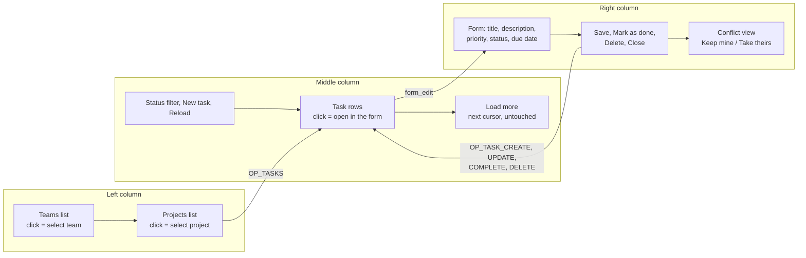

# 04. Screens and state

> **Draft: written but not yet run.** The code and the expected output in this lesson were prepared by reading the code and the official documentation. They have not been executed yet. If something does not behave as described, trust your tool's real output and report it.

## What you will be able to do
- Build a three-column immediate-mode UI (teams and projects, tasks, form) over one state struct.
- Send `If-Match`, a JSON Merge Patch and an `Idempotency-Key` from a form, and explain why each exists.
- Page through a list with an opaque cursor without ever parsing it, and drop answers that arrived too late.
- Show a 412 as a "mine versus theirs" conflict and let the person choose, with every owned pointer moved or freed exactly once.

## Recap
1. In chapter 03, which function hands the bearer token to the API layer, and who frees what it returns? <details><summary>Answer</summary>`ts_auth_token` (set as `api.token`); it returns a copy that the caller frees with `ts_secure_free`.</details>
2. In chapter 02, what happens to a `ts_task` after `ts_vec_push` copied it into a page? <details><summary>Answer</summary>It was *moved*: the vector owns its `description` now, and the local copy must not be freed again.</details>
3. In platform primer 03, what does `required` list in a schema? <details><summary>Answer</summary>The property names that must be present in a valid object; our parsers also refuse a task without `id` or `version`.</details>

## Why it matters
This is where the program becomes useful, and where the hardest C bugs live: lists that are replaced while the screen is drawing them, answers that arrive after the user clicked elsewhere, a form that holds the only copy of what the person typed, a second click that must not create a second task. The rules from the first three chapters (one owner, move then zero, one thread touches the state) are what keep this chapter correct.

## What you will build
After sign-in the window shows three columns: **Teams and projects** on the left, **Tasks** in the middle (status filter, New task, Reload, a "Load more" button), and the **Task** form on the right (title, description, priority, status, due date, Save, Close, Mark as done, Delete, and the conflict view). Errors appear in a bar under the header, with field errors from 422 answers. Requirements D-15 to D-22, D-28, D-29.



## Before you start
- **Chapters 01 to 03 done**, with the platform running, one backend on 8000 and the Keycloak client imported.
- **Replaced files:** `CMakeLists.txt`, `src/store.h`, `src/store.c`, `src/ui.h`, `src/ui.c`. **New file:** `src/ui_work.c`. Everything else is unchanged from chapter 03: `vcpkg.json`, `CMakePresets.json`, `.gitignore`, `keycloak/tasks-desktop-client.json`, `src/util.*`, `src/config.*`, `src/nk_api.h`, `src/nk_impl.c`, `src/main.c`, `src/http.*`, `src/model.*`, `src/api.*`, `src/pkce.*`, `src/loopback.*`, `src/auth.*`, `src/jobs.*`.
- **Time:** about 180 minutes in two sittings (break after Step 5).
- Finished code: `capstones/desktop-c/source/phase-4-screens/04-screens-and-state/code`.

## Steps
### Step 1. `CMakeLists.txt`
One new source file, `src/ui_work.c`.

**File: `CMakeLists.txt`**
```cmake
cmake_minimum_required(VERSION 3.21)
project(tasksteams_desktop LANGUAGES C)

set(CMAKE_C_STANDARD 17)
set(CMAKE_C_STANDARD_REQUIRED ON)
set(CMAKE_C_EXTENSIONS OFF)

# Nuklear is one header plus an SDL3 renderer header in the same git repository.
# SOURCE_SUBDIR points at a folder that does not exist, so CMake downloads the
# repository but does not run Nuklear's own CMakeLists.txt.
include(FetchContent)
FetchContent_Declare(
  nuklear
  GIT_REPOSITORY https://github.com/Immediate-Mode-UI/Nuklear.git
  GIT_TAG        v4.13.4
  GIT_SHALLOW    TRUE
  SOURCE_SUBDIR  no-cmake-here
)
FetchContent_MakeAvailable(nuklear)

find_package(SDL3 CONFIG REQUIRED)
find_package(CURL CONFIG REQUIRED)
find_package(cJSON CONFIG REQUIRED)
find_package(OpenSSL REQUIRED)
# vcpkg's cJSON exports the target "cjson"; upstream's own config names it "cJSON::cJSON".
if(TARGET cjson)
  set(TS_CJSON_TARGET cjson)
elseif(TARGET cJSON::cJSON)
  set(TS_CJSON_TARGET cJSON::cJSON)
else()
  message(FATAL_ERROR "cJSON was found but exports neither cjson nor cJSON::cJSON")
endif()

add_executable(tasksteams
  src/main.c
  src/util.c
  src/config.c
  src/http.c
  src/model.c
  src/api.c
  src/pkce.c
  src/loopback.c
  src/auth.c
  src/jobs.c
  src/store.c
  src/ui.c
  src/ui_work.c
  src/nk_impl.c
)

target_include_directories(tasksteams PRIVATE src)
target_include_directories(tasksteams SYSTEM PRIVATE
  ${nuklear_SOURCE_DIR}
  ${nuklear_SOURCE_DIR}/demo/sdl3_renderer
)
target_link_libraries(tasksteams PRIVATE SDL3::SDL3 CURL::libcurl OpenSSL::Crypto ${TS_CJSON_TARGET})
if(UNIX)
  target_link_libraries(tasksteams PRIVATE m)
  # loopback.c uses POSIX sockets, which -std=c17 hides unless this is defined for that file only
  set_source_files_properties(src/loopback.c PROPERTIES COMPILE_DEFINITIONS _POSIX_C_SOURCE=200809L)
endif()
if(WIN32)
  target_link_libraries(tasksteams PRIVATE ws2_32)
endif()

if(MSVC)
  target_compile_options(tasksteams PRIVATE /W4 /utf-8 /external:W0)
  target_compile_definitions(tasksteams PRIVATE _CRT_SECURE_NO_WARNINGS)
  set_source_files_properties(src/nk_impl.c PROPERTIES COMPILE_OPTIONS /w)
else()
  target_compile_options(tasksteams PRIVATE -Wall -Wextra -Wpedantic)
  set_source_files_properties(src/nk_impl.c PROPERTIES COMPILE_OPTIONS -w)
endif()
```

### Step 2. `src/store.h`, the whole state in one struct
Read the comments on each field. Three ideas to hold on to: the **form** is its own struct (the person's typing lives there, not in the list); `base_version` is "the version the person *saw*", which becomes `If-Match`; `loading_more` is a flag that stops a double click from asking for the same page twice.

**File: `src/store.h`**
```c
#ifndef TS_STORE_H
#define TS_STORE_H

#include <stdbool.h>
#include <stdint.h>

#include "api.h"
#include "auth.h"
#include "config.h"
#include "jobs.h"
#include "model.h"

typedef enum {
    TS_AUTH_SIGNED_OUT,
    TS_AUTH_STARTING,   /* worker: discovery, PKCE, listener */
    TS_AUTH_WAITING,    /* the browser is open, the listener is polled every frame */
    TS_AUTH_EXCHANGING, /* worker: code for tokens, then /v1/me */
    TS_AUTH_SIGNED_IN
} ts_auth_state;

/* The create/edit form. Everything the person typed lives here until it is saved or closed. */
typedef struct {
    bool open;
    bool editing;                  /* false = a new task */
    char task_id[TS_ID_LEN];
    char project_id[TS_ID_LEN];
    long base_version;             /* the version the person saw: it becomes If-Match */
    ts_task_draft draft;           /* what is in the fields now */
    ts_task_draft original;        /* what the server showed when the form opened (or after "keep mine") */
    bool description_locked;       /* the stored description did not fit the form: do not edit or send it */
    int status_index;              /* index into TS_STATUSES */
    int priority_index;            /* index into TS_PRIORITIES */
    char idem_key[40];             /* Idempotency-Key of this create; changes only when the body changes */
    bool sent;
    uint64_t sent_hash;
    bool delete_armed;             /* the first click on Delete only arms it */
    bool conflict;                 /* a 412 happened: theirs holds the current server task */
    ts_task theirs;                /* owned while conflict is true */
} ts_form;

/* All application state. Only the main thread reads or writes it.
   The worker thread sees only the ts_op it was given, the read-only api member and the
   mutex-protected tokens inside auth. */
typedef struct {
    ts_config cfg;
    ts_jobs jobs;
    ts_auth auth;
    ts_api api;
    unsigned long frames;

    ts_auth_state auth_state;
    char sign_in_url[1024];
    char login_message[256];
    ts_me me;
    bool have_me;

    ts_health health;
    bool have_health;

    ts_page teams;
    ts_page projects;
    char team_id[TS_ID_LEN];    /* selected team, "" = none */
    ts_page tasks;
    char project_id[TS_ID_LEN]; /* selected project, "" = none */
    int status_filter;          /* 0 = all, 1..5 = TS_STATUSES[filter - 1] */
    bool loading_more;          /* a "Load more" request is in flight: a second click must not repeat it */
    ts_form form;

    ts_problem problem;
    bool has_problem;
    char message[256]; /* the sentence shown for the last problem */
    char info[256];    /* the line shown for the last success */
} ts_store;

bool ts_store_init(ts_store *st);
void ts_store_pump(ts_store *st); /* once per frame: finished jobs, the sign-in listener, session expiry */
void ts_store_shutdown(ts_store *st);

bool ts_store_busy(ts_store *st);
bool ts_store_check_health(ts_store *st);
void ts_store_dismiss_problem(ts_store *st);

bool ts_store_sign_in(ts_store *st);
void ts_store_cancel_sign_in(ts_store *st);
void ts_store_sign_out(ts_store *st);

/* Teams, projects, tasks */
void ts_store_load_teams(ts_store *st);
void ts_store_select_team(ts_store *st, const char *team_id);
void ts_store_select_project(ts_store *st, const char *project_id);
void ts_store_set_filter(ts_store *st, int filter);
void ts_store_load_more(ts_store *st);

/* The form */
void ts_store_form_new(ts_store *st);
void ts_store_form_edit(ts_store *st, size_t index);
void ts_store_form_close(ts_store *st);
void ts_store_form_save(ts_store *st);
void ts_store_form_complete(ts_store *st);
void ts_store_form_delete(ts_store *st);
void ts_store_form_keep_mine(ts_store *st);
void ts_store_form_take_theirs(ts_store *st);

#endif
```

### Step 3. `src/store.c`
The file has five parts: the `ts_op` struct and small helpers; `op_run` (worker side); `op_done` (main-thread side, where results are *moved* into the state); the lifecycle and sign-in functions (chapter 03, now using `new_op` and `submit_op`); the data and form functions. Read the comments before the code: they carry the ownership rules.

**File: `src/store.c`**
```c
#include "store.h"

#include <string.h>

#include "http.h"
#include "pkce.h"

typedef enum {
    OP_HEALTH,
    OP_SIGN_BEGIN,
    OP_SIGN_FINISH,
    OP_SIGN_OUT,
    OP_TEAMS,
    OP_PROJECTS,
    OP_TASKS,
    OP_TASK_CREATE,
    OP_TASK_UPDATE,
    OP_TASK_COMPLETE,
    OP_TASK_DELETE
} ts_op_kind;

/* One job's inputs and outputs. Allocated on the main thread, filled by the worker,
   read by done on the main thread, freed by release. Whatever done moves out must be zeroed
   in the op, so that release never frees it twice. */
typedef struct {
    ts_store *st;
    ts_op_kind kind;
    bool ok;
    ts_problem problem;

    /* inputs */
    char id[TS_ID_LEN];        /* team, project or task id */
    char status[16];           /* OP_TASKS: status filter text, "" = all */
    char cursor[TS_CURSOR_LEN];
    int filter;                /* OP_TASKS: the filter index the answer belongs to */
    bool append;               /* OP_TASKS: "Load more" */
    long version;              /* If-Match */
    unsigned mask;             /* OP_TASK_UPDATE: changed fields */
    char idem[40];             /* OP_TASK_CREATE: Idempotency-Key */
    char code[512];            /* OP_SIGN_FINISH: authorization code */
    char *secret;              /* OP_SIGN_OUT: owns the old refresh token */
    ts_task_draft draft;

    /* outputs */
    ts_health health;
    ts_me me;
    ts_page page;
    ts_task task;
    bool conflict_loaded;      /* OP_TASK_UPDATE: task holds the current server version after a 412 */
    char url[1024];            /* OP_SIGN_BEGIN */
} ts_op;

/* ---------------------------------------------------------------- small helpers */

static void show_problem(ts_store *st, const ts_problem *p) {
    st->problem = *p;
    st->has_problem = true;
    ts_problem_message(p, st->message, sizeof st->message);
}

static void show_text(ts_store *st, const char *text) {
    ts_problem p;
    ts_problem_transport(&p, text);
    show_problem(st, &p);
}

static void move_page(ts_page *dst, ts_page *src) {
    ts_page_free(dst);
    *dst = *src;
    memset(src, 0, sizeof *src); /* moved: the op must not free it again */
}

static int index_of(const char *const *list, int count, const char *value) {
    for (int i = 0; i < count; i++) {
        if (strcmp(list[i], value) == 0) return i;
    }
    return 0;
}

static uint64_t hash_text(uint64_t h, const char *s) {
    for (; *s != '\0'; s++) {
        h ^= (unsigned char)*s;
        h *= 1099511628211ULL;
    }
    h ^= 0xFF; /* separates fields: "ab" + "c" differs from "a" + "bc" */
    h *= 1099511628211ULL;
    return h;
}

static uint64_t hash_draft(const ts_task_draft *d) {
    uint64_t h = 1469598103934665603ULL;
    h = hash_text(h, d->title);
    h = hash_text(h, d->description);
    h = hash_text(h, d->priority);
    return hash_text(h, d->due_date);
}

static void form_clear(ts_form *f) {
    ts_task_free(&f->theirs);
    memset(f, 0, sizeof *f);
}

static void form_load(ts_form *f, const ts_task *t) {
    f->description_locked = !ts_draft_from_task(&f->draft, t);
    f->original = f->draft;
    f->status_index = index_of(TS_STATUSES, 5, t->status);
    f->priority_index = index_of(TS_PRIORITIES, 4, t->priority);
    f->base_version = t->version;
    ts_copy(f->task_id, sizeof f->task_id, t->id);
    ts_copy(f->project_id, sizeof f->project_id, t->project_id);
}

static void reset_workspace(ts_store *st) {
    ts_page_free(&st->teams);
    ts_page_free(&st->projects);
    ts_page_free(&st->tasks);
    st->team_id[0] = '\0';
    st->project_id[0] = '\0';
    st->status_filter = 0;
    st->loading_more = false;
    form_clear(&st->form);
    st->info[0] = '\0';
}

/* Puts *t into the task list, moving it: replaces the task with the same id, or puts a new
   task of the selected project at the front. If t is not moved, the op's release frees it. */
static void put_task(ts_store *st, ts_task *t) {
    ts_vec *v = &st->tasks.items;
    for (size_t i = 0; i < v->len; i++) {
        ts_task *slot = ts_vec_at(v, i);
        if (strcmp(slot->id, t->id) == 0) {
            ts_task_free(slot);
            *slot = *t;
            memset(t, 0, sizeof *t);
            return;
        }
    }
    if (strcmp(t->project_id, st->project_id) != 0) return; /* not on screen */
    if (!ts_vec_push(v, t)) return;
    char *base = v->items;
    size_t size = v->elem_size;
    ts_task last;
    memcpy(&last, base + (v->len - 1) * size, size);
    memmove(base + size, base, (v->len - 1) * size);
    memcpy(base, &last, size);
    memset(t, 0, sizeof *t);
}

static void remove_task(ts_store *st, const char *id) {
    ts_vec *v = &st->tasks.items;
    for (size_t i = 0; i < v->len; i++) {
        ts_task *slot = ts_vec_at(v, i);
        if (strcmp(slot->id, id) == 0) {
            ts_vec_remove(v, i);
            return;
        }
    }
}

/* ---------------------------------------------------------------- jobs */

static void op_run(void *ctx) {
    ts_op *op = ctx; /* worker thread: touches only op, the read-only api and the locked tokens */
    ts_store *st = op->st;
    const ts_api *api = &st->api;
    switch (op->kind) {
    case OP_HEALTH:
        op->ok = ts_api_health(api, &op->health, &op->problem);
        break;
    case OP_SIGN_BEGIN:
        op->ok = ts_auth_begin(&st->auth, op->url, sizeof op->url, &op->problem);
        break;
    case OP_SIGN_FINISH:
        op->ok = ts_auth_finish(&st->auth, op->code, &op->problem) && ts_api_me(api, &op->me, &op->problem);
        break;
    case OP_SIGN_OUT:
        ts_auth_revoke(&st->auth, op->secret);
        op->ok = true;
        break;
    case OP_TEAMS:
        op->ok = ts_api_list_teams(api, &op->page, &op->problem);
        break;
    case OP_PROJECTS:
        op->ok = ts_api_list_projects(api, op->id, &op->page, &op->problem);
        break;
    case OP_TASKS:
        op->ok = ts_api_list_tasks(api, op->id, op->status, op->cursor, &op->page, &op->problem);
        break;
    case OP_TASK_CREATE:
        op->ok = ts_api_create_task(api, op->id, &op->draft, op->idem, &op->task, &op->problem);
        break;
    case OP_TASK_UPDATE:
        op->ok = ts_api_update_task(api, op->id, op->version, &op->draft, op->mask, &op->task, &op->problem);
        if (!op->ok && op->problem.status == 412) {
            ts_problem ignored; /* the 412 problem stays in op->problem for the message */
            op->conflict_loaded = ts_api_get_task(api, op->id, &op->task, &ignored);
        }
        break;
    case OP_TASK_COMPLETE:
        op->ok = ts_api_complete_task(api, op->id, op->version, &op->task, &op->problem);
        break;
    case OP_TASK_DELETE:
        op->ok = ts_api_delete_task(api, op->id, op->version, &op->problem);
        break;
    }
}

static void op_release(void *ctx) {
    ts_op *op = ctx;
    ts_secure_free(op->secret);
    ts_page_free(&op->page);
    ts_task_free(&op->task);
    ts_secure_zero(op, sizeof *op); /* an op may carry a code or a token: wipe before freeing */
    ts_free(op);
}

static ts_op *new_op(ts_store *st, ts_op_kind kind) {
    ts_op *op = ts_calloc(1, sizeof *op);
    if (op == NULL) return NULL;
    op->st = st;
    op->kind = kind;
    return op;
}

static void op_done(void *ctx, void *user);

/* Takes ownership of op in every case: on failure it is released here. */
static bool submit_op(ts_store *st, ts_op *op) {
    ts_job job = {.run = op_run, .done = op_done, .release = op_release, .ctx = op};
    if (ts_jobs_submit(&st->jobs, job)) return true;
    op_release(op); /* the queue did not take it: we still own it */
    show_text(st, "Too many requests are waiting. Try again in a moment.");
    return false;
}

static bool submit_simple(ts_store *st, ts_op_kind kind) {
    ts_op *op = new_op(st, kind);
    return op != NULL && submit_op(st, op);
}

static bool start_tasks(ts_store *st, bool append) {
    ts_op *op = new_op(st, OP_TASKS);
    if (op == NULL) return false;
    ts_copy(op->id, sizeof op->id, st->project_id);
    if (st->status_filter > 0) ts_copy(op->status, sizeof op->status, TS_STATUSES[st->status_filter - 1]);
    op->filter = st->status_filter;
    op->append = append;
    if (append) ts_copy(op->cursor, sizeof op->cursor, st->tasks.next_cursor); /* passed through untouched */
    return submit_op(st, op);
}

/* Applies a page of tasks if it still belongs to what is on screen. */
static void apply_tasks(ts_store *st, ts_op *op) {
    if (op->filter != st->status_filter || strcmp(op->id, st->project_id) != 0) return; /* stale answer: dropped */
    if (!op->append) {
        move_page(&st->tasks, &op->page);
        return;
    }
    ts_vec *src = &op->page.items;
    size_t total = src->len;
    size_t moved = 0;
    while (moved < total && ts_vec_push(&st->tasks.items, ts_vec_at(src, moved))) moved++;
    for (size_t i = moved; i < total; i++) ts_task_free(ts_vec_at(src, i)); /* not moved: free them here */
    src->len = 0;                                                            /* moved or freed: release has nothing left */
    if (moved == total) {
        ts_copy(st->tasks.next_cursor, sizeof st->tasks.next_cursor, op->page.next_cursor);
    } else {
        st->tasks.next_cursor[0] = '\0';
        show_text(st, "Out of memory: the list is incomplete.");
    }
}

static void op_done(void *ctx, void *user) {
    ts_op *op = ctx; /* main thread */
    ts_store *st = user;

    switch (op->kind) {
    case OP_SIGN_BEGIN:
        if (op->ok && ts_http_url_allowed(op->url) && SDL_OpenURL(op->url)) {
            ts_copy(st->sign_in_url, sizeof st->sign_in_url, op->url);
            st->auth_state = TS_AUTH_WAITING;
        } else {
            ts_auth_cancel(&st->auth);
            st->auth_state = TS_AUTH_SIGNED_OUT;
            if (op->ok) {
                ts_copy(st->login_message, sizeof st->login_message, "The browser could not be opened.");
            } else {
                ts_problem_message(&op->problem, st->login_message, sizeof st->login_message);
            }
        }
        return;
    case OP_SIGN_FINISH:
        if (op->ok) {
            st->me = op->me;
            st->have_me = true;
            st->auth_state = TS_AUTH_SIGNED_IN;
            st->login_message[0] = '\0';
            ts_store_load_teams(st);
        } else {
            ts_secure_free(ts_auth_clear(&st->auth)); /* tokens without a working /v1/me are useless */
            st->auth_state = TS_AUTH_SIGNED_OUT;
            ts_problem_message(&op->problem, st->login_message, sizeof st->login_message);
        }
        return;
    case OP_SIGN_OUT:
        return;
    default:
        break;
    }

    if (op->kind == OP_TASKS && op->append) st->loading_more = false;
    if (op->kind >= OP_TEAMS && st->auth_state != TS_AUTH_SIGNED_IN) return; /* the person signed out meanwhile */

    if (!op->ok) {
        if (op->kind == OP_TASK_UPDATE && op->problem.status == 412 && op->conflict_loaded && st->form.open &&
            strcmp(st->form.task_id, op->id) == 0) {
            ts_task_free(&st->form.theirs);
            st->form.theirs = op->task; /* moved: the current server version, for the conflict view */
            memset(&op->task, 0, sizeof op->task);
            st->form.conflict = true;
        }
        show_problem(st, &op->problem);
        return;
    }

    st->has_problem = false;
    switch (op->kind) {
    case OP_HEALTH:
        st->health = op->health;
        st->have_health = true;
        break;
    case OP_TEAMS:
        move_page(&st->teams, &op->page);
        break;
    case OP_PROJECTS:
        if (strcmp(op->id, st->team_id) == 0) move_page(&st->projects, &op->page);
        break;
    case OP_TASKS:
        apply_tasks(st, op);
        break;
    case OP_TASK_CREATE:
        put_task(st, &op->task);
        if (st->form.open && !st->form.editing && strcmp(st->form.idem_key, op->idem) == 0) form_clear(&st->form);
        ts_copy(st->info, sizeof st->info, "Task created.");
        break;
    case OP_TASK_UPDATE:
        put_task(st, &op->task);
        if (st->form.open && strcmp(st->form.task_id, op->id) == 0) form_clear(&st->form);
        ts_copy(st->info, sizeof st->info, "Task saved.");
        break;
    case OP_TASK_COMPLETE:
        if (st->form.open && strcmp(st->form.task_id, op->id) == 0) {
            ts_task_free(&st->form.theirs);
            st->form.conflict = false;
            form_load(&st->form, &op->task); /* the form now shows the completed task and its new version */
        }
        put_task(st, &op->task);
        ts_copy(st->info, sizeof st->info, "Task completed.");
        break;
    case OP_TASK_DELETE:
        remove_task(st, op->id);
        if (st->form.open && strcmp(st->form.task_id, op->id) == 0) form_clear(&st->form);
        ts_copy(st->info, sizeof st->info, "Task deleted.");
        break;
    default:
        break;
    }
}

/* ---------------------------------------------------------------- lifecycle */

bool ts_store_init(ts_store *st) {
    memset(st, 0, sizeof *st);
    ts_config_load(&st->cfg);
    ts_page_init_teams(&st->teams);
    ts_page_init_projects(&st->projects);
    ts_page_init_tasks(&st->tasks);
    if (!ts_http_global_init()) return false;
    if (!ts_auth_init(&st->auth, &st->cfg)) {
        ts_http_global_cleanup();
        return false;
    }
    st->api.base = st->cfg.api_base;
    st->api.token = ts_auth_token;
    st->api.token_ctx = &st->auth;
    if (!ts_jobs_start(&st->jobs, st)) {
        ts_auth_free(&st->auth);
        ts_http_global_cleanup();
        return false;
    }
    return true;
}

static bool start_exchange(ts_store *st, const char *code) {
    ts_op *op = new_op(st, OP_SIGN_FINISH);
    if (op == NULL) return false;
    if (!ts_copy(op->code, sizeof op->code, code)) {
        op_release(op);
        return false;
    }
    return submit_op(st, op);
}

void ts_store_pump(ts_store *st) {
    st->frames++;
    ts_jobs_pump(&st->jobs);

    if (st->auth_state == TS_AUTH_WAITING) {
        char code[512];
        ts_poll_result r = ts_auth_poll(&st->auth, code, sizeof code, st->login_message, sizeof st->login_message);
        if (r == TS_POLL_CODE) {
            st->auth_state = TS_AUTH_EXCHANGING;
            if (!start_exchange(st, code)) {
                ts_auth_cancel(&st->auth);
                st->auth_state = TS_AUTH_SIGNED_OUT;
                ts_copy(st->login_message, sizeof st->login_message, "Could not start the token request.");
            }
        } else if (r == TS_POLL_FAILED) {
            st->auth_state = TS_AUTH_SIGNED_OUT;
        }
        ts_secure_zero(code, sizeof code);
    }
    if (st->auth_state == TS_AUTH_SIGNED_IN && ts_auth_take_expired(&st->auth)) {
        st->auth_state = TS_AUTH_SIGNED_OUT;
        st->have_me = false;
        reset_workspace(st);
        ts_copy(st->login_message, sizeof st->login_message, "Your session expired. Sign in again.");
    }
}

void ts_store_shutdown(ts_store *st) {
    ts_http_cancel_all(); /* a running transfer stops at once */
    ts_jobs_stop(&st->jobs);
    reset_workspace(st);
    ts_auth_free(&st->auth);
    ts_http_global_cleanup();
}

bool ts_store_busy(ts_store *st) {
    return ts_jobs_in_flight(&st->jobs) > 0;
}

bool ts_store_check_health(ts_store *st) {
    return submit_simple(st, OP_HEALTH);
}

void ts_store_dismiss_problem(ts_store *st) {
    st->has_problem = false;
}

/* ---------------------------------------------------------------- sign-in and sign-out */

bool ts_store_sign_in(ts_store *st) {
    if (st->auth_state != TS_AUTH_SIGNED_OUT) return false;
    st->login_message[0] = '\0';
    st->auth_state = TS_AUTH_STARTING;
    if (!submit_simple(st, OP_SIGN_BEGIN)) {
        st->auth_state = TS_AUTH_SIGNED_OUT;
        return false;
    }
    return true;
}

void ts_store_cancel_sign_in(ts_store *st) {
    if (st->auth_state != TS_AUTH_WAITING) return; /* only then is the main thread the sole user of auth.lb */
    ts_auth_cancel(&st->auth);
    st->auth_state = TS_AUTH_SIGNED_OUT;
    ts_copy(st->login_message, sizeof st->login_message, "Sign-in cancelled.");
}

void ts_store_sign_out(ts_store *st) {
    if (st->auth_state != TS_AUTH_SIGNED_IN) return;
    char *refresh = ts_auth_clear(&st->auth); /* the local session ends now, whatever the network does */
    st->auth_state = TS_AUTH_SIGNED_OUT;
    st->have_me = false;
    reset_workspace(st);
    st->login_message[0] = '\0';
    if (refresh == NULL) return;
    ts_op *op = new_op(st, OP_SIGN_OUT);
    if (op == NULL) {
        ts_secure_free(refresh);
        return;
    }
    op->secret = refresh; /* the op owns it from here and wipes it in release */
    submit_op(st, op);
}

/* ---------------------------------------------------------------- teams, projects, tasks */

void ts_store_load_teams(ts_store *st) {
    submit_simple(st, OP_TEAMS);
}

void ts_store_select_team(ts_store *st, const char *team_id) {
    if (!ts_valid_id(team_id) || strcmp(st->team_id, team_id) == 0) return;
    ts_page_free(&st->projects);
    ts_page_free(&st->tasks);
    st->project_id[0] = '\0';
    st->loading_more = false;
    form_clear(&st->form);
    ts_copy(st->team_id, sizeof st->team_id, team_id);

    ts_op *op = new_op(st, OP_PROJECTS);
    if (op == NULL) return;
    ts_copy(op->id, sizeof op->id, team_id);
    submit_op(st, op);
}

void ts_store_select_project(ts_store *st, const char *project_id) {
    if (!ts_valid_id(project_id) || strcmp(st->project_id, project_id) == 0) return;
    ts_page_free(&st->tasks);
    st->loading_more = false;
    form_clear(&st->form);
    ts_copy(st->project_id, sizeof st->project_id, project_id);
    start_tasks(st, false);
}

void ts_store_set_filter(ts_store *st, int filter) {
    if (filter < 0 || filter > 5 || filter == st->status_filter) return;
    st->status_filter = filter;
    st->loading_more = false;
    if (st->project_id[0] != '\0') {
        ts_page_free(&st->tasks);
        start_tasks(st, false);
    }
}

void ts_store_load_more(ts_store *st) {
    if (st->project_id[0] == '\0' || st->tasks.next_cursor[0] == '\0' || st->loading_more) return;
    st->loading_more = start_tasks(st, true);
}

/* ---------------------------------------------------------------- the form */

static unsigned changed_fields(const ts_form *f) {
    unsigned mask = 0;
    if (strcmp(f->draft.title, f->original.title) != 0) mask |= TS_F_TITLE;
    if (!f->description_locked && strcmp(f->draft.description, f->original.description) != 0) mask |= TS_F_DESCRIPTION;
    if (strcmp(f->draft.status, f->original.status) != 0) mask |= TS_F_STATUS;
    if (strcmp(f->draft.priority, f->original.priority) != 0) mask |= TS_F_PRIORITY;
    if (strcmp(f->draft.due_date, f->original.due_date) != 0) mask |= TS_F_DUE;
    return mask;
}

void ts_store_form_new(ts_store *st) {
    if (st->project_id[0] == '\0') return;
    form_clear(&st->form);
    ts_form *f = &st->form;
    ts_copy(f->project_id, sizeof f->project_id, st->project_id);
    ts_copy(f->draft.status, sizeof f->draft.status, "todo");
    ts_copy(f->draft.priority, sizeof f->draft.priority, "medium");
    f->original = f->draft;
    f->status_index = 0;
    f->priority_index = 1;
    if (!ts_random_uuid(f->idem_key)) {
        show_text(st, "The system could not provide random numbers.");
        return;
    }
    f->open = true; /* a new task: one Idempotency-Key per form, created now */
}

void ts_store_form_edit(ts_store *st, size_t index) {
    const ts_task *t = ts_vec_at(&st->tasks.items, index);
    if (t == NULL) return;
    form_clear(&st->form);
    st->form.open = true;
    st->form.editing = true;
    form_load(&st->form, t);
}

void ts_store_form_close(ts_store *st) {
    form_clear(&st->form);
}

void ts_store_form_save(ts_store *st) {
    ts_form *f = &st->form;
    if (!f->open) return;
    ts_copy(f->draft.status, sizeof f->draft.status, TS_STATUSES[f->status_index]);
    ts_copy(f->draft.priority, sizeof f->draft.priority, TS_PRIORITIES[f->priority_index]);

    unsigned mask = f->editing ? changed_fields(f) : (TS_F_TITLE | TS_F_PRIORITY | TS_F_DUE);
    ts_problem err;
    if (!ts_draft_validate(&f->draft, mask, &err)) { /* the same field list as a 422, without a request */
        show_problem(st, &err);
        return;
    }
    if (f->editing && mask == 0) {
        ts_copy(st->info, sizeof st->info, "Nothing was changed.");
        return;
    }

    ts_op *op = new_op(st, f->editing ? OP_TASK_UPDATE : OP_TASK_CREATE);
    if (op == NULL) return;
    op->draft = f->draft;
    if (f->editing) {
        ts_copy(op->id, sizeof op->id, f->task_id);
        op->version = f->base_version;
        op->mask = mask;
    } else {
        uint64_t h = hash_draft(&f->draft);
        if (f->sent && h != f->sent_hash && !ts_random_uuid(f->idem_key)) { /* a changed body needs a new key */
            op_release(op);
            return;
        }
        f->sent = true;
        f->sent_hash = h;
        ts_copy(op->id, sizeof op->id, f->project_id);
        ts_copy(op->idem, sizeof op->idem, f->idem_key);
    }
    submit_op(st, op);
}

void ts_store_form_complete(ts_store *st) {
    ts_form *f = &st->form;
    if (!f->open || !f->editing) return;
    ts_op *op = new_op(st, OP_TASK_COMPLETE);
    if (op == NULL) return;
    ts_copy(op->id, sizeof op->id, f->task_id);
    op->version = f->base_version;
    submit_op(st, op);
}

void ts_store_form_delete(ts_store *st) {
    ts_form *f = &st->form;
    if (!f->open || !f->editing) return;
    if (!f->delete_armed) { /* the first click only arms the button */
        f->delete_armed = true;
        return;
    }
    f->delete_armed = false;
    ts_op *op = new_op(st, OP_TASK_DELETE);
    if (op == NULL) return;
    ts_copy(op->id, sizeof op->id, f->task_id);
    op->version = f->base_version;
    submit_op(st, op);
}

void ts_store_form_keep_mine(ts_store *st) {
    ts_form *f = &st->form;
    if (!f->open || !f->conflict) return;
    bool fits = ts_draft_from_task(&f->original, &f->theirs); /* compare against what the server has now */
    if (!fits) f->description_locked = true;
    f->base_version = f->theirs.version;
    ts_task_free(&f->theirs);
    f->conflict = false;
    ts_store_form_save(st);
}

void ts_store_form_take_theirs(ts_store *st) {
    ts_form *f = &st->form;
    if (!f->open || !f->conflict) return;
    ts_task copy;
    if (ts_task_clone(&copy, &f->theirs)) {
        put_task(st, &copy);
        ts_task_free(&copy); /* put_task zeroed it if it moved it; otherwise this frees it */
    }
    form_load(f, &f->theirs);
    ts_task_free(&f->theirs);
    f->conflict = false;
}
```

### Step 4. `src/ui.h`, `src/ui.c`
`ui.c` is the shell: header, signed-out panel, messages, problem bar and the size of the area left for the columns. The three columns live in `ui_work.c`.

**File: `src/ui.h`**
```c
#ifndef TS_UI_H
#define TS_UI_H

#include "nk_api.h"
#include "store.h"

/* Builds the whole UI for one frame. w and h are the logical window size. */
void ts_ui_frame(struct nk_context *nk, ts_store *st, float w, float h);

/* The three columns shown while signed in (ui_work.c). body_h is the height left for them. */
void ts_ui_workspace(struct nk_context *nk, ts_store *st, float body_h);

#endif
```
**File: `src/ui.c`**
```c
#include "ui.h"

/* Draws the last problem and returns the height it used, so the columns below can use the rest. */
static float problem_panel(struct nk_context *nk, ts_store *st) {
    int rows = 2 + (st->problem.detail[0] != '\0') + (st->problem.trace_id[0] != '\0') + st->problem.field_count;
    nk_layout_row_dynamic(nk, 52, 1);
    nk_label_wrap(nk, st->message);
    nk_layout_row_dynamic(nk, 26, 1);
    if (st->problem.detail[0] != '\0') nk_labelf(nk, NK_TEXT_LEFT, "Detail: %s", st->problem.detail);
    if (st->problem.trace_id[0] != '\0') nk_labelf(nk, NK_TEXT_LEFT, "Trace id: %s", st->problem.trace_id);
    for (int i = 0; i < st->problem.field_count; i++) {
        nk_labelf(nk, NK_TEXT_LEFT, "Field %s: %s", st->problem.fields[i].pointer, st->problem.fields[i].detail);
    }
    if (nk_button_label(nk, "Dismiss")) ts_store_dismiss_problem(st);
    return 52.0f + 30.0f * (float)(rows - 1);
}

static void signed_out_panel(struct nk_context *nk, ts_store *st) {
    nk_layout_row_dynamic(nk, 36, 1);
    nk_label(nk, "Tasks and Teams", NK_TEXT_LEFT);
    nk_layout_row_dynamic(nk, 26, 1);
    nk_labelf(nk, NK_TEXT_LEFT, "API base: %s", st->cfg.api_base);
    nk_labelf(nk, NK_TEXT_LEFT, "Issuer: %s (client %s)", st->cfg.issuer, st->cfg.client_id);

    switch (st->auth_state) {
    case TS_AUTH_SIGNED_OUT:
        nk_label(nk, "You are signed out.", NK_TEXT_LEFT);
        if (st->login_message[0] != '\0') {
            nk_layout_row_dynamic(nk, 52, 1);
            nk_label_wrap(nk, st->login_message);
        }
        nk_layout_row_dynamic(nk, 34, 2);
        if (nk_button_label(nk, "Sign in with the browser")) ts_store_sign_in(st);
        if (nk_button_label(nk, "Test connection (GET /health)")) ts_store_check_health(st);
        break;
    case TS_AUTH_STARTING:
        nk_label(nk, "Contacting the identity server...", NK_TEXT_LEFT);
        break;
    case TS_AUTH_WAITING:
        nk_label(nk, "Waiting for you to finish in the browser.", NK_TEXT_LEFT);
        nk_labelf(nk, NK_TEXT_LEFT, "Listening for the answer on %s", st->auth.redirect_uri);
        nk_layout_row_dynamic(nk, 34, 2);
        if (nk_button_label(nk, "Cancel")) ts_store_cancel_sign_in(st);
        if (nk_button_label(nk, "Copy the sign-in address")) SDL_SetClipboardText(st->sign_in_url);
        break;
    case TS_AUTH_EXCHANGING:
        nk_label(nk, "Finishing the sign-in...", NK_TEXT_LEFT);
        break;
    case TS_AUTH_SIGNED_IN:
        break;
    }
    nk_layout_row_dynamic(nk, 26, 1);
    if (st->have_health) {
        nk_labelf(nk, NK_TEXT_LEFT, "Health: status %s, database %s, version %s", st->health.status,
                  st->health.database, st->health.version);
    }
}

static void header(struct nk_context *nk, ts_store *st) {
    static const float ratio[3] = {0.62f, 0.14f, 0.24f};
    nk_layout_row(nk, NK_DYNAMIC, 34, 3, ratio);
    nk_labelf(nk, NK_TEXT_LEFT, "Tasks and Teams    %s (%s), roles: %s", st->me.display_name, st->me.username,
              st->me.roles);
    nk_label(nk, ts_store_busy(st) ? "Working..." : "", NK_TEXT_LEFT);
    if (nk_button_label(nk, "Sign out")) ts_store_sign_out(st);
}

void ts_ui_frame(struct nk_context *nk, ts_store *st, float w, float h) {
    if (nk_begin(nk, "Tasks and Teams", nk_rect(0, 0, w, h), NK_WINDOW_NO_SCROLLBAR)) {
        float used = 0.0f;
        if (st->auth_state == TS_AUTH_SIGNED_IN) {
            header(nk, st);
            used += 42.0f;
        } else {
            signed_out_panel(nk, st);
            used += 300.0f; /* generous: this branch has no columns to size */
        }
        if (st->info[0] != '\0') {
            nk_layout_row_dynamic(nk, 26, 1);
            nk_label(nk, st->info, NK_TEXT_LEFT);
            used += 30.0f;
        }
        if (st->has_problem) used += problem_panel(nk, st);
        if (st->auth_state == TS_AUTH_SIGNED_IN) {
            float body = h - used - 24.0f;
            ts_ui_workspace(nk, st, body < 200.0f ? 200.0f : body);
        }
    }
    nk_end(nk);
}
```

### Step 5. `src/ui_work.c`
**File: `src/ui_work.c`**
```c
#include <string.h>

#include "ui.h"

/* Same order as TS_STATUSES and TS_PRIORITIES in model.c: the combo index is the array index. */
static const char *STATUS_ITEMS[5] = {"todo", "in_progress", "blocked", "done", "cancelled"};
static const char *PRIORITY_ITEMS[4] = {"low", "medium", "high", "urgent"};
static const char *FILTER_ITEMS[6] = {"all statuses", "todo", "in_progress", "blocked", "done", "cancelled"};

static void teams_group(struct nk_context *nk, ts_store *st) {
    if (!nk_group_begin(nk, "Teams and projects", NK_WINDOW_BORDER | NK_WINDOW_TITLE)) return;

    nk_layout_row_dynamic(nk, 26, 1);
    for (size_t i = 0; i < st->teams.items.len; i++) {
        const ts_team *t = ts_vec_at(&st->teams.items, i);
        char label[160];
        ts_setf(label, sizeof label, "%s (%d members)", t->name, t->member_count);
        nk_bool selected = strcmp(t->id, st->team_id) == 0;
        if (nk_selectable_label(nk, label, NK_TEXT_LEFT, &selected) && selected) ts_store_select_team(st, t->id);
    }
    if (st->teams.items.len == 0) nk_label(nk, ts_store_busy(st) ? "Loading teams..." : "No teams.", NK_TEXT_LEFT);

    if (st->team_id[0] != '\0') {
        nk_label(nk, "Projects", NK_TEXT_LEFT);
        for (size_t i = 0; i < st->projects.items.len; i++) {
            const ts_project *p = ts_vec_at(&st->projects.items, i);
            char label[200];
            ts_setf(label, sizeof label, "%s  %s%s", p->key, p->name, p->archived ? "  [archived]" : "");
            nk_bool selected = strcmp(p->id, st->project_id) == 0;
            if (nk_selectable_label(nk, label, NK_TEXT_LEFT, &selected) && selected) {
                ts_store_select_project(st, p->id);
            }
        }
        if (st->projects.items.len == 0) nk_label(nk, ts_store_busy(st) ? "Loading projects..." : "No projects.", NK_TEXT_LEFT);
    }
    nk_group_end(nk);
}

static void tasks_group(struct nk_context *nk, ts_store *st) {
    static const float columns[3] = {0.58f, 0.22f, 0.20f};
    if (!nk_group_begin(nk, "Tasks", NK_WINDOW_BORDER | NK_WINDOW_TITLE)) return;

    if (st->project_id[0] == '\0') {
        nk_layout_row_dynamic(nk, 26, 1);
        nk_label(nk, "Choose a project.", NK_TEXT_LEFT);
        nk_group_end(nk);
        return;
    }

    nk_layout_row_dynamic(nk, 30, 3);
    int filter = nk_combo(nk, FILTER_ITEMS, 6, st->status_filter, 24, nk_vec2(200, 190));
    if (filter != st->status_filter) ts_store_set_filter(st, filter);
    if (nk_button_label(nk, "New task")) ts_store_form_new(st);
    if (nk_button_label(nk, "Reload")) {
        char id[TS_ID_LEN];
        ts_copy(id, sizeof id, st->project_id);
        st->project_id[0] = '\0'; /* select_project ignores the project that is already selected */
        ts_store_select_project(st, id);
    }

    nk_layout_row(nk, NK_DYNAMIC, 26, 3, columns);
    for (size_t i = 0; i < st->tasks.items.len; i++) {
        const ts_task *t = ts_vec_at(&st->tasks.items, i);
        nk_bool selected = st->form.open && st->form.editing && strcmp(st->form.task_id, t->id) == 0;
        if (nk_selectable_label(nk, t->title, NK_TEXT_LEFT, &selected) && selected) ts_store_form_edit(st, i);
        nk_label(nk, t->status, NK_TEXT_LEFT);
        nk_label(nk, t->priority, NK_TEXT_LEFT);
    }

    nk_layout_row_dynamic(nk, 30, 1);
    if (st->tasks.next_cursor[0] != '\0') {
        if (nk_button_label(nk, st->loading_more ? "Loading..." : "Load more")) ts_store_load_more(st);
    } else if (st->tasks.items.len == 0) {
        nk_label(nk, ts_store_busy(st) ? "Loading tasks..." : "No tasks match.", NK_TEXT_LEFT);
    } else {
        nk_labelf(nk, NK_TEXT_LEFT, "%zu tasks, end of list", st->tasks.items.len);
    }
    nk_group_end(nk);
}

static void show_difference(struct nk_context *nk, const char *name, const char *mine, const char *theirs) {
    if (strcmp(mine, theirs) == 0) return;
    nk_labelf(nk, NK_TEXT_LEFT, "%s, mine: %s", name, mine);
    nk_labelf(nk, NK_TEXT_LEFT, "%s, theirs: %s", name, theirs);
}

static void conflict_panel(struct nk_context *nk, ts_store *st) {
    ts_form *f = &st->form;
    ts_task_draft theirs;
    ts_draft_from_task(&theirs, &f->theirs);

    nk_layout_row_dynamic(nk, 26, 1);
    nk_labelf(nk, NK_TEXT_LEFT, "Conflict: someone saved version %ld first.", f->theirs.version);
    show_difference(nk, "Title", f->draft.title, theirs.title);
    if (strcmp(f->draft.description, theirs.description) != 0) nk_label(nk, "Description differs.", NK_TEXT_LEFT);
    show_difference(nk, "Status", STATUS_ITEMS[f->status_index], theirs.status);
    show_difference(nk, "Priority", PRIORITY_ITEMS[f->priority_index], theirs.priority);
    show_difference(nk, "Due", f->draft.due_date, theirs.due_date);

    nk_layout_row_dynamic(nk, 34, 2);
    if (nk_button_label(nk, "Keep mine")) ts_store_form_keep_mine(st);
    if (nk_button_label(nk, "Take theirs")) ts_store_form_take_theirs(st);
}

static void form_group(struct nk_context *nk, ts_store *st) {
    if (!nk_group_begin(nk, "Task", NK_WINDOW_BORDER | NK_WINDOW_TITLE)) return;
    ts_form *f = &st->form;

    nk_layout_row_dynamic(nk, 26, 1);
    if (!f->open) {
        nk_label(nk, "Select a task, or press New task.", NK_TEXT_LEFT);
        nk_group_end(nk);
        return;
    }

    if (f->editing) {
        nk_labelf(nk, NK_TEXT_LEFT, "Edit task (version %ld)", f->base_version);
    } else {
        nk_label(nk, "New task", NK_TEXT_LEFT);
    }

    nk_label(nk, "Title", NK_TEXT_LEFT);
    nk_edit_string_zero_terminated(nk, NK_EDIT_FIELD, f->draft.title, (int)sizeof f->draft.title, nk_filter_default);

    nk_label(nk, "Description", NK_TEXT_LEFT);
    if (f->description_locked) {
        nk_layout_row_dynamic(nk, 52, 1);
        nk_label_wrap(nk, "The description is too long for this form. It is shown cut and is left unchanged.");
        nk_layout_row_dynamic(nk, 26, 1);
    } else {
        nk_layout_row_dynamic(nk, 100, 1);
        nk_edit_string_zero_terminated(nk, NK_EDIT_BOX, f->draft.description, (int)sizeof f->draft.description,
                                       nk_filter_default);
        nk_layout_row_dynamic(nk, 26, 1);
    }

    nk_label(nk, "Priority", NK_TEXT_LEFT);
    f->priority_index = nk_combo(nk, PRIORITY_ITEMS, 4, f->priority_index, 24, nk_vec2(200, 130));
    if (f->editing) {
        nk_label(nk, "Status", NK_TEXT_LEFT);
        f->status_index = nk_combo(nk, STATUS_ITEMS, 5, f->status_index, 24, nk_vec2(200, 160));
    }
    nk_label(nk, "Due date (YYYY-MM-DD, empty = none)", NK_TEXT_LEFT);
    nk_edit_string_zero_terminated(nk, NK_EDIT_FIELD, f->draft.due_date, (int)sizeof f->draft.due_date, nk_filter_default);

    nk_layout_row_dynamic(nk, 34, 2);
    if (nk_button_label(nk, "Save")) ts_store_form_save(st);
    if (nk_button_label(nk, "Close")) {
        ts_store_form_close(st);
        nk_group_end(nk);
        return;
    }
    if (f->editing) {
        if (nk_button_label(nk, "Mark as done")) ts_store_form_complete(st);
        if (nk_button_label(nk, f->delete_armed ? "Really delete" : "Delete")) ts_store_form_delete(st);
    }
    if (f->conflict) conflict_panel(nk, st);
    nk_group_end(nk);
}

void ts_ui_workspace(struct nk_context *nk, ts_store *st, float body_h) {
    static const float ratio[3] = {0.22f, 0.40f, 0.38f};
    nk_layout_row(nk, NK_DYNAMIC, body_h, 3, ratio);
    teams_group(nk, st);
    tasks_group(nk, st);
    form_group(nk, st);
}
```

### Step 6. Build and run
**Command (from `app/`):**
```powershell
cmake --preset default
cmake --build --preset default
```
Expected result (typical): the build ends without errors; there should be no warning in `src/`. If your compiler warns about a `const` qualifier at `nk_combo`, check that the item arrays in `ui_work.c` are `static const char *NAME[]`, not `const char *const`.

## Run it
Start the platform and a backend, run the app and sign in as `carol`. Predict first: which teams do you see, and which one can you open? <details><summary>Answer</summary>Per the platform seed carol leads the Mobile Team; typically only that team is listed for carol (alice, the admin, sees both). Opening a team lists its projects (for the seed, MOB in Mobile Team).</details>

1. Click your team, then a project. The middle column fills with at most 25 tasks. If more exist, **Load more** appears; click it once and the next page is appended (typical; the seed has few tasks, so you may need to create more to see it).
2. Choose a status in the filter combo: the list reloads with only that status.
3. Click **New task**, type a title, **Save**: the task appears at the top of the list and the form closes. Click **Save** twice quickly on a second new task: only one task appears (the second request replays the first through the `Idempotency-Key`).
4. Click a task, change only its title, **Save**. In the platform's or the backend's logs the `PATCH` body contains only `title` (typical; the app does not print bodies).
5. **Conflict.** Open a task, then change the same task from another client (for example the platform's conformance helper or `curl` with a valid token and the old `If-Match`; the backend capstones show how), then **Save** in the app: the message bar says someone else changed the item, and the form shows the conflict view with *mine* and *theirs*. **Keep mine** saves again with the new version; **Take theirs** replaces the form and the list row with the server's task.
6. Empty the title and press **Save**: the bar shows "Some fields are not valid." and `Field /title: Use 1 to 200 characters.` without any request.
7. As `bob` (a member, not a lead) open a task and press **Delete** twice: the second click sends the request; typically the answer is 403 and the bar says "You are not allowed to do that. (HTTP 403)".
8. Click two projects quickly: the tasks of the project you clicked last are shown, even if the first answer arrives later.

## How it works
1. **One `ts_op` per request, with moves.** The op holds every input and every output. `op_run` fills outputs on the worker; `op_done` *moves* what it keeps into the store and zeroes the op's copy (`move_page`, `st->form.theirs = op->task; memset(&op->task, 0, ...)`, `put_task`); `op_release` frees what is left. Because `ts_page_free` and `ts_task_free` on a zeroed value do nothing, "move then zero" is safe to repeat. This is the whole memory discipline of the chapter.
2. **Stale answers.** `OP_TASKS` carries the `id` and the filter index it was started for; `apply_tasks` compares them with the current selection and drops a late answer. `OP_PROJECTS` does the same with the team id, and every data op is dropped if the person signed out meanwhile (`op->kind >= OP_TEAMS && auth_state != SIGNED_IN`). Without these checks, clicking quickly would paint the wrong project's tasks.
3. **Pagination.** The page carries `next_cursor`, an opaque string. "Load more" copies it into the next request unchanged (`start_tasks(st, true)`), appends the answer, and takes the new cursor. `loading_more` makes a second click a no-op while the first request is in flight, otherwise both requests would carry the same cursor and the same 25 tasks would be appended twice.
4. **`If-Match` and the version.** `form_load` stores `base_version`, the version the person saw. Saving sends it as `If-Match: "<version>"`. If someone else saved first, the server's version is higher, the precondition fails with 412, and nothing is overwritten. That is optimistic concurrency: no lock is held while a person thinks.
5. **Merge patch.** `changed_fields` compares the form with `original` and builds a mask; `draft_json` (chapter 02) writes only those keys. An unchanged description is not sent, which also protects text that did not fit the form (`description_locked`). An emptied due date is sent as `null`, because in JSON Merge Patch `null` means "remove".
6. **`Idempotency-Key`.** A new form gets a random UUID. Every send of that form uses it, so a double click or a retry after a timeout asks the server to replay the stored answer instead of creating a second task. If the body changes after a send, the same key would be a different request (the server answers 422), so `hash_draft` notices the change and a new key is made.
7. **The conflict flow.** On 412 the worker immediately asks for the current task (`ts_api_get_task`) inside the same job, so the conflict view has "theirs" without another round trip. **Keep mine** makes the server's draft the new `original` and its version the new `base_version`, so the mask becomes "what I changed relative to theirs" and `If-Match` is current. **Take theirs** loads their version into the form and the list.
8. **Client-side validation.** `ts_draft_validate` (chapter 02) returns the same `ts_problem` shape as a 422, so one panel displays both. The server stays the authority; the client check only saves a round trip.
9. **Immediate mode and ownership.** The UI reads the store every frame and calls store functions on clicks; nothing stores pointers into the lists between frames. One rule keeps this safe: a click handler may change the list, but the loop that is drawing the list must not touch the item it just changed. `ts_store_form_edit(st, i)` only touches the form, `ts_store_select_project` frees the task list but the task loop has ended by then (`Reload` is drawn *before* the loop).
10. **Misconception:** "the UI is a tree of widgets I must keep in sync with the data". Here there is no widget tree: the screen is a pure function of the store, which is why the state struct is the only thing to get right.

## Try it
The exercise is standard-library only.
1. **Guided.** `exercise/starter/exercise.c`: write `parse_etag_version`, the function that turns the API's `"3"` into the number 3 and rejects everything else. Compile: `gcc -std=c17 -Wall -Wextra -o exercise exercise.c`.
2. **Change.** Make the "Mark as done" button disabled-looking when the task is already `done`: where do you read the status, and which two files change? <details><summary>Answer</summary>`f->draft.status` (or `f->original.status`) in `ui_work.c`; draw a label instead of the button. No store change is needed.</details>
3. **Stretch.** The list shows only `title`, `status` and `priority`. Add the due date column and decide what an empty due date should look like so that the column never shows the text "(null)".

Expected output of the exercise solution (derived from the code):
```text
"3" -> 3
3 -> rejected
"" -> rejected
"12abc" -> rejected
"99999999999999999999" -> rejected
"0" -> rejected
W/"3" -> rejected
```

<details><summary>Solution</summary>

**File: `exercise/solution/exercise.c`**
```c
#include <errno.h>
#include <stdbool.h>
#include <stdio.h>
#include <stdlib.h>
#include <string.h>

/* The API sends the version of a task as a strong ETag: the decimal number in double quotes, such as "3".
   Parse it into *out. Accept only a quoted run of digits whose value is at least 1 and fits in a long.
   Return false for everything else (no quotes, weak "W/" prefix, empty, letters, spaces, a sign, overflow, zero),
   and leave *out untouched in that case. */
static bool parse_etag_version(const char *etag, long *out) {
    if (etag == NULL || out == NULL) return false;
    size_t n = strlen(etag);
    if (n < 3 || etag[0] != '"' || etag[n - 1] != '"') return false;

    char digits[24];
    size_t len = n - 2;
    if (len >= sizeof digits) return false;
    memcpy(digits, etag + 1, len);
    digits[len] = '\0';
    for (size_t i = 0; i < len; i++) {
        if (digits[i] < '0' || digits[i] > '9') return false;
    }

    errno = 0;
    char *end = NULL;
    long value = strtol(digits, &end, 10);
    if (errno == ERANGE || end == digits || *end != '\0' || value < 1) return false;
    *out = value;
    return true;
}

static void show(const char *etag) {
    long version = 0;
    printf("%s -> ", etag);
    if (parse_etag_version(etag, &version)) {
        printf("%ld\n", version);
    } else {
        printf("rejected\n");
    }
}

int main(void) {
    show("\"3\"");
    show("3");
    show("\"\"");
    show("\"12abc\"");
    show("\"99999999999999999999\"");
    show("\"0\"");
    show("W/\"3\"");
    return 0;
}
```
The digit loop before `strtol` is deliberate: `strtol` accepts leading spaces and a sign, which an ETag must not have. The 20-digit number passes the digit check and is stopped by `ERANGE`. The starter has the same `show` and `main` and an empty body with four TODO comments.
</details>

## Check yourself
1. Why does `put_task` end with `memset(t, 0, sizeof *t)`? <details><summary>Answer</summary>The task was moved into the list; zeroing the source means `op_release` (which calls `ts_task_free`) frees nothing a second time.</details>
2. Predict: you click "Load more" and then click a different filter before the answer arrives. What happens to the answer? <details><summary>Answer</summary>`op->filter` differs from `st->status_filter`, so `apply_tasks` returns without moving anything and `op_release` frees the page.</details>
3. Find the bug: `ts_vec_push(&st->tasks.items, &t); ts_task_free(&t);` <details><summary>Answer</summary>After the push the vector owns `t.description`; freeing it leaves a dangling pointer in the vector (use after free and later a double free).</details>
4. A second device changes a task title; you press Save on an old copy of the form. Which header makes the server refuse, and what status do you see? <details><summary>Answer</summary>`If-Match` with the old version; 412 Precondition Failed.</details>

## Common mistakes
| Symptom or error text (typical) | Cause | Fix |
|---|---|---|
| The task list is empty after clicking a project | The answer was dropped as stale because `status_filter` or `project_id` changed, or the request failed | Look at the message bar; click **Reload** |
| "The app did not send a version (a bug)" (HTTP 428) | A save without `If-Match` | The code always sends it; check any change you made to `ts_api_update_task` |
| The same 25 tasks appear twice after Load more | `loading_more` was not honoured | Keep the guard in `ts_store_load_more` and reset it in `op_done` |
| A crash after clicking a task while the list reloads | A pointer into the list was kept across frames | Only index into `st->tasks.items` inside the frame; copy what you need (`ts_store_form_edit` copies into the form) |
| The form shows the old title after "Take theirs" | `form_load` was not called or the draft was not copied | Keep `form_load(f, &f->theirs)` before `ts_task_free(&f->theirs)` |
| Layout cut off at the bottom | `body_h` too large for the visible window | The height estimate in `ts_ui_frame` is approximate; reduce the 24 px margin or make the window larger |

## Best practice
Treat the server's version number as the truth about "what changed since I looked", and send it back on every write. Source: RFC 9110 section 13.1.1 "If-Match" and RFC 7396 "JSON Merge Patch", https://www.rfc-editor.org/info/rfc9110, https://www.rfc-editor.org/info/rfc7396

## Accessibility note (D-28)
Everything is a labelled button or a text field, status and priority are words, and text is at least 16 logical pixels and follows the display scale. Nuklear draws its own widgets, so **screen readers cannot see them**: this app is not accessible to blind users, and chapter 05 lists it as a known limit. A product that must be accessible needs a toolkit with an accessibility tree.

## Going further
- The Nuklear [overview demo](https://github.com/Immediate-Mode-UI/Nuklear/tree/v4.13.4/demo/common) (`overview.c`) shows every widget.
- Chapter 05 adds logging with redaction, the leak report and packaging.

## Summary
- You built three columns over one state struct and a `ts_op` per request, with moves instead of copies.
- You sent `If-Match`, a merge patch of only the changed fields and a stable `Idempotency-Key`.
- You paged with an untouched cursor and dropped stale answers.
- You turned a 412 into a conflict view with two ways out.

## Next lesson
05. Hardening and packaging: a redacting logger, the leak report, sanitizer and hardening builds, and an installable zip, plus what changes for production.
