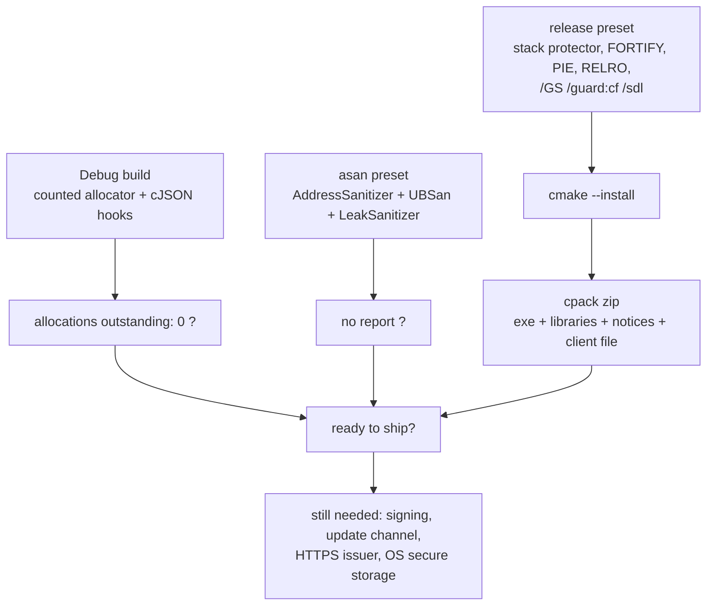

# 05. Hardening and packaging

> **Draft: written but not yet run.** The code and the expected output in this lesson were prepared by reading the code and the official documentation. They have not been executed yet. If something does not behave as described, trust your tool's real output and report it.

## What you will be able to do
- Prove (to a reasonable degree) that the program leaves nothing behind: a counted allocator, cJSON hooks, and a sanitizer build.
- Log without leaking secrets, and explain why redaction is a second line of defence behind "do not log it".
- Build with compiler and linker hardening, and say what each flag stops.
- Package the program with CMake and CPack, and say what a real distribution still needs (signing, updates, secure storage, TLS).

## Recap
1. In chapter 04, what is "move then zero" and which function in `store.c` shows it best? <details><summary>Answer</summary>Copy the struct into its new owner and zero the old copy so the old owner's cleanup frees nothing; `put_task` and `move_page`.</details>
2. In chapter 01, what does `ts_alloc_outstanding` count and what does it not count? <details><summary>Answer</summary>Blocks allocated through `ts_malloc`, `ts_calloc`, `ts_realloc` and `ts_strdup` that are not yet freed; blocks inside SDL, libcurl, OpenSSL and Nuklear are not counted (chapter 05 adds cJSON).</details>

## Why it matters
A program that works is not yet a program you can ship. Shipping means: it ends cleanly (so a crash on exit cannot hide a real bug), it does not write secrets where they can be read, the compiler has been asked to make common mistakes harder to exploit, and somebody else can install it without your build tree. This chapter adds those four things to the app and lists, honestly, what remains outside this lab.

## What you will build
Four small additions, and two new build presets. (1) `log.c`: a logger with redaction, used by `http.c` to print one line per request when `TASKS_LOG=1`. (2) `main.c`: cJSON allocates through the counted functions, and a debug build prints `allocations outstanding: N` at exit and fails the run when N is not zero. (3) `CMakeLists.txt` and `CMakePresets.json`: hardening flags, an `asan` preset and a `release` preset. (4) install rules, a third-party notices file and a CPack zip. Requirements D-23 to D-27.



## Before you start
- **Chapters 01 to 04 done.**
- **Replaced files:** `CMakeLists.txt`, `CMakePresets.json`, `.gitignore`, `src/main.c`, `src/http.c`. **New files:** `src/log.h`, `src/log.c`, `packaging/THIRD-PARTY-NOTICES.md`. Everything else is unchanged from chapter 04: `vcpkg.json`, `keycloak/tasks-desktop-client.json`, `src/util.*`, `src/config.*`, `src/nk_api.h`, `src/nk_impl.c`, `src/http.h`, `src/model.*`, `src/api.*`, `src/pkce.*`, `src/loopback.*`, `src/auth.*`, `src/jobs.*`, `src/store.*`, `src/ui.*`, `src/ui_work.c`.
- **Time:** about 120 minutes. The sanitizer run is easiest on Linux; Windows has AddressSanitizer in recent Visual Studio versions (no leak detection there, which is why the counted allocator exists).
- Finished code: `capstones/desktop-c/source/phase-5-ship/05-hardening-and-packaging/code`.

## Steps
### Step 1. `src/log.h`
Two ideas: the compiler learns that `ts_logf` takes a `printf`-style format (so it checks your arguments and warns on a non-literal format), and redaction is a function you can read and test.

**File: `src/log.h`**
```c
#ifndef TS_LOG_H
#define TS_LOG_H

#include <stdbool.h>
#include <stddef.h>

/* The compiler checks the arguments against the format string (FIO30-C): the format must be a literal. */
#if defined(__GNUC__) || defined(__clang__)
#define TS_PRINTF_LIKE(format_index, first_arg) __attribute__((format(printf, format_index, first_arg)))
#else
#define TS_PRINTF_LIKE(format_index, first_arg)
#endif

/* Reads TASKS_LOG: the value "1" switches logging on. Off by default. */
void ts_log_init(void);
bool ts_log_enabled(void);

/* One line to stderr with a millisecond stamp. The text is passed through ts_log_redact first. */
void ts_logf(const char *fmt, ...) TS_PRINTF_LIKE(1, 2);

/* Copies in to out (capacity cap) and replaces secrets by a marker: the value after "Bearer ",
   "access_token=", "refresh_token=", "id_token=", "code=", "code_verifier=" (and the JSON forms
   "access_token":"...") and any run that starts with "eyJ" (the start of a JWT). It errs on the
   side of hiding too much. Returns the length written; out is always terminated when cap > 0. */
size_t ts_log_redact(const char *in, char *out, size_t cap);

#endif
```

### Step 2. `src/log.c`
**File: `src/log.c`**
```c
#include "log.h"

#include <ctype.h>
#include <stdarg.h>
#include <stdio.h>
#include <stdlib.h>
#include <string.h>

#include "util.h"

static bool g_enabled;

void ts_log_init(void) {
    const char *value = getenv("TASKS_LOG");
    g_enabled = value != NULL && strcmp(value, "1") == 0;
}

bool ts_log_enabled(void) {
    return g_enabled;
}

static const char *const MARKERS[] = {
    "Bearer ",        "access_token=",    "refresh_token=",    "id_token=",
    "code_verifier=", "code=",            "access_token\":\"", "refresh_token\":\"",
    "id_token\":\"",
};

static bool starts_with_nocase(const char *s, const char *prefix) {
    for (; *prefix != '\0'; s++, prefix++) {
        if (*s == '\0' || tolower((unsigned char)*s) != tolower((unsigned char)*prefix)) return false;
    }
    return true;
}

static bool is_value_end(char c) {
    return c == '\0' || c == '&' || c == '"' || c == ' ' || c == '\r' || c == '\n' || c == ',' || c == ';';
}

static bool is_token_char(char c) {
    return isalnum((unsigned char)c) || c == '_' || c == '-' || c == '.';
}

/* Appends n bytes, never writing past out[cap - 1]: the last byte is kept for the terminator. */
static void emit(char *out, size_t cap, size_t *o, const char *s, size_t n) {
    size_t room = cap - 1 - *o;
    if (n > room) n = room;
    memcpy(out + *o, s, n);
    *o += n;
}

size_t ts_log_redact(const char *in, char *out, size_t cap) {
    if (out == NULL || cap == 0) return 0;
    size_t o = 0;
    size_t i = 0;
    while (in[i] != '\0') {
        size_t marker_len = 0;
        for (size_t m = 0; m < sizeof MARKERS / sizeof MARKERS[0]; m++) {
            if (starts_with_nocase(in + i, MARKERS[m])) {
                marker_len = strlen(MARKERS[m]);
                break;
            }
        }
        if (marker_len != 0) {
            emit(out, cap, &o, in + i, marker_len);
            i += marker_len;
            while (!is_value_end(in[i])) i++;
            emit(out, cap, &o, "[redacted]", 10);
        } else if (strncmp(in + i, "eyJ", 3) == 0) {
            while (is_token_char(in[i])) i++;
            emit(out, cap, &o, "[jwt]", 5);
        } else {
            emit(out, cap, &o, in + i, 1);
            i++;
        }
    }
    out[o] = '\0';
    return o;
}

void ts_logf(const char *fmt, ...) {
    if (!g_enabled) return;
    char raw[512];
    char safe[640];
    va_list ap;
    va_start(ap, fmt);
    vsnprintf(raw, sizeof raw, fmt, ap); /* a long line is cut, never overflowed */
    va_end(ap);
    ts_log_redact(raw, safe, sizeof safe);
    fprintf(stderr, "[%llu ms] %s\n", (unsigned long long)ts_now_ms(), safe);
}
```
`emit` is the whole bounds story of this file: it is the only function that writes to `out`, and it never writes past `cap - 1`.

### Step 3. `src/http.c`: one log line per request
Only three things changed compared with chapter 04: the `#include "log.h"`, the new function `log_request`, and its call just before the cleanup in `ts_http_send`. The listing is complete so you can replace the file.

**File: `src/http.c`**
```c
#include "http.h"

#include <SDL3/SDL.h>
#include <ctype.h>
#include <curl/curl.h>
#include <stdint.h>
#include <stdio.h>
#include <stdlib.h>
#include <string.h>

#include "log.h"

#define MAX_BODY_BYTES (4u * 1024u * 1024u)
#define MAX_REQUEST_BYTES (64u * 1024u)

static SDL_AtomicInt g_cancel;

bool ts_http_global_init(void) {
    return curl_global_init(CURL_GLOBAL_DEFAULT) == CURLE_OK;
}

void ts_http_global_cleanup(void) {
    curl_global_cleanup();
}

void ts_http_cancel_all(void) {
    SDL_SetAtomicInt(&g_cancel, 1);
}

static bool equals_nocase(const char *a, const char *b) {
    while (*a != '\0' && *b != '\0') {
        if (tolower((unsigned char)*a) != tolower((unsigned char)*b)) return false;
        a++;
        b++;
    }
    return *a == *b;
}

bool ts_http_url_allowed(const char *url) {
    if (url == NULL) return false;
    if (strncmp(url, "https://", 8) == 0) return url[8] != '\0';
    if (strncmp(url, "http://", 7) != 0) return false;

    const char *authority = url + 7;
    size_t alen = strcspn(authority, "/?#");
    if (alen == 0 || memchr(authority, '@', alen) != NULL) return false;

    size_t hlen;
    if (authority[0] == '[') {
        const char *close = memchr(authority, ']', alen);
        if (close == NULL) return false;
        hlen = (size_t)(close - authority) + 1;
    } else {
        const char *colon = memchr(authority, ':', alen);
        hlen = colon != NULL ? (size_t)(colon - authority) : alen;
    }
    char host[64];
    if (hlen == 0 || hlen >= sizeof host) return false;
    memcpy(host, authority, hlen);
    host[hlen] = '\0';
    return equals_nocase(host, "localhost") || strcmp(host, "127.0.0.1") == 0 || strcmp(host, "[::1]") == 0;
}

void ts_http_response_init(ts_http_response *r) {
    memset(r, 0, sizeof *r);
    r->retry_after_s = -1;
}

void ts_http_response_free(ts_http_response *r) {
    ts_buf_free(&r->body);
    ts_http_response_init(r);
}

static bool header_value(const char *line, size_t n, const char *name, char *out, size_t cap) {
    size_t name_len = strlen(name);
    if (n <= name_len || line[name_len] != ':') return false;
    for (size_t i = 0; i < name_len; i++) {
        if (tolower((unsigned char)line[i]) != tolower((unsigned char)name[i])) return false;
    }
    const char *v = line + name_len + 1;
    const char *end = line + n;
    while (v < end && (*v == ' ' || *v == '\t')) v++;
    while (end > v && (end[-1] == '\r' || end[-1] == '\n' || end[-1] == ' ')) end--;
    size_t len = (size_t)(end - v);
    if (len >= cap) len = cap - 1;
    memcpy(out, v, len);
    out[len] = '\0';
    return true;
}

static size_t on_header(char *line, size_t size, size_t nitems, void *userdata) {
    ts_http_response *r = userdata;
    size_t n = size * nitems;
    char value[128];
    if (header_value(line, n, "ETag", value, sizeof value)) {
        ts_copy(r->etag, sizeof r->etag, value);
    } else if (header_value(line, n, "Content-Type", value, sizeof value)) {
        ts_copy(r->content_type, sizeof r->content_type, value);
    } else if (header_value(line, n, "Retry-After", value, sizeof value)) {
        char *end = NULL;
        long seconds = strtol(value, &end, 10);
        if (end != value && seconds >= 0 && seconds <= 86400) r->retry_after_s = seconds;
    }
    return n;
}

static size_t on_body(char *data, size_t size, size_t nmemb, void *userdata) {
    ts_buf *body = userdata;
    size_t n = size * nmemb;
    /* Returning less than n makes curl stop with CURLE_WRITE_ERROR: the 4 MiB cap. */
    return ts_buf_append(body, data, n, MAX_BODY_BYTES) ? n : 0;
}

static int on_progress(void *userdata, curl_off_t dltotal, curl_off_t dlnow, curl_off_t ultotal, curl_off_t ulnow) {
    (void)userdata;
    (void)dltotal;
    (void)dlnow;
    (void)ultotal;
    (void)ulnow;
    return SDL_GetAtomicInt(&g_cancel) != 0 ? 1 : 0; /* non-zero aborts the transfer */
}

/* Adds "name: prefix value". The temporary line may contain a token, so it is wiped. */
static bool add_header(struct curl_slist **list, const char *name, const char *prefix, const char *value) {
    size_t n = strlen(name) + strlen(prefix) + strlen(value) + 3;
    char *line = ts_malloc(n);
    if (line == NULL) return false;
    if (!ts_setf(line, n, "%s: %s%s", name, prefix, value)) {
        ts_secure_free(line);
        return false;
    }
    struct curl_slist *grown = curl_slist_append(*list, line);
    ts_secure_free(line); /* curl copied it; this copy may hold a token */
    if (grown == NULL) return false;
    *list = grown;
    return true;
}

static void fail(ts_http_response *res, const char *text) {
    ts_copy(res->error, sizeof res->error, text);
    res->status = 0;
}

/* One log line: method, path (never the query, never a body, never a header) and the outcome. */
static void log_request(const ts_http_request *req, long status, const char *error) {
    if (!ts_log_enabled()) return;
    static const char *const names[] = {"GET", "POST", "PATCH", "DELETE"};
    const char *p = strstr(req->url, "://");
    p = p != NULL ? p + 3 : req->url;
    p += strcspn(p, "/");
    char path[160];
    size_t n = strcspn(p, "?#");
    if (n >= sizeof path) n = sizeof path - 1;
    memcpy(path, p, n);
    path[n] = '\0';
    if (status > 0) {
        ts_logf("%s %s -> %ld", names[req->method], path, status);
    } else {
        ts_logf("%s %s failed: %s", names[req->method], path, error);
    }
}

bool ts_http_send(const ts_http_request *req, ts_http_response *res) {
    if (!ts_http_url_allowed(req->url)) {
        fail(res, "Blocked: use https, or http to localhost only.");
        return false;
    }
    if (req->body_len > MAX_REQUEST_BYTES) {
        fail(res, "Request body is too large.");
        return false;
    }
    if (SDL_GetAtomicInt(&g_cancel) != 0) {
        fail(res, "Cancelled.");
        return false;
    }
    CURL *h = curl_easy_init();
    if (h == NULL) {
        fail(res, "Could not start a transfer.");
        return false;
    }

    struct curl_slist *headers = NULL;
    bool ok = add_header(&headers, "Accept", "", "application/json");
    if (ok && req->bearer != NULL) ok = add_header(&headers, "Authorization", "Bearer ", req->bearer);
    if (ok && req->if_match != NULL) ok = add_header(&headers, "If-Match", "", req->if_match);
    if (ok && req->idempotency_key != NULL) ok = add_header(&headers, "Idempotency-Key", "", req->idempotency_key);
    if (ok && (req->method == TS_HTTP_POST || req->method == TS_HTTP_PATCH)) {
        ok = add_header(&headers, "Content-Type", "", req->content_type != NULL ? req->content_type : "application/json");
    }
    if (!ok) {
        curl_slist_free_all(headers);
        curl_easy_cleanup(h);
        fail(res, "Out of memory while building the request.");
        return false;
    }

    curl_easy_setopt(h, CURLOPT_URL, req->url);
    curl_easy_setopt(h, CURLOPT_HTTPHEADER, headers);
    curl_easy_setopt(h, CURLOPT_USERAGENT, "TasksTeamsDesktop/1.0");
    curl_easy_setopt(h, CURLOPT_NOSIGNAL, 1L);
    curl_easy_setopt(h, CURLOPT_FOLLOWLOCATION, 0L);
    curl_easy_setopt(h, CURLOPT_PROTOCOLS_STR, "http,https");
    curl_easy_setopt(h, CURLOPT_CONNECTTIMEOUT_MS, 5000L);
    curl_easy_setopt(h, CURLOPT_TIMEOUT_MS, 20000L);
    curl_easy_setopt(h, CURLOPT_ACCEPT_ENCODING, ""); /* let curl decode gzip; the 4 MiB cap counts decoded bytes */
    /* TLS: verification is on by default; the next three lines only make that visible. */
    curl_easy_setopt(h, CURLOPT_SSL_VERIFYPEER, 1L);
    curl_easy_setopt(h, CURLOPT_SSL_VERIFYHOST, 2L);
    curl_easy_setopt(h, CURLOPT_SSLVERSION, (long)CURL_SSLVERSION_TLSv1_2);
    curl_easy_setopt(h, CURLOPT_WRITEFUNCTION, on_body);
    curl_easy_setopt(h, CURLOPT_WRITEDATA, &res->body);
    curl_easy_setopt(h, CURLOPT_HEADERFUNCTION, on_header);
    curl_easy_setopt(h, CURLOPT_HEADERDATA, res);
    curl_easy_setopt(h, CURLOPT_NOPROGRESS, 0L);
    curl_easy_setopt(h, CURLOPT_XFERINFOFUNCTION, on_progress);

    switch (req->method) {
    case TS_HTTP_GET:
        break;
    case TS_HTTP_POST:
        curl_easy_setopt(h, CURLOPT_POST, 1L);
        break;
    case TS_HTTP_PATCH:
        curl_easy_setopt(h, CURLOPT_CUSTOMREQUEST, "PATCH");
        break;
    case TS_HTTP_DELETE:
        curl_easy_setopt(h, CURLOPT_CUSTOMREQUEST, "DELETE");
        break;
    }
    if (req->method == TS_HTTP_POST || req->method == TS_HTTP_PATCH) {
        curl_easy_setopt(h, CURLOPT_POSTFIELDS, req->body != NULL ? req->body : "");
        curl_easy_setopt(h, CURLOPT_POSTFIELDSIZE_LARGE, (curl_off_t)req->body_len);
    }

    CURLcode rc = curl_easy_perform(h);
    bool got_answer = false;
    if (rc == CURLE_OK) {
        long status = 0;
        curl_easy_getinfo(h, CURLINFO_RESPONSE_CODE, &status);
        res->status = status;
        got_answer = true;
    } else if (rc == CURLE_ABORTED_BY_CALLBACK) {
        fail(res, "Cancelled.");
    } else if (rc == CURLE_WRITE_ERROR) {
        fail(res, "The response was too large or memory ran out.");
    } else {
        fail(res, curl_easy_strerror(rc));
    }
    log_request(req, got_answer ? res->status : 0, res->error);

    curl_slist_free_all(headers);
    curl_easy_cleanup(h);
    return got_answer;
}

static bool is_unreserved(unsigned char c) {
    return isalnum(c) || c == '-' || c == '.' || c == '_' || c == '~';
}

char *ts_url_encode(const char *s) {
    size_t len = strlen(s);
    if (len > (SIZE_MAX - 1) / 3) return NULL; /* 3 * len + 1 would wrap around */
    char *out = ts_malloc(len * 3 + 1);
    if (out == NULL) return NULL;
    static const char hex[] = "0123456789ABCDEF";
    size_t o = 0;
    for (size_t i = 0; i < len; i++) {
        unsigned char c = (unsigned char)s[i];
        if (is_unreserved(c)) {
            out[o++] = (char)c;
        } else {
            out[o++] = '%';
            out[o++] = hex[c >> 4];
            out[o++] = hex[c & 15];
        }
    }
    out[o] = '\0';
    return out;
}

static int hex_value(char c) {
    if (c >= '0' && c <= '9') return c - '0';
    if (c >= 'a' && c <= 'f') return c - 'a' + 10;
    if (c >= 'A' && c <= 'F') return c - 'A' + 10;
    return -1;
}

void ts_url_decode(char *s) {
    char *w = s;
    for (const char *r = s; *r != '\0'; r++) {
        if (*r == '%' && hex_value(r[1]) >= 0 && hex_value(r[2]) >= 0) {
            *w++ = (char)(hex_value(r[1]) * 16 + hex_value(r[2]));
            r += 2;
        } else if (*r == '+') {
            *w++ = ' ';
        } else {
            *w++ = *r;
        }
    }
    *w = '\0';
}
```

### Step 4. `src/main.c`: cJSON through our allocator, and the leak report
Two additions: `cJSON_InitHooks` (before any cJSON call) and the report after `SDL_Quit`. In a debug build (no `NDEBUG`) a non-zero count turns an otherwise successful run into exit code 2, so a script or a CI job notices.

**File: `src/main.c`**
```c
#include <cjson/cJSON.h>
#include <stdio.h>
#include <stdlib.h>

#include "log.h"
#include "nk_api.h"
#include "store.h"
#include "ui.h"
#include "util.h"

#define WINDOW_WIDTH 1100
#define WINDOW_HEIGHT 720

int main(int argc, char **argv) {
    (void)argc;
    (void)argv;

    int exit_code = EXIT_FAILURE;
    SDL_Window *window = NULL;
    SDL_Renderer *renderer = NULL;
    struct nk_context *nk = NULL;
    ts_store store;
    bool store_ready = false;
    float scale = 1.0f;

    ts_log_init();
    /* cJSON allocates through our counted functions too, so the leak report below covers it.
       This must run before the first cJSON call and must never change afterwards. */
    cJSON_Hooks hooks = {ts_malloc, ts_free};
    cJSON_InitHooks(&hooks);

    if (!SDL_Init(SDL_INIT_VIDEO)) {
        fprintf(stderr, "SDL_Init failed: %s\n", SDL_GetError());
        return EXIT_FAILURE;
    }
    if (!SDL_CreateWindowAndRenderer("Tasks and Teams", WINDOW_WIDTH, WINDOW_HEIGHT, SDL_WINDOW_RESIZABLE,
                                     &window, &renderer)) {
        fprintf(stderr, "Window creation failed: %s\n", SDL_GetError());
        goto cleanup;
    }
    SDL_SetRenderVSync(renderer, 1);

    scale = SDL_GetWindowDisplayScale(window);
    if (scale < 1.0f) scale = 1.0f; /* 0 means "unknown" */
    SDL_SetRenderScale(renderer, scale, scale);

    nk = nk_sdl_init(window, renderer, nk_sdl_allocator());
    if (nk == NULL) {
        fprintf(stderr, "Nuklear initialisation failed\n");
        goto cleanup;
    }
    {
        /* Bake the built-in font at the physical size, then draw it at the logical size:
           the text stays sharp on high-DPI displays. */
        struct nk_font_config font_config = nk_font_config(0);
        struct nk_font_atlas *atlas = nk_sdl_font_stash_begin(nk);
        struct nk_font *font = nk_font_atlas_add_default(atlas, 16.0f * scale, &font_config);
        nk_sdl_font_stash_end(nk);
        if (font != NULL) {
            font->handle.height /= scale;
            nk_style_set_font(nk, &font->handle);
        }
    }

    if (!ts_store_init(&store)) {
        fprintf(stderr, "Could not start the application\n");
        goto cleanup;
    }
    store_ready = true;

    bool running = true;
    while (running) {
        SDL_Event event;
        nk_input_begin(nk);
        while (SDL_PollEvent(&event)) {
            if (event.type == SDL_EVENT_QUIT) running = false;
            SDL_ConvertEventToRenderCoordinates(renderer, &event);
            nk_sdl_handle_event(nk, &event);
        }
        nk_input_end(nk);

        ts_store_pump(&store);

        int pixel_w = 0, pixel_h = 0;
        SDL_GetCurrentRenderOutputSize(renderer, &pixel_w, &pixel_h);
        ts_ui_frame(nk, &store, (float)pixel_w / scale, (float)pixel_h / scale);
        nk_sdl_update_TextInput(nk);

        SDL_SetRenderDrawColor(renderer, 24, 28, 36, 255);
        SDL_RenderClear(renderer);
        nk_sdl_render(nk, NK_ANTI_ALIASING_ON);
        SDL_RenderPresent(renderer);
    }
    exit_code = EXIT_SUCCESS;

cleanup:
    /* Reverse order of creation: the store (it stops the worker first), the UI, the window, SDL. */
    if (store_ready) ts_store_shutdown(&store);
    if (nk != NULL) nk_sdl_shutdown(nk);
    if (renderer != NULL) SDL_DestroyRenderer(renderer);
    if (window != NULL) SDL_DestroyWindow(window);
    SDL_Quit();

#ifndef NDEBUG
    {
        long outstanding = ts_alloc_outstanding();
        fprintf(stderr, "allocations outstanding: %ld\n", outstanding);
        if (outstanding != 0 && exit_code == EXIT_SUCCESS) exit_code = 2; /* a leak fails the run */
    }
#endif
    return exit_code;
}
```

### Step 5. `CMakeLists.txt`
New: the `TS_SANITIZE` option, hardening flags, the sanitizer block, install rules and CPack settings; `project(... VERSION 0.1.0 ...)`; `src/log.c` in the sources.

**File: `CMakeLists.txt`**
```cmake
cmake_minimum_required(VERSION 3.21)
project(tasksteams_desktop VERSION 0.1.0 LANGUAGES C)

set(CMAKE_C_STANDARD 17)
set(CMAKE_C_STANDARD_REQUIRED ON)
set(CMAKE_C_EXTENSIONS OFF)

option(TS_SANITIZE "Build with AddressSanitizer (and UBSan outside MSVC); use the asan preset" OFF)

# Nuklear is one header plus an SDL3 renderer header in the same git repository.
# SOURCE_SUBDIR points at a folder that does not exist, so CMake downloads the
# repository but does not run Nuklear's own CMakeLists.txt.
include(FetchContent)
FetchContent_Declare(
  nuklear
  GIT_REPOSITORY https://github.com/Immediate-Mode-UI/Nuklear.git
  GIT_TAG        v4.13.4
  GIT_SHALLOW    TRUE
  SOURCE_SUBDIR  no-cmake-here
)
FetchContent_MakeAvailable(nuklear)

find_package(SDL3 CONFIG REQUIRED)
find_package(CURL CONFIG REQUIRED)
find_package(cJSON CONFIG REQUIRED)
find_package(OpenSSL REQUIRED)
# vcpkg's cJSON exports the target "cjson"; upstream's own config names it "cJSON::cJSON".
if(TARGET cjson)
  set(TS_CJSON_TARGET cjson)
elseif(TARGET cJSON::cJSON)
  set(TS_CJSON_TARGET cJSON::cJSON)
else()
  message(FATAL_ERROR "cJSON was found but exports neither cjson nor cJSON::cJSON")
endif()

add_executable(tasksteams
  src/main.c
  src/util.c
  src/config.c
  src/log.c
  src/http.c
  src/model.c
  src/api.c
  src/pkce.c
  src/loopback.c
  src/auth.c
  src/jobs.c
  src/store.c
  src/ui.c
  src/ui_work.c
  src/nk_impl.c
)

target_include_directories(tasksteams PRIVATE src)
target_include_directories(tasksteams SYSTEM PRIVATE
  ${nuklear_SOURCE_DIR}
  ${nuklear_SOURCE_DIR}/demo/sdl3_renderer
)
target_link_libraries(tasksteams PRIVATE SDL3::SDL3 CURL::libcurl OpenSSL::Crypto ${TS_CJSON_TARGET})
if(UNIX)
  target_link_libraries(tasksteams PRIVATE m)
  # loopback.c uses POSIX sockets, which -std=c17 hides unless this is defined for that file only
  set_source_files_properties(src/loopback.c PROPERTIES COMPILE_DEFINITIONS _POSIX_C_SOURCE=200809L)
endif()
if(WIN32)
  target_link_libraries(tasksteams PRIVATE ws2_32)
endif()

# ---- warnings (all builds) and hardening (all builds that are not sanitizer builds) ----
include(CheckPIESupported)
check_pie_supported(LANGUAGES C)
set_property(TARGET tasksteams PROPERTY POSITION_INDEPENDENT_CODE TRUE) # position independent executable

if(MSVC)
  target_compile_options(tasksteams PRIVATE /W4 /utf-8 /external:W0 /GS /sdl /guard:cf)
  target_compile_definitions(tasksteams PRIVATE _CRT_SECURE_NO_WARNINGS)
  target_link_options(tasksteams PRIVATE /guard:cf /DYNAMICBASE /NXCOMPAT /HIGHENTROPYVA)
  set_source_files_properties(src/nk_impl.c PROPERTIES COMPILE_OPTIONS /w)
else()
  target_compile_options(tasksteams PRIVATE -Wall -Wextra -Wpedantic -Wformat=2 -Wformat-security
                                            -fstack-protector-strong)
  # _FORTIFY_SOURCE needs optimisation, so it is only switched on for Release
  target_compile_definitions(tasksteams PRIVATE $<$<CONFIG:Release>:_FORTIFY_SOURCE=2>)
  if(CMAKE_SYSTEM_NAME STREQUAL "Linux")
    target_link_options(tasksteams PRIVATE -Wl,-z,relro,-z,now) # full RELRO
  endif()
  set_source_files_properties(src/nk_impl.c PROPERTIES COMPILE_OPTIONS -w)
endif()

# ---- sanitizers (the asan preset) ----
if(TS_SANITIZE)
  if(MSVC)
    # MSVC's AddressSanitizer does not work with the runtime checks or incremental linking
    string(REGEX REPLACE "/RTC[1csu]+" "" CMAKE_C_FLAGS_DEBUG "${CMAKE_C_FLAGS_DEBUG}")
    target_compile_options(tasksteams PRIVATE /fsanitize=address)
    target_link_options(tasksteams PRIVATE /INCREMENTAL:NO)
  else()
    target_compile_options(tasksteams PRIVATE -fsanitize=address,undefined -fno-omit-frame-pointer -g)
    target_link_options(tasksteams PRIVATE -fsanitize=address,undefined)
  endif()
endif()

# ---- installing and packaging: cmake --install, then cpack ----
install(TARGETS tasksteams RUNTIME DESTINATION .)
install(FILES keycloak/tasks-desktop-client.json DESTINATION keycloak)
install(FILES packaging/THIRD-PARTY-NOTICES.md DESTINATION .)
if(WIN32)
  # the DLLs of SDL3, curl, cJSON and OpenSSL that the program needs
  install(FILES $<TARGET_RUNTIME_DLLS:tasksteams> DESTINATION .)
endif()

set(CPACK_GENERATOR ZIP)
set(CPACK_PACKAGE_NAME tasksteams)
set(CPACK_PACKAGE_VERSION ${PROJECT_VERSION})
set(CPACK_INCLUDE_TOPLEVEL_DIRECTORY ON)
include(CPack)
```
What each hardening option does (one line each; the chapter's "How it works" gives the reasoning):

| Flag | What it makes harder |
|------|----------------------|
| `-fstack-protector-strong`, `/GS` | a stack buffer overflow that overwrites a return address is detected before the function returns |
| `_FORTIFY_SOURCE=2` | `memcpy`, `snprintf` and friends check the destination size when the compiler knows it |
| position independent executable, `/DYNAMICBASE`, `/HIGHENTROPYVA` | the program loads at a random address (ASLR), so an attacker cannot hard-code addresses |
| `-Wl,-z,relro,-z,now` | the relocation table becomes read-only after start (full RELRO) |
| `/NXCOMPAT` | data pages are not executable (DEP) |
| `/guard:cf` | indirect calls may only go to function starts (control-flow guard) |
| `/sdl` | extra security checks and some warnings as errors |
| `-Wformat=2 -Wformat-security` | non-literal format strings are warnings (FIO30-C) |

### Step 6. `CMakePresets.json`, `.gitignore`, notices
**File: `CMakePresets.json`**
```json
{
  "version": 3,
  "cmakeMinimumRequired": { "major": 3, "minor": 21, "patch": 0 },
  "configurePresets": [
    {
      "name": "default",
      "displayName": "Debug build with vcpkg",
      "binaryDir": "${sourceDir}/build/default",
      "toolchainFile": "$env{VCPKG_ROOT}/scripts/buildsystems/vcpkg.cmake",
      "cacheVariables": { "CMAKE_BUILD_TYPE": "Debug" }
    },
    {
      "name": "asan",
      "displayName": "Debug build with AddressSanitizer",
      "inherits": "default",
      "binaryDir": "${sourceDir}/build/asan",
      "cacheVariables": { "TS_SANITIZE": "ON" }
    },
    {
      "name": "release",
      "displayName": "Release build with hardening flags",
      "inherits": "default",
      "binaryDir": "${sourceDir}/build/release",
      "cacheVariables": { "CMAKE_BUILD_TYPE": "Release" }
    }
  ],
  "buildPresets": [
    { "name": "default", "configurePreset": "default", "configuration": "Debug" },
    { "name": "asan", "configurePreset": "asan", "configuration": "Debug" },
    { "name": "release", "configurePreset": "release", "configuration": "Release" }
  ]
}
```
**File: `.gitignore`**
```text
build/
vcpkg_installed/
CMakeUserPresets.json
dist/
*.o
*.obj
*.exe
*.pdb
*.log
.env
```
**File: `packaging/THIRD-PARTY-NOTICES.md`**
```markdown
# Third-party notices

The `tasksteams` program is built from the Code101 desktop-c capstone sources and links the libraries below.
Each library keeps its own licence; the licence texts come with the packages that vcpkg installs
(`vcpkg_installed/<triplet>/share/<port>/copyright`) and with the Nuklear repository. This list is a
starting point for a release: check the real licence files of the versions you ship before you distribute.

| Library | Used for | Licence (as published by the project) |
|---------|----------|----------------------------------------|
| SDL3 | window, input, threads, clock | zlib licence |
| Nuklear (tag v4.13.4) and its SDL3 renderer backend | user interface | public domain or MIT, at your choice |
| libcurl | HTTP and TLS client | curl licence (MIT-like) |
| cJSON | JSON parsing and writing | MIT |
| OpenSSL | random numbers and SHA-256 | Apache licence 2.0 (OpenSSL 3.x) |

No secret, token, key or personal data is part of this package. The file `keycloak/tasks-desktop-client.json`
is public configuration for a public OAuth client.
```

### Step 7. Build the debug app and read the report
**Command (from `app/`):**
```powershell
cmake --preset default
cmake --build --preset default
```
Expected result (typical): the build succeeds; if your compiler warns about `-Wformat` in `ts_logf` calls, check that every format string is a literal.

## Run it
1. **The leak report.** Run `.\build\default\Debug\tasksteams.exe` (Linux/macOS: `./build/default/tasksteams`), sign in, open a project, click a task, close the window with its button. Predict first: what does the last line of the terminal say? <details><summary>Answer</summary>`allocations outstanding: 0` when every owned block was released. A different number means a leak (positive) or a double free (negative): the exit code is then 2.</details>
2. **The log.** Start again with logging on. Windows PowerShell: `$env:TASKS_LOG = "1"` before the program; Linux: `TASKS_LOG=1 ./build/default/tasksteams`. Sign in and open a project. Typical lines on stderr, each with a millisecond stamp: `GET /realms/tasksteams/.well-known/openid-configuration -> 200`, `POST /realms/tasksteams/protocol/openid-connect/token -> 200`, `GET /v1/me -> 200`, `GET /v1/teams -> 200`. No query, no header, no body, no token appears. Search the whole output for `eyJ`: it must not be there.
3. **Static searches** (PowerShell from `app/`; the first two must print nothing, the third one line):
```powershell
Select-String -Path src\*.c,src\*.h -Pattern '\b(strcpy|strcat|sprintf|gets|strncpy)\s*\('
Get-ChildItem src -Include *.c,*.h -Recurse | Where-Object Name -ne 'util.c' | Select-String -Pattern '\b(malloc|calloc|realloc|free)\s*\('
Select-String -Path src\*.c,src\*.h -Pattern 'tasks:read'
```
The third prints the line of `config.h` that defines `TS_SCOPES`: the scope list exists once (D-13). Linux: the same searches with `grep -nE` and `grep -rnE`.
4. **The sanitizer build (Linux, gcc or clang).** `cmake --preset asan`, `cmake --build --preset asan`, `./build/asan/tasksteams`. Do the same clicks and quit. Expected (typical): no AddressSanitizer or UBSan report from `src/`. LeakSanitizer may print leaks whose stacks end inside the graphics driver or the system libraries; read the stack, only frames in `src/` are ours. Windows (Visual Studio 2022 or later): the same preset enables `/fsanitize=address`; leak detection is not available there, which is why step 1 exists.
5. **The release build and the package.**
```powershell
cmake --preset release
cmake --build --preset release
cmake --install build\release --config Release --prefix dist\tasksteams
cpack --config build\release\CPackConfig.cmake -C Release -B dist
```
Typical result: `dist\tasksteams\` contains the executable, the DLLs on Windows, `keycloak\tasks-desktop-client.json` and `THIRD-PARTY-NOTICES.md`; `dist\` also holds a zip named like `tasksteams-0.1.0-win64.zip` (the exact name comes from CPack and your platform). The release build has no `NDEBUG`-only report line: the leak report exists in debug builds only. On Linux and macOS use `cmake --install build/release --prefix dist/tasksteams` and `cpack --config build/release/CPackConfig.cmake -B dist`.
6. **Redaction by hand.** For `ts_log_redact("POST /token Authorization: Bearer abc123 code=xyz&state=s1")` the code gives `POST /token Authorization: Bearer [redacted] code=[redacted]&state=s1` (derived from the marker list: the value after `Bearer ` ends at the space, the value after `code=` ends at `&`).

## How it works
1. **Two nets for leaks.** The counted allocator (chapter 01) plus the cJSON hooks catch leaks of *our* blocks on every platform and print a number. AddressSanitizer with LeakSanitizer catches *any* leak, use after free, double free and buffer overflow, and prints a stack, but it needs a supported toolchain and slows the program. Use both: the number is a cheap tripwire, the sanitizer is the microscope.
2. **Why hooks must come first.** `cJSON_InitHooks` changes the functions cJSON calls for all later allocations. If a cJSON tree were allocated with `malloc` and freed with `ts_free` (or the reverse), the counter would go wrong and the program might corrupt the heap. That is why the call is the first thing in `main` and is never repeated.
3. **Shutdown order is a design, not a habit.** `ts_store_shutdown` raises the cancel flag, joins the worker (so no thread uses a pointer any more), frees every list, then frees the auth object and cleans libcurl. `main` then destroys Nuklear, the renderer and the window, and finally calls `SDL_Quit`. The leak report comes after all of it, which is why it can be trusted.
4. **Logging is a data-flow decision.** The best redaction is a log call that never receives the secret: `log_request` takes the method, the *path* and the status, and nothing else; the headers and bodies are not in scope. `ts_log_redact` is the backstop for the day somebody adds `ts_logf("%s", some_text)`. It is deliberately greedy (it also hides the value after `status_code=`, because it ends in `code=`): false positives cost a little readability, false negatives cost a secret.
5. **Compiler hardening is mitigation, not correctness.** Stack protectors, FORTIFY, ASLR, RELRO and control-flow guard raise the price of an exploit after a memory bug exists. The coding rules of chapters 01 to 04 (bounded copies, checked sizes, one owner) keep the bug from existing. Ship both. `_FORTIFY_SOURCE` needs optimisation, so it is only on in Release; some Linux distributions already define it, and a "redefined" warning then means you can drop the line.
6. **What the zip is.** `install()` copies named files to a prefix; CPack zips the prefix. On Windows `$<TARGET_RUNTIME_DLLS:tasksteams>` is the list of DLLs that the executable needs from vcpkg's packages. Nothing else goes in: no build tree, no `.env`, no debug symbols (`.pdb`), no tokens.
7. **Misconception:** "the sanitizer run is clean, so the program is safe". A sanitizer only reports what the run touched. It does not test the 422 branch you never clicked, a hostile server, or a 4 MiB response. Add inputs, not confidence.

## Production notes: what changes outside the lab (D-27)
- **TLS everywhere.** The app is built to accept plain `http://` only for loopback hosts. Production sets `TASKS_API_BASE` and `TASKS_OIDC_ISSUER` to `https://` addresses with certificates from a public or company CA. TLS verification is already on; do not add an option that turns it off. Certificate pinning is a separate, costly decision (rotation, recovery) and is not used here.
- **Secure storage.** Tokens stay in memory. If users must stay signed in, store only the *refresh token*, in the operating system's store: Windows Credential Manager (`CredWriteW`) or DPAPI (`CryptProtectData`), the macOS Keychain (Security framework), or a Secret Service client (for example libsecret) on Linux. Request `offline_access` only then, never write a token to a file, the registry, a log or a crash report, and wipe it from memory after use as this app does.
- **Signing and trust.** Sign the executable and installer (Authenticode on Windows; Developer ID and notarisation on macOS; a signed repository or package on Linux). An unsigned download is a request to trust the network path; a signed one is a request to trust you.
- **Updates.** A client that talks to your API needs an update path: a signed installer, a package repository or a store. The API's `/v1` versioning gives you a deprecation window; the client must still be updatable inside it.
- **Crash reports and dumps** can contain memory, including tokens. If you collect them, scrub or encrypt them and say so in your privacy text.
- **Accessibility and localisation** are limits of this lab (Nuklear exposes no accessibility tree; the built-in font covers Latin text). A product that must serve everyone needs a toolkit that does.

## Threat model check
| Threat | Where it is answered in this app |
|--------|----------------------------------|
| Buffer overflow (CWE-120) | `ts_copy`, `ts_setf`, `ts_catf`, `ts_buf`, `emit`; no unbounded libc string function (static search above) |
| Integer overflow in sizes (CWE-190) | checks in `ts_buf_append`, `ts_vec_push`, `ts_url_encode`, `ts_base64url` |
| Double free, use after free (CWE-415, CWE-416) | one owner per block, move then zero, AddressSanitizer run |
| Leaks (CWE-401) | counted allocator and cJSON hooks, LeakSanitizer |
| Format strings (CWE-134) | literal formats only; `TS_PRINTF_LIKE` and `-Wformat=2` |
| Bad certificates, cleartext (CWE-295) | TLS verification on, URL policy |
| Secrets at rest or in logs (CWE-312, CWE-532) | memory-only tokens, wiping, redacting logger, path-only request lines |
| Local port abuse | loopback only, PKCE, `state`, one-shot listener |
| Hostile or huge answers | 4 MiB cap, bounded copies, type-checked JSON, no redirects |

## Try it
1. **Guided.** `exercise/starter/exercise.c` has the same ownership bugs this chapter warns about, in a program small enough to read in one go: a leak when an allocation fails half way, a pointer that two owners will free, and a replace that forgets the old value. Find them with the counter and fix them. Compile: `gcc -std=c17 -Wall -Wextra -g -o exercise exercise.c`. Also try `-fsanitize=address` on the starter (Linux or macOS) to see the double free reported with a stack.
2. **Change.** Add a request counter to `log_request`'s output (`#12 GET /v1/me -> 200`). Which variable do you need, which thread writes it, and does it need to be atomic? <details><summary>Answer</summary>A counter in `http.c`; only the worker thread calls `ts_http_send`, so a plain variable is safe today, but `SDL_AtomicInt` costs nothing and survives a future second worker.</details>
3. **Stretch.** Write a 10-line fuzz harness for the JSON parser: `int LLVMFuzzerTestOneInput(const uint8_t *data, size_t size) { ts_task t; if (ts_parse_task((const char *)data, size, &t)) ts_task_free(&t); return 0; }`, build it with `clang -fsanitize=fuzzer,address` together with `model.c`, `util.c` and the libraries, run it for five minutes, and write down what it found. Decide what the project would need to run it in CI.

Expected output of the exercise solution (derived from the code):
```text
name taken: alice
note replaced: second
after normal use, outstanding: 0
entry_new with a failing allocation returned NULL
after failed entry_new, outstanding: 0
```

<details><summary>Solution</summary>

**File: `exercise/solution/exercise.c`**
```c
#include <stdbool.h>
#include <stdio.h>
#include <stdlib.h>
#include <string.h>

/* A tiny counted allocator, like ts_malloc and ts_free in the app, with a switch that makes it fail on purpose. */
static long live = 0;
static int allocs_until_failure = -1; /* -1 = never fail */

static void *xalloc(size_t n) {
    if (allocs_until_failure == 0) return NULL;
    if (allocs_until_failure > 0) allocs_until_failure--;
    void *p = malloc(n);
    if (p != NULL) live++;
    return p;
}

static void xfree(void *p) {
    if (p == NULL) return;
    live--;
    free(p);
}

static char *xdup(const char *s) {
    size_t n = strlen(s) + 1;
    char *p = xalloc(n);
    if (p != NULL) memcpy(p, s, n);
    return p;
}

typedef struct {
    char *name; /* owned */
    char *note; /* owned */
} entry;

static void entry_free(entry *e) {
    if (e == NULL) return;
    xfree(e->name);
    xfree(e->note);
    xfree(e);
}

/* Fixed: entry_free releases whatever was allocated so far (xfree(NULL) is allowed). */
static entry *entry_new(const char *name, const char *note) {
    entry *e = xalloc(sizeof *e);
    if (e == NULL) return NULL;
    e->name = xdup(name);
    e->note = xdup(note);
    if (e->name == NULL || e->note == NULL) {
        entry_free(e);
        return NULL;
    }
    return e;
}

/* Fixed: ownership moves to the caller, so the entry forgets the pointer. */
static char *take_name(entry *e) {
    char *name = e->name;
    e->name = NULL;
    return name;
}

/* Fixed: copy first, then free the old note and keep the new one; on failure nothing changes. */
static bool replace_note(entry *e, const char *note) {
    char *copy = xdup(note);
    if (copy == NULL) return false;
    xfree(e->note);
    e->note = copy;
    return true;
}

int main(void) {
    entry *e = entry_new("alice", "first");
    char *name = take_name(e);
    printf("name taken: %s\n", name);
    replace_note(e, "second");
    printf("note replaced: %s\n", e->note);
    xfree(name);
    entry_free(e);
    printf("after normal use, outstanding: %ld\n", live);

    allocs_until_failure = 2; /* the entry and its name succeed, the note fails */
    e = entry_new("bob", "x");
    printf("%s\n", e == NULL ? "entry_new with a failing allocation returned NULL" : "entry_new unexpectedly succeeded");
    entry_free(e);
    printf("after failed entry_new, outstanding: %ld\n", live);
    return 0;
}
```
The three bugs of the starter: (1) `entry_new` returned `NULL` without freeing the entry and the name that already existed (a leak on the failure path, the kind that only shows up under memory pressure); (2) `take_name` returned a pointer the entry still owned, so `xfree(name)` followed by `entry_free(e)` freed the same block twice; (3) `replace_note` overwrote `e->note` before freeing the old text (a leak) and, on failure, would have replaced a valid note by `NULL`. The starter has the same `main` as the solution.
</details>

## Check yourself
1. Why does the leak report only exist in debug builds? <details><summary>Answer</summary>It is guarded by `#ifndef NDEBUG`; release builds define `NDEBUG`. The report costs nothing at run time, but the exit-code change would make a release build fail for a reason the customer cannot act on.</details>
2. Predict: you set `TASKS_LOG=1` and a bug passes an access token to `ts_logf("token: %s", token)`. What is printed? <details><summary>Answer</summary>Typically `token: eyJ...` becomes `token: [jwt]`: the run starting with `eyJ` is replaced. The bug is still a bug (a different token format would not match), which is why the first defence is not to pass secrets to the logger.</details>
3. Find the bug: `char buf[16]; ts_logf(user_text);` <details><summary>Answer</summary>A non-literal format string: `user_text` containing `%s` or `%n` is interpreted as a format (CWE-134). Write `ts_logf("%s", user_text)`; `-Wformat-security` and `TS_PRINTF_LIKE` warn about it.</details>
4. Which two checks together would tell you the shutdown path frees everything, even blocks the counted allocator does not see? <details><summary>Answer</summary>The `allocations outstanding: 0` line for our blocks and a clean AddressSanitizer/LeakSanitizer run for the rest.</details>

## Common mistakes
| Symptom or error text (typical) | Cause | Fix |
|---|---|---|
| `allocations outstanding: 3` at exit | a `ts_task`, page or token string was not freed | Find which op or list: reproduce with fewer clicks; every owner frees in `ts_store_shutdown` or `op_release` |
| `allocations outstanding: -1` | a block was freed twice, or freed with `free` instead of `ts_free` | Search for `free(` outside `util.c`; check moves are followed by a zeroing |
| cJSON crash right at start with the hooks | `cJSON_InitHooks` was called after a cJSON allocation | Keep it first in `main` |
| Warning that `_FORTIFY_SOURCE` is redefined | The distribution compiler already defines it | Remove the definition from `CMakeLists.txt` for that platform |
| MSVC error that `/RTC1` and `/fsanitize=address` are incompatible | The default debug flags are still present | Keep the `string(REGEX REPLACE ...)` line of the sanitizer block |
| `cpack` makes a zip without the DLLs | The install step was skipped or was a Debug install | Run `cmake --install` with `--config Release` first, then `cpack ... -C Release` |
| LeakSanitizer prints many leaks from `libGL`, `libX11` or `libfontconfig` | Third-party libraries keep caches until exit | Keep only reports whose stack has frames in `src/`; add a suppression file for the rest |

## Best practice
Make leaks and overflows loud in development (counters, sanitizers, warnings as habit) and make secrets absent in production (not stored, not logged, wiped). Source: SEI CERT C Coding Standard, MEM31-C "Free dynamically allocated memory when no longer needed", https://wiki.sei.cmu.edu/confluence/display/c/MEM31-C.+Free+dynamically+allocated+memory+when+no+longer+needed ; AddressSanitizer, https://clang.llvm.org/docs/AddressSanitizer.html

## Going further
- The [OpenSSF compiler options hardening guide](https://best.openssf.org/Compiler-Hardening-Guides/Compiler-Options-Hardening-Guide-for-C-and-C++.html) explains every flag of Step 5 and what else exists.
- CMake [`install`](https://cmake.org/cmake/help/latest/command/install.html) and [CPack](https://cmake.org/cmake/help/latest/module/CPack.html).
- Back to the platform: run this client against each backend that passes `18 passed, 0 failed`, and note any difference as a contract finding for the platform backlog (section 12.1 of the platform TDD).

## Summary
- You made the exit path verifiable: a counter that includes cJSON and a sanitizer build for everything else.
- You added a logger that cannot be handed a secret by `http.c` and that redacts what it does receive.
- You switched on compiler and linker hardening and built Debug, ASan and Release presets.
- You packaged the app with install rules and CPack, and listed what production still needs: HTTPS, OS secure storage, signing and updates.

## Next steps
Return to the [capstone README](../../README.md) for the full map. Good follow-ups: the platform's backend capstones (to read the other side of every request you made), or a 301 lesson on memory-safety tooling in C.
