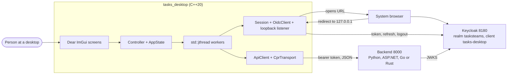

# Desktop client in C++20 with SDL3 and Dear ImGui

Native Tasks and Teams for Windows, macOS and Linux: sign in with the system browser (authorization code + PKCE, loopback redirect), list teams and projects, and create, edit and delete tasks with `If-Match`, cursor paging and RFC 9457 problem details. It uses only the [platform contract](../platform/TDD.md) and works with every backend that passes the conformance script. Requirement ids are `D-xx` (see the [TDD](TDD.md)).

**Status: written (not run).** The author was told not to run builds, tests, compilers or verifiers in this writing block. Every chapter has `verified: not yet run`; the code was written from the upstream headers and documentation and has never been compiled. Expect small compile errors on the first build and treat your compiler's message as the truth. No output in the chapters is invented: where it is derived it says "typical".

## System diagram

## Chapters and complete phase snapshots
| Chapter | Tutorial | Source pack | Time |
|---|---|---|---|
| 01 Setup and window | [01](tutorials/phase-1-setup/01-setup-and-window.md) | desktop-cpp-phase-1-setup.zip | 60 min |
| 02 HTTP and JSON client | [02](tutorials/phase-2-http/02-http-and-json-client.md) | desktop-cpp-phase-2-http.zip | 90 min |
| 03 Auth with PKCE | [03](tutorials/phase-3-auth/03-auth-pkce.md) | desktop-cpp-phase-3-auth.zip | 120 min |
| 04 Screens, threading and state | [04](tutorials/phase-4-screens/04-screens-threading-state.md) | desktop-cpp-phase-4-screens.zip | 150 min |
| 05 Hardening and packaging (with Catch2 tests) | [05](tutorials/phase-5-ship/05-hardening-and-packaging.md) | desktop-cpp-phase-5-ship.zip | 90 min |

Each `source/phase-N-slug/NN-slug/` holds `code` (the whole app at that point), `exercise/starter`, `exercise/solution` (small overlays on `code/src`) and `verify.json`. A lesson shows every file that is new or changed in that chapter in full and lists the unchanged files with the chapter that shows them; the pack always contains all files. Zips are built by the repository pack builder into `dist/packs`, not committed.

## Start reading
1. The [TDD](TDD.md): requirements `D-01` to `D-27`, architecture, the sign-in sequence and the readiness checklist (section 14: recommended lessons `cpp/101` 01 to 12 and the platform primers; none is a gate).
2. [VERSIONS](VERSIONS.md) and the [glossary](GLOSSARY.md).
3. Chapter 01.

## What you need
A C++20 compiler, CMake 3.28+, Git, vcpkg (manifest mode, baseline `9eec002df1cd109f8f104cd966a763daf9751489`), the platform running with one backend, and a web browser. The first `cmake --preset` compiles every dependency and takes a long time; later runs reuse the result.

## The one platform gap
The platform realm file has no client that accepts a loopback redirect. `source/phase-3-auth/03-auth-pkce/code/keycloak/tasks-desktop-client.json` is a Keycloak *partial import* file that adds the public client `tasks-desktop` (redirect `http://127.0.0.1/callback`, PKCE S256, no secret). Import it once (chapter 03). The platform files were not edited; adding this client to `realm-tasksteams.json` belongs in the platform v1.1 backlog.

## What is included
- CMake presets for Windows, Linux and macOS, vcpkg manifest with a pinned baseline, warnings on, static libraries.
- RAII wrappers for SDL3 and Dear ImGui; `Result<T>` on `tl::expected`; a transport interface over cpr and libcurl with timeouts, no redirects, a body cap and cancellation.
- Typed JSON models, `If-Match`, JSON Merge Patch, `Idempotency-Key`, cursor paging, problem details with a type-to-message table and per-field errors.
- Authorization code + PKCE (S256) from the system browser, discovery with exact issuer check, a one-shot loopback listener with `state` and `Host` checks, single-flight refresh with rotation, back-channel sign out, tokens in memory only (`Secret`, wiped on release).
- `std::jthread` workers, a thread-safe queue to the UI thread, stale-answer dropping, clean shutdown through stop tokens.
- Catch2 tests for PKCE (RFC 7636 appendix B), base64url, request building, problem parsing, the pager, the patch, messages and URL rules; CPack ZIP presets.

## Limits
- Not run: no build, no browser sign-in, no manual check, no test result is claimed anywhere.
- Dear ImGui has no accessibility tree; screen readers cannot read this app. Keyboard navigation and display scaling are on.
- No offline cache and no secure token storage on disk (chapter 03 and the TDD name what a production app would use per OS).
- No code signing, notarisation, auto update or Linux packaging beyond a ZIP (named in chapter 05).
- Keycloak's "any port for a 127.0.0.1 redirect URI" rule was read in its documentation and has to be confirmed in the first manual run (TDD section 12).

Neighbours: [platform](../platform/README.md), [mobile-kotlin](../mobile-kotlin/README.md) (same contract, same phases for a phone).
