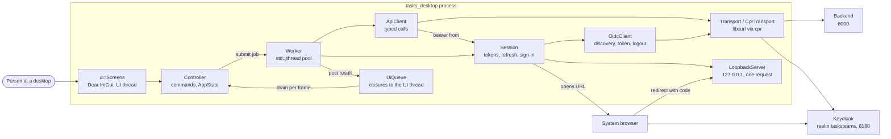
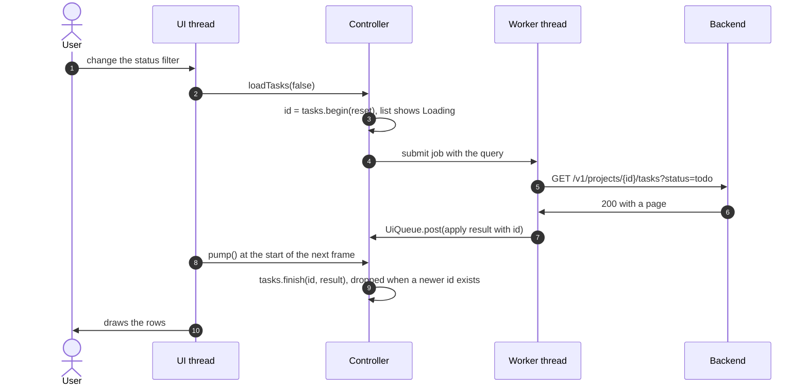
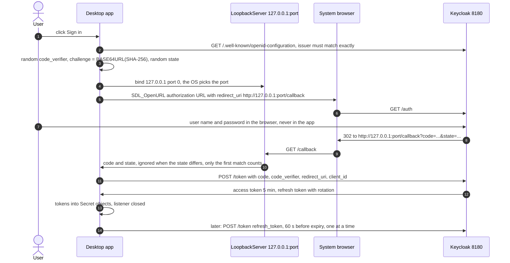

# TDD: Desktop client in C++20 with SDL3 and Dear ImGui (Tasks and Teams)

| Field | Value |
|-------|-------|
| Id | desktop-cpp |
| Level | 201 |
| Status | Draft (design and source written 2026-11-23; nothing built or run) |
| Depends on | platform (contract, Keycloak realm, plus the extra client in `keycloak/tasks-desktop-client.json`) and one backend: backend-python, backend-dotnet, backend-go or backend-rust (the desktop client uses only the contract, so all four work) |
| Stack | C++20 (MSVC from Visual Studio 2022 or newer, GCC 12+, Clang 15+), CMake 3.28+, vcpkg manifest mode (registry baseline `9eec002df1cd109f8f104cd966a763daf9751489`, the 2026.10.16 release), SDL3, Dear ImGui (SDL3 renderer backend), cpr (libcurl), nlohmann-json, spdlog, tl-expected, OpenSSL (hash and random only), cpp-httplib (loopback listener only), Catch2 3. Exact port versions are those of the baseline; the lessons name none that was not read from the vcpkg port files on 2026-11-23 |
| Estimated learner time | 5 chapters, about 8.5 hours (60 + 90 + 120 + 150 + 90 minutes), plus a long first `vcpkg install` |
| Last updated | 2026-11-23 |

## 1. Purpose and learning goals
The app is the native desktop client of "Tasks and Teams": a person signs in with the system browser, browses teams and projects, and works a task list (create, edit, delete) with optimistic concurrency. It is the C++ sibling of the web and mobile clients and uses only the [platform contract](../platform/TDD.md); this document repeats none of it.

Skills gained:
1. Set up a modern C++20 project with CMake presets, vcpkg manifest mode and compiler warnings, following the C++ Core Guidelines.
2. Wrap C libraries (SDL3, Dear ImGui) in RAII types so that no resource is released by hand.
3. Model failure as values with `tl::expected` (the C++23 `std::expected` shape in C++20) and one `Problem` type for transport, HTTP, parsing and sign-in errors.
4. Call a REST API with cpr, parse RFC 9457 problem details, send `If-Match`, `Idempotency-Key`, JSON Merge Patch and cursors.
5. Sign in with OAuth 2.0 authorization code + PKCE (RFC 7636) from the system browser using a loopback redirect (RFC 8252), keep tokens in memory only and refresh them safely.
6. Run requests on `std::jthread` workers, hand results to the UI thread through a thread-safe queue, drop stale answers and shut down cleanly with stop tokens.
7. Build an immediate-mode GUI (Dear ImGui) with forms, tables, modals and error banners.
8. Unit-test pure logic with Catch2 and package a release build with CPack.

## 2. Scope
**In scope:** one desktop executable for Windows, macOS and Linux; sign in and out; teams and projects lists; task list with filters, sort and cursor paging; create, edit and delete tasks; conflict handling; problem details display; clean shutdown; unit tests; a release ZIP; five chapters and phase packs.
**Out of scope:** offline cache and outbox (the mobile capstones teach them), comments, team and member administration, the audit log, attachments, auto update, code signing and notarisation (named in chapter 05, not taught), screen-reader support (Dear ImGui has none; stated honestly in D-25), Authentik (appendix only in the backends), Qt and other GUI toolkits.
**Assumptions:** the platform runs (`docker compose -p platform up -d --wait`), one backend listens on `http://localhost:8000`, Keycloak on `http://localhost:8180`, the learner has finished C++ 101 (see the readiness checklist) and has a C++20 toolchain, CMake, Git and vcpkg.
**Constraints:** Docker is temporary and only the platform and a backend use it; the app is never run in Docker. The realm file of the platform has no client for desktop apps (section 12), so this capstone ships a partial-import file and does not edit the platform.

## 3. Requirements
`[build]` checks need a compiler but no server; `[manual]` checks need the platform and a backend; `[review]` checks are a reading or search by the learner.

| Id | Requirement | Priority | Acceptance check | Phase |
|----|-------------|----------|------------------|-------|
| D-01 | The project configures and builds from a clean checkout with `cmake --preset <os>` and `cmake --build --preset <os>-debug`; vcpkg manifest mode installs every dependency; the warning level is `/W4 /permissive-` or `-Wall -Wextra -Wpedantic` | Must | `[build]` both commands exit 0 | 1 |
| D-02 | A resizable SDL3 window with a Dear ImGui frame loop opens, scales with the display (HiDPI) and closes through the window button or a Quit button | Must | `[manual]` window appears and process exits with code 0 | 1 |
| D-03 | Every resource (SDL, ImGui contexts, threads, secrets, servers) is owned by an RAII type; app code contains no `new`, `delete` expressions, `malloc` or `free` calls | Must | `[review]` `rg "\bnew\b|malloc|std::free" src` finds only comments, UI strings and the MSVC `_dupenv_s` holder (`= delete` declarations are fine) | 1 to 5 |
| D-04 | Every fallible operation returns `Result<T>` (`tl::expected<T, Problem>`); exceptions are used only for start-up failures that stop the program | Must | `[review]` no `throw` outside `Platform.hpp` | 2 |
| D-05 | All HTTP goes through one `Transport` interface: connect timeout 3 s, total timeout 10 s, redirects off, TLS verification on, no header or body logged | Must | `[build]` unit test with a fake transport; `[review]` | 2 |
| D-06 | Responses are decoded into typed models; a missing or mistyped field gives a `Parse` problem, never a crash | Must | `[build]` unit test with a bad body | 2 |
| D-07 | Sign-in uses authorization code + PKCE (S256) with client `tasks-desktop`, the system browser, a `127.0.0.1` listener on an OS-chosen port, a random `state` that is checked, and discovery with an exact issuer comparison | Must | `[manual]` browser opens, the app shows the user name | 3 |
| D-08 | Tokens live only in memory inside `Secret` objects that overwrite their bytes on destruction; nothing is written to disk, the registry or the log | Must | `[review]` search for file writes in `src/auth`; `[manual]` log file has no token | 3, 5 |
| D-09 | One shared in-flight refresh runs when the access token has less than 60 s left; the rotated refresh token replaces the old one before use; a failed refresh returns to the signed-out state | Must | `[manual]` wait 6 minutes, next call works; `[build]` unit test of the expiry rule is a stretch goal | 3 |
| D-10 | Sign out ends the Keycloak session with the refresh token (back-channel logout), then wipes the tokens | Must | `[manual]` the next sign-in asks for the password again only after the SSO session ended, and the old refresh token is rejected | 3 |
| D-11 | The app requests exactly `openid profile email tasks:read tasks:write`, has no client secret and never uses the password grant | Must | `[review]` the scope string appears once, in `core/Config.hpp` | 3 |
| D-12 | Teams and projects load page by page with `limit` 25 and the opaque `page.nextCursor` behind a "More" button; the cursor is never parsed | Must | `[manual]` with more than 25 teams the button appears; `[build]` pager unit test | 4 |
| D-13 | The task list filters by repeatable `status` and `q`, sorts by `sort` and pages with the cursor; a filter change restarts at page 1 | Must | `[manual]` seed data filtered by status `todo` | 4 |
| D-14 | Create sends an `Idempotency-Key` created when the form opens, so a double click or retry replays instead of duplicating | Must | `[manual]` double click creates one task; `[build]` header unit test | 4 |
| D-15 | Edit sends `If-Match: "<version>"` and a JSON Merge Patch with only the changed fields; clearing the due date sends `"dueDate": null` | Must | `[build]` patch and header unit tests | 4 |
| D-16 | A 412 opens a conflict dialog with "Keep my change" (fetch the task, resend with the new version) and "Reload" (drop the change) | Must | `[manual]` edit the same task in two copies of the app | 4 |
| D-17 | Delete asks for confirmation and sends `If-Match` | Must | `[manual]` task disappears; `[build]` header unit test | 4 |
| D-18 | Problem details are shown as a message plus technical lines (type, status, detail, `traceId`); 422 `errors[]` appear next to the fields; 429 shows `Retry-After`; unknown types show the `title` | Must | `[manual]` empty title; `[build]` message unit test | 4 |
| D-19 | No network call runs on the UI thread; workers post closures to a thread-safe queue that the UI thread drains once per frame; an answer for a superseded request is dropped | Must | `[manual]` the window stays responsive with the backend stopped; `[build]` pager unit test | 3, 4 |
| D-20 | Closing the window requests stop on every worker, aborts in-flight requests and the sign-in wait, joins all threads and exits within the 10 s request timeout | Must | `[manual]` close during a request; no hang | 3, 4 |
| D-21 | Base URLs must be `https`, or `http` only for `localhost`, `127.0.0.1` or `[::1]`, without credentials, query or fragment | Must | `[build]` URL policy unit test | 5 |
| D-22 | A response body larger than 4 MiB is rejected while it downloads | Should | `[review]` write callback in `CprTransport.cpp` | 5 |
| D-23 | Catch2 unit tests cover: base64url and the RFC 7636 example, request building, problem parsing, patch building, pager, messages, URL policy | Should | `[build]` `ctest --preset <os>` | 5 |
| D-24 | `cpack --preset ship-<os>` produces a ZIP with the executable and the Keycloak client file from a static release build without tests (licence notices of the dependencies are a stretch goal, named in chapter 05) | Should | `[build]` ZIP exists | 5 |
| D-25 | Keyboard navigation is enabled, text scales with the display, status and errors are words and never colour alone; the lesson states that screen readers cannot read an ImGui window | Should | `[manual]` Tab and Enter operate the forms | 1, 4 |
| D-26 | spdlog writes a rotating log file in the user's preferences folder; request lines hold method, path and status only | Should | `[manual]` log lines readable, no token | 5 |
| D-27 | Every chapter has a complete snapshot pack, a `verify.json` and a lesson that matches the files | Must | `[review]` `python scripts/verify_labs.py --static capstones/desktop-cpp` (not run in this block) | 1 to 5 |

| Non-functional requirement | Target |
|----------------------------|--------|
| UI frame time | no network, parsing or file work on the UI thread; measure the frame time yourself with Dear ImGui's `GetIO().Framerate` while a list loads (no number is claimed) |
| First task page after sign-in | the platform budget applies (p95 200 ms on loopback); the client adds no more than one UI frame of latency |
| Shutdown | all threads joined; worst case one request timeout (10 s) |
| Portability | Windows 10+, macOS 13+, Linux with a desktop session; no platform `#ifdef` in app code except the MSVC environment lookup |
| Security | no secret on disk, https or loopback only, no redirects, redirect listener bound to loopback and one-shot |
| Maintainability | layers depend inwards (section 8); pure logic is header-only or in `tasks_core` and tested without a window |

## 4. Architecture


| Component | Responsibility |
|-----------|----------------|
| `app::Platform` (SdlRuntime, Window, ImGuiLayer) | RAII for SDL3 and Dear ImGui; frame begin and end |
| `app::App` | Owns the window and the controller; runs the frame loop |
| `app::Controller` | The only place where UI events become jobs; owns `AppState`, `Session`, `ApiClient`, `UiQueue`, `Worker` |
| `state::AppState` | Plain data the UI draws: auth phase, lists with paging and generation, form, conflict |
| `ui::Screens` | Draws state, calls controller commands; no network, no threads |
| `api::ApiClient`, `Models` | One method per operation; builds URLs, headers and bodies; decodes JSON |
| `net::Transport`, `CprTransport` | One `send` function: request in, response or network problem out; stop token aborts |
| `auth::Session`, `OidcClient`, `Pkce`, `LoopbackServer`, `Secret` | The sign-in protocol and the in-memory token store |
| `core::Result`, `Config`, `Util`, `ProblemText`, `Validation`, `Concurrency` | Shared value types and helpers; no I/O |

Decisions (ADR style):

| Decision | Alternatives | Consequences |
|----------|--------------|--------------|
| SDL3 + Dear ImGui with the SDL renderer backend | Qt, wxWidgets, GLFW + OpenGL | Small dependency set and a tiny frame loop; immediate mode keeps UI state in plain structs. No native widgets, no screen reader support, text input is basic |
| vcpkg manifest mode with a registry baseline, static triplets | Conan, FetchContent, system packages | The manifest is the dependency list; the baseline pins every version; static triplets give one executable. First configure compiles everything |
| cpr over raw libcurl | libcurl C API, Boost.Beast, WinHTTP | Readable C++ API with a progress callback for cancellation; cpr hides curl handles. One more layer to learn |
| `tl::expected` | exceptions, `std::expected` (C++23), error codes | Explicit failure path that composes; the type has the C++23 interface, so migration is a rename. C++20 has no monadic syntax sugar |
| One `Problem` error type | per-layer error enums | Every layer can return the same value to the UI; a `kind` field separates network, HTTP, parse, auth |
| `std::jthread` pool + `UiQueue` | `std::async`, coroutines, a UI-thread event loop with callbacks | Stop tokens give cooperative cancellation and automatic joins; closures are simple. Jobs must not touch UI state, only post |
| System browser with a loopback listener | Embedded web view, device code flow | RFC 8252 recommended path; the app never sees the password. Needs a free loopback port and a browser |
| Keycloak client `tasks-desktop` registered as `http://127.0.0.1/callback` | Reuse `tasks-web` or `tasks-mobile` | Keycloak ignores the port for loopback redirect URIs (documented in its securing-apps guide); a separate client keeps redirect URIs exact. Needs the partial import of this capstone |
| OpenSSL only for SHA-256 and random bytes | Hand-written SHA-256, `std::random_device` | No home-made cryptography; a vetted random source. A large dependency for two functions |
| Tokens in memory only | OS credential store | No secret on disk and nothing to clean up; the user signs in again after a restart. Production note below |
| Hand-written models and URL building | Generated client | The contract is small and a C++ generator adds a build step and a style the lessons would have to explain. Drift is possible: the exit check compares operations by reading |

**Production note (not implemented).** A shipped desktop app that must stay signed in would store only the refresh token in the operating system secret store: Windows Credential Manager (DPAPI), macOS Keychain, Linux Secret Service (libsecret, GNOME Keyring or KWallet). The capstone does not do this because secure storage differs per OS and an in-memory design is the safer default for a teaching app.

## 5. Domain and data model
The server entities are in the platform TDD. The client keeps them as plain structs (`Team`, `Project`, `Task`, `Me`), all `version` fields as `int` and all timestamps as the server's strings. There is no local database. UI state:

| State | Fields | Rule |
|-------|--------|------|
| `PagedList<T>` | `phase` (Idle, Loading, Ready, Failed), `items`, `nextCursor`, `error`, `generation` | `begin()` increments `generation`; `finish(id, result)` applies the answer only when `id == generation` |
| `AppState` | `auth`, `me`, `notice`, three lists, selected ids, status filter flags, search text, sort index, `form`, `conflict`, `pendingDelete` | Mutated only on the UI thread |
| `TaskForm` | fixed text buffers, selected status and priority, `original` task, `baseVersion`, `idempotencyKey`, `errors` | `makePatch()` compares with `original` and returns only changed fields |
| `Session` tokens | access `Secret`, refresh `Secret`, expiry (steady clock) | guarded by a mutex; replaced as a whole on refresh |



## 6. API design
The app only consumes the contract; every row is an operation of the [platform TDD](../platform/TDD.md) section 6.

| Screen area | Operation (`operationId`) | Headers the app sends | Success | Failures handled |
|-------------|---------------------------|-----------------------|---------|------------------|
| Probe (chapter 2) | `getHealth` | none | 200 | 503 |
| Top bar | `getMe` | bearer | 200 | 401 |
| Teams | `listTeams` (`limit`, `cursor`) | bearer | 200 | 401, 429 |
| Projects | `listProjects` | bearer | 200 | 404 |
| Tasks | `listTasks` (`status` repeated, `q`, `sort`, `limit`, `cursor`) | bearer | 200 | 400 bad cursor |
| Form | `createTask` | bearer, `Idempotency-Key` | 201 | 409, 422 `errors[]` |
| Form | `updateTask` | bearer, `If-Match: "<version>"`, `Content-Type: application/merge-patch+json` | 200 | 412, 422, 428 (a bug if it ever happens) |
| Conflict dialog | `getTask` | bearer | 200 | 404 |
| Row | `deleteTask` | bearer, `If-Match` | 204 | 403, 404, 412 |

Client rules: base URL plus `/v1` path; ids from the server are percent-encoded before they are put in a path; the cursor is copied, never built or parsed; 401 on an API call ends the session (the tokens are wiped and the sign-in button returns); a replayed create (`Idempotent-Replayed: true`) is a success; header names are compared case-insensitively (platform section 12.1); RateLimit headers are not used except `Retry-After` after a 429; the `Problem` `type` suffix selects the user message.

## 7. Identity and security design
Realm `tasksteams`, issuer `http://localhost:8180/realms/tasksteams`, public client `tasks-desktop` (standard flow, PKCE S256, no direct grants, redirect URI `http://127.0.0.1/callback`).



| Topic | Rule |
|-------|------|
| Scopes | `openid profile email tasks:read tasks:write`; no `tasks:admin` (no screen needs it), no `offline_access` (tokens are not kept across runs) |
| Redirect | RFC 8252 section 7.3: IP literal `127.0.0.1`, any port, path `/callback`; the listener answers only requests whose `Host` header is `127.0.0.1:<port>` and whose `state` matches, then closes after the first match |
| Storage | Memory only (`Secret`: move-only, overwritten with `OPENSSL_cleanse` on destruction). Best effort: libcurl and the OS keep their own short-lived copies. Production would store the refresh token in the OS secret store (note in section 4) |
| Rotation | Realm `revokeRefreshToken` true and `refreshTokenMaxReuse` 0: refresh is serialised by a mutex and the new refresh token replaces the old one before the access token is used |
| Transport | TLS verification on, redirects off (a redirect would forward the bearer to another host), URL policy of D-21, body cap of D-22, no tokens, headers or bodies in logs |
| UI safety | Server text is drawn with `TextUnformatted` or `"%s"`, never as a format string |
| Sign out | `POST end_session_endpoint` with `client_id` and `refresh_token`, then local wipe; failures are logged and the wipe still happens |

OWASP mapping (desktop focus, OWASP ASVS and the API Top 10 client side):

| Risk | Where this design answers it |
|------|------------------------------|
| Stolen authorization code | PKCE S256, one-shot loopback listener, state check, exact `127.0.0.1` redirect |
| Token theft from disk | Nothing is written (D-08) |
| Token leakage in logs or crash dumps | No token logging; `Secret` wipes; dumps are out of scope and named |
| Open redirect or SSRF through server data | Discovery issuer must match the configured issuer; URL policy; ids encoded in paths |
| Malicious server text in the UI | Never used as a format string |
| Outdated dependencies | vcpkg baseline pinned; update by changing one commit id and rebuilding |
| Local port squatting | Loopback bound with an OS-chosen port; only a request with the right `state` is accepted |

## 8. Project structure
```text
capstones/desktop-cpp/
  README.md  TDD.md  VERSIONS.md  GLOSSARY.md  _BRIEF.md  _STATE.md
  tutorials/phase-N-slug/NN-slug.md                    five chapters
  source/phase-N-slug/PACK-README.md
  source/phase-N-slug/NN-slug/{code, exercise/{starter,solution}, verify.json}
  source/phase-5-ship/05-hardening-and-packaging/code/   the finished app
    CMakeLists.txt  CMakePresets.json  vcpkg.json  .gitignore
    keycloak/tasks-desktop-client.json                   partial import for the realm
    src/main.cpp
    src/app/{Platform.hpp, Theme.hpp, App.hpp, App.cpp, Controller.hpp, Controller.cpp}
    src/ui/{Screens.hpp, Screens.cpp}
    src/state/AppState.hpp
    src/api/{Models.hpp, ApiClient.hpp, ApiClient.cpp}
    src/net/{Transport.hpp, CprTransport.hpp, CprTransport.cpp}
    src/auth/{Secret.hpp, Pkce.hpp, Pkce.cpp, LoopbackServer.hpp, OidcClient.hpp, OidcClient.cpp, Session.hpp, Session.cpp}
    src/core/{Result.hpp, Util.hpp, Config.hpp, ProblemText.hpp, Validation.hpp, Concurrency.hpp}
    tests/{CMakeLists.txt, test_pkce.cpp, test_api.cpp, test_state.cpp, test_config.cpp}
```
Layering: `ui -> app (Controller) -> {state, api, auth} -> net -> core`; `core` depends on nothing in the project; only `app/Platform.hpp` and `app/App.cpp` include SDL; only `ui/Screens.cpp` includes ImGui widgets besides `Platform.hpp`. CMake targets: `tasks_warnings` (interface), `tasks_core` (static library with everything except `app`, `ui`, `main`), `tasks_desktop` (executable), `tasks_tests` (chapter 05). Naming: namespace `tt`, types `PascalCase`, functions and variables `camelCase`, members with a trailing underscore, files named after their main type. Every chapter pack holds the whole project at that point; the lesson shows every file that is new or changed in the chapter in full and lists unchanged files with the chapter where they were shown.

| Setting | Default | Used by |
|---------|---------|---------|
| `API_BASE_URL` | `http://localhost:8000` | `ApiClient` |
| `OIDC_ISSUER` | `http://localhost:8180/realms/tasksteams` | `OidcClient` |
| `SPDLOG_LEVEL` | `info` | spdlog (for example `debug`) |

## 9. Delivery plan (phases)
| Phase | Title | Chapter | Requirement ids | Exit check | Source pack |
|-------|-------|---------|-----------------|-----------|-------------|
| 1 | Setup and window | 01 | D-01, D-02, D-03, D-25 (part) | `cmake --preset <os>`, `cmake --build --preset <os>-debug`, window opens and closes | `desktop-cpp-phase-1-setup.zip` |
| 2 | HTTP and JSON client | 02 | D-04, D-05, D-06 | build; probe buttons show `/health` and a 401 problem | `desktop-cpp-phase-2-http.zip` |
| 3 | Auth with PKCE | 03 | D-07 to D-11, D-19 (part), D-20 (part) | build; sign in as carol, name appears; sign out | `desktop-cpp-phase-3-auth.zip` |
| 4 | Screens, threading and state | 04 | D-12 to D-20, D-25 | build; seed data visible; create, edit, conflict, delete | `desktop-cpp-phase-4-screens.zip` |
| 5 | Hardening and packaging | 05 | D-21 to D-24, D-26, D-27 | `ctest --preset <os>` green; `cpack --preset ship-<os>` ZIP | `desktop-cpp-phase-5-ship.zip` |

## 10. Verification plan
Written but not run in this block (the user's writing-only rule). A later authorised run, per phase, from the pack's `code` folder: configure and build with the presets (the first run compiles all dependencies); phase 5 adds `ctest --preset <os>` and `cpack --preset ship-<os>`. `verify.json` covers only build, test and package steps; sign-in and the screens need a browser, a display and the platform, so they are `[manual]`. **Manual run (author once, learner always):** start the platform and one backend (`docker compose -p platform up -d --wait`, then the backend's run command), import `keycloak/tasks-desktop-client.json` (Admin console, realm settings, Action, Partial import), start `tasks_desktop`, sign in as carol (password in the platform TDD, fake), open Mobile Team, create, edit, double click Save, edit the same task in a second copy to force a 412, delete, close the window during a request. Clean up: close the app, `docker compose -p platform down -v --remove-orphans`. **Conformance:** the app is conformant when it uses only operations of `openapi.yaml` and works against every backend that reports `18 passed, 0 failed`.

## 11. Deployment and operations
There is no server component. Outputs: `build/<preset>/out/tasks_desktop[.exe]` for development (the folder `out` comes from `CMAKE_RUNTIME_OUTPUT_DIRECTORY`; Debug and Release builds of one preset overwrite each other) and `tasks-desktop-0.1.0-<System>.zip` in `build/ship-<os>` from CPack. Logs: `tasks.log` in the SDL preferences folder (`SDL_GetPrefPath("code101", "tasks-desktop")`), rotated at 1 MiB, three files. Health: the banner shows problems in words with their trace ids. Release hygiene: nothing secret is built in; the ZIP holds the executable and `keycloak/tasks-desktop-client.json`; third-party licence notices are a stretch goal. Code signing (Authenticode on Windows, Developer ID plus notarisation on macOS) and Linux packaging (AppImage, Flatpak) are named in chapter 05 and not taught.

## 12. Risks, open questions, decisions
| Risk or question | Impact | Mitigation / decision |
|------------------|--------|-----------------------|
| The realm has no desktop client (`tasks-web` and `tasks-mobile` do not allow a loopback redirect) | Sign-in is refused with an invalid redirect URI | This capstone ships `keycloak/tasks-desktop-client.json` for the Admin console's Partial import. **Platform backlog item for v1.1:** add the same client to `realm-tasksteams.json`. The platform files are not edited here |
| Keycloak accepting any port for `http://127.0.0.1/callback` was read in Keycloak's securing-apps guide and secondary sources, not run | Sign-in could fail with "Invalid parameter: redirect_uri" | Check in the manual run; fallback in chapter 03: register a fixed port and set it in `LoopbackServer` |
| First `vcpkg install` compiles SDL3, curl, OpenSSL, Catch2 and more | A long wait on the first configure | Say so; binary caching (`VCPKG_BINARY_SOURCES`) is a going-further note |
| cpr, SDL3 and Dear ImGui APIs were read from upstream headers and docs, not compiled | A call may differ in the baseline's version | Chapters name the header each call comes from; the learner's compiler message wins |
| Dear ImGui has no accessibility tree | Screen-reader users cannot use the app | Stated in D-25; the web and mobile capstones are the accessible clients |
| `localhost` may resolve to `::1` first on some systems | The backend is bound to IPv4 only | libcurl falls back to IPv4; the loopback listener uses the IP literal `127.0.0.1` as RFC 8252 advises |
| No tokens on disk | The user signs in after every start | Deliberate; production note in section 4 |
| Contract v1.1 decisions (platform 12.1) | Behaviour the OpenAPI file does not state | Consumed, not patched: 413 and 503 problems are shown by `title`, task-only `If-None-Match` (not used), case-insensitive headers, replayed responses are compared as JSON (not needed here) |
| The cpp track has only level 101 | Learners meet templates, lambdas, `std::optional`, `std::jthread` here first | Each chapter has "New C++ in this chapter" boxes and the readiness list names the missing topics |
| Open: binary caching and CI | Build time | Stretch goal |

## 13. References
- C++ Core Guidelines: https://isocpp.github.io/CppCoreGuidelines/CppCoreGuidelines (rule ids are cited in each chapter's Best practice)
- C++ reference (`std::jthread`, `std::stop_token`, `std::condition_variable_any`, `std::span`, `std::optional`): https://en.cppreference.com/
- vcpkg manifest mode and baselines: https://learn.microsoft.com/en-us/vcpkg/concepts/manifest-mode, https://learn.microsoft.com/en-us/vcpkg/users/versioning; vcpkg releases: https://github.com/microsoft/vcpkg/releases
- CMake presets and CPack: https://cmake.org/cmake/help/latest/manual/cmake-presets.7.html, https://cmake.org/cmake/help/latest/module/CPack.html
- SDL3 wiki: https://wiki.libsdl.org/SDL3/FrontPage; Dear ImGui: https://github.com/ocornut/imgui and its `examples/example_sdl3_sdlrenderer3`
- cpr: https://github.com/libcpr/cpr; libcurl: https://curl.se/libcurl/; nlohmann/json: https://json.nlohmann.me/; spdlog: https://github.com/gabime/spdlog; tl::expected: https://github.com/TartanLlama/expected; cpp-httplib: https://github.com/yhirose/cpp-httplib; Catch2: https://github.com/catchorg/Catch2
- OpenSSL `EVP_Digest` and `RAND_bytes`: https://docs.openssl.org/3.0/man3/EVP_DigestInit/, https://docs.openssl.org/3.0/man3/RAND_bytes/
- RFC 8252 OAuth 2.0 for Native Apps, RFC 7636 PKCE, RFC 9700 Security BCP, RFC 9457 problem details, RFC 7396 JSON Merge Patch, RFC 6901 JSON Pointer: https://www.rfc-editor.org/info/rfc8252, https://www.rfc-editor.org/info/rfc7636, https://www.rfc-editor.org/info/rfc9700, https://www.rfc-editor.org/info/rfc9457, https://www.rfc-editor.org/info/rfc7396, https://www.rfc-editor.org/info/rfc6901
- Keycloak securing apps (valid redirect URIs, logout) and server administration: https://www.keycloak.org/docs/latest/securing_apps/ , https://www.keycloak.org/docs/latest/server_admin/
- Platform contract: [TDD](../platform/TDD.md), [README](../platform/README.md)

## 14. Readiness checklist (recommended, not a gate)
Tick what you can do without looking it up. If a line is unclear, read the lesson named on it first; every item is a recommendation.

| Area | Lesson (id) | You should be able to |
|------|-------------|-----------------------|
| Toolchain | `cpp/101` lesson 01 Hello, C++ | install a compiler and CMake, configure and build a CMake project |
| Types and I/O | `cpp/101` lessons 02, 03 | use `std::string`, `const`, brace initialisation |
| Control flow | `cpp/101` lesson 04 Loops | write range-for loops |
| Functions | `cpp/101` lesson 05 Functions and references | pass by `const &`, return a struct |
| Containers | `cpp/101` lessons 06, 07 | use `std::vector`, `std::map`, `std::sort`, structured bindings |
| Pointers | `cpp/101` lesson 08 | tell an owning from a non-owning pointer, use `nullptr` |
| RAII | `cpp/101` lesson 09 Classes and RAII | write a constructor and destructor that release a resource |
| Smart pointers | `cpp/101` lesson 10 | use `std::unique_ptr` and `std::make_unique`, no `new` or `delete` |
| Errors | `cpp/101` lesson 11 Files and errors | `try` and `catch`, `std::runtime_error` |
| Project shape | `cpp/101` lesson 12 | split a program into header and source files |
| Git | platform primer 01 Git and GitHub | clone, commit, branch, never commit secrets |
| HTTP | platform primer 02 HTTP and REST | read a status code, a header and a JSON body |
| OpenAPI | platform primer 03 Reading an OpenAPI file | follow a `$ref` to a schema |
| OAuth | platform primer 04 OAuth 2, OIDC and Keycloak | explain code flow with PKCE |
| Platform | platform chapters 01 and 04 (contract, conformance script) | start the platform and run `python scripts/conformance.py --infra-only` |
| Backend | one backend capstone (for example backend-python chapters 1 to 4) or its finished run command | run a backend on port 8000 |
| Not yet taught anywhere in Code101 (checked 2026-11-23: `tutorials/cpp` holds only 101-zero-to-hero) | none | templates, lambdas, `std::optional`, move semantics, `std::function`, `std::thread` and `std::mutex`. Each is introduced in a "New C++ in this chapter" box when first used; budget extra time if these are new |
