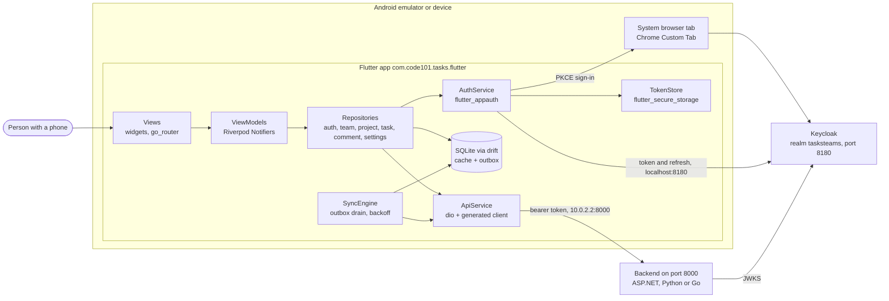
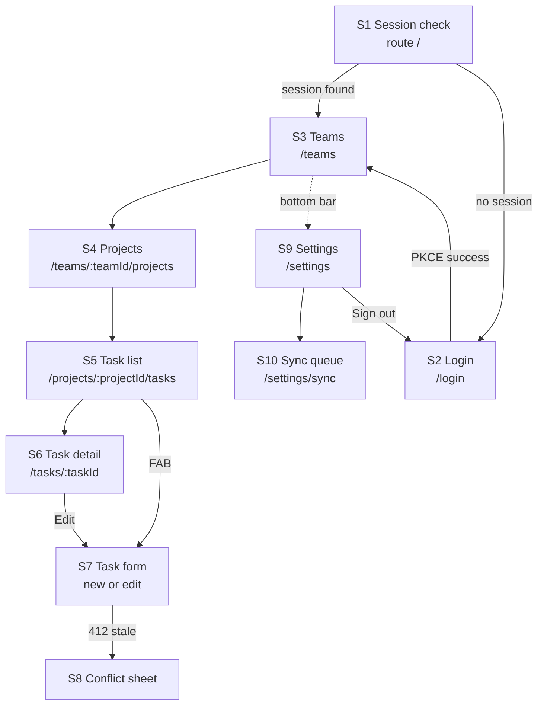
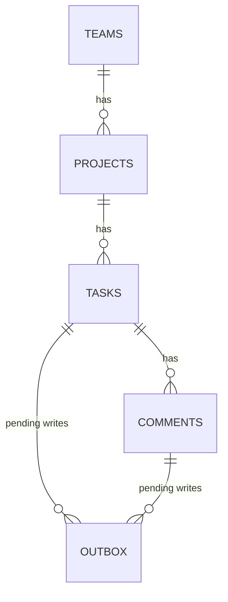
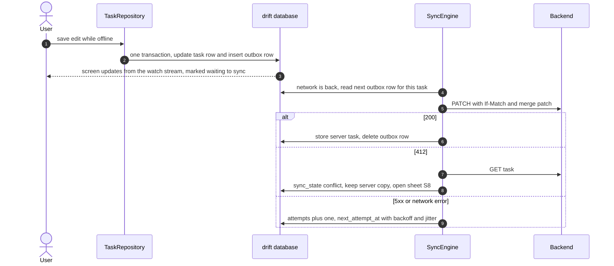
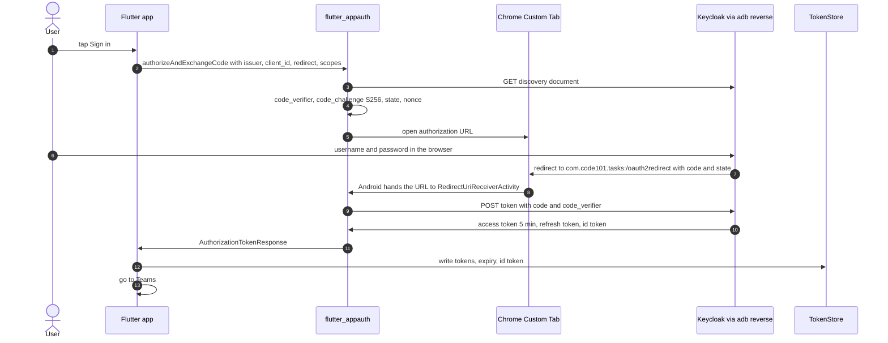
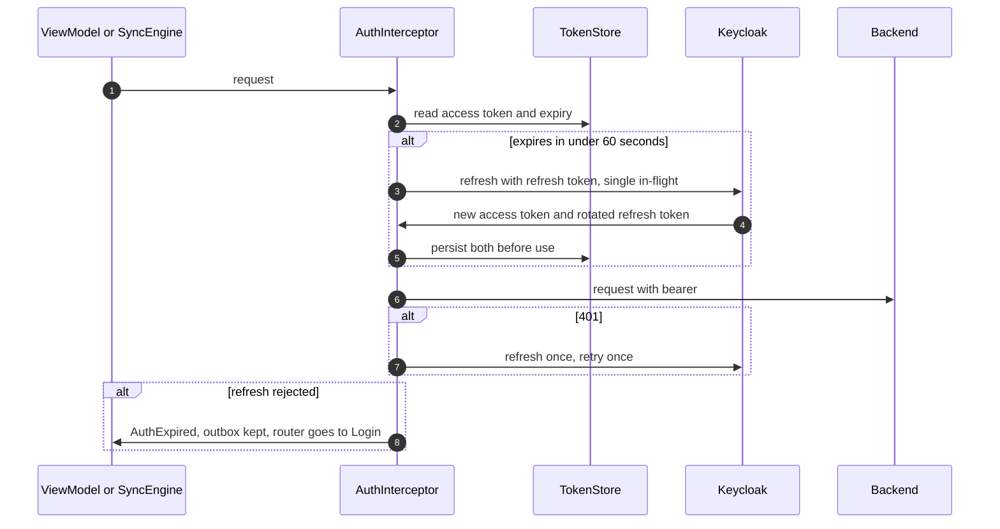

# TDD: Mobile client in Flutter (Tasks and Teams)

| Field | Value |
|-------|-------|
| Id | mobile-flutter |
| Level | 201 |
| Status | Design implemented as written source/lessons (not run); executable verification stopped by user on 2026-11-23; see _STATE.md and VERSION-NOTES.md |
| Depends on | platform (contract, realm client `tasks-mobile`, Keycloak) and one backend: backend-dotnet, backend-python or backend-go (not backend-rust) |
| Stack | Flutter 3.50.1 with Dart 3.14 (3.50 bundles Dart 3.14.0); Android Gradle Plugin 9.3.1, Gradle 9.5.0, Kotlin Gradle Plugin 2.4.20, Java 17 or newer (the Flutter 3.50 new-project defaults); compileSdk 36, targetSdk 36 (Flutter defaults), minSdk 26 (set by us). Packages: flutter_riverpod 3.5.0, go_router 18.1.4, dio 5.11.1, swagger_parser 2.3.0 (+ json_serializable, build_runner), flutter_appauth 13.0.0, flutter_secure_storage 11.2.0, drift 2.35.4 + drift_dev 2.35.3 + drift_flutter 0.3.1, connectivity_plus 7.3.2, workmanager 0.10.10, flutter_svg 2.5.0, uuid 4.6.0. All versions read from pub.dev, the Flutter 3.50 release notes and the Android docs on 2026-11-23 |
| Estimated learner time | 5 chapters, about 7.5 hours (60 + 90 + 120 + 120 + 60 minutes) |
| Last updated | 2026-11-23 |

## 1. Purpose and learning goals
The app is the phone client of "Tasks and Teams": a signed-in person browses teams and projects, works a task list, reads and writes comments, creates and edits tasks, and keeps working without a connection. It is the Flutter twin of [mobile-kotlin](../mobile-kotlin/TDD.md): same screens, same requirement ids `M-xx`, same phases. The contract is the [platform TDD](../platform/TDD.md); this document repeats none of it.

Skills gained:
1. Structure a Flutter app feature-first with MVVM and the repository pattern, following the official architecture guide.
2. Choose and use one state and dependency-injection approach (Riverpod) and one router (go_router).
3. Generate a typed API client from `openapi.yaml` and keep it out of hand-written code.
4. Sign in with OIDC authorization code + PKCE in the system browser and store tokens in Keystore-backed storage.
5. Use ETag/`If-Match`, `Idempotency-Key`, cursor pagination and RFC 9457 problem details from the client side.
6. Build an offline-first data layer: SQLite cache as the source for screens plus an outbox of pending writes.
7. Reach a host-machine backend from an Android emulator or a USB device safely (host alias, `adb reverse`, debug-only cleartext).
8. Build for accessibility (TalkBack, 48 dp targets, 200 percent font) and produce a debug APK and a release bundle without committing keys.

## 2. Scope
**In scope:** the ten screens in section 4, sign-in and sign-out, refresh, a local cache, an outbox, an offline banner, a backend selector, Android only (debug APK, release AAB), the TDD, five chapters and phase packs.
**Out of scope:** iOS and desktop targets, push notifications, attachments, the admin features (audit log, team deletion), tablets, Play Store listing, real TLS certificates, biometric unlock (a stretch goal), Authentik (appendix only).
**Assumptions:** the platform is running (`docker compose -p platform up -d --wait` from the platform capstone), one backend listens on port 8000, an Android emulator image with Chrome (a "Google APIs" image) or a USB device is available for manual runs, learners work on Windows, macOS or Linux.
**Constraints:** the redirect URI and client id are fixed by the realm file: client `tasks-mobile`, redirect `com.code101.tasks:/oauth2redirect`, post-logout `com.code101.tasks:/logout` (checked 2026-11-23 in the platform realm file and its copies: exactly these two values, so the platform needs no change). Docker is temporary and only the platform and backend use it; the app never runs in Docker. The Rust backend is not a target.

## 3. Requirements
`[build]` checks run without an emulator and are what the verifier executes; `[manual]` checks need an emulator or device and are done once by the author and the learner.

| Id | Requirement | Priority | Acceptance check | Phase |
|----|-------------|----------|------------------|-------|
| M-01 | The project builds from a clean checkout; base URL, issuer and client id come from build configuration (`--dart-define-from-file`), never from literals in feature code | Must | `[build]` `flutter build apk --debug` succeeds; a search for `http://` outside `config/` and `core/url_policy.dart` finds nothing | 1 |
| M-02 | A typed client is generated from the platform `openapi.yaml` by one command and generated files are never edited | Must | `[build]` `dart run swagger_parser` exits 0; `lib/data/generated` contains `getTask`, `updateTask`, `createTask`, `completeTask`, `listComments` | 1 |
| M-03 | Cleartext HTTP is possible only in debug builds and only to `10.0.2.2`, `localhost`, `127.0.0.1`; release builds allow none | Must | `[build]` `aapt2 dump xmltree` of the debug APK shows `networkSecurityConfig`; the release bundle manifest does not | 1 |
| M-04 | The ten icons of section 8 are converted from `assets/art` and every icon button also has a text label or tooltip | Should | `[build]` ten SVG files listed in `pubspec.yaml`; build passes | 1 |
| M-05 | Sign-in uses authorization code + PKCE (S256) in the system browser (Custom Tab) with client `tasks-mobile` and the registered redirect URI; the app never sees the password | Must | `[build]` the debug manifest holds scheme `com.code101.tasks`; `[manual]` login ends on the Teams screen | 2 |
| M-06 | Tokens are stored only in Keystore-backed secure storage; they never appear in logs, the database, preferences or error texts | Must | `[build]` one class (`TokenStore`) imports the storage package; search for `print(` and `debugPrint(` with token values finds none | 2 |
| M-07 | Access tokens are refreshed by one shared in-flight refresh, 60 s before expiry or after a 401; the new refresh token is persisted before it is used (rotation is on); a failed refresh keeps all local data and goes to Login | Must | `[manual]` wait 6 minutes: next call succeeds without login; clear the refresh token: Login appears and pending items remain | 2, 4 |
| M-08 | Sign out ends the Keycloak session in the browser (post-logout redirect `com.code101.tasks:/logout`), deletes tokens and offers "also delete offline data" | Must | `[manual]` after sign out the browser session is gone and Login is shown | 2 |
| M-09 | The router lets a signed-out user reach only Login and returns to the intended route after sign-in | Must | `[manual]` open a deep link while signed out, sign in, land on that route | 2 |
| M-10 | Teams and Projects screens list `GET /v1/teams` and `GET /v1/teams/{id}/projects` with loading, empty, data and error states | Must | `[manual]` seed shows Platform Team and Mobile Team for alice, Mobile Team for carol | 3 |
| M-11 | The task list supports pull-to-refresh, cursor pagination (`limit` 25, `page.nextCursor`), repeatable status filter chips and sort | Must | `[manual]` scrolling loads the next page; refresh resets to page 1 | 3 |
| M-12 | Task detail shows every field, lists comments, adds a comment and lets the author delete their comment | Must | `[manual]` a new comment appears at the end of the list | 3 |
| M-13 | Create and edit task validate against the OpenAPI limits; create sends an `Idempotency-Key` that stays the same for retries of one form; edit sends `If-Match: "<version>"` and a JSON Merge Patch that contains only changed fields (`null` clears assignee and due date) | Must | `[manual]` double-tap Save creates one task; clearing the due date sends `"dueDate": null` | 3 |
| M-14 | A task can be completed with `POST /complete` and `If-Match` | Should | `[manual]` status becomes `done` and `completedAt` is set | 3 |
| M-15 | Settings has a backend selector (ASP.NET, Python, Go presets and a custom URL), a connection test (`/health` then `/v1/me`), the account (name, roles, scopes), a link to the sync queue and Sign out | Must | `[manual]` the test shows `database up` and the caller name | 3 |
| M-16 | Every problem `type` of the platform TDD maps to one user message; 422 `errors[]` pointers show next to fields; 429 honours `Retry-After`; unknown types show the `title` | Must | `[manual]` an empty title shows the field message; a stale edit shows the conflict sheet | 4 |
| M-17 | A 412 on edit opens a conflict sheet with "mine" and "theirs" per changed field; "Keep mine" re-sends with the new version, "Take theirs" drops the local change | Must | `[manual]` edit the same task on two clients; the loser sees the sheet | 4 |
| M-18 | Screens render from the local SQLite cache; the network only updates the cache | Must | `[manual]` airplane mode: teams, projects and loaded tasks still open after a cold start | 4 |
| M-19 | Writes (create task, edit task, complete task, create comment) go into a durable outbox in the same transaction as the local change, drain in order per entity, retry with exponential backoff and jitter, and park permanent failures with their problem | Must | `[manual]` create a task offline, force-stop the app, go online: one task exists on the server | 4 |
| M-20 | An offline banner (announced to screen readers) shows the pending count, a "Sync now" action and a link to the sync queue screen | Must | `[manual]` banner appears in airplane mode and disappears after sync | 4 |
| M-21 | Pending writes are also synced in the background when a network is available | Should | `[manual]` leave the app after queuing; the item arrives within 15 minutes | 4 |
| M-22 | Accessibility: TalkBack reads every control in order, touch targets are at least 48 x 48 dp, layouts survive 200 percent font scale, contrast is at least 4.5:1, status is never shown by colour alone | Must | `[manual]` Accessibility Scanner shows no target-size or label issue on the ten screens | 3, 4 |
| M-23 | All user-visible text is in `lib/l10n/app_en.arb`; dates and numbers use the device locale | Should | `[build]` no string literal in `view/` files except route names and keys | 3 |
| M-24 | `flutter build apk --debug` and `flutter build appbundle --release` succeed; release signing reads `android/key.properties`, which is git-ignored; no keystore is committed | Must | `[build]` both artifacts exist; `git ls-files` lists no `.jks`, `.keystore` or `key.properties` | 5 |
| M-25 | A run guide explains the host alias, `adb reverse` (emulator and USB device) and running against each of the three backends | Must | `[build]` the chapter text matches the files | 5 |
| M-26 | The app requests only `openid profile email offline_access tasks:read tasks:write`; it has no client secret, no password grant and no admin scope | Must | `[build]` the scope list appears once, in `core/config.dart` | 2 |

| Non-functional requirement | Target |
|----------------------------|--------|
| Cold start to the cached Teams screen | under 2 s on a mid-range emulator profile with 50 cached tasks |
| First task page after sign-in | under 1 s on loopback with the seed data (the API budget is p95 200 ms, see the platform TDD) |
| Outbox durability | no queued write lost when the process is killed at any time (author kills the app 20 times during queuing) |
| Background sync | no more often than every 15 minutes (the WorkManager minimum periodic interval) |
| Accessibility | 48 dp targets, 200 percent font, contrast 4.5:1, TalkBack order matches reading order |
| Security | no cleartext in release, no token in logs, `allowBackup` false |
| i18n | English strings in ARB, ready for more locales; UTF-8 everywhere |

## 4. Architecture
Context and containers (C4 levels 1 and 2 in one picture; the platform TDD owns the rest):



| Component | Responsibility |
|-----------|----------------|
| Views | Widgets only: layout, semantics, simple show or hide. No HTTP, no SQL. One screen per feature |
| ViewModels | `Notifier` or `AsyncNotifier` per screen: immutable state (loading, data, error, empty), commands the view calls, mapping of domain errors to messages |
| Repositories | One per data type: read from the drift cache, refresh from the network, write through the outbox, map generated DTOs to domain models. They never call each other (the sync engine sits above them) |
| Services | Stateless wrappers around one data source: `ApiService` (dio + generated client), `AuthService` (flutter_appauth), `TokenStore` (secure storage), `ConnectivityService` |
| SyncEngine | Drains the outbox, applies backoff, reports queue size; started by connectivity changes, "Sync now" and WorkManager |
| `UrlPolicy` | Rejects any `http` URL unless the build is debug and the host is `10.0.2.2`, `localhost` or `127.0.0.1` |

Screens and navigation (route key is the same in the Kotlin twin):

| Id | Screen | Route | Calls | Notes |
|----|--------|-------|-------|-------|
| S1 | Session check | `/` | none | splash while the token store is read; redirects to S2 or S3 |
| S2 | Login | `/login` | system browser | one button "Sign in", progress and error text; cancel is not an error |
| S3 | Teams | `/teams` | `GET /v1/teams` | pull-to-refresh, search field `q`, bottom bar item 1 |
| S4 | Projects | `/teams/:teamId/projects` | `GET /v1/teams/{id}/projects` | archived toggle |
| S5 | Task list | `/projects/:projectId/tasks` | `GET /v1/projects/{id}/tasks` | pull-to-refresh, paging, status chips, sort menu, FAB "New task" |
| S6 | Task detail | `/tasks/:taskId` | `GET /v1/tasks/{id}`, comments, `POST complete` | comments with add box; pending items marked "waiting to sync" |
| S7 | Create or edit task | `/projects/:projectId/tasks/new`, `/tasks/:taskId/edit` | `POST` create, `PATCH` | field validation, conflict sheet S8 on 412 |
| S8 | Conflict sheet | modal over S7 | `GET /v1/tasks/{id}` | per-field mine or theirs |
| S9 | Settings | `/settings` | `GET /health`, `GET /v1/me` | backend selector, account, sign out, bottom bar item 2 |
| S10 | Sync queue | `/settings/sync` | outbox | pending and failed items, retry, discard |

The offline banner is a shared widget above S3 to S10, not a screen.



Decisions (ADR style):

| Decision | Alternatives | Consequences |
|----------|--------------|--------------|
| MVVM + repository, feature-first folders (official guide) | MVC; layer-first folders; adding a domain layer | Views stay thin and testable; one folder per feature. No domain/use-case layer, because no logic merges several repositories (the sync engine is the only exception) |
| **Riverpod** for state and DI | Bloc, Provider + ChangeNotifier, get_it | One tool gives state, DI and caching; `AsyncValue` models loading, data and error without event and state class boilerplate; `ProviderContainer` overrides make repositories easy to fake. Bloc gives a strict event log, which this app does not need, and costs about twice the files per screen. Riverpod 3 is newer, so we use only `Notifier`, `AsyncNotifier` and plain `Provider`, and no code generator |
| go_router | Navigator 1.0 by hand, auto_route | Declarative routes, `redirect` for the auth guard, deep links; maintained by the Flutter team |
| dio + **swagger_parser** (`http_client: dio`, `serializer: json_serializable`) | openapi_generator 7.0.0 (wraps the Java OpenAPI Generator, needs a JVM), swagger_parser with retrofit 4.10.0, `http` + hand-written client | swagger_parser is pure Dart, reads OpenAPI 3.1, active (2.3.0 on 2026-11-17) and emits dio clients and models. openapi_generator also exists and is maintained but needs Java and a heavier build step; retrofit adds a second code generator. dio gives interceptors for bearer, refresh and problem details |
| drift for the cache and outbox | sqflite, isar, hive | Typed SQL, reactive `watch` streams that feed ViewModels, transactions for "change + outbox row"; needs `build_runner`, which the generated client also uses |
| flutter_appauth for sign-in | Hand-built PKCE with `url_launcher` | Wraps AppAuth-Android (Custom Tabs, PKCE, state, discovery); the redirect is a manifest placeholder. Last pub.dev release 13.0.0 on 2026-10-30, so it is maintained |
| flutter_secure_storage | shared_preferences with own crypto; EncryptedSharedPreferences | Since version 10 it uses its own RSA-OAEP + AES-GCM ciphers with the key in Android Keystore; Jetpack's `EncryptedSharedPreferences` is deprecated since security-crypto 1.1.0 |
| `--dart-define-from-file` for configuration | Android product flavors, `.env` package | Official, no extra package, nothing secret is needed (public client) |
| Separate application ids `com.code101.tasks.flutter` and `com.code101.tasks.kotlin`, one shared redirect scheme | One id for both; two realm clients | Android identifies an installed app by its application id, so one shared id would make the second install replace the first and mix their data and keys. The realm allows exactly one redirect URI, so both apps claim the scheme `com.code101.tasks` and, if both are installed, Android shows an app chooser after sign-in: install one at a time and uninstall the other first |

**Reaching the host.** The emulator treats `127.0.0.1` as itself; `10.0.2.2` is a special alias for the host's loopback interface ([emulator networking](https://developer.android.com/studio/run/emulator-networking), network address space). The backend does not care how it is addressed, so the API uses the alias. Keycloak does care: the platform Compose file fixes `KC_HOSTNAME=http://localhost:8180`, so discovery documents, the `iss` claim and every redirect say `localhost:8180`, and the backends validate that exact issuer. A call to `10.0.2.2:8180` would return endpoints on `localhost` that the emulator cannot reach. Keycloak is therefore reached with `adb reverse`, which makes `localhost:8180` inside the device reach the host.

| Target | API base URL | Keycloak issuer | Commands (PowerShell, once per emulator boot or USB connection) |
|--------|--------------|-----------------|-------------------------------------------------------------------|
| Emulator (default) | `http://10.0.2.2:8000` | `http://localhost:8180/realms/tasksteams` | `adb reverse tcp:8180 tcp:8180` |
| Physical device over USB | `http://localhost:8000` | same | `adb reverse tcp:8180 tcp:8180` and `adb reverse tcp:8000 tcp:8000` (the alias does not exist on a real phone) |
| Emulator, API also by reverse (optional) | `http://localhost:8000` | same | both `adb reverse` commands |

`adb reverse` is documented in the [adb guide](https://developer.android.com/tools/adb); `adb reverse --remove-all` undoes it. A device on Wi-Fi without USB is out of scope (it would need HTTPS and a real hostname).

## 5. Domain and data model
Server entities are defined in the platform TDD (section 5) and generated from `openapi.yaml`. The app has its own domain models (`Team`, `Project`, `TaskItem`, `Comment`, `Me`) and maps DTOs to them in the repositories, so screens never import generated code. The local database (drift) mirrors what the screens need:



| Table | Columns (type, constraints) | Notes |
|-------|-----------------------------|-------|
| `teams` | `id` text PK; `name`; `description`; `member_count` int; `version` int; `updated_at` text | replaced on refresh |
| `projects` | `id` text PK; `team_id` text; `key`; `name`; `description`; `archived` bool; `version` int | index `(team_id)` |
| `tasks` | `id` text PK (a client UUID until the server answers); `project_id`; `title`; `description`; `status`; `priority`; `assignee_id` null; `due_date` null; `completed_at` null; `version` int; `created_at`; `sync_state` text in (`synced`, `pending`, `conflict`, `failed`); `server_json` null (copy of the server version during a conflict) | index `(project_id, created_at DESC, id DESC)`; a create that succeeds re-keys the row to the server id in one transaction |
| `comments` | `id` text PK; `task_id`; `author_id`; `author_name`; `body`; `created_at`; `sync_state` | index `(task_id, created_at)` |
| `outbox` | `id` text PK (also the `Idempotency-Key` of a create); `seq` int autoincrement; `kind` in (`create_task`, `update_task`, `complete_task`, `create_comment`); `entity_id`; `payload` text (JSON); `base_version` int null; `state` in (`pending`, `in_flight`, `failed`, `conflict`); `attempts` int; `next_attempt_at` int; `last_problem_type` null; `created_at` | index `(state, next_attempt_at)`, `(entity_id, seq)` |
| `app_settings` | `key` text PK; `value` text | `base_url`, `backend_label`; never tokens |

**Rules.** (1) A user write updates the cache row (`sync_state = pending`) and inserts the outbox row in one drift transaction. (2) Edits to a task whose create is still pending are merged into the create payload (no second row). (3) Pull-to-refresh deletes the project's `synced` tasks and inserts page 1; later pages append; offline you see what you loaded. (4) Changing the backend URL is refused while the outbox is not empty; otherwise the cache is cleared. **Migrations:** drift `schemaVersion` 1, later changes are numbered steps in `MigrationStrategy`; the file is never edited after a phase ships. **Seed data:** none locally; the platform seed (alice, bob, carol, Platform Team, Mobile Team) comes from the server.



## 6. API design
The app only consumes the API; every row below is an operation of the [platform contract](../platform/TDD.md) (section 6). Generated operation ids come from `openapi.yaml`.

| Screen | Operation (`operationId`) | Headers the app sends | Success | Failures the app handles |
|--------|---------------------------|-----------------------|---------|--------------------------|
| S9 | `getHealth`, `getMe` | none, bearer | 200 | 503 shown as "backend not ready", 401 |
| S3 | `listTeams` (`q`, `limit`, `cursor`) | bearer | 200 | 401, 429 |
| S4 | `listProjects` | bearer | 200 | 404 (not a member) |
| S5 | `listTasks` (`status` repeated, `sort`, `limit`, `cursor`) | bearer | 200 | 400 bad cursor: reset to page 1 |
| S6 | `getTask` (`If-None-Match` optional), `listComments`, `completeTask` | bearer, `If-Match` | 200, 304 | 404, 409, 412 |
| S7 | `createTask` | bearer, `Idempotency-Key` | 201 | 409, 422 `errors[]`; replay header `Idempotent-Replayed: true` is success |
| S7 | `updateTask` | bearer, `If-Match: "<version>"` | 200 | 412 conflict, 422, 428 (a bug: never send without) |
| S6 | `createComment`, `deleteComment` | bearer, `Idempotency-Key` on create | 201, 204 | 404, 422 |

Client rules: base URL from settings plus `/v1`; `If-Match` is built from the `version` field of the task the user edited (the strong ETag is the quoted version); a merge patch is a `Map<String, Object?>` built by hand for `updateTask`, because generated models cannot tell "absent" from `null`; the `Idempotency-Key` of a create is the outbox row id, created when the form opens, so a retry or double tap replays instead of duplicating; pagination never parses the cursor; 5xx and network errors are retryable, 4xx other than 408, 425 and 429 are permanent; RateLimit headers are read only to show a delay after 429. Error bodies are parsed into `ApiProblem(type, title, status, detail, errors, traceId)` by one dio interceptor; the `type` suffix (`validation-error`, `precondition-failed`, ...) selects the message from the ARB file.

## 7. Identity and security design
Realm `tasksteams`, issuer `http://localhost:8180/realms/tasksteams`, public client `tasks-mobile` (PKCE S256, direct grants off, redirect `com.code101.tasks:/oauth2redirect`). Sign-in follows RFC 8252: external user agent, no embedded web view.



Refresh and offline behaviour:



| Topic | Rule |
|-------|------|
| Scopes | `openid profile email offline_access tasks:read tasks:write`. `offline_access` (optional scope of the client) lets the session outlive the 30 minute SSO idle time while the phone is offline. No `tasks:admin` because no screen needs it |
| Storage | Tokens and the id token (needed as `id_token_hint` for sign-out) only in `flutter_secure_storage`; settings and cache hold no secrets; `android:allowBackup="false"` so keys and ciphertext are never restored apart |
| Rotation | Realm has `revokeRefreshToken` true and `refreshTokenMaxReuse` 0: one refresh at a time, persist before use, never log |
| Cleartext | `src/debug/res/xml/network_security_config.xml` allows cleartext only for `10.0.2.2`, `localhost`, `127.0.0.1`; `base-config` forbids it. `dart:io` sockets may not follow that XML, so `UrlPolicy` enforces the same rule in Dart. `allowInsecureConnections` of flutter_appauth is passed only when `kDebugMode` is true, because the issuer is `http` locally |
| Release | URLs must be `https`; in a release build `UrlPolicy` refuses every `http` URL at start-up and the app shows a configuration error (the build itself passes, so `config/release.example.json` uses `https://tasks.example.invalid`) |
| Logging | Interceptor logs method, path, status, `traceId`; never headers or bodies in release |
| Sign out | `endSession` with `id_token_hint` and `com.code101.tasks:/logout`, then delete tokens; the outbox survives unless the user ticks "delete offline data" |

OWASP Mobile Application Security Verification Standard (MASVS) mapping:

| MASVS area | Where this design answers it |
|------------|------------------------------|
| STORAGE | Keystore-backed token storage (M-06), no secrets in SQLite, backup off |
| NETWORK | HTTPS in release, debug-only cleartext limited to dev hosts (M-03), `UrlPolicy` |
| AUTH | Code + PKCE in the system browser, rotation-safe refresh, sign-out at the IdP (M-05, M-07, M-08) |
| PLATFORM | Exact custom-scheme redirect, no exported components besides the launcher and the redirect receiver, no WebView |
| CODE | Pinned dependencies, `pubspec.lock` committed, generated code isolated |
| PRIVACY | Only the data the screens show is cached; "delete offline data" on sign-out |

## 8. Project structure
```text
capstones/mobile-flutter/
  README.md  TDD.md
  tutorials/phase-N-slug/NN-slug.md                 five chapters
  source/phase-N-slug/PACK-README.md
  source/phase-N-slug/NN-slug/{code, exercise/{starter,solution}, verify.json}
  source/phase-5-ship/05-build-run-ship/code/       the finished app
    pubspec.yaml  pubspec.lock  swagger_parser.yaml  analysis_options.yaml  .gitignore
    contract/openapi.yaml                           copied from platform, read only
    config/dev.json  config/release.example.json    dart-define files, no secrets
    assets/icons/*.svg                              ten icons
    android/app/src/main/AndroidManifest.xml        redirect scheme placeholder, allowBackup false
    android/app/src/debug/{AndroidManifest.xml, res/xml/network_security_config.xml}
    android/app/build.gradle.kts                    namespace, applicationId, appAuthRedirectScheme, signing
    lib/
      main.dart
      app/{app.dart, router.dart, theme.dart}
      core/{config.dart, url_policy.dart, api_problem.dart, widgets/offline_banner.dart}
      l10n/app_en.arb
      data/
        generated/                                  swagger_parser output, never edited
        services/{api_service, auth_service, token_store, connectivity_service}.dart
        local/{database.dart, tables.dart}
        repositories/{auth, team, project, task, comment, settings}_repository.dart
        sync/{sync_engine.dart, outbox_dao.dart, sync_worker.dart}
        models/                                     immutable domain models
      features/{login, teams, projects, tasks, task_detail, task_form, settings, sync}/
        view/<feature>_screen.dart
        view_model/<feature>_view_model.dart
    test/                                           learner tests, not run by the verifier
```
Layering: `view -> view_model -> repository -> service or local`. Features never import another feature's `view`; repositories never import `features/`; only `data/services/api_service.dart` imports `data/generated/`. Naming: files `snake_case`, classes `UpperCamel`, providers `lowerCamelProvider`, screens `XxxScreen`, view models `XxxViewModel`, route keys equal the routes in section 4. In `build.gradle.kts`: `namespace = "com.code101.tasks"`, `applicationId = "com.code101.tasks.flutter"`, `manifestPlaceholders += mapOf("appAuthRedirectScheme" to "com.code101.tasks")` (the scheme must be lowercase).

| Configuration key (`config/dev.json`) | Dev value | Used by |
|---------------------------------------|-----------|---------|
| `API_BASE_URL` | `http://10.0.2.2:8000` (USB device: `http://localhost:8000`) | `ApiService`, overridable in S9 |
| `OIDC_ISSUER` | `http://localhost:8180/realms/tasksteams` | `AuthService` |
| `OIDC_CLIENT_ID`, `OIDC_REDIRECT_URI`, `OIDC_LOGOUT_URI` | `tasks-mobile`, `com.code101.tasks:/oauth2redirect`, `com.code101.tasks:/logout` | `AuthService` |

Run with `flutter run --dart-define-from-file=config/dev.json`. Icons (all CC0, from `assets/art/icons`): `arrows/log-in`, `arrows/log-out`, `arrows/refresh-cw`, `users/team`, `files/folder`, `ui/list`, `ui/plus`, `ui/settings`, `devices/wifi-off`, `communication/message-square`. They use `stroke="currentColor"`: copy the files to `assets/icons/`, list the folder under `flutter: assets:` and draw them with `flutter_svg` using `colorFilter: ColorFilter.mode(color, BlendMode.srcIn)` so they follow the theme; give each a `semanticsLabel`.

## 9. Delivery plan (phases)
| Phase | Title | Chapters | Requirement ids | Exit check (smoke, no emulator) | Source pack |
|-------|-------|----------|-----------------|---------------------------------|-------------|
| 1 | Setup and generated client | 01 Project, define files, generated client, network config | M-01, M-02, M-03, M-04 | `dart run swagger_parser` exits 0; `flutter build apk --debug` succeeds; `build/app/outputs/flutter-apk/app-debug.apk` exists | `mobile-flutter-phase-1-setup.zip` |
| 2 | Auth (PKCE) and secure storage | 02 Sign-in, refresh, sign-out, guard | M-05, M-06, M-07 (refresh), M-08, M-09, M-26 | debug build succeeds; `aapt2 dump xmltree --file AndroidManifest.xml app-debug.apk` contains `com.code101.tasks` | `mobile-flutter-phase-2-auth.zip` |
| 3 | Screens and state | 03 Ten screens, Riverpod ViewModels, forms, Idempotency-Key and If-Match, accessibility | M-10 to M-15, M-22 (first half), M-23 | debug build succeeds; the router file declares the 10 route keys of section 4 | `mobile-flutter-phase-3-screens.zip` |
| 4 | Offline cache, sync and errors | 04 drift cache, outbox, sync engine, banner, problem mapping, conflicts | M-07 (queue kept), M-16 to M-22 | `dart run build_runner build` exits 0 (generates drift); debug build succeeds | `mobile-flutter-phase-4-offline.zip` |
| 5 | Build, run and ship | 05 APK, AAB, signing, run guide | M-24, M-25 | `flutter build apk --debug` and `flutter build appbundle --release` succeed; `git ls-files` shows no key material | `mobile-flutter-phase-5-ship.zip` |

Phase 3 hides the data source behind the repository interfaces with an in-memory cache; phase 4 swaps in drift without touching views or ViewModels. Each pack holds the whole app at the end of that phase.

## 10. Verification plan
Smoke only; the verifier needs **no emulator and no Docker**. Per phase (PowerShell 5.1 compatible, from the pack's `code` folder):
1. `flutter pub get`
2. `dart run swagger_parser` and `dart run build_runner build --delete-conflicting-outputs` (phase 1 onward; drift joins in phase 4)
3. `flutter build apk --debug`, then check that `build\app\outputs\flutter-apk\app-debug.apk` exists and is larger than 0 bytes
4. Phase 2: `aapt2 dump xmltree --file AndroidManifest.xml build\app\outputs\flutter-apk\app-debug.apk` (Android SDK build-tools 36.0.0) shows scheme `com.code101.tasks`; phase 5 adds `flutter build appbundle --release`.

Static analysis and unit tests are taught but not run by the verifier. **Manual run (author once, learner always):** start the platform and one backend under a throwaway project (`docker compose -p platform up -d --wait`, then the backend capstone's run command), start an emulator, run `adb reverse tcp:8180 tcp:8180`, then `flutter run --dart-define-from-file=config/dev.json`, sign in as carol, open Mobile Team, create a task offline and watch it sync. Clean up: stop the app, `adb reverse --remove-all`, `docker compose -p platform down -v --remove-orphans`. **Conformance:** the app is conformant when it only uses operations of `openapi.yaml` and works the same against the ASP.NET, Python and Go backends once each reports `18 passed, 0 failed` from `scripts/conformance.py`.

## 11. Deployment and operations
There is no server component. Host ports used from the phone: 8000 (backend, via `10.0.2.2` or `adb reverse`) and 8180 (Keycloak, via `adb reverse`); 8080, 8081, 11434 are never used. Build outputs: `app-debug.apk` and `app-release.aab`. **Signing:** create an upload keystore outside the repository (`keytool`), put its path and passwords in `android/key.properties` (git-ignored), read them in `android/app/build.gradle.kts`; without that file the release build falls back to the debug key and prints "NOT FOR STORE". Never commit `*.jks`, `*.keystore`, `key.properties`. Before a Play upload raise `targetSdk` to the current Play requirement and use an `https` backend. Logs: `flutter logs` or `adb logcat` (no tokens). Health: Settings, "Test connection". Backup of user data: none on the device (backup disabled); the server is the source of truth.

## 12. Risks, open questions, decisions
| Risk or question | Impact | Mitigation / decision |
|------------------|--------|-----------------------|
| Both mobile capstones use the scheme `com.code101.tasks`, the only redirect URI the realm allows | With both apps installed Android shows an app chooser after sign-in | Different application ids, one install at a time (section 4). Platform check 2026-11-23: no defect, the realm lists exactly `com.code101.tasks:/oauth2redirect` and post-logout `com.code101.tasks:/logout` |
| `10.0.2.2` for Keycloak breaks the issuer check | Sign-in or 401 loops | Keycloak only via `adb reverse` and `localhost:8180`; only the API uses the alias |
| Emulator image without Chrome | Custom Tab cannot open | Use a Google APIs image; AppAuth falls back to any installed browser |
| flutter_appauth wraps AppAuth-Android, whose newest Maven Central release is 0.11.1 (Dec 2021) | Slow upstream releases | The plugin is current (13.0.0, Oct 2026) and RFC 8252 compliant; fallback is a manual PKCE flow with `url_launcher` (stretch goal) |
| AGP 9 built-in Kotlin and plugin support | A plugin may not build | Flutter 3.50 templates work with the default setup; do not opt into the new DSL until all plugins support it |
| Gradle on JDK 25 | Unsupported class file errors | Use Android Studio's bundled JBR (`flutter config --jdk-dir`); AGP needs JDK 17 or newer |
| Generated Dart models cannot express merge-patch `null` | Cleared fields not sent | Patch bodies are hand-built maps (section 6) |
| `offline_access` is an optional scope; realm changes could remove it | Sessions end after 30 idle minutes | Request it; if refused, the app still works and signs in again, queue kept |
| WorkManager runs Dart in a background isolate | Plugins may not register | Background sync only calls `SyncEngine` with plain services; foreground sync is the main path |
| Riverpod 3 and drift APIs move quickly | Chapters age | Versions pinned in the header; `pubspec.lock` committed |
| Open: biometric unlock for the token store | Extra security, extra UX | Stretch goal using `AndroidOptions.biometric` |

## 13. References
- Flutter app architecture guide and offline-first pattern: https://docs.flutter.dev/app-architecture/guide, https://docs.flutter.dev/app-architecture/design-patterns/offline-first
- What's new in Flutter 3.50 (AGP 9.3.1, Gradle 9.5.0, SDK defaults): https://flutter.dev/blog/whats-new-in-flutter-3-50
- Flutter accessibility and Android release docs: https://docs.flutter.dev/ui/accessibility, https://docs.flutter.dev/deployment/android
- pub.dev: https://pub.dev/packages/flutter_riverpod, https://pub.dev/packages/go_router, https://pub.dev/packages/dio, https://pub.dev/packages/swagger_parser, https://pub.dev/packages/flutter_appauth, https://pub.dev/packages/flutter_secure_storage, https://pub.dev/packages/drift, https://pub.dev/packages/workmanager
- Android emulator networking (10.0.2.2 alias): https://developer.android.com/studio/run/emulator-networking and https://developer.android.com/studio/run/emulator-networking-address
- Android Debug Bridge (`adb reverse`): https://developer.android.com/tools/adb
- Network security configuration: https://developer.android.com/privacy-and-security/security-config
- EncryptedSharedPreferences (deprecated in 1.1.0): https://developer.android.com/reference/androidx/security/crypto/EncryptedSharedPreferences
- Android accessibility principles (48 dp targets): https://developer.android.com/guide/topics/ui/accessibility/principles
- App signing: https://developer.android.com/studio/publish/app-signing
- RFC 8252 OAuth 2.0 for native apps, RFC 7636 PKCE, RFC 9700 Security BCP, RFC 9457 problem details: https://www.rfc-editor.org/info/rfc8252, https://www.rfc-editor.org/info/rfc7636, https://www.rfc-editor.org/info/rfc9700, https://www.rfc-editor.org/info/rfc9457
- OpenID Connect Core 1.0 and RP-Initiated Logout 1.0: https://openid.net/specs/openid-connect-core-1_0.html, https://openid.net/specs/openid-connect-rpinitiated-1_0.html
- Keycloak documentation: https://www.keycloak.org/documentation
- OWASP MASVS: https://mas.owasp.org/MASVS/
- Platform contract: [TDD](../platform/TDD.md), [README](../platform/README.md)
