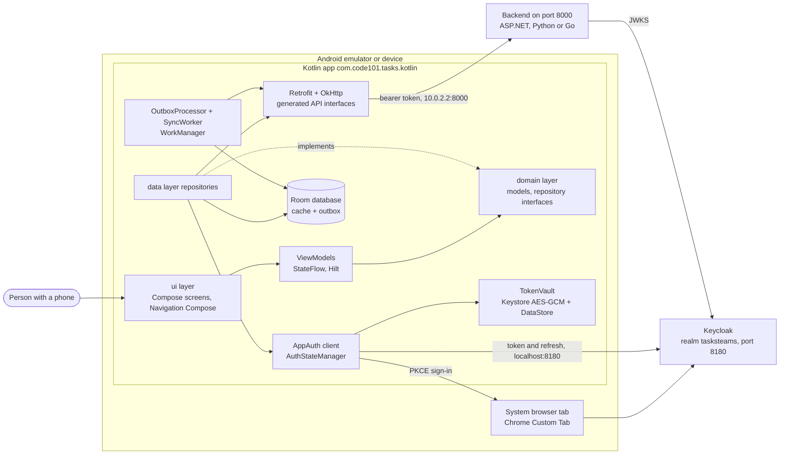
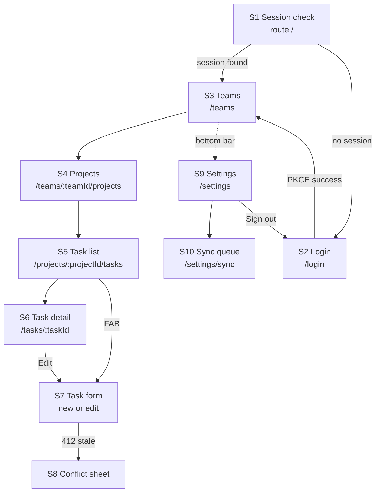
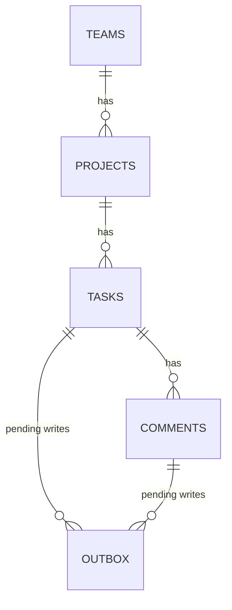
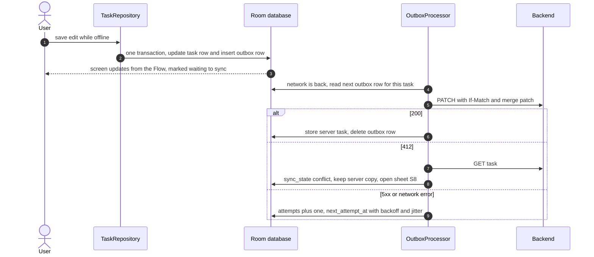
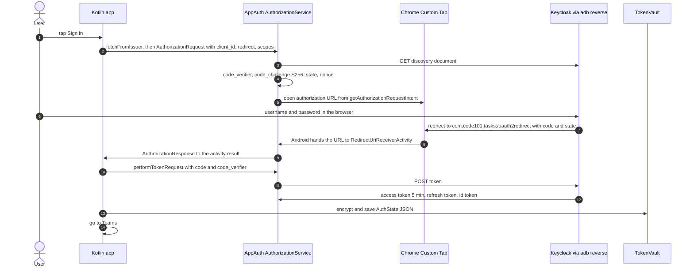
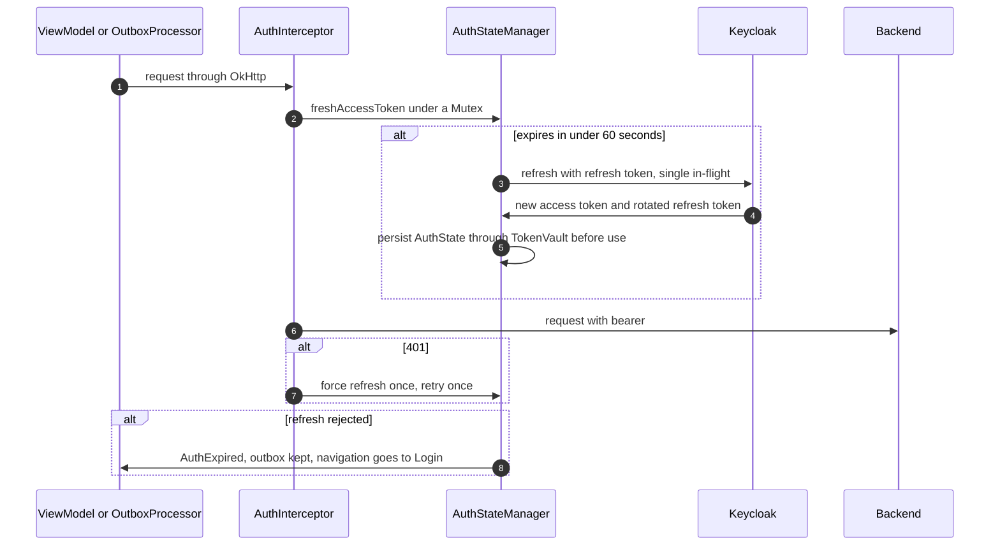

# TDD: Mobile client in Kotlin and Jetpack Compose (Tasks and Teams)

| Field | Value |
|-------|-------|
| Id | mobile-kotlin |
| Level | 201 |
| Status | Draft (design written 2026-11-23; source packs not built yet) |
| Depends on | platform (contract, realm client `tasks-mobile`, Keycloak) and one backend: backend-dotnet, backend-python or backend-go (not backend-rust) |
| Stack | Kotlin 2.4.21, Android Gradle Plugin 9.5.1 on Gradle 9.6.0 (JDK 17 or newer, build-tools 36.0.0), Jetpack Compose BOM 2026.11.01 (Compose 1.13.0), compileSdk 37, targetSdk 36, minSdk 26. Full pin table in section 4. Versions and compatibility read from the official Android, Kotlin and Maven Central pages on 2026-11-23 |
| Estimated learner time | 5 chapters, about 7.5 hours (60 + 90 + 120 + 120 + 60 minutes) |
| Last updated | 2026-11-23 |

## 1. Purpose and learning goals
The app is the phone client of "Tasks and Teams": a signed-in person browses teams and projects, works a task list, reads and writes comments, creates and edits tasks, and keeps working without a connection. It is the Kotlin twin of [mobile-flutter](../mobile-flutter/TDD.md): same screens, same requirement ids `M-xx`, same phases. The contract is the [platform TDD](../platform/TDD.md); this document repeats none of it.

Skills gained:
1. Structure an Android app with MVVM and clean layers (ui, domain, data) following the official architecture recommendations.
2. Expose UI state with `ViewModel` and `StateFlow`, collect it lifecycle-aware in Compose, inject with Hilt.
3. Generate a typed Retrofit client from `openapi.yaml` and keep it out of hand-written code.
4. Sign in with OIDC authorization code + PKCE in a Custom Tab using AppAuth-Android and store the auth state encrypted with an Android Keystore key.
5. Use ETag/`If-Match`, `Idempotency-Key`, cursor pagination and RFC 9457 problem details from the client side.
6. Build an offline-first data layer with Room as the source for screens, an outbox of pending writes and WorkManager for background sync.
7. Reach a host-machine backend from an Android emulator or a USB device safely (host alias, `adb reverse`, debug-only cleartext).
8. Build for accessibility (TalkBack, 48 dp targets, 200 percent font) and produce a debug APK and a release bundle without committing keys.

## 2. Scope
**In scope:** the ten screens in section 4, sign-in and sign-out, refresh, a Room cache, an outbox, an offline banner, a backend selector, Android only (debug APK, release AAB), the TDD, five chapters and phase packs.
**Out of scope:** Kotlin Multiplatform, iOS, push notifications, attachments, the admin features (audit log, team deletion), tablets and foldables, Play Store listing, real TLS certificates, biometric unlock (a stretch goal), modularisation into Gradle modules (Compose 301), Authentik (appendix only).
**Assumptions:** the platform is running (`docker compose -p platform up -d --wait` from the platform capstone), one backend listens on port 8000, an Android emulator image with Chrome (a "Google APIs" image) or a USB device is available for manual runs, Android Studio with SDK 37.x installed, learners work on Windows, macOS or Linux.
**Constraints:** the redirect URI and client id are fixed by the realm file: client `tasks-mobile`, redirect `com.code101.tasks:/oauth2redirect`, post-logout `com.code101.tasks:/logout` (checked 2026-11-23 in the platform realm file and its copies: exactly these two values, so the platform needs no change). Docker is temporary and only the platform and backend use it; the app never runs in Docker. The Rust backend is not a target.

## 3. Requirements
`[build]` checks run without an emulator and are what the verifier executes; `[manual]` checks need an emulator or device and are done once by the author and the learner.

| Id | Requirement | Priority | Acceptance check | Phase |
|----|-------------|----------|------------------|-------|
| M-01 | The project builds from a clean checkout; base URL, issuer and client id come from `BuildConfig` fields set per build type, never from literals in feature code | Must | `[build]` `.\gradlew.bat assembleDebug` succeeds; a search for `http://` outside `app/build.gradle.kts` and `data/remote/HttpUrlPolicy.kt` finds nothing | 1 |
| M-02 | A typed Retrofit client is generated from the platform `openapi.yaml` by one Gradle task and generated files are never edited | Must | `[build]` `.\gradlew.bat openApiGenerate` exits 0; `app/src/main/kotlin-generated` contains `getTask`, `updateTask`, `createTask`, `completeTask`, `listComments` | 1 |
| M-03 | Cleartext HTTP is possible only in debug builds and only to `10.0.2.2`, `localhost`, `127.0.0.1`; release builds allow none | Must | `[build]` `aapt2 dump xmltree` of the debug APK shows `networkSecurityConfig`; the release manifest does not | 1 |
| M-04 | The ten icons of section 8 are converted with Vector Asset Studio and every icon button also has a text label or `contentDescription` | Should | `[build]` ten `ic_*.xml` files in `res/drawable`; build passes | 1 |
| M-05 | Sign-in uses authorization code + PKCE (S256) in a Custom Tab (AppAuth-Android) with client `tasks-mobile` and the registered redirect URI; the app never sees the password | Must | `[build]` the debug manifest holds scheme `com.code101.tasks`; `[manual]` login ends on the Teams screen | 2 |
| M-06 | Auth state (tokens) is stored only encrypted with an Android Keystore key; tokens never appear in logs, Room, DataStore plaintext or error texts | Must | `[build]` one class (`TokenVault`) uses `AndroidKeyStore`; search for `Log.` calls with token values finds none | 2 |
| M-07 | Access tokens are refreshed by one shared in-flight refresh, 60 s before expiry or after a 401; the new refresh token is persisted before it is used (rotation is on); a failed refresh keeps all local data and goes to Login | Must | `[manual]` wait 6 minutes: next call succeeds without login; clear the refresh token: Login appears and pending items remain | 2, 4 |
| M-08 | Sign out ends the Keycloak session in the browser (post-logout redirect `com.code101.tasks:/logout`), deletes tokens and offers "also delete offline data" | Must | `[manual]` after sign out the browser session is gone and Login is shown | 2 |
| M-09 | Navigation lets a signed-out user reach only Login and returns to the intended route after sign-in | Must | `[manual]` open a deep link while signed out, sign in, land on that route | 2 |
| M-10 | Teams and Projects screens list `GET /v1/teams` and `GET /v1/teams/{id}/projects` with loading, empty, data and error states | Must | `[manual]` seed shows Platform Team and Mobile Team for alice, Mobile Team for carol | 3 |
| M-11 | The task list supports pull-to-refresh, cursor pagination (`limit` 25, `page.nextCursor`), repeatable status filter chips and sort | Must | `[manual]` scrolling loads the next page; refresh resets to page 1 | 3 |
| M-12 | Task detail shows every field, lists comments, adds a comment and lets the author delete their comment | Must | `[manual]` a new comment appears at the end of the list | 3 |
| M-13 | Create and edit task validate against the OpenAPI limits; create sends an `Idempotency-Key` that stays the same for retries of one form; edit sends `If-Match: "<version>"` and a JSON Merge Patch that contains only changed fields (`null` clears assignee and due date) | Must | `[manual]` double-tap Save creates one task; clearing the due date sends `"dueDate": null` | 3 |
| M-14 | A task can be completed with `POST /complete` and `If-Match` | Should | `[manual]` status becomes `done` and `completedAt` is set | 3 |
| M-15 | Settings has a backend selector (ASP.NET, Python, Go presets and a custom URL), a connection test (`/health` then `/v1/me`), the account (name, roles, scopes), a link to the sync queue and Sign out | Must | `[manual]` the test shows `database up` and the caller name | 3 |
| M-16 | Every problem `type` of the platform TDD maps to one user message; 422 `errors[]` pointers show next to fields; 429 honours `Retry-After`; unknown types show the `title` | Must | `[manual]` an empty title shows the field message; a stale edit shows the conflict sheet | 4 |
| M-17 | A 412 on edit opens a conflict sheet with "mine" and "theirs" per changed field; "Keep mine" re-sends with the new version, "Take theirs" drops the local change | Must | `[manual]` edit the same task on two clients; the loser sees the sheet | 4 |
| M-18 | Screens render from the Room cache; the network only updates the cache | Must | `[manual]` airplane mode: teams, projects and loaded tasks still open after a cold start | 4 |
| M-19 | Writes (create task, edit task, complete task, create comment) go into a durable outbox in the same Room transaction as the local change, drain in order per entity, retry with exponential backoff and jitter, and park permanent failures with their problem | Must | `[manual]` create a task offline, force-stop the app, go online: one task exists on the server | 4 |
| M-20 | An offline banner (a polite live region) shows the pending count, a "Sync now" action and a link to the sync queue screen | Must | `[manual]` banner appears in airplane mode and disappears after sync | 4 |
| M-21 | Pending writes are also synced in the background by WorkManager when a network is available | Should | `[manual]` leave the app after queuing; the item arrives within 15 minutes | 4 |
| M-22 | Accessibility: TalkBack reads every control in order, touch targets are at least 48 x 48 dp, layouts survive 200 percent font scale, contrast is at least 4.5:1, status is never shown by colour alone | Must | `[manual]` Accessibility Scanner shows no target-size or label issue on the ten screens | 3, 4 |
| M-23 | All user-visible text is in `res/values/strings.xml`; dates and numbers use the device locale | Should | `[build]` no string literal in `ui/` files except route names, tags and keys | 3 |
| M-24 | `assembleDebug` and `bundleRelease` succeed; release signing reads `keystore.properties`, which is git-ignored; no keystore is committed | Must | `[build]` both artifacts exist; `git ls-files` lists no `.jks`, `.keystore` or `keystore.properties` | 5 |
| M-25 | A run guide explains the host alias, `adb reverse` (emulator and USB device) and running against each of the three backends | Must | `[build]` the chapter text matches the files | 5 |
| M-26 | The app requests only `openid profile email offline_access tasks:read tasks:write`; it has no client secret, no password grant and no admin scope | Must | `[build]` the scope list appears once, in `auth/AuthConfig.kt` | 2 |

| Non-functional requirement | Target |
|----------------------------|--------|
| Cold start to the cached Teams screen | under 2 s on a mid-range emulator profile with 50 cached tasks |
| First task page after sign-in | under 1 s on loopback with the seed data (the API budget is p95 200 ms, see the platform TDD) |
| Outbox durability | no queued write lost when the process is killed at any time (author kills the app 20 times during queuing) |
| Background sync | no more often than every 15 minutes (the WorkManager minimum periodic interval) |
| Accessibility | 48 dp targets, 200 percent font, contrast 4.5:1, TalkBack order matches reading order |
| Security | no cleartext in release, no token in logs, `allowBackup` false, R8 on in release |
| i18n | English strings in `strings.xml`, ready for more locales; UTF-8 everywhere |

## 4. Architecture
Context and containers (C4 levels 1 and 2 in one picture; the platform TDD owns the rest):



| Component | Responsibility |
|-----------|----------------|
| ui layer | Composables, theme, navigation graph. Stateless where possible: receive state, emit events. No HTTP, no Room |
| ViewModels | `@HiltViewModel` per screen: one immutable `UiState` in a `StateFlow` (`stateIn(WhileSubscribed(5_000))`), event functions, mapping of domain errors to messages; one-off effects through a `Channel` |
| domain layer | Plain Kotlin: models (`Team`, `Project`, `TaskItem`, `Comment`, `Me`), repository interfaces, `ApiProblem`. A use case exists only where logic merges repositories (for example `SyncAllUseCase`) |
| data layer | Repository implementations (Room first, network refresh, outbox writes), DTO mappers, `AuthInterceptor`, `TokenAuthenticator`, `ProblemParser`, `HttpUrlPolicy` |
| OutboxProcessor / SyncWorker | Drain the outbox with backoff; run in the foreground on connectivity changes and "Sync now", in the background through WorkManager |
| TokenVault / AuthStateManager | Encrypt and decrypt the AppAuth `AuthState` JSON; single-flight refresh |

Screens and navigation (route key is the same in the Flutter twin):

| Id | Screen | Route | Calls | Notes |
|----|--------|-------|-------|-------|
| S1 | Session check | `/` | none | splash while the vault is read; redirects to S2 or S3 |
| S2 | Login | `/login` | system browser | one button "Sign in", progress and error text; cancel is not an error |
| S3 | Teams | `/teams` | `GET /v1/teams` | pull-to-refresh, search field `q`, bottom bar item 1 |
| S4 | Projects | `/teams/:teamId/projects` | `GET /v1/teams/{id}/projects` | archived toggle |
| S5 | Task list | `/projects/:projectId/tasks` | `GET /v1/projects/{id}/tasks` | pull-to-refresh, paging, status chips, sort menu, FAB "New task" |
| S6 | Task detail | `/tasks/:taskId` | `GET /v1/tasks/{id}`, comments, `POST complete` | comments with add box; pending items marked "waiting to sync" |
| S7 | Create or edit task | `/projects/:projectId/tasks/new`, `/tasks/:taskId/edit` | `POST` create, `PATCH` | field validation, conflict sheet S8 on 412 |
| S8 | Conflict sheet | modal bottom sheet over S7 | `GET /v1/tasks/{id}` | per-field mine or theirs |
| S9 | Settings | `/settings` | `GET /health`, `GET /v1/me` | backend selector, account, sign out, bottom bar item 2 |
| S10 | Sync queue | `/settings/sync` | outbox | pending and failed items, retry, discard |

The offline banner is a shared composable above S3 to S10, not a screen. Navigation Compose uses type-safe routes: each key is a `@Serializable` route class (`TeamsRoute`, `ProjectsRoute(teamId)`, ...), and deep links use the key patterns.



Decisions (ADR style):

| Decision | Alternatives | Consequences |
|----------|--------------|--------------|
| MVVM + clean layers (ui, domain, data) in **one Gradle module** | One module per layer; MVI | Matches the official architecture recommendations; a single module keeps the build simple and the dependency rule is enforced by packages (`ui -> domain <- data`). Splitting into modules is the Compose 301 topic |
| `ViewModel` + `StateFlow` | `LiveData`, Compose `mutableStateOf` in the ViewModel, MVI reducers | Flow composes with Room and Retrofit results, survives rotation, collected with `collectAsStateWithLifecycle`. Slightly more code than `mutableStateOf`, but testable without Compose |
| Hilt 2.60.1 + androidx.hilt 1.4.0 | Koin, manual DI, plain Dagger | Compile-time graph, `@HiltViewModel`, `@HiltWorker`; needs KSP. AGP 9 requires Hilt 2.59.2 or newer and KSP 2.3.6 or newer (official AGP 9 migration notes), both satisfied |
| **Retrofit 3.0.0 + OkHttp** with the generator's `jvm-retrofit2` library | Ktor client (the generator's Ktor option belongs to its `multiplatform` library and targets Ktor 1.6.7), hand-written client | The generated `*Api` interfaces are `suspend` functions; OkHttp interceptors and an `Authenticator` are the standard place for bearer and refresh. The generator pins an old Retrofit in its own templates, so only `*Api` interfaces and models are used and our own pinned Retrofit is on the classpath; phase 1 proves it compiles |
| **OpenAPI Generator 7.27.0**, generator `kotlin`, library `jvm-retrofit2`, `serializationLibrary=kotlinx_serialization`, `useCoroutines=true`, `dateLibrary=java8` | `openapi-generator` `kotlin-spring`-style server generators (not relevant), Swagger Codegen, hand-written DTOs | Stable generator, released 2026-11-02, reads OpenAPI 3.1. Output is generated once by `openApiGenerate`, committed under `app/src/main/kotlin-generated`, and the generated `ApiClient` helper is excluded in `.openapi-generator-ignore` |
| Room 2.8.5 for cache and outbox | SQLDelight, raw SQLite | Typed DAOs returning `Flow`, `@Transaction` for "change + outbox row", schema export for migrations |
| WorkManager 2.12.0 | `AlarmManager`, foreground service | Survives process death, honours constraints (`NetworkType.CONNECTED`), unique work prevents duplicate drains |
| AppAuth-Android 0.11.1 | Hand-built PKCE with `androidx.browser` and OkHttp | Official-style RFC 8252 library: Custom Tabs, PKCE, state, discovery, `performActionWithFreshTokens`. The newest Maven Central release is from Dec 2021, so it is stable rather than fast-moving; the fallback is a manual flow (stretch goal) |
| AES-GCM key in Android Keystore + Preferences DataStore 1.3.0 for the encrypted blob | `EncryptedSharedPreferences` (deprecated since security-crypto 1.1.0), plain DataStore | The Keystore key is non-exportable; we store only `iv + ciphertext` of the AppAuth `AuthState` JSON. No deprecated API, no extra crypto library |
| Navigation Compose 2.10.2 | Navigation 3, manual back stack | The library is in maintenance mode (critical fixes only) but stable and the subject of the course; Navigation 3 is a stretch migration |
| Build types and `buildConfigField` for configuration | Product flavors, `local.properties`, `.env` | No secrets needed (public client); release values come from Gradle properties and must be `https` |
| Separate application ids `com.code101.tasks.kotlin` and `com.code101.tasks.flutter`, one shared redirect scheme | One id for both; two realm clients | Android identifies an installed app by its application id, so one shared id would make the second install replace the first and mix their data and keys. The realm allows exactly one redirect URI, so both apps claim the scheme `com.code101.tasks` and, if both are installed, Android shows an app chooser after sign-in: install one at a time and uninstall the other first |

Version pins (checked 2026-11-23). Compatibility facts: AGP 9.5 needs Gradle 9.6.0, JDK 17 or newer and build-tools 36.0.0 and supports up to API 37; Compose 1.12 and newer require compileSdk 37 and AGP 9; the Compose Compiler Gradle plugin version equals the Kotlin version; with AGP 9 Kotlin support is built in, so `org.jetbrains.kotlin.android` is **not** applied; the Compose setup page names BOM 2026.09.00 as latest while the BOM mapping page lists 2026.11.01, which we use.

| Item | Version | Item | Version |
|------|---------|------|---------|
| Android Gradle Plugin | 9.5.1 | Kotlin and Compose compiler plugin | 2.4.21 |
| Gradle | 9.6.0 | KSP | 2.3.14 |
| Compose BOM | 2026.11.01 | activity-compose | 1.13.0 |
| lifecycle (viewmodel-compose, runtime-compose) | 2.11.1 | Navigation Compose | 2.10.2 |
| Hilt (dagger) / androidx.hilt | 2.60.1 / 1.4.0 | Room | 2.8.5 |
| WorkManager | 2.12.0 | DataStore Preferences | 1.3.0 |
| Retrofit + converter-kotlinx-serialization | 3.0.0 | OkHttp | 5.5.1 |
| kotlinx-serialization-json | 1.13.0 | kotlinx-coroutines-android | 1.11.0 |
| AppAuth-Android (`net.openid:appauth`) | 0.11.1 | OpenAPI Generator (Gradle plugin `org.openapi.generator`) | 7.27.0 |

**Reaching the host.** The emulator treats `127.0.0.1` as itself; `10.0.2.2` is a special alias for the host's loopback interface ([emulator networking](https://developer.android.com/studio/run/emulator-networking), network address space). The backend does not care how it is addressed, so the API uses the alias. Keycloak does care: the platform Compose file fixes `KC_HOSTNAME=http://localhost:8180`, so discovery documents, the `iss` claim and every redirect say `localhost:8180`, and the backends validate that exact issuer. A call to `10.0.2.2:8180` would return endpoints on `localhost` that the emulator cannot reach. Keycloak is therefore reached with `adb reverse`, which makes `localhost:8180` inside the device reach the host.

| Target | API base URL | Keycloak issuer | Commands (PowerShell, once per emulator boot or USB connection) |
|--------|--------------|-----------------|-------------------------------------------------------------------|
| Emulator (default) | `http://10.0.2.2:8000` | `http://localhost:8180/realms/tasksteams` | `adb reverse tcp:8180 tcp:8180` |
| Physical device over USB | `http://localhost:8000` | same | `adb reverse tcp:8180 tcp:8180` and `adb reverse tcp:8000 tcp:8000` (the alias does not exist on a real phone) |
| Emulator, API also by reverse (optional) | `http://localhost:8000` | same | both `adb reverse` commands |

`adb reverse` is documented in the [adb guide](https://developer.android.com/tools/adb); `adb reverse --remove-all` undoes it. A device on Wi-Fi without USB is out of scope (it would need HTTPS and a real hostname).

## 5. Domain and data model
Server entities are defined in the platform TDD (section 5) and generated from `openapi.yaml`. The domain layer has its own models and the data layer maps generated DTOs to them, so `ui` and `domain` never import generated code. The Room database mirrors what the screens need:



| Table (Room entity) | Columns (type, constraints) | Notes |
|---------------------|-----------------------------|-------|
| `teams` (`TeamEntity`) | `id` text PK; `name`; `description`; `member_count` int; `version` int; `updated_at` text | replaced on refresh |
| `projects` | `id` text PK; `team_id` text; `key`; `name`; `description`; `archived` bool; `version` int | index `(team_id)` |
| `tasks` | `id` text PK (a client UUID until the server answers); `project_id`; `title`; `description`; `status`; `priority`; `assignee_id` null; `due_date` null; `completed_at` null; `version` int; `created_at`; `sync_state` text in (`synced`, `pending`, `conflict`, `failed`); `server_json` null (copy of the server version during a conflict) | index `(project_id, created_at DESC, id DESC)`; a create that succeeds re-keys the row to the server id in one transaction |
| `comments` | `id` text PK; `task_id`; `author_id`; `author_name`; `body`; `created_at`; `sync_state` | index `(task_id, created_at)` |
| `outbox` | `id` text PK (also the `Idempotency-Key` of a create); `seq` integer autoGenerate; `kind` in (`create_task`, `update_task`, `complete_task`, `create_comment`); `entity_id`; `payload` text (JSON); `base_version` int null; `state` in (`pending`, `in_flight`, `failed`, `conflict`); `attempts` int; `next_attempt_at` long; `last_problem_type` null; `created_at` | index `(state, next_attempt_at)`, `(entity_id, seq)` |
| Preferences DataStore `settings` | `base_url`, `backend_label` | never tokens; the encrypted auth blob lives in a second DataStore file `auth` |

**Rules.** (1) A user write updates the cache row (`sync_state = pending`) and inserts the outbox row in one `@Transaction`. (2) Edits to a task whose create is still pending are merged into the create payload (no second row). (3) Pull-to-refresh deletes the project's `synced` tasks and inserts page 1; later pages append; offline you see what you loaded. (4) Changing the backend URL is refused while the outbox is not empty; otherwise the cache is cleared. **Migrations:** Room `version = 1` with `exportSchema = true` (JSON in `app/schemas/`, committed); later changes are numbered `Migration` objects and are never edited after a phase ships. **Seed data:** none locally; the platform seed (alice, bob, carol, Platform Team, Mobile Team) comes from the server.



## 6. API design
The app only consumes the API; every row below is an operation of the [platform contract](../platform/TDD.md) (section 6). Generated operation ids come from `openapi.yaml`.

| Screen | Operation (`operationId`) | Headers the app sends | Success | Failures the app handles |
|--------|---------------------------|-----------------------|---------|--------------------------|
| S9 | `getHealth`, `getMe` | none, bearer | 200 | 503 shown as "backend not ready", 401 |
| S3 | `listTeams` (`q`, `limit`, `cursor`) | bearer | 200 | 401, 429 |
| S4 | `listProjects` | bearer | 200 | 404 (not a member) |
| S5 | `listTasks` (`status` repeated, `sort`, `limit`, `cursor`) | bearer | 200 | 400 bad cursor: reset to page 1 |
| S6 | `getTask` (`If-None-Match` optional), `listComments`, `completeTask` | bearer, `If-Match` | 200, 304 | 404, 409, 412 |
| S7 | `createTask` | bearer, `Idempotency-Key` | 201 | 409, 422 `errors[]`; replay header `Idempotent-Replayed: true` is success |
| S7 | `updateTask` | bearer, `If-Match: "<version>"` | 200 | 412 conflict, 422, 428 (a bug: never send without) |
| S6 | `createComment`, `deleteComment` | bearer, `Idempotency-Key` on create | 201, 204 | 404, 422 |

Client rules: base URL from settings plus `/v1` (a Retrofit `Interceptor` swaps the host so the backend selector works without rebuilding Retrofit); `If-Match` is built from the `version` field of the task the user edited (the strong ETag is the quoted version); the merge patch for `updateTask` is a hand-built `JsonObject` sent as the body, because generated nullable properties cannot tell "absent" from `null`; the `Idempotency-Key` of a create is the outbox row id, created when the form opens, so a retry or double tap replays instead of duplicating; pagination never parses the cursor; 5xx, `IOException` and 408 are retryable, other 4xx except 425 and 429 are permanent; RateLimit headers are read only to show a delay after 429. Error bodies are parsed by `ProblemParser` into `ApiProblem(type, title, status, detail, errors, traceId)`; the `type` suffix (`validation-error`, `precondition-failed`, ...) selects the string resource.

## 7. Identity and security design
Realm `tasksteams`, issuer `http://localhost:8180/realms/tasksteams`, public client `tasks-mobile` (PKCE S256, direct grants off, redirect `com.code101.tasks:/oauth2redirect`). Sign-in follows RFC 8252: external user agent, no embedded web view.



Refresh and offline behaviour:



| Topic | Rule |
|-------|------|
| Scopes | `openid profile email offline_access tasks:read tasks:write`. `offline_access` (optional scope of the client) lets the session outlive the 30 minute SSO idle time while the phone is offline. No `tasks:admin` because no screen needs it |
| Storage | `TokenVault` creates an AES-256-GCM key in `AndroidKeyStore` (alias `tasks_auth_key`, randomized IV, not exportable) and stores `iv + ciphertext` of the `AuthState` JSON (which holds the id token needed as `id_token_hint`) in the `auth` DataStore. Room and the settings DataStore hold no secrets. `android:allowBackup="false"` and empty `dataExtractionRules`, so ciphertext is never restored without its key |
| Rotation | Realm has `revokeRefreshToken` true and `refreshTokenMaxReuse` 0: one refresh at a time (Mutex), persist before use, never log |
| Cleartext | `src/debug/res/xml/network_security_config.xml` allows cleartext only for `10.0.2.2`, `localhost`, `127.0.0.1`; `base-config` forbids it; OkHttp asks the platform policy. `HttpUrlPolicy` (an interceptor) repeats the rule in code. For AppAuth the debug build uses `AppAuthConfiguration` with `setSkipIssuerHttpsCheck(true)` and a connection builder that allows `http`, because the issuer is `http` locally; release uses the defaults |
| Release | `apiBaseUrl` must start with `https://`; the Gradle script fails the release build otherwise (default `https://tasks.example.invalid`, override with `-PapiBaseUrl=`); R8 is on with keep rules for kotlinx.serialization and AppAuth |
| Logging | OkHttp logging only in debug at `BASIC` level with `Authorization` redacted; `Timber`-style wrappers are not used |
| Sign out | `EndSessionRequest` with `id_token_hint` and `com.code101.tasks:/logout`, then delete the vault; the outbox survives unless the user ticks "delete offline data" |

OWASP Mobile Application Security Verification Standard (MASVS) mapping:

| MASVS area | Where this design answers it |
|------------|------------------------------|
| STORAGE | Keystore-encrypted auth state (M-06), no secrets in Room, backup off |
| NETWORK | HTTPS in release, debug-only cleartext limited to dev hosts (M-03), `HttpUrlPolicy` |
| AUTH | Code + PKCE in the system browser, rotation-safe refresh, sign-out at the IdP (M-05, M-07, M-08) |
| PLATFORM | Exact custom-scheme redirect, only the launcher activity and the AppAuth receiver exported, no WebView |
| CODE | Pinned versions in `libs.versions.toml`, R8, generated code isolated |
| PRIVACY | Only the data the screens show is cached; "delete offline data" on sign-out |

## 8. Project structure
```text
capstones/mobile-kotlin/
  README.md  TDD.md
  tutorials/phase-N-slug/NN-slug.md                 five chapters
  source/phase-N-slug/PACK-README.md
  source/phase-N-slug/NN-slug/{code, exercise/{starter,solution}, verify.json}
  source/phase-5-ship/05-build-run-ship/code/       the finished app
    settings.gradle.kts  build.gradle.kts  gradle.properties  .gitignore
    gradle/libs.versions.toml  gradle/wrapper/      wrapper pinned to Gradle 9.6.0
    contract/openapi.yaml                           copied from platform, read only
    openapi/{generator-config.json, .openapi-generator-ignore}
    app/
      build.gradle.kts  proguard-rules.pro
      schemas/                                      Room schema JSON, committed
      src/main/AndroidManifest.xml                  appAuthRedirectScheme placeholder, allowBackup false
      src/main/res/{drawable/ic_*.xml, values/strings.xml, xml/data_extraction_rules.xml}
      src/debug/{AndroidManifest.xml, res/xml/network_security_config.xml}
      src/main/kotlin-generated/                    OpenAPI Generator output, never edited
      src/main/kotlin/com/code101/tasks/
        TasksApplication.kt  MainActivity.kt
        di/{NetworkModule, DatabaseModule, AuthModule, SyncModule}.kt
        domain/{model, repository, usecase}/
        data/{remote, local, auth, repository, sync}/
        ui/{navigation, theme, components, login, teams, projects, tasks, taskdetail, taskform, settings, sync}/
```
Layering: `ui -> domain <- data`; `ui` never imports `data` or generated code; only `data/remote` imports `kotlin-generated`; `di` is the only package that sees both. Naming: packages lowercase, `XxxScreen`, `XxxViewModel`, `XxxUiState`, `XxxRepository` (interface in `domain`) and `XxxRepositoryImpl` (in `data`), routes `XxxRoute`. In `app/build.gradle.kts`: `namespace = "com.code101.tasks"`, `applicationId = "com.code101.tasks.kotlin"`, `manifestPlaceholders["appAuthRedirectScheme"] = "com.code101.tasks"` (lowercase), `buildFeatures { buildConfig = true; compose = true }`, JVM target 17.

| BuildConfig field | Debug value | Release value | Used by |
|-------------------|-------------|---------------|---------|
| `API_BASE_URL` | `http://10.0.2.2:8000` (USB device: `-PapiBaseUrl=http://localhost:8000`) | `-PapiBaseUrl=https://...` (must be https) | Retrofit, overridable in S9 |
| `OIDC_ISSUER` | `http://localhost:8180/realms/tasksteams` | `-PoidcIssuer=https://...` | AppAuth |
| `OIDC_CLIENT_ID`, `OIDC_REDIRECT_URI`, `OIDC_LOGOUT_URI` | `tasks-mobile`, `com.code101.tasks:/oauth2redirect`, `com.code101.tasks:/logout` | same | AppAuth |

Icons (all CC0, from `assets/art/icons`): `arrows/log-in`, `arrows/log-out`, `arrows/refresh-cw`, `users/team`, `files/folder`, `ui/list`, `ui/plus`, `ui/settings`, `devices/wifi-off`, `communication/message-square`. In Android Studio use New, Vector Asset, Local file (SVG) for each, name them `ic_log_in` and so on, size 24 dp. The icons use `stroke="currentColor"`; if the importer warns about it, set the stroke colour to black in the XML and tint with `Icon(tint = ...)` so the icon follows the theme; give each `contentDescription` or `null` when a text label sits beside it.

## 9. Delivery plan (phases)
| Phase | Title | Chapters | Requirement ids | Exit check (smoke, no emulator) | Source pack |
|-------|-------|----------|-----------------|---------------------------------|-------------|
| 1 | Setup and generated client | 01 Project, build types, generated client, network config | M-01, M-02, M-03, M-04 | `.\gradlew.bat openApiGenerate` exits 0; `.\gradlew.bat assembleDebug` succeeds; `app\build\outputs\apk\debug\app-debug.apk` exists | `mobile-kotlin-phase-1-setup.zip` |
| 2 | Auth (PKCE) and secure storage | 02 Sign-in, refresh, sign-out, guard | M-05, M-06, M-07 (refresh), M-08, M-09, M-26 | debug build succeeds; `aapt2 dump xmltree --file AndroidManifest.xml app-debug.apk` contains `com.code101.tasks` | `mobile-kotlin-phase-2-auth.zip` |
| 3 | Screens and state | 03 Ten screens, ViewModels, forms, Idempotency-Key and If-Match, accessibility | M-10 to M-15, M-22 (first half), M-23 | debug build succeeds; the navigation graph declares the 10 route keys of section 4 | `mobile-kotlin-phase-3-screens.zip` |
| 4 | Offline cache, sync and errors | 04 Room cache, outbox, WorkManager, banner, problem mapping, conflicts | M-07 (queue kept), M-16 to M-22 | debug build succeeds and `app\schemas\...\1.json` exists (Room schema export by KSP) | `mobile-kotlin-phase-4-offline.zip` |
| 5 | Build, run and ship | 05 APK, AAB, signing, run guide | M-24, M-25 | `assembleDebug` and `bundleRelease` (with `-PapiBaseUrl=https://tasks.example.invalid`) succeed; `git ls-files` shows no key material | `mobile-kotlin-phase-5-ship.zip` |

Phase 3 hides the data source behind the `domain` repository interfaces with an in-memory implementation; phase 4 swaps in Room without touching `ui`. Each pack holds the whole app at the end of that phase.

## 10. Verification plan
Smoke only; the verifier needs **no emulator and no Docker**. Per phase (PowerShell 5.1 compatible, from the pack's `code` folder; use `./gradlew` on macOS and Linux):
1. `.\gradlew.bat openApiGenerate` (phase 1 onward, regenerates the committed client; a clean `git status` afterwards is expected)
2. `.\gradlew.bat assembleDebug`, then check that `app\build\outputs\apk\debug\app-debug.apk` exists and is larger than 0 bytes
3. Phase 2: `aapt2 dump xmltree --file AndroidManifest.xml app\build\outputs\apk\debug\app-debug.apk` (Android SDK build-tools 36.0.0) shows scheme `com.code101.tasks`; phase 5 adds `.\gradlew.bat bundleRelease -PapiBaseUrl=https://tasks.example.invalid`.

Gradle runs on Android Studio's bundled JBR or any JDK 17 or newer. Lint and unit tests are taught but not run by the verifier. **Manual run (author once, learner always):** start the platform and one backend under a throwaway project (`docker compose -p platform up -d --wait`, then the backend capstone's run command), start an emulator, run `adb reverse tcp:8180 tcp:8180`, run the app from Android Studio, sign in as carol, open Mobile Team, create a task offline and watch it sync. Clean up: stop the app, `adb reverse --remove-all`, `docker compose -p platform down -v --remove-orphans`. **Conformance:** the app is conformant when it only uses operations of `openapi.yaml` and works the same against the ASP.NET, Python and Go backends once each reports `18 passed, 0 failed` from `scripts/conformance.py`.

## 11. Deployment and operations
There is no server component. Host ports used from the phone: 8000 (backend, via `10.0.2.2` or `adb reverse`) and 8180 (Keycloak, via `adb reverse`); 8080, 8081, 11434 are never used. Build outputs: `app-debug.apk` and `app-release.aab`. **Signing:** create an upload keystore outside the repository (`keytool`), put its path and passwords in `keystore.properties` (git-ignored) or in environment variables, read them in `app/build.gradle.kts`; without them the release build falls back to the debug key and prints "NOT FOR STORE". Never commit `*.jks`, `*.keystore`, `keystore.properties`. Before a Play upload raise `targetSdk` to the current Play requirement and use an `https` backend ([app signing guide](https://developer.android.com/studio/publish/app-signing)). Logs: `adb logcat` (no tokens). Health: Settings, "Test connection". Backup of user data: none on the device (backup disabled); the server is the source of truth.

## 12. Risks, open questions, decisions
| Risk or question | Impact | Mitigation / decision |
|------------------|--------|-----------------------|
| Both mobile capstones use the scheme `com.code101.tasks`, the only redirect URI the realm allows | With both apps installed Android shows an app chooser after sign-in | Different application ids, one install at a time (section 4). Platform check 2026-11-23: no defect, the realm lists exactly `com.code101.tasks:/oauth2redirect` and post-logout `com.code101.tasks:/logout` |
| `10.0.2.2` for Keycloak breaks the issuer check | Sign-in or 401 loops | Keycloak only via `adb reverse` and `localhost:8180`; only the API uses the alias |
| Emulator image without Chrome | Custom Tab cannot open | Use a Google APIs image; AppAuth falls back to any installed browser |
| AppAuth-Android's last Maven Central release is 0.11.1 (Dec 2021) | Slow upstream releases | Library is stable and RFC 8252 compliant; the Flutter plugin also builds on it; fallback is a manual PKCE flow with `androidx.browser` (stretch goal) |
| OpenAPI Generator `jvm-retrofit2` templates target an older Retrofit | Generated code may not compile against Retrofit 3.0.0 | Only `*Api` interfaces and models are used; phase 1 exit check is a full `assembleDebug`; fallback is to pin the generator's dependency versions in `generator-config.json` |
| The `org.openapi.generator` Gradle plugin on Gradle 9.6 and AGP 9.5 | Plugin may fail to configure | Run the CLI jar 7.27.0 (`java -jar`) with the same config; the output is committed either way |
| AGP 9 built-in Kotlin with KSP and Hilt | Build errors if old versions are used | Do not apply `org.jetbrains.kotlin.android`; KSP 2.3.14 and Hilt 2.60.1 meet the AGP 9 minimums (2.3.6 and 2.59.2) |
| Gradle on JDK 25 | Unsupported class file or toolchain errors | Set the Gradle JDK to Android Studio's JBR (Settings, Build Tools, Gradle) or `JAVA_HOME`; AGP needs JDK 17 or newer |
| Compose 1.13 requires compileSdk 37 | Older SDK installs cannot build | SDK 37.x is installed on the author machine; the README lists the SDK Manager step |
| Navigation Compose is in maintenance mode | Chapters age | Pinned 2.10.2; Navigation 3 migration is a stretch goal |
| `offline_access` is an optional scope; realm changes could remove it | Sessions end after 30 idle minutes | Request it; if refused, the app still works and signs in again, queue kept |
| Open: biometric unlock for the token vault | Extra security, extra UX | Stretch goal using `setUserAuthenticationRequired` and `BiometricPrompt` |

## 13. References
- Android app architecture recommendations and the offline-first data layer: https://developer.android.com/topic/architecture/recommendations, https://developer.android.com/topic/architecture/data-layer/offline-first
- Android Gradle plugin 9.5 release notes (Gradle 9.6.0, JDK 17, API 37): https://developer.android.com/build/releases/agp-9-5-0-release-notes
- Compose compiler Gradle plugin setup, BOM and BOM mapping: https://developer.android.com/develop/ui/compose/setup-compose-dependencies-and-compiler, https://developer.android.com/develop/ui/compose/bom/bom-mapping
- Kotlin releases (2.4.21): https://kotlinlang.org/docs/releases.html; update to AGP 9 and built-in Kotlin: https://blog.jetbrains.com/kotlin/2026/01/update-your-projects-for-agp9/
- Jetpack releases: https://developer.android.com/jetpack/androidx/releases/room, https://developer.android.com/jetpack/androidx/releases/work, https://developer.android.com/jetpack/androidx/releases/navigation, https://developer.android.com/jetpack/androidx/releases/lifecycle, https://developer.android.com/jetpack/androidx/releases/datastore, https://developer.android.com/jetpack/androidx/releases/hilt
- Hilt/Dagger releases and KSP releases: https://github.com/google/dagger/releases, https://github.com/google/ksp/releases
- OpenAPI Generator `kotlin` generator and releases: https://openapi-generator.tech/docs/generators/kotlin/, https://github.com/OpenAPITools/openapi-generator/releases
- AppAuth for Android: https://github.com/openid/AppAuth-Android
- EncryptedSharedPreferences (deprecated in 1.1.0) and Android security tips: https://developer.android.com/reference/androidx/security/crypto/EncryptedSharedPreferences, https://developer.android.com/privacy-and-security/security-tips
- Network security configuration: https://developer.android.com/privacy-and-security/security-config
- Android emulator networking (10.0.2.2 alias): https://developer.android.com/studio/run/emulator-networking and https://developer.android.com/studio/run/emulator-networking-address; adb (`adb reverse`): https://developer.android.com/tools/adb
- Accessibility principles (48 dp targets): https://developer.android.com/guide/topics/ui/accessibility/principles; app signing: https://developer.android.com/studio/publish/app-signing
- RFC 8252 OAuth 2.0 for native apps, RFC 7636 PKCE, RFC 9700 Security BCP, RFC 9457 problem details: https://www.rfc-editor.org/info/rfc8252, https://www.rfc-editor.org/info/rfc7636, https://www.rfc-editor.org/info/rfc9700, https://www.rfc-editor.org/info/rfc9457
- OpenID Connect Core 1.0 and RP-Initiated Logout 1.0: https://openid.net/specs/openid-connect-core-1_0.html, https://openid.net/specs/openid-connect-rpinitiated-1_0.html
- Keycloak documentation: https://www.keycloak.org/documentation; OWASP MASVS: https://mas.owasp.org/MASVS/
- Platform contract: [TDD](../platform/TDD.md), [README](../platform/README.md)
