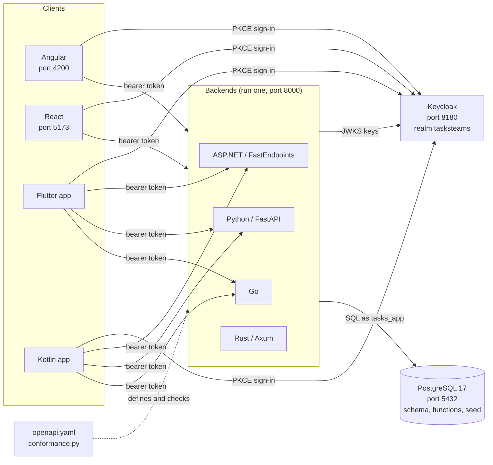

# Platform: the Tasks and Teams contract

The platform capstone is the shared base of the whole "Tasks and Teams" family. It contains **no application code**: it holds the contract that every backend implements and every client consumes, and the infrastructure they all run against.

| Part | File | Chapter |
|------|------|---------|
| API contract | `openapi.yaml` (OpenAPI 3.1, 27 operations, 33 schemas) | [01](tutorials/phase-1-contract/01-openapi-contract.md) |
| Database | `db/schema.sql`, `db/seed.sql`, stored functions `complete_task`, `reassign_task`, `create_team` | [02](tutorials/phase-2-data/02-database-and-procedures.md) |
| Identity | `keycloak/realm-tasksteams.json` (clients, roles, scopes, test users) | [03](tutorials/phase-3-identity/03-keycloak-identity.md) |
| Infrastructure | `docker-compose.yml` (Postgres 17 and Keycloak 26.8.2, healthchecks, loopback ports), `.env.example` | 02, 03 |
| Conformance | `scripts/conformance.py` (standard library only; `--infra-only` or 18 ordered checks) | [04](tutorials/phase-4-conformance/04-conformance-script.md) |
| Design | [TDD.md](TDD.md): requirements, diagrams, API table, security, phase plan | all |

## System diagram

Every arrow into the backends is the same HTTP contract, which is why the parts are interchangeable.

## Which parts fit together

| You pick | Works with | Does not work with |
|----------|------------|--------------------|
| Any **web client** (Angular or React) | any backend: Python, ASP.NET, Go or Rust | nothing excluded |
| Any **mobile client** (Flutter or Kotlin) | ASP.NET, Python or Go backend | the Rust backend (not taught for mobile) |
| Any **backend** | any web client; mobile only for ASP.NET, Python and Go | needs this platform's Postgres and Keycloak |
| Two clients at once | yes, they use different Keycloak clients (`tasks-web`, `tasks-mobile`) | |
| Two backends at once | no, both want port 8000 and the same database | run one at a time |

The backend is chosen with one setting in the clients (`API_BASE_URL`, default `http://localhost:8000`). A backend is allowed to claim the contract only when `python scripts/conformance.py` prints `18 passed, 0 failed`.

## Host ports

| Port | Service |
|------|---------|
| 8000 | the backend API |
| 8180 | Keycloak (published on 127.0.0.1) |
| 5432 | Postgres (published on 127.0.0.1) |
| 4200 | Angular dev server |
| 5173 | React (Vite) dev server |

Never used here: 8080, 8081 (Docker 101 labs), 11434 (Ollama). Postgres on 5432 is shared with the Databases track labs: run one at a time.

## How to work through it

0. New to Git, HTTP, OpenAPI or sign-in with OAuth? Start with the primers below (about 3 hours in total); otherwise go on with step 1.
1. Read the [TDD](TDD.md) sections 3, 4 and 6 (about 20 minutes).
2. Do the four chapters in order. Each phase pack contains the whole project at the end of that phase, so you may start at any phase.
3. Start the finished platform with `docker compose -p platform up -d --wait` in `source/phase-4-conformance/04-conformance-script/code` (copy `.env.example` to `.env` first) and run `python scripts/conformance.py --infra-only`.
4. Continue with a backend capstone, then a client capstone.

| Phase | Pack | Chapter | Time |
|-------|------|---------|------|
| 0 Primers | `platform-phase-0-primers.zip` | 01 to 04 below | 4 x 30 to 45 min |
| 1 Contract | `platform-phase-1-contract.zip` | 01 The OpenAPI contract | 60 min |
| 2 Data | `platform-phase-2-data.zip` | 02 The database and stored procedures | 75 min |
| 3 Identity | `platform-phase-3-identity.zip` | 03 Identity with Keycloak | 90 min |
| 4 Conformance | `platform-phase-4-conformance.zip` | 04 The conformance script | 75 min |

## Chapter 0: primers
Four short background lessons for developers who have not met these topics. Each takes 30 to 45 minutes, starts from zero and uses the platform's own examples (Tasks and Teams, `/v1/tasks`, the realm `tasksteams`, ports 8000 and 8180). They are written but not yet run.

| Primer | Topic | Time |
|--------|-------|------|
| [01 Git and GitHub](tutorials/phase-0-primers/01-git-and-github.md) | install Git, commit, branch, diff, push, clone Code101, never commit secrets | 40 min |
| [02 HTTP and REST](tutorials/phase-0-primers/02-http-and-rest.md) | requests, responses, methods, status codes, JSON, first calls with `curl` and PowerShell | 45 min |
| [03 Reading an OpenAPI file](tutorials/phase-0-primers/03-reading-an-openapi-file.md) | paths, operations, schemas, components, security, `$ref`, viewers and generated clients | 45 min |
| [04 OAuth 2, OIDC and Keycloak](tutorials/phase-0-primers/04-oauth2-oidc-and-keycloak.md) | tokens, JWT, authorization code flow with PKCE, realm, client, role, token validation | 45 min |

Source: `source/phase-0-primers/` (see its `PACK-README.md`).

## Status
Verified on 2026-11-23 (Windows 11, Docker 29.9.3, Compose 5.7.0, Python 3.15.2): the OpenAPI file validates, Postgres and Keycloak start healthy under a throwaway Compose project, the infrastructure checks pass, and everything is removed afterwards. The 14 API checks of the conformance script are run by each backend capstone, because no backend exists in this capstone.
