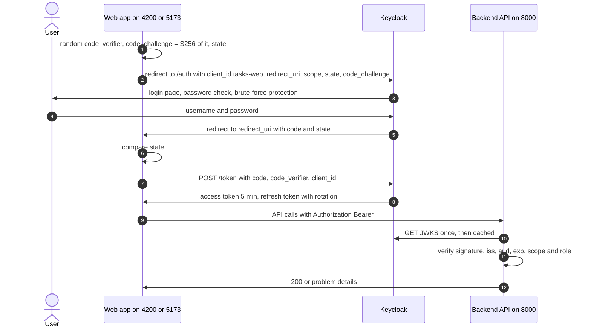
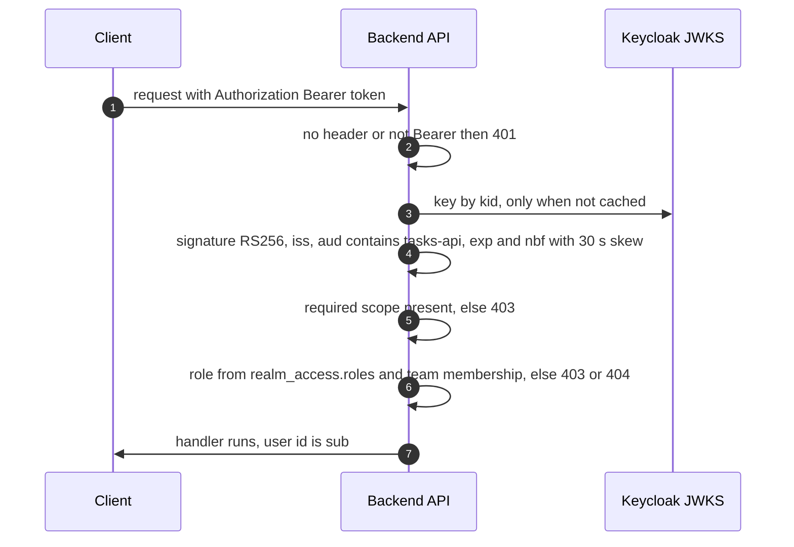

# 04. OAuth 2, OpenID Connect and Keycloak

> **Draft: written but not yet run.** The code and the expected output in this lesson were prepared by reading the code and the official documentation. They have not been executed yet. If something does not behave as described, trust your tool's real output and report it.

## What you will be able to do
By the end of this lesson you will be able to:
- tell authentication from authorization and name the four roles in OAuth 2;
- take a JWT apart into header, payload and signature and name its important claims;
- explain the authorization code flow with PKCE step by step and draw it;
- describe a Keycloak realm, client, role, scope and user using the `tasksteams` realm;
- list the checks a backend makes before it trusts a bearer token.

## Recap
From lessons 02 and 03:
1. What does the `Authorization: Bearer ...` header do, and which status do you get without it? <details><summary>Answer</summary>It carries the access token that says who you are; without it the API answers 401.</details>
2. Where in an OpenAPI file is the default sign-in requirement of every operation? <details><summary>Answer</summary>In the top-level `security` list; an operation can override it, and `security: []` means "no token needed".</details>
3. Which differs: a scope or a role? <details><summary>Answer</summary>A scope limits what the app may do for the user; a role says what the user may do.</details>

## Why it matters
Imagine a hotel. At the front desk you show your passport once; the clerk checks that you are you and gives you a **key card**. The card does not say your passport number; it only opens the doors you are allowed to open, and it stops working tomorrow morning. Every door lock just reads the card and does not call the front desk each time. That is how sign-in works on the web: the **login** happens once at a trusted place (here Keycloak), and every later request carries a short-lived card (the **token**) that the API checks locally. Getting this wrong is how real systems leak data, so the platform teaches it carefully.

## What you will build
You will run two small Python scripts: one builds a practice token and takes it apart the way a backend does (and shows four checks passing and failing), the other computes the PKCE challenge from RFC 7636's own example. Optionally, if you ran the platform's Docker project from chapter 03, you fetch a real token from Keycloak and take that one apart too.

## Before you start
- Python 3.10 or newer (`python --version`; `python3` on macOS and Linux). Nothing to install with `pip`.
- Optional (Step 4 only): Docker, and the platform project from chapter 03 running on ports 5432 and 8180.
- Time: about 45 minutes.
- Source pack (optional): every file is shown in full here; the finished files are in https://github.com/Uee03/Code101 under `capstones/platform/source/phase-0-primers/04-oauth2-oidc-and-keycloak/`.

## The ideas first
### Authentication and authorization
| Word | Question | Hotel | In the platform |
|------|----------|-------|-----------------|
| **Authentication** (authn) | Who are you? | Passport check at the desk | Keycloak checks a user name and password |
| **Authorization** (authz) | What may you do? | The card opens floor 3 only | The API checks scope, role and team membership |

A 401 answers the first question ("I do not know who you are"); a 403 answers the second ("I know, and the answer is no").

### OAuth 2 and OpenID Connect
**OAuth 2** is a standard that lets an app act on a user's behalf **without ever seeing the user's password**. It names four roles:

| Role | Meaning | In the platform |
|------|---------|-----------------|
| Resource owner | The user whose data it is | alice, bob or carol |
| Client | The app that wants access | `tasks-web` (Angular or React) and `tasks-mobile` (Flutter or Kotlin) |
| Authorization server | Checks the user and issues tokens | **Keycloak**, realm `tasksteams`, port 8180 |
| Resource server | The API that holds the data and checks tokens | the backend on port 8000 |

**OpenID Connect** (OIDC) is a thin layer on top of OAuth 2 that adds *identity*: a standard way to learn who the user is. When a client adds the scope `openid`, Keycloak also returns an **ID token** about the user. Keycloak publishes a **discovery document** at `/.well-known/openid-configuration` that lists all its addresses, so apps need to know only one URL: `http://localhost:8180/realms/tasksteams/.well-known/openid-configuration`.

### The tokens
| Token | For | Lifetime in the realm |
|-------|-----|-----------------------|
| **Access token** | The API. Sent as `Authorization: Bearer <token>`. | 5 minutes (`accessTokenLifespan: 300`) |
| **Refresh token** | Keycloak. Trades for a new access token without a new login. | Replaced at every use (`revokeRefreshToken: true`, "rotation") |
| **ID token** | The client app. Tells it who signed in. | Short |

**Bearer** means "whoever *bears* (holds) this token is treated as the user", like cash. So tokens are short, travel only over encrypted connections (`https` in production) and are never written to logs.

### What is inside a JWT
The access token is a **JWT** (JSON Web Token, said "jot"): three text pieces joined by dots.

```text
eyJhbGciOi....eyJpc3MiOi....c2lnbmF0dXJl
header        payload       signature
```
| Part | Contains |
|------|----------|
| header | How it was signed: `alg` (the algorithm, `RS256` here) and `kid` (which key). |
| payload | The **claims**: statements about the user and the token. |
| signature | A stamp made with Keycloak's **private** key over header and payload. |

Header and payload are encoded with **base64url**, which is only a way to write bytes as text. **It is not encryption**: anyone can decode them, so never put secrets in a token. What makes a token trustworthy is the signature: Keycloak keeps the private key; the API fetches the matching **public** key (published as a **JWKS**, a JSON list of keys, each with a `kid`) and checks the stamp. If one character of the payload changes, the stamp no longer fits.

The claims the platform uses:

| Claim | Meaning | Example |
|-------|---------|---------|
| `iss` | Issuer: who made the token | `http://localhost:8180/realms/tasksteams` |
| `sub` | Subject: the user's id, becomes the user id in the database | `b0b00000-0000-4000-8000-000000000002` (bob) |
| `aud` | Audience: who the token is meant for. The API only accepts tokens that include `tasks-api`. | `tasks-api` |
| `exp`, `iat` | Expiry and issue time, in seconds since 1 January 1970 | `exp - iat` is 300 |
| `scope` | Space-separated permissions granted to the app | `openid tasks:read tasks:write` |
| `realm_access.roles` | The user's realm roles | `["member"]` |
| `preferred_username` | Display login name | `bob` |

### The authorization code flow with PKCE
Web and phone apps are **public clients**: anyone can read their code, so they cannot keep a secret. The safe flow for them is the **authorization code flow with PKCE** (said "pixie").

**Analogy: the coat check.** You hand over your coat and get a ticket (the *code*). The ticket alone is risky, because a thief who snatches it in the queue could collect your coat. So before you hand the coat over, you write a secret word on a sealed card and leave the card at the desk (the *code challenge*, a fingerprint of the secret). To collect the coat you must show the ticket **and** say the secret word (the *code verifier*). The desk checks that the word matches the fingerprint. A thief with only the ticket gets nothing.

Terms used in the diagram:

| Term | Meaning |
|------|---------|
| `client_id` | The app's name in Keycloak: `tasks-web` or `tasks-mobile`. |
| `redirect_uri` | Where Keycloak sends the user back. It must match one registered for the client **exactly**. |
| `state` | A random value the app creates and checks again later, so it can tell that the answer belongs to its own request. |
| `code_verifier` | A random secret, 43 to 128 URL-safe characters, created by the app and never sent in the first step. |
| `code_challenge` | `base64url(SHA-256(code_verifier))`; the fingerprint sent in the first step. `S256` names this method. |
| `code` | A one-time ticket that Keycloak gives back; in this realm it lives 60 seconds (`accessCodeLifespan: 60`). |

The web flow, as in the platform's design document (TDD section 7):


Step by step (the numbers are the arrows of the diagram):

| # | What happens | Why |
|---|--------------|-----|
| 1 | The app makes a random `code_verifier`, computes the `code_challenge` (S256) and a random `state`. | The secret never leaves the app yet. |
| 2 | The app sends the browser to Keycloak's `/auth` address with `client_id`, `redirect_uri`, `response_type=code`, `scope`, `state` and the `code_challenge`. | Keycloak learns which app asks and receives the fingerprint. |
| 3-4 | Keycloak shows **its own** login page; the user types the password **into Keycloak**, never into the app. After 5 wrong tries the realm's brute-force protection slows the account down. | The app never sees the password. |
| 5 | Keycloak redirects the browser to the `redirect_uri` with the `code` and the same `state`. | The ticket is delivered. |
| 6 | The app compares `state` with the one it saved. | Rejects answers it did not ask for. |
| 7 | The app sends `POST /token` straight to Keycloak with the `code`, the `code_verifier` and `client_id`. | Keycloak hashes the verifier and compares it with the stored challenge. A stolen code is useless without the verifier. |
| 8 | Keycloak returns the access token (5 minutes) and a refresh token. | The key card. |
| 9 | The app calls the API with `Authorization: Bearer <access token>`. | |
| 10-12 | The API fetches the signing keys once (JWKS, then cached), checks the token and answers. | See the next section. |

What the browser address of step 2 looks like (one line in reality, wrapped here; `%3A` and `%2F` are escaped `:` and `/`). The verifier and challenge are the example pair from RFC 7636, Appendix B:
```text
http://localhost:8180/realms/tasksteams/protocol/openid-connect/auth
  ?client_id=tasks-web
  &redirect_uri=http%3A%2F%2Flocalhost%3A5173%2F
  &response_type=code
  &scope=openid%20tasks%3Aread%20tasks%3Awrite
  &state=k3J9xQ
  &code_challenge=E9Melhoa2OwvFrEMTJguCHaoeK1t8URWbuGJSstw-cM
  &code_challenge_method=S256
```
And the body of step 7, sent as a form:
```text
grant_type=authorization_code
client_id=tasks-web
code=<the code from step 5>
redirect_uri=http://localhost:5173/
code_verifier=dBjftJeZ4CVP-mB92K27uhbUJU1p1r_wW1gFWFOEjXk
```
On a phone the flow is the same, with two differences: the login runs in the **system browser** (never inside the app), and `redirect_uri` is a private link `com.code101.tasks:/oauth2redirect` that the operating system hands back to the app.

### Keycloak in five words
| Word | Meaning | In the platform |
|------|---------|-----------------|
| **Realm** | A separate world of users, roles and apps. Nothing is shared between realms. | `tasksteams` |
| **Client** | An app registered in Keycloak. *Public* clients keep no secret; *confidential* ones do. | `tasks-web`, `tasks-mobile` (public), `tasks-api` (the API as an audience), `tasks-smoke` (a test script) |
| **Role** | What a user is. | `admin`, `member` |
| **Client scope** | A permission label the app asks for and puts in the token's `scope`. *Default* scopes are always granted; *optional* ones are requested on demand. | `tasks:read`, `tasks:write` (default), `tasks:admin` (optional) |
| **User** | A person who can sign in. | alice (`admin`), bob and carol (`member`) |

The platform defines all of this in one file, `keycloak/realm-tasksteams.json`, which Keycloak imports at start. Here are the real excerpts. The roles:

**File: `realm-tasksteams.json` (excerpt: roles)**
```json
  "roles": {
    "realm": [
      { "name": "admin", "description": "Manages teams, reads the audit log" },
      { "name": "member", "description": "Works on tasks in the teams they belong to" }
    ]
  },
```
The web client:

**File: `realm-tasksteams.json` (excerpt: client `tasks-web`)**
```json
    {
      "clientId": "tasks-web",
      "name": "Tasks web client (Angular or React)",
      "enabled": true,
      "protocol": "openid-connect",
      "publicClient": true,
      "standardFlowEnabled": true,
      "implicitFlowEnabled": false,
      "directAccessGrantsEnabled": false,
      "serviceAccountsEnabled": false,
      "fullScopeAllowed": true,
      "redirectUris": ["http://localhost:4200/*", "http://localhost:5173/*"],
      "webOrigins": ["http://localhost:4200", "http://localhost:5173"],
      "attributes": {
        "pkce.code.challenge.method": "S256",
        "post.logout.redirect.uris": "http://localhost:4200/*##http://localhost:5173/*"
      },
      "defaultClientScopes": ["basic", "profile", "email", "roles", "web-origins", "tasks:read", "tasks:write", "tasks-api-audience"],
      "optionalClientScopes": ["tasks:admin", "offline_access"]
    },
```
| Setting | Meaning |
|---------|---------|
| `publicClient: true` | A browser app cannot keep a secret, so there is none. |
| `standardFlowEnabled: true` | The authorization code flow is allowed. |
| `implicitFlowEnabled: false`, `directAccessGrantsEnabled: false` | The older, weaker flows (tokens in the address bar; sending the password to the app) are off. |
| `redirectUris` | The only places Keycloak may send the user back to. Anything else is refused. |
| `pkce.code.challenge.method: S256` | PKCE with SHA-256 is **required** for this client. |
| `defaultClientScopes` | Includes `tasks:read`, `tasks:write` and `tasks-api-audience`, the scope that adds `tasks-api` to the token's `aud`. |
| `optionalClientScopes` | `tasks:admin` is only in the token when the app asks for it. |

One of the three users (the passwords are public, fake and for local practice only):

**File: `realm-tasksteams.json` (excerpt: user bob)**
```json
    {
      "id": "b0b00000-0000-4000-8000-000000000002",
      "username": "bob",
      "email": "bob@tasksteams.test",
      "emailVerified": true,
      "firstName": "Bob",
      "lastName": "Member",
      "enabled": true,
      "credentials": [{ "type": "password", "value": "bob-local-fake", "temporary": false }],
      "realmRoles": ["member"]
    },
```
The user `id` is the `sub` claim of bob's tokens, and the backend uses it as the user id in its `users` table. **Scope plus role:** the permission is the *intersection*. Bob holding the scope `tasks:admin` is still refused an admin route, because his role is `member`.

### How a backend validates a token
The backend never calls Keycloak for each request; it checks the token itself with the public key. The platform's rule list (TDD section 7), as a diagram:


In words:
1. No `Authorization: Bearer ...` header, or the token fails any check below: **401**.
2. Accept only the algorithm `RS256`; reject `alg: none`, a trick where an attacker says "no signature needed".
3. The signature must match a key from the JWKS (looked up by `kid`; cache the keys, fetch again when the `kid` is unknown).
4. `iss` must equal the configured issuer **exactly**; `aud` (a string or a list) must contain `tasks-api`; `exp` must be in the future (allow 30 seconds of clock difference).
5. The token must carry the scope the operation needs (`tasks:read`, `tasks:write`, `tasks:admin`), else **403**.
6. The user's role and team membership decide the rest: **403**, or **404** when the user must not even learn that the thing exists.
7. Never log the token.

## Steps
### Step 1. Take a token apart
Create a folder `oauth-primer` and in it the file `decode_token.py`. The script builds a practice token (the signature is the word "signature", not a real one) and then does what a backend does first: split, decode, check.

**File: `decode_token.py`**
```python
"""Take a JWT apart the way a backend starts to: split it, decode it, check the claims.

Without an argument it builds a practice token. With a real access token as the first
argument it takes that one apart instead. It never checks the signature.
"""
import base64
import json
import sys
import time

ISSUER = "http://localhost:8180/realms/tasksteams"


def b64url(raw):
    return base64.urlsafe_b64encode(raw).rstrip(b"=").decode()


def decode_part(part):
    return json.loads(base64.urlsafe_b64decode(part + "=" * (-len(part) % 4)))


def practice_token(now):
    header = {"alg": "RS256", "typ": "JWT", "kid": "practice-key"}
    payload = {
        "iss": ISSUER,
        "sub": "b0b00000-0000-4000-8000-000000000002",
        "aud": "tasks-api",
        "preferred_username": "bob",
        "scope": "openid tasks:read tasks:write",
        "realm_access": {"roles": ["member"]},
        "iat": now,
        "exp": now + 300,
    }
    return ".".join([
        b64url(json.dumps(header).encode()),
        b64url(json.dumps(payload).encode()),
        b64url(b"signature"),
    ])


def check(claims, now):
    problems = []
    if claims["iss"] != ISSUER:
        problems.append("wrong issuer")
    audience = claims["aud"] if isinstance(claims["aud"], list) else [claims["aud"]]  # aud may be a string or a list
    if "tasks-api" not in audience:
        problems.append("wrong audience")
    if claims["exp"] < now:
        problems.append("token expired")
    if "tasks:read" not in claims["scope"].split():
        problems.append("scope tasks:read missing")
    return problems


now = int(time.time())
token = sys.argv[1] if len(sys.argv) > 1 else practice_token(now)
parts = token.split(".")
print(f"parts: {len(parts)} (header, payload, signature)")
print("header:", decode_part(parts[0]))
claims = decode_part(parts[1])
print("user:", claims["preferred_username"], claims["sub"])
print("roles:", ", ".join(claims["realm_access"]["roles"]))
print("scopes:", claims["scope"])
print("lifetime:", claims["exp"] - claims["iat"], "seconds")
print("checks:", check(claims, now) or "all passed")
print("expired token:", check(dict(claims, exp=now - 1), now))
print("other audience:", check(dict(claims, aud="other-api"), now))
print("signature: not checked here, a real backend verifies it with Keycloak's public key")
```
How it works, in the order it runs:

| Lines | Meaning |
|-------|---------|
| `b64url` | Turns bytes into base64url text and removes the `=` padding, the way JWTs are written. |
| `decode_part` | The reverse. It adds back the missing `=` signs (`-len(part) % 4` is how many are needed), decodes and reads the JSON. The platform's conformance script uses the same one-liner to read claims. |
| `practice_token` | Builds the three parts with the claims of bob (his real `sub`, the role `member`, a 5-minute life) and joins them with dots. |
| `check` | Four of the backend's checks: issuer, audience, expiry, scope. It returns a list of problems; an empty list means the token is fine. |
| the lines after `now = ...` | Take the token from the first command-line argument if there is one, else build the practice token; split it; print the parts; run the checks on the real claims, on a copy that expired one second ago, and on a copy with a different audience. `dict(claims, exp=now - 1)` copies the dictionary and replaces one key. |

**Predict:** what will `checks:` print for the untouched practice token, and what for the two changed copies? The first has the right issuer, audience, expiry and scope, so `all passed` (an empty list is false, so `or` picks the text). The expired copy has `exp` in the past: `['token expired']`. The copy with audience `other-api` lacks `tasks-api`: `['wrong audience']`.

**Terminal (folder: `oauth-primer`)**
```powershell
python decode_token.py
```
On macOS and Linux use `python3 decode_token.py`. Expected output:
```text
parts: 3 (header, payload, signature)
header: {'alg': 'RS256', 'typ': 'JWT', 'kid': 'practice-key'}
user: bob b0b00000-0000-4000-8000-000000000002
roles: member
scopes: openid tasks:read tasks:write
lifetime: 300 seconds
checks: all passed
expired token: ['token expired']
other audience: ['wrong audience']
signature: not checked here, a real backend verifies it with Keycloak's public key
```
**Decoding is not trusting.** This script decoded the token without any key. Anybody can do that, and anybody can *write* a payload that says `"roles": ["admin"]`. Only the signature check proves Keycloak made it, so a backend must verify the signature first and read the claims second.

### Step 2. Compute a PKCE challenge
**File: `pkce_challenge.py`**
```python
"""Compute the PKCE code_challenge (method S256) from a code_verifier."""
import base64
import hashlib

verifier = "dBjftJeZ4CVP-mB92K27uhbUJU1p1r_wW1gFWFOEjXk"
digest = hashlib.sha256(verifier.encode("ascii")).digest()
challenge = base64.urlsafe_b64encode(digest).rstrip(b"=").decode()
print("code_verifier :", verifier)
print("code_challenge:", challenge)
```
| Line | Meaning |
|------|---------|
| `verifier = ...` | The example verifier from RFC 7636, Appendix B. A real app makes a fresh random one each time (in Python `secrets.token_urlsafe(32)` gives 43 characters). |
| `hashlib.sha256(...).digest()` | The SHA-256 fingerprint: a fixed 32-byte value; a hash cannot be turned back into its input. |
| `base64.urlsafe_b64encode(...).rstrip(b"=")` | Writes the fingerprint as base64url text without padding. |

**Terminal (folder: `oauth-primer`)**
```powershell
python pkce_challenge.py
```
Expected output (the challenge is the one given in the RFC for this verifier, and it is the same one used in the address of the flow above):
```text
code_verifier : dBjftJeZ4CVP-mB92K27uhbUJU1p1r_wW1gFWFOEjXk
code_challenge: E9Melhoa2OwvFrEMTJguCHaoeK1t8URWbuGJSstw-cM
```
In step 2 of the flow the app sends only the challenge; in step 7 it sends the verifier. Keycloak runs this very calculation and compares.

### Step 3. Read the token flow on paper
Without a computer: take the numbered table in "The authorization code flow with PKCE" and, for each of the 12 arrows, say who sends what. Then answer: *at which step could a thief who copies the `code` from the address bar use it?* (Answer: none. Step 7 needs the verifier, which never travelled through the address bar.)

### Step 4. Optional: a real token from Keycloak
This step needs the platform running. In the folder `capstones/platform/source/phase-4-conformance/04-conformance-script/code` of your clone of Code101 (lesson 01), copy `.env.example` to `.env` and start the project, as the platform README says:

**Terminal (folder: `.../04-conformance-script/code`)**
```powershell
Copy-Item .env.example .env
docker compose -p platform up -d --wait
```
When both services are healthy, ask Keycloak for a token as bob. The script client `tasks-smoke` allows the older **password grant** (the app sends the user's password itself) **only so scripts can run unattended; a real app never does this**. Go back to `oauth-primer`:

**Terminal (PowerShell; folder: `oauth-primer`)**
```powershell
$form = @{ grant_type = "password"; client_id = "tasks-smoke"; username = "bob"; password = "bob-local-fake"; scope = "openid tasks:read tasks:write" }
$response = Invoke-RestMethod -Method Post -Uri "http://127.0.0.1:8180/realms/tasksteams/protocol/openid-connect/token" -Body $form
$response.token_type
$response.expires_in
python decode_token.py $response.access_token
```
`Invoke-RestMethod` sends a hashtable body as a form. The first two lines print:
```text
Bearer
300
```
`300` is the 5 minutes of the realm. Then the script takes the real token apart. Expect `parts: 3`, a `header` with `alg` `RS256` and a `kid` that is a long random text, `user: bob b0b00000-0000-4000-8000-000000000002`, `roles: member`, a `scopes:` line that includes `tasks:read` and `tasks:write`, `lifetime: 300 seconds` and `checks: all passed`. The `sub` is the id from the realm file excerpt above. Stop the project afterwards:

**Terminal (folder: `.../04-conformance-script/code`)**
```powershell
docker compose -p platform down -v --remove-orphans
```
On macOS and Linux use `cp .env.example .env`, and `curl -s -X POST http://127.0.0.1:8180/realms/tasksteams/protocol/openid-connect/token -d grant_type=password -d client_id=tasks-smoke -d username=bob -d password=bob-local-fake -d "scope=openid tasks:read tasks:write"`, then copy the value of `access_token` from the JSON into `python3 decode_token.py <value>`.

## Run it
You have run `decode_token.py` and `pkce_challenge.py`. To close the loop, answer from the output of Step 1: which of the platform's backend checks did the script show, and which one could it not show? It showed issuer, audience, expiry and scope. It could not show the **signature** check, because that needs the public key from Keycloak's JWKS: the backend capstones implement it.

## How it works
- **Why a short access token.** If a token leaks, it works for at most 5 minutes. The longer-lived refresh token stays inside the app and is replaced at every use, so a stolen copy stops working as soon as the real app uses its own.
- **Why the API checks locally.** Verifying with a cached public key needs no network call per request. The cost: if you disable a user, tokens already issued stay valid until they expire (up to 5 minutes).
- **Why `aud` matters.** A token for another API of the same Keycloak must not work here; the API insists that `tasks-api` is in `aud`.
- **Why Keycloak, not our own login.** Passwords, brute-force protection, multi-factor sign-in and key rotation are hard to get right. A standard identity server does it once.
- **Misconception to drop:** "OAuth is a login protocol." OAuth 2 is about *access* (what an app may do). The login and the "who" come from OpenID Connect on top of it.

## Try it
Starter: `exercise/starter/can_call.py`. Copy it into `oauth-primer` and run `python can_call.py` after each rung.
1. **Guided.** Implement `has_scope` (the scope is one of the words in `claims["scope"]`) and `has_role` (the role is in `claims["realm_access"]["roles"]`).
2. **Change.** Implement `may_delete_team`: deleting a team needs the scope `tasks:admin` **and** the role `admin`. Four callers are listed. Predict first which of them is allowed.
3. **Stretch (no single answer).** Add `status_for(claims)` that returns the HTTP status the API should answer for a caller: which status for "no token", which for "token but not allowed", which for "allowed"? Print it after each answer.

The starter file:

**File: `exercise/starter/can_call.py`**
```python
"""Exercise: may this caller delete a team? It needs the scope tasks:admin AND the role admin."""


def has_scope(claims, scope):
    return False  # TODO rung 1: True when scope is one of the words in claims["scope"]


def has_role(claims, role):
    return False  # TODO rung 1: True when role is in claims["realm_access"]["roles"]


def may_delete_team(claims):
    return False  # TODO rung 2: both the scope tasks:admin and the role admin are needed


# TODO rung 3 (stretch): add status_for(claims): 401 without a token (claims is None),
# 204 when the delete is allowed, 403 otherwise. Then print the status after each answer.

CALLERS = {
    "alice with tasks:admin": {"scope": "openid tasks:read tasks:write tasks:admin", "realm_access": {"roles": ["admin"]}},
    "alice without tasks:admin": {"scope": "openid tasks:read tasks:write", "realm_access": {"roles": ["admin"]}},
    "bob with tasks:admin": {"scope": "openid tasks:read tasks:write tasks:admin", "realm_access": {"roles": ["member"]}},
    "bob": {"scope": "openid tasks:read tasks:write", "realm_access": {"roles": ["member"]}},
}
for name, claims in CALLERS.items():
    print(f"{name}: {'allowed' if may_delete_team(claims) else 'refused'}")
```

<details><summary>Solution</summary>

**File: `exercise/solution/can_call.py`**
```python
"""Exercise: may this caller delete a team? It needs the scope tasks:admin AND the role admin."""


def has_scope(claims, scope):
    return scope in claims["scope"].split()


def has_role(claims, role):
    return role in claims["realm_access"]["roles"]


def may_delete_team(claims):
    return has_scope(claims, "tasks:admin") and has_role(claims, "admin")


def status_for(claims):
    if claims is None:
        return 401
    return 204 if may_delete_team(claims) else 403


CALLERS = {
    "alice with tasks:admin": {"scope": "openid tasks:read tasks:write tasks:admin", "realm_access": {"roles": ["admin"]}},
    "alice without tasks:admin": {"scope": "openid tasks:read tasks:write", "realm_access": {"roles": ["admin"]}},
    "bob with tasks:admin": {"scope": "openid tasks:read tasks:write tasks:admin", "realm_access": {"roles": ["member"]}},
    "bob": {"scope": "openid tasks:read tasks:write", "realm_access": {"roles": ["member"]}},
}
for name, claims in CALLERS.items():
    print(f"{name}: {'allowed' if may_delete_team(claims) else 'refused'} ({status_for(claims)})")
print(f"no token: refused ({status_for(None)})")
```
Expected output:
```text
alice with tasks:admin: allowed (204)
alice without tasks:admin: refused (403)
bob with tasks:admin: refused (403)
bob: refused (403)
no token: refused (401)
```
Only the first caller has **both** the scope and the role. Alice without the scope is refused because the *app* was not granted `tasks:admin`; bob with the scope is refused because the *user* is not an admin. That is the scope-and-role intersection. In the solution the last rung is one possible answer: 401 for an unknown caller, 403 for a known caller who may not, and 204 (the success status of `DELETE /v1/teams/{teamId}`) for an allowed one.

</details>

## Check yourself
1. Which part of a JWT proves that Keycloak issued it? <details><summary>Answer</summary>The signature, checked with Keycloak's public key. The header and payload can be read and even written by anyone.</details>
2. Why does PKCE protect a stolen authorization code? <details><summary>Answer</summary>Exchanging the code needs the `code_verifier`, which stays in the app; Keycloak compares its hash with the `code_challenge` sent at the start.</details>
3. A token has `aud: "other-api"`. What does the platform's API answer, and why? <details><summary>Answer</summary>401: the audience does not contain `tasks-api`, so the token was not meant for this API.</details>
4. **Predict:** a user with the role `member` presents a valid token whose scope includes `tasks:admin` and calls `GET /v1/audit-log` (admin only). Which status? <details><summary>Answer</summary>403: the token is valid, but the role `admin` is also required.</details>
5. Why is the password grant of `tasks-smoke` acceptable for a script but wrong for an app? <details><summary>Answer</summary>The app would handle the user's password itself, which the code flow with a login page at Keycloak exists to avoid. The script uses fake test accounts on a local, disposable realm.</details>

## Common mistakes
| Symptom or error text | Cause | Fix |
|---|---|---|
| Keycloak login page shows `Invalid parameter: redirect_uri` | The `redirect_uri` of the request does not match a registered one exactly. | Use `http://localhost:4200/...` or `http://localhost:5173/...` for `tasks-web`, as listed in `redirectUris`. |
| The API answers 401 after about 5 minutes of work | The access token expired. | Use the refresh token to get a new access token, or sign in again. |
| 401 with a valid-looking token | `iss` differs (for example the token came from `127.0.0.1:8180` but the API expects `localhost:8180`), or `aud` lacks `tasks-api`. | Use the same host name everywhere (`localhost`) and make sure the client has the scope `tasks-api-audience`. |
| `binascii.Error: Incorrect padding` in your own decoding code | base64url text without its `=` padding. | Add the padding back as `decode_part` does. |
| `IndexError: list index out of range` on `parts[1]` | The text is not a JWT (fewer than three dot-separated parts), for example a copied value with quotes or a line break. | Copy only the value of `access_token`, without quotes. |
| Tokens in `localStorage`, in logs, or in a commit | A token is a key card: anyone who copies it is you for 5 minutes. | Keep tokens in memory (web) or in Keychain/Keystore (mobile); never log or commit them. |
| On an Android emulator sign-in cannot reach Keycloak | The emulator's `localhost` is the emulator itself. | The mobile capstones use `adb reverse tcp:8180 tcp:8180` and `adb reverse tcp:8000 tcp:8000`. |

(The error texts above are typical; exact wording varies by tool and version.)

## Best practice
Use the authorization code flow with PKCE for every public client, request the smallest scopes you need, keep access tokens short and out of logs, and in the API verify signature, issuer, audience and expiry before reading a single claim. Source: [RFC 9700, the OAuth 2.0 Security Best Current Practice](https://www.rfc-editor.org/info/rfc9700), [RFC 7636 (PKCE)](https://www.rfc-editor.org/info/rfc7636) and the [Keycloak documentation](https://www.keycloak.org/documentation).

## Going further
- Chapter [03 Identity with Keycloak](../phase-3-identity/03-keycloak-identity.md) shows the whole realm file line by line and starts Keycloak in Docker.
- The platform's [TDD](../../TDD.md), section 7, has the mobile flow, the scope table and the OWASP API Security mapping.
- Paste a token into https://jwt.io only if it is a throw-away practice token: a real token is a key card, and you should not paste it into websites.

## Summary
- You separated authentication (who) from authorization (what) and named the four OAuth 2 roles.
- You split a JWT into header, payload and signature, read its claims and saw why decoding is not verifying.
- You followed the authorization code flow with PKCE step by step and computed a `code_challenge` yourself.
- You read the `tasksteams` realm excerpts: roles, the `tasks-web` client with PKCE required, and the user bob.
- You listed the checks a backend runs on a bearer token and the status each failure gets.

## Next lesson
This was the last primer. Continue with chapter [01 The OpenAPI contract](../phase-1-contract/01-openapi-contract.md), which builds the contract you now know how to read.
