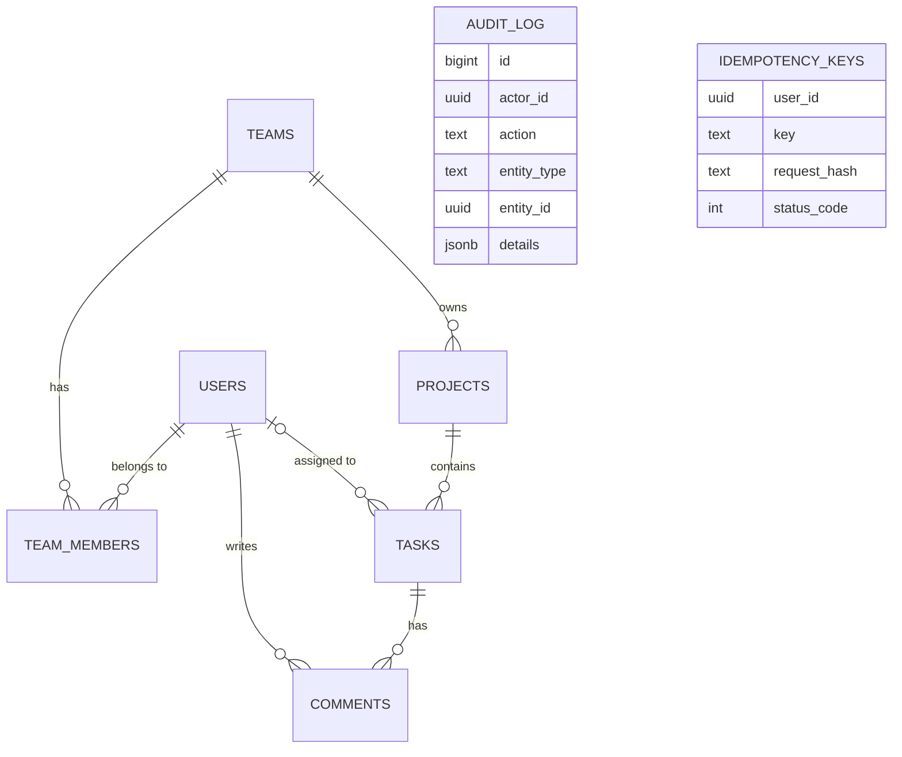

# 02. The database and stored procedures

## Why it matters
A bank does not trust every teller to remember the rules: the vault itself refuses a withdrawal larger than the balance. Putting rules in the database works the same way. Whether a Python, C#, Go or Rust backend writes a task, the database still refuses a negative version, an empty title, or a half-finished "complete" operation. This chapter builds that vault: tables, constraints, indexes, triggers and two stored functions that are atomic.

## What you will build
A Postgres 17 container that, on its first start, creates eight tables, the triggers that version, time-stamp and audit every change, four stored functions and a demo data set (3 users, 2 teams, 3 projects, 8 tasks, 3 comments), then runs a demo script that completes and reassigns a task in one transaction and rolls it back.

## Before you start
- Docker running in Linux-container mode (Docker Desktop on Windows and macOS). Check with `docker info`. Author baseline: Docker 29.9.3, Compose 5.7.0.
- Chapter 01 done or its pack unzipped. This chapter's `code` folder contains the whole project so far (the contract from chapter 01 plus the new `db/` folder).
- **Host port 5432 must be free.** The Databases track labs also use 5432: finish their `docker compose down -v` first. Only one platform stack runs at a time (the Compose network has the fixed name `tasksteams-net`).
- Source pack: unzip `platform-phase-2-data.zip`, open folder `02-database-and-procedures/code`. Keep the `exercise` folder next to it.
- The passwords in this chapter are public, fake and local only. Never reuse them.

## Steps
### Step 1. Open the code folder and see the data model
Open a terminal in `02-database-and-procedures/code`. Everything below is run from this folder. The model:



`users.id` is the Keycloak `sub` claim, so the database never stores passwords. `audit_log` and `idempotency_keys` stand alone on purpose: an audit entry must survive the deletion of the thing it describes.

### Step 2. Read the Compose file
**File: `code/docker-compose.yml`**
```yaml
services:
  db:
    image: postgres:17-alpine
    environment:
      POSTGRES_DB: ${POSTGRES_DB}
      POSTGRES_USER: ${POSTGRES_USER}
      POSTGRES_PASSWORD: ${POSTGRES_PASSWORD}
    ports:
      - "127.0.0.1:${POSTGRES_PORT:-5432}:5432"
    volumes:
      - pg_data:/var/lib/postgresql/data
      - ./db/schema.sql:/docker-entrypoint-initdb.d/01-schema.sql:ro
      - ./db/seed.sql:/docker-entrypoint-initdb.d/02-seed.sql:ro
      - ./db:/scripts:ro
    healthcheck:
      test: ["CMD-SHELL", "pg_isready -h 127.0.0.1 -U $$POSTGRES_USER -d $$POSTGRES_DB"]
      interval: 3s
      timeout: 3s
      retries: 30
      start_period: 5s
    networks:
      - tasksteams
networks:
  tasksteams:
    name: ${TASKS_NETWORK:-tasksteams-net}
volumes:
  pg_data:
```

| Line | What it does | If you change it |
|------|--------------|------------------|
| `services: db:` | One container, named `db`. Other containers will reach it at the hostname `db`. | Backends later use `db` in their connection string. |
| `image: postgres:17-alpine` | The official image, Postgres major version 17, on the small Alpine Linux base. | `18-alpine` also exists, but its data folder layout differs; 17 stays supported until 2029 and matches the Databases track. |
| `environment` | On the first start the image creates this database, administrator and password. The `${...}` values come from `.env`. | Changing them after the first start has no effect: the data volume already exists. |
| `ports: "127.0.0.1:5432:5432"` | Publishes the port **only on your own machine** (127.0.0.1). Without `127.0.0.1:` the database would be reachable from your network. `:-5432` means "use 5432 unless `POSTGRES_PORT` says otherwise". | Never publish a database port to `0.0.0.0` on a shared machine. |
| `pg_data:/var/lib/postgresql/data` | A named volume keeps the data when the container is replaced. | `down -v` deletes it. |
| `./db/schema.sql:/docker-entrypoint-initdb.d/01-schema.sql:ro` | The image runs every `.sql` file in this folder, in name order, **once**, when the data folder is empty. `:ro` mounts it read-only. | Rename carefully: `01` runs before `02`. |
| `./db:/scripts:ro` | Lets you run `try_procedures.sql` with `psql -f /scripts/...`. | Not needed by the backends. |
| `healthcheck` | Docker runs `pg_isready` every 3 seconds. `-h 127.0.0.1` forces a network connection; during the first start the image runs a temporary server that listens only on a socket, so without `-h` the check would pass too early. `$$` is how Compose writes a literal `$`. | `--wait` below waits for this check to turn healthy. |
| `networks: tasksteams` and `name:` | A named network. Backends in later chapters join the same network by this fixed name. | Two stacks cannot share it; stop one first. |

### Step 3. Create the environment file
Compose reads `.env` from the same folder. The repository only contains the template.

**File: `code/.env.example`**
```dotenv
# Disposable local practice only. Never reuse these values for a real system.
POSTGRES_DB=tasksteams
POSTGRES_USER=tasks_admin
POSTGRES_PASSWORD=tasks_admin_local_only
POSTGRES_PORT=5432
TASKS_NETWORK=tasksteams-net
```

Copy it. A line starting with `#` is a comment.

**Terminal (PowerShell; folder: `02-database-and-procedures/code`)**
```powershell
Copy-Item .env.example .env
```

**Terminal (macOS/Linux)**
```bash
cp .env.example .env
```

`POSTGRES_USER` is a bootstrap administrator that owns the tables. The backends will not use it: they use the limited `tasks_app` role created in Step 4. `.env` is listed in `.gitignore`, so the copy is never committed.

### Step 4. Read the schema (`db/schema.sql`)
The file has five parts. It is 304 lines; each part is shown in full.

**Part 1: the application role and the extension**

**File: `code/db/schema.sql` (part 1)**
```sql
-- Tasks and Teams: PostgreSQL 17 schema. Run once on an empty database.
-- Disposable local role for the backends; create it from a secret store in any real environment.
DO $$
BEGIN
    IF NOT EXISTS (SELECT FROM pg_roles WHERE rolname = 'tasks_app') THEN
        CREATE ROLE tasks_app LOGIN PASSWORD 'tasks_app_local_only';
    END IF;
END
$$;

CREATE EXTENSION IF NOT EXISTS pg_trgm;
```

`DO $$ ... $$` runs an anonymous block of PL/pgSQL, Postgres's procedural language. The block creates the role `tasks_app` only if it does not exist yet, so the script can be rerun. `pg_trgm` adds trigram indexes, which make `title ILIKE '%word%'` searches fast.

**Part 2: users, teams, members, projects**

**File: `code/db/schema.sql` (part 2)**
```sql
-- Tables ---------------------------------------------------------------------

CREATE TABLE users (
    id           uuid PRIMARY KEY,
    username     text        NOT NULL CHECK (length(btrim(username)) BETWEEN 1 AND 100),
    email        text        NOT NULL CHECK (position('@' IN email) > 1),
    display_name text        NOT NULL CHECK (length(btrim(display_name)) BETWEEN 1 AND 120),
    created_at   timestamptz NOT NULL DEFAULT now(),
    updated_at   timestamptz NOT NULL DEFAULT now()
);
CREATE UNIQUE INDEX users_username_key ON users (lower(username));
CREATE UNIQUE INDEX users_email_key ON users (lower(email));

CREATE TABLE teams (
    id          uuid PRIMARY KEY DEFAULT gen_random_uuid(),
    name        text        NOT NULL CHECK (length(btrim(name)) BETWEEN 1 AND 80),
    description text        NOT NULL DEFAULT '' CHECK (length(description) <= 500),
    created_by  uuid        NOT NULL REFERENCES users (id),
    version     integer     NOT NULL DEFAULT 1,
    created_at  timestamptz NOT NULL DEFAULT now(),
    updated_at  timestamptz NOT NULL DEFAULT now()
);
CREATE UNIQUE INDEX teams_name_key ON teams (lower(name));
CREATE INDEX teams_created_idx ON teams (created_at DESC, id DESC);

CREATE TABLE team_members (
    team_id   uuid        NOT NULL REFERENCES teams (id) ON DELETE CASCADE,
    user_id   uuid        NOT NULL REFERENCES users (id) ON DELETE CASCADE,
    role      text        NOT NULL DEFAULT 'member' CHECK (role IN ('lead', 'member')),
    joined_at timestamptz NOT NULL DEFAULT now(),
    PRIMARY KEY (team_id, user_id)
);
CREATE INDEX team_members_user_idx ON team_members (user_id);

CREATE TABLE projects (
    id          uuid PRIMARY KEY DEFAULT gen_random_uuid(),
    team_id     uuid        NOT NULL REFERENCES teams (id) ON DELETE CASCADE,
    key         text        NOT NULL CHECK (key ~ '^[A-Z][A-Z0-9]{1,9}$'),
    name        text        NOT NULL CHECK (length(btrim(name)) BETWEEN 1 AND 120),
    description text        NOT NULL DEFAULT '' CHECK (length(description) <= 2000),
    archived    boolean     NOT NULL DEFAULT false,
    created_by  uuid        NOT NULL REFERENCES users (id),
    version     integer     NOT NULL DEFAULT 1,
    created_at  timestamptz NOT NULL DEFAULT now(),
    updated_at  timestamptz NOT NULL DEFAULT now(),
    UNIQUE (team_id, key)
);
CREATE INDEX projects_team_created_idx ON projects (team_id, created_at DESC, id DESC);
```

Why each choice:
- `uuid` keys: the client can be given an id without revealing how many rows exist, and ids can be created before an insert (idempotent creates).
- `timestamptz`: an instant with time zone, stored as UTC. Plain `timestamp` loses the zone and causes bugs.
- `CHECK (length(btrim(name)) BETWEEN 1 AND 80)` repeats the OpenAPI limits. `btrim` removes surrounding spaces, so a name of three spaces is rejected.
- `UNIQUE INDEX ... (lower(name))` makes "Platform Team" and "platform team" the same name. An index on an expression is how Postgres enforces case-insensitive uniqueness.
- `version integer` is the ETag source (chapter 01). Triggers raise it.
- `ON DELETE CASCADE` removes memberships and projects when their team goes. Users are referenced without cascade on `created_by`, so a user who created data cannot be deleted by accident.
- `(created_at DESC, id DESC)` indexes match the list order of the API, so cursor pagination reads an index range instead of sorting the table. `id` breaks ties between rows created in the same microsecond.
- The `projects.key` pattern `^[A-Z][A-Z0-9]{1,9}$` is a regular expression: 2 to 10 uppercase letters and digits, starting with a letter.

**Part 3: tasks, comments, audit and idempotency**

**File: `code/db/schema.sql` (part 3)**
```sql
CREATE TABLE tasks (
    id           uuid PRIMARY KEY DEFAULT gen_random_uuid(),
    project_id   uuid        NOT NULL REFERENCES projects (id) ON DELETE CASCADE,
    title        text        NOT NULL CHECK (length(btrim(title)) BETWEEN 1 AND 200),
    description  text        NOT NULL DEFAULT '' CHECK (length(description) <= 10000),
    status       text        NOT NULL DEFAULT 'todo'
                 CHECK (status IN ('todo', 'in_progress', 'blocked', 'done', 'cancelled')),
    priority     text        NOT NULL DEFAULT 'medium' CHECK (priority IN ('low', 'medium', 'high', 'urgent')),
    assignee_id  uuid        REFERENCES users (id) ON DELETE SET NULL,
    due_date     date,
    completed_at timestamptz,
    created_by   uuid        NOT NULL REFERENCES users (id),
    version      integer     NOT NULL DEFAULT 1,
    created_at   timestamptz NOT NULL DEFAULT now(),
    updated_at   timestamptz NOT NULL DEFAULT now(),
    CHECK ((status = 'done') = (completed_at IS NOT NULL))
);
CREATE INDEX tasks_project_created_idx ON tasks (project_id, created_at DESC, id DESC);
CREATE INDEX tasks_project_status_idx ON tasks (project_id, status);
CREATE INDEX tasks_project_due_idx ON tasks (project_id, due_date, id) WHERE due_date IS NOT NULL;
CREATE INDEX tasks_assignee_idx ON tasks (assignee_id) WHERE assignee_id IS NOT NULL;
CREATE INDEX tasks_title_trgm_idx ON tasks USING gin (title gin_trgm_ops);

CREATE TABLE comments (
    id         uuid PRIMARY KEY DEFAULT gen_random_uuid(),
    task_id    uuid        NOT NULL REFERENCES tasks (id) ON DELETE CASCADE,
    author_id  uuid        NOT NULL REFERENCES users (id),
    body       text        NOT NULL CHECK (length(btrim(body)) BETWEEN 1 AND 2000),
    created_at timestamptz NOT NULL DEFAULT now()
);
CREATE INDEX comments_task_created_idx ON comments (task_id, created_at, id);

CREATE TABLE audit_log (
    id          bigint GENERATED ALWAYS AS IDENTITY PRIMARY KEY,
    occurred_at timestamptz NOT NULL DEFAULT now(),
    actor_id    uuid,
    action      text        NOT NULL CHECK (action IN ('create', 'update', 'delete')),
    entity_type text        NOT NULL CHECK (entity_type IN ('team', 'member', 'project', 'task', 'comment')),
    entity_id   uuid        NOT NULL,
    details     jsonb       NOT NULL DEFAULT '{}'
);
CREATE INDEX audit_occurred_idx ON audit_log (occurred_at DESC, id DESC);
CREATE INDEX audit_entity_idx ON audit_log (entity_type, entity_id);
CREATE INDEX audit_actor_idx ON audit_log (actor_id) WHERE actor_id IS NOT NULL;

CREATE TABLE idempotency_keys (
    user_id       uuid        NOT NULL,
    key           text        NOT NULL CHECK (length(key) BETWEEN 8 AND 128),
    request_hash  text        NOT NULL,
    status_code   integer,
    response_body jsonb,
    created_at    timestamptz NOT NULL DEFAULT now(),
    expires_at    timestamptz NOT NULL DEFAULT now() + interval '24 hours',
    PRIMARY KEY (user_id, key)
);
CREATE INDEX idempotency_expires_idx ON idempotency_keys (expires_at);
```

- Status and priority are `text` with `CHECK ... IN (...)`, not Postgres `enum` types. A check list is easy to change in a migration (an enum value can be added but never removed) and every ORM maps text.
- `CHECK ((status = 'done') = (completed_at IS NOT NULL))` is a rule about two columns: a task is done exactly when it has a completion time. The trigger in Part 4 keeps this true automatically.
- `ON DELETE SET NULL` on `assignee_id`: deleting a user unassigns their tasks instead of deleting them.
- Partial indexes (`WHERE due_date IS NOT NULL`) are smaller because they skip rows that can never match.
- `gin (title gin_trgm_ops)` is the trigram index from Part 1.
- `GENERATED ALWAYS AS IDENTITY` is the modern auto-increment. The audit table has no foreign keys by design (see Step 1).
- `idempotency_keys` stores, per user and key, a hash of the request and the first response, for 24 hours. The backends implement the replay logic in their phase 2.

**Part 4: trigger functions and triggers**

**File: `code/db/schema.sql` (part 4)**
```sql
-- Trigger functions ----------------------------------------------------------

-- Bumps `version` only when a column really changed, so a no-op PATCH keeps the same ETag.
CREATE FUNCTION bump_version() RETURNS trigger LANGUAGE plpgsql AS $$
BEGIN
    IF NEW IS DISTINCT FROM OLD THEN
        NEW.version := OLD.version + 1;
    END IF;
    RETURN NEW;
END
$$;

CREATE FUNCTION set_updated_at() RETURNS trigger LANGUAGE plpgsql AS $$
BEGIN
    IF NEW IS DISTINCT FROM OLD THEN
        NEW.updated_at := now();
    END IF;
    RETURN NEW;
END
$$;

-- Keeps completed_at in step with status, so the CHECK on tasks always holds.
CREATE FUNCTION sync_completed_at() RETURNS trigger LANGUAGE plpgsql AS $$
BEGIN
    IF NEW.status = 'done' THEN
        IF TG_OP = 'UPDATE' AND OLD.status = 'done' THEN
            NEW.completed_at := OLD.completed_at;
        ELSE
            NEW.completed_at := now();
        END IF;
    ELSE
        NEW.completed_at := NULL;
    END IF;
    RETURN NEW;
END
$$;

-- The API sets app.current_user_id inside each write transaction (SELECT set_config(..., true)).
CREATE FUNCTION audit_row_change() RETURNS trigger LANGUAGE plpgsql AS $$
DECLARE
    entity   text := TG_ARGV[0];
    new_row  jsonb;
    old_row  jsonb;
    changed  jsonb;
    actor    uuid := nullif(current_setting('app.current_user_id', true), '')::uuid;
BEGIN
    IF TG_OP = 'INSERT' THEN
        new_row := to_jsonb(NEW);
        INSERT INTO audit_log (actor_id, action, entity_type, entity_id, details)
        VALUES (actor, 'create', entity, COALESCE((new_row->>'id'), new_row->>'user_id')::uuid, new_row);
    ELSIF TG_OP = 'UPDATE' THEN
        new_row := to_jsonb(NEW);
        old_row := to_jsonb(OLD);
        SELECT COALESCE(jsonb_object_agg(n.key, n.value), '{}')
          INTO changed
          FROM jsonb_each(new_row) AS n
          JOIN jsonb_each(old_row) AS o USING (key)
         WHERE n.value IS DISTINCT FROM o.value AND n.key NOT IN ('updated_at', 'version');
        IF changed <> '{}' THEN
            INSERT INTO audit_log (actor_id, action, entity_type, entity_id, details)
            VALUES (actor, 'update', entity, COALESCE((new_row->>'id'), new_row->>'user_id')::uuid, changed);
        END IF;
    ELSE
        old_row := to_jsonb(OLD);
        INSERT INTO audit_log (actor_id, action, entity_type, entity_id, details)
        VALUES (actor, 'delete', entity, COALESCE((old_row->>'id'), old_row->>'user_id')::uuid, old_row);
    END IF;
    RETURN NULL;
END
$$;

-- Triggers -------------------------------------------------------------------
-- BEFORE triggers of one event fire in name order: bump_version, set_updated_at, sync_completed_at.

CREATE TRIGGER trg_bump_version BEFORE UPDATE ON teams FOR EACH ROW EXECUTE FUNCTION bump_version();
CREATE TRIGGER trg_bump_version BEFORE UPDATE ON projects FOR EACH ROW EXECUTE FUNCTION bump_version();
CREATE TRIGGER trg_bump_version BEFORE UPDATE ON tasks FOR EACH ROW EXECUTE FUNCTION bump_version();

CREATE TRIGGER trg_set_updated_at BEFORE UPDATE ON users FOR EACH ROW EXECUTE FUNCTION set_updated_at();
CREATE TRIGGER trg_set_updated_at BEFORE UPDATE ON teams FOR EACH ROW EXECUTE FUNCTION set_updated_at();
CREATE TRIGGER trg_set_updated_at BEFORE UPDATE ON projects FOR EACH ROW EXECUTE FUNCTION set_updated_at();
CREATE TRIGGER trg_set_updated_at BEFORE UPDATE ON tasks FOR EACH ROW EXECUTE FUNCTION set_updated_at();

CREATE TRIGGER trg_sync_completed_at BEFORE INSERT OR UPDATE ON tasks
    FOR EACH ROW EXECUTE FUNCTION sync_completed_at();

CREATE TRIGGER trg_audit AFTER INSERT OR UPDATE OR DELETE ON teams
    FOR EACH ROW EXECUTE FUNCTION audit_row_change('team');
CREATE TRIGGER trg_audit AFTER INSERT OR UPDATE OR DELETE ON team_members
    FOR EACH ROW EXECUTE FUNCTION audit_row_change('member');
CREATE TRIGGER trg_audit AFTER INSERT OR UPDATE OR DELETE ON projects
    FOR EACH ROW EXECUTE FUNCTION audit_row_change('project');
CREATE TRIGGER trg_audit AFTER INSERT OR UPDATE OR DELETE ON tasks
    FOR EACH ROW EXECUTE FUNCTION audit_row_change('task');
CREATE TRIGGER trg_audit AFTER INSERT OR UPDATE OR DELETE ON comments
    FOR EACH ROW EXECUTE FUNCTION audit_row_change('comment');
```

A trigger is a function Postgres runs automatically around a row change. `NEW` is the row after the change, `OLD` the row before. `BEFORE` triggers may edit `NEW`; `AFTER` triggers observe.

- `bump_version` adds 1 to `version`, but only when something really changed (`IS DISTINCT FROM` compares whole rows and treats NULL sensibly). A PATCH that sends the same values keeps the ETag, so caches stay valid.
- `set_updated_at` is the classic "updated_at trigger": it stamps `now()` on a real change.
- `sync_completed_at` stamps the completion time when a task becomes `done` and clears it otherwise. It runs on INSERT too, so a task created as `done` is valid.
- `audit_row_change` writes the audit trail. The API sets the user id with `set_config('app.current_user_id', ..., true)`; the `true` limits the setting to the current transaction, so one request cannot leak its user into the next on a pooled connection. For updates only the changed columns are stored (`jsonb_each` compares the old and new row column by column). `RETURN NULL` is correct for AFTER triggers.
- The comment line says "name order" because Postgres fires triggers of the same kind alphabetically: first the version bump, then `updated_at`, then `completed_at`. The prefix `trg_` makes the names sort the way the logic needs.
- `TG_ARGV[0]` is the argument written in `audit_row_change('team')`; `TG_OP` is `'INSERT'`, `'UPDATE'` or `'DELETE'`.

**Part 5: stored functions and privileges**

**File: `code/db/schema.sql` (part 5)**
```sql
-- Stored functions: one atomic step each. Errors carry a custom SQLSTATE the API maps to a problem type:
-- TS404 not found (404), TS409 business rule (409), TS412 stale version (412), TS422 invalid input (422).

CREATE FUNCTION create_team(p_name text, p_description text, p_lead_id uuid, p_actor_id uuid)
RETURNS teams LANGUAGE plpgsql AS $$
DECLARE
    t teams;
BEGIN
    PERFORM set_config('app.current_user_id', p_actor_id::text, true);
    IF NOT EXISTS (SELECT 1 FROM users WHERE id = p_lead_id) THEN
        RAISE EXCEPTION 'lead user % does not exist', p_lead_id USING ERRCODE = 'TS422';
    END IF;
    INSERT INTO teams (name, description, created_by)
    VALUES (p_name, COALESCE(p_description, ''), p_actor_id)
    RETURNING * INTO t;
    INSERT INTO team_members (team_id, user_id, role) VALUES (t.id, p_lead_id, 'lead');
    RETURN t;
END
$$;

CREATE FUNCTION complete_task(p_task_id uuid, p_actor_id uuid, p_expected_version integer DEFAULT NULL)
RETURNS tasks LANGUAGE plpgsql AS $$
DECLARE
    t tasks;
BEGIN
    SELECT * INTO t FROM tasks WHERE id = p_task_id FOR UPDATE;
    IF NOT FOUND THEN
        RAISE EXCEPTION 'task % not found', p_task_id USING ERRCODE = 'TS404';
    END IF;
    IF p_expected_version IS NOT NULL AND t.version <> p_expected_version THEN
        RAISE EXCEPTION 'task changed (current version %)', t.version USING ERRCODE = 'TS412';
    END IF;
    IF t.status = 'cancelled' THEN
        RAISE EXCEPTION 'a cancelled task cannot be completed' USING ERRCODE = 'TS409';
    END IF;
    IF t.status = 'done' THEN
        RETURN t;
    END IF;
    PERFORM set_config('app.current_user_id', p_actor_id::text, true);
    UPDATE tasks SET status = 'done' WHERE id = p_task_id RETURNING * INTO t;
    RETURN t;
END
$$;

CREATE FUNCTION reassign_task(p_task_id uuid, p_assignee_id uuid, p_actor_id uuid, p_expected_version integer DEFAULT NULL)
RETURNS tasks LANGUAGE plpgsql AS $$
DECLARE
    t tasks;
BEGIN
    SELECT * INTO t FROM tasks WHERE id = p_task_id FOR UPDATE;
    IF NOT FOUND THEN
        RAISE EXCEPTION 'task % not found', p_task_id USING ERRCODE = 'TS404';
    END IF;
    IF p_expected_version IS NOT NULL AND t.version <> p_expected_version THEN
        RAISE EXCEPTION 'task changed (current version %)', t.version USING ERRCODE = 'TS412';
    END IF;
    IF t.status IN ('done', 'cancelled') THEN
        RAISE EXCEPTION 'a % task cannot be reassigned', t.status USING ERRCODE = 'TS409';
    END IF;
    IF p_assignee_id IS NOT NULL AND NOT EXISTS (
        SELECT 1 FROM projects p
          JOIN team_members m ON m.team_id = p.team_id
         WHERE p.id = t.project_id AND m.user_id = p_assignee_id
    ) THEN
        RAISE EXCEPTION 'user % is not a member of the project team', p_assignee_id USING ERRCODE = 'TS422';
    END IF;
    PERFORM set_config('app.current_user_id', p_actor_id::text, true);
    UPDATE tasks SET assignee_id = p_assignee_id WHERE id = p_task_id RETURNING * INTO t;
    RETURN t;
END
$$;

CREATE FUNCTION purge_expired_idempotency_keys() RETURNS integer LANGUAGE plpgsql AS $$
DECLARE
    removed integer;
BEGIN
    DELETE FROM idempotency_keys WHERE expires_at < now();
    GET DIAGNOSTICS removed = ROW_COUNT;
    RETURN removed;
END
$$;

-- Privileges: the app role can read and write rows, run the functions and append to the audit log,
-- but cannot change the schema and cannot edit or delete audit entries.

GRANT USAGE ON SCHEMA public TO tasks_app;
GRANT SELECT, INSERT, UPDATE, DELETE ON ALL TABLES IN SCHEMA public TO tasks_app;
REVOKE UPDATE, DELETE ON audit_log FROM tasks_app;
GRANT EXECUTE ON ALL FUNCTIONS IN SCHEMA public TO tasks_app;
```

These are stored **functions** (Postgres also has `CREATE PROCEDURE`, which can commit inside itself; a function is called with `SELECT`, which every ORM and driver supports, and always runs inside the caller's transaction). Either way the unit is atomic: all steps happen or none do.

Read `complete_task` in running order:
1. `SELECT ... FOR UPDATE` locks the task row. A second caller that tries to complete or change the same task waits until this transaction ends, so two requests cannot both pass the version check.
2. `p_expected_version` is the version the client saw (from the `If-Match` ETag). A different current version raises the custom error `TS412`.
3. A cancelled task cannot be completed (`TS409`); an already done task is returned unchanged, so the call can safely be repeated.
4. `set_config` records who acts, so the audit trigger can name the user.
5. `UPDATE ... RETURNING * INTO t` changes the status. The triggers from Part 4 then bump the version, stamp `updated_at` and `completed_at` and write the audit row. The function returns the finished row, which the API turns into the response and the new `ETag`.

`reassign_task` follows the same pattern and adds a rule across tables: the new assignee must belong to the team that owns the project. `create_team` creates a team and its first lead membership together; without that, a crash between the two inserts would leave a team nobody can manage. `purge_expired_idempotency_keys` is a maintenance helper.

The custom error codes `TS404`, `TS409`, `TS412` and `TS422` are SQLSTATE values (five characters; class `TS` is ours). A backend catches the code and turns it into the matching problem details: 404, 409, 412 or 422. Standard errors map too: `23505` (unique violation) becomes 409.

The last block is **least privilege**: the application role may read and write rows and call functions, but cannot create or drop tables, and cannot `UPDATE` or `DELETE` the audit log, so even a hacked backend cannot erase its tracks.

### Step 5. Read the seed data
The three users have the same ids as the Keycloak users you create in chapter 03 (`id` is the `sub` claim). Fixed ids make the demo data predictable for every backend.

**File: `code/db/seed.sql`**
```sql
-- Demo data. The three users match the Keycloak realm import: the id is the Keycloak `sub`.
-- Every insert below is recorded in audit_log with alice as the actor.
SELECT set_config('app.current_user_id', 'a11ce000-0000-4000-8000-000000000001', false);

INSERT INTO users (id, username, email, display_name) VALUES
    ('a11ce000-0000-4000-8000-000000000001', 'alice', 'alice@tasksteams.test', 'Alice Admin'),
    ('b0b00000-0000-4000-8000-000000000002', 'bob', 'bob@tasksteams.test', 'Bob Member'),
    ('ca401000-0000-4000-8000-000000000003', 'carol', 'carol@tasksteams.test', 'Carol Member');

INSERT INTO teams (id, name, description, created_by) VALUES
    ('7ea00000-0000-4000-8000-000000000001', 'Platform Team', 'Builds and runs the shared platform.', 'a11ce000-0000-4000-8000-000000000001'),
    ('7ea00000-0000-4000-8000-000000000002', 'Mobile Team', 'Builds the phone apps.', 'a11ce000-0000-4000-8000-000000000001');

INSERT INTO team_members (team_id, user_id, role) VALUES
    ('7ea00000-0000-4000-8000-000000000001', 'a11ce000-0000-4000-8000-000000000001', 'lead'),
    ('7ea00000-0000-4000-8000-000000000001', 'b0b00000-0000-4000-8000-000000000002', 'member'),
    ('7ea00000-0000-4000-8000-000000000001', 'ca401000-0000-4000-8000-000000000003', 'member'),
    ('7ea00000-0000-4000-8000-000000000002', 'ca401000-0000-4000-8000-000000000003', 'lead'),
    ('7ea00000-0000-4000-8000-000000000002', 'b0b00000-0000-4000-8000-000000000002', 'member');

INSERT INTO projects (id, team_id, key, name, description, created_by) VALUES
    ('9a000000-0000-4000-8000-000000000001', '7ea00000-0000-4000-8000-000000000001', 'PLAT', 'Platform Launch', 'Get the first release out.', 'a11ce000-0000-4000-8000-000000000001'),
    ('9a000000-0000-4000-8000-000000000002', '7ea00000-0000-4000-8000-000000000001', 'DOCS', 'Documentation', 'Guides and API reference.', 'a11ce000-0000-4000-8000-000000000001'),
    ('9a000000-0000-4000-8000-000000000003', '7ea00000-0000-4000-8000-000000000002', 'MOB', 'Mobile App', 'The Flutter and Kotlin clients.', 'ca401000-0000-4000-8000-000000000003');

INSERT INTO tasks (id, project_id, title, description, status, priority, assignee_id, due_date, created_by) VALUES
    ('7a500000-0000-4000-8000-000000000001', '9a000000-0000-4000-8000-000000000001', 'Write the OpenAPI contract', 'Every endpoint and schema.', 'done', 'high', 'a11ce000-0000-4000-8000-000000000001', '2027-01-15', 'a11ce000-0000-4000-8000-000000000001'),
    ('7a500000-0000-4000-8000-000000000002', '9a000000-0000-4000-8000-000000000001', 'Design the database', 'Tables, indexes, stored procedures.', 'done', 'high', 'b0b00000-0000-4000-8000-000000000002', '2027-01-22', 'a11ce000-0000-4000-8000-000000000001'),
    ('7a500000-0000-4000-8000-000000000003', '9a000000-0000-4000-8000-000000000001', 'Configure Keycloak', 'Realm, clients, roles and users.', 'in_progress', 'urgent', 'ca401000-0000-4000-8000-000000000003', '2027-02-05', 'a11ce000-0000-4000-8000-000000000001'),
    ('7a500000-0000-4000-8000-000000000004', '9a000000-0000-4000-8000-000000000001', 'Run the conformance script', 'All checks green on every backend.', 'todo', 'medium', NULL, '2027-02-19', 'b0b00000-0000-4000-8000-000000000002'),
    ('7a500000-0000-4000-8000-000000000005', '9a000000-0000-4000-8000-000000000001', 'Add rate limiting', 'RateLimit headers and 429 responses.', 'blocked', 'medium', 'b0b00000-0000-4000-8000-000000000002', NULL, 'a11ce000-0000-4000-8000-000000000001'),
    ('7a500000-0000-4000-8000-000000000006', '9a000000-0000-4000-8000-000000000002', 'Write the getting started guide', 'From clone to first request.', 'todo', 'low', 'ca401000-0000-4000-8000-000000000003', '2027-03-01', 'a11ce000-0000-4000-8000-000000000001'),
    ('7a500000-0000-4000-8000-000000000007', '9a000000-0000-4000-8000-000000000003', 'Sign in with PKCE', 'Authorization code flow on a phone.', 'in_progress', 'high', 'ca401000-0000-4000-8000-000000000003', '2027-02-12', 'ca401000-0000-4000-8000-000000000003'),
    ('7a500000-0000-4000-8000-000000000008', '9a000000-0000-4000-8000-000000000003', 'Cache tasks offline', 'Show the last list without a network.', 'todo', 'medium', 'b0b00000-0000-4000-8000-000000000002', NULL, 'ca401000-0000-4000-8000-000000000003');

INSERT INTO comments (id, task_id, author_id, body) VALUES
    ('c0000000-0000-4000-8000-000000000001', '7a500000-0000-4000-8000-000000000003', 'a11ce000-0000-4000-8000-000000000001', 'Remember to turn on brute-force protection.'),
    ('c0000000-0000-4000-8000-000000000002', '7a500000-0000-4000-8000-000000000003', 'ca401000-0000-4000-8000-000000000003', 'Done in the realm file, checking the token lifetimes next.'),
    ('c0000000-0000-4000-8000-000000000003', '7a500000-0000-4000-8000-000000000007', 'b0b00000-0000-4000-8000-000000000002', 'The emulator needs adb reverse for port 8180.');
```

The first line sets the "current user" for the audit trigger (`false` = for the whole session; the API uses `true` per transaction). Every ID is a valid UUID with a readable prefix: `a11ce...` is alice, `b0b00...` is bob, `7ea...` teams, `9a0...` projects, `7a5...` tasks. `ON_ERROR_STOP` is on in the image's init runner, so a typo here stops the first start with an error.

### Step 6. Write the demo script
This script calls the stored functions inside one transaction and always rolls back, so you can run it again and again.

**File: `code/db/try_procedures.sql`**
```sql
-- Calls the stored functions inside one transaction and rolls everything back at the end.
\set ON_ERROR_STOP on
BEGIN;

SELECT assignee_id = 'ca401000-0000-4000-8000-000000000003' AS assigned_to_carol, version
FROM reassign_task('7a500000-0000-4000-8000-000000000004', 'ca401000-0000-4000-8000-000000000003', 'b0b00000-0000-4000-8000-000000000002', 1);

SELECT status, completed_at IS NOT NULL AS has_completed_at, version
FROM complete_task('7a500000-0000-4000-8000-000000000004', 'b0b00000-0000-4000-8000-000000000002', 2);

CREATE TEMP TABLE probe (step text, result text);
DO $$
BEGIN
    PERFORM complete_task('7a500000-0000-4000-8000-000000000006', 'b0b00000-0000-4000-8000-000000000002', 99);
    INSERT INTO probe VALUES ('stale version', 'accepted');
EXCEPTION WHEN SQLSTATE 'TS412' THEN
    INSERT INTO probe VALUES ('stale version', 'rejected: ' || SQLERRM);
END
$$;
SELECT step, result FROM probe;

SELECT action, entity_type, details ->> 'status' AS new_status, details ->> 'assignee_id' AS new_assignee
FROM audit_log
WHERE entity_id = '7a500000-0000-4000-8000-000000000004'
ORDER BY id DESC
LIMIT 2;

ROLLBACK;
```

`\set ON_ERROR_STOP on` is a psql command: stop at the first error. The task `...0004` starts at version 1. `reassign_task(..., 1)` succeeds and makes version 2; `complete_task(..., 2)` makes version 3. The `DO` block passes version 99, which the function refuses with `TS412`; the `EXCEPTION WHEN SQLSTATE` handler turns that into a row you can see. The last query reads the audit entries that the triggers wrote. `ROLLBACK` undoes everything, including the audit rows.

#### The `.gitignore` of this chapter (unchanged from chapter 01)
From this chapter on you create a real `.env`, so the `.gitignore` of chapter 01 protects you. It is shown again so you can check your copy.

<details>
<summary><code>code/.gitignore</code> (same as chapter 01)</summary>

**File: `code/.gitignore`**
```text
.env
.deps/
.venv/
__pycache__/
```

- `.env`: your local settings and passwords. Never commit it; `.env.example` is the committed template.
- `.deps/`: packages installed next to the scripts (for example by `pip install --target`); they are downloaded again on any machine.
- `.venv/`: the Python virtual environment, a full copy of an interpreter with packages; never shared through Git.
- `__pycache__/`: compiled Python files that Python recreates on its own.

`.git` itself is never listed: Git does not track its own folder.
</details>

## Run it
**Terminal (folder: `02-database-and-procedures/code`)**
```powershell
docker compose -p platform up -d --wait
```
`-p platform` names this stack, so every command below uses the same name. `--wait` returns when the health check passes. Expected output (lines may appear in a different order):
```text
 Volume platform_pg_data Created
 Network tasksteams-net Created
 Container platform-db-1 Created
 Container platform-db-1 Started
 Container platform-db-1 Waiting
 Container platform-db-1 Healthy
```

Check the status and the log:
```powershell
docker compose -p platform ps --format "{{.Service}} {{.State}} {{.Health}}"
docker compose -p platform logs --no-log-prefix --tail 2 db
```
```text
db running healthy
2026-11-23 07:24:24.366 UTC [61] LOG:  database system was shut down at 2026-11-23 07:24:24 UTC
2026-11-23 07:24:24.371 UTC [1] LOG:  database system is ready to accept connections
```
The timestamps in your log differ.

Count the seed rows:
```powershell
docker compose -p platform exec -T db psql -X -q -U tasks_admin -d tasksteams -c "SELECT (SELECT count(*) FROM users) AS users, (SELECT count(*) FROM teams) AS teams, (SELECT count(*) FROM projects) AS projects, (SELECT count(*) FROM tasks) AS tasks, (SELECT count(*) FROM comments) AS comments"
```
```text
 users | teams | projects | tasks | comments
-------+-------+----------+-------+----------
     3 |     2 |        3 |     8 |        3
(1 row)
```

`exec -T db psql` runs the Postgres command-line client inside the container (`-T` = no terminal; `-X` = ignore psqlrc; `-q` = quiet). Run the demo script:
```powershell
docker compose -p platform exec -T db psql -X -q -U tasks_admin -d tasksteams -f /scripts/try_procedures.sql
```
```text
 assigned_to_carol | version
-------------------+---------
 t                 |       2
(1 row)

 status | has_completed_at | version
--------+------------------+---------
 done   | t                |       3
(1 row)

     step      |                   result
---------------+--------------------------------------------
 stale version | rejected: task changed (current version 1)
(1 row)

 action | entity_type | new_status |             new_assignee
--------+-------------+------------+--------------------------------------
 update | task        | done       |
 update | task        |            | ca401000-0000-4000-8000-000000000003
(2 rows)
```

Now prove the least-privilege role. This connects as `tasks_app` and tries to delete the audit log:
```powershell
docker compose -p platform exec -T -e PGPASSWORD=tasks_app_local_only db psql -X -h 127.0.0.1 -U tasks_app -d tasksteams -c "DELETE FROM audit_log"
```
```text
ERROR:  permission denied for table audit_log
```

Clean up when you are done (this deletes the data and the network):
```powershell
docker compose -p platform down -v --remove-orphans
```

## How it works
- **First start only.** The image runs `01-schema.sql` then `02-seed.sql` only when the data volume is empty. After `down -v` a new start rebuilds everything, which is the reset button for experiments. Changing a SQL file without `down -v` changes nothing.
- **Why stored functions at all.** The check "is the version still current?" and the change must happen as one step. In application code that is a read followed by a write, and a second request can slip between them. In a function with `FOR UPDATE` it cannot. All four backends call the same two functions, so the rule exists once, not four times.
- **Why also keep rules in the API.** The database is the last line of defence; the API gives friendly 422 messages with a JSON pointer before the database has to refuse.
- **Trade-off.** Logic in the database is harder to unit test and needs migrations to change. This capstone keeps there only what must be atomic or must hold for every writer: constraints, versioning, audit, two multi-step operations.
- **Terms.** *Constraint*: a rule the database enforces. *Trigger*: code that runs on a row change. *Transaction*: steps that succeed or fail together. *Stored function*: named code stored in the database. *SQLSTATE*: a five-character error code. *Least privilege*: give a role only what it needs.

## Try it
Starter: `exercise/starter/exercise.sql`. For every user, count the tasks assigned to them that are still open (status not `done` and not `cancelled`); users with none must show 0. Start the stack as above, then run your query:

**Terminal (PowerShell; folder: `02-database-and-procedures/code`)**
```powershell
Get-Content ..\exercise\starter\exercise.sql | docker compose -p platform exec -T db psql -X -q -U tasks_admin -d tasksteams
```
**Terminal (macOS/Linux)**
```bash
docker compose -p platform exec -T db psql -X -q -U tasks_admin -d tasksteams < ../exercise/starter/exercise.sql
```

<details><summary>Solution</summary>

**File: `exercise/solution/exercise.sql`**
```sql
-- Exercise: for every user, count the tasks assigned to them that are still open
-- (status is not done and not cancelled). Users with no open task must show 0.
SELECT u.username,
       count(t.id) FILTER (WHERE t.status NOT IN ('done', 'cancelled')) AS open_tasks
FROM users u
LEFT JOIN tasks t ON t.assignee_id = u.id
GROUP BY u.username
ORDER BY u.username;
```

Expected output:
```text
 username | open_tasks
----------+------------
 alice    |          0
 bob      |          2
 carol    |          3
(3 rows)
```

`LEFT JOIN` keeps users without tasks. `count(...) FILTER (WHERE ...)` counts only the matching rows. A plain `WHERE` on `tasks` would remove alice from the result.

</details>

## Check yourself
1. Why does `complete_task` use `FOR UPDATE`? <details><summary>Answer</summary>It locks the row, so a concurrent change must wait and cannot slip between the version check and the update.</details>
2. Why is `127.0.0.1:` written in the `ports` line? <details><summary>Answer</summary>It publishes the database only on your own machine; without it, anyone on the network could try to connect.</details>
3. What does the `CHECK ((status = 'done') = (completed_at IS NOT NULL))` guarantee? <details><summary>Answer</summary>A task has a completion time exactly when it is done, whichever program writes the row.</details>
4. Why can `tasks_app` not delete audit rows? <details><summary>Answer</summary>`REVOKE UPDATE, DELETE ON audit_log` removes those rights, so a compromised backend cannot erase the trail.</details>

## Common mistakes
| Symptom or error text | Cause | Fix |
|---|---|---|
| `git status` lists `.env`, `.venv/` or `__pycache__/` as new files, or a password appears in a commit | `.gitignore` is missing, or it was created after the files were already tracked | Create the `.gitignore` shown above; for files already tracked run `git rm --cached .env` (and `git rm -r --cached .venv`), commit, and replace any real secret that was ever committed |
| `psql:/docker-entrypoint-initdb.d/01-schema.sql: error: could not read from input file: Is a directory` and the container exits | The file `db/schema.sql` was not found next to `docker-compose.yml` (wrong folder or missing file), so Docker created a folder with that name. | Run the command in the `code` folder, make sure `db/schema.sql` exists, delete the stray folder, then `docker compose -p platform down -v` and start again. |
| `ERROR:  permission denied for table audit_log` | You connected as `tasks_app` and tried to change the audit log. | That is the intended behaviour. Use `tasks_admin` only for administration. |
| `ERROR:  a done task cannot be reassigned` | The demo script ran `complete_task` before `reassign_task`; the rule `TS409` forbids reassigning a finished task. | Keep the order of the script: reassign first, then complete. |
| Changed `schema.sql` but nothing changed | Init scripts run only on an empty data volume. | `docker compose -p platform down -v` and `up -d --wait` again. |
| `up` fails and mentions port 5432 | Another Postgres (for example a Databases track lab) already uses the port. | Stop it with its own `down -v`, or set `POSTGRES_PORT=5433` in `.env`. |

## Best practice
Give the application its own database role with only the rights it needs, never the administrator, and protect audit data from the application itself. Source: [PostgreSQL documentation: Privileges](https://www.postgresql.org/docs/17/ddl-priv.html).

## Next lesson
03. Identity with Keycloak: add Keycloak to the same Compose file, import a realm with clients, roles and test users, and fetch your first access token.
