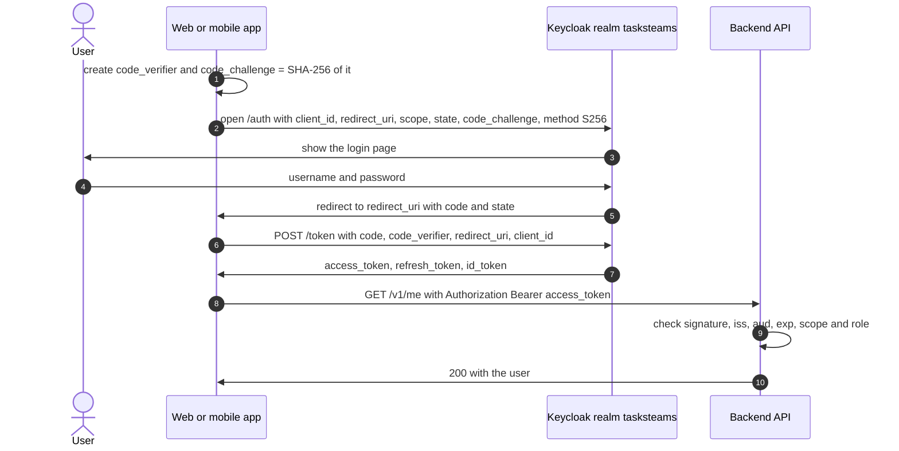

# 03. Identity with Keycloak

## Why it matters
At a festival you show your ticket once at the gate and receive a wristband. After that, every stage checks the wristband, not your ticket, and nobody asks for your credit card again. Keycloak is the gate: people sign in there, it hands out a signed "wristband" (an access token), and our APIs only check the wristband. No backend ever sees a password.

## What you will build
Keycloak 26.8.2 added to the Compose project from chapter 02, with a **realm** (a private user directory with its own settings) imported from one JSON file: roles `admin` and `member`, four clients, four scopes and three test users. A first script gets real tokens for alice and bob and checks what is inside them.

## Before you start
- Chapter 02 done or its pack unzipped. This chapter's `code` folder holds the whole project so far.
- Docker running. **Host ports 5432 (Postgres) and 8180 (Keycloak) must be free.** Keycloak is published on 8180 because 8080 and 8081 belong to the Docker 101 labs.
- Python 3.10+ for the script (standard library only, no packages).
- The first run downloads the Keycloak image (about 450 MB); later starts take about 20 seconds.
- Source pack: unzip `platform-phase-3-identity.zip`, open `03-keycloak-identity/code`.
- All passwords here are public and fake. Never reuse them.

## Steps
### Step 1. Understand the three flows
Three things happen with tokens. Read them once; the rest of the chapter builds the pieces.

**Sign-in with PKCE (web and mobile).** PKCE (Proof Key for Code Exchange, "pixie") protects the authorization code flow for apps that cannot keep a secret, like a single-page app or a phone app. The app invents a random secret (`code_verifier`), sends only its hash (`code_challenge`) to Keycloak, and later proves it knows the secret. A stolen authorization code is then useless to an attacker.



**Validating a token in the API.** The API never calls Keycloak per request. It downloads Keycloak's public keys once (the JWKS document), caches them, and checks every token locally: the signature, `iss` (issuer must equal `http://localhost:8180/realms/tasksteams`), `aud` (must contain `tasks-api`), `exp` (not expired) and then the scope and the role.

**The smoke script.** For automated checks there is no human to type a password, so one special client, `tasks-smoke`, allows the password grant. It exists only for `scripts/conformance.py`; the password grant is deprecated for apps because the app would handle the password.

### Step 2. Read the Compose file (changed region: the `keycloak` service)
The `db` service is unchanged from chapter 02. The `keycloak` service is new. The whole file:

**File: `code/docker-compose.yml`**
```yaml
services:
  db:
    image: postgres:17-alpine
    environment:
      POSTGRES_DB: ${POSTGRES_DB}
      POSTGRES_USER: ${POSTGRES_USER}
      POSTGRES_PASSWORD: ${POSTGRES_PASSWORD}
    ports:
      - "127.0.0.1:${POSTGRES_PORT:-5432}:5432"
    volumes:
      - pg_data:/var/lib/postgresql/data
      - ./db/schema.sql:/docker-entrypoint-initdb.d/01-schema.sql:ro
      - ./db/seed.sql:/docker-entrypoint-initdb.d/02-seed.sql:ro
      - ./db:/scripts:ro
    healthcheck:
      test: ["CMD-SHELL", "pg_isready -h 127.0.0.1 -U $$POSTGRES_USER -d $$POSTGRES_DB"]
      interval: 3s
      timeout: 3s
      retries: 30
      start_period: 5s
    networks:
      - tasksteams
  keycloak:
    image: quay.io/keycloak/keycloak:26.8.2
    command: ["start-dev", "--import-realm"]
    environment:
      KC_BOOTSTRAP_ADMIN_USERNAME: ${KEYCLOAK_ADMIN}
      KC_BOOTSTRAP_ADMIN_PASSWORD: ${KEYCLOAK_ADMIN_PASSWORD}
      KC_HOSTNAME: http://localhost:${KEYCLOAK_PORT:-8180}
      KC_HOSTNAME_BACKCHANNEL_DYNAMIC: "true"
      KC_HEALTH_ENABLED: "true"
    ports:
      - "127.0.0.1:${KEYCLOAK_PORT:-8180}:8080"
    volumes:
      - ./keycloak/realm-tasksteams.json:/opt/keycloak/data/import/realm-tasksteams.json:ro
    healthcheck:
      test: ["CMD", "bash", "-c", "exec 3<>/dev/tcp/127.0.0.1/9000 && printf 'GET /health/ready HTTP/1.1\\r\\nHost: localhost\\r\\nConnection: close\\r\\n\\r\\n' >&3 && grep -q UP <&3"]
      interval: 5s
      timeout: 5s
      retries: 60
      start_period: 30s
    networks:
      - tasksteams
networks:
  tasksteams:
    name: ${TASKS_NETWORK:-tasksteams-net}
volumes:
  pg_data:
```

| Line | What it does | If you change it |
|------|--------------|------------------|
| `image: quay.io/keycloak/keycloak:26.8.2` | The official image, pinned to an exact version (the newest stable release when this was written, checked on quay.io). Never use `latest`: a major upgrade can change behaviour. | Change the tag only after reading the release notes. |
| `command: ["start-dev", "--import-realm"]` | `start-dev` runs Keycloak in development mode: plain HTTP, an in-container H2 database, no HTTPS rules. `--import-realm` loads every JSON file in `/opt/keycloak/data/import` on start, **only if the realm does not exist yet**. | Use `start` with a real database, TLS and a hostname in production. Editing the JSON later does not update an existing realm: `down -v` first. |
| `KC_BOOTSTRAP_ADMIN_USERNAME` / `_PASSWORD` | Creates the temporary administrator for the admin console (`master` realm). Values come from `.env`. | Replace the bootstrap admin with a named admin and MFA in production. |
| `KC_HOSTNAME: http://localhost:8180` | The public address. Keycloak writes it into every token as the issuer (`iss`) and into the login redirect, so it must be what browsers and phones can open and it must never change between requests. | A different value changes `iss`; every API checks `iss`. |
| `KC_HOSTNAME_BACKCHANNEL_DYNAMIC: "true"` | Lets servers (our backends in Docker) call Keycloak by the internal name `http://keycloak:8080` for tokens and keys, while the issuer stays `http://localhost:8180/...`. | Without it a backend inside Docker could not reach `localhost:8180`. |
| `KC_HEALTH_ENABLED: "true"` | Turns on `/health/ready` on the management port 9000. | Needed by the health check. |
| `ports: "127.0.0.1:8180:8080"` | Keycloak listens on 8080 inside the container; the host sees it on 8180, on your machine only. The management port 9000 is **not** published. | Do not use host 8080 or 8081. |
| `volumes: ./keycloak/realm-tasksteams.json:...:ro` | Puts the realm file where `--import-realm` looks. | The file name may be anything ending in `.json`. |
| `healthcheck` | The Keycloak image has no `curl`, so the check uses `bash` to open a TCP connection to port 9000, send a tiny HTTP request and look for `UP`. `\\r\\n` is written twice because YAML consumes one backslash. `start_period: 30s` gives the first start time before failures count. | `up --wait` returns only when this passes. |

### Step 3. The environment file
**File: `code/.env.example`**
```dotenv
# Disposable local practice only. Never reuse these values for a real system.
POSTGRES_DB=tasksteams
POSTGRES_USER=tasks_admin
POSTGRES_PASSWORD=tasks_admin_local_only
POSTGRES_PORT=5432
KEYCLOAK_ADMIN=kcadmin
KEYCLOAK_ADMIN_PASSWORD=kcadmin_local_only
KEYCLOAK_PORT=8180
TASKS_NETWORK=tasksteams-net
```

The three new lines are `KEYCLOAK_ADMIN`, `KEYCLOAK_ADMIN_PASSWORD` and `KEYCLOAK_PORT`. Copy the file (`Copy-Item .env.example .env` on Windows, `cp .env.example .env` on macOS and Linux) in the `code` folder.

### Step 4. Read the realm file
`keycloak/realm-tasksteams.json` is the whole identity configuration, kept in Git. It is 331 lines, shown here in five parts.

**Part 1: realm settings and roles**

**File: `code/keycloak/realm-tasksteams.json` (part 1)**
```json
{
  "realm": "tasksteams",
  "displayName": "Tasks and Teams",
  "enabled": true,
  "sslRequired": "external",
  "registrationAllowed": false,
  "resetPasswordAllowed": false,
  "editUsernameAllowed": false,
  "loginWithEmailAllowed": true,
  "duplicateEmailsAllowed": false,
  "bruteForceProtected": true,
  "permanentLockout": false,
  "failureFactor": 5,
  "waitIncrementSeconds": 60,
  "maxFailureWaitSeconds": 900,
  "minimumQuickLoginWaitSeconds": 60,
  "maxDeltaTimeSeconds": 43200,
  "accessTokenLifespan": 300,
  "accessCodeLifespan": 60,
  "ssoSessionIdleTimeout": 1800,
  "ssoSessionMaxLifespan": 36000,
  "revokeRefreshToken": true,
  "refreshTokenMaxReuse": 0,
  "defaultSignatureAlgorithm": "RS256",
  "eventsEnabled": true,
  "eventsListeners": ["jboss-logging"],
  "roles": {
    "realm": [
      { "name": "admin", "description": "Manages teams, reads the audit log" },
      { "name": "member", "description": "Works on tasks in the teams they belong to" }
    ]
  },
```

| Setting | Meaning |
|---------|---------|
| `realm`, `displayName`, `enabled` | The realm id used in URLs (`/realms/tasksteams`), a friendly name, and the on switch. |
| `sslRequired: external` | HTTPS is required for requests from outside private networks, plain HTTP is accepted on localhost and Docker networks. Use `all` in production. |
| `registrationAllowed: false` | Nobody can create an account on the login page. Accounts are created by an administrator. |
| `resetPasswordAllowed`, `editUsernameAllowed` | Off: this realm has no e-mail server, and usernames must stay stable because the API stores them. |
| `loginWithEmailAllowed`, `duplicateEmailsAllowed: false` | Users may sign in with their e-mail; two users cannot share one. |
| `bruteForceProtected` and the next five lines | After `failureFactor` (5) failed logins the account waits 60 seconds, doubling at every further failure up to 900 seconds (`maxFailureWaitSeconds`). `permanentLockout: false` avoids letting an attacker lock people out forever. Failures count inside a 12-hour window (`maxDeltaTimeSeconds`, in seconds). `minimumQuickLoginWaitSeconds` penalises very fast repeated failures. |
| `accessTokenLifespan: 300` | An access token lives 5 minutes. A short life limits damage when one leaks; clients renew it with the refresh token. |
| `accessCodeLifespan: 60` | The authorization code from step 5 of the diagram must be exchanged within 60 seconds. |
| `ssoSessionIdleTimeout: 1800`, `ssoSessionMaxLifespan: 36000` | A login session ends after 30 minutes without use and after 10 hours at the latest. |
| `revokeRefreshToken: true`, `refreshTokenMaxReuse: 0` | Refresh-token rotation: each refresh token works exactly once, and a replay (a sign of theft) is rejected. Required advice for public clients. |
| `defaultSignatureAlgorithm: RS256` | Tokens are signed with an RSA key pair; APIs verify them with the public key from the JWKS endpoint. |
| `eventsEnabled`, `eventsListeners` | Login events (success, failure) are written to the container log. |
| `roles.realm` | The two roles. Roles describe what a **user** may do. |

**Part 2: standard client scopes**

Importing `clientScopes` replaces Keycloak's built-in scopes, so the ones the tokens need must be listed. This is the most common surprise (see Common mistakes).

**File: `code/keycloak/realm-tasksteams.json` (part 2)**
```json
  "clientScopes": [
    {
      "name": "basic",
      "description": "Adds the sub and auth_time claims",
      "protocol": "openid-connect",
      "attributes": { "include.in.token.scope": "false", "display.on.consent.screen": "false" },
      "protocolMappers": [
        {
          "name": "sub",
          "protocol": "openid-connect",
          "protocolMapper": "oidc-sub-mapper",
          "consentRequired": false,
          "config": { "access.token.claim": "true", "introspection.token.claim": "true" }
        },
        {
          "name": "auth_time",
          "protocol": "openid-connect",
          "protocolMapper": "oidc-usersessionmodel-note-mapper",
          "consentRequired": false,
          "config": {
            "user.session.note": "AUTH_TIME",
            "claim.name": "auth_time",
            "jsonType.label": "long",
            "access.token.claim": "true",
            "id.token.claim": "true",
            "introspection.token.claim": "true"
          }
        }
      ]
    },
    {
      "name": "profile",
      "description": "Name and username claims",
      "protocol": "openid-connect",
      "attributes": { "include.in.token.scope": "true", "display.on.consent.screen": "true" },
      "protocolMappers": [
        {
          "name": "full name",
          "protocol": "openid-connect",
          "protocolMapper": "oidc-full-name-mapper",
          "consentRequired": false,
          "config": {
            "access.token.claim": "true",
            "id.token.claim": "true",
            "userinfo.token.claim": "true",
            "introspection.token.claim": "true"
          }
        },
        {
          "name": "username",
          "protocol": "openid-connect",
          "protocolMapper": "oidc-usermodel-attribute-mapper",
          "consentRequired": false,
          "config": {
            "user.attribute": "username",
            "claim.name": "preferred_username",
            "jsonType.label": "String",
            "access.token.claim": "true",
            "id.token.claim": "true",
            "userinfo.token.claim": "true",
            "introspection.token.claim": "true"
          }
        }
      ]
    },
    {
      "name": "email",
      "description": "Email claims",
      "protocol": "openid-connect",
      "attributes": { "include.in.token.scope": "true", "display.on.consent.screen": "true" },
      "protocolMappers": [
        {
          "name": "email",
          "protocol": "openid-connect",
          "protocolMapper": "oidc-usermodel-attribute-mapper",
          "consentRequired": false,
          "config": {
            "user.attribute": "email",
            "claim.name": "email",
            "jsonType.label": "String",
            "access.token.claim": "true",
            "id.token.claim": "true",
            "userinfo.token.claim": "true",
            "introspection.token.claim": "true"
          }
        },
        {
          "name": "email verified",
          "protocol": "openid-connect",
          "protocolMapper": "oidc-usermodel-property-mapper",
          "consentRequired": false,
          "config": {
            "user.attribute": "emailVerified",
            "claim.name": "email_verified",
            "jsonType.label": "boolean",
            "access.token.claim": "true",
            "id.token.claim": "true",
            "userinfo.token.claim": "true",
            "introspection.token.claim": "true"
          }
        }
      ]
    },
    {
      "name": "roles",
      "description": "Realm roles in realm_access.roles and the audience of the client roles",
      "protocol": "openid-connect",
      "attributes": { "include.in.token.scope": "false", "display.on.consent.screen": "false" },
      "protocolMappers": [
        {
          "name": "realm roles",
          "protocol": "openid-connect",
          "protocolMapper": "oidc-usermodel-realm-role-mapper",
          "consentRequired": false,
          "config": {
            "claim.name": "realm_access.roles",
            "jsonType.label": "String",
            "multivalued": "true",
            "access.token.claim": "true",
            "introspection.token.claim": "true"
          }
        },
        {
          "name": "audience resolve",
          "protocol": "openid-connect",
          "protocolMapper": "oidc-audience-resolve-mapper",
          "consentRequired": false,
          "config": { "access.token.claim": "true", "introspection.token.claim": "true" }
        }
      ]
    },
    {
      "name": "web-origins",
      "description": "Allowed web origins for CORS",
      "protocol": "openid-connect",
      "attributes": { "include.in.token.scope": "false", "display.on.consent.screen": "false" },
      "protocolMappers": [
        {
          "name": "allowed web origins",
          "protocol": "openid-connect",
          "protocolMapper": "oidc-allowed-origins-mapper",
          "consentRequired": false,
          "config": { "access.token.claim": "true", "introspection.token.claim": "true" }
        }
      ]
    },
    {
      "name": "offline_access",
      "description": "Lets a client ask for a refresh token that outlives the browser session",
      "protocol": "openid-connect",
      "attributes": { "include.in.token.scope": "true", "display.on.consent.screen": "true" }
    },
```

A **client scope** is a bundle of token content. Its **protocol mappers** each copy one piece of data into the token. Reading the mappers:

| Scope | What it puts in the access token |
|-------|----------------------------------|
| `basic` | `sub` (the user id, equal to `users.id` in Postgres) and `auth_time`. |
| `profile` | `name` (first and last name) and `preferred_username`. |
| `email` | `email` and `email_verified`. |
| `roles` | `realm_access.roles`, the list of realm roles; `audience resolve` adds audiences for client roles. |
| `web-origins` | `allowed-origins`, used by browsers for CORS. |
| `offline_access` | Permission to request a long-lived refresh token (used by mobile apps later). |

`include.in.token.scope: true` means the scope's name appears in the token's `scope` claim; `access.token.claim`, `id.token.claim` and `userinfo.token.claim` choose which token receives each claim. `introspection.token.claim` includes it in token introspection answers.

**Part 3: our own scopes**

**File: `code/keycloak/realm-tasksteams.json` (part 3)**
```json
    {
      "name": "tasks:read",
      "description": "Read teams, projects, tasks and comments",
      "protocol": "openid-connect",
      "attributes": { "include.in.token.scope": "true", "display.on.consent.screen": "true" }
    },
    {
      "name": "tasks:write",
      "description": "Create and change teams, projects, tasks and comments",
      "protocol": "openid-connect",
      "attributes": { "include.in.token.scope": "true", "display.on.consent.screen": "true" }
    },
    {
      "name": "tasks:admin",
      "description": "Administrative operations such as deleting teams and reading the audit log",
      "protocol": "openid-connect",
      "attributes": { "include.in.token.scope": "true", "display.on.consent.screen": "true" }
    },
    {
      "name": "tasks-api-audience",
      "description": "Adds tasks-api to the aud claim of access tokens",
      "protocol": "openid-connect",
      "attributes": { "include.in.token.scope": "false", "display.on.consent.screen": "false" },
      "protocolMappers": [
        {
          "name": "tasks-api-audience",
          "protocol": "openid-connect",
          "protocolMapper": "oidc-audience-mapper",
          "consentRequired": false,
          "config": {
            "included.client.audience": "tasks-api",
            "id.token.claim": "false",
            "access.token.claim": "true",
            "introspection.token.claim": "true"
          }
        }
      ]
    }
  ],
```

`tasks:read`, `tasks:write` and `tasks:admin` have no mappers: their only job is to appear in the `scope` claim, and the API checks them (the contract names them per operation). `tasks-api-audience` adds `"aud": "tasks-api"`, which tells each API "this token was meant for you". An API must reject tokens that lack its audience, otherwise a token for another service could be replayed here.

**Part 4: the four clients**

**File: `code/keycloak/realm-tasksteams.json` (part 4)**
```json
  "clients": [
    {
      "clientId": "tasks-web",
      "name": "Tasks web client (Angular or React)",
      "enabled": true,
      "protocol": "openid-connect",
      "publicClient": true,
      "standardFlowEnabled": true,
      "implicitFlowEnabled": false,
      "directAccessGrantsEnabled": false,
      "serviceAccountsEnabled": false,
      "fullScopeAllowed": true,
      "redirectUris": ["http://localhost:4200/*", "http://localhost:5173/*"],
      "webOrigins": ["http://localhost:4200", "http://localhost:5173"],
      "attributes": {
        "pkce.code.challenge.method": "S256",
        "post.logout.redirect.uris": "http://localhost:4200/*##http://localhost:5173/*"
      },
      "defaultClientScopes": ["basic", "profile", "email", "roles", "web-origins", "tasks:read", "tasks:write", "tasks-api-audience"],
      "optionalClientScopes": ["tasks:admin", "offline_access"]
    },
    {
      "clientId": "tasks-mobile",
      "name": "Tasks mobile client (Flutter or Kotlin)",
      "enabled": true,
      "protocol": "openid-connect",
      "publicClient": true,
      "standardFlowEnabled": true,
      "implicitFlowEnabled": false,
      "directAccessGrantsEnabled": false,
      "serviceAccountsEnabled": false,
      "fullScopeAllowed": true,
      "redirectUris": ["com.code101.tasks:/oauth2redirect"],
      "webOrigins": [],
      "attributes": {
        "pkce.code.challenge.method": "S256",
        "post.logout.redirect.uris": "com.code101.tasks:/logout"
      },
      "defaultClientScopes": ["basic", "profile", "email", "roles", "tasks:read", "tasks:write", "tasks-api-audience"],
      "optionalClientScopes": ["tasks:admin", "offline_access"]
    },
    {
      "clientId": "tasks-api",
      "name": "Tasks API (resource server)",
      "description": "Only the audience of access tokens. Backends validate tokens; they never log in with this client.",
      "enabled": true,
      "protocol": "openid-connect",
      "publicClient": false,
      "standardFlowEnabled": false,
      "implicitFlowEnabled": false,
      "directAccessGrantsEnabled": false,
      "serviceAccountsEnabled": false,
      "fullScopeAllowed": false,
      "defaultClientScopes": [],
      "optionalClientScopes": []
    },
    {
      "clientId": "tasks-smoke",
      "name": "Smoke script only (password grant)",
      "description": "Used only by scripts/conformance.py. Never use the password grant in an app.",
      "enabled": true,
      "protocol": "openid-connect",
      "publicClient": true,
      "standardFlowEnabled": false,
      "implicitFlowEnabled": false,
      "directAccessGrantsEnabled": true,
      "serviceAccountsEnabled": false,
      "fullScopeAllowed": true,
      "defaultClientScopes": ["basic", "profile", "email", "roles", "tasks:read", "tasks:write", "tasks:admin", "tasks-api-audience"],
      "optionalClientScopes": []
    }
  ],
```

A **client** is an application that talks to Keycloak.

| Setting | Meaning |
|---------|---------|
| `publicClient: true` | The app cannot keep a secret (anyone can read a web page or unpack a phone app), so it has no client secret and relies on PKCE. `tasks-api` is `false`: a server could hold a secret, but it never signs in. |
| `standardFlowEnabled` | The authorization code flow (the diagram). `true` for web and mobile only. |
| `implicitFlowEnabled: false` | The old implicit flow returns tokens in the URL and is removed from OAuth 2.1: keep it off. |
| `directAccessGrantsEnabled` | The password grant. `true` **only** for `tasks-smoke`. |
| `serviceAccountsEnabled: false` | No machine-to-machine login is needed in this project. |
| `redirectUris` | The only places Keycloak may send the code. Exact origins only: a browser app on `localhost:4200` (Angular) or `localhost:5173` (React/Vite), and for mobile the private URL scheme `com.code101.tasks:/oauth2redirect`, which the phone app registers (RFC 8252 recommends reverse-domain schemes). A loose wildcard would let an attacker steal codes. |
| `webOrigins` | Origins allowed to call the token endpoint from a browser (CORS). |
| `attributes.pkce.code.challenge.method: S256` | The client **must** use PKCE with SHA-256; a request with the weaker `plain` method or without PKCE is refused. |
| `post.logout.redirect.uris` | Where the user may be sent after sign-out. `##` separates several values. |
| `defaultClientScopes` | Scopes always included. Web and mobile get read and write, never admin by default. |
| `optionalClientScopes` | Scopes the app must ask for with `scope=...`. `tasks:admin` is optional so an admin's everyday token cannot delete teams. |
| `fullScopeAllowed: true` | The token includes all the user's realm roles. For `tasks-api` it is `false` because that client never gets tokens. |

The effective permission is scope **and** role: alice with a `tasks:admin` scope may use admin routes, bob with the same scope may not, because he lacks the `admin` role.

**Part 5: the users**

**File: `code/keycloak/realm-tasksteams.json` (part 5)**
```json
  "users": [
    {
      "id": "a11ce000-0000-4000-8000-000000000001",
      "username": "alice",
      "email": "alice@tasksteams.test",
      "emailVerified": true,
      "firstName": "Alice",
      "lastName": "Admin",
      "enabled": true,
      "credentials": [{ "type": "password", "value": "alice-local-fake", "temporary": false }],
      "realmRoles": ["admin"]
    },
    {
      "id": "b0b00000-0000-4000-8000-000000000002",
      "username": "bob",
      "email": "bob@tasksteams.test",
      "emailVerified": true,
      "firstName": "Bob",
      "lastName": "Member",
      "enabled": true,
      "credentials": [{ "type": "password", "value": "bob-local-fake", "temporary": false }],
      "realmRoles": ["member"]
    },
    {
      "id": "ca401000-0000-4000-8000-000000000003",
      "username": "carol",
      "email": "carol@tasksteams.test",
      "emailVerified": true,
      "firstName": "Carol",
      "lastName": "Member",
      "enabled": true,
      "credentials": [{ "type": "password", "value": "carol-local-fake", "temporary": false }],
      "realmRoles": ["member"]
    }
  ]
}
```

`id` fixes the user id, which becomes the token's `sub`; it equals the ids in `db/seed.sql`. First and last name and e-mail must be present, otherwise Keycloak 26 asks the user to "update the account" at the first login and the password grant fails. `temporary: false` means no forced password change. `.test` is a reserved top-level domain (RFC 2606), so the e-mail addresses can never reach a real person. `realmRoles` assigns alice the `admin` role and bob and carol the `member` role.

### Step 5. Write the first script
The script checks what Keycloak hands out. It uses only the Python standard library.

**File: `code/scripts/conformance.py`**
```python
#!/usr/bin/env python3
"""Platform checks, phase 3: Keycloak tokens and Postgres reachability. Standard library only."""
import argparse
import base64
import json
import os
import socket
import struct
import sys
import urllib.error
import urllib.parse
import urllib.request

KEYCLOAK_URL = os.environ.get("KEYCLOAK_URL", "http://127.0.0.1:8180")
ISSUER = os.environ.get("TOKEN_ISSUER", "http://localhost:8180/realms/tasksteams")
REALM = os.environ.get("KEYCLOAK_REALM", "tasksteams")
POSTGRES_HOST = os.environ.get("POSTGRES_HOST", "127.0.0.1")
POSTGRES_PORT = int(os.environ.get("POSTGRES_PORT", "5432"))
SMOKE_CLIENT = "tasks-smoke"
PASSWORDS = {
    "alice": os.environ.get("SMOKE_ALICE_PASSWORD", "alice-local-fake"),
    "bob": os.environ.get("SMOKE_BOB_PASSWORD", "bob-local-fake"),
}
ALICE_ID = "a11ce000-0000-4000-8000-000000000001"


def http_post_form(url, form):
    data = urllib.parse.urlencode(form).encode()
    request = urllib.request.Request(url, data=data, method="POST")
    try:
        with urllib.request.urlopen(request, timeout=15) as response:
            return response.status, json.loads(response.read())
    except urllib.error.HTTPError as err:
        return err.code, json.loads(err.read() or b"{}")


def http_get_json(url):
    with urllib.request.urlopen(url, timeout=15) as response:
        return json.loads(response.read())


def token_for(username):
    url = f"{KEYCLOAK_URL}/realms/{REALM}/protocol/openid-connect/token"
    status, body = http_post_form(url, {
        "grant_type": "password",
        "client_id": SMOKE_CLIENT,
        "username": username,
        "password": PASSWORDS[username],
        "scope": "openid tasks:read tasks:write tasks:admin",
    })
    if status != 200:
        raise AssertionError(f"token endpoint answered {status}: {body.get('error_description', body)}")
    return body["access_token"]


def claims_of(token):
    payload = token.split(".")[1]
    return json.loads(base64.urlsafe_b64decode(payload + "=" * (-len(payload) % 4)))


def check_discovery():
    doc = http_get_json(f"{KEYCLOAK_URL}/realms/{REALM}/.well-known/openid-configuration")
    assert doc["issuer"] == ISSUER, f"issuer is {doc['issuer']}, expected {ISSUER}"
    assert "S256" in doc["code_challenge_methods_supported"], "PKCE S256 is not offered"
    return "issuer matches, PKCE S256 offered"


def check_alice_token():
    claims = claims_of(token_for("alice"))
    assert claims["iss"] == ISSUER, f"iss is {claims['iss']}"
    audience = claims["aud"] if isinstance(claims["aud"], list) else [claims["aud"]]  # aud may be a string or a list
    assert "tasks-api" in audience, f"aud is {claims['aud']}"
    assert claims["sub"] == ALICE_ID, f"sub is {claims['sub']}"
    assert "admin" in claims["realm_access"]["roles"], "role admin missing"
    assert {"tasks:read", "tasks:write", "tasks:admin"} <= set(claims["scope"].split()), "scopes missing"
    return "iss, aud tasks-api, sub, role admin, three scopes"


def check_bob_token():
    claims = claims_of(token_for("bob"))
    roles = claims["realm_access"]["roles"]
    assert "member" in roles and "admin" not in roles, f"roles are {roles}"
    return "role member only"


def check_postgres():
    with socket.create_connection((POSTGRES_HOST, POSTGRES_PORT), timeout=5) as sock:
        sock.sendall(struct.pack("!ii", 8, 80877103))  # the Postgres SSLRequest message
        answer = sock.recv(1)
    assert answer in (b"S", b"N"), f"unexpected reply {answer!r}"
    return f"{POSTGRES_HOST}:{POSTGRES_PORT} answers the Postgres protocol"


def run(name, check):
    try:
        detail = check()
    except Exception as exc:  # a failed check is reported, the others still run
        print(f"FAIL  {name}: {exc}")
        return False
    print(f"PASS  {name} ({detail})")
    return True


def main():
    parser = argparse.ArgumentParser(description=__doc__)
    parser.add_argument("--infra-only", action="store_true", help="accepted for later phases; phase 3 only has infra checks")
    parser.parse_args()
    checks = [
        ("keycloak discovery", check_discovery),
        ("token for alice", check_alice_token),
        ("token for bob", check_bob_token),
        ("postgres reachable", check_postgres),
    ]
    results = [run(name, check) for name, check in checks]
    print(f"{sum(results)} passed, {len(results) - sum(results)} failed")
    return 0 if all(results) else 1


if __name__ == "__main__":
    sys.exit(main())
```

How it works:
- The constants at the top read settings from environment variables with local defaults, so the same script later runs against any host.
- `token_for` sends a form (`application/x-www-form-urlencoded`) to the token endpoint: `grant_type=password`, the client `tasks-smoke`, the user's name and password and the scopes wanted. `openid` is the OIDC marker scope. A non-200 answer becomes a readable error from Keycloak's `error_description`.
- A JWT (JSON Web Token) is three Base64URL parts separated by dots: header, payload, signature. `claims_of` decodes the middle part. **Decoding is not validating**: this script trusts Keycloak because it just received the token over a local connection; an API must verify the signature and the claims (Step 1).
- The `-len(payload) % 4` expression restores the `=` padding that JWTs leave out.
- `check_discovery` downloads the OpenID Connect discovery document and checks the issuer and that PKCE S256 is offered.
- `check_alice_token` checks issuer, audience (a string for one audience, a list for several, hence the normalisation), subject, role and scopes. `check_bob_token` checks that bob is a member and not an admin.
- `check_postgres` sends the 8-byte Postgres `SSLRequest` message and expects one letter back (`S` or `N`): only a real Postgres answers like that, which proves more than an open port.
- `run` catches every error, prints `FAIL` with the reason and goes on. The exit code is 1 if any check failed. `--infra-only` already exists so the command stays the same in chapter 04, where API checks are added.

#### The `.gitignore` of this chapter (unchanged from chapter 01)
Your `.env` now also holds the Keycloak settings. The `.gitignore` is the same as in chapter 01, shown again so you can check your copy.

<details>
<summary><code>code/.gitignore</code> (same as chapter 01)</summary>

**File: `code/.gitignore`**
```text
.env
.deps/
.venv/
__pycache__/
```

- `.env`: your local settings and passwords. Never commit it; `.env.example` is the committed template.
- `.deps/`: packages installed next to the scripts; downloaded again on any machine.
- `.venv/`: the Python virtual environment; never shared through Git.
- `__pycache__/`: compiled Python files that Python recreates on its own.

`.git` itself is never listed: Git does not track its own folder.
</details>

## Run it
**Terminal (PowerShell; folder: `03-keycloak-identity/code`)**
```powershell
Copy-Item .env.example .env
docker compose -p platform up -d --wait
docker compose -p platform ps --format "{{.Service}} {{.State}} {{.Health}}"
python scripts/conformance.py --infra-only
```
On macOS and Linux use `cp .env.example .env` and `python3`. The first start pulls the Keycloak image, which takes a few minutes; `up --wait` shows the progress. Expected `ps` output:
```text
db running healthy
keycloak running healthy
```

Expected output of the script:
```text
PASS  keycloak discovery (issuer matches, PKCE S256 offered)
PASS  token for alice (iss, aud tasks-api, sub, role admin, three scopes)
PASS  token for bob (role member only)
PASS  postgres reachable (127.0.0.1:5432 answers the Postgres protocol)
4 passed, 0 failed
```

See what Keycloak logged while importing (the lines are wrapped differently on your screen):
```powershell
docker compose -p platform logs --no-log-prefix keycloak
```
```text
2026-11-23 07:27:40,279 INFO  [org.keycloak.exportimport.util.ImportUtils] (main) Realm 'tasksteams' imported
2026-11-23 07:27:40,582 INFO  [io.quarkus] (main) Keycloak 26.8.2 on JVM (powered by Quarkus 3.40.1.1) started in 11.141s. Listening on: http://0.0.0.0:8080. Management interface listening on http://0.0.0.0:9000.
```

Look inside alice's token. This prints the decoded claims:
```powershell
python -c "import sys, json; sys.path.insert(0, 'scripts'); import conformance as c; print(json.dumps(c.claims_of(c.token_for('alice')), indent=1))"
```
```text
{
 "exp": 1795418580,
 "iat": 1795418280,
 "jti": "onrtro:55801cf2-04a2-d10a-9ac4-1c573c65d6a7",
 "iss": "http://localhost:8180/realms/tasksteams",
 "aud": "tasks-api",
 "sub": "a11ce000-0000-4000-8000-000000000001",
 "typ": "Bearer",
 "azp": "tasks-smoke",
 "sid": "F2DXvS5TqOPxapg9gUxla9w7",
 "realm_access": {
  "roles": [
   "admin"
  ]
 },
 "scope": "openid tasks:write email tasks:read tasks:admin profile",
 "email_verified": true,
 "name": "Alice Admin",
 "preferred_username": "alice",
 "email": "alice@tasksteams.test"
}
```
The values of `exp`, `iat`, `jti` and `sid` differ on every run; `exp - iat` is 300 seconds, the access token lifespan. Open `http://localhost:8180` in a browser to see the Keycloak welcome page; the admin console login uses `KEYCLOAK_ADMIN` and `KEYCLOAK_ADMIN_PASSWORD` from your `.env`, and the realm `tasksteams` is in the realm list. Stop and remove everything when you are done:
```powershell
docker compose -p platform down -v --remove-orphans
```

## How it works
- **Token validation in an API** (built in each backend capstone): fetch the discovery document, cache the JWKS keys, then for every request verify the signature (`RS256`), `iss`, `aud` contains `tasks-api`, `exp`/`nbf` with a small clock skew, then require the scope the operation names and the role `x-access` demands. Reject on any failure with 401 (bad token) or 403 (good token, not allowed).
- **Why roles and scopes both.** Roles say what a person may do; scopes say what an app may do for that person. A calendar app may be allowed to read tasks but never delete a team, even for an admin.
- **Why `iss` is `localhost:8180` but backends call `keycloak:8080`.** The issuer is a name, fixed so tokens issued to browsers are valid for APIs; the backchannel URL is a route, which may differ inside Docker (`KC_HOSTNAME_BACKCHANNEL_DYNAMIC`). The discovery document you fetch from `127.0.0.1` therefore shows `issuer = http://localhost:8180/realms/tasksteams` but `token_endpoint = http://127.0.0.1:8180/...`.
- **Trade-off: realm JSON.** A realm file is repeatable and reviewable, but Keycloak imports it only once. In production use the admin API, Terraform or the `kc.sh import` command for changes.
- **Authentik appendix.** The same model maps onto Authentik: realm = tenant, client = provider and application, realm role = group, client scope = scope mapping. A later appendix lists each step.
- **Terms.** *Realm*: isolated set of users and clients. *Client*: an app registered with Keycloak. *Access token*: the short-lived wristband. *Refresh token*: lets the app get a new access token. *PKCE*: proof that the app that started the login finishes it. *JWKS*: the public keys that verify signatures. *Claim*: one fact inside a token. *Audience*: who the token is meant for.

## Try it
Starter: `exercise/starter/show_roles.py`. Finish the three TODOs so it prints the realm roles in bob's token. Edit the file where it is (its first lines find `code/scripts` relative to the file), keep the stack running, and run `python exercise/starter/show_roles.py` from the chapter folder.

<details><summary>Solution</summary>

**File: `exercise/solution/show_roles.py`**
```python
"""Exercise: print the realm roles inside bob's access token."""
import sys
from pathlib import Path

sys.path.insert(0, str(Path(__file__).resolve().parents[2] / "code" / "scripts"))
import conformance

token = conformance.token_for("bob")
claims = conformance.claims_of(token)
print("bob roles: " + ", ".join(claims["realm_access"]["roles"]))
```

Expected output:
```text
bob roles: member
```

The script imports the chapter's own `conformance.py` as a module; the `if __name__ == "__main__"` guard there keeps `main()` from running on import.

</details>

## Check yourself
1. Why is `tasks-web` a public client without a secret? <details><summary>Answer</summary>A web page or phone app can be inspected by anyone, so a secret in it would not be secret. PKCE protects the code exchange instead.</details>
2. What does the `aud` claim protect against? <details><summary>Answer</summary>A token issued for another service being accepted here. The API must require `tasks-api` in `aud`.</details>
3. Why is `tasks:admin` an optional scope on the web client? <details><summary>Answer</summary>The app asks for it only when an admin screen needs it, so a leaked everyday token cannot reach admin operations.</details>
4. Why does `revokeRefreshToken: true` help? <details><summary>Answer</summary>Each refresh token works once; if a thief replays a used token, Keycloak notices and the stolen chain is rejected.</details>

## Common mistakes
| Symptom or error text | Cause | Fix |
|---|---|---|
| `git status` lists `.env`, `.venv/` or `__pycache__/` as new files, or a password appears in a commit | `.gitignore` is missing, or it was created after the files were already tracked | Create the `.gitignore` shown above; for files already tracked run `git rm --cached .env` (and `git rm -r --cached .venv`), commit, and replace any real secret that was ever committed |
| `FAIL  token for alice: 'sub'` | The realm file lists `clientScopes` without the built-in `basic` scope, so tokens have no `sub` (and without `roles` no `realm_access`). | Keep the standard scopes of part 2 in the file, `down -v` and start again. |
| `FAIL  keycloak discovery: Remote end closed connection without response` | Keycloak is still starting (or crashed). | Wait for `up --wait` to finish, or read `docker compose -p platform logs keycloak`. |
| `FAIL  postgres reachable: [WinError 10061] No connection could be made because the target machine actively refused it` | The database container is not running, or the port differs from `POSTGRES_PORT`. | `docker compose -p platform ps`, then start the stack. Linux and macOS show a different message for the same cause. |
| `FAIL  token for bob: token endpoint answered 400: Invalid user credentials` | The password is wrong (the script reads `SMOKE_BOB_PASSWORD` if set). | Unset the variable or use `bob-local-fake`. Five wrong tries lock the account for 60 seconds (brute-force protection). |
| Changed the realm JSON, nothing changed | Keycloak imports the file only when the realm does not exist. | `docker compose -p platform down -v`, then `up -d --wait`. |
| The container exits at once | A typo made the realm JSON invalid, or the port is taken. | Read `docker compose -p platform logs keycloak` and validate the JSON. |

## Best practice
Use the authorization code flow with PKCE for every browser and mobile app, keep redirect URIs exact, and give access tokens a short life. Source: [RFC 9700: Best Current Practice for OAuth 2.0 Security](https://www.rfc-editor.org/info/rfc9700), [RFC 7636: PKCE](https://www.rfc-editor.org/info/rfc7636), [Keycloak documentation](https://www.keycloak.org/documentation).

## Next lesson
04. The conformance script: grow `scripts/conformance.py` into the full test that every backend must pass, and learn what each of its checks proves about the contract.
