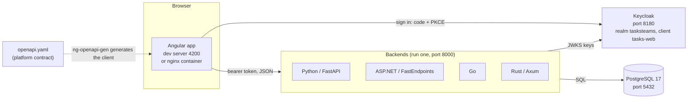

# Web client, Angular

An Angular 22 client for the "Tasks and Teams" platform: sign in with Keycloak (authorization code + PKCE), browse teams, projects and tasks, edit with `ETag` and `If-Match`, read the admin audit log. It talks to **any backend on `http://localhost:8000`** and to **Keycloak on `http://localhost:8180`**. The sibling [web-react](../web-react/README.md) client has the same screens, requirement ids (`W-xx`) and phases: choose one, or build both and compare.

Full design: [TDD.md](TDD.md). Contract and infrastructure: [platform](../platform/README.md).

## System diagram

## How it fits

| Question | Answer |
|----------|--------|
| Which backend? | Any of the four (Python, ASP.NET, Go, Rust). Start one on port 8000; the client does not change |
| Where is the API URL set? | `src/environments/environment.ts` (`apiBaseUrl`, default `http://localhost:8000`) |
| Which Keycloak client? | `tasks-web` (public, PKCE S256); redirect `http://localhost:4200/auth/callback` |
| Why `localhost` and not `127.0.0.1`? | The token issuer is `http://localhost:8180/realms/tasksteams` and must match exactly |
| Can I run React too? | Yes, one client at a time per port: React uses 5173, Angular 4200 |

## Ports

| Port | Use |
|------|-----|
| 4200 | Angular dev server (not in Docker). Also where you publish the production container for a real sign-in test: `-p 127.0.0.1:4200:8080` (stop `ng serve` first) |
| 8200 | Production nginx container for plain smoke checks (static files, headers, SPA fallback). Sign-in does not work here: the realm only allows origins 4200 and 5173 |
| 8000 | The backend API |
| 8180 | Keycloak |

## Phases

| Phase | Chapter | Requirements | Time |
|-------|---------|--------------|------|
| 1 Setup and generated client | [01 Create the app, generate the client](tutorials/phase-1-setup/01-create-app-generate-client.md) | W-01 to W-05 | about 3 h |
| 2 Auth (PKCE) and token handling | [02 Sign in with Keycloak](tutorials/phase-2-auth/02-sign-in-keycloak.md) | W-06 to W-12 | about 5 h |
| 3 Screens and state | [03 Screens, stores and pagination](tutorials/phase-3-screens/03-screens-stores-pagination.md) | W-13 to W-22, W-30 | about 6 h |
| 4 Errors, conflicts, accessibility | [04 Problem details, 412, offline, WCAG](tutorials/phase-4-errors/04-problem-details-conflicts-offline-wcag.md) | W-23 to W-28, W-33 | about 4 h |
| 5 Build, run and ship | [05 Docker, nginx, CSP](tutorials/phase-5-ship/05-build-run-ship.md) | W-29, W-31, W-32 | about 2 h |

## Before you start

1. Finish or read the Web 101 track (`tutorials/web`), especially lessons 03, 06, 07, 10 and 11.
2. Use the chapter's copied final Python smoke backend, or one already-conformant backend on 8000, never both. The chapters hold the `tasksteams` lock for the entire temporary stack/dev-server session. Do not disturb another owner's stack.
3. Node 26 and npm 11 are enough; the Angular CLI is **not** installed globally. The scaffold uses `npx --yes -p @angular/cli@22.3.0 ng ...`; build/start use the locked local CLI.
4. Copy `openapi.yaml` from the platform's final folder into `contract/` and never edit it.

## Versions (checked 2026-11-23)

Angular 22.3.0, TypeScript 6.0.x (required by Angular 22; Web 101 uses 7.0.2 only to teach the language), RxJS 7.8.2, `ng-openapi-gen` 1.1.0, `angular-oauth2-oidc` 22.0.2, nginx 1.30 (unprivileged image).

## What is delivered

Five full-project snapshots are in `source/phase-N-slug/NN-slug/code`, each with `exercise/starter`, `exercise/solution`, `verify.json` and a phase `PACK-README.md`. The finished app is `source/phase-5-ship/05-build-run-ship/code`. Each chapter shows every authored app/config file in full, even on later edits. The immutable contract, lockfile, generated client and unchanged upstream Python/SQL/realm fixture have explicit provenance/line-check exclusions; no authored application file is hidden.

Screens (same names as React): Login, Callback, Dashboard, Teams, Team detail, Projects, Tasks, Task detail, Audit log, Not found. Every route is lazy; components are standalone/OnPush, server state uses signals, forms are reactive. All API operations except unused listUsers are consumed through the generated client. The private root-injector marker is isolated to the successful Node smoke spike, never browser code.

From the final code folder: `npm ci --no-audit --no-fund`, `npm run build`, `npm start`. The chapters show exact directories, temporary stack startup/status/logging/cleanup and manual browser checklists. API generation runs before build/start. `package-lock.json` is shipped; node_modules, dist, .angular and generated api are not. No unit suites, ng test, lint or browser automation were run.

Production nginx smoke uses 8200 only for static/CSP/deep-link checks. Publish on 4200 after stopping ng serve for a human sign-in run. Always remove your containers, volumes, network and built images before releasing the lock.

- [Requirement-by-requirement acceptance ledger](ACCEPTANCE.md)
- [Contract/design findings and documented deviations](CONTRACT-NOTES.md)
- [Glossary](GLOSSARY.md), [authoring brief](_BRIEF.md), [verification state](_STATE.md)
- Captured output: `evidence/`; chapter snippets are copied from these executions, not remembered output.

## Status
**Written (not run)** under the user's runtime-verification pause. All five chapters, full-app snapshots, exercise pairs and future verify.json plans are written. The final clean-room run was stopped; no final runtime PASS count is claimed. Historical captured output from before the pause is retained and labelled in the chapters.

Only `python scripts/verify_labs.py --static capstones/web-angular` is permitted now: it compares lesson text with code, without running it. Build/serve/Docker instructions in chapters and packs are for future learner use, not current author execution. The interrupted temporary stack, volume/network and built API image were removed; cleanup inventory showed zero containers, zero volumes and only Docker's default networks.

Browser-only sign-in/callback/storage, six-minute refresh, step-up/logout, keyboard/focus/contrast and conflict-dialog interaction remain human acceptance. Only Python was used in historical backend captures, not all four backends.
