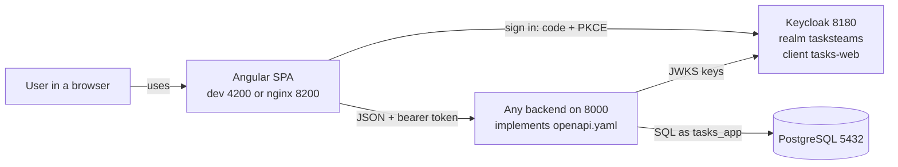
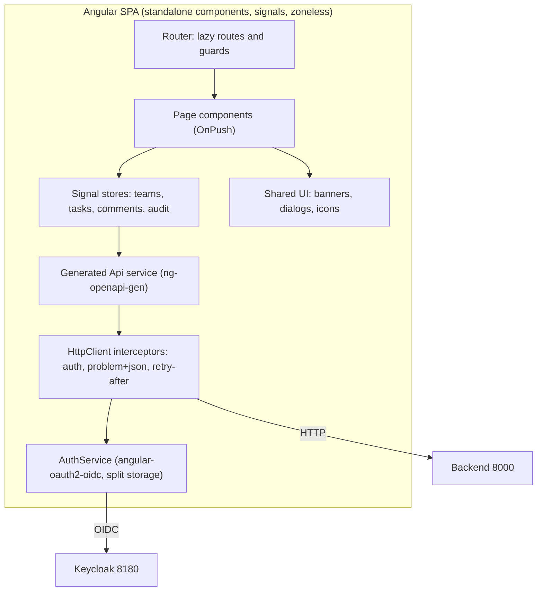
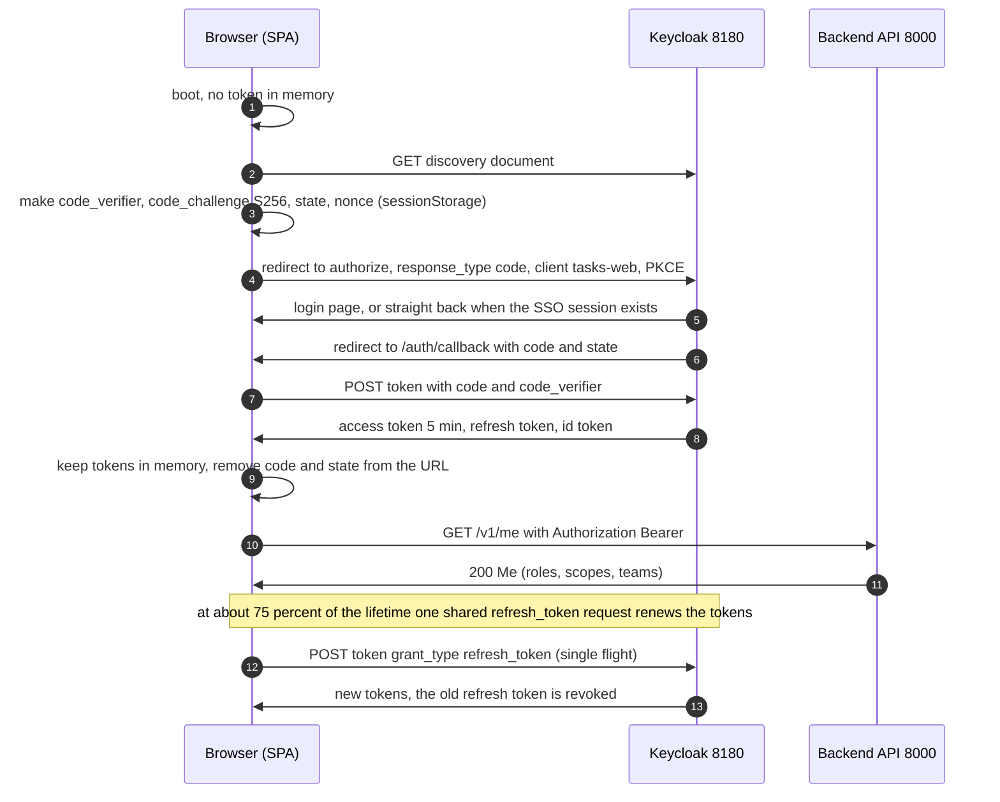
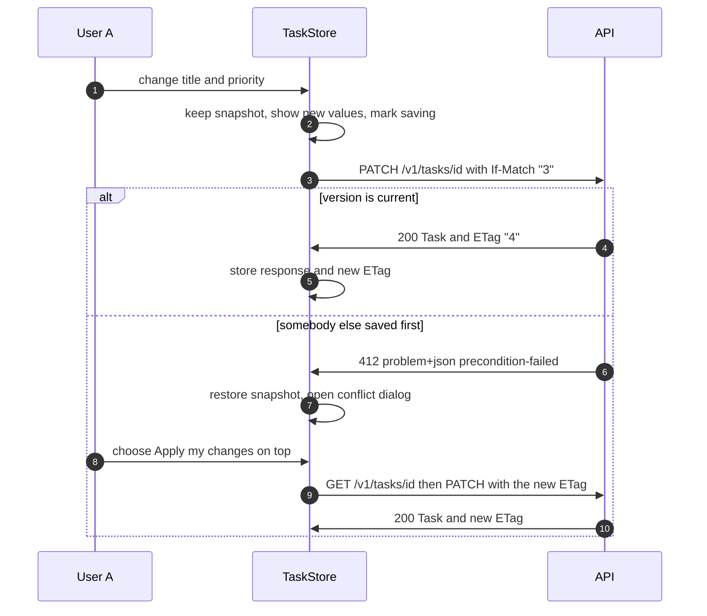

# TDD: Web client, Angular (Tasks and Teams)

| Field | Value |
|-------|-------|
| Id | web-angular |
| Level | 201 |
| Status | Written (not run): approved design implemented in five chapters/source packs; final runtime verification stopped by user; browser acceptance manual |
| Depends on | `platform` (contract, realm client `tasks-web`) and any one backend on port 8000 |
| Stack | Angular 22.3.0 and CLI 22.3.0 (standalone, signals, zoneless by default since v21), TypeScript 6.0.x (Angular 22 accepts `>=6.0.0 <6.1.0` only), RxJS 7.8.2, `ng-openapi-gen` 1.1.0, `angular-oauth2-oidc` 22.0.2, `tsx` 4.23.15 (script runner), Node 26.13.1 and npm 11.20.0 (installed here; Angular 22 supports Node `^26.0.0`), `node:26-alpine` and `nginxinc/nginx-unprivileged:1.30-alpine` (nginx stable 1.30.7). All checked on 2026-11-23 against npm, angular.dev, GitHub and Docker Hub |
| Estimated learner time | 5 chapters, about 20 hours (4 weeks, 5 hours a week) |
| Last updated | 2026-11-23 |

## 1. Purpose and learning goals
Build the web client of the "Tasks and Teams" family in Angular. It signs users in with Keycloak, shows teams, projects, tasks, comments and the admin audit log, and works unchanged against the Python, ASP.NET, Go or Rust backend because it only knows the [platform contract](../platform/TDD.md). The React client ([web-react](../web-react/TDD.md)) has **the same screens, requirement ids (`W-xx`) and phases**, so you can pick one or compare them side by side.

Skills gained: (1) generate a typed API client from `openapi.yaml` instead of writing `HttpClient` calls by hand; (2) sign in with the authorization code flow plus PKCE and keep tokens out of storage and URLs; (3) model server state with signals and use RxJS only where a stream fits; (4) use `ETag`, `If-Match` and `Idempotency-Key` for optimistic updates, rollback and 412 conflicts; (5) turn RFC 9457 problem details and 401, 403, 404, 429 and network errors into clear screens and banners; (6) page lists with opaque cursors ("load more") and keep filters in the URL; (7) meet key WCAG 2.2 AA criteria with semantic HTML, focus management and live regions; (8) ship a production build behind nginx with a strict Content Security Policy.

Prerequisites (Web 101, `tutorials/web/101-zero-to-hero`): 03 Forms and semantic HTML, 04 CSS basics, 06 Flexbox, 07 Grid and responsive design, 08 JavaScript basics, 09 The DOM and events, 10 TypeScript first steps, 11 TypeScript in the browser (`fetch` and modules), 12 the personal page project. Platform chapters 01 (contract) and 03 (Keycloak) are recommended.

**TypeScript versions.** Web 101 uses TypeScript 7.0.2 to teach the language. This capstone pins **its own** version because Angular 22 only accepts TypeScript `>=6.0.0 <6.1.0` ([version compatibility](https://angular.dev/reference/versions)). The React capstone pins 5.9.x for a different reason (its generator's peer range). The language you learn in Web 101 carries over; only the compiler version in `package.json` differs.

## 2. Scope
**In scope:** the screens in section 3.1, generated client, PKCE sign-in, token handling, error handling, accessibility, Docker production image, smoke scripts, the five chapters.
**Out of scope:** a backend-for-frontend, server-side rendering, offline write queue (offline is detected and shown, writes are disabled), push notifications, i18n beyond English strings in one place, e2e and unit test suites (lessons may mention testing; the verifier does not run any), file attachments, drag and drop.
**Assumptions:** the platform stack (Postgres 17, Keycloak 26.8.2) and one backend run on the host; browsers are current Edge, Chrome, Firefox or Safari; learner uses `localhost`, never `127.0.0.1`, in the browser, because the token issuer is `http://localhost:8180/realms/tasksteams` and must match exactly.
**Constraints:** dev server on 4200 (not in Docker); Docker is only for the production image and is temporary; no secrets in the repository (the realm client is public); the contract is never edited here.

## 3. Requirements

### 3.1 Screens and routes
| Screen | Route | Access | Operations used (operationId) | Notes |
|--------|-------|--------|-------------------------------|-------|
| Login | `/login` | public | none (OIDC discovery) | Button "Sign in"; shows `error` from the callback |
| Callback | `/auth/callback` | public | token endpoint (library) | "Signing you in" status; removes `code` and `state` from the URL |
| Dashboard | `/` | signed in | `getMe`, `listTeams`, `getHealth` | Greeting, roles, scopes, my teams, API status chip |
| Teams | `/teams` | signed in | `listTeams`, `createTeam`, `deleteTeam` | Search `q`, sort, load more; create and delete for admin |
| Team detail | `/teams/:teamId` | member | `getTeam`, `updateTeam`, `listMembers`, `putMember`, `removeMember` | Edit with `If-Match`; member tab; lead controls hidden for members |
| Projects | `/teams/:teamId/projects` | member | `listProjects`, `createProject`, `updateProject` | Show or hide archived; create and archive for leads |
| Tasks | `/projects/:projectId` | member | `getProject`, `listTasks`, `createTask`, `listMembers` | List and board views, filters, load more, create task |
| Task detail | `/tasks/:taskId` | member | `getTask`, `updateTask`, `completeTask`, `reassignTask`, `deleteTask`, `listComments`, `createComment`, `deleteComment` | Optimistic edit, 412 dialog, comments |
| Audit log | `/admin/audit` | admin | `listAuditLog`, `getMe` | Needs scope `tasks:admin` (step-up sign-in); filters, load more |
| Not found | `**` | public | none | 404 page with link home |

Cross-cutting UI: error banner (API and network), offline banner, 403 panel ("You do not have access"), 404 panel for a missing or invisible object (the API answers 404 for non-members, so the client never says "exists but forbidden"), 429 notice with a countdown, toast region for success messages.

### 3.2 Functional requirements
| Id | Requirement | Priority | Acceptance check | Phase |
|----|-------------|----------|------------------|-------|
| W-01 | Project is created with the Angular CLI, builds, and the dev server answers on port 4200 | Must | `npm run build` exits 0; `GET http://localhost:4200/` returns 200 | 1 |
| W-02 | `contract/openapi.yaml` is a verbatim copy of the platform file (27 operations) and is never edited | Must | file hash equals the platform file | 1 |
| W-03 | One npm script generates the client into `src/app/api` (git-ignored); `prebuild` and `prestart` run it | Must | `npm run api:gen` lists generated functions such as `getMe` | 1 |
| W-04 | API base URL, issuer and client id come from `src/environments`; defaults `http://localhost:8000`, `http://localhost:8180/realms/tasksteams`, `tasks-web` | Must | `environment.ts` holds all three; no URL appears elsewhere | 1 |
| W-05 | `npm run smoke` gets a token (client `tasks-smoke`) and calls `getHealth` and `getMe` through the generated client | Must | prints `health: ok` and `me: alice (admin)` | 1 |
| W-06 | Sign-in uses authorization code with PKCE `S256` and client `tasks-web`; scopes `openid profile email tasks:read tasks:write` | Must | `npm run smoke:auth`: authorization URL contains `code_challenge_method=S256` and Keycloak answers 200 | 2 |
| W-07 | Callback route completes sign-in, restores the original route, removes `code` and `state` from the address bar and history, shows `error` values | Must | manual: browser shows no `code=` after sign-in | 2 |
| W-08 | Tokens live in memory only; transient PKCE values may use `sessionStorage`; no token in `localStorage`, URLs or logs | Must | `smoke:auth` prints the storage rules checked in `auth.config.ts`; manual DevTools check | 2 |
| W-09 | Access token is renewed with the refresh token before expiry; concurrent renewals share one request (refresh rotation is on) | Must | manual: after 6 minutes the app still calls the API; code review of the single-flight guard | 2 |
| W-10 | The bearer header is added only to requests for the API base URL; a 401 triggers one renewal and one retry, then sign-in | Must | code review of `auth.interceptor.ts`; `smoke` sends no token to other hosts | 2 |
| W-11 | Sign-out ends the Keycloak session (`id_token_hint`, post-logout redirect to `/login`) and clears memory | Must | manual: after sign-out `/teams` redirects to `/login` | 2 |
| W-12 | Guards: `authGuard`, `adminGuard`; opening `/admin/audit` without `tasks:admin` starts a step-up sign-in that adds the scope, silently through the SSO session | Must | alice reaches the audit page; bob sees the 403 panel | 2 |
| W-13 | App shell: header, nav, main landmark, skip link, user menu, route-change focus and title | Must | `build` ok; skip link is first tab stop | 3 |
| W-14 | Dashboard shows the caller, roles, scopes, my teams (from `getMe`) and API health | Must | page renders alice's two teams | 3 |
| W-15 | Teams list with search, sort and load more; admins create (with `Idempotency-Key`) and delete teams | Must | `smoke` follows `nextCursor` and prints `teams: 2` | 3 |
| W-16 | Team detail: edit name and description with `If-Match`; members tab: list, add, change role, remove (leads) | Must | 200 after edit; 412 path tested in W-24 | 3 |
| W-17 | Projects: list, create (key pattern `^[A-Z][A-Z0-9]{1,9}$` validated in the form), archive and restore | Must | project appears; duplicate key shows 409 text | 3 |
| W-18 | Task list and board views; filters status, priority, assignee, due range, title text and sort live in the query string; load more uses `page.nextCursor` | Must | `smoke` walks `listTasks` with `limit=2` until `nextCursor` is null | 3 |
| W-19 | Create task sends one `Idempotency-Key` per submit attempt and reuses it when the same submit is retried | Must | replay response has `Idempotent-Replayed: true` (smoke phase 4) | 3 |
| W-20 | Task detail: edit fields, complete, reassign (lead), delete (lead) | Must | task shows `done` and `completedAt` after complete | 3 |
| W-21 | Comments: list with load more, add, delete (author, lead, admin) | Must | new comment appears at the end | 3 |
| W-22 | Audit log screen for admins: filters entity type, actor, from, to; load more | Must | alice sees entries; bob gets the 403 panel | 3 |
| W-23 | Edits are applied optimistically, send the exact `ETag` value received as `If-Match`, replace the stored `ETag` from the response, and roll back on any error | Must | UI changes before the response; rollback restores the old values | 4 |
| W-24 | A 412 opens a conflict dialog showing server and local values with "Use the server version" and "Apply my changes on top"; the second choice re-reads the task and resends with the new `ETag` | Must | `smoke` prints `412 precondition-failed` for a stale `If-Match` | 4 |
| W-25 | One parser turns `application/problem+json` into an `ApiProblem` (type, status, title, detail, traceId, `errors[]`); `errors[].pointer` maps to form fields; the trace id is shown in support text | Must | `smoke` parses a 404 and a 422 with it | 4 |
| W-26 | 401, 403, 404, 429 and 5xx each have defined behaviour (section 4.4); 429 waits `Retry-After` seconds and retries only GET requests, once | Must | walk the table in the chapter; the parser unit reads `Retry-After` from a canned 429 response in `smoke` | 4 |
| W-27 | Offline banner (`online` and `offline` events plus failed requests); writes are disabled while offline; "Try again" re-fetches | Should | manual: DevTools offline mode shows the banner within 1 second | 4 |
| W-28 | WCAG 2.2 AA items of section 7.5 are met on every screen | Must | checklist in the chapter, keyboard-only walk | 4 |
| W-29 | Production nginx sends the CSP and headers of section 7.4; deep links fall back to `index.html` | Must | `curl -I` shows `Content-Security-Policy`; `/teams` returns 200 | 5 |
| W-30 | Ten or more icons from `assets/art` (section 8.2) are copied with their licence and used with accessible names | Should | files exist in `public/icons`; icon-only buttons have `aria-label` | 3 |
| W-31 | Multi-stage Dockerfile builds a non-root nginx image that serves the build on container port 8080 | Must | `docker build` exits 0; container healthy | 5 |
| W-32 | Run, check and clean up leaves no container, image or network behind | Must | `docker ps -a` and `docker images` show nothing from this lab | 5 |
| W-33 | Task detail revalidates on window focus with `If-None-Match`; a 304 keeps the data | Could | network tab shows 304 | 4 |

### 3.3 Non-functional requirements
| Area | Target |
|------|--------|
| Performance | Initial JavaScript under 250 kB gzip (read from the build output); every route except login is lazy-loaded; list pages request `limit=25` |
| Responsiveness and browsers | Works from 320 px width (WCAG reflow); current Edge, Chrome, Firefox, Safari |
| Accessibility | WCAG 2.2 level AA key criteria (section 7.5), full keyboard use |
| Security | Strict CSP, no `innerHTML` with API data, no token outside memory, dependency check with `npm audit --omit=dev` before shipping (advice, not part of the verifier) |
| i18n and reliability | English strings; dates via `Intl.DateTimeFormat` (the API sends UTC ISO 8601); every failed call ends in a visible message with a retry or a way back |

## 4. Architecture
Context:



Containers and layers inside the browser (dependencies point downwards):



| Component | Responsibility |
|-----------|----------------|
| Router | Lazy `loadComponent` per screen, `authGuard`, `adminGuard`, query-string state for filters, page title and focus per navigation |
| Page components | Standalone, `ChangeDetectionStrategy.OnPush`, read signals from stores, no `HttpClient` calls |
| Signal stores | `@Injectable({providedIn: 'root'})` classes holding `signal`s (`items`, `nextCursor`, `status`, `error`) and `computed` views; methods `load`, `loadMore`, `save` |
| Generated `Api` | `ng-openapi-gen` output; each operation is a typed function; the `$Response` variant gives headers (needed for `ETag`, `Location`, `Retry-After`) |
| Interceptors | Functional `HttpInterceptorFn`s registered with `provideHttpClient(withFetch(), withInterceptors([...]))`: `authInterceptor` (bearer, one renewal and retry on 401), `problemInterceptor` (maps `HttpErrorResponse` to `ApiProblem`), `retryAfterInterceptor` (GET only, once) |
| `AuthService` | Wraps `OAuthService`: discovery, `initCodeFlow`, step-up scope, single-flight renewal, sign-out, `isAdmin` and `hasScope` signals |
| Shared UI | Banner, toast region, confirm and conflict dialogs (native `<dialog>`), icon component |

Decisions (ADR style):

| Decision | Alternatives | Consequences |
|----------|--------------|--------------|
| Standalone components, signals, zoneless (CLI default) | NgModules, Zone.js, NgRx | Least boilerplate; state is plain classes with signals; no devtools time travel |
| RxJS only for streams (online events, debounced search, interceptor plumbing) | Observables everywhere | Fewer operators to learn; request-response uses the generated Promise API |
| `ng-openapi-gen` 1.1.0, Promise results, `Api` service plus functions | OpenAPI Generator `typescript-angular`; hand-written services | Reads OpenAPI 3.1 (supported since 1.0, Angular 16+), small output, `$Response` variants expose headers. It never converts `date-time` to `Date` (strings stay strings). The OpenAPI Generator CLI (2.43.0 on npm) needs Java and produces larger code, so it is the documented alternative |
| `angular-oauth2-oidc` 22.0.2 | `keycloak-js` (26.2.5) with `keycloak-angular`; `oidc-client-ts` by hand | Generic OIDC library, versioned per Angular major, works with Authentik too (appendix). `keycloak-js` is Keycloak-only. Its storage is one `OAuthStorage`, so a small split storage is needed (section 7.3) |
| Reactive forms plus native validation | Signal Forms | Stable, widely documented. Secondary sources call Signal Forms, `resource` and `httpResource` stable in Angular 22; verify on angular.dev before using them in a lesson. The design does not depend on them |
| Tokens in memory, silent re-entry through the Keycloak SSO session | `sessionStorage`, `localStorage`, BFF | Smallest XSS exposure for a pure SPA; a reload costs one redirect round trip. A BFF is stronger but needs server code (out of scope) |
| Direct CORS to the backend (no dev proxy); generated code git-ignored and rebuilt | `proxy.conf.json`; committed generated code | Exercises the real CORS and `Expose-Headers` rules; no stale client, but `contract/openapi.yaml` must be in every build context |

### 4.1 Client state model
| State | Where it lives | Notes |
|-------|----------------|-------|
| Server data (lists, entities, `ETag`) | Signal stores, one per area | A store entry for a single resource is `{ value, etag }`; lists keep `items`, `nextCursor`, `status` (`idle`, `loading`, `loadingMore`, `error`) |
| Filters, sort, view mode | URL query string, read with `ActivatedRoute.queryParamMap` | Shareable and back-button friendly; a change resets the cursor |
| Form drafts | Reactive `FormGroup` in the component | Kept when a 412 dialog is open (no redundant re-entry, WCAG 3.3.7) |
| Auth | `AuthService` signals: `user`, `roles`, `scopes`, `isAdmin` | Roles and scopes come from `getMe`, not by decoding the token |
| Connectivity | `online` signal from `fromEvent` streams plus failed requests | Writes are disabled when false; `Versioned<T>` and `ListState<T>` are in section 5 |

### 4.2 Sign-in, boot and renewal

Reload: memory is empty, so the app checks a non-secret flag `ts.hint` in `localStorage` (value `1`, no token). If set, it redirects with `prompt=none`; Keycloak answers with a code when the SSO session lives (idle 30 minutes) or with `error=login_required`, which clears the flag and shows `/login`.

### 4.3 Optimistic update with conflict


### 4.4 Status handling
| Status | Where | Behaviour |
|--------|-------|-----------|
| 400, 428 | any | Developer errors (the client builds valid requests and always sends `If-Match`): banner with `detail` and trace id |
| 401 | any | One renewal and one retry; if it fails, clear memory and go to `/login?returnUrl=...` |
| 403, 404 | any, detail screens | 403: "You do not have access" panel, no retry. 404: "Not found" panel (the object does not exist or you may not know it) |
| 409 | forms | Show `detail` next to the form (duplicate name or key, rule violated); `code=last_lead` gets its own text |
| 412 | edits | Conflict dialog (section 4.3) |
| 422 | forms | `errors[].pointer` such as `/title` maps to the form control `title`; summary at the top focused |
| 429 | any | Notice "Too many requests, retrying in N s" from `Retry-After`; GET retried once, writes ask the user |
| 5xx, network | any | Error banner with "Try again"; offline banner when `navigator.onLine` is false |

## 5. Domain and data model
The data model is the platform's ([entities and ER diagram](../platform/TDD.md#5-domain-and-data-model)). The client adds only these types in `src/app`:

| Type | Fields | Purpose |
|------|--------|---------|
| `ApiProblem` | `type`, `title`, `status`, `detail?`, `instance?`, `traceId?`, `code?`, `errors?: {pointer, detail}[]`, `retryAfter?` | Result of the problem parser (framework-free file `problem.ts`, also imported by the smoke script) |
| `Versioned<T>` | `value: T`, `etag: string` | Resource plus the exact header value |
| `ListState<T>` | `items`, `nextCursor: string or null`, `status`, `error?` | Shape of every list store |
| `TaskFilter` | `status[]`, `priority[]`, `assigneeId?`, `dueAfter?`, `dueBefore?`, `q?`, `sort` | Mirrors the `listTasks` query parameters and the URL; `ClientConfig` (`apiBaseUrl`, `issuer`, `clientId`, `scopes`) comes from `environment.ts` |

Cursors are opaque: the client copies `page.nextCursor` and never builds or parses one. Entity types (`Team`, `Task`, `Comment`, ...) are the generated models; there are no hand-written copies.

## 6. API design (consumption)
All 27 operations are in the [platform API table](../platform/TDD.md#6-api-design). This client uses 26 of them (every operation except `listUsers`, because assignee choices come from `listMembers`). Rules it follows:

| Rule | Client behaviour |
|------|------------------|
| Errors | `application/problem+json`; the client never shows raw JSON or stack traces |
| Pagination | `limit=25`, send `cursor` from the last `page.nextCursor`; stop when it is `null`; a `400 bad-request` for a cursor resets the list |
| Filters | Repeat `status` and `priority` query parameters; dates as `yyyy-MM-dd`; `q` trimmed, 1 to 100 chars |
| Concurrency | Read `ETag` from the response header (exposed by CORS), store it, send it unchanged as `If-Match` on `PATCH`, `complete`, `reassign`, `PATCH team and project` |
| Idempotency | `Idempotency-Key: <crypto.randomUUID()>` on `createTeam`, `createProject`, `createTask`, `createComment`; new key per user action, same key for a retry of that action |
| Rate limits | Read `RateLimit-Remaining`; show a notice when it is 0; honour `Retry-After` |
| Merge patch | `updateTask` sends only changed fields; `null` clears `assigneeId` and `dueDate` |

## 7. Identity and security design

### 7.1 Keycloak client (from the platform realm, not changed here)
| Setting | Value |
|---------|-------|
| Client | `tasks-web`, public, standard flow only, PKCE `S256` required |
| Redirect URIs and web origins (CORS for the token endpoint) | `http://localhost:4200/*` and `http://localhost:5173/*`; this app uses `http://localhost:4200/auth/callback` and post-logout `http://localhost:4200/login` |
| Scopes | default `profile email roles web-origins tasks:read tasks:write tasks-api-audience` (audience `tasks-api`); optional `tasks:admin` (step-up), `offline_access` (not used) |
| Lifetimes | access 5 min, SSO idle 30 min, SSO max 10 h, refresh token rotation on |

The backend's CORS allow-list also contains only the origins 4200 and 5173 (platform TDD section 7). Consequence: a real sign-in only works from `http://localhost:4200` (or 5173 for React). Only one client may own a port at a time.

### 7.2 Roles, scopes, guards
| Check | Source | UI effect |
|-------|--------|-----------|
| `admin` realm role | `getMe().roles` | Shows Teams create and delete, Audit nav item |
| Team `lead` | `getMe().teams[].role` | Shows member, project and reassign controls |
| Scope `tasks:admin` | `getMe().scopes` | If missing and `admin` is present, `/admin/audit` runs the step-up sign-in |

UI checks only hide controls. The API is the authority and answers 403 or 404, which the client always handles.

### 7.3 Token storage rules
| Option | XSS can read it | Survives reload | Multi-tab | Verdict |
|--------|-----------------|-----------------|-----------|---------|
| Memory (a JavaScript variable) | only while the attacker runs inside the page | no (silent re-entry) | each tab signs in alone, one redirect | **Chosen** |
| `sessionStorage` | yes, any script | yes, per tab | no | Documented fallback; the library default |
| `localStorage` | yes, any script, every tab | yes | yes | Rejected for tokens |
| BFF with HttpOnly cookie | no | yes | yes | Best, needs a server (stretch goal) |

`angular-oauth2-oidc` keeps everything in one `OAuthStorage` and needs the `nonce` and `PKCE_verifier` values to survive the redirect to Keycloak (a page navigation destroys memory). The app provides `SplitStorage`: those two keys go to `sessionStorage`, every other key (access, refresh and id tokens, expiry, claims) goes to a `Map`. Acceptance: after sign-in no `sessionStorage` or `localStorage` key contains `token`. Renewal uses the refresh token (no hidden iframes, which break when third-party cookies are blocked). The app never logs tokens or the `Authorization` header, never puts them in URLs, and removes `code` and `state` from the address bar after the exchange (the library does this after `tryLogin`; the callback component verifies it). RFC 10017 and RFC 9700 describe the trade-offs.

### 7.4 Web security checklist
| Threat | Control |
|--------|---------|
| XSS | Angular's template escaping; no `innerHTML`, no `bypassSecurityTrust*`; comments rendered as text; strict CSP; no third-party scripts or fonts |
| Token theft | Section 7.3; short lifetime; `connect-src` restricts where scripts may send data |
| Open redirect | `returnUrl` must start with `/` and not `//`; checked before navigation |
| CSRF | Not applicable: bearer header, no cookies on the API origin |
| Clickjacking | `frame-ancestors 'none'` and `X-Frame-Options: DENY` |
| Information leak | Problem `detail` shown, stack traces never; trace id offered for support; `npm audit --omit=dev` and a committed lockfile before release |

Production CSP (nginx, localhost values; replace hosts for a real deployment):
```nginx
add_header Content-Security-Policy "default-src 'self'; script-src 'self'; style-src 'self' 'unsafe-inline'; img-src 'self' data:; font-src 'self'; connect-src 'self' http://localhost:8000 http://localhost:8180; frame-ancestors 'none'; base-uri 'self'; form-action 'self'; object-src 'none'" always;
add_header X-Content-Type-Options "nosniff" always;
add_header Referrer-Policy "no-referrer" always;
add_header X-Frame-Options "DENY" always;
```
`style-src 'unsafe-inline'` is an accepted, documented exception: Angular injects component styles at runtime. Scripts stay strict. Stretch goal: nonce-based styles through `CSP_NONCE`. The React capstone needs no such exception. The sign-in redirect is a navigation, so `connect-src` only needs the token and discovery hosts.

### 7.5 Accessibility (WCAG 2.2 AA key items)
| Criterion | How this app meets it |
|-----------|-----------------------|
| 1.1.1, 1.3.1 Non-text content, structure | Decorative icons `aria-hidden`, icon-only buttons have `aria-label`; landmarks (`header`, `nav`, `main`), headings in order, `<label for>`, table headers with `scope` |
| 1.4.3, 1.4.11, 1.4.10 Contrast, reflow | Text 4.5:1, icons and focus rings 3:1, light and dark scheme; usable at 320 px, filters collapse into a disclosure |
| 2.1.1, 2.1.2 Keyboard | Everything reachable; dialogs trap focus (native `<dialog>`) and `Esc` closes them |
| 2.4.1, 2.4.3, 2.4.7 Bypass, focus order, focus visible | "Skip to content" link first; `:focus-visible` outline 2 px; focus moves to the page `h1` after navigation |
| 2.4.11 Focus not obscured (new in 2.2) | Sticky header uses `scroll-padding-top` |
| 2.5.7, 2.5.8 Dragging, target size (new in 2.2) | Board has no drag, each card has a "Move to" select; buttons and links at least 24 by 24 CSS px |
| 3.3.1, 3.3.3 Errors | Error summary focused on submit, field messages tied with `aria-describedby`, text not colour |
| 3.3.7, 3.3.8 Redundant entry, accessible authentication (new in 2.2) | Drafts are kept across the 412 dialog and failed saves; login is the Keycloak page, no cognitive tests added |
| 4.1.2, 4.1.3 Name, role, value; status messages | Native elements first, ARIA only when needed; one `role="status"` region for toasts, `role="alert"` for the error banner |

## 8. Project structure

### 8.1 Folder tree
```text
capstones/web-angular/
  README.md  TDD.md
  tutorials/phase-N-slug/NN-slug.md          five chapters
  source/phase-N-slug/PACK-README.md
  source/phase-N-slug/NN-slug/{code, exercise/{starter,solution}, verify.json}
  source/phase-5-ship/05-build-run-ship/code/        the finished app
    contract/openapi.yaml                    copy of the platform file, never edited
    ng-openapi-gen.json  angular.json  package.json  tsconfig*.json
    Dockerfile  nginx.conf  .dockerignore  .gitignore
    scripts/{write-env.mjs, smoke.ts, smoke-auth.ts}
    public/icons/{ui,arrows,users,...}/*.svg  public/icons/LICENSE-ICONS-CC0.txt
    src/main.ts  src/index.html  src/styles.css
    src/environments/{environment.ts, environment.development.ts}
    src/app/
      app.config.ts  app.routes.ts  app.ts
      api/            generated (git-ignored) and problem.ts (hand-written, framework-free)
      auth/           auth.service.ts  auth.config.ts  split-storage.ts  guards.ts
      http/           auth.interceptor.ts  problem.interceptor.ts  retry-after.interceptor.ts
      core/           connectivity.ts  title-focus.ts
      shared/         banner  toast  confirm-dialog  conflict-dialog  icon
      features/{dashboard,teams,team-detail,projects,tasks,task-detail,audit,login,callback,not-found}/
```
Rules: `features` may import `core`, `shared`, `auth`, `api`; `shared` imports nothing from `features`; only `http/` and `auth/` touch tokens; components never call `HttpClient`. Naming: files kebab-case, signals without a suffix, stores `*.store.ts`, Promise-returning methods are verbs (`load`, `save`). Creating the project: `npx @angular/cli@22 new web-angular --routing --style=css --ssr=false --skip-git --package-manager=npm` (the CLI is not installed globally).

### 8.2 Icons (CC0, from `assets/art/icons`, all verified to exist on 2026-11-23)
| Icon files | Use |
|------------|-----|
| `ui/search`, `ui/filter`, `ui/plus`, `ui/x` | search field, filter disclosure, create buttons, close dialogs and banners |
| `ui/check-circle`, `ui/alert-triangle` | complete task and success toast, error banner and 412 dialog |
| `ui/list`, `ui/columns` | list and board view toggle |
| `arrows/log-in`, `arrows/log-out`, `arrows/refresh-cw` | sign in, sign out, "Try again" |
| `users/users`, `cloud-network/cloud-off`, `time/calendar-days` | teams and members, offline banner, due date |

Icons are drawn with a CSS mask (`mask: url(/icons/ui/plus.svg) center / contain no-repeat; background-color: currentColor`) so they follow the text colour and the high-contrast scheme. The `LICENSE-ICONS-CC0.txt` file is copied next to them.

### 8.3 Configuration
| Setting | Where | Default |
|---------|-------|---------|
| `apiBaseUrl` | `src/environments/environment.ts`, or `API_BASE_URL` read by `scripts/write-env.mjs` | `http://localhost:8000` |
| `issuer` | `environment.ts`, or `OIDC_ISSUER` | `http://localhost:8180/realms/tasksteams` |
| `clientId` | `environment.ts`, or `OIDC_CLIENT_ID` | `tasks-web` |
| Smoke: `SMOKE_ALICE_PASSWORD`, `KEYCLOAK_URL` | process environment of `npm run smoke` | the fake local values from the platform script and `http://localhost:8180` |

Switching backend: stop one, start another on port 8000; the client needs no change. Only a backend on another host or port needs `API_BASE_URL`; CORS depends on the client origin (4200), which does not change. `environment.ts` is compiled in; changing it needs a rebuild (a restart of `ng serve` picks it up). The file holds no secret because `tasks-web` is a public client.

## 9. Delivery plan (phases)
| Phase | Title | Chapters | Requirement ids | Exit check (smoke) | Source pack |
|-------|-------|----------|-----------------|--------------------|-------------|
| 1 | Setup and generated client | 01 Create the app, generate the client | W-01 to W-05 | `npm run build` exits 0; dev server 200 on 4200; `npm run smoke` prints `health: ok` and `me: alice (admin)` | `web-angular-phase-1-setup.zip` |
| 2 | Auth (PKCE) and token handling | 02 Sign in with Keycloak | W-06 to W-12 | build ok; `npm run smoke:auth` gets a 200 login page for the generated authorization URL | `web-angular-phase-2-auth.zip` |
| 3 | Screens and state | 03 Screens, stores and pagination | W-13 to W-22, W-30 | build ok; `npm run smoke` prints `teams: 2` and walks `listTasks` cursors to the end | `web-angular-phase-3-screens.zip` |
| 4 | Errors, conflicts, accessibility | 04 Problem details, 412, offline, WCAG | W-23 to W-28, W-33 | build ok; `smoke` prints `412 precondition-failed`, a parsed 422 and `Idempotent-Replayed: true` | `web-angular-phase-4-errors.zip` |
| 5 | Build, run and ship | 05 Docker, nginx, CSP | W-29, W-31, W-32 | `docker build` ok; container on 8200 answers `curl -I /` with CSP and `/teams` with 200; cleanup leaves nothing | `web-angular-phase-5-ship.zip` |

Every requirement id above appears in exactly one phase; each pack holds the whole project at that point.

## 10. Verification plan
Smoke only. Prerequisite: the platform stack and one backend run (`docker compose -p platform up -d --wait`, then the backend on 8000; both owned by their capstones). Per chapter, `python scripts/verify_labs.py capstones/web-angular` runs in a clean copy:
1. Phase 1: `npm ci`, `npm run api:gen`, `npm run build`, start `ng serve` in the background on 4200, probe `/` once (retries), `npm run smoke`, stop the server.
2. Phase 2: as 1 plus `npm run smoke:auth`.
3. Phases 3 and 4: as 1; `smoke` extended as in the table. When no backend is running the lab is **UNVERIFIED**, never passed.
4. Phase 5: `docker build -t code101-web-angular-verify .`, `docker run -d --name code101-web-angular-verify -p 127.0.0.1:8200:8080 code101-web-angular-verify`, `curl -I` twice (`/`, `/teams`), then cleanup: `docker rm -f code101-web-angular-verify` and `docker rmi code101-web-angular-verify`. Cleanup always runs.

No unit tests, linters or browser automation are run. Sign-in in a browser is a manual lesson step. Conformance with the platform contract: every call goes through the generated client; the client is conformant when `smoke` passes against each backend that prints `18 passed, 0 failed` in `conformance.py`.

## 11. Deployment and operations
| Item | Value |
|------|-------|
| Dev server | `npm start` (`ng serve`) on `http://localhost:4200`, not in Docker |
| Production image | Stage 1 `node:26-alpine`: `npm ci`, `node scripts/write-env.mjs` (build args `API_BASE_URL`, `OIDC_ISSUER`, `OIDC_CLIENT_ID`), `npm run build`. Stage 2 `nginxinc/nginx-unprivileged:1.30-alpine`: copy `dist/web-angular/browser`, `nginx.conf`; runs as a non-root user, listens on 8080 |
| Host port, plain smoke | **8200** (`-p 127.0.0.1:8200:8080`): checks static serving, headers and the SPA fallback only. Sign-in cannot work there because `http://localhost:8200` is not a registered redirect URI or web origin |
| Host port, real sign-in test | Publish on **4200** (`-p 127.0.0.1:4200:8080`) after stopping `ng serve`; the origin then matches the realm and the backend CORS list. **Only one may run at a time**: the Angular dev server and the Angular nginx container share 4200, and for a clean comparison run one web client (Angular or React) at a time |
| `nginx.conf` | `try_files $uri /index.html` fallback, long cache for hashed files, `no-cache` for `index.html`, the headers of section 7.4, `/healthz` returning 200 |
| Health, logs, ignore | `HEALTHCHECK CMD wget -q -O /dev/null http://127.0.0.1:8080/healthz`; `docker logs code101-web-angular-verify` (the app logs nothing sensitive); `.dockerignore`: `node_modules`, `dist`, `.angular`, `.git`, `*.log` |

Ports 8200 (Angular nginx) and 8201 (React nginx) are used only by temporary containers and are recorded here; neither appears in the host-port table of `CONTEXT.md`, which stays unchanged.

## 12. Risks, open questions, decisions
| Risk or question | Impact | Mitigation / decision |
|------------------|--------|-----------------------|
| Angular 22 pins TypeScript 6.0.x while the Web 101 lessons use 7.0.2 | Learners see two TypeScript versions | Web 101 teaches the language; the capstone pins its own compiler in `package.json`; chapter 1 explains this |
| `HttpClient` generated functions run in Node for `smoke` | Standing up `HttpClient` without a browser app may be awkward | Chapter 1 does a spike with `createEnvironmentInjector` and `provideHttpClient(withFetch())` run by `tsx`; fallback: `smoke` uses the generated models and `fetch` against the same URLs, and the build proves the generated functions compile |
| `angular-oauth2-oidc` key names `nonce` and `PKCE_verifier` and its refresh behaviour must match the 22.0.2 source | Split storage could break sign-in | Phase 2 reads `oauth-service.ts`; the acceptance check (no `token` key in browser storage) catches mistakes |
| Refresh rotation with reuse 0 revokes sessions on parallel refresh; `ng-openapi-gen` keeps dates as strings | Random sign-outs; learners expect `Date` | Single-flight guard in `AuthService` (W-09); format with `Intl.DateTimeFormat` |
| Origins 8200 and 8201 are not allowed by realm and CORS | Cannot sign in on the nginx smoke port | Publish on 4200 or 5173 for a full test; no platform change |
| IETF draft headers (Rate-Limit, Idempotency-Key) | Names may change | Headers read in one place (`problem.ts`, interceptors) |

## 13. References
- Angular versions (Node, TypeScript, RxJS): https://angular.dev/reference/versions; local setup: https://angular.dev/tools/cli/setup-local; HttpClient setup and interceptors: https://angular.dev/guide/http/setup; zoneless: https://angular.dev/guide/zoneless
- `ng-openapi-gen` (OpenAPI 3.0 and 3.1, Angular 16+): https://github.com/cyclosproject/ng-openapi-gen
- `angular-oauth2-oidc`: https://github.com/manfredsteyer/angular-oauth2-oidc
- OpenAPI Specification 3.1.1: https://spec.openapis.org/oas/v3.1.1.html
- RFC 9457 Problem Details: https://www.rfc-editor.org/info/rfc9457; RFC 9110 (ETag, If-Match, 412, 304): https://www.rfc-editor.org/info/rfc9110; RFC 6585 (428, 429): https://www.rfc-editor.org/info/rfc6585
- RFC 7636 PKCE: https://www.rfc-editor.org/info/rfc7636; RFC 9700 OAuth 2.0 Security BCP: https://www.rfc-editor.org/info/rfc9700; RFC 10017 OAuth 2.0 for Browser-Based Applications: https://www.rfc-editor.org/info/rfc10017; OpenID Connect Core 1.0: https://openid.net/specs/openid-connect-core-1_0.html; Keycloak: https://www.keycloak.org/documentation
- WCAG 2.2: https://www.w3.org/TR/WCAG22/; MDN CSP: https://developer.mozilla.org/en-US/docs/Web/HTTP/Guides/CSP; OWASP Cheat Sheet Series: https://cheatsheetseries.owasp.org/; nginx: https://nginx.org/; Docker Hub `nginxinc/nginx-unprivileged` and `node`
- Platform: [TDD](../platform/TDD.md), [README](../platform/README.md); sibling client: [web-react TDD](../web-react/TDD.md)
