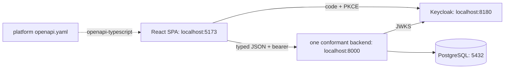

# Web client, React - Tasks and Teams

React 19 + TypeScript client of the [platform](../platform/README.md), with the same five chapters and ten screen names as [web-angular](../web-angular/README.md).
Approved design: [TDD.md](TDD.md). Terms: [GLOSSARY.md](GLOSSARY.md). Writing status: [_STATE.md](_STATE.md).
Official version/API checks: [REFERENCES.md](REFERENCES.md). Disclosures and contract feedback: [IMPLEMENTATION-NOTES.md](IMPLEMENTATION-NOTES.md).

## Chapters and phase packs

Every phase contains the **whole app** at that point, package-lock.json, a copied Python backend smoke fixture, an exercise starter/solution and verify.json.
Every authored app file is shown in full in its chapter; generated and immutable copied inputs have explicit exclusions/provenance.

| Phase | Chapter | Requirements | Pack |
|---|---|---|---|
| 1 | [01 Create the app, generate the client](tutorials/phase-1-setup/01-create-app.md) | W-01 to W-05 | web-react-phase-1-setup.zip |
| 2 | [02 Sign in with Keycloak](tutorials/phase-2-auth/02-sign-in.md) | W-06 to W-12 | web-react-phase-2-auth.zip |
| 3 | [03 Screens, queries and pagination](tutorials/phase-3-screens/03-screens-and-state.md) | W-13 to W-22, W-30 | web-react-phase-3-screens.zip |
| 4 | [04 Problem details, 412, offline, WCAG](tutorials/phase-4-errors/04-errors-and-accessibility.md) | W-23 to W-28, W-33 | web-react-phase-4-errors.zip |
| 5 | [05 Docker, nginx, CSP](tutorials/phase-5-ship/05-build-run-ship.md) | W-29, W-31, W-32 | web-react-phase-5-ship.zip |

## Start here

The install/build/server instructions below are for a later authorized learner run; do not execute them during this no-execution authoring session.

1. Install Node 26.13.1/npm 11.20.0, Docker Desktop Linux containers, and Python for repository scripts. Read Web 101 forms/layout/TypeScript/fetch, then the platform contract and Keycloak chapters.
2. Windows: Extract All on a phase zip; macOS: double-click; Linux: unzip. Open its chapter/code folder. Run `npm ci` then `npm run build`; generated declarations are rebuilt automatically. No node_modules, dist or local .env is shipped.
3. Follow the chapter's exact temporary-backend startup and cleanup commands. The backend fixture comes verbatim from `backend-python/source/phase-5-hardening/05-hardening/code`; the client does not modify the platform or another capstone.
4. Current delivery is **written (not run)**. Do not execute runtime verification in this authoring session. Text comparison only: `python scripts/verify_labs.py --static capstones/web-react`. verify.json retains deferred runtime commands for a later authorized session.
5. For manual shared-port work, enter a lock-owning shell first: `python scripts/stack_lock.py tasksteams -- powershell -NoProfile`. Inside it change to the phase's code folder, use the chapter commands and clean up before exiting. On macOS/Linux replace `powershell -NoProfile` with `bash`.
6. Production pack: `source/phase-5-ship/05-build-run-ship/code`. The chapter shows Docker build, health/status/log/header probes and cleanup. Rebuild downloadable zips with `python scripts/build_packs.py web-react`.

## Screens (same names and routes as Angular)

| Screen | Route |
|---|---|
| Login | /login |
| Callback | /auth/callback |
| Dashboard | / |
| Teams | /teams |
| Team detail | /teams/:teamId |
| Projects | /teams/:teamId/projects |
| Tasks | /projects/:projectId |
| Task detail | /tasks/:taskId |
| Audit log | /admin/audit |
| Not found | * |

## Origins, accounts and configuration

- Browser: **localhost**, never 127.0.0.1. API default http://localhost:8000; issuer http://localhost:8180/realms/tasksteams; public client tasks-web, PKCE S256. Only src/config.ts reads VITE_ settings; .env.example shows all three.
- Development 5173. nginx smoke 8201 is **not registered for sign-in**. For a real production-image login stop Vite and set WEB_PORT=5173; only one server owns 5173. Angular uses 4200, but run one comparison client at a time.
- Local fixture accounts only: alice / alice-local-fake (admin), bob / bob-local-fake, carol / carol-local-fake. tasks-smoke password grant is used only by Node smoke, never by browser UI. Real credentials/tokens are never shipped or logged.
- The client can consume Python, ASP.NET, Go or Rust on 8000 without code changes. **Only Python was integration-smoked in this task**; cross-backend compatibility is contract-based, not a claim of four runs.

## Current writing status

**All five chapters: written (not run).** Their front matter reads `verified: not yet run`.
The active React verification process was stopped after the user's no-execution update. No more smoke tests, Docker startup, builds or servers are run in this session. The source and future verification manifests remain complete; only static text/source comparison and pack creation are allowed.
Existing captured output in the chapters and captures/ is explicitly historical, from before the update, not a current acceptance claim.
No chapters remain unwritten. The prior run's PASS count does not replace the required new delivery status.

**Human-only acceptance remains:** browser sign-in/callback/history/storage; six-minute refresh and single-flight behaviour in a real tab; silent re-entry, role/scope step-up and logout; screen flows, optimistic visual timing/rollback/conflict choices; offline timing; keyboard, dialogs, reflow, contrast and screen-reader checks; production-image auth on registered port 5173.
Runtime, image, dependency-audit and browser checks are deferred until separately authorized. No security or WCAG certification is claimed.
