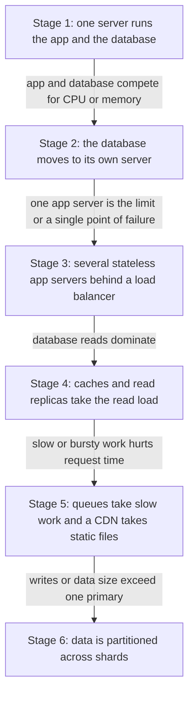
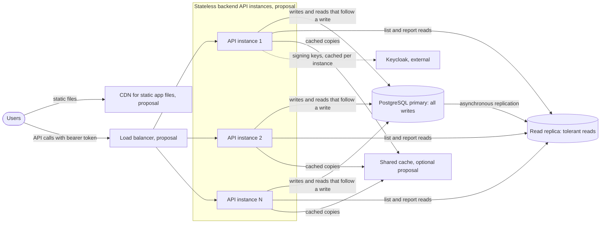
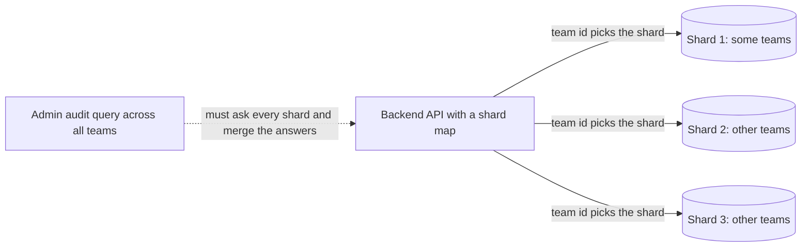

# Diagram sources, lesson 01

Each fenced block is the content of the .mmd file named above it.

**File: `scaling-stages.mmd`**

**File: `scaled-platform.mmd`**

**File: `sharding-by-team.mmd`**

