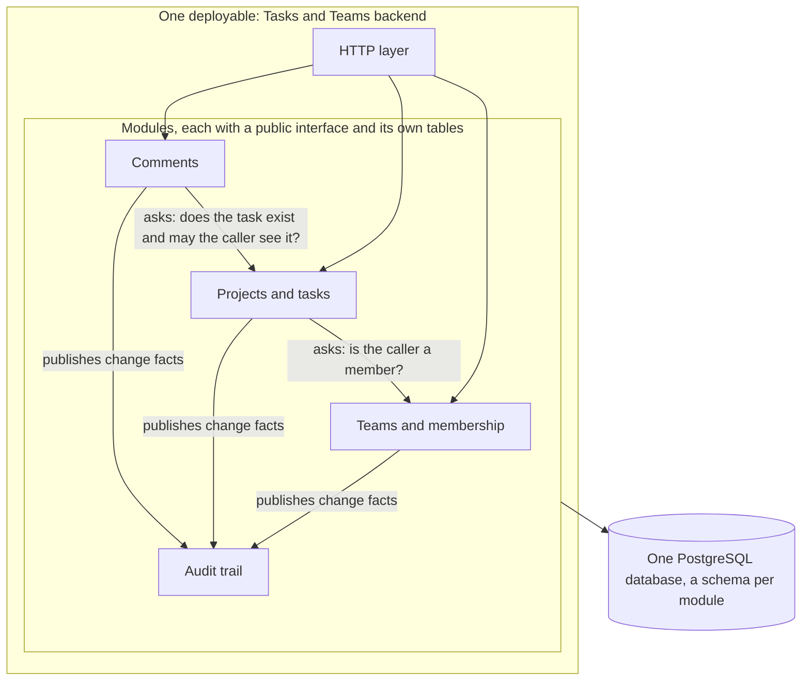
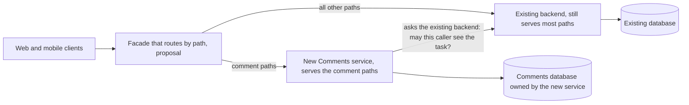
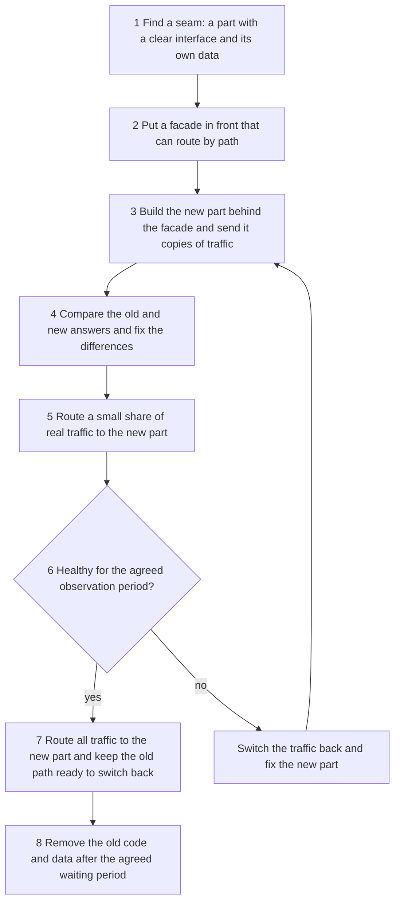

# Diagram sources, lesson 07

Each fenced block is the content of the .mmd file named above it.

**File: `modular-monolith.mmd`**

**File: `strangler-routing.mmd`**

**File: `strangler-steps.mmd`**

