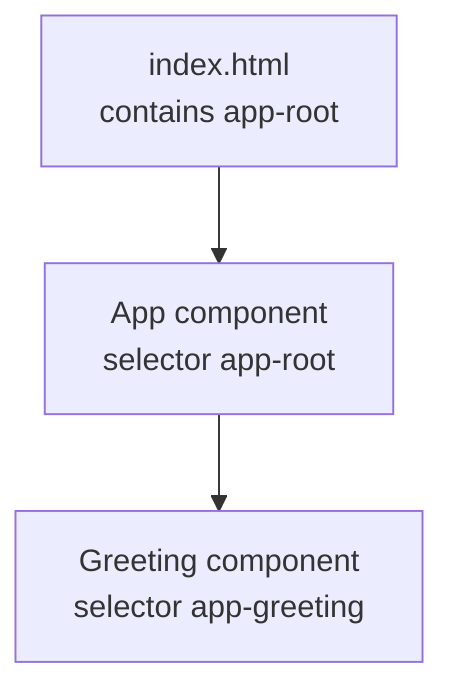

# 02. Project tour and standalone components

> **Draft: written but not yet run.** The code and the expected output in this lesson were prepared by reading the code and the official documentation. They have not been executed yet. If something does not behave as described, trust your tool's real output and report it.

## What you will be able to do
By the end of this lesson you will be able to:
- Say what each folder and file of a new Angular project is for.
- Write a standalone component by hand: class, decorator, template and style file.
- Use one component inside another with the `imports` list and the component's selector.
- Explain why a component's CSS does not leak to other components.

## Recap
1. Which file contains `<app-root>`, and which call fills it? <details><summary>Answer</summary>`src/index.html` contains it; `bootstrapApplication(App, appConfig)` in `src/main.ts` renders the `App` component into it.</details>
2. What does `npm start` do? <details><summary>Answer</summary>It runs the `start` script, `ng serve`: the development server that rebuilds and reloads when you save.</details>
3. What does `{{ title }}` in `app.html` show? <details><summary>Answer</summary>The value of the `title` property of the `App` class.</details>

## Why it matters
A house has rooms: kitchen, bedroom, bathroom. You can walk into one room without knowing how the others are wired. A **component** is a room of your app: it owns its own HTML, CSS and logic, and you can put the same room into many places. Everything you build in the next lessons (task items, forms, pages) is a component, so making one by hand is the most important skill of the track.

## What you will build
The same page as before, with a new `Greeting` component: a blue-edged box that the `App` component places in its own page.



## Before you start
- Lesson 01 done: your `tasks-first` project runs with `npm start`. Time: about 60 minutes.
- Source pack (optional): every file is shown in full in this lesson, so you can follow without it. The finished code, the exercise starter and the solution are in the
  course repository https://github.com/Uee03/Code101 under `source/angular/101-zero-to-hero/phase-1-first-app/02-project-tour-and-standalone-components/` (on that page choose **Code, Download ZIP**, or run
  `git clone https://github.com/Uee03/Code101.git`).
- Open the terminal in the `tasks-first` folder and run `npm start`. Keep it running: each save rebuilds the page.

## Steps

### Step 1. Take the tour
Open the project in VS Code and look at the folder tree. Here is what you will meet:

| Path | What it is |
|------|------------|
| `package.json` | The project's identity and shortcuts (`scripts`) and the packages it needs |
| `package-lock.json` | Created by `npm install`; the exact version of every package. Do not edit it |
| `node_modules/` | The downloaded packages. Large, generated, never committed to git |
| `angular.json` | Settings for the CLI: entry file, styles, assets, build modes |
| `tsconfig.json`, `tsconfig.app.json` | TypeScript settings |
| `public/` | Files copied to the site unchanged (icons, later a JSON file) |
| `src/index.html` | The single HTML page |
| `src/main.ts` | Starts the app |
| `src/styles.css` | Global styles |
| `src/app/` | **Your code.** Most of your work happens here |
| `src/app/app.ts`, `app.html`, `app.css` | The root component: class, template, styles |
| `src/app/app.config.ts` | App-wide settings (providers, lesson 08) |
| `src/app/app.routes.ts` | The page list (lesson 07) |
| `.angular/`, `dist/` | Caches and build output, generated and ignored by git |

**File names.** Angular's style guide names files after what they contain, without a type suffix: `app.ts` holds the class `App`, `greeting.ts` holds `Greeting`. Older guides wrote `app.component.ts`; you may meet that in books and videos. Source: https://angular.dev/style-guide

### Step 2. Write the Greeting component class
A **standalone component** declares everything it needs by itself; there is no separate module file to keep in sync. Make the folder `src/app/greeting` and create `greeting.ts` in it. (The CLI command `npm run ng -- generate component greeting` would create a folder with the same three files; writing them by hand once shows what it does.)

**File: `src/app/greeting/greeting.ts`**
```ts
import { Component } from '@angular/core';

@Component({
  selector: 'app-greeting',
  templateUrl: './greeting.html',
  styleUrl: './greeting.css'
})
export class Greeting {
  protected readonly message = 'Welcome to your task list.';
}
```

Line by line:
- `import { Component } from '@angular/core';` brings in the decorator.
- `@Component({ ... })` is the **decorator**: configuration attached to the class below it.
- `selector: 'app-greeting'` is the custom HTML tag name other templates use: `<app-greeting />`. The prefix `app-` (from `angular.json`) avoids clashes with real HTML tags.
- `templateUrl` and `styleUrl` point to the HTML and CSS files next to this file.
- `export class Greeting` is the component's logic. `protected readonly message` is a value the template may read. `readonly` means it cannot be reassigned; `protected` means "usable in the template and in this class, but not from outside". Angular's style guide prefers `protected` for template-only members.

### Step 3. Write its template and style
**File: `src/app/greeting/greeting.html`**
```html
<p class="greeting">{{ message }}</p>
```

**File: `src/app/greeting/greeting.css`**
```css
.greeting {
  background: #e8f1fb;
  border-left: 0.25rem solid #1d6fb8;
  padding: 0.75rem 1rem;
}
```

By default Angular **scopes** a component's CSS: it adds a hidden attribute to the component's elements and to your selectors, so `.greeting` here cannot style anything outside this component. That is why you can reuse short class names in every component.

### Step 4. Use the component in App
**File: `src/app/app.ts`**
```ts
import { Component } from '@angular/core';
import { Greeting } from './greeting/greeting';

@Component({
  selector: 'app-root',
  imports: [Greeting],
  templateUrl: './app.html',
  styleUrl: './app.css'
})
export class App {
  protected readonly title = 'Tasks First';
}
```

The new parts are the `import { Greeting } ... ;` line (normal TypeScript import: it makes the class available in this file) and `imports: [Greeting]` in the decorator (an Angular rule: it makes the component available **in this component's template**). You need both. The `title` text changed to "Tasks First".

**File: `src/app/app.html`**
```html
<main class="page">
  <h1>{{ title }}</h1>
  <app-greeting />
  <p>The box above is a component of its own.</p>
</main>
```

`<app-greeting />` is the selector used as a tag. Self-closing is allowed for components.

Unchanged files this lesson (shown at the end of the page for completeness): `app.css`, `app.config.ts`, `app.routes.ts` and the configuration from lesson 01.

## Run it
With `npm start` running, save all files and look at http://localhost:4200/.

**Predict before you look:** the heading, then what? Where will the blue-edged box appear?

Expected result: the heading "Tasks First", a light blue box with a blue left edge saying "Welcome to your task list.", then the paragraph "The box above is a component of its own." (described from the code, not yet seen in a browser). If the terminal shows an error, the page keeps the last good version: read the message and fix the file.

## How it works
1. The browser loads `index.html`; `main.ts` renders `App` into `<app-root>`.
2. While Angular renders the `App` template it meets `<app-greeting />`, looks it up in `App`'s `imports` list, finds the `Greeting` class and renders that component's template there.
3. The CSS is scoped, so the box style only touches `Greeting`.

**Misconception:** "importing the class is enough." The TypeScript `import` and the decorator's `imports` do different jobs: the first is for the compiler, the second tells Angular which tags and directives this template may use.

## Try it
Starter files are in `exercise/starter/src/app/site-footer/`.
1. **Guided:** finish the `SiteFooter` component (three TODOs in the starter files), then add it to `App`: `import` the class, add it to `imports`, and put `<app-site-footer />` at the end of `app.html`.
2. **Change:** give `Greeting` a different message, then use `<app-greeting />` twice in `app.html`. Predict how many boxes you will see.
3. **Stretch (optional):** make a third component of your own (for example `app-tip` that shows a tip of the day). Decide what belongs in `App` and what belongs in the new component.

<details><summary>Solution for rung 1</summary>

**File: `exercise/solution/src/app/site-footer/site-footer.ts`**
```ts
import { Component } from '@angular/core';

@Component({
  selector: 'app-site-footer',
  templateUrl: './site-footer.html',
  styleUrl: './site-footer.css'
})
export class SiteFooter {
  protected readonly year = 2026;
}
```

**File: `exercise/solution/src/app/site-footer/site-footer.html`**
```html
<footer class="site-footer">Tasks First, {{ year }}</footer>
```

**File: `exercise/solution/src/app/site-footer/site-footer.css`**
```css
.site-footer {
  margin-top: 2rem;
  color: #4b5563;
  font-size: 0.875rem;
}
```

**File: `exercise/solution/src/app/app.ts`**
```ts
import { Component } from '@angular/core';
import { Greeting } from './greeting/greeting';
import { SiteFooter } from './site-footer/site-footer';

@Component({
  selector: 'app-root',
  imports: [Greeting, SiteFooter],
  templateUrl: './app.html',
  styleUrl: './app.css'
})
export class App {
  protected readonly title = 'Tasks First';
}
```

**File: `exercise/solution/src/app/app.html`**
```html
<main class="page">
  <h1>{{ title }}</h1>
  <app-greeting />
  <p>The box above is a component of its own.</p>
  <app-site-footer />
</main>
```

</details>

## Check yourself
1. What are the three parts of a component in this course? <details><summary>Answer</summary>A TypeScript class with the `@Component` decorator, an HTML template and a CSS file.</details>
2. You wrote `<app-greeting />` but nothing appears and the terminal shows an error. What did you probably forget? <details><summary>Answer</summary>Adding `Greeting` to the `imports` array of the component that uses it (or the TypeScript `import` line).</details>
3. Why can two components both use a CSS class called `.box` without interfering? <details><summary>Answer</summary>Angular scopes each component's CSS to that component's elements.</details>
4. Is the folder `node_modules` something you edit or commit? <details><summary>Answer</summary>No: it is generated by `npm install` and ignored by git.</details>

## Common mistakes
| Symptom or error text | Cause | Fix |
|---|---|---|
| Typical message: `'app-greeting' is not a known element` | `Greeting` is not in the `imports` array of the component whose template uses it | Add it to `imports` and keep the TypeScript `import` line |
| Typical message: cannot find module `./greeting/greeting` | The file path or file name differs (case matters on macOS and Linux) | Check the folder `src/app/greeting` and the file `greeting.ts` |
| The box is unstyled | `styleUrl` points to a wrong file name, or `greeting.css` is not saved | Compare the file names with the decorator |
| Typical message: a file in `templateUrl` or `styleUrl` cannot be found | A typo in `./greeting.html` or `./greeting.css` | Fix the name; each is relative to the `.ts` file |
| The page does not change | File not saved (dot on the tab) or `npm start` is not running | Save, check the terminal |

## Best practice
Keep each component small and name its files after the class it holds; one component per file, with the template and the styles next to it. Source: Angular Style Guide https://angular.dev/style-guide

## Going further
- Components guide: https://angular.dev/guide/components
- Component styles and encapsulation: https://angular.dev/guide/components/styling

## Summary
- You toured the project and named the purpose of each file.
- You wrote a standalone component with a selector, a template and scoped styles.
- You used it in `App` with both the TypeScript `import` and the `imports` array.

## Next lesson
03. Templates and data binding: show values, set properties and react to clicks.

<details>
<summary>Files that did not change in this lesson (listed so this page is complete)</summary>

**File: `src/app/app.css`**

```css
.page {
  max-width: 40rem;
  margin: 0 auto;
}

h1 {
  color: #1d6fb8;
}
```

**File: `src/styles.css`**

```css
body {
  font-family: system-ui, sans-serif;
  line-height: 1.5;
  margin: 2rem;
}
```

</details>
