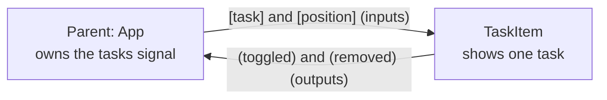

# 05. Component inputs and outputs

> **Draft: written but not yet run.** The code and the expected output in this lesson were prepared by reading the code and the official documentation. They have not been executed yet. If something does not behave as described, trust your tool's real output and report it.

## What you will be able to do
By the end of this lesson you will be able to:
- Pass data into a child component with `input()` and `input.required()`.
- Send an event out of a child component with `output()` and `.emit()`.
- Bind an input with `[name]` and listen to an output with `(name)`, reading the payload as `$event`.
- Explain why the child reports "what happened" and the parent decides what to change.

## Recap
1. What does `@for` need besides the list? <details><summary>Answer</summary>A `track` expression that identifies each item, usually its id.</details>
2. How do you change a signal that holds an array without mutating it? <details><summary>Answer</summary>`update` with a function that returns a new array (`map`, `filter`, or a spread).</details>
3. What do you write in `imports` to use a component in a template? <details><summary>Answer</summary>The component class.</details>

## Why it matters
Think of a vending machine: you put coins and a choice **in**, and a snack and a receipt come **out**. A component is the same: it receives values through **inputs** and tells the world what happened through **outputs**. Keeping those two doors the only way in and out lets you reuse one `TaskItem` anywhere and understand it without reading the rest of the app.



## What you will build
The task list from lesson 04, with each row moved into its own `TaskItem` component. The row has a checkbox and a **Remove** button. The parent still owns the data.

## Before you start
- Lesson 04 done and `npm start` running. Time: about 65 minutes.
- Source pack (optional): every file is shown in full in this lesson, so you can follow without it. The finished code, the exercise starter and the solution are in the
  course repository https://github.com/Uee03/Code101 under `source/angular/101-zero-to-hero/phase-2-building/05-component-inputs-and-outputs/` (on that page choose **Code, Download ZIP**, or run
  `git clone https://github.com/Uee03/Code101.git`).

## Steps

### Step 1. Write the child component
Make the folder `src/app/task-item` and create three files.

**File: `src/app/task-item/task-item.ts`**
```ts
import { Component, input, output } from '@angular/core';
import { Task } from '../task';

@Component({
  selector: 'li[app-task-item]',
  templateUrl: './task-item.html',
  styleUrl: './task-item.css',
  host: {
    '[class.done]': 'task().done'
  }
})
export class TaskItem {
  readonly task = input.required<Task>();
  readonly position = input(1);
  readonly toggled = output<number>();
  readonly removed = output<number>();

  protected toggle(): void {
    this.toggled.emit(this.task().id);
  }

  protected remove(): void {
    this.removed.emit(this.task().id);
  }
}
```

- `selector: 'li[app-task-item]'` is an **attribute selector**: the component attaches to an existing `<li>` element written as `<li app-task-item>`. We do this so the list stays valid HTML (`<ul>` may only contain `<li>`), which matters for screen readers.
- `input.required<Task>()` declares an input called `task` that the parent **must** pass. Inside the class you read it like a signal: `this.task()`. The compiler stops the build when a parent forgets it.
- `input(1)` declares an optional input `position` with the default 1; its type (number) is inferred.
- `output<number>()` declares an event called `toggled` whose payload is a number (the task id). `removed` is the same. Output names are plain event names (`toggled`, not `onToggled`).
- `toggle()` and `remove()` run from the child's template and call `.emit(value)`, which sends the payload to whoever listens.
- Inputs and outputs are **public** (no `protected`) because the parent's template reaches them from outside.
- `host: { '[class.done]': 'task().done' }` adds the class `done` to the `<li>` itself while the task is done. The `host` object describes the component's own element.

**File: `src/app/task-item/task-item.html`**
```html
<label>
  <input type="checkbox" [checked]="task().done" (change)="toggle()">
  {{ position() }}. {{ task().title }}
</label>
<button type="button" class="remove" [attr.aria-label]="'Remove ' + task().title" (click)="remove()">Remove</button>
```

`[attr.aria-label]="'Remove ' + task().title"` makes the button's name specific ("Remove Install Node") instead of the same word repeated three times, which helps screen-reader users.

**File: `src/app/task-item/task-item.css`**
```css
:host {
  display: flex;
  justify-content: space-between;
  align-items: center;
  padding: 0.5rem 0;
  border-bottom: 1px solid #d1d5db;
}

:host(.done) label {
  color: #4b5563;
  text-decoration: line-through;
}

.remove {
  padding: 0.25rem 0.625rem;
}
```

`:host` styles the component's own element (the `<li>`); `:host(.done)` applies only while that class is present.

### Step 2. Use it in the parent
**File: `src/app/app.ts`**
```ts
import { Component, computed, signal } from '@angular/core';
import { TaskItem } from './task-item/task-item';
import { Filter, Task } from './task';

@Component({
  selector: 'app-root',
  imports: [TaskItem],
  templateUrl: './app.html',
  styleUrl: './app.css'
})
export class App {
  protected readonly title = 'Tasks First';
  protected readonly filters: readonly Filter[] = ['all', 'todo', 'done'];
  protected readonly tasks = signal<Task[]>([
    { id: 1, title: 'Install Node', done: true },
    { id: 2, title: 'Create the app', done: true },
    { id: 3, title: 'Learn control flow', done: false }
  ]);
  protected readonly filter = signal<Filter>('all');

  protected readonly remaining = computed(() => this.tasks().filter((task) => !task.done).length);
  protected readonly visibleTasks = computed(() => {
    const current = this.filter();
    return this.tasks().filter((task) => current === 'all' || (current === 'done' ? task.done : !task.done));
  });

  protected toggle(id: number): void {
    this.tasks.update((list) => list.map((task) => (task.id === id ? { ...task, done: !task.done } : task)));
  }

  protected remove(id: number): void {
    this.tasks.update((list) => list.filter((task) => task.id !== id));
  }

  protected setFilter(value: Filter): void {
    this.filter.set(value);
  }
}
```

Changes from lesson 04: `TaskItem` is imported and added to `imports`, and there is a new `remove(id)` method that keeps all tasks except the one with that id.

**File: `src/app/app.html`**
```html
<main class="page">
  <h1>{{ title }}</h1>

  @if (remaining() === 0) {
    <p class="status">All tasks are done.</p>
  } @else if (remaining() === 1) {
    <p class="status">One task left.</p>
  } @else {
    <p class="status">{{ remaining() }} tasks left.</p>
  }

  <div role="group" aria-label="Filter tasks">
    @for (option of filters; track option) {
      <button type="button" [class.active]="filter() === option" [attr.aria-pressed]="filter() === option" (click)="setFilter(option)">
        {{ option }}
      </button>
    }
  </div>

  <ul class="tasks">
    @for (task of visibleTasks(); track task.id; let i = $index) {
      <li app-task-item [task]="task" [position]="i + 1" (toggled)="toggle($event)" (removed)="remove($event)"></li>
    } @empty {
      <li class="empty">No tasks in this view.</li>
    }
  </ul>

  @switch (filter()) {
    @case ('all') {
      <p class="hint">Showing every task.</p>
    }
    @case ('todo') {
      <p class="hint">Showing tasks that still need work.</p>
    }
    @case ('done') {
      <p class="hint">Showing finished tasks.</p>
    }
  }
</main>
```

The important line is:
```html
<li app-task-item [task]="task" [position]="i + 1" (toggled)="toggle($event)" (removed)="remove($event)"></li>
```
`[task]="task"` and `[position]="i + 1"` push values into the inputs. `(toggled)="toggle($event)"` listens to the output; **`$event`** holds the payload the child emitted (the id), and the parent passes it on to its own method. The data stays in the parent: the child never changes the list itself.

**File: `src/app/app.css`** (the old `li` rules moved into the child's CSS)
```css
.page {
  max-width: 40rem;
  margin: 0 auto;
}

h1 {
  color: #1d6fb8;
}

.status {
  font-weight: 600;
}

button {
  margin-right: 0.5rem;
  padding: 0.375rem 0.75rem;
  text-transform: capitalize;
}

button.active {
  background: #1d6fb8;
  color: #ffffff;
}

.tasks {
  list-style: none;
  padding: 0;
}

.empty,
.hint {
  color: #4b5563;
}
```

## Run it
Save everything and open http://localhost:4200/.

**Predict:** you click **Remove** on "Create the app". What happens to the numbers in front of the other titles?

Expected behaviour (described from the code, not yet seen in a browser): the page looks like lesson 04 with a **Remove** button at the right of each row. Removing the second task makes the third task move up and its number change from 3 to 2, because `position` is `i + 1`. Ticking a box still strikes the title and updates the status line.

## How it works
1. `App` renders one `TaskItem` per visible task and gives it the task and its position.
2. When you tick a box, `TaskItem.toggle()` calls `this.toggled.emit(id)`.
3. Angular calls the parent's `toggle($event)` with that id; the parent updates `tasks`; the new array flows back down through the inputs and the row redraws.

This is called **one-way data flow**: data goes down through inputs, events go up through outputs. The next lessons keep this rule.

**Misconception:** "the child may change `task` directly." An input is read-only inside the child. If it could change shared data on its own, you could not tell who changed what.

**Other kind.** There is also `model()` for a two-way pair of input and output (used for custom form-like components). You will not need it yet; see the guide in Going further.

## Try it
Starter files are in `exercise/starter/src/app/` (`task-item/task-item.ts` and `app.html`).
1. **Guided:** add a `highlight` input (default `false`) and the matching host class binding, then pass `[highlight]="task.id === 3"` from the parent. Copy `task-item.css` from the solution folder for the yellow rule (or write your own).
2. **Change:** add an output `edited` that emits the task id when you double-click the title (`(dblclick)`), and log it in the parent with `console.log`. Predict what the browser console shows.
3. **Stretch (optional):** decide: should the "Remove" confirmation (an "Are you sure?" step) live in the child or in the parent? Write down your reasoning.

<details><summary>Solution for rung 1</summary>

**File: `exercise/solution/src/app/task-item/task-item.ts`**
```ts
import { Component, input, output } from '@angular/core';
import { Task } from '../task';

@Component({
  selector: 'li[app-task-item]',
  templateUrl: './task-item.html',
  styleUrl: './task-item.css',
  host: {
    '[class.done]': 'task().done',
    '[class.highlight]': 'highlight()'
  }
})
export class TaskItem {
  readonly task = input.required<Task>();
  readonly position = input(1);
  readonly highlight = input(false);
  readonly toggled = output<number>();
  readonly removed = output<number>();

  protected toggle(): void {
    this.toggled.emit(this.task().id);
  }

  protected remove(): void {
    this.removed.emit(this.task().id);
  }
}
```

**File: `exercise/solution/src/app/task-item/task-item.css`**
```css
:host {
  display: flex;
  justify-content: space-between;
  align-items: center;
  padding: 0.5rem 0;
  border-bottom: 1px solid #d1d5db;
}

:host(.done) label {
  color: #4b5563;
  text-decoration: line-through;
}

:host(.highlight) {
  background: #fff4cc;
}

.remove {
  padding: 0.25rem 0.625rem;
}
```

**File: `exercise/solution/src/app/app.html`**
```html
<main class="page">
  <h1>{{ title }}</h1>

  @if (remaining() === 0) {
    <p class="status">All tasks are done.</p>
  } @else if (remaining() === 1) {
    <p class="status">One task left.</p>
  } @else {
    <p class="status">{{ remaining() }} tasks left.</p>
  }

  <div role="group" aria-label="Filter tasks">
    @for (option of filters; track option) {
      <button type="button" [class.active]="filter() === option" [attr.aria-pressed]="filter() === option" (click)="setFilter(option)">
        {{ option }}
      </button>
    }
  </div>

  <ul class="tasks">
    @for (task of visibleTasks(); track task.id; let i = $index) {
      <li app-task-item [task]="task" [position]="i + 1" [highlight]="task.id === 3" (toggled)="toggle($event)" (removed)="remove($event)"></li>
    } @empty {
      <li class="empty">No tasks in this view.</li>
    }
  </ul>

  @switch (filter()) {
    @case ('all') {
      <p class="hint">Showing every task.</p>
    }
    @case ('todo') {
      <p class="hint">Showing tasks that still need work.</p>
    }
    @case ('done') {
      <p class="hint">Showing finished tasks.</p>
    }
  }
</main>
```

</details>

## Check yourself
1. How does a child read an input, and what happens if a required input is not passed? <details><summary>Answer</summary>By calling it like a signal (`this.task()`); the build fails with an error about the missing required input.</details>
2. What is `$event` in `(removed)="remove($event)"`? <details><summary>Answer</summary>The value the child passed to `emit`, here the task id.</details>
3. Which side owns the list of tasks, and why does that matter? <details><summary>Answer</summary>The parent. Only one place changes the data, so you always know where to look.</details>
4. The Remove button does nothing. Name two causes. <details><summary>Answer</summary>The parent listens to the wrong output name, or the child's `remove()` never calls `emit`.</details>

## Common mistakes
| Symptom or error text | Cause | Fix |
|---|---|---|
| Typical message: required input `task` from component `TaskItem` must be specified | The parent forgot `[task]="task"` | Pass the input |
| Typical message: `Can't bind to 'position' since it isn't a known property of 'li'` | `TaskItem` is not in the parent's `imports` | Add it to `imports` |
| `task` input shows `[object Object]` | A binding without brackets passes a string: `task="task"` | Use `[task]="task"` |
| Nothing happens on click | `(toggled)` is spelled differently from the output name | Use the same name in both files |
| The list is wrong HTML (rows not aligned) | The component was used as `<app-task-item>` inside `<ul>` | Keep the `li[app-task-item]` selector and write `<li app-task-item ...>` |

## Best practice
Name inputs for what they hold and outputs for what happened, give inputs a type, and keep the data in one owner. Source: Angular Style Guide https://angular.dev/style-guide

## Going further
- Inputs: https://angular.dev/guide/components/inputs
- Outputs: https://angular.dev/guide/components/outputs
- Two-way binding with `model()`: https://angular.dev/guide/signals/model

## Summary
- You created a reusable component with a required input, an optional input and two outputs.
- You bound inputs with `[ ]` and outputs with `( )`, using `$event` for the payload.
- You kept the data in the parent and let the child only report events.

## Next lesson
06. Forms: add new tasks with a template-driven form, then meet reactive forms.

<details>
<summary>Files that did not change in this lesson (listed so this page is complete)</summary>

**File: `src/app/task.ts`**

```ts
export type Filter = 'all' | 'todo' | 'done';

export interface Task {
  id: number;
  title: string;
  done: boolean;
}
```

**File: `src/styles.css`**

```css
body {
  font-family: system-ui, sans-serif;
  line-height: 1.5;
  margin: 2rem;
}
```

</details>
