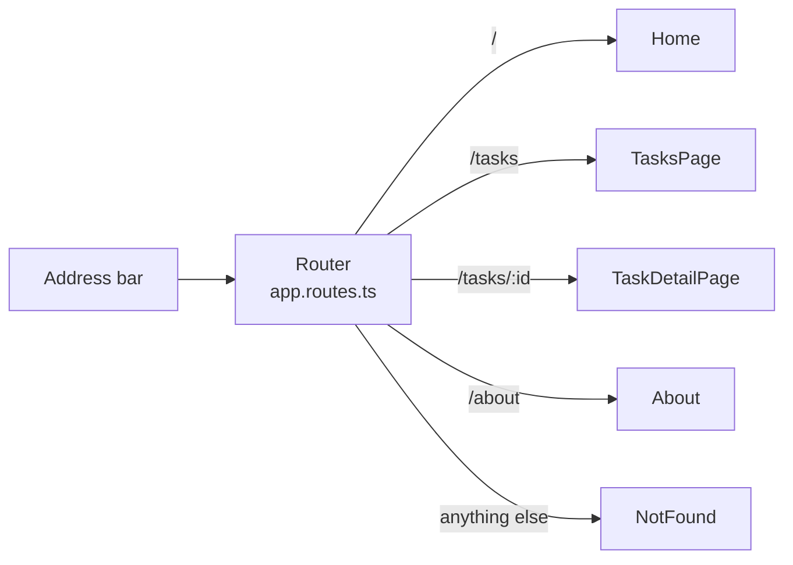

# 07. Routing

> **Draft: written but not yet run.** The code and the expected output in this lesson were prepared by reading the code and the official documentation. They have not been executed yet. If something does not behave as described, trust your tool's real output and report it.

## What you will be able to do
By the end of this lesson you will be able to:
- Define routes (path, component, title) and show the matching page with `<router-outlet />`.
- Link between pages with `routerLink` and highlight the current link with `routerLinkActive`.
- Read a route parameter such as `/tasks/3` as a component input.
- Add a catch-all route for unknown addresses.

## Recap
1. What does `$event` hold in `(added)="add($event)"`? <details><summary>Answer</summary>The value the child passed to `emit`.</details>
2. In which file did lesson 01 leave an empty list of routes? <details><summary>Answer</summary>`src/app/app.routes.ts`.</details>
3. Why does `@for` need `track`? <details><summary>Answer</summary>So Angular can recognise each item between updates.</details>

## Why it matters
A website is a building with many rooms, and the address bar is the room number. A **single-page app** has only one HTML file, but it still wants different addresses for different screens: so a link can be shared, the back button works and a refresh lands on the same screen. The **router** is the doorman: it reads the address, picks the component for it and shows that component in a reserved spot.

## What you will build
A small site with four addresses: `/` (home), `/tasks` (the task list from lesson 06), `/tasks/2` (details of one task), `/about`, and a "Page not found" for everything else. A navigation bar marks the current page.



## Before you start
- Lesson 06 done. Time: about 70 minutes (break after Step 3).
- Source pack (optional): every file is shown in full in this lesson, so you can follow without it. The finished code, the exercise starter and the solution are in the
  course repository https://github.com/Uee03/Code101 under `source/angular/101-zero-to-hero/phase-2-building/07-routing/` (on that page choose **Code, Download ZIP**, or run
  `git clone https://github.com/Uee03/Code101.git`).
- **Clean-up:** delete the folder `src/app/new-task-template` (one form is enough from now on; we keep the reactive one).

## Steps

### Step 1. Move the starting data into its own file
Both the task list and the detail page need the same starting tasks.

**File: `src/app/task-data.ts`**
```ts
import { Task } from './task';

export const INITIAL_TASKS: Task[] = [
  { id: 1, title: 'Install Node', done: true },
  { id: 2, title: 'Create the app', done: true },
  { id: 3, title: 'Learn control flow', done: false }
];
```

### Step 2. Create the pages
The list you built in lessons 04 to 06 moves out of `App` into a page component. Create the folders `src/app/pages/home`, `tasks`, `task-detail`, `about` and `not-found`.

Small pages can use an **inline template**: the HTML sits in the `template` option (between backticks) instead of in a separate file. That is fine while it stays short.

**File: `src/app/pages/home/home.ts`**
```ts
import { Component } from '@angular/core';
import { RouterLink } from '@angular/router';

@Component({
  selector: 'app-home',
  imports: [RouterLink],
  template: `
    <h1>Welcome</h1>
    <p>This is the home page. Go to the <a routerLink="/tasks">task list</a>.</p>
  `
})
export class Home {}
```

**File: `src/app/pages/about/about.ts`**
```ts
import { Component } from '@angular/core';

@Component({
  selector: 'app-about',
  template: `
    <h1>About</h1>
    <p>Tasks First is the practice app of the Code101 Angular 101 track.</p>
  `
})
export class About {}
```

**File: `src/app/pages/not-found/not-found.ts`**
```ts
import { Component } from '@angular/core';
import { RouterLink } from '@angular/router';

@Component({
  selector: 'app-not-found',
  imports: [RouterLink],
  template: `
    <h1>Page not found</h1>
    <p>There is nothing at this address. <a routerLink="/">Go to the home page</a>.</p>
  `
})
export class NotFound {}
```

`routerLink="/tasks"` is the router's version of `href`: it changes the address **without** reloading the page. It needs `RouterLink` in `imports`.

**File: `src/app/pages/tasks/tasks.ts`** (the old `App` logic, now a page; it starts from a copy of `INITIAL_TASKS`)
```ts
import { Component, computed, signal } from '@angular/core';
import { NewTaskReactive } from '../../new-task-reactive/new-task-reactive';
import { TaskItem } from '../../task-item/task-item';
import { Filter, Task } from '../../task';
import { INITIAL_TASKS } from '../../task-data';

@Component({
  selector: 'app-tasks-page',
  imports: [NewTaskReactive, TaskItem],
  templateUrl: './tasks.html',
  styleUrl: './tasks.css'
})
export class TasksPage {
  protected readonly filters: readonly Filter[] = ['all', 'todo', 'done'];
  protected readonly tasks = signal<Task[]>([...INITIAL_TASKS]);
  protected readonly filter = signal<Filter>('all');

  protected readonly remaining = computed(() => this.tasks().filter((task) => !task.done).length);
  protected readonly visibleTasks = computed(() => {
    const current = this.filter();
    return this.tasks().filter((task) => current === 'all' || (current === 'done' ? task.done : !task.done));
  });

  protected add(title: string): void {
    const id = Math.max(0, ...this.tasks().map((task) => task.id)) + 1;
    this.tasks.update((list) => [...list, { id, title, done: false }]);
  }

  protected toggle(id: number): void {
    this.tasks.update((list) => list.map((task) => (task.id === id ? { ...task, done: !task.done } : task)));
  }

  protected remove(id: number): void {
    this.tasks.update((list) => list.filter((task) => task.id !== id));
  }

  protected setFilter(value: Filter): void {
    this.filter.set(value);
  }
}
```

**File: `src/app/pages/tasks/tasks.html`**
```html
<h1>Tasks</h1>

<app-new-task-reactive (added)="add($event)" />

@if (remaining() === 0) {
  <p class="status">All tasks are done.</p>
} @else if (remaining() === 1) {
  <p class="status">One task left.</p>
} @else {
  <p class="status">{{ remaining() }} tasks left.</p>
}

<div role="group" aria-label="Filter tasks">
  @for (option of filters; track option) {
    <button type="button" [class.active]="filter() === option" [attr.aria-pressed]="filter() === option" (click)="setFilter(option)">
      {{ option }}
    </button>
  }
</div>

<ul class="tasks">
  @for (task of visibleTasks(); track task.id; let i = $index) {
    <li app-task-item [task]="task" [position]="i + 1" (toggled)="toggle($event)" (removed)="remove($event)"></li>
  } @empty {
    <li class="empty">No tasks in this view.</li>
  }
</ul>

<p class="hint">This list lives inside this page. Leave the page and come back: the list starts over. Lesson 08 fixes that.</p>
```

**File: `src/app/pages/tasks/tasks.css`**
```css
h1 {
  color: #1d6fb8;
}

.status {
  font-weight: 600;
}

button {
  margin-right: 0.5rem;
  padding: 0.375rem 0.75rem;
  text-transform: capitalize;
}

button.active {
  background: #1d6fb8;
  color: #ffffff;
}

.tasks {
  list-style: none;
  padding: 0;
}

.empty,
.hint {
  color: #4b5563;
}
```

### Step 3. The detail page reads the address
**File: `src/app/pages/task-detail/task-detail.ts`**
```ts
import { Component, computed, input } from '@angular/core';
import { RouterLink } from '@angular/router';
import { INITIAL_TASKS } from '../../task-data';

@Component({
  selector: 'app-task-detail-page',
  imports: [RouterLink],
  templateUrl: './task-detail.html'
})
export class TaskDetailPage {
  readonly id = input.required<string>();
  protected readonly task = computed(() => INITIAL_TASKS.find((task) => task.id === Number(this.id())));
}
```

`readonly id = input.required<string>()` looks like the inputs of lesson 05, but nobody writes `[id]="..."`: with the option `withComponentInputBinding()` (Step 5) the router fills an input whose name matches a **route parameter**. For the path `tasks/:id` and the address `/tasks/2`, `id()` is the text `"2"`. Route values are always strings, so we convert with `Number(...)`. The `computed` looks the task up and returns `undefined` when it does not exist.

**File: `src/app/pages/task-detail/task-detail.html`**
```html
@if (task(); as found) {
  <h1>{{ found.title }}</h1>
  <p>Task number {{ found.id }}. Status: {{ found.done ? 'done' : 'to do' }}.</p>
} @else {
  <h1>Task not found</h1>
  <p>There is no task with the number "{{ id() }}" in the starting list.</p>
}
<p><a routerLink="/tasks">Back to the list</a></p>
```

`@if (task(); as found)` runs the block only when the value is not `undefined` and names it `found` inside the block.

### Step 4. Update the task row to link to the detail page
**File: `src/app/task-item/task-item.ts`** (new: `RouterLink` in `imports`)
```ts
import { Component, input, output } from '@angular/core';
import { RouterLink } from '@angular/router';
import { Task } from '../task';

@Component({
  selector: 'li[app-task-item]',
  imports: [RouterLink],
  templateUrl: './task-item.html',
  styleUrl: './task-item.css',
  host: {
    '[class.done]': 'task().done'
  }
})
export class TaskItem {
  readonly task = input.required<Task>();
  readonly position = input(1);
  readonly toggled = output<number>();
  readonly removed = output<number>();

  protected toggle(): void {
    this.toggled.emit(this.task().id);
  }

  protected remove(): void {
    this.removed.emit(this.task().id);
  }
}
```

**File: `src/app/task-item/task-item.html`**
```html
<span class="title">
  <input type="checkbox" [checked]="task().done" [attr.aria-label]="'Done: ' + task().title" (change)="toggle()">
  {{ position() }}. <a [routerLink]="['/tasks', task().id]">{{ task().title }}</a>
</span>
<button type="button" class="remove" [attr.aria-label]="'Remove ' + task().title" (click)="remove()">Remove</button>
```

`[routerLink]="['/tasks', task().id]"` builds the address from parts: an array like `['/tasks', 3]` becomes `/tasks/3`. Passing parts instead of gluing strings avoids mistakes with slashes. The checkbox lost its `<label>`, so it now has an `aria-label` that names it ("Done: Install Node"); the link is the title.

**File: `src/app/task-item/task-item.css`**
```css
:host {
  display: flex;
  justify-content: space-between;
  align-items: center;
  padding: 0.5rem 0;
  border-bottom: 1px solid #d1d5db;
}

:host(.done) .title {
  color: #4b5563;
  text-decoration: line-through;
}

.remove {
  padding: 0.25rem 0.625rem;
}
```

### Step 5. Define the routes and switch on the input binding
**File: `src/app/app.routes.ts`**
```ts
import { Routes } from '@angular/router';
import { About } from './pages/about/about';
import { Home } from './pages/home/home';
import { NotFound } from './pages/not-found/not-found';
import { TaskDetailPage } from './pages/task-detail/task-detail';
import { TasksPage } from './pages/tasks/tasks';

export const routes: Routes = [
  { path: '', component: Home, title: 'Home' },
  { path: 'tasks', component: TasksPage, title: 'Tasks' },
  { path: 'tasks/:id', component: TaskDetailPage, title: 'Task details' },
  { path: 'about', component: About, title: 'About' },
  { path: '**', component: NotFound, title: 'Page not found' }
];
```

Each route object says: when the address matches `path`, show `component`; `title` sets the browser tab title (and is read out by screen readers when the page changes). `tasks/:id` has a **route parameter** `:id`. The last route, `**`, is the **wildcard**: it matches anything the earlier routes did not, so it must come last because the router uses the first match.

**File: `src/app/app.config.ts`**
```ts
import { ApplicationConfig, provideBrowserGlobalErrorListeners } from '@angular/core';
import { provideRouter, withComponentInputBinding } from '@angular/router';

import { routes } from './app.routes';

export const appConfig: ApplicationConfig = {
  providers: [provideBrowserGlobalErrorListeners(), provideRouter(routes, withComponentInputBinding())]
};
```

`withComponentInputBinding()` is the switch that lets route parameters flow into inputs.

### Step 6. Build the shell
**File: `src/app/app.ts`**
```ts
import { Component } from '@angular/core';
import { RouterLink, RouterLinkActive, RouterOutlet } from '@angular/router';

@Component({
  selector: 'app-root',
  imports: [RouterLink, RouterLinkActive, RouterOutlet],
  templateUrl: './app.html',
  styleUrl: './app.css'
})
export class App {}
```

**File: `src/app/app.html`**
```html
<header class="site-header">
  <a class="brand" routerLink="/">Tasks First</a>
  <nav aria-label="Main">
    <a routerLink="/" routerLinkActive="active" ariaCurrentWhenActive="page" [routerLinkActiveOptions]="{ exact: true }">Home</a>
    <a routerLink="/tasks" routerLinkActive="active" ariaCurrentWhenActive="page">Tasks</a>
    <a routerLink="/about" routerLinkActive="active" ariaCurrentWhenActive="page">About</a>
  </nav>
</header>

<main class="page">
  <router-outlet />
</main>
```

- `<router-outlet />` is the reserved spot where the current page appears.
- `routerLinkActive="active"` adds the class `active` to the link whose address is the current one; `[routerLinkActiveOptions]="{ exact: true }"` on Home stops it from counting as active on every page (all addresses start with `/`).
- `ariaCurrentWhenActive="page"` adds `aria-current="page"` to the active link so screen readers say "current page".
- The `<nav aria-label="Main">` gives the navigation a name for people who jump between landmarks.

**File: `src/app/app.css`**
```css
.site-header {
  display: flex;
  align-items: center;
  gap: 1.5rem;
  max-width: 40rem;
  margin: 0 auto 1.5rem;
  padding-bottom: 0.75rem;
  border-bottom: 1px solid #d1d5db;
}

.brand {
  color: #1d6fb8;
  font-size: 1.25rem;
  font-weight: 700;
  text-decoration: none;
}

nav {
  display: flex;
  gap: 1rem;
}

nav a.active {
  font-weight: 700;
  text-decoration: none;
}

.page {
  max-width: 40rem;
  margin: 0 auto;
}
```

## Run it
Save everything and open http://localhost:4200/.

**Predict:** you open http://localhost:4200/tasks/3, then http://localhost:4200/tasks/99. What does each show?

Expected behaviour (described from the code, not yet seen in a browser):
1. `/` shows "Welcome" with a link; the Home link in the bar is bold.
2. Click **Tasks**: the address becomes `/tasks`, the list from lesson 06 appears with the form above, and the tab title reads "Tasks".
3. Click "Learn control flow": `/tasks/3` shows its title, "Task number 3. Status: to do." and a "Back to the list" link.
4. `/tasks/99` shows "Task not found". `/nothing-here` shows "Page not found".
5. Add a task on the list page, click **Home** and then **Tasks** again: your added task is gone. This is expected: the list belongs to the page component, and the router creates a fresh page each time. Lesson 08 solves it with a service.

Typing an address in the address bar reloads the whole app (that is a normal page load); clicking a `routerLink` does not.

## How it works
1. At start-up the router reads the current address and matches it against the `routes` array from top to bottom.
2. The matching component is created and placed at `<router-outlet />`. When the address changes, the old page is destroyed and a new one is created.
3. `routerLink` intercepts the click, tells the router to navigate and updates the address with the browser history API: no page reload.
4. Route parameters, query parameters and static data can all arrive as inputs when `withComponentInputBinding()` is on.

**Misconception:** "the router keeps my page alive." No: leaving a page destroys its component and its signals. Anything that must survive navigation lives in a service (lesson 08).

## Try it
Starter file: `exercise/starter/src/app/pages/about/about.ts`.
1. **Guided:** complete the two TODOs so the About page links to the task list.
2. **Change:** add a `Help` page (a new component, a route with the title "Help", and a link in the navigation). Predict which links are bold on the Help page.
3. **Stretch (optional):** make `/tasks/:id` show "Previous" and "Next" links to the neighbouring task ids. Where do you decide that a neighbour does not exist?

<details><summary>Solution for rung 1</summary>

**File: `exercise/solution/src/app/pages/about/about.ts`**
```ts
import { Component } from '@angular/core';
import { RouterLink } from '@angular/router';

@Component({
  selector: 'app-about',
  imports: [RouterLink],
  template: `
    <h1>About</h1>
    <p>Tasks First is the practice app of the Code101 Angular 101 track.</p>
    <p><a routerLink="/tasks">See the tasks</a></p>
  `
})
export class About {}
```

</details>

## Check yourself
1. Why must the `**` route be last? <details><summary>Answer</summary>The router uses the first matching route, and `**` matches everything.</details>
2. What type does a route parameter input have and why? <details><summary>Answer</summary>`string`: addresses are text, so convert to a number yourself if you need one.</details>
3. What is the difference between `href="/tasks"` and `routerLink="/tasks"`? <details><summary>Answer</summary>`href` makes the browser load a new page; `routerLink` navigates inside the running app without a reload.</details>
4. You added a task, navigated away and back, and the task is gone. Why? <details><summary>Answer</summary>The list is state of the page component, which is destroyed on navigation.</details>

## Common mistakes
| Symptom or error text | Cause | Fix |
|---|---|---|
| Typical message: `Can't bind to 'routerLink' since it isn't a known property of 'a'` | `RouterLink` is not in the component's `imports` | Add it |
| `<router-outlet />` is unknown or nothing shows | `RouterOutlet` is not imported in `App` | Add it to `imports` |
| Typical message: `NG04002: Cannot match any routes. URL Segment: ...` (in the console) | There is no route for that address and no `**` route | Add the route, or the wildcard |
| The detail page shows "Task not found" for a task you just added | The detail page reads `INITIAL_TASKS`, not the page's list | Expected for now: lesson 08 shares the data |
| The detail input is always `undefined` or the build complains | `withComponentInputBinding()` is missing, or the input name differs from `:id` | Check `app.config.ts` and the parameter name |
| Opening `/tasks` directly works in dev but your own server shows 404 | A plain file server has no file called `tasks` | Serve `index.html` for unknown paths (done by `ng serve` and, in the 201 capstone, by nginx) |

## Best practice
Give every route a `title`, keep `**` last, and use `routerLink` with an array of parts. Source: Angular, Routing https://angular.dev/guide/routing

## Going further
- Define routes: https://angular.dev/guide/routing/define-routes
- Lazy loading, guards and resolvers: level 201 lessons 06 and 08.

## Summary
- You defined routes with titles, a route parameter and a wildcard.
- You showed pages with `<router-outlet />` and linked them with `routerLink` and `routerLinkActive`.
- You read `:id` as a component input with `withComponentInputBinding()`.

## Next lesson
08. Services and dependency injection: share the task list between pages so it survives navigation.

<details>
<summary>Files that did not change in this lesson (listed so this page is complete)</summary>

**File: `src/app/new-task-reactive/new-task-reactive.css`**

```css
form {
  margin: 1rem 0;
}

label {
  display: block;
  font-weight: 600;
}

input {
  margin-right: 0.5rem;
  padding: 0.375rem;
}

.error {
  margin: 0.25rem 0 0;
  color: #b42318;
}
```

**File: `src/app/new-task-reactive/new-task-reactive.html`**

```html
<form [formGroup]="form" (ngSubmit)="submit()" novalidate>
  <label for="title-reactive">New task (reactive form)</label>
  <input
    id="title-reactive"
    type="text"
    formControlName="title"
    [attr.aria-invalid]="title.invalid && title.touched"
    aria-describedby="title-reactive-error">
  <button type="submit">Add</button>
  @if (title.invalid && title.touched) {
    <p id="title-reactive-error" class="error" role="alert">
      @if (title.hasError('required')) {
        Enter a title.
      } @else {
        Use at least 3 characters.
      }
    </p>
  }
</form>
```

**File: `src/app/new-task-reactive/new-task-reactive.ts`**

```ts
import { Component, inject, output } from '@angular/core';
import { NonNullableFormBuilder, ReactiveFormsModule, Validators } from '@angular/forms';

@Component({
  selector: 'app-new-task-reactive',
  imports: [ReactiveFormsModule],
  templateUrl: './new-task-reactive.html',
  styleUrl: './new-task-reactive.css'
})
export class NewTaskReactive {
  private readonly fb = inject(NonNullableFormBuilder);

  readonly added = output<string>();
  protected readonly form = this.fb.group({
    title: ['', [Validators.required, Validators.minLength(3)]]
  });
  protected readonly title = this.form.controls.title;

  protected submit(): void {
    const value = this.title.value.trim();
    if (this.form.invalid || value === '') {
      this.form.markAllAsTouched();
      return;
    }
    this.added.emit(value);
    this.form.reset();
  }
}
```

**File: `src/app/task.ts`**

```ts
export type Filter = 'all' | 'todo' | 'done';

export interface Task {
  id: number;
  title: string;
  done: boolean;
}
```

**File: `src/styles.css`**

```css
body {
  font-family: system-ui, sans-serif;
  line-height: 1.5;
  margin: 2rem;
}
```

</details>
