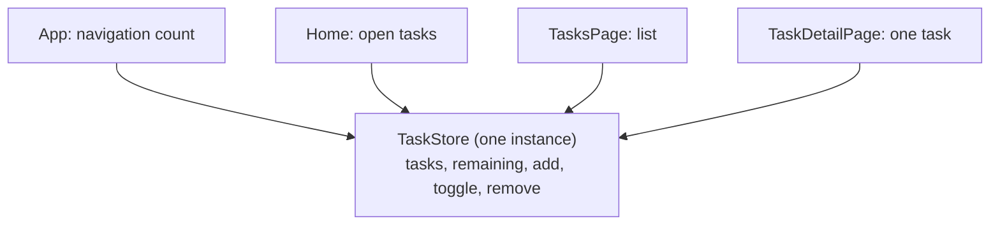

# 08. Services and dependency injection

> **Draft: written but not yet run.** The code and the expected output in this lesson were prepared by reading the code and the official documentation. They have not been executed yet. If something does not behave as described, trust your tool's real output and report it.

## What you will be able to do
By the end of this lesson you will be able to:
- Write a service: a class marked `@Injectable({ providedIn: 'root' })` that holds shared state in signals.
- Get a service into a component with `inject()`.
- Explain what dependency injection is and why one service instance is shared by every component.
- Provide a plain value with an `InjectionToken` and `{ provide, useValue }` in `app.config.ts`.

## Recap
1. Why did the task list vanish when you left the Tasks page in lesson 07? <details><summary>Answer</summary>The list was state of the page component, which is destroyed on navigation.</details>
2. What does `withComponentInputBinding()` allow? <details><summary>Answer</summary>Route parameters can be received as component inputs.</details>
3. Which function creates a value derived from signals? <details><summary>Answer</summary>`computed()`.</details>

## Why it matters
A restaurant has one kitchen and many tables. Every table orders from the same kitchen; the waiters do not each cook. A **service** is the kitchen: one class that owns shared data and logic, and every component that needs it asks for it. **Dependency injection** (DI) is the system that hands a component the thing it asks for, so the component never builds its own copy and you can swap the kitchen for a test kitchen later.

## What you will build
The same app, but the task list now lives in a `TaskStore` service. The Tasks page, the detail page, the home page and the navigation bar all read the same list, so a task you add on one page is visible everywhere, and it survives navigation. The navigation shows the live count of open tasks.



## Before you start
- Lesson 07 done. Time: about 65 minutes.
- Source pack (optional): every file is shown in full in this lesson, so you can follow without it. The finished code, the exercise starter and the solution are in the
  course repository https://github.com/Uee03/Code101 under `source/angular/101-zero-to-hero/phase-2-building/08-services-and-dependency-injection/` (on that page choose **Code, Download ZIP**, or run
  `git clone https://github.com/Uee03/Code101.git`).

## Steps

### Step 1. Write the service
**File: `src/app/task-store.ts`**
```ts
import { computed, Injectable, signal } from '@angular/core';
import { Task } from './task';
import { INITIAL_TASKS } from './task-data';

@Injectable({ providedIn: 'root' })
export class TaskStore {
  private readonly items = signal<Task[]>([...INITIAL_TASKS]);

  readonly tasks = this.items.asReadonly();
  readonly remaining = computed(() => this.items().filter((task) => !task.done).length);

  byId(id: number): Task | undefined {
    return this.items().find((task) => task.id === id);
  }

  add(title: string): void {
    const id = Math.max(0, ...this.items().map((task) => task.id)) + 1;
    this.items.update((list) => [...list, { id, title, done: false }]);
  }

  toggle(id: number): void {
    this.items.update((list) => list.map((task) => (task.id === id ? { ...task, done: !task.done } : task)));
  }

  remove(id: number): void {
    this.items.update((list) => list.filter((task) => task.id !== id));
  }
}
```

- `@Injectable({ providedIn: 'root' })` tells Angular: "this class can be injected, and there is one instance for the whole app (the **root** injector)". Angular creates it the first time somebody asks for it. (Angular 22 also offers a shorter `@Service()` decorator for the same job; the long form works in every version and is what you will meet in most code.)
- `private readonly items = signal<Task[]>(...)` is the real state. **`private`** keeps components from replacing the list.
- `readonly tasks = this.items.asReadonly()` exposes the list as a **read-only signal**: components can read `tasks()` but cannot call `set` or `update` on it. Changes can only go through the methods, so there is one place to look for bugs.
- `remaining` is a `computed` shared by everybody.
- `byId`, `add`, `toggle` and `remove` are the only ways to change the data. This is the logic that used to live in the page.

### Step 2. Get the service into the pages
**File: `src/app/pages/tasks/tasks.ts`**
```ts
import { Component, computed, inject, signal } from '@angular/core';
import { NewTaskReactive } from '../../new-task-reactive/new-task-reactive';
import { TaskItem } from '../../task-item/task-item';
import { Filter } from '../../task';
import { TaskStore } from '../../task-store';

@Component({
  selector: 'app-tasks-page',
  imports: [NewTaskReactive, TaskItem],
  templateUrl: './tasks.html',
  styleUrl: './tasks.css'
})
export class TasksPage {
  protected readonly store = inject(TaskStore);
  protected readonly filters: readonly Filter[] = ['all', 'todo', 'done'];
  protected readonly filter = signal<Filter>('all');

  protected readonly visibleTasks = computed(() => {
    const current = this.filter();
    return this.store.tasks().filter((task) => current === 'all' || (current === 'done' ? task.done : !task.done));
  });

  protected setFilter(value: Filter): void {
    this.filter.set(value);
  }
}
```

`protected readonly store = inject(TaskStore);` is **dependency injection**: `inject(TaskStore)` asks Angular for the `TaskStore` instance and Angular hands over the shared one. It must run while the class is being created (in a field initialiser like this one, or in the constructor). The older style, `constructor(private store: TaskStore) {}`, does the same; you will see it in older code. The page keeps only what is its own business: the current filter and the filtered view.

**File: `src/app/pages/tasks/tasks.html`**
```html
<h1>Tasks</h1>

<app-new-task-reactive (added)="store.add($event)" />

@if (store.remaining() === 0) {
  <p class="status">All tasks are done.</p>
} @else if (store.remaining() === 1) {
  <p class="status">One task left.</p>
} @else {
  <p class="status">{{ store.remaining() }} tasks left.</p>
}

<div role="group" aria-label="Filter tasks">
  @for (option of filters; track option) {
    <button type="button" [class.active]="filter() === option" [attr.aria-pressed]="filter() === option" (click)="setFilter(option)">
      {{ option }}
    </button>
  }
</div>

<ul class="tasks">
  @for (task of visibleTasks(); track task.id; let i = $index) {
    <li app-task-item [task]="task" [position]="i + 1" (toggled)="store.toggle($event)" (removed)="store.remove($event)"></li>
  } @empty {
    <li class="empty">No tasks in this view.</li>
  }
</ul>

<p class="hint">This list is shared through the task store, so it survives navigation.</p>
```

The template calls `store.add(...)`, `store.toggle(...)` and `store.remove(...)` directly. For this the property must be `protected` or `public`.

**File: `src/app/pages/task-detail/task-detail.ts`**
```ts
import { Component, computed, inject, input } from '@angular/core';
import { RouterLink } from '@angular/router';
import { TaskStore } from '../../task-store';

@Component({
  selector: 'app-task-detail-page',
  imports: [RouterLink],
  templateUrl: './task-detail.html'
})
export class TaskDetailPage {
  private readonly store = inject(TaskStore);

  readonly id = input.required<string>();
  protected readonly task = computed(() => this.store.byId(Number(this.id())));
}
```

**File: `src/app/pages/task-detail/task-detail.html`**
```html
@if (task(); as found) {
  <h1>{{ found.title }}</h1>
  <p>Task number {{ found.id }}. Status: {{ found.done ? 'done' : 'to do' }}.</p>
} @else {
  <h1>Task not found</h1>
  <p>There is no task with the number "{{ id() }}".</p>
}
<p><a routerLink="/tasks">Back to the list</a></p>
```

**File: `src/app/pages/home/home.ts`**
```ts
import { Component, inject } from '@angular/core';
import { RouterLink } from '@angular/router';
import { TaskStore } from '../../task-store';

@Component({
  selector: 'app-home',
  imports: [RouterLink],
  template: `
    <h1>Welcome</h1>
    <p>Open tasks: {{ store.remaining() }}. Go to the <a routerLink="/tasks">task list</a>.</p>
  `
})
export class Home {
  protected readonly store = inject(TaskStore);
}
```

### Step 3. Provide a plain value with a token
Not everything is a class. A **token** is a name for something Angular can inject; `InjectionToken` makes one for a plain value, such as a setting.

**File: `src/app/app-title.ts`**
```ts
import { InjectionToken } from '@angular/core';

export const APP_TITLE = new InjectionToken<string>('APP_TITLE');
```

**File: `src/app/app.config.ts`**
```ts
import { ApplicationConfig, provideBrowserGlobalErrorListeners } from '@angular/core';
import { provideRouter, withComponentInputBinding } from '@angular/router';

import { APP_TITLE } from './app-title';
import { routes } from './app.routes';

export const appConfig: ApplicationConfig = {
  providers: [
    provideBrowserGlobalErrorListeners(),
    provideRouter(routes, withComponentInputBinding()),
    { provide: APP_TITLE, useValue: 'Tasks First' }
  ]
};
```

The `providers` array is the list of "recipes" for the root injector. `provideRouter(...)` from lesson 07 is a function that returns such recipes. `{ provide: APP_TITLE, useValue: 'Tasks First' }` says: when somebody injects `APP_TITLE`, give them this string. Later lessons use the same mechanism for the HTTP client, interceptors and configuration.

### Step 4. Use both in the shell
**File: `src/app/app.ts`**
```ts
import { Component, inject } from '@angular/core';
import { RouterLink, RouterLinkActive, RouterOutlet } from '@angular/router';
import { APP_TITLE } from './app-title';
import { TaskStore } from './task-store';

@Component({
  selector: 'app-root',
  imports: [RouterLink, RouterLinkActive, RouterOutlet],
  templateUrl: './app.html',
  styleUrl: './app.css'
})
export class App {
  protected readonly appTitle = inject(APP_TITLE);
  protected readonly store = inject(TaskStore);
}
```

**File: `src/app/app.html`**
```html
<header class="site-header">
  <a class="brand" routerLink="/">{{ appTitle }}</a>
  <nav aria-label="Main">
    <a routerLink="/" routerLinkActive="active" ariaCurrentWhenActive="page" [routerLinkActiveOptions]="{ exact: true }">Home</a>
    <a routerLink="/tasks" routerLinkActive="active" ariaCurrentWhenActive="page">Tasks ({{ store.remaining() }} open)</a>
    <a routerLink="/about" routerLinkActive="active" ariaCurrentWhenActive="page">About</a>
  </nav>
</header>

<main class="page">
  <router-outlet />
</main>
```

The navigation reads `store.remaining()`, so it changes the instant any page changes the list.

## Run it
Save everything and open http://localhost:4200/.

**Predict:** you add the task "Buy milk" on the Tasks page, click **Home**, then open the detail page of the new task from the list. What do you see on each page?

Expected behaviour (described from the code, not yet seen in a browser):
1. Home says "Open tasks: 1." (the starting list has one open task) and the navigation reads "Tasks (1 open)".
2. Add "Buy milk": the navigation changes to "Tasks (2 open)" at once.
3. Click **Home**: "Open tasks: 2.". Click **Tasks**: "Buy milk" is still in the list as number 4.
4. Click "Buy milk": the address is `/tasks/4` and the page shows "Task number 4. Status: to do." The detail page now finds new tasks because it reads the store.
5. Reload the browser page (F5): everything starts again with the three starting tasks. The store lives in memory; saving to a server is lesson 09.

## How it works
1. When the first component runs `inject(TaskStore)`, the root injector looks for a recipe, finds `providedIn: 'root'`, creates **one** `TaskStore` and remembers it. Every later `inject(TaskStore)` returns the same object.
2. Because the data is in signals, every template that reads them updates when they change: the navigation, the home page and the list all redraw from one source.
3. Components stay small: they show data and forward user actions. The service holds rules and state.

**Misconception:** "a service is a special Angular thing." It is an ordinary class. What makes it a service is that it is provided to the injector, and what makes it shared is the single instance.

## Try it
Starter file: `exercise/starter/src/app/task-store.ts`.
1. **Guided:** finish the two TODOs in the store (`doneCount` and `clearDone()`), then add a "Clear finished" button to the Tasks page that is disabled while no task is done.
2. **Change:** show "N finished" on the Home page using `store.doneCount()`. Predict the number before you look.
3. **Stretch (optional):** add a token `MAX_TASKS` (default 10) and make `add()` ignore new tasks beyond it. Where should the check live: in the store or in the form? Argue for your choice.

<details><summary>Solution for rung 1 (the store)</summary>

**File: `exercise/solution/src/app/task-store.ts`**
```ts
import { computed, Injectable, signal } from '@angular/core';
import { Task } from './task';
import { INITIAL_TASKS } from './task-data';

@Injectable({ providedIn: 'root' })
export class TaskStore {
  private readonly items = signal<Task[]>([...INITIAL_TASKS]);

  readonly tasks = this.items.asReadonly();
  readonly remaining = computed(() => this.items().filter((task) => !task.done).length);
  readonly doneCount = computed(() => this.items().filter((task) => task.done).length);

  byId(id: number): Task | undefined {
    return this.items().find((task) => task.id === id);
  }

  add(title: string): void {
    const id = Math.max(0, ...this.items().map((task) => task.id)) + 1;
    this.items.update((list) => [...list, { id, title, done: false }]);
  }

  toggle(id: number): void {
    this.items.update((list) => list.map((task) => (task.id === id ? { ...task, done: !task.done } : task)));
  }

  remove(id: number): void {
    this.items.update((list) => list.filter((task) => task.id !== id));
  }

  clearDone(): void {
    this.items.update((list) => list.filter((task) => !task.done));
  }
}
```

In `tasks.html`, the button is `<button type="button" [disabled]="store.doneCount() === 0" (click)="store.clearDone()">Clear finished</button>`.

</details>

## Check yourself
1. How many `TaskStore` objects exist when four components inject it? <details><summary>Answer</summary>One, because it is provided in the root injector.</details>
2. Why expose `asReadonly()` instead of the writable signal? <details><summary>Answer</summary>So only the store's methods can change the data.</details>
3. A component calls `inject(TaskStore)` inside a button's click handler and gets an error. Why? <details><summary>Answer</summary>`inject()` only works in an injection context: while the class is being created (field initialisers, constructor) or in functions Angular calls for you. Inject at creation time and keep the reference.</details>
4. What does `{ provide: APP_TITLE, useValue: 'Tasks First' }` do? <details><summary>Answer</summary>It registers the string as the value injected for the token `APP_TITLE`.</details>

## Common mistakes
| Symptom or error text | Cause | Fix |
|---|---|---|
| Typical message: `NG0203: inject() must be called from an injection context` | `inject()` was called inside a method that runs later | Call it in a field initialiser or the constructor |
| Typical message: `NG0201: No provider found for 'InjectionToken APP_TITLE'` | The token is not provided in `app.config.ts` | Add the `{ provide, useValue }` entry |
| The count in the navigation does not change | The template reads `store.tasks` or a copied value instead of calling the signal | Call `store.remaining()` |
| Typical message: property `store` is private | The template uses a `private` member | Make it `protected` |
| Two different lists appear on two pages | The service was provided separately in a component's `providers` | Remove that `providers`; keep `providedIn: 'root'` |

## Best practice
Put shared state and rules in a service, expose read-only signals, and use `inject()`. Source: Angular, Dependency injection https://angular.dev/guide/di

## Going further
- Creating and using services: https://angular.dev/guide/di/creating-and-using-services
- Level 201 lesson 03 builds a full state pattern on this idea.

## Summary
- You wrote a service holding shared state in signals and exposed it read-only.
- You injected it with `inject()` in five places and saw one shared instance.
- You provided a plain value with an `InjectionToken` in `app.config.ts`.

## Next lesson
09. HttpClient and calling an API: load the starting tasks from a JSON file with an HTTP request.

<details>
<summary>Files that did not change in this lesson (listed so this page is complete)</summary>

**File: `src/app/app.css`**

```css
.site-header {
  display: flex;
  align-items: center;
  gap: 1.5rem;
  max-width: 40rem;
  margin: 0 auto 1.5rem;
  padding-bottom: 0.75rem;
  border-bottom: 1px solid #d1d5db;
}

.brand {
  color: #1d6fb8;
  font-size: 1.25rem;
  font-weight: 700;
  text-decoration: none;
}

nav {
  display: flex;
  gap: 1rem;
}

nav a.active {
  font-weight: 700;
  text-decoration: none;
}

.page {
  max-width: 40rem;
  margin: 0 auto;
}
```

**File: `src/app/app.routes.ts`**

```ts
import { Routes } from '@angular/router';
import { About } from './pages/about/about';
import { Home } from './pages/home/home';
import { NotFound } from './pages/not-found/not-found';
import { TaskDetailPage } from './pages/task-detail/task-detail';
import { TasksPage } from './pages/tasks/tasks';

export const routes: Routes = [
  { path: '', component: Home, title: 'Home' },
  { path: 'tasks', component: TasksPage, title: 'Tasks' },
  { path: 'tasks/:id', component: TaskDetailPage, title: 'Task details' },
  { path: 'about', component: About, title: 'About' },
  { path: '**', component: NotFound, title: 'Page not found' }
];
```

**File: `src/app/new-task-reactive/new-task-reactive.css`**

```css
form {
  margin: 1rem 0;
}

label {
  display: block;
  font-weight: 600;
}

input {
  margin-right: 0.5rem;
  padding: 0.375rem;
}

.error {
  margin: 0.25rem 0 0;
  color: #b42318;
}
```

**File: `src/app/new-task-reactive/new-task-reactive.html`**

```html
<form [formGroup]="form" (ngSubmit)="submit()" novalidate>
  <label for="title-reactive">New task (reactive form)</label>
  <input
    id="title-reactive"
    type="text"
    formControlName="title"
    [attr.aria-invalid]="title.invalid && title.touched"
    aria-describedby="title-reactive-error">
  <button type="submit">Add</button>
  @if (title.invalid && title.touched) {
    <p id="title-reactive-error" class="error" role="alert">
      @if (title.hasError('required')) {
        Enter a title.
      } @else {
        Use at least 3 characters.
      }
    </p>
  }
</form>
```

**File: `src/app/new-task-reactive/new-task-reactive.ts`**

```ts
import { Component, inject, output } from '@angular/core';
import { NonNullableFormBuilder, ReactiveFormsModule, Validators } from '@angular/forms';

@Component({
  selector: 'app-new-task-reactive',
  imports: [ReactiveFormsModule],
  templateUrl: './new-task-reactive.html',
  styleUrl: './new-task-reactive.css'
})
export class NewTaskReactive {
  private readonly fb = inject(NonNullableFormBuilder);

  readonly added = output<string>();
  protected readonly form = this.fb.group({
    title: ['', [Validators.required, Validators.minLength(3)]]
  });
  protected readonly title = this.form.controls.title;

  protected submit(): void {
    const value = this.title.value.trim();
    if (this.form.invalid || value === '') {
      this.form.markAllAsTouched();
      return;
    }
    this.added.emit(value);
    this.form.reset();
  }
}
```

**File: `src/app/pages/about/about.ts`**

```ts
import { Component } from '@angular/core';

@Component({
  selector: 'app-about',
  template: `
    <h1>About</h1>
    <p>Tasks First is the practice app of the Code101 Angular 101 track.</p>
  `
})
export class About {}
```

**File: `src/app/pages/not-found/not-found.ts`**

```ts
import { Component } from '@angular/core';
import { RouterLink } from '@angular/router';

@Component({
  selector: 'app-not-found',
  imports: [RouterLink],
  template: `
    <h1>Page not found</h1>
    <p>There is nothing at this address. <a routerLink="/">Go to the home page</a>.</p>
  `
})
export class NotFound {}
```

**File: `src/app/pages/tasks/tasks.css`**

```css
h1 {
  color: #1d6fb8;
}

.status {
  font-weight: 600;
}

button {
  margin-right: 0.5rem;
  padding: 0.375rem 0.75rem;
  text-transform: capitalize;
}

button.active {
  background: #1d6fb8;
  color: #ffffff;
}

.tasks {
  list-style: none;
  padding: 0;
}

.empty,
.hint {
  color: #4b5563;
}
```

**File: `src/app/task-data.ts`**

```ts
import { Task } from './task';

export const INITIAL_TASKS: Task[] = [
  { id: 1, title: 'Install Node', done: true },
  { id: 2, title: 'Create the app', done: true },
  { id: 3, title: 'Learn control flow', done: false }
];
```

**File: `src/app/task-item/task-item.css`**

```css
:host {
  display: flex;
  justify-content: space-between;
  align-items: center;
  padding: 0.5rem 0;
  border-bottom: 1px solid #d1d5db;
}

:host(.done) .title {
  color: #4b5563;
  text-decoration: line-through;
}

.remove {
  padding: 0.25rem 0.625rem;
}
```

**File: `src/app/task-item/task-item.html`**

```html
<span class="title">
  <input type="checkbox" [checked]="task().done" [attr.aria-label]="'Done: ' + task().title" (change)="toggle()">
  {{ position() }}. <a [routerLink]="['/tasks', task().id]">{{ task().title }}</a>
</span>
<button type="button" class="remove" [attr.aria-label]="'Remove ' + task().title" (click)="remove()">Remove</button>
```

**File: `src/app/task-item/task-item.ts`**

```ts
import { Component, input, output } from '@angular/core';
import { RouterLink } from '@angular/router';
import { Task } from '../task';

@Component({
  selector: 'li[app-task-item]',
  imports: [RouterLink],
  templateUrl: './task-item.html',
  styleUrl: './task-item.css',
  host: {
    '[class.done]': 'task().done'
  }
})
export class TaskItem {
  readonly task = input.required<Task>();
  readonly position = input(1);
  readonly toggled = output<number>();
  readonly removed = output<number>();

  protected toggle(): void {
    this.toggled.emit(this.task().id);
  }

  protected remove(): void {
    this.removed.emit(this.task().id);
  }
}
```

**File: `src/app/task.ts`**

```ts
export type Filter = 'all' | 'todo' | 'done';

export interface Task {
  id: number;
  title: string;
  done: boolean;
}
```

**File: `src/styles.css`**

```css
body {
  font-family: system-ui, sans-serif;
  line-height: 1.5;
  margin: 2rem;
}
```

</details>
