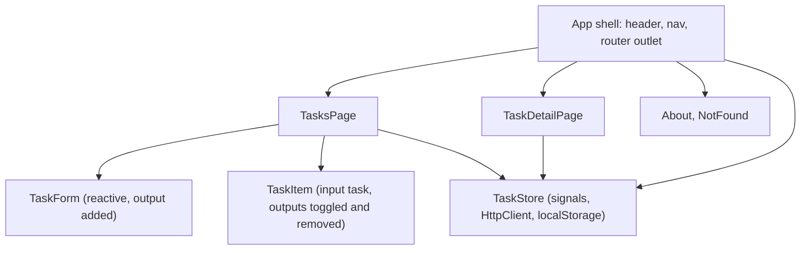

# 12. Project: a task list app

> **Draft: written but not yet run.** The code and the expected output in this lesson were prepared by reading the code and the official documentation. They have not been executed yet. If something does not behave as described, trust your tool's real output and report it.

## What you will be able to do
By the end of this lesson you will be able to:
- Start a new Angular project from nothing and bring it to the same configuration as the course.
- Combine components, inputs and outputs, a reactive form, routing, a service with signals, `HttpClient`, pipes and accessible styling in one app.
- Save the user's data in the browser's `localStorage` and restore it on the next visit.
- Read your own code against a checklist and name what you would improve.

## Recap
1. Which lesson showed how a child tells a parent that something happened? <details><summary>Answer</summary>Lesson 05: outputs and `emit`.</details>
2. Where does shared state live? <details><summary>Answer</summary>In a service provided in the root injector (lesson 08).</details>
3. What are the three states of a data request? <details><summary>Answer</summary>Loading, ready and error (lesson 09).</details>

## Why it matters
Learning to play single notes is not playing a song. A project forces you to decide where things go, to name them, and to connect them, and that is where most of the learning happens. This app is small enough to finish in two sittings and complete enough to show to a friend or a future employer.

## What you will build
**Task List**, a new project. It has:
- A page that lists tasks, with filters (all, todo, done), a live "N tasks left" line, and an accessible form with title, priority and an optional due date.
- A detail page for each task (`/tasks/3`) with mark as done and delete.
- An About page and a "Page not found" page.
- First-run data from `/api/tasks.json`; after that, your changes are saved in this browser (`localStorage`).
- A skip link, a visible focus ring, focus on the content after navigation, and screen reader announcements for add, toggle and remove.



## Before you start
- Lessons 01 to 11 done. Time: about 150 minutes; **two sittings**: break after Step 4 (the data layer is complete and the shell runs).
- Source pack (optional): every file is shown in full in this lesson, so you can follow without it. The finished code, the exercise starter and the solution are in the
  course repository https://github.com/Uee03/Code101 under `source/angular/101-zero-to-hero/phase-3-data-and-polish/12-project-task-list-app/` (on that page choose **Code, Download ZIP**, or run
  `git clone https://github.com/Uee03/Code101.git`).
- Try to write each file yourself from what you remember before you read the version shown: the struggle is what makes it stick.

## Steps

### Step 1. Create the project and replace the configuration
**Where: `code101/angular`** (not inside `tasks-first`). Same command as lesson 01, with a new name:
```text
npx --yes -p @angular/cli@22.3.0 ng new task-list --routing --style=css --ssr=false --skip-git --skip-tests --ai-config=none --package-manager=npm --defaults
```
Then `cd task-list`. As in lesson 01, replace these files with the course versions so that everyone has identical settings: `package.json`, `angular.json`, `tsconfig.json`, `tsconfig.app.json`, `src/index.html`, `src/main.ts`, delete `public/favicon.ico` and create `public/favicon.svg`. They are listed in full at the end of this page, under "Files that did not change in this lesson". Only the project name differs from lesson 01 (`task-list` instead of `tasks-first`) and the page title.

After saving `package.json`, run `npm install --no-audit --no-fund`. Remember: it creates `package-lock.json`; do not edit it.

### Step 2. The data: a JSON file, icons and the types
**File: `public/api/tasks.json`** (the first-run data)
```json
[
  { "id": 1, "title": "Install Node", "done": true, "priority": "normal" },
  { "id": 2, "title": "Create the app", "done": true, "priority": "normal" },
  { "id": 3, "title": "Learn control flow", "done": false, "priority": "high", "due": "2026-12-01" },
  { "id": 4, "title": "Build the task list project", "done": false, "priority": "normal", "due": "2026-12-15" }
]
```

Add the four icons exactly as in lesson 10, step 1 (`public/icons/ui/plus.svg`, `ui/x.svg`, `ui/alert-triangle.svg`, `arrows/refresh-cw.svg`); they are listed with the unchanged files at the end of this page.

**File: `src/app/task.ts`**
```ts
export type Priority = 'low' | 'normal' | 'high';
export type Filter = 'all' | 'todo' | 'done';

export interface Task {
  id: number;
  title: string;
  done: boolean;
  priority: Priority;
  due?: string;
}

export type TaskDraft = Pick<Task, 'title' | 'priority' | 'due'>;
```

`Pick<Task, 'title' | 'priority' | 'due'>` builds a new type from three fields of `Task`: what the form gives us before the app adds an `id` and `done`.

### Step 3. The store
**File: `src/app/task-store.ts`**
```ts
import { HttpClient, HttpErrorResponse } from '@angular/common/http';
import { computed, inject, Injectable, signal } from '@angular/core';
import { Task, TaskDraft } from './task';

export type LoadStatus = 'loading' | 'ready' | 'error';

const STORAGE_KEY = 'task-list.tasks';

@Injectable({ providedIn: 'root' })
export class TaskStore {
  private readonly http = inject(HttpClient);
  private readonly items = signal<Task[]>([]);
  private readonly state = signal<LoadStatus>('loading');
  private readonly problem = signal('');
  private readonly note = signal('');

  readonly tasks = this.items.asReadonly();
  readonly status = this.state.asReadonly();
  readonly message = this.problem.asReadonly();
  readonly announcement = this.note.asReadonly();
  readonly remaining = computed(() => this.items().filter((task) => !task.done).length);

  constructor() {
    this.load();
  }

  load(): void {
    const saved = this.readSaved();
    if (saved) {
      this.items.set(saved);
      this.state.set('ready');
      return;
    }
    this.state.set('loading');
    this.http.get<Task[]>('/api/tasks.json').subscribe({
      next: (tasks) => {
        this.items.set(tasks);
        this.state.set('ready');
      },
      error: (error: HttpErrorResponse) => {
        this.problem.set(error.status === 0 ? 'Cannot reach the server.' : `The server answered with status ${error.status}.`);
        this.state.set('error');
      }
    });
  }

  byId(id: number): Task | undefined {
    return this.items().find((task) => task.id === id);
  }

  add(draft: TaskDraft): void {
    const id = Math.max(0, ...this.items().map((task) => task.id)) + 1;
    this.commit([...this.items(), { ...draft, id, done: false }], `Task added: ${draft.title}`);
  }

  toggle(id: number): void {
    const next = this.items().map((task) => (task.id === id ? { ...task, done: !task.done } : task));
    this.commit(next, next.find((task) => task.id === id)?.done ? 'Task marked as done' : 'Task marked as to do');
  }

  remove(id: number): void {
    this.commit(this.items().filter((task) => task.id !== id), 'Task removed');
  }

  private commit(next: Task[], announcement: string): void {
    this.items.set(next);
    this.note.set(announcement);
    localStorage.setItem(STORAGE_KEY, JSON.stringify(next));
  }

  private readSaved(): Task[] | null {
    try {
      const parsed: unknown = JSON.parse(localStorage.getItem(STORAGE_KEY) ?? 'null');
      return Array.isArray(parsed) ? (parsed as Task[]) : null;
    } catch {
      return null;
    }
  }
}
```

Read it against lessons 08 and 09:
- The state is private; components get read-only signals (`tasks`, `status`, `message`, `announcement`) and the methods `load`, `add`, `toggle`, `remove`.
- `load()` first asks `readSaved()` for earlier data in `localStorage`. Only when there is none does it call the HTTP request. After the first change, the saved copy wins: that is how the app remembers your tasks.
- `commit(next, announcement)` is the **one place** that changes the list: it updates the signal, sets the text for screen readers and writes to `localStorage`. Having one place keeps the three in step.
- `readSaved()` parses with `JSON.parse` inside `try`/`catch`: text in storage can be damaged or edited, so we never trust it. It returns `null` for anything that is not an array. (A stricter app would validate each item as well.)
- **Storage rule:** `localStorage` is readable by every script on the page, so never keep passwords or tokens in it. Task titles are fine.

### Step 4. App shell, routes and configuration
**File: `src/app/app.config.ts`**
```ts
import { ApplicationConfig, provideBrowserGlobalErrorListeners } from '@angular/core';
import { provideHttpClient, withFetch } from '@angular/common/http';
import { provideRouter, withComponentInputBinding } from '@angular/router';

import { routes } from './app.routes';

export const appConfig: ApplicationConfig = {
  providers: [
    provideBrowserGlobalErrorListeners(),
    provideHttpClient(withFetch()),
    provideRouter(routes, withComponentInputBinding())
  ]
};
```

**File: `src/app/app.routes.ts`**
```ts
import { Routes } from '@angular/router';
import { About } from './pages/about/about';
import { NotFound } from './pages/not-found/not-found';
import { TaskDetailPage } from './pages/task-detail/task-detail';
import { TasksPage } from './pages/tasks/tasks';

export const routes: Routes = [
  { path: '', component: TasksPage, title: 'My tasks' },
  { path: 'tasks/:id', component: TaskDetailPage, title: 'Task details' },
  { path: 'about', component: About, title: 'About' },
  { path: '**', component: NotFound, title: 'Page not found' }
];
```

**File: `src/app/app.ts`**
```ts
import { Component, ElementRef, inject, viewChild } from '@angular/core';
import { RouterLink, RouterLinkActive, RouterOutlet } from '@angular/router';
import { TaskStore } from './task-store';

@Component({
  selector: 'app-root',
  imports: [RouterLink, RouterLinkActive, RouterOutlet],
  templateUrl: './app.html',
  styleUrl: './app.css'
})
export class App {
  protected readonly store = inject(TaskStore);
  private readonly main = viewChild.required<ElementRef<HTMLElement>>('main');
  private firstPage = true;

  protected pageChanged(): void {
    if (this.firstPage) {
      this.firstPage = false;
      return;
    }
    this.main().nativeElement.focus();
  }
}
```

**File: `src/app/app.html`**
```html
<a class="skip-link" href="#main">Skip to content</a>

<header class="site-header">
  <a class="brand" routerLink="/">Task List</a>
  <nav aria-label="Main">
    <a routerLink="/" routerLinkActive="active" ariaCurrentWhenActive="page" [routerLinkActiveOptions]="{ exact: true }">Tasks ({{ store.remaining() }} open)</a>
    <a routerLink="/about" routerLinkActive="active" ariaCurrentWhenActive="page">About</a>
  </nav>
</header>

<main id="main" #main class="page" tabindex="-1">
  <router-outlet (activate)="pageChanged()" />
</main>
```

**File: `src/app/app.css`**
```css
.site-header {
  display: flex;
  flex-wrap: wrap;
  align-items: center;
  gap: 0.75rem 1.5rem;
  max-width: 40rem;
  margin: 0 auto 1.5rem;
  padding-bottom: 0.75rem;
  border-bottom: 1px solid var(--color-border);
}

.brand {
  font-size: 1.25rem;
  font-weight: 700;
  text-decoration: none;
}

nav {
  display: flex;
  flex-wrap: wrap;
  gap: 1rem;
}

nav a.active {
  font-weight: 700;
  text-decoration: none;
}

.page {
  max-width: 40rem;
  margin: 0 auto;
}

.page:focus {
  outline: none;
}
```

**File: `src/styles.css`**
```css
:root {
  --color-text: #1f2937;
  --color-muted: #4b5563;
  --color-brand: #1d6fb8;
  --color-danger: #b42318;
  --color-border: #d1d5db;
  --color-surface: #ffffff;
  --radius: 0.375rem;
}

body {
  margin: 2rem;
  background: var(--color-surface);
  color: var(--color-text);
  font-family: system-ui, sans-serif;
  line-height: 1.5;
}

a {
  color: var(--color-brand);
}

button {
  display: inline-flex;
  align-items: center;
  gap: 0.375rem;
  min-height: 2.25rem;
  padding: 0.375rem 0.75rem;
  border: 1px solid var(--color-brand);
  border-radius: var(--radius);
  background: var(--color-surface);
  color: var(--color-brand);
  font: inherit;
  cursor: pointer;
  transition: background-color 0.15s;
}

button:hover:not(:disabled) {
  background: #e8f1fb;
}

button:disabled {
  opacity: 0.6;
  cursor: not-allowed;
}

button.active {
  background: var(--color-brand);
  color: #ffffff;
}

input,
select {
  min-height: 2.25rem;
  padding: 0 0.5rem;
  border: 1px solid var(--color-muted);
  border-radius: var(--radius);
  background: var(--color-surface);
  color: var(--color-text);
  font: inherit;
}

:focus-visible {
  outline: 3px solid var(--color-brand);
  outline-offset: 2px;
}

.skip-link {
  position: absolute;
  top: 0.5rem;
  left: -999px;
  z-index: 10;
  padding: 0.5rem 1rem;
  background: var(--color-brand);
  color: #ffffff;
}

.skip-link:focus {
  left: 0.5rem;
}

.visually-hidden {
  position: absolute;
  width: 1px;
  height: 1px;
  overflow: hidden;
  clip-path: inset(50%);
  white-space: nowrap;
}

.icon {
  display: inline-block;
  width: 1.125rem;
  height: 1.125rem;
  background-color: currentColor;
  -webkit-mask: var(--icon) center / contain no-repeat;
  mask: var(--icon) center / contain no-repeat;
}

.icon-plus {
  --icon: url('/icons/ui/plus.svg');
}

.icon-x {
  --icon: url('/icons/ui/x.svg');
}

.icon-refresh {
  --icon: url('/icons/arrows/refresh-cw.svg');
}

.icon-alert {
  --icon: url('/icons/ui/alert-triangle.svg');
}

@media (max-width: 30rem) {
  body {
    margin: 1rem;
  }
}

@media (prefers-reduced-motion: reduce) {
  * {
    transition: none !important;
    animation: none !important;
  }
}
```

New compared with lesson 10: the `input` and `select` rules, and `.visually-hidden`, a class that hides text visually but keeps it for screen readers (used for the announcement line).

**Take a break here.** Run `npm start` and open http://localhost:4200/. The shell shows, but the pages do not exist yet and the build will stop with errors: finish Step 5 and 6 first. Come back, read the last file you wrote, and continue.

### Step 5. The form and the list item
**File: `src/app/task-form/task-form.ts`**
```ts
import { TitleCasePipe } from '@angular/common';
import { Component, inject, output } from '@angular/core';
import { NonNullableFormBuilder, ReactiveFormsModule, Validators } from '@angular/forms';
import { Priority, TaskDraft } from '../task';

@Component({
  selector: 'app-task-form',
  imports: [ReactiveFormsModule, TitleCasePipe],
  templateUrl: './task-form.html',
  styleUrl: './task-form.css'
})
export class TaskForm {
  private readonly fb = inject(NonNullableFormBuilder);

  readonly added = output<TaskDraft>();
  protected readonly priorities: readonly Priority[] = ['low', 'normal', 'high'];
  protected readonly form = this.fb.group({
    title: ['', [Validators.required, Validators.minLength(3), Validators.maxLength(80)]],
    priority: this.fb.control<Priority>('normal'),
    due: ['']
  });
  protected readonly title = this.form.controls.title;

  protected submit(): void {
    const title = this.title.value.trim();
    if (this.form.invalid || title === '') {
      this.form.markAllAsTouched();
      return;
    }
    const { priority, due } = this.form.getRawValue();
    this.added.emit({ title, priority, due: due === '' ? undefined : due });
    this.form.reset();
  }
}
```

`this.fb.control<Priority>('normal')` is a non-nullable control typed to the three allowed values. `getRawValue()` returns the values of all controls (also disabled ones) with their exact types. An empty date becomes `undefined`.

**File: `src/app/task-form/task-form.html`**
```html
<form [formGroup]="form" (ngSubmit)="submit()" novalidate>
  <div class="field">
    <label for="task-title">Title</label>
    <input
      id="task-title"
      type="text"
      formControlName="title"
      autocomplete="off"
      [attr.aria-invalid]="title.invalid && title.touched"
      aria-describedby="task-title-error">
    @if (title.invalid && title.touched) {
      <p id="task-title-error" class="error" role="alert">
        @if (title.hasError('required')) {
          Enter a title.
        } @else if (title.hasError('minlength')) {
          Use at least 3 characters.
        } @else if (title.hasError('maxlength')) {
          Use at most 80 characters.
        }
      </p>
    }
  </div>

  <div class="field">
    <label for="task-priority">Priority</label>
    <select id="task-priority" formControlName="priority">
      @for (option of priorities; track option) {
        <option [value]="option">{{ option | titlecase }}</option>
      }
    </select>
  </div>

  <div class="field">
    <label for="task-due">Due date (optional)</label>
    <input id="task-due" type="date" formControlName="due">
  </div>

  <button type="submit">
    <span class="icon icon-plus" aria-hidden="true"></span>
    Add task
  </button>
</form>
```

Every field has a `<label for>`. The error is tied to the title field with `aria-describedby`. `<option [value]="option">` loops over the priorities with `@for`, and `titlecase` shows "Low", "Normal", "High".

**File: `src/app/task-form/task-form.css`**
```css
form {
  display: flex;
  flex-wrap: wrap;
  align-items: flex-end;
  gap: 1rem;
  margin: 1rem 0;
}

.field {
  display: flex;
  flex-direction: column;
  gap: 0.25rem;
}

label {
  font-weight: 600;
}

.error {
  margin: 0;
  color: var(--color-danger);
}
```

**File: `src/app/task-item/task-item.ts`**
```ts
import { DatePipe, TitleCasePipe } from '@angular/common';
import { Component, input, output } from '@angular/core';
import { RouterLink } from '@angular/router';
import { Task } from '../task';

@Component({
  selector: 'li[app-task-item]',
  imports: [DatePipe, RouterLink, TitleCasePipe],
  templateUrl: './task-item.html',
  styleUrl: './task-item.css',
  host: {
    '[class.done]': 'task().done'
  }
})
export class TaskItem {
  readonly task = input.required<Task>();
  readonly toggled = output<number>();
  readonly removed = output<number>();

  protected toggle(): void {
    this.toggled.emit(this.task().id);
  }

  protected remove(): void {
    this.removed.emit(this.task().id);
  }
}
```

**File: `src/app/task-item/task-item.html`**
```html
<span class="title">
  <input type="checkbox" [checked]="task().done" [attr.aria-label]="'Done: ' + task().title" (change)="toggle()">
  <a [routerLink]="['/tasks', task().id]">{{ task().title }}</a>
  <span class="badge" [class.badge-high]="task().priority === 'high'">{{ task().priority | titlecase }}</span>
  @if (task().due) {
    <small class="due">Due {{ task().due | date: 'mediumDate' }}</small>
  }
</span>
<button type="button" class="remove" [attr.aria-label]="'Remove ' + task().title" (click)="remove()">
  <span class="icon icon-x" aria-hidden="true"></span>
</button>
```

**File: `src/app/task-item/task-item.css`**
```css
:host {
  display: flex;
  justify-content: space-between;
  align-items: center;
  gap: 0.5rem;
  padding: 0.5rem 0;
  border-bottom: 1px solid var(--color-border);
}

:host(.done) .title a {
  color: var(--color-muted);
  text-decoration: line-through;
}

input[type='checkbox'] {
  width: 1.25rem;
  height: 1.25rem;
  margin-right: 0.5rem;
  vertical-align: middle;
}

.badge {
  margin-left: 0.5rem;
  padding: 0.125rem 0.5rem;
  border: 1px solid var(--color-muted);
  border-radius: 999px;
  color: var(--color-muted);
  font-size: 0.8125rem;
}

.badge-high {
  border-color: var(--color-danger);
  color: var(--color-danger);
  font-weight: 700;
}

.due {
  margin-left: 0.5rem;
  color: var(--color-muted);
}

.remove {
  min-width: 2.25rem;
  justify-content: center;
}
```

Priority is shown as text ("High"), and the high-priority badge also changes colour and weight: colour is never the only signal.

### Step 6. The pages
**File: `src/app/pages/tasks/tasks.ts`**
```ts
import { Component, computed, inject, signal } from '@angular/core';
import { TaskForm } from '../../task-form/task-form';
import { TaskItem } from '../../task-item/task-item';
import { Filter } from '../../task';
import { TaskStore } from '../../task-store';

@Component({
  selector: 'app-tasks-page',
  imports: [TaskForm, TaskItem],
  templateUrl: './tasks.html',
  styleUrl: './tasks.css'
})
export class TasksPage {
  protected readonly store = inject(TaskStore);
  protected readonly filters: readonly Filter[] = ['all', 'todo', 'done'];
  protected readonly filter = signal<Filter>('all');

  protected readonly visibleTasks = computed(() => {
    const current = this.filter();
    return this.store.tasks().filter((task) => current === 'all' || (current === 'done' ? task.done : !task.done));
  });

  protected setFilter(value: Filter): void {
    this.filter.set(value);
  }
}
```

**File: `src/app/pages/tasks/tasks.html`**
```html
<h1>My tasks</h1>

<p class="visually-hidden" role="status">{{ store.announcement() }}</p>

@switch (store.status()) {
  @case ('loading') {
    <p role="status">Loading tasks...</p>
  }
  @case ('error') {
    <div class="problem" role="alert">
      <span class="icon icon-alert" aria-hidden="true"></span>
      <p>{{ store.message() }}</p>
      <button type="button" (click)="store.load()">
        <span class="icon icon-refresh" aria-hidden="true"></span>
        Try again
      </button>
    </div>
  }
  @case ('ready') {
    <app-task-form (added)="store.add($event)" />

    @if (store.remaining() === 0) {
      <p class="status">All tasks are done.</p>
    } @else if (store.remaining() === 1) {
      <p class="status">One task left.</p>
    } @else {
      <p class="status">{{ store.remaining() }} tasks left.</p>
    }

    <div class="filters" role="group" aria-label="Filter tasks">
      @for (option of filters; track option) {
        <button type="button" [class.active]="filter() === option" [attr.aria-pressed]="filter() === option" (click)="setFilter(option)">
          {{ option }}
        </button>
      }
    </div>

    <ul class="tasks">
      @for (task of visibleTasks(); track task.id) {
        <li app-task-item [task]="task" (toggled)="store.toggle($event)" (removed)="store.remove($event)"></li>
      } @empty {
        <li class="empty">No tasks in this view.</li>
      }
    </ul>
  }
}
```

`<p class="visually-hidden" role="status">` is a **live region**: when the store changes `announcement`, screen readers read the new text ("Task added: Buy milk") without moving focus.

**File: `src/app/pages/tasks/tasks.css`**
```css
h1 {
  color: var(--color-brand);
}

.status {
  font-weight: 600;
}

.filters {
  display: flex;
  flex-wrap: wrap;
  gap: 0.5rem;
  margin: 1rem 0;
}

.filters button {
  text-transform: capitalize;
}

.problem {
  display: flex;
  flex-wrap: wrap;
  align-items: center;
  gap: 0.75rem;
  padding: 0.75rem 1rem;
  border-left: 0.25rem solid var(--color-danger);
  background: #fdecea;
}

.problem p {
  margin: 0;
}

.problem .icon {
  color: var(--color-danger);
}

.tasks {
  list-style: none;
  padding: 0;
}

.empty {
  color: var(--color-muted);
}
```

**File: `src/app/pages/task-detail/task-detail.ts`**
```ts
import { DatePipe, TitleCasePipe } from '@angular/common';
import { Component, computed, inject, input } from '@angular/core';
import { Router, RouterLink } from '@angular/router';
import { Task } from '../../task';
import { TaskStore } from '../../task-store';

@Component({
  selector: 'app-task-detail-page',
  imports: [DatePipe, RouterLink, TitleCasePipe],
  templateUrl: './task-detail.html'
})
export class TaskDetailPage {
  private readonly router = inject(Router);
  protected readonly store = inject(TaskStore);

  readonly id = input.required<string>();
  protected readonly task = computed(() => this.store.byId(Number(this.id())));

  protected remove(task: Task): void {
    this.store.remove(task.id);
    void this.router.navigateByUrl('/');
  }
}
```

**File: `src/app/pages/task-detail/task-detail.html`**
```html
@if (store.status() === 'loading') {
  <p role="status">Loading the task...</p>
} @else {
  @if (task(); as found) {
    <h1>{{ found.title }}</h1>
    <dl>
      <dt>Status</dt>
      <dd>{{ found.done ? 'Done' : 'To do' }}</dd>
      <dt>Priority</dt>
      <dd>{{ found.priority | titlecase }}</dd>
      <dt>Due</dt>
      <dd>{{ found.due ? (found.due | date: 'fullDate') : 'No due date' }}</dd>
    </dl>
    <p>
      <button type="button" (click)="store.toggle(found.id)">{{ found.done ? 'Mark as to do' : 'Mark as done' }}</button>
      <button type="button" (click)="remove(found)">Delete task</button>
    </p>
  } @else {
    <h1>Task not found</h1>
    <p>There is no task with the number "{{ id() }}".</p>
  }
}
<p><a routerLink="/">Back to the list</a></p>
```

`remove(task)` removes the task and then navigates to the list with the `Router` service (`navigateByUrl('/')`), because the page you are on would otherwise say "Task not found".

**File: `src/app/pages/about/about.ts`**
```ts
import { Component } from '@angular/core';
import { RouterLink } from '@angular/router';

@Component({
  selector: 'app-about',
  imports: [RouterLink],
  template: `
    <h1>About</h1>
    <p>Task List is the project of the Code101 Angular 101 track. Your tasks are saved in this browser.</p>
    <p><a routerLink="/">Back to the tasks</a></p>
  `
})
export class About {}
```

**File: `src/app/pages/not-found/not-found.ts`**
```ts
import { Component } from '@angular/core';
import { RouterLink } from '@angular/router';

@Component({
  selector: 'app-not-found',
  imports: [RouterLink],
  template: `
    <h1>Page not found</h1>
    <p>There is nothing at this address. <a routerLink="/">Go to the tasks</a>.</p>
  `
})
export class NotFound {}
```

## Run it
```text
npm start
```
Open http://localhost:4200/.

**Predict:** on the very first visit, how many tasks are listed and what does the status line say? After you add a task and reload the page (F5), is it still there?

Expected behaviour (described from the code, not yet seen in a browser):
1. First visit: the page "My tasks" with the form, "2 tasks left.", All, Todo and Done buttons and four tasks. "Learn control flow" has a red "High" badge and "Due Dec 1, 2026".
2. Add the title `Buy milk` with priority Low: it appears as task 5 at the end; the navigation says "Tasks (3 open)".
3. Press F5. The four tasks and "Buy milk" are still there: they now come from `localStorage`, not from the JSON file.
4. Click "Buy milk": the detail page shows its status, priority and "No due date". Press **Delete task**: you land on the list and it is gone.
5. Try the keyboard only: Tab to the skip link, to the form, to the filters, Space on a checkbox. Open the Network tab: after the first visit there is no request for `tasks.json`.
6. To start fresh, clear the site's data in the browser (Application tab, Storage, Clear site data) and reload.

Finally run `npm run build`: it should finish without errors and print the sizes of the generated files (typical output, not yet run).

## How it works
1. `main.ts` starts `App` with the config: HTTP client and router with input binding.
2. `App` renders the shell and the router puts a page into `<router-outlet />`; each page reads the **same** `TaskStore`.
3. The user's action flows up through outputs (`added`, `toggled`, `removed`) to a page, which calls a store method; the store changes its signals and `localStorage`; the signals flow down through inputs and templates.
4. Everything the user can do works with the keyboard, has a name, and announces its result.

## Try it
Starter files: `exercise/starter/src/app/task-stats.ts` and `exercise/starter/src/app/pages/about/about.ts`.
1. **Guided:** finish the `TaskStats` service (TODO 1) and show the numbers on the About page (TODOs 2 and 3). Predict the text with the four starting tasks (one of them high priority).
2. **Change:** add a "Clear finished" button to the tasks page (a store method `clearDone()` and a disabled state while nothing is finished), announce "Finished tasks removed", and make sure it is saved.
3. **Stretch (optional):** sort the list by due date with the tasks without a date last; or add an "edit title" form on the detail page. Sketch the design first: which file changes, which new files are needed?

<details><summary>Solution for rung 1</summary>

**File: `exercise/solution/src/app/task-stats.ts`**
```ts
import { computed, inject, Injectable } from '@angular/core';
import { TaskStore } from './task-store';

@Injectable({ providedIn: 'root' })
export class TaskStats {
  private readonly store = inject(TaskStore);

  readonly total = computed(() => this.store.tasks().length);
  readonly highCount = computed(() => this.store.tasks().filter((task) => task.priority === 'high').length);
}
```

**File: `exercise/solution/src/app/pages/about/about.ts`**
```ts
import { Component, inject } from '@angular/core';
import { RouterLink } from '@angular/router';
import { TaskStats } from '../../task-stats';

@Component({
  selector: 'app-about',
  imports: [RouterLink],
  template: `
    <h1>About</h1>
    <p>Task List is the project of the Code101 Angular 101 track. Your tasks are saved in this browser.</p>
    <p>You have {{ stats.total() }} tasks, {{ stats.highCount() }} of them high priority.</p>
    <p><a routerLink="/">Back to the tasks</a></p>
  `
})
export class About {
  protected readonly stats = inject(TaskStats);
}
```

</details>

## Check yourself
1. Why is there exactly one `commit` method in the store? <details><summary>Answer</summary>So the signal, the screen-reader announcement and the saved copy always change together.</details>
2. Why do we use `try`/`catch` around `JSON.parse` of data from `localStorage`? <details><summary>Answer</summary>Stored text can be damaged or edited, and a parse error would otherwise break the whole app at start.</details>
3. A user deletes a task on the detail page and sees "Task not found". What did the code forget? <details><summary>Answer</summary>To navigate back to the list after removing the task.</details>
4. Name two things in this app that help keyboard or screen-reader users. <details><summary>Answer</summary>For example: the skip link, visible focus, labels on every field, `aria-describedby` errors, focus moved to the content after navigation, the live announcement region, `aria-label` on icon-only buttons.</details>

## Common mistakes
| Symptom or error text | Cause | Fix |
|---|---|---|
| Typical message: no provider for `HttpClient` | `provideHttpClient(withFetch())` is missing in `app.config.ts` | Add it |
| The list never loads on the first visit | `public/api/tasks.json` is missing or `npm start` was not restarted | Create the file and restart |
| Old data keeps coming back after you change `tasks.json` | The first visit already saved a copy in `localStorage` | Clear the site data of `localhost` and reload |
| The page is blank and the terminal lists many errors | A file from steps 5 or 6 is missing | Read the first error: it names the file |
| Icons do not show | The `public/icons/...` files are missing or in the wrong folder | Compare with lesson 10 |
| Typical message: `NG8001: 'app-task-form' is not a known element` | `TaskForm` is not in the `imports` of `TasksPage` | Add it |

## Best practice
Build a feature end to end in a thin slice (store, one component, one page), then widen it; and keep the data rules in one place. Source: Angular Style Guide https://angular.dev/style-guide

## Going further
- Level 201 starts with signals in depth and ends with a task board that talks to a real API: `tutorials/angular/201-hero-to-super-hero/`.
- The full Angular client capstone (`capstones/web-angular`) uses what you learned here plus OIDC sign-in and a generated API client.
- Deploy: `npm run build` creates `dist/task-list/browser`; any static file host works if it returns `index.html` for unknown paths.

## Summary
- You created and configured a project from scratch.
- You combined components, forms, routing, a signal store, HTTP, pipes, accessibility and `localStorage` in one app.
- You can now read the 201 level, which adds depth: signals in detail, RxJS, interceptors, a typed API client, sign-in and performance.

## Next lesson
Level 201: 01. Signals in depth (`tutorials/angular/201-hero-to-super-hero/phase-1-signals-and-state/01-signals-in-depth.md`).

<details>
<summary>Files that did not change in this lesson (listed so this page is complete)</summary>

**File: `.gitignore`**

```
node_modules/
dist/
.angular/
.env
*.log
```

**File: `angular.json`**

```json
{
  "$schema": "./node_modules/@angular/cli/lib/config/schema.json",
  "version": 1,
  "cli": {
    "packageManager": "npm",
    "analytics": false
  },
  "newProjectRoot": "projects",
  "projects": {
    "task-list": {
      "projectType": "application",
      "schematics": {
        "@schematics/angular:class": {
          "skipTests": true
        },
        "@schematics/angular:component": {
          "skipTests": true
        },
        "@schematics/angular:directive": {
          "skipTests": true
        },
        "@schematics/angular:guard": {
          "skipTests": true
        },
        "@schematics/angular:interceptor": {
          "skipTests": true
        },
        "@schematics/angular:pipe": {
          "skipTests": true
        },
        "@schematics/angular:resolver": {
          "skipTests": true
        },
        "@schematics/angular:service": {
          "skipTests": true
        }
      },
      "root": "",
      "sourceRoot": "src",
      "prefix": "app",
      "architect": {
        "build": {
          "builder": "@angular/build:application",
          "options": {
            "browser": "src/main.ts",
            "tsConfig": "tsconfig.app.json",
            "assets": [
              {
                "glob": "**/*",
                "input": "public"
              }
            ],
            "styles": [
              "src/styles.css"
            ]
          },
          "configurations": {
            "production": {
              "budgets": [
                {
                  "type": "initial",
                  "maximumWarning": "500kB",
                  "maximumError": "1MB"
                },
                {
                  "type": "anyComponentStyle",
                  "maximumWarning": "4kB",
                  "maximumError": "8kB"
                }
              ],
              "outputHashing": "all"
            },
            "development": {
              "optimization": false,
              "extractLicenses": false,
              "sourceMap": true
            }
          },
          "defaultConfiguration": "production"
        },
        "serve": {
          "builder": "@angular/build:dev-server",
          "configurations": {
            "production": {
              "buildTarget": "task-list:build:production"
            },
            "development": {
              "buildTarget": "task-list:build:development"
            }
          },
          "defaultConfiguration": "development"
        }
      }
    }
  }
}
```

**File: `package.json`**

```json
{
  "name": "task-list",
  "version": "1.0.0",
  "private": true,
  "scripts": {
    "ng": "ng",
    "start": "ng serve --host localhost --port 4200",
    "build": "ng build"
  },
  "dependencies": {
    "@angular/common": "22.3.0",
    "@angular/compiler": "22.3.0",
    "@angular/core": "22.3.0",
    "@angular/forms": "22.3.0",
    "@angular/platform-browser": "22.3.0",
    "@angular/router": "22.3.0",
    "rxjs": "7.8.2",
    "tslib": "2.8.1"
  },
  "devDependencies": {
    "@angular/build": "22.3.0",
    "@angular/cli": "22.3.0",
    "@angular/compiler-cli": "22.3.0",
    "typescript": "6.0.3"
  }
}
```

**File: `public/favicon.svg`**

```xml
<svg xmlns="http://www.w3.org/2000/svg" viewBox="0 0 24 24" width="24" height="24" fill="none" stroke="#1d6fb8" stroke-width="2" stroke-linecap="round" stroke-linejoin="round">
  <path d="M22 11.08V12a10 10 0 1 1-5.93-9.14"/><polyline points="22 4 12 14.01 9 11.01"/>
</svg>
```

**File: `public/icons/arrows/refresh-cw.svg`**

```xml
<svg xmlns="http://www.w3.org/2000/svg" viewBox="0 0 24 24" width="24" height="24" fill="none" stroke="currentColor" stroke-width="2" stroke-linecap="round" stroke-linejoin="round" role="img" aria-label="Refresh Cw">
  <polyline points="23 4 23 10 17 10"/><polyline points="1 20 1 14 7 14"/><path d="M3.51 9a9 9 0 0 1 14.85-3.36L23 10M1 14l4.64 4.36A9 9 0 0 0 20.49 15"/>
</svg>
```

**File: `public/icons/ui/alert-triangle.svg`**

```xml
<svg xmlns="http://www.w3.org/2000/svg" viewBox="0 0 24 24" width="24" height="24" fill="none" stroke="currentColor" stroke-width="2" stroke-linecap="round" stroke-linejoin="round" role="img" aria-label="Alert Triangle">
  <path d="M10.29 3.86L1.82 18a2 2 0 0 0 1.71 3h16.94a2 2 0 0 0 1.71-3L13.71 3.86a2 2 0 0 0-3.42 0z"/><line x1="12" y1="9" x2="12" y2="13"/><line x1="12" y1="17" x2="12.01" y2="17"/>
</svg>
```

**File: `public/icons/ui/plus.svg`**

```xml
<svg xmlns="http://www.w3.org/2000/svg" viewBox="0 0 24 24" width="24" height="24" fill="none" stroke="currentColor" stroke-width="2" stroke-linecap="round" stroke-linejoin="round" role="img" aria-label="Plus">
  <line x1="12" y1="5" x2="12" y2="19"/><line x1="5" y1="12" x2="19" y2="12"/>
</svg>
```

**File: `public/icons/ui/x.svg`**

```xml
<svg xmlns="http://www.w3.org/2000/svg" viewBox="0 0 24 24" width="24" height="24" fill="none" stroke="currentColor" stroke-width="2" stroke-linecap="round" stroke-linejoin="round" role="img" aria-label="X">
  <line x1="18" y1="6" x2="6" y2="18"/><line x1="6" y1="6" x2="18" y2="18"/>
</svg>
```

**File: `src/index.html`**

```html
<!doctype html>
<html lang="en">
<head>
  <meta charset="utf-8">
  <title>Task List</title>
  <base href="/">
  <meta name="viewport" content="width=device-width, initial-scale=1">
  <link rel="icon" type="image/svg+xml" href="favicon.svg">
</head>
<body>
  <app-root></app-root>
</body>
</html>
```

**File: `src/main.ts`**

```ts
import { bootstrapApplication } from '@angular/platform-browser';
import { appConfig } from './app/app.config';
import { App } from './app/app';

bootstrapApplication(App, appConfig)
  .catch((err) => console.error(err));
```

**File: `tsconfig.app.json`**

```json
/* To learn more about Typescript configuration file: https://www.typescriptlang.org/docs/handbook/tsconfig-json.html. */
/* To learn more about Angular compiler options: https://angular.dev/reference/configs/angular-compiler-options. */
{
  "extends": "./tsconfig.json",
  "compilerOptions": {
    "types": []
  },
  "include": [
    "src/**/*.ts"
  ],
  "exclude": [
    "src/**/*.spec.ts"
  ]
}
```

**File: `tsconfig.json`**

```json
/* To learn more about Typescript configuration file: https://www.typescriptlang.org/docs/handbook/tsconfig-json.html. */
/* To learn more about Angular compiler options: https://angular.dev/reference/configs/angular-compiler-options. */
{
  "compileOnSave": false,
  "compilerOptions": {
    "strict": true,
    "noImplicitOverride": true,
    "noPropertyAccessFromIndexSignature": true,
    "noImplicitReturns": true,
    "noFallthroughCasesInSwitch": true,
    "skipLibCheck": true,
    "isolatedModules": true,
    "experimentalDecorators": true,
    "importHelpers": true,
    "target": "ES2022",
    "module": "preserve"
  },
  "angularCompilerOptions": {
    "enableI18nLegacyMessageIdFormat": false,
    "strictInjectionParameters": true,
    "strictInputAccessModifiers": true,
    "strictTemplates": true
  },
  "files": [],
  "references": [
    {
      "path": "./tsconfig.app.json"
    }
  ]
}
```

</details>
