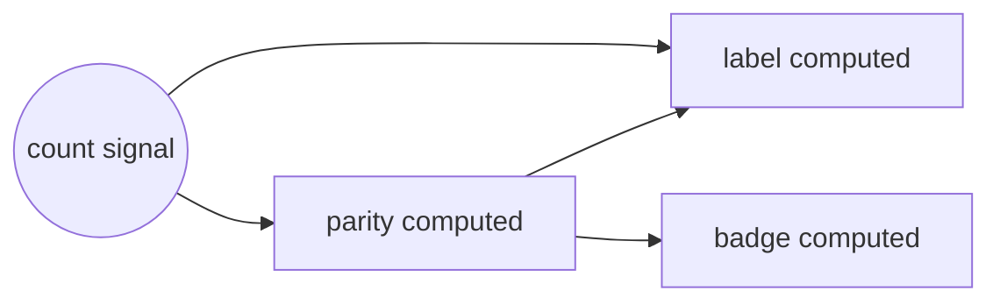

# 01. Signals in depth: computed, effect and linkedSignal

> **Draft: written but not yet run.** The code and the expected output in this lesson were prepared by reading the code and the official documentation. They have not been executed yet. If something does not behave as described, trust your tool's real output and report it.

## What you will be able to do
By the end of this lesson you will be able to:
- Explain how `computed` stays lazy, cached and consistent, and predict when it recomputes.
- Use `linkedSignal` for state that is derived from other state but can also be written by the user.
- Use `effect` only for side effects, and say why it is the wrong tool for computing state.
- Choose between `signal`, `computed`, `linkedSignal` and `effect` for a given requirement.

## Recap
1. How do you read and change a signal? <details><summary>Answer</summary>Call it, `count()`, to read; `set` or `update` to change (lesson 101.03).</details>
2. Why must you not mutate an array held in a signal? <details><summary>Answer</summary>The signal notices a different value; copy and replace instead (101.04).</details>
3. Where does shared signal state belong? <details><summary>Answer</summary>In a service that exposes read-only signals (101.08).</details>

## Why it matters
A spreadsheet is the best picture of signals. A cell with a number is a **signal**. A cell with a formula such as `=A1*2` is a **computed**: it recalculates only when `A1` changes, and only if somebody looks at it. The capstone client (`capstones/web-angular`, chapter 03) keeps every screen's server data in signals, and its bugs would be the classic spreadsheet bugs: a stale cell, a cell that recalculates twice, or a formula that secretly changes another cell. This lesson makes the rules explicit so you can predict behaviour instead of hoping.

## What you will build
A small lab, "Signals lab", with three sections: (1) a counter with three chained `computed` signals and `console.log` calls, to see exactly when they run; (2) a project and task chooser built with `linkedSignal`; (3) a theme switch whose `effect` writes the theme into the page and into `localStorage`.



## Before you start
- Level 101 finished (especially lessons 04, 08 and 12). Time: about 75 minutes.
- New project this level: in `code101/angular` run the `ng new` command from 101 lesson 01 with the name `signals-lab` (`npx --yes -p @angular/cli@22.3.0 ng new signals-lab --routing --style=css --ssr=false --skip-git --skip-tests --ai-config=none --package-manager=npm --defaults`), then replace the configuration files with the ones listed in this lesson. It is the same procedure as 101 lesson 01, step 6.
- Source pack (optional): every file is shown in full in this lesson, so you can follow without it. The finished code, the exercise starter and the solution are in the
  course repository https://github.com/Uee03/Code101 under `source/angular/201-hero-to-super-hero/phase-1-signals-and-state/01-signals-in-depth/` (on that page choose **Code, Download ZIP**, or run
  `git clone https://github.com/Uee03/Code101.git`).
- The configuration files are listed at the end of this page. `package-lock.json` is not part of the pack: `npm install` creates it.
- From now on the course writes `changeDetection: ChangeDetectionStrategy.OnPush` in every component. In Angular 22 it is already the default for a component that does not say anything; writing it down documents the intent and keeps the code correct if you open it in an older project.

## Steps

### Step 1. Project configuration
Replace the generated `package.json`, `angular.json`, `tsconfig.json`, `tsconfig.app.json`, `src/index.html`, `src/main.ts` and the other files in the "unchanged" block at the end of this page with the course versions (same content as 101 lesson 01, only the project name `signals-lab` and the title differ), then run `npm install --no-audit --no-fund`. Delete `public/favicon.ico`.

### Step 2. Sample data
**File: `src/app/data.ts`**
```ts
export interface Item {
  id: number;
  title: string;
}

export interface Project {
  id: number;
  name: string;
  tasks: Item[];
}

export const PROJECTS: Project[] = [
  {
    id: 1,
    name: 'Platform',
    tasks: [
      { id: 11, title: 'Add the health check' },
      { id: 12, title: 'Write the OpenAPI file' },
      { id: 13, title: 'Seed the database' }
    ]
  },
  {
    id: 2,
    name: 'Docs',
    tasks: [
      { id: 21, title: 'Explain signals' },
      { id: 22, title: 'Record a demo' }
    ]
  },
  { id: 3, name: 'Mobile', tasks: [] }
];
```

### Step 3. `computed`: lazy, cached, glitch-free
**File: `src/app/derived/derived.ts`**
```ts
import { ChangeDetectionStrategy, Component, computed, signal } from '@angular/core';

@Component({
  selector: 'app-derived',
  changeDetection: ChangeDetectionStrategy.OnPush,
  templateUrl: './derived.html',
  styleUrl: './derived.css'
})
export class Derived {
  protected readonly count = signal(0);

  protected readonly parity = computed(() => {
    console.log('parity computed');
    return this.count() % 2 === 0 ? 'even' : 'odd';
  });

  protected readonly label = computed(() => {
    console.log('label computed');
    return `${this.count()} is ${this.parity()}`;
  });

  protected readonly badge = computed(() => {
    console.log('badge computed');
    return this.parity() === 'even' ? 'E' : 'O';
  });

  protected add(amount: number): void {
    this.count.update((value) => value + amount);
  }
}
```

**File: `src/app/derived/derived.html`**
```html
<section aria-labelledby="derived-heading">
  <h2 id="derived-heading">1. computed: lazy, cached, glitch-free</h2>
  <p>{{ label() }}</p>
  <p>Parity: {{ parity() }}. Badge: {{ badge() }}</p>
  <button type="button" (click)="add(1)">Add 1</button>
  <button type="button" (click)="add(2)">Add 2</button>
  <p class="hint">Open the browser console (F12) and watch which computed signals run.</p>
</section>
```

**File: `src/app/derived/derived.css`**
```css
button {
  margin-right: 0.5rem;
}

.hint {
  color: var(--muted);
}
```

Three rules to read from this code:
1. **Lazy.** A `computed` runs only when something reads it. If no template reads `badge()`, `badge computed` never prints.
2. **Cached.** Reading it twice in a row does not run it twice; it reruns only after a signal it **actually read** has changed.
3. **Glitch-free and equality-aware.** If `parity` recomputes but produces the **same value** as before (`'even'` again), signals that depend only on `parity` (`badge`) are not recomputed. The default equality check is `Object.is`; you can pass `{ equal }` as a second argument to `computed` for custom rules (for objects and arrays: compare ids, not references).

**Predict before you click:** what is printed in the console when the page first appears, after clicking **Add 2**, and after clicking **Add 1**?

### Step 4. `linkedSignal`: derived but writable
**File: `src/app/chooser/chooser.ts`**
```ts
import { ChangeDetectionStrategy, Component, computed, linkedSignal, signal } from '@angular/core';
import { Item, PROJECTS } from '../data';

@Component({
  selector: 'app-chooser',
  changeDetection: ChangeDetectionStrategy.OnPush,
  templateUrl: './chooser.html',
  styleUrl: './chooser.css'
})
export class Chooser {
  protected readonly projects = PROJECTS;
  protected readonly projectId = signal(PROJECTS[0].id);
  protected readonly tasks = computed(() => PROJECTS.find((project) => project.id === this.projectId())?.tasks ?? []);

  // Writable like a signal, derived like a computed: it resets to the first task when the list changes,
  // but keeps the user's choice when that task is still in the new list.
  protected readonly selectedId = linkedSignal<Item[], number | null>({
    source: this.tasks,
    computation: (list, previous) => (list.some((item) => item.id === previous?.value) ? previous!.value : (list[0]?.id ?? null))
  });
  protected readonly selected = computed(() => this.tasks().find((item) => item.id === this.selectedId()) ?? null);

  // The draft starts as the selected title; typing overwrites it; choosing another task resets it.
  protected readonly draft = linkedSignal(() => this.selected()?.title ?? '');

  protected chooseProject(value: string): void {
    this.projectId.set(Number(value));
  }

  protected chooseTask(value: string): void {
    this.selectedId.set(Number(value));
  }

  protected edit(value: string): void {
    this.draft.set(value);
  }
}
```

**File: `src/app/chooser/chooser.html`**
```html
<section aria-labelledby="chooser-heading">
  <h2 id="chooser-heading">2. linkedSignal: derived state you can also write</h2>

  <p>
    <label for="project">Project</label>
    <select id="project" #project (change)="chooseProject(project.value)">
      @for (item of projects; track item.id) {
        <option [value]="item.id" [selected]="item.id === projectId()">{{ item.name }}</option>
      }
    </select>
  </p>

  @if (selected(); as current) {
    <p>
      <label for="task">Task</label>
      <select id="task" #task (change)="chooseTask(task.value)">
        @for (item of tasks(); track item.id) {
          <option [value]="item.id" [selected]="item.id === current.id">{{ item.title }}</option>
        }
      </select>
    </p>
    <p>
      <label for="draft">Edit the title (a draft, not saved)</label>
      <input id="draft" #draftBox type="text" [value]="draft()" (input)="edit(draftBox.value)">
    </p>
    <p>Draft: "{{ draft() }}"</p>
  } @else {
    <p>This project has no tasks.</p>
  }
</section>
```

**File: `src/app/chooser/chooser.css`**
```css
label {
  display: inline-block;
  min-width: 14rem;
  font-weight: 600;
}

select,
input {
  min-height: 2rem;
}
```

The problem: the chosen task depends on the chosen project, but the user must also be able to choose a task. A `computed` cannot be set; a plain `signal` would keep pointing at a task that no longer exists after the project changes (and you would need an `effect` to fix it, which is the anti-pattern below).
- `linkedSignal({ source, computation })` is "a computed you may also `.set()`". The `computation` runs when `source` changes; it receives the new source value and the `previous` state (`previous.value` is what the signal held before). Here: keep the previous choice if it is still in the list, otherwise take the first task, or `null` for an empty list.
- `draft = linkedSignal(() => this.selected()?.title ?? '')` is the short form: no `source`, the function re-runs when anything it reads changes. Typing sets the draft; choosing another task resets it to that task's title.
- `[selected]="..."` on `<option>` marks the current option, because the options come from `@for`.

### Step 5. `effect`: for side effects only
**File: `src/app/theme/theme-switcher.ts`**
```ts
import { ChangeDetectionStrategy, Component, effect, signal, untracked } from '@angular/core';

type Theme = 'light' | 'dark';

const STORAGE_KEY = 'signals-lab.theme';

function readTheme(): Theme {
  return localStorage.getItem(STORAGE_KEY) === 'dark' ? 'dark' : 'light';
}

@Component({
  selector: 'app-theme-switcher',
  changeDetection: ChangeDetectionStrategy.OnPush,
  templateUrl: './theme-switcher.html'
})
export class ThemeSwitcher {
  protected readonly theme = signal<Theme>(readTheme());
  protected readonly changes = signal(0);

  constructor() {
    // A side effect: it syncs the signal to things outside Angular (the page and the browser storage).
    effect(() => {
      const value = this.theme();
      document.documentElement.dataset['theme'] = value;
      localStorage.setItem(STORAGE_KEY, value);
      console.log(`theme is ${value} after ${untracked(this.changes)} changes`);
    });
  }

  protected toggle(): void {
    this.theme.update((value) => (value === 'light' ? 'dark' : 'light'));
    this.changes.update((count) => count + 1);
  }
}
```

**File: `src/app/theme/theme-switcher.html`**
```html
<section aria-labelledby="theme-heading">
  <h2 id="theme-heading">3. effect: a side effect, not a way to compute state</h2>
  <button type="button" [attr.aria-pressed]="theme() === 'dark'" (click)="toggle()">Dark theme</button>
  <p>Theme: {{ theme() }}. Changes this visit: {{ changes() }}.</p>
</section>
```

- `effect(() => { ... })` runs the function once initially, and again whenever a signal **read inside it** changes. It runs asynchronously, during Angular's change detection, never in the middle of your `set` call.
- It must be created in an **injection context**: here the constructor (a field initialiser also works). Angular destroys it with the component.
- `untracked(this.changes)` reads a signal **without** making the effect depend on it. Without it, changes to `changes` alone would also re-run the effect.
- The body syncs the signal to things Angular does not know: the `<html>` attribute and `localStorage`. That is the right use.
- **Do not** use an effect to copy one signal into another (`effect(() => b.set(a() * 2))`). That is a `computed`, or a `linkedSignal` if `b` must be writable. Effects that write signals hide the data flow, can loop, and run one tick late.
- `effect` can register cleanup (`effect((onCleanup) => { ... onCleanup(() => ...) })`) for timers and listeners that must be undone before the next run.

### Step 6. The shell and the styles
**File: `src/app/app.ts`**
```ts
import { ChangeDetectionStrategy, Component } from '@angular/core';
import { Chooser } from './chooser/chooser';
import { Derived } from './derived/derived';
import { ThemeSwitcher } from './theme/theme-switcher';

@Component({
  selector: 'app-root',
  imports: [Chooser, Derived, ThemeSwitcher],
  changeDetection: ChangeDetectionStrategy.OnPush,
  templateUrl: './app.html',
  styleUrl: './app.css'
})
export class App {}
```

**File: `src/app/app.html`**
```html
<main class="page">
  <h1>Signals lab</h1>
  <app-derived />
  <app-chooser />
  <app-theme-switcher />
</main>
```

**File: `src/app/app.css`**
```css
.page {
  max-width: 44rem;
  margin: 0 auto;
}
```

**File: `src/styles.css`**
```css
:root {
  --bg: #ffffff;
  --fg: #1f2937;
  --muted: #4b5563;
  --brand: #1d6fb8;
}

:root[data-theme='dark'] {
  --bg: #111827;
  --fg: #f9fafb;
  --muted: #d1d5db;
  --brand: #7cb7ee;
}

body {
  margin: 2rem;
  background: var(--bg);
  color: var(--fg);
  font-family: system-ui, sans-serif;
  line-height: 1.5;
}

h1,
h2 {
  color: var(--brand);
}

section {
  margin-top: 1.5rem;
  padding-top: 1rem;
  border-top: 1px solid var(--muted);
}

:focus-visible {
  outline: 3px solid var(--brand);
  outline-offset: 2px;
}
```

## Run it
```text
npm start
```
Open http://localhost:4200/ and the browser console (F12, Console tab).

Expected console output (derived by reading the code, not yet run). First paint: the template reads `label()`, which reads `parity()`, then `badge()`. The effect's line is printed once as well; its position relative to the other three lines is not guaranteed, because effects run during change detection:
```text
label computed
parity computed
badge computed
theme is light after 0 changes
```
Click **Add 2** (count 0 to 2): `parity` is still `'even'`, so `badge` does not run:
```text
label computed
parity computed
```
Click **Add 1** (count 2 to 3): all three change:
```text
label computed
parity computed
badge computed
```
Click **Dark theme**: the page turns dark, `theme is dark after 1 changes` is printed, and a reload keeps the dark theme because the initial value is read from `localStorage`.

In the chooser, pick project **Docs**, then its second task, then switch to **Platform**: the task list changes, the selected task resets to "Add the health check" (the previous id 22 does not exist there). Pick **Mobile**: "This project has no tasks."

## How it works
1. Each signal keeps a version number. A `computed` remembers which signals it read and their versions. When it is read, it compares them and recomputes only if one moved ("pull"); a changed signal only marks dependents as possibly stale ("push"). That is why there are no glitches: a value is never read half-updated.
2. A `linkedSignal` is a `computed` whose result can be overwritten; the next change of its source replaces the written value.
3. Templates and effects are consumers: they re-run when what they read changes.

| Need | Use | Why |
|------|-----|-----|
| State the user changes | `signal` | The source of truth |
| A value calculated from state | `computed` | Cached, lazy, read-only |
| Derived state the user may override, resetting on a source change | `linkedSignal` | Writable computed |
| Talk to something outside Angular (DOM attribute, storage, logging) | `effect` | Side effects only |
| State from an asynchronous request or a stream | `httpResource` or `toSignal` (next lessons) | Time-based |

**Why this, not that.** *Effect to keep two signals in sync* versus *linkedSignal*: the effect runs one tick late and can show an inconsistent state for a frame; the linked signal is always consistent when read.

**Misconception:** "`computed` runs on every change detection." It does not: it only reruns when a dependency actually changed.

## Try it
Starter file: `exercise/starter/src/app/chooser/chooser.ts`.
1. **Guided:** the starter has a plain `signal` for `selectedId` and `draft`. Replace them with `linkedSignal` (TODOs 1 and 2) and repeat the project test above. Predict what the starter does wrong.
2. **Change:** add a `computed` `summary` that returns "N tasks in <project name>" and show it. Predict what it prints for **Mobile**.
3. **Stretch (optional):** make a `computed` of the list of ids with a custom `equal` function, log in it, and show that choosing the same project again does not re-run what depends on it. Is the custom `equal` worth its complexity here?

<details><summary>Solution for rung 1</summary>

**File: `exercise/solution/src/app/chooser/chooser.ts`**
```ts
import { ChangeDetectionStrategy, Component, computed, linkedSignal, signal } from '@angular/core';
import { Item, PROJECTS } from '../data';

@Component({
  selector: 'app-chooser',
  changeDetection: ChangeDetectionStrategy.OnPush,
  templateUrl: './chooser.html',
  styleUrl: './chooser.css'
})
export class Chooser {
  protected readonly projects = PROJECTS;
  protected readonly projectId = signal(PROJECTS[0].id);
  protected readonly tasks = computed(() => PROJECTS.find((project) => project.id === this.projectId())?.tasks ?? []);

  protected readonly selectedId = linkedSignal<Item[], number | null>({
    source: this.tasks,
    computation: (list, previous) => (list.some((item) => item.id === previous?.value) ? previous!.value : (list[0]?.id ?? null))
  });
  protected readonly selected = computed(() => this.tasks().find((item) => item.id === this.selectedId()) ?? null);

  protected readonly draft = linkedSignal(() => this.selected()?.title ?? '');

  protected chooseProject(value: string): void {
    this.projectId.set(Number(value));
  }

  protected chooseTask(value: string): void {
    this.selectedId.set(Number(value));
  }

  protected edit(value: string): void {
    this.draft.set(value);
  }
}
```

</details>

## Check yourself
1. `badge computed` did not print after "Add 2". Why? <details><summary>Answer</summary>`parity` recomputed but returned the same value, so its dependents are not recomputed.</details>
2. Why is an `effect` that calls `other.set(...)` a smell? <details><summary>Answer</summary>It is derived state in disguise: use `computed` or `linkedSignal`; the effect runs late and hides the data flow.</details>
3. What does `untracked` change? <details><summary>Answer</summary>The signal read inside it does not become a dependency of the effect or computed.</details>
4. What does a `linkedSignal` do when its source changes after the user has set it? <details><summary>Answer</summary>It recomputes and overwrites the written value (the computation may reuse `previous.value`).</details>

## Common mistakes
| Symptom or error text | Cause | Fix |
|---|---|---|
| Typical message: `NG0203: effect() can only be used within an injection context` | `effect` was created in a method called later | Create it in the constructor or a field initialiser, or pass an `injector` |
| Typical message: `Property 'selectedId' is used before its initialization` | A field uses another field that is declared further down | Reorder the fields |
| Selection points at a missing task after changing project | `selectedId` is a plain signal | Use `linkedSignal` (rung 1) |
| An effect runs more often than expected | It reads a signal you did not mean to track | Wrap that read in `untracked` |
| Updating an array in a signal does nothing | The array was mutated in place | Return a new array (`[...]`, `map`, `filter`) |

## Best practice
Compute, do not copy: derive with `computed` and `linkedSignal`, and keep `effect` for the border between Angular and the outside world. Source: Angular, Signals https://angular.dev/guide/signals and Dependent state with linkedSignal https://angular.dev/guide/signals/linked-signal

## Going further
- Effects: https://angular.dev/guide/signals/effect
- `afterRenderEffect` for effects that need rendered DOM: https://angular.dev/api/core/afterRenderEffect
- Where this is used: the stores of `capstones/web-angular` chapter 03 (signal stores and cursor lists).

## Summary
- You predicted `computed` recomputation from laziness, caching and equality.
- You built writable derived state with `linkedSignal`.
- You used `effect` for a real side effect and named why not to use it for state.

## Next lesson
02. RxJS essentials and signal interop: when a stream (debounce, cancel, retry) is the better tool and how it meets signals.

<details>
<summary>Files that did not change in this lesson (listed so this page is complete)</summary>

**File: `.gitignore`**

```
node_modules/
dist/
.angular/
.env
*.log
```

**File: `angular.json`**

```json
{
  "$schema": "./node_modules/@angular/cli/lib/config/schema.json",
  "version": 1,
  "cli": {
    "packageManager": "npm",
    "analytics": false
  },
  "newProjectRoot": "projects",
  "projects": {
    "signals-lab": {
      "projectType": "application",
      "schematics": {
        "@schematics/angular:class": {
          "skipTests": true
        },
        "@schematics/angular:component": {
          "skipTests": true
        },
        "@schematics/angular:directive": {
          "skipTests": true
        },
        "@schematics/angular:guard": {
          "skipTests": true
        },
        "@schematics/angular:interceptor": {
          "skipTests": true
        },
        "@schematics/angular:pipe": {
          "skipTests": true
        },
        "@schematics/angular:resolver": {
          "skipTests": true
        },
        "@schematics/angular:service": {
          "skipTests": true
        }
      },
      "root": "",
      "sourceRoot": "src",
      "prefix": "app",
      "architect": {
        "build": {
          "builder": "@angular/build:application",
          "options": {
            "browser": "src/main.ts",
            "tsConfig": "tsconfig.app.json",
            "assets": [
              {
                "glob": "**/*",
                "input": "public"
              }
            ],
            "styles": [
              "src/styles.css"
            ]
          },
          "configurations": {
            "production": {
              "budgets": [
                {
                  "type": "initial",
                  "maximumWarning": "500kB",
                  "maximumError": "1MB"
                },
                {
                  "type": "anyComponentStyle",
                  "maximumWarning": "4kB",
                  "maximumError": "8kB"
                }
              ],
              "outputHashing": "all"
            },
            "development": {
              "optimization": false,
              "extractLicenses": false,
              "sourceMap": true
            }
          },
          "defaultConfiguration": "production"
        },
        "serve": {
          "builder": "@angular/build:dev-server",
          "configurations": {
            "production": {
              "buildTarget": "signals-lab:build:production"
            },
            "development": {
              "buildTarget": "signals-lab:build:development"
            }
          },
          "defaultConfiguration": "development"
        }
      }
    }
  }
}
```

**File: `package.json`**

```json
{
  "name": "signals-lab",
  "version": "1.0.0",
  "private": true,
  "scripts": {
    "ng": "ng",
    "start": "ng serve --host localhost --port 4200",
    "build": "ng build"
  },
  "dependencies": {
    "@angular/common": "22.3.0",
    "@angular/compiler": "22.3.0",
    "@angular/core": "22.3.0",
    "@angular/forms": "22.3.0",
    "@angular/platform-browser": "22.3.0",
    "@angular/router": "22.3.0",
    "rxjs": "7.8.2",
    "tslib": "2.8.1"
  },
  "devDependencies": {
    "@angular/build": "22.3.0",
    "@angular/cli": "22.3.0",
    "@angular/compiler-cli": "22.3.0",
    "typescript": "6.0.3"
  }
}
```

**File: `public/favicon.svg`**

```xml
<svg xmlns="http://www.w3.org/2000/svg" viewBox="0 0 24 24" width="24" height="24" fill="none" stroke="#1d6fb8" stroke-width="2" stroke-linecap="round" stroke-linejoin="round">
  <path d="M22 11.08V12a10 10 0 1 1-5.93-9.14"/><polyline points="22 4 12 14.01 9 11.01"/>
</svg>
```

**File: `src/app/app.config.ts`**

```ts
import { ApplicationConfig, provideBrowserGlobalErrorListeners } from '@angular/core';
import { provideRouter } from '@angular/router';

import { routes } from './app.routes';

export const appConfig: ApplicationConfig = {
  providers: [provideBrowserGlobalErrorListeners(), provideRouter(routes)]
};
```

**File: `src/app/app.routes.ts`**

```ts
import { Routes } from '@angular/router';

export const routes: Routes = [];
```

**File: `src/index.html`**

```html
<!doctype html>
<html lang="en">
<head>
  <meta charset="utf-8">
  <title>Signals Lab</title>
  <base href="/">
  <meta name="viewport" content="width=device-width, initial-scale=1">
  <link rel="icon" type="image/svg+xml" href="favicon.svg">
</head>
<body>
  <app-root></app-root>
</body>
</html>
```

**File: `src/main.ts`**

```ts
import { bootstrapApplication } from '@angular/platform-browser';
import { appConfig } from './app/app.config';
import { App } from './app/app';

bootstrapApplication(App, appConfig)
  .catch((err) => console.error(err));
```

**File: `tsconfig.app.json`**

```json
/* To learn more about Typescript configuration file: https://www.typescriptlang.org/docs/handbook/tsconfig-json.html. */
/* To learn more about Angular compiler options: https://angular.dev/reference/configs/angular-compiler-options. */
{
  "extends": "./tsconfig.json",
  "compilerOptions": {
    "types": []
  },
  "include": [
    "src/**/*.ts"
  ],
  "exclude": [
    "src/**/*.spec.ts"
  ]
}
```

**File: `tsconfig.json`**

```json
/* To learn more about Typescript configuration file: https://www.typescriptlang.org/docs/handbook/tsconfig-json.html. */
/* To learn more about Angular compiler options: https://angular.dev/reference/configs/angular-compiler-options. */
{
  "compileOnSave": false,
  "compilerOptions": {
    "strict": true,
    "noImplicitOverride": true,
    "noPropertyAccessFromIndexSignature": true,
    "noImplicitReturns": true,
    "noFallthroughCasesInSwitch": true,
    "skipLibCheck": true,
    "isolatedModules": true,
    "experimentalDecorators": true,
    "importHelpers": true,
    "target": "ES2022",
    "module": "preserve"
  },
  "angularCompilerOptions": {
    "enableI18nLegacyMessageIdFormat": false,
    "strictInjectionParameters": true,
    "strictInputAccessModifiers": true,
    "strictTemplates": true
  },
  "files": [],
  "references": [
    {
      "path": "./tsconfig.app.json"
    }
  ]
}
```

</details>
