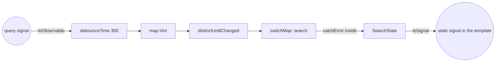

# 02. RxJS essentials and signal interop

> **Draft: written but not yet run.** The code and the expected output in this lesson were prepared by reading the code and the official documentation. They have not been executed yet. If something does not behave as described, trust your tool's real output and report it.

## What you will be able to do
By the end of this lesson you will be able to:
- Say what an Observable is, and when a stream is a better model than a signal.
- Build a search-as-you-type pipeline with `debounceTime`, `distinctUntilChanged`, `switchMap` and `catchError`, and place `catchError` so that one failure does not kill the stream.
- Move between worlds with `toObservable` and `toSignal`, and end a manual subscription with `takeUntilDestroyed`.
- Choose between `switchMap`, `mergeMap`, `concatMap` and `exhaustMap`.

## Recap
1. When should you use an `effect`? <details><summary>Answer</summary>Only for side effects at the border of Angular, such as the DOM, storage or logging (201.01).</details>
2. What does `HttpClient.get` return, and when does it send the request? <details><summary>Answer</summary>An Observable; the request is sent on `subscribe` (101.09).</details>
3. Which signal API makes writable derived state? <details><summary>Answer</summary>`linkedSignal` (201.01).</details>

## Why it matters
A signal is a **mailbox**: it always holds the latest letter and you can look at any time. An Observable is a **conveyor belt**: items arrive over time, and you decide what to do with each one as it passes, including throwing old ones away. Typing in a search box is a conveyor belt: many events, a pause, a request, an answer that may arrive late or never. Signals say "what is the value now"; RxJS says "what happens over time". The capstone client (`capstones/web-angular`) uses RxJS only for streams (online events, debounced search, interceptor plumbing) and signals for everything else; this lesson teaches exactly that boundary.

## What you will build
Continue the `signals-lab` project: the three demos of lesson 01 are replaced by one component, a **search box** that waits for you to pause typing, ignores repeated text, cancels outdated requests, survives a failing request, shows the online/offline state and counts the seconds the page was open.



## Before you start
- Lesson 01 done (the `signals-lab` project). Time: about 75 minutes.
- Source pack (optional): every file is shown in full in this lesson, so you can follow without it. The finished code, the exercise starter and the solution are in the
  course repository https://github.com/Uee03/Code101 under `source/angular/201-hero-to-super-hero/phase-1-signals-and-state/02-rxjs-essentials-and-signal-interop/` (on that page choose **Code, Download ZIP**, or run
  `git clone https://github.com/Uee03/Code101.git`).
- **Clean-up:** delete `src/app/data.ts` and the folders `src/app/derived`, `chooser` and `theme`. Keep `src/styles.css`.

## Steps

### Step 1. A fake search service
**File: `src/app/search.service.ts`**
```ts
import { Injectable } from '@angular/core';
import { map, Observable, timer } from 'rxjs';

export interface Hit {
  id: number;
  title: string;
}

const DATA: Hit[] = [
  { id: 1, title: 'Add the health check' },
  { id: 2, title: 'Write the OpenAPI file' },
  { id: 3, title: 'Seed the database' },
  { id: 4, title: 'Explain signals' },
  { id: 5, title: 'Explain RxJS' },
  { id: 6, title: 'Record a demo' }
];

@Injectable({ providedIn: 'root' })
export class SearchService {
  // A stand-in for an HTTP call: it answers after 300 ms, and fails for the query "boom".
  search(query: string): Observable<Hit[]> {
    return timer(300).pipe(
      map(() => {
        if (query.toLowerCase() === 'boom') {
          throw new Error('The search service failed.');
        }
        return DATA.filter((hit) => hit.title.toLowerCase().includes(query.toLowerCase()));
      })
    );
  }
}
```

`timer(300)` emits once after 300 ms: a stand-in for a network delay. Throwing inside `map` turns into an **error notification** on the stream, exactly like a failed HTTP request would.

### Step 2. The component class
**File: `src/app/search/search.ts`**
```ts
import { ChangeDetectionStrategy, Component, inject, signal } from '@angular/core';
import { takeUntilDestroyed, toObservable, toSignal } from '@angular/core/rxjs-interop';
import { catchError, debounceTime, distinctUntilChanged, fromEvent, interval, map, merge, Observable, of, startWith, switchMap, tap } from 'rxjs';
import { Hit, SearchService } from '../search.service';

interface SearchState {
  status: 'idle' | 'loading' | 'done' | 'error';
  hits: Hit[];
  message?: string;
}

const IDLE: SearchState = { status: 'idle', hits: [] };
const LOADING: SearchState = { status: 'loading', hits: [] };

@Component({
  selector: 'app-search',
  changeDetection: ChangeDetectionStrategy.OnPush,
  templateUrl: './search.html',
  styleUrl: './search.css'
})
export class Search {
  private readonly service = inject(SearchService);

  protected readonly query = signal('');
  protected readonly requests = signal(0);
  protected readonly seconds = signal(0);

  // Signal in, stream in the middle, signal out.
  protected readonly state = toSignal(
    toObservable(this.query).pipe(
      debounceTime(300),
      map((text) => text.trim()),
      distinctUntilChanged(),
      switchMap((text): Observable<SearchState> => {
        if (text.length < 2) {
          return of(IDLE);
        }
        return this.service.search(text).pipe(
          tap(() => this.requests.update((count) => count + 1)),
          map((hits): SearchState => ({ status: 'done', hits })),
          startWith(LOADING),
          catchError((error: unknown) =>
            of<SearchState>({ status: 'error', hits: [], message: error instanceof Error ? error.message : 'The search failed.' })
          )
        );
      })
    ),
    { initialValue: IDLE }
  );

  // Browser events as a stream, shown as a signal. requireSync is allowed because startWith emits at once.
  protected readonly online = toSignal(
    merge(
      fromEvent(window, 'online').pipe(map(() => true)),
      fromEvent(window, 'offline').pipe(map(() => false))
    ).pipe(startWith(navigator.onLine)),
    { requireSync: true }
  );

  constructor() {
    // A manual subscription must be ended: takeUntilDestroyed does it when the component is destroyed.
    interval(1000)
      .pipe(takeUntilDestroyed())
      .subscribe(() => this.seconds.update((count) => count + 1));
  }
}
```

Read the pipeline from the top, like a recipe:
1. `toObservable(this.query)` turns the signal into a stream: it emits the current value and every later change (asynchronously, after change detection settles; it is built on an effect, so it must be created in an injection context such as this field initialiser).
2. `debounceTime(300)` waits until 300 ms pass without a new value, then lets the last one through: typing "explain" quickly sends one value, not seven.
3. `map(trim)` and `distinctUntilChanged()` drop values equal to the previous one: adding a trailing space does not search again.
4. `switchMap(text => inner)` starts the inner stream for each text and **cancels the previous inner stream** when a new text arrives. That cancellation is what prevents an old, slow answer from overwriting a newer one.
5. Inside the inner stream: `tap` counts a request only when an answer arrived, `map` wraps the hits in a `SearchState`, `startWith(LOADING)` emits the loading state immediately, and `catchError` turns a failure into an error **state**.
6. `toSignal(stream, { initialValue })` subscribes (and unsubscribes when the component is destroyed) and exposes the latest value as a signal for the template.

**Why `catchError` is inside the `switchMap`.** An error ends a stream. If `catchError` were placed after the `switchMap`, the first failure would end the **outer** stream and the search box would be dead until reload. Inside, only that one search ends; the outer stream keeps listening.

`online` merges two browser events: `fromEvent(window, 'online')` and `'offline'` map to `true` and `false`; `startWith(navigator.onLine)` gives an initial value, so `toSignal` can use `requireSync: true` (the signal never needs `undefined`). The constructor starts `interval(1000)` and ends it with `takeUntilDestroyed()`: without it the interval would keep running after the component is gone (compare 101 lesson 11).

**File: `src/app/search/search.html`**
```html
<section aria-labelledby="search-heading">
  <h2 id="search-heading">Search as you type</h2>

  <label for="q">Search tasks (try "explain", "x" or "boom")</label>
  <input id="q" #box type="search" autocomplete="off" [value]="query()" (input)="query.set(box.value)">

  <p>Requests sent: {{ requests() }}. Network: {{ online() ? 'online' : 'offline' }}. Open for {{ seconds() }} s.</p>

  <div role="status">
    @switch (state().status) {
      @case ('idle') {
        <p class="hint">Type at least two characters.</p>
      }
      @case ('loading') {
        <p>Searching...</p>
      }
      @case ('error') {
        <p class="error">{{ state().message }}</p>
      }
      @case ('done') {
        <ul>
          @for (hit of state().hits; track hit.id) {
            <li>{{ hit.title }}</li>
          } @empty {
            <li>Nothing found.</li>
          }
        </ul>
      }
    }
  </div>
</section>
```

`role="status"` makes the result area a polite live region, so a screen reader announces "Searching..." and the result. The state is a union, so `@switch` on its `status` shows exactly one view.

**File: `src/app/search/search.css`**
```css
label {
  display: block;
  font-weight: 600;
}

input {
  min-height: 2rem;
  min-width: 16rem;
}

.hint {
  color: var(--muted);
}

.error {
  color: #b42318;
  font-weight: 600;
}
```

**File: `src/app/app.ts`**
```ts
import { ChangeDetectionStrategy, Component } from '@angular/core';
import { Search } from './search/search';

@Component({
  selector: 'app-root',
  imports: [Search],
  changeDetection: ChangeDetectionStrategy.OnPush,
  templateUrl: './app.html',
  styleUrl: './app.css'
})
export class App {}
```

**File: `src/app/app.html`**
```html
<main class="page">
  <h1>Signals lab</h1>
  <app-search />
</main>
```

## Run it
```text
npm start
```
Open http://localhost:4200/.

**Predict before you try:** you type `explain`, wait, press Space, wait, then type `boom`, wait, then clear the box and type `demo`. How large is "Requests sent" at the end?

Expected behaviour (derived by reading the code, not yet seen in a browser):
1. Initially: "Type at least two characters.", "Requests sent: 0. Network: online. Open for N s." (N counts up each second).
2. Type `explain` and stop: after about 300 ms "Searching...", after another 300 ms the list "Explain signals" and "Explain RxJS". Requests sent: 1.
3. Add a space: nothing happens (the trimmed text is the same).
4. Replace with `boom`: after the pause "Searching...", then the red text "The search service failed." Requests sent stays 1 (the counter only counts answers).
5. Replace with `demo`: the search works again ("Record a demo"). Requests sent: 2. The error did not kill the stream.
6. In the browser developer tools, Network tab, choose "Offline": "Network: offline" appears; choose "No throttling": back to online.

## How it works
1. An **Observable** describes a source of values over time; nothing happens until someone **subscribes**. Each subscription gets its own run. A **Subject** is a hand-operated Observable.
2. An **operator** (a function inside `pipe`) takes a stream and returns a new one. Operators are small and compose: that is the whole power of RxJS.
3. **Flattening operators** map each value to an inner Observable. They differ in what they do when a new value arrives while the previous inner stream is still running:

| Operator | Behaviour | Use it for |
|----------|-----------|------------|
| `switchMap` | Cancel the old, start the new | Search, route-driven loads (only the latest matters) |
| `mergeMap` | Run all in parallel | Independent fire-and-forget calls |
| `concatMap` | Queue: one after another, in order | Writes that must keep their order |
| `exhaustMap` | Ignore new values while busy | Submit buttons, avoid double submits |

4. `toObservable` and `toSignal` are the bridges; they live in `@angular/core/rxjs-interop`. `toSignal` also needs an `initialValue` (or `requireSync`) because a signal always has a value, while a stream may not have emitted yet.

**Why this, not that.** *Signals for state, RxJS for time.* A request/response call fits a Promise or `httpResource`; a debounced search, a polling loop, a WebSocket and browser events fit RxJS. Using RxJS for plain state means operators and subscriptions to manage; using only signals for a search box means hand-writing timers and cancellation.

**Misconception:** "Observables are asynchronous." They can be synchronous (`of(1)` emits at once); what is true is that they *can* deliver over time.

## Try it
Starter file: `exercise/starter/src/app/search/search.ts`.
1. **Guided:** the starter searches twice for the same text and dies after `boom`. Add `distinctUntilChanged()` (TODO 1) and the inner `catchError` (TODO 2). Predict how many requests `explain` then `explain ` produce before and after.
2. **Change:** switch `switchMap` to `exhaustMap` and type a second query while the first is loading. What does the user see, and why is that worse for search?
3. **Stretch (optional):** add a "Retry" button that re-runs the last search. Which operator or signal design lets you re-run the same text without changing the query?

<details><summary>Solution for rung 1</summary>

**File: `exercise/solution/src/app/search/search.ts`**
```ts
import { ChangeDetectionStrategy, Component, inject, signal } from '@angular/core';
import { toObservable, toSignal } from '@angular/core/rxjs-interop';
import { catchError, debounceTime, distinctUntilChanged, map, Observable, of, startWith, switchMap, tap } from 'rxjs';
import { Hit, SearchService } from '../search.service';

interface SearchState {
  status: 'idle' | 'loading' | 'done' | 'error';
  hits: Hit[];
  message?: string;
}

const IDLE: SearchState = { status: 'idle', hits: [] };
const LOADING: SearchState = { status: 'loading', hits: [] };

@Component({
  selector: 'app-search',
  changeDetection: ChangeDetectionStrategy.OnPush,
  templateUrl: './search.html',
  styleUrl: './search.css'
})
export class Search {
  private readonly service = inject(SearchService);

  protected readonly query = signal('');
  protected readonly requests = signal(0);
  protected readonly seconds = signal(0);
  protected readonly online = signal(true);

  protected readonly state = toSignal(
    toObservable(this.query).pipe(
      debounceTime(300),
      map((text) => text.trim()),
      distinctUntilChanged(),
      switchMap((text): Observable<SearchState> => {
        if (text.length < 2) {
          return of(IDLE);
        }
        return this.service.search(text).pipe(
          tap(() => this.requests.update((count) => count + 1)),
          map((hits): SearchState => ({ status: 'done', hits })),
          startWith(LOADING),
          catchError((error: unknown) =>
            of<SearchState>({ status: 'error', hits: [], message: error instanceof Error ? error.message : 'The search failed.' })
          )
        );
      })
    ),
    { initialValue: IDLE }
  );
}
```

</details>

## Check yourself
1. Why does `catchError` sit inside the `switchMap`? <details><summary>Answer</summary>So an error ends only that one inner stream; the outer stream stays alive for the next search.</details>
2. What does `switchMap` do with a slow response for an old query? <details><summary>Answer</summary>It cancels the old inner stream, so the old answer never arrives.</details>
3. Why does `toSignal` need `initialValue` or `requireSync`? <details><summary>Answer</summary>A signal always holds a value; the stream might not have emitted yet.</details>
4. What happens to the `interval` if you leave out `takeUntilDestroyed()`? <details><summary>Answer</summary>It keeps running after the component is destroyed (a leak).</details>

## Common mistakes
| Symptom or error text | Cause | Fix |
|---|---|---|
| Typical message: `NG0203` for `toObservable` or `toSignal` | They were called outside an injection context | Use field initialisers or the constructor, or pass `{ injector }` |
| Typical message: `NG0600: Writing to signals is not allowed in a computed` | A `set` or `update` inside a `computed` | Computed values must be pure: derive, do not write |
| The search stops forever after one error | `catchError` is outside the `switchMap` | Move it into the inner pipe |
| The same text is searched twice | `distinctUntilChanged` is missing | Add it after `map(trim)` |
| `toSignal` throws about `undefined` | A stream that does not emit synchronously, with no `initialValue` | Add `initialValue` or `startWith` plus `requireSync` |
| Memory or CPU creeps up | A manual `subscribe` without `takeUntilDestroyed` | End every manual subscription |

## Best practice
Make the stream do the time work, end every subscription, and keep the template reading signals. Source: Angular, RxJS interop https://angular.dev/ecosystem/rxjs-interop and RxJS operators https://rxjs.dev/guide/operators

## Going further
- Choosing a flattening operator: https://rxjs.dev/guide/operators
- `rxResource` and `httpResource` (a signal-based alternative for request/response, stable in Angular 22): https://angular.dev/guide/http/http-resource
- Where this is used: the online banner and interceptors in `capstones/web-angular` chapters 02 and 04.

## Summary
- You built a debounced, cancel-safe search with RxJS operators.
- You bridged signals and streams with `toObservable` and `toSignal`, and ended a subscription with `takeUntilDestroyed`.
- You placed `catchError` where it keeps the stream alive and chose a flattening operator on purpose.

## Next lesson
03. State patterns: a store service that combines signals, a cursor-paged list and optimistic updates with rollback.

<details>
<summary>Files that did not change in this lesson (listed so this page is complete)</summary>

**File: `src/app/app.css`**

```css
.page {
  max-width: 44rem;
  margin: 0 auto;
}
```

**File: `src/styles.css`**

```css
:root {
  --bg: #ffffff;
  --fg: #1f2937;
  --muted: #4b5563;
  --brand: #1d6fb8;
}

:root[data-theme='dark'] {
  --bg: #111827;
  --fg: #f9fafb;
  --muted: #d1d5db;
  --brand: #7cb7ee;
}

body {
  margin: 2rem;
  background: var(--bg);
  color: var(--fg);
  font-family: system-ui, sans-serif;
  line-height: 1.5;
}

h1,
h2 {
  color: var(--brand);
}

section {
  margin-top: 1.5rem;
  padding-top: 1rem;
  border-top: 1px solid var(--muted);
}

:focus-visible {
  outline: 3px solid var(--brand);
  outline-offset: 2px;
}
```

</details>
