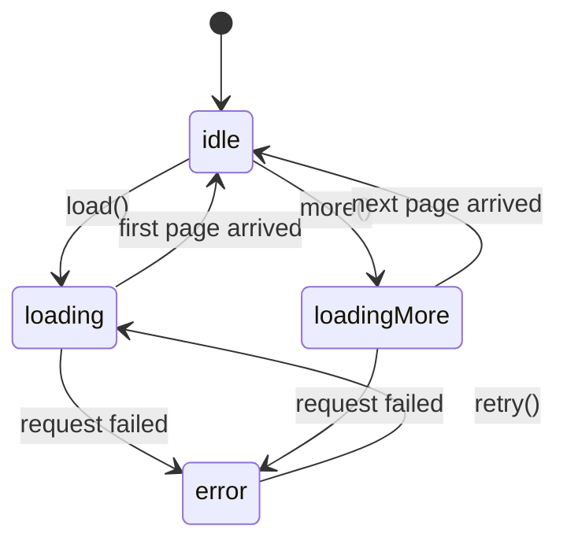
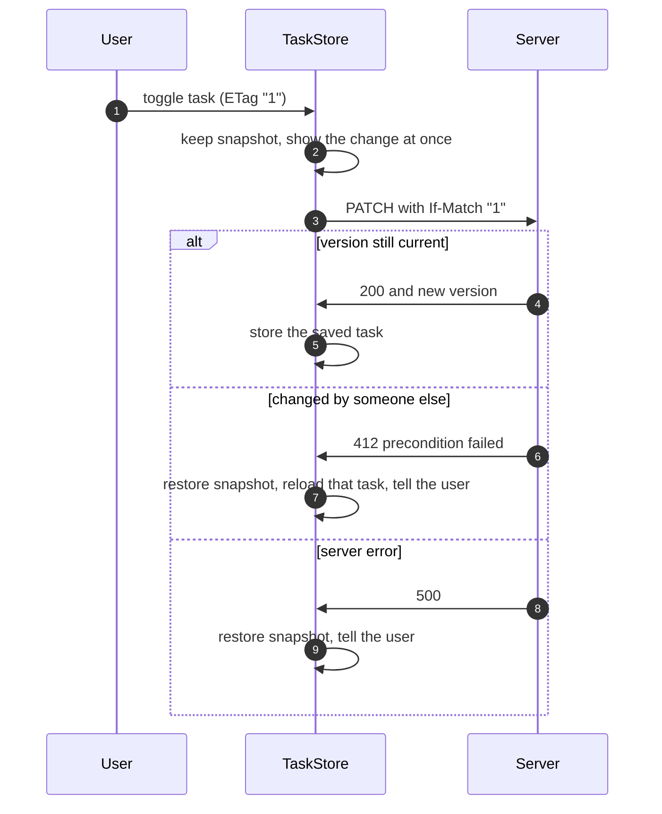

# 03. State patterns: a store service with signals

> **Draft: written but not yet run.** The code and the expected output in this lesson were prepared by reading the code and the official documentation. They have not been executed yet. If something does not behave as described, trust your tool's real output and report it.

## What you will be able to do
By the end of this lesson you will be able to:
- Design a store service: private writable state, read-only signals, computed views and intention-named methods.
- Page a list with an opaque cursor and protect it from stale answers with a generation counter.
- Apply an optimistic update with rollback, and handle a version conflict (HTTP 412) with an ETag.
- Make a retried create safe by reusing one Idempotency-Key per user action.

## Recap
1. Why does `catchError` belong inside `switchMap`? <details><summary>Answer</summary>So one failure ends only that inner stream (201.02).</details>
2. What does `asReadonly()` give you? <details><summary>Answer</summary>A signal that components can read but not set (101.08).</details>
3. When is `linkedSignal` better than `effect`? <details><summary>Answer</summary>When derived state must also be writable: it is always consistent when read (201.01).</details>

## Why it matters
A store is the **front desk** of a hotel: guests (components) ask it for things, and it alone knows which room (state) is free, what is being cleaned (loading) and what went wrong (error). Without a front desk, every screen invents its own half-correct loading flags and error text. In the capstone client (`capstones/web-angular`, chapter 03 "Screens, stores and pagination" and chapter 04 "Problem details, 412, offline, WCAG"), every screen reads a store like the one you build here; later in this level the fake server of this lesson is replaced by a real API.

## What you will build
In the `signals-lab` project: a `FakeApi` (an in-memory server that is slow, pages with a cursor, versions its rows with ETags, replays idempotent creates and can be told to fail), a reusable `CursorList` class, and a `TaskStore` with optimistic toggle, conflict handling and idempotent add. A `Board` component with three checkboxes and buttons lets you trigger every case.





## Before you start
- Lessons 01 and 02 done (`signals-lab`). Time: about 80 minutes (break after Step 4).
- Source pack (optional): every file is shown in full in this lesson, so you can follow without it. The finished code, the exercise starter and the solution are in the
  course repository https://github.com/Uee03/Code101 under `source/angular/201-hero-to-super-hero/phase-1-signals-and-state/03-state-patterns-service-with-signals/` (on that page choose **Code, Download ZIP**, or run
  `git clone https://github.com/Uee03/Code101.git`).
- **Clean-up:** delete `src/app/search.service.ts` and the folder `src/app/search`.

## Steps

### Step 1. The domain types
**File: `src/app/task.ts`**
```ts
export interface Task {
  id: number;
  title: string;
  done: boolean;
  version: number;
}

export interface TaskDraft {
  title: string;
}

// The ETag of a task is its version in quotes, like the platform API sends it.
export function etagOf(task: Task): string {
  return `"${task.version}"`;
}
```

Every task has a `version`. The ETag header value is that version in quotes, as the platform contract defines it (`"3"`).

### Step 2. Reusable state building blocks
**File: `src/app/core/state.ts`**
```ts
import { signal } from '@angular/core';

export interface Versioned<T> {
  value: T;
  etag: string;
}

export interface Page<T> {
  items: T[];
  nextCursor: string | null;
}

export interface ListState<T> {
  items: T[];
  nextCursor: string | null;
  status: 'idle' | 'loading' | 'loadingMore' | 'error';
  error?: unknown;
}

type Loader<T> = (cursor?: string) => Promise<Page<T>>;

// A list that is read page by page with an opaque cursor.
export class CursorList<T> {
  readonly state = signal<ListState<T>>({ items: [], nextCursor: null, status: 'idle' });
  private loader?: Loader<T>;
  private generation = 0;

  async load(loader: Loader<T>): Promise<void> {
    this.loader = loader;
    this.generation++;
    this.state.set({ items: [], nextCursor: null, status: 'loading' });
    await this.fetch(false);
  }

  retry(): Promise<void> {
    return this.loader ? this.load(this.loader) : Promise.resolve();
  }

  async more(): Promise<void> {
    const current = this.state();
    if (current.nextCursor === null || current.status !== 'idle') {
      return;
    }
    this.state.update((s) => ({ ...s, status: 'loadingMore' }));
    await this.fetch(true);
  }

  snapshot(): ListState<T> {
    return this.state();
  }

  restore(snapshot: ListState<T>): void {
    this.state.set(snapshot);
  }

  replace(next: T, isSame: (item: T) => boolean): void {
    this.state.update((s) => ({ ...s, items: s.items.map((item) => (isSame(item) ? next : item)) }));
  }

  append(item: T): void {
    this.state.update((s) => ({ ...s, items: [...s.items, item] }));
  }

  private async fetch(append: boolean): Promise<void> {
    const generation = this.generation;
    const cursor = append ? (this.state().nextCursor ?? undefined) : undefined;
    try {
      const page = await this.loader!(cursor);
      if (generation !== this.generation) {
        return; // a newer load started: this answer is stale
      }
      this.state.update((s) => ({
        items: append ? [...s.items, ...page.items] : page.items,
        nextCursor: page.nextCursor,
        status: 'idle'
      }));
    } catch (error) {
      if (generation === this.generation) {
        this.state.update((s) => ({ ...s, status: 'error', error }));
      }
    }
  }
}

// One Idempotency-Key per user action: the same key (and body) is reused when the user retries after a failure.
export class Creation {
  private pending?: { json: string; key: string };

  async send<T, R>(body: T, submit: (key: string, body: T) => Promise<R>): Promise<R> {
    const json = JSON.stringify(body);
    if (!this.pending || this.pending.json !== json) {
      this.pending = { json, key: crypto.randomUUID() };
    }
    const result = await submit(this.pending.key, body);
    this.pending = undefined;
    return result;
  }
}
```

- `Versioned<T>` is a resource together with the exact `ETag` string, the pair you need for `If-Match` later.
- `ListState<T>` is a **status union plus data** in one object, so a screen can never be "loading" and "error" at once.
- `CursorList<T>` holds that state in one signal. `load(loader)` starts from scratch; `more()` appends the next page; the **generation counter** makes an answer that belongs to an older `load` call harmless: if the user pressed Reload twice, the slow first answer is ignored. `snapshot`, `restore`, `replace` and `append` give the store small, safe operations that always create a new state object.
- A cursor is **opaque**: the client copies `nextCursor` from the answer and sends it back; it never builds or parses one.
- `Creation` keeps one `Idempotency-Key` for one user action. If the send fails, the next attempt with the same body reuses the key, so the server can recognise a retry and not create a duplicate; the key is cleared only after success.

### Step 3. A server that misbehaves on purpose
**File: `src/app/fake-api.ts`**
```ts
import { Injectable, signal } from '@angular/core';
import { Page, Versioned } from './core/state';
import { etagOf, Task, TaskDraft } from './task';

export class ApiError extends Error {
  constructor(
    readonly status: number,
    message: string
  ) {
    super(message);
  }
}

const wait = (ms: number) => new Promise<void>((resolve) => setTimeout(resolve, ms));

// A stand-in for a server that lives in memory: slow, paged, versioned, idempotent and sometimes broken.
@Injectable({ providedIn: 'root' })
export class FakeApi {
  readonly failSaves = signal(false);

  private readonly rows: Task[] = Array.from({ length: 7 }, (_, index) => ({
    id: index + 1,
    title: `Task number ${index + 1}`,
    done: false,
    version: 1
  }));
  private readonly replays = new Map<string, Task>();
  private nextId = 8;

  async list(cursor?: string, limit = 3): Promise<Page<Task>> {
    await wait(250);
    const start = cursor === undefined ? 0 : Number(cursor);
    if (!Number.isInteger(start) || start < 0) {
      throw new ApiError(400, 'The cursor is not valid.');
    }
    const end = start + limit;
    return { items: this.rows.slice(start, end).map((row) => ({ ...row })), nextCursor: end < this.rows.length ? String(end) : null };
  }

  async get(id: number): Promise<Versioned<Task>> {
    await wait(150);
    const row = this.find(id);
    return { value: { ...row }, etag: etagOf(row) };
  }

  async patch(id: number, changes: Partial<Pick<Task, 'title' | 'done'>>, ifMatch: string): Promise<Versioned<Task>> {
    await wait(300);
    if (this.failSaves()) {
      throw new ApiError(500, 'The server could not save the change.');
    }
    const row = this.find(id);
    if (etagOf(row) !== ifMatch) {
      throw new ApiError(412, 'The task changed since you read it.');
    }
    Object.assign(row, changes, { version: row.version + 1 });
    return { value: { ...row }, etag: etagOf(row) };
  }

  async create(key: string, draft: TaskDraft): Promise<Task> {
    await wait(300);
    const replay = this.replays.get(key);
    if (replay) {
      return { ...replay };
    }
    const row: Task = { id: this.nextId++, title: draft.title, done: false, version: 1 };
    this.rows.push(row);
    this.replays.set(key, row);
    if (this.failSaves()) {
      throw new ApiError(504, 'The answer was lost on the way back.'); // the task WAS created
    }
    return { ...row };
  }

  // Pretend another user edited this task.
  changeElsewhere(id: number): void {
    const row = this.find(id);
    row.title += ' (edited elsewhere)';
    row.version++;
  }

  private find(id: number): Task {
    const row = this.rows.find((item) => item.id === id);
    if (!row) {
      throw new ApiError(404, 'The task does not exist.');
    }
    return row;
  }
}
```

Read it as the contract the real API (lesson 04 onwards) also follows: paged lists, `412` for a stale `If-Match`, and `create` that remembers the key. `failSaves` makes `patch` fail with 500 and makes `create` fail **after** storing the row, which models the nastiest real case: the server did the work, but the answer was lost. `changeElsewhere` stands in for a colleague editing the same task.

### Step 4. The store
**File: `src/app/task-store.ts`**
```ts
import { computed, inject, Injectable, signal } from '@angular/core';
import { CursorList, Creation, Versioned } from './core/state';
import { ApiError, FakeApi } from './fake-api';
import { etagOf, Task } from './task';

@Injectable({ providedIn: 'root' })
export class TaskStore {
  private readonly api = inject(FakeApi);
  private readonly creation = new Creation();
  private readonly text = signal('');
  private readonly working = signal(false);

  readonly list = new CursorList<Task>();
  readonly detail = signal<Versioned<Task> | null>(null);
  readonly message = this.text.asReadonly();
  readonly saving = this.working.asReadonly();

  readonly tasks = computed(() => this.list.state().items);
  readonly status = computed(() => this.list.state().status);
  readonly canLoadMore = computed(() => this.list.state().nextCursor !== null && this.status() === 'idle');
  readonly openCount = computed(() => this.tasks().filter((task) => !task.done).length);

  load(): Promise<void> {
    this.text.set('');
    return this.list.load((cursor) => this.api.list(cursor));
  }

  more(): Promise<void> {
    return this.list.more();
  }

  async show(id: number): Promise<void> {
    try {
      this.detail.set(await this.api.get(id));
    } catch (error) {
      this.text.set(error instanceof Error ? error.message : 'Could not load the task.');
    }
  }

  // Optimistic update: show the change at once, send it, and undo it if the server refuses.
  async toggle(task: Task): Promise<void> {
    const before = this.list.snapshot();
    this.text.set('');
    this.working.set(true);
    this.list.replace({ ...task, done: !task.done }, (item) => item.id === task.id);
    try {
      const saved = await this.api.patch(task.id, { done: !task.done }, etagOf(task));
      this.list.replace(saved.value, (item) => item.id === task.id);
    } catch (error) {
      this.list.restore(before);
      if (error instanceof ApiError && error.status === 412) {
        const fresh = await this.api.get(task.id);
        this.list.replace(fresh.value, (item) => item.id === task.id);
        this.text.set('Someone else changed this task first. It was reloaded: check it and try again.');
      } else {
        this.text.set('Could not save. Your change was undone.');
      }
    } finally {
      this.working.set(false);
    }
  }

  async add(title: string): Promise<boolean> {
    this.text.set('');
    try {
      const task = await this.creation.send({ title }, (key, body) => this.api.create(key, body));
      this.list.append(task);
      return true;
    } catch (error) {
      this.text.set(`${error instanceof Error ? error.message : 'Could not add the task.'} Press Add again: the retry is safe.`);
      return false;
    }
  }

  changeElsewhere(id: number): void {
    this.api.changeElsewhere(id);
  }
}
```

Look for the patterns:
1. **Private writable, public read-only**: `text` and `working` are private; `message` and `saving` are their read-only faces. Components cannot put the store into a state it does not intend.
2. **Computed views**: `tasks`, `status`, `canLoadMore` and `openCount` derive from the one list state.
3. **Methods named for intent**: `load`, `more`, `toggle`, `add`. A component says what the user did, not how to update state.
4. **Optimistic update**: `toggle` takes a snapshot, shows the new value at once, sends the request with `If-Match`, and on any error restores the snapshot. For `412` it also reloads that one task so the user sees the other person's version; for anything else it says the change was undone.
5. **Safe retry**: `add` goes through `Creation.send`; on failure the message says the retry is safe, and the draft stays in the box.

**Take a break here.** The data layer is finished; the rest is the user interface.

### Step 5. The board and the shell
**File: `src/app/board/board.ts`**
```ts
import { ChangeDetectionStrategy, Component, inject, OnInit, signal } from '@angular/core';
import { FakeApi } from '../fake-api';
import { TaskStore } from '../task-store';

@Component({
  selector: 'app-board',
  changeDetection: ChangeDetectionStrategy.OnPush,
  templateUrl: './board.html',
  styleUrl: './board.css'
})
export class Board implements OnInit {
  protected readonly store = inject(TaskStore);
  protected readonly api = inject(FakeApi);
  protected readonly draft = signal('');

  ngOnInit(): void {
    void this.store.load();
  }

  protected setFail(checked: boolean): void {
    this.api.failSaves.set(checked);
  }

  protected async add(): Promise<void> {
    const title = this.draft().trim();
    if (title === '') {
      return;
    }
    if (await this.store.add(title)) {
      this.draft.set('');
    }
  }
}
```

**File: `src/app/board/board.html`**
```html
<section aria-labelledby="board-heading">
  <h2 id="board-heading">Task store</h2>

  <p>
    <input id="fail" #fail type="checkbox" [checked]="api.failSaves()" (change)="setFail(fail.checked)">
    <label for="fail">Make the server fail (saves and creates)</label>
  </p>
  <p>
    <button type="button" (click)="store.changeElsewhere(1)">Pretend someone edits task 1</button>
    <button type="button" (click)="store.load()">Reload</button>
  </p>

  <p role="status">{{ store.openCount() }} open in the loaded tasks{{ store.saving() ? ', saving...' : '' }}</p>
  @if (store.message()) {
    <p class="message" role="alert">{{ store.message() }}</p>
  }

  @switch (store.status()) {
    @case ('loading') {
      <p>Loading...</p>
    }
    @case ('error') {
      <p class="message" role="alert">Could not load the tasks. <button type="button" (click)="store.list.retry()">Try again</button></p>
    }
    @default {
      <ul>
        @for (task of store.tasks(); track task.id) {
          <li>
            <label>
              <input type="checkbox" [checked]="task.done" (change)="store.toggle(task)">
              {{ task.title }}
            </label>
            <small>version {{ task.version }}</small>
            <button type="button" (click)="store.show(task.id)">Details</button>
          </li>
        }
      </ul>
      @if (store.canLoadMore()) {
        <button type="button" (click)="store.more()">Load more</button>
      }
      @if (store.status() === 'loadingMore') {
        <p>Loading more...</p>
      }
    }
  }

  <form (submit)="$event.preventDefault(); add()">
    <label for="title">New task</label>
    <input id="title" #titleBox type="text" [value]="draft()" (input)="draft.set(titleBox.value)">
    <button type="submit">Add</button>
  </form>

  @if (store.detail(); as one) {
    <p>Details: "{{ one.value.title }}", ETag {{ one.etag }}.</p>
  }
</section>
```

**File: `src/app/board/board.css`**
```css
li {
  margin: 0.375rem 0;
}

small {
  margin: 0 0.5rem;
  color: var(--muted);
}

.message {
  color: #b42318;
  font-weight: 600;
}

form {
  margin-top: 1rem;
}

label {
  font-weight: 600;
}

input[type='text'] {
  min-height: 2rem;
  margin: 0 0.5rem;
}
```

**File: `src/app/app.ts`**
```ts
import { ChangeDetectionStrategy, Component } from '@angular/core';
import { Board } from './board/board';

@Component({
  selector: 'app-root',
  imports: [Board],
  changeDetection: ChangeDetectionStrategy.OnPush,
  templateUrl: './app.html',
  styleUrl: './app.css'
})
export class App {}
```

**File: `src/app/app.html`**
```html
<main class="page">
  <h1>Signals lab</h1>
  <app-board />
</main>
```

The messages use `role="alert"` for problems and `role="status"` for the count line, so assistive technology announces them without a focus change.

## Run it
```text
npm start
```
Open http://localhost:4200/.

**Predict:** you tick "Make the server fail" and then tick task 3. What do you see, and after how long?

Expected behaviour (derived by reading the code, not yet seen in a browser):
1. "Loading..." and after about a quarter of a second three tasks ("Task number 1" to "3", version 1), "3 open in the loaded tasks" and a **Load more** button. Pressing it twice gives 6 and then 7 tasks and the button disappears (the last `nextCursor` is `null`).
2. Tick task 2 (server working): it is ticked at once, "saving..." shows for about 0.3 s, then the version reads 2.
3. Make the server fail and tick task 3: it ticks, and after about 0.3 s unticks again with "Could not save. Your change was undone."
4. Switch the failure off. Press **Pretend someone edits task 1**, then tick task 1 (the screen still holds version 1): after 0.3 s the tick is undone, the title becomes "Task number 1 (edited elsewhere)", version 2, and the message says someone else changed it first.
5. Make the server fail, type `Buy milk`, press **Add**: after 0.3 s "The answer was lost on the way back. Press Add again: the retry is safe." The text stays in the box. Press **Add** again: "Buy milk" appears **once** in the list, because the second attempt reused the key and the server replayed the first result.
6. Press **Details** on a task: "Details: ... ETag "2"" (the value depends on the task).

## How it works
1. **One source of truth**: the store owns the data; components only render and call methods.
2. **Status as data**: `idle`, `loading`, `loadingMore`, `error` are values, so templates use `@switch` and never juggle several booleans.
3. **Stale-response guard**: every `load` increments a number; an answer carries the number it started with and is dropped if it is not the current one. The RxJS `switchMap` of lesson 02 solves the same problem with cancellation; with Promises you need the counter.
4. **Optimistic UI** trades honesty for speed: the user sees success before the server agrees, so the rollback path is not optional.
5. **ETag plus `If-Match`** is optimistic **concurrency control**: "change this only if it is still the version I read".

**Why this, not that.** *A store service with signals* versus *NgRx*: a signal store needs no actions, reducers or effects, is a plain class, and fits a screen-sized problem; NgRx adds structure, tooling (time-travel, devtools) and strict one-way flow that pays off in very large teams and apps. The capstone chooses the plain store; moving to NgRx later keeps the same component code if components only call store methods.

**Misconception:** "optimistic means no error handling." The opposite: every optimistic action needs a rollback and a message.

## Try it
Starter file: `exercise/starter/src/app/core/state.ts`.
1. **Guided:** add the `remove(isSame)` method to `CursorList` (TODO 1).
2. **Change:** use it: add `delete(id)` to `FakeApi` (404 for a missing row, `If-Match` required), a `remove(task)` method in the store with an optimistic removal and rollback, and a "Delete" button. Predict what happens if you delete a task that someone else already changed.
3. **Stretch (optional):** add a reload that keeps the old list visible while the new first page loads (status `loading` but `items` kept). Which part of `CursorList.load` changes, and what must the template show?

<details><summary>Solution for rung 1</summary>

**File: `exercise/solution/src/app/core/state.ts`**
```ts
import { signal } from '@angular/core';

export interface Versioned<T> {
  value: T;
  etag: string;
}

export interface Page<T> {
  items: T[];
  nextCursor: string | null;
}

export interface ListState<T> {
  items: T[];
  nextCursor: string | null;
  status: 'idle' | 'loading' | 'loadingMore' | 'error';
  error?: unknown;
}

type Loader<T> = (cursor?: string) => Promise<Page<T>>;

// A list that is read page by page with an opaque cursor.
export class CursorList<T> {
  readonly state = signal<ListState<T>>({ items: [], nextCursor: null, status: 'idle' });
  private loader?: Loader<T>;
  private generation = 0;

  async load(loader: Loader<T>): Promise<void> {
    this.loader = loader;
    this.generation++;
    this.state.set({ items: [], nextCursor: null, status: 'loading' });
    await this.fetch(false);
  }

  retry(): Promise<void> {
    return this.loader ? this.load(this.loader) : Promise.resolve();
  }

  async more(): Promise<void> {
    const current = this.state();
    if (current.nextCursor === null || current.status !== 'idle') {
      return;
    }
    this.state.update((s) => ({ ...s, status: 'loadingMore' }));
    await this.fetch(true);
  }

  snapshot(): ListState<T> {
    return this.state();
  }

  restore(snapshot: ListState<T>): void {
    this.state.set(snapshot);
  }

  replace(next: T, isSame: (item: T) => boolean): void {
    this.state.update((s) => ({ ...s, items: s.items.map((item) => (isSame(item) ? next : item)) }));
  }

  append(item: T): void {
    this.state.update((s) => ({ ...s, items: [...s.items, item] }));
  }

  remove(isSame: (item: T) => boolean): void {
    this.state.update((s) => ({ ...s, items: s.items.filter((item) => !isSame(item)) }));
  }

  private async fetch(append: boolean): Promise<void> {
    const generation = this.generation;
    const cursor = append ? (this.state().nextCursor ?? undefined) : undefined;
    try {
      const page = await this.loader!(cursor);
      if (generation !== this.generation) {
        return; // a newer load started: this answer is stale
      }
      this.state.update((s) => ({
        items: append ? [...s.items, ...page.items] : page.items,
        nextCursor: page.nextCursor,
        status: 'idle'
      }));
    } catch (error) {
      if (generation === this.generation) {
        this.state.update((s) => ({ ...s, status: 'error', error }));
      }
    }
  }
}

// One Idempotency-Key per user action: the same key (and body) is reused when the user retries after a failure.
export class Creation {
  private pending?: { json: string; key: string };

  async send<T, R>(body: T, submit: (key: string, body: T) => Promise<R>): Promise<R> {
    const json = JSON.stringify(body);
    if (!this.pending || this.pending.json !== json) {
      this.pending = { json, key: crypto.randomUUID() };
    }
    const result = await submit(this.pending.key, body);
    this.pending = undefined;
    return result;
  }
}
```

</details>

## Check yourself
1. Why is the status stored as one union value? <details><summary>Answer</summary>So impossible combinations (loading and error together) cannot exist, and the template can switch on one value.</details>
2. What does the generation counter protect against? <details><summary>Answer</summary>An old, slow answer overwriting the newer list after a second `load`.</details>
3. The save fails with status 412. What does the store do and why not just retry? <details><summary>Answer</summary>It restores the snapshot, reloads the task and tells the user; a blind retry would overwrite the other person's change.</details>
4. Why does the second `Add` press not create a second "Buy milk"? <details><summary>Answer</summary>`Creation` reuses the same Idempotency-Key for the same body, and the server replays the first result for a known key.</details>

## Common mistakes
| Symptom or error text | Cause | Fix |
|---|---|---|
| The list does not redraw after an update | The array or object was changed in place | Always create a new state object |
| Two loading flags disagree | Several booleans instead of one status union | Use one `status` |
| A duplicate task after a retry | A new key was created for each attempt | Keep the key until success, as `Creation` does |
| An old answer replaces a newer one | No generation (or cancellation) guard | Compare generation numbers |
| Typical message: `Property 'x' is used before its initialization` | A field uses a field declared after it | Reorder the fields |
| The rollback restores too much | The snapshot was taken after the optimistic change | Take it first |

## Best practice
Keep state private and expose read-only signals plus methods named for what the user did; every optimistic change needs a rollback. Source: Angular, Signals https://angular.dev/guide/signals and RFC 9110, `If-Match` (preconditions) https://www.rfc-editor.org/info/rfc9110

## Going further
- Resource API (`resource`, `httpResource`) for request-driven state: https://angular.dev/guide/signals/resource
- The same pattern with a real API and `Versioned` responses: `capstones/web-angular` chapter 03 and 04.
- RFC 9110, section "Conditional requests" for `If-Match` and 412.

## Summary
- You built a store with private state, read-only signals, computed views and intent-named methods.
- You paged a list with an opaque cursor and guarded it against stale answers.
- You applied optimistic updates with rollback, handled a 412 conflict and made a retry idempotent.

## Next lesson
04. HTTP interceptors and `application/problem+json` error handling: replace the fake server with a real HTTP API (a mock you run locally) and turn every failure into one clear shape.

<details>
<summary>Files that did not change in this lesson (listed so this page is complete)</summary>

**File: `src/app/app.css`**

```css
.page {
  max-width: 44rem;
  margin: 0 auto;
}
```

**File: `src/styles.css`**

```css
:root {
  --bg: #ffffff;
  --fg: #1f2937;
  --muted: #4b5563;
  --brand: #1d6fb8;
}

:root[data-theme='dark'] {
  --bg: #111827;
  --fg: #f9fafb;
  --muted: #d1d5db;
  --brand: #7cb7ee;
}

body {
  margin: 2rem;
  background: var(--bg);
  color: var(--fg);
  font-family: system-ui, sans-serif;
  line-height: 1.5;
}

h1,
h2 {
  color: var(--brand);
}

section {
  margin-top: 1.5rem;
  padding-top: 1rem;
  border-top: 1px solid var(--muted);
}

:focus-visible {
  outline: 3px solid var(--brand);
  outline-offset: 2px;
}
```

</details>
