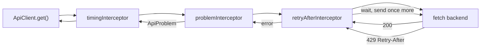

# 04. HTTP interceptors and problem+json error handling

> **Draft: written but not yet run.** The code and the expected output in this lesson were prepared by reading the code and the official documentation. They have not been executed yet. If something does not behave as described, trust your tool's real output and report it.

## What you will be able to do
By the end of this lesson you will be able to:
- Write functional interceptors (`HttpInterceptorFn`), register them with `withInterceptors`, and explain their order.
- Parse an RFC 9457 `application/problem+json` answer into one `ApiProblem` shape, including field errors from JSON Pointers.
- Retry a rate-limited GET once, honouring `Retry-After`, and leave writes alone.
- Restrict interceptor work to your own API address so that nothing leaks to other hosts.

## Recap
1. What does `HttpClient` return, and what runs it? <details><summary>Answer</summary>An Observable; the request is sent when it is subscribed (101.09). Here `firstValueFrom` subscribes.</details>
2. Why does `catchError` live inside `switchMap` in a search stream? <details><summary>Answer</summary>So an error ends only the inner request (201.02).</details>
3. What do the HTTP status codes 412 and 428 mean? <details><summary>Answer</summary>412: the `If-Match` version is stale; 428: the request must include `If-Match` (201.03).</details>

## Why it matters
Imagine a post office where every parcel passes through the same counter: someone checks the address, someone stamps it, someone writes a note if it was refused. An **interceptor** is such a counter for HTTP: one place that sees every request leaving and every answer arriving. Without it, each screen copies the same error handling, and the copies drift apart. With it, "404 means this, 429 means wait, 500 means retry later" is written once. The platform's API (`capstones/platform`) answers every error with the same JSON shape, **problem details** (RFC 9457): a `type`, a `title`, a `status`, a `detail`, a `traceId` and, for validation, a list of `errors` with a JSON Pointer to the bad field. This lesson turns that into one TypeScript type and one place of handling. The capstone client chapter "04 Problem details, 412, offline, WCAG" builds on exactly this.

## What you will build
A new project, `task-board`, with a **mock API** you start in a second terminal (a 250-line Node script that speaks a small part of the platform contract), a hand-written `ApiClient`, three interceptors (timing log, problem parser, 429 retry), an `ApiProblem` type with a parser, a `ProblemView` component, and a page with six buttons that provoke a 200, a 404, a 422, a 429 that succeeds on retry, a 500 and a dropped connection.



## Before you start
- Phase 1 done. Time: about 90 minutes (break after Step 4).
- **New project.** In `code101/angular` run `npx --yes -p @angular/cli@22.3.0 ng new task-board --routing --style=css --ssr=false --skip-git --skip-tests --ai-config=none --package-manager=npm --defaults`, then replace the configuration files as in 101 lesson 01, step 6 (the files are listed at the end of this page). `package.json` differs from before: it has two more scripts, `mock` and `mock:auth`.
- Source pack (optional): every file is shown in full in this lesson, so you can follow without it. The finished code, the exercise starter and the solution are in the
  course repository https://github.com/Uee03/Code101 under `source/angular/201-hero-to-super-hero/phase-2-http-and-auth/04-http-interceptors-and-problem-json/` (on that page choose **Code, Download ZIP**, or run
  `git clone https://github.com/Uee03/Code101.git`).
- **Two terminals.** One runs `npm start` (the Angular app on 4200), the other `npm run mock` (the mock API on 8000). Keep both open.
- The mock stands in for a backend. It has no database and checks no tokens. A real backend from the platform family (Python, ASP.NET, Go or Rust) also listens on 8000 and can replace it: stop one before you start the other.

## Steps

### Step 1. Scripts and the environment
**File: `package.json`**
```json
{
  "name": "task-board",
  "version": "1.0.0",
  "private": true,
  "scripts": {
    "ng": "ng",
    "start": "ng serve --host localhost --port 4200",
    "build": "ng build",
    "mock": "node server/mock-api.mjs",
    "mock:auth": "node server/mock-api.mjs --require-auth"
  },
  "dependencies": {
    "@angular/common": "22.3.0",
    "@angular/compiler": "22.3.0",
    "@angular/core": "22.3.0",
    "@angular/forms": "22.3.0",
    "@angular/platform-browser": "22.3.0",
    "@angular/router": "22.3.0",
    "rxjs": "7.8.2",
    "tslib": "2.8.1"
  },
  "devDependencies": {
    "@angular/build": "22.3.0",
    "@angular/cli": "22.3.0",
    "@angular/compiler-cli": "22.3.0",
    "typescript": "6.0.3"
  }
}
```

`npm run mock` starts the mock; `npm run mock:auth` starts it so that it answers `401` unless a bearer header is present (used from lesson 06 on).

**File: `src/environments/environment.ts`**
```ts
export const environment = {
  apiBaseUrl: 'http://localhost:8000'
};
```

The API address lives in one place. The browser uses `localhost` (not `127.0.0.1`), because later the sign-in issuer must match exactly.

### Step 2. The mock API
Create `server/mock-api.mjs`. You do not need to understand every line today; read the parts called out below. It implements: `GET /health`, `GET /v1/me`, teams, projects, tasks (list with cursor, create with `Idempotency-Key`, get with `ETag`, patch with `If-Match`), and the demo endpoints for this lesson. Every error answer is `application/problem+json`.

**File: `server/mock-api.mjs`**
```js
// A tiny stand-in for the Tasks and Teams backend, for lessons 04 to 10 of the Angular 201 track.
// It speaks a small part of the platform contract on port 8000. It is NOT a real backend: no database,
// no token validation (it only checks that a bearer header exists when started with --require-auth).
// Stop it before you start a real backend: both want port 8000.
import { createServer } from 'node:http';
import { randomUUID } from 'node:crypto';

const PORT = 8000;
const ORIGIN = 'http://localhost:4200';
const REQUIRE_AUTH = process.argv.includes('--require-auth');

const USER_ID = '33333333-3333-4333-8333-333333333333';
const TEAM_ID = '11111111-1111-4111-8111-111111111111';
const PROJECT_ID = '22222222-2222-4222-8222-222222222222';
const taskId = (number) => `5d1b8d9e-0000-4000-8000-${String(number).padStart(12, '0')}`;
const STATUSES = ['todo', 'in_progress', 'blocked', 'done', 'cancelled'];
const PRIORITIES = ['low', 'medium', 'high', 'urgent'];

const ME = {
  id: USER_ID,
  username: 'alice',
  email: 'alice@example.test',
  displayName: 'Alice Admin',
  roles: ['admin'],
  scopes: ['tasks:read', 'tasks:write'],
  teams: [{ teamId: TEAM_ID, name: 'Platform Team', role: 'lead' }]
};

const timestamp = () => new Date().toISOString();
const makeTask = (number, title, status, priority) => ({
  id: taskId(number),
  projectId: PROJECT_ID,
  title,
  description: '',
  status,
  priority,
  assigneeId: null,
  dueDate: null,
  completedAt: status === 'done' ? timestamp() : null,
  createdBy: USER_ID,
  version: 1,
  createdAt: timestamp(),
  updatedAt: timestamp()
});

const tasks = [
  makeTask(1, 'Write the OpenAPI file', 'done', 'high'),
  makeTask(2, 'Add the health check', 'in_progress', 'medium'),
  makeTask(3, 'Seed the database', 'todo', 'medium'),
  makeTask(4, 'Explain signals', 'todo', 'low'),
  makeTask(5, 'Record a demo', 'blocked', 'high'),
  makeTask(6, 'Review the release notes', 'todo', 'urgent')
];
let nextNumber = 7;
const replays = new Map();
let limitedCalls = 0;

function send(res, status, body, headers = {}) {
  res.writeHead(status, {
    'Access-Control-Allow-Origin': ORIGIN,
    'Access-Control-Expose-Headers': 'ETag, Location, Retry-After, Idempotent-Replayed, RateLimit-Remaining',
    Vary: 'Origin',
    'RateLimit-Limit': '100',
    'RateLimit-Remaining': '99',
    'Content-Type': 'application/json',
    ...headers
  });
  res.end(body === undefined ? undefined : JSON.stringify(body));
}

function problem(req, res, status, title, detail, extra = {}, headers = {}) {
  const slug = title.toLowerCase().replaceAll(' ', '-');
  send(
    res,
    status,
    {
      type: `https://code101.example/problems/${slug}`,
      title,
      status,
      detail,
      instance: new URL(req.url, 'http://localhost').pathname,
      traceId: randomUUID().replaceAll('-', ''),
      ...extra
    },
    { 'Content-Type': 'application/problem+json', ...headers }
  );
}

async function readJson(req) {
  const chunks = [];
  for await (const chunk of req) {
    chunks.push(chunk);
  }
  try {
    return JSON.parse(Buffer.concat(chunks).toString('utf8') || '{}');
  } catch {
    return null;
  }
}

const page = (items, limit, nextCursor) => ({ items, page: { limit, nextCursor } });

function validate(body, partial) {
  const errors = [];
  if (!partial || 'title' in body) {
    if (typeof body.title !== 'string' || body.title.length < 1 || body.title.length > 200) {
      errors.push({ pointer: '/title', detail: 'must be between 1 and 200 characters' });
    } else if (/[<>]/.test(body.title)) {
      errors.push({ pointer: '/title', detail: 'must not contain < or >' });
    }
  }
  if ('status' in body && !STATUSES.includes(body.status)) {
    errors.push({ pointer: '/status', detail: `must be one of ${STATUSES.join(', ')}` });
  }
  if ('priority' in body && !PRIORITIES.includes(body.priority)) {
    errors.push({ pointer: '/priority', detail: `must be one of ${PRIORITIES.join(', ')}` });
  }
  if ('dueDate' in body && body.dueDate !== null && !/^\d{4}-\d{2}-\d{2}$/.test(body.dueDate)) {
    errors.push({ pointer: '/dueDate', detail: 'must be a date like 2026-12-31' });
  }
  return errors;
}

const server = createServer(async (req, res) => {
  const url = new URL(req.url, 'http://localhost');
  const path = url.pathname;
  const method = req.method;

  if (method === 'OPTIONS') {
    res.writeHead(204, {
      'Access-Control-Allow-Origin': ORIGIN,
      'Access-Control-Allow-Methods': 'GET, POST, PATCH, PUT, DELETE, OPTIONS',
      'Access-Control-Allow-Headers': 'Authorization, Content-Type, If-Match, If-None-Match, Idempotency-Key',
      'Access-Control-Max-Age': '600',
      Vary: 'Origin'
    });
    res.end();
    return;
  }

  if (method === 'GET' && path === '/health') {
    send(res, 200, { status: 'ok', version: 'mock', database: 'up' });
    return;
  }

  if (path.startsWith('/v1/') && REQUIRE_AUTH && !(req.headers.authorization ?? '').startsWith('Bearer ')) {
    problem(req, res, 401, 'Unauthorized', 'A bearer access token is required.', {}, { 'WWW-Authenticate': 'Bearer realm="tasksteams"' });
    return;
  }

  let match = path.match(/^\/v1\/demo\/error\/(\d{3})$/);
  if (method === 'GET' && match) {
    const status = Number(match[1]);
    const extra = status === 422 ? { errors: [{ pointer: '/title', detail: 'must be between 1 and 200 characters' }] } : {};
    const headers = status === 429 ? { 'Retry-After': '2' } : {};
    problem(req, res, status, `Demo error ${status}`, `This is a demo answer with status ${status}.`, extra, headers);
    return;
  }
  if (method === 'GET' && path === '/v1/demo/limited') {
    limitedCalls++;
    if (limitedCalls % 2 === 1) {
      problem(req, res, 429, 'Too many requests', 'Slow down.', {}, { 'Retry-After': '1' });
    } else {
      send(res, 200, { ok: true, message: 'The retry worked.' });
    }
    return;
  }
  if (method === 'GET' && path === '/v1/demo/drop') {
    req.socket.destroy();
    return;
  }

  if (method === 'GET' && path === '/v1/me') {
    send(res, 200, ME);
    return;
  }
  if (method === 'GET' && path === '/v1/teams') {
    const team = { id: TEAM_ID, name: 'Platform Team', description: 'Builds the platform', memberCount: 1, createdBy: USER_ID, version: 1, createdAt: timestamp(), updatedAt: timestamp() };
    send(res, 200, page([team], 25, null));
    return;
  }
  match = path.match(/^\/v1\/teams\/([^/]+)\/projects$/);
  if (method === 'GET' && match) {
    const project = { id: PROJECT_ID, teamId: match[1], key: 'PLAT', name: 'Platform', description: 'The platform project', archived: false, version: 1, createdAt: timestamp(), updatedAt: timestamp() };
    send(res, 200, page([project], 25, null));
    return;
  }

  match = path.match(/^\/v1\/projects\/([^/]+)\/tasks$/);
  if (match && method === 'GET') {
    const limit = Math.min(100, Math.max(1, Number(url.searchParams.get('limit') ?? 25) || 25));
    const start = Number(url.searchParams.get('cursor') ?? 0);
    if (!Number.isInteger(start) || start < 0) {
      problem(req, res, 400, 'Bad request', 'The cursor is not valid.');
      return;
    }
    const wanted = url.searchParams.getAll('status');
    const text = (url.searchParams.get('q') ?? '').toLowerCase();
    const rows = tasks.filter((task) => (wanted.length === 0 || wanted.includes(task.status)) && task.title.toLowerCase().includes(text));
    const end = start + limit;
    send(res, 200, page(rows.slice(start, end), limit, end < rows.length ? String(end) : null));
    return;
  }
  if (match && method === 'POST') {
    const body = await readJson(req);
    if (body === null) {
      problem(req, res, 400, 'Bad request', 'The body is not valid JSON.');
      return;
    }
    const errors = validate(body, false);
    if (errors.length > 0) {
      problem(req, res, 422, 'Validation failed', 'One or more fields are invalid.', { errors });
      return;
    }
    const key = req.headers['idempotency-key'];
    const fingerprint = JSON.stringify(body);
    if (typeof key === 'string' && replays.has(key)) {
      const first = replays.get(key);
      if (first.fingerprint !== fingerprint) {
        problem(req, res, 422, 'Validation failed', 'The Idempotency-Key was used with another body.');
        return;
      }
      send(res, 201, first.task, { Location: `http://localhost:${PORT}/v1/tasks/${first.task.id}`, ETag: '"1"', 'Idempotent-Replayed': 'true' });
      return;
    }
    const task = makeTask(nextNumber++, body.title, 'todo', body.priority ?? 'medium');
    task.description = body.description ?? '';
    task.dueDate = body.dueDate ?? null;
    tasks.push(task);
    if (typeof key === 'string') {
      replays.set(key, { fingerprint, task });
    }
    send(res, 201, task, { Location: `http://localhost:${PORT}/v1/tasks/${task.id}`, ETag: '"1"' });
    return;
  }

  match = path.match(/^\/v1\/tasks\/([^/]+)$/);
  if (match) {
    const task = tasks.find((row) => row.id === match[1]);
    if (!task) {
      problem(req, res, 404, 'Not found', 'The task does not exist, or you may not know that it exists.');
      return;
    }
    const etag = `"${task.version}"`;
    if (method === 'GET') {
      if (req.headers['if-none-match'] === etag) {
        send(res, 304, undefined, { ETag: etag });
        return;
      }
      send(res, 200, task, { ETag: etag });
      return;
    }
    if (method === 'PATCH') {
      if (!req.headers['if-match']) {
        problem(req, res, 428, 'Precondition required', 'Send the If-Match header with the ETag you read.');
        return;
      }
      if (req.headers['if-match'] !== etag) {
        problem(req, res, 412, 'Precondition failed', `The task changed since you read it (current version ${task.version}).`);
        return;
      }
      const body = await readJson(req);
      if (body === null) {
        problem(req, res, 400, 'Bad request', 'The body is not valid JSON.');
        return;
      }
      const errors = validate(body, true);
      if (errors.length > 0) {
        problem(req, res, 422, 'Validation failed', 'One or more fields are invalid.', { errors });
        return;
      }
      Object.assign(task, body, { version: task.version + 1, updatedAt: timestamp() });
      task.completedAt = task.status === 'done' ? timestamp() : null;
      send(res, 200, task, { ETag: `"${task.version}"` });
      return;
    }
  }

  problem(req, res, 404, 'Not found', 'This mock server does not know that address.');
});

server.listen(PORT, 'localhost', () => {
  console.log(`Mock API on http://localhost:${PORT}${REQUIRE_AUTH ? ' (bearer header required)' : ''}`);
});
```

Read these parts:
- `send(...)` sets the **CORS** headers. The page (`http://localhost:4200`) and the API (`http://localhost:8000`) are different origins, so the browser only lets the page read the answer if the server says so with `Access-Control-Allow-Origin`. `Access-Control-Expose-Headers` lists the response headers the page may read (`ETag`, `Retry-After` and others are hidden otherwise).
- The `OPTIONS` branch answers the **preflight**: before a request with an `Authorization`, `If-Match` or `Idempotency-Key` header, the browser asks which headers and methods are allowed.
- `problem(...)` builds the RFC 9457 body and sets `Content-Type: application/problem+json`.
- `/v1/demo/error/:status`, `/v1/demo/limited` (429 on odd calls, 200 on even) and `/v1/demo/drop` (closes the socket) exist only for this lesson.

### Step 3. The problem type and parser
**File: `src/app/http/problem.ts`**
```ts
export interface ApiProblem {
  type: string;
  title: string;
  status: number;
  detail?: string;
  instance?: string;
  traceId?: string;
  code?: string;
  errors?: { pointer: string; detail: string }[];
  retryAfter?: number;
}

export function isApiProblem(value: unknown): value is ApiProblem {
  return typeof value === 'object' && value !== null && typeof (value as ApiProblem).status === 'number' && typeof (value as ApiProblem).title === 'string';
}

// Turns an error answer into one shape. It does not depend on Angular, so any code can use it.
export function parseProblem(status: number, body: unknown, headers: { get(name: string): string | null }): ApiProblem {
  const data = body && typeof body === 'object' ? (body as Record<string, unknown>) : {};
  const text = (key: string): string | undefined => (typeof data[key] === 'string' ? (data[key] as string) : undefined);
  const retry = headers.get('Retry-After');
  const seconds = retry === null ? undefined : /^\d+$/.test(retry) ? Number(retry) : Math.max(0, Math.ceil((Date.parse(retry) - Date.now()) / 1000));
  const errors = Array.isArray(data['errors'])
    ? data['errors'].filter((item): item is { pointer: string; detail: string } => !!item && typeof item.pointer === 'string' && typeof item.detail === 'string')
    : undefined;
  return {
    type: text('type') ?? 'about:blank',
    title: text('title') ?? 'Request failed',
    status,
    detail: text('detail') ?? (status === 0 ? 'Cannot reach the API. Check your connection, then try again.' : 'The request could not be completed.'),
    instance: text('instance'),
    traceId: text('traceId'),
    code: text('code'),
    errors,
    retryAfter: seconds !== undefined && Number.isFinite(seconds) ? seconds : undefined
  };
}

// "/title" becomes "title" (a form control name). Nested pointers such as "/a/b" return null.
export function fieldName(pointer: string): string | null {
  if (!pointer.startsWith('/') || pointer.slice(1).includes('/')) {
    return null;
  }
  return pointer.slice(1).replace(/~1/g, '/').replace(/~0/g, '~');
}
```

- `ApiProblem` is the one shape every failure takes inside the app. `status 0` is our own convention for "no answer at all".
- `parseProblem` is defensive: the body is `unknown` because a server, a proxy or an outage may send anything, so it reads each field only if it has the right type. It also converts `Retry-After` (seconds, or an HTTP date) into seconds.
- `fieldName('/title')` returns `'title'`: the name of a form control (lesson 07). A nested pointer such as `/a/b` returns `null`.
- The file imports nothing from Angular, so any script can reuse it.

**File: `src/app/http/api-url.ts`**
```ts
import { environment } from '../../environments/environment';

// True only for addresses under the API base URL. Interceptors use it so that nothing is added to,
// or changed for, requests to other hosts (a token must never go to a third party).
export function isApiUrl(value: string): boolean {
  const target = new URL(value, environment.apiBaseUrl);
  const base = new URL(environment.apiBaseUrl);
  const path = base.pathname.replace(/\/$/, '');
  return target.origin === base.origin && (target.pathname === path || target.pathname.startsWith(path + '/'));
}
```

`isApiUrl` compares the **origin** (scheme, host and port) and the path prefix with the configured API base. A plain `startsWith` test would also accept `http://localhost:8000.evil.example`, so we use the `URL` class.

### Step 4. The interceptors
A functional interceptor is a function `(request, next) => Observable<event>`. It may change the request (`request.clone(...)`: requests are immutable), pass it on with `next(request)`, and change what comes back by adding operators with `pipe`.

**File: `src/app/http/problem.interceptor.ts`**
```ts
import { HttpErrorResponse, HttpInterceptorFn } from '@angular/common/http';
import { catchError, throwError } from 'rxjs';
import { isApiUrl } from './api-url';
import { parseProblem } from './problem';

export const problemInterceptor: HttpInterceptorFn = (request, next) => {
  if (!isApiUrl(request.url)) {
    return next(request);
  }
  return next(request).pipe(
    catchError((error: unknown) => {
      if (!(error instanceof HttpErrorResponse) || error.status === 304) {
        return throwError(() => error);
      }
      const isProblem = error.headers.get('Content-Type')?.includes('application/problem+json') ?? false;
      return throwError(() => parseProblem(error.status, isProblem ? error.error : null, error.headers));
    })
  );
};
```

It converts every `HttpErrorResponse` for the API into an `ApiProblem` and rethrows it, so every caller sees the same type. A `304 Not Modified` (used in the capstone for revalidation) is left alone.

**File: `src/app/http/retry-after.interceptor.ts`**
```ts
import { HttpErrorResponse, HttpInterceptorFn } from '@angular/common/http';
import { catchError, switchMap, throwError, timer } from 'rxjs';
import { isApiUrl } from './api-url';
import { parseProblem } from './problem';

// A GET that gets "429 Too Many Requests" waits for Retry-After seconds and is sent once more.
// Writes are not repeated here: a human must decide whether to send them again.
export const retryAfterInterceptor: HttpInterceptorFn = (request, next) => {
  if (!isApiUrl(request.url) || request.method !== 'GET') {
    return next(request);
  }
  return next(request).pipe(
    catchError((error: unknown) => {
      if (!(error instanceof HttpErrorResponse) || error.status !== 429) {
        return throwError(() => error);
      }
      const seconds = parseProblem(429, null, error.headers).retryAfter ?? 1;
      return timer(Math.min(seconds, 10) * 1000).pipe(switchMap(() => next(request)));
    })
  );
};
```

For a `GET` that fails with 429 it waits `Retry-After` seconds (at most 10 here) and sends the request **once more**. The second `next(request)` sits outside this `catchError`, so a second 429 is passed on. Writes (`POST`, `PATCH`) are never repeated automatically: the user decides.

**File: `src/app/http/timing.interceptor.ts`**
```ts
import { HttpInterceptorFn, HttpResponse } from '@angular/common/http';
import { tap } from 'rxjs';
import { isApiUrl } from './api-url';

// Logs method, path, status and duration of every API call to the console.
// It never logs headers or bodies, so it cannot leak a token.
export const timingInterceptor: HttpInterceptorFn = (request, next) => {
  if (!isApiUrl(request.url)) {
    return next(request);
  }
  const started = performance.now();
  const path = new URL(request.url).pathname;
  const report = (status: number): void => {
    console.log(`${request.method} ${path} -> ${status} in ${Math.round(performance.now() - started)} ms`);
  };
  return next(request).pipe(
    tap({
      next: (event) => {
        if (event instanceof HttpResponse) {
          report(event.status);
        }
      },
      error: (error: unknown) => report((error as { status?: number }).status ?? 0)
    })
  );
};
```

It logs `GET /health -> 200 in 12 ms`. It never prints headers or bodies, so it cannot leak a token.

**Order matters.** In `withInterceptors([A, B, C])` a request goes A, B, C and the answer comes back C, B, A. Here: `timing` is outermost, so it measures everything including the retry wait and sees the final `ApiProblem` (which has a `status`); `problem` converts errors; `retryAfter` is closest to the network, so it sees the raw 429 before conversion.

**Take a break here.**

### Step 5. A small client, the problem view and the demo page
**File: `src/app/api-client.ts`**
```ts
import { HttpClient } from '@angular/common/http';
import { inject, Injectable } from '@angular/core';
import { firstValueFrom } from 'rxjs';
import { environment } from '../environments/environment';

// A hand-written client. Lesson 05 replaces it with a client generated from the OpenAPI contract.
@Injectable({ providedIn: 'root' })
export class ApiClient {
  private readonly http = inject(HttpClient);

  get<T>(path: string): Promise<T> {
    return firstValueFrom(this.http.get<T>(environment.apiBaseUrl + path));
  }
}
```

`firstValueFrom` turns the Observable into a Promise (it takes the first and only answer). Errors become **rejections carrying an `ApiProblem`**. Lesson 05 replaces this class with a generated one.

**File: `src/app/app.config.ts`**
```ts
import { ApplicationConfig, provideBrowserGlobalErrorListeners } from '@angular/core';
import { provideHttpClient, withFetch, withInterceptors } from '@angular/common/http';
import { provideRouter } from '@angular/router';

import { routes } from './app.routes';
import { problemInterceptor } from './http/problem.interceptor';
import { retryAfterInterceptor } from './http/retry-after.interceptor';
import { timingInterceptor } from './http/timing.interceptor';

export const appConfig: ApplicationConfig = {
  providers: [
    provideBrowserGlobalErrorListeners(),
    provideHttpClient(withFetch(), withInterceptors([timingInterceptor, problemInterceptor, retryAfterInterceptor])),
    provideRouter(routes)
  ]
};
```

**File: `src/app/shared/problem-view.ts`**
```ts
import { ChangeDetectionStrategy, Component, input } from '@angular/core';
import { ApiProblem, fieldName } from '../http/problem';

@Component({
  selector: 'app-problem-view',
  changeDetection: ChangeDetectionStrategy.OnPush,
  templateUrl: './problem-view.html',
  styleUrl: './problem-view.css'
})
export class ProblemView {
  readonly problem = input.required<ApiProblem>();

  protected field(pointer: string): string {
    return fieldName(pointer) ?? pointer;
  }
}
```

**File: `src/app/shared/problem-view.html`**
```html
<div class="problem" role="alert">
  <h3>{{ problem().title }} ({{ problem().status }})</h3>
  <p>{{ problem().detail }}</p>
  @if (problem().errors; as errors) {
    <ul>
      @for (error of errors; track error.pointer) {
        <li>Field <strong>{{ field(error.pointer) }}</strong>: {{ error.detail }}</li>
      }
    </ul>
  }
  @if (problem().traceId; as trace) {
    <p class="trace">Support code: {{ trace }}</p>
  }
</div>
```

**File: `src/app/shared/problem-view.css`**
```css
.problem {
  padding: 0.75rem 1rem;
  border-left: 0.25rem solid #b42318;
  background: #fdecea;
  color: #1f2937;
}

h3 {
  margin: 0 0 0.25rem;
}

.trace {
  margin-bottom: 0;
  color: #4b5563;
  font-size: 0.875rem;
}
```

`role="alert"` makes assistive technology announce it. The **trace id** is shown as "Support code": it lets support find the server log line for this exact request. Never show stack traces or raw JSON.

**File: `src/app/features/demo/demo.ts`**
```ts
import { ChangeDetectionStrategy, Component, inject, signal } from '@angular/core';
import { ApiClient } from '../../api-client';
import { ApiProblem, isApiProblem } from '../../http/problem';
import { ProblemView } from '../../shared/problem-view';

interface Probe {
  label: string;
  path: string;
}

type Outcome = { kind: 'idle' } | { kind: 'loading'; label: string } | { kind: 'ok'; label: string; data: string } | { kind: 'problem'; label: string; problem: ApiProblem };

@Component({
  selector: 'app-demo',
  imports: [ProblemView],
  changeDetection: ChangeDetectionStrategy.OnPush,
  templateUrl: './demo.html',
  styleUrl: './demo.css'
})
export class Demo {
  private readonly api = inject(ApiClient);

  protected readonly probes: readonly Probe[] = [
    { label: 'Health check (200)', path: '/health' },
    { label: 'Not found (404)', path: '/v1/demo/error/404' },
    { label: 'Validation failed (422)', path: '/v1/demo/error/422' },
    { label: 'Too many requests, retried once (429 then 200)', path: '/v1/demo/limited' },
    { label: 'Server error (500)', path: '/v1/demo/error/500' },
    { label: 'Connection dropped (no answer)', path: '/v1/demo/drop' }
  ];
  protected readonly outcome = signal<Outcome>({ kind: 'idle' });

  protected async run(probe: Probe): Promise<void> {
    this.outcome.set({ kind: 'loading', label: probe.label });
    try {
      const data = await this.api.get<unknown>(probe.path);
      this.outcome.set({ kind: 'ok', label: probe.label, data: JSON.stringify(data) });
    } catch (error) {
      if (isApiProblem(error)) {
        this.outcome.set({ kind: 'problem', label: probe.label, problem: error });
      } else {
        throw error;
      }
    }
  }
}
```

**File: `src/app/features/demo/demo.html`**
```html
<section aria-labelledby="demo-heading">
  <h2 id="demo-heading">Ask the API for trouble</h2>
  <p>Start the mock API in a second terminal (<code>npm run mock</code>), then press a button.</p>

  <ul class="probes">
    @for (probe of probes; track probe.path) {
      <li><button type="button" (click)="run(probe)">{{ probe.label }}</button></li>
    }
  </ul>

  <div role="status">
    @switch (outcome().kind) {
      @case ('loading') {
        <p>Waiting for the answer...</p>
      }
    }
  </div>

  @let current = outcome();
  @if (current.kind === 'ok') {
    <p>{{ current.label }}: <code>{{ current.data }}</code></p>
  } @else if (current.kind === 'problem') {
    <p>{{ current.label }}:</p>
    <app-problem-view [problem]="current.problem" />
  }
</section>
```

`@let current = outcome();` declares a template variable. Narrowing a **union** needs a plain variable: `current.kind === 'ok'` lets the compiler know `current.data` exists in that block (a signal call such as `outcome().kind` does not narrow).

**File: `src/app/features/demo/demo.css`**
```css
.probes {
  padding: 0;
  list-style: none;
}

.probes li {
  margin: 0.5rem 0;
}

button {
  min-height: 2.25rem;
  padding: 0.25rem 0.75rem;
}
```

**File: `src/app/app.ts`**
```ts
import { ChangeDetectionStrategy, Component } from '@angular/core';
import { Demo } from './features/demo/demo';

@Component({
  selector: 'app-root',
  imports: [Demo],
  changeDetection: ChangeDetectionStrategy.OnPush,
  templateUrl: './app.html',
  styleUrl: './app.css'
})
export class App {}
```

**File: `src/app/app.html`**
```html
<main class="page">
  <h1>Task board</h1>
  <app-demo />
</main>
```

**File: `src/app/app.css`**
```css
.page {
  max-width: 44rem;
  margin: 0 auto;
}
```

## Run it
Terminal 1: `npm run mock`. Terminal 2: `npm start`. Open http://localhost:4200/ and the browser console.

Expected output of the mock terminal (derived from the code):
```text
Mock API on http://localhost:8000
```

**Predict:** for the button "Too many requests, retried once", which status does the user see, how long does it take, and how many lines does the timing interceptor log?

Expected behaviour (derived by reading the code, not yet seen in a browser; times vary):
1. **Health check**: `{"status":"ok","version":"mock","database":"up"}`; console `GET /health -> 200 in N ms`.
2. **Not found (404)**: a red box "Demo error 404 (404)", "This is a demo answer with status 404." and a "Support code" with 32 hex characters.
3. **Validation failed (422)**: the same, plus the list item "Field **title**: must be between 1 and 200 characters" (from the pointer `/title`).
4. **Too many requests**: the first answer is 429 with `Retry-After: 1`; the interceptor waits about one second, sends the GET again, and the page shows `{"ok":true,"message":"The retry worked."}`. The timing interceptor logs **one** line, `GET /v1/demo/limited -> 200 in about 1000 ms`, because it sits outside the retry.
5. **Server error (500)**: red box "Demo error 500 (500)"; console `-> 500`.
6. **Connection dropped**: the mock closes the connection; the box says "Request failed (0)" and "Cannot reach the API. Check your connection, then try again."; console `-> 0`. (The browser also prints its own red network error: that is the browser, not your code.)
7. Stop the mock (Ctrl+C) and press **Health check**: the same "Request failed (0)" box. A stopped server and a dropped connection look the same to the browser.

## How it works
1. `provideHttpClient(withFetch(), withInterceptors([...]))` builds a chain; each request runs through the interceptors in order.
2. The `fetch` backend rejects only on network failure; for HTTP error statuses Angular wraps the answer in an `HttpErrorResponse` and `HttpClient` emits it as an error. The problem interceptor reads its headers and body.
3. `application/problem+json` is JSON with a standard vocabulary, so clients can handle all errors the same way. `errors[].pointer` (RFC 6901 JSON Pointer) names the bad field.
4. The retry rule is deliberately narrow: only GET (it is safe and idempotent), only 429, only once. Anything wider (retry on 500, retry POST) risks repeating a payment or hammering a struggling server.

**Why this, not that.** *Interceptors* versus *a wrapper service that every call goes through*: interceptors also cover calls made by libraries and generated clients (lesson 05 and the OIDC library in 06), and they cannot be forgotten. A wrapper is simpler to read but easy to bypass.

**Security note.** Every interceptor starts with `isApiUrl`. Without it, a call to any other site would also get your error handling and, later, your **bearer token**: a data leak.

**Misconception:** "the interceptor gets the response body as an object for errors too." It does for JSON error bodies, but the content type must be checked: a proxy may answer with HTML.

## Try it
Starter file: `exercise/starter/src/app/http/accept.interceptor.ts`.
1. **Guided:** write `acceptInterceptor` (TODO 1): for API addresses, clone the request with `Accept: application/json, application/problem+json`, then register it first in `app.config.ts` (TODO 2). Predict the effect on the browser's request headers (look at the Network tab).
2. **Change:** make `retryAfterInterceptor` also retry once for **503** (`Retry-After` allowed), but still only for GET. What risks does a 503 retry add compared with 429?
3. **Stretch (optional):** add a global "offline" banner: when `problemInterceptor` sees status 0, set a signal in a `Connectivity` service. Where should the signal live, and who resets it?

<details><summary>Solution for rung 1</summary>

**File: `exercise/solution/src/app/http/accept.interceptor.ts`**
```ts
import { HttpInterceptorFn } from '@angular/common/http';
import { isApiUrl } from './api-url';

export const acceptInterceptor: HttpInterceptorFn = (request, next) => {
  if (!isApiUrl(request.url)) {
    return next(request);
  }
  return next(request.clone({ setHeaders: { Accept: 'application/json, application/problem+json' } }));
};
```

In `app.config.ts`: `withInterceptors([acceptInterceptor, timingInterceptor, problemInterceptor, retryAfterInterceptor])` with the import `import { acceptInterceptor } from './http/accept.interceptor';`.

</details>

## Check yourself
1. Why is the order `timing, problem, retryAfter` and not `retryAfter, problem, timing`? <details><summary>Answer</summary>The one closest to the network (last in the list) sees the raw error first. `retryAfter` must see the raw 429 before `problem` converts it, and `timing` outermost measures the total time.</details>
2. Why do we compare origins with `URL` instead of `startsWith`? <details><summary>Answer</summary>A prefix test accepts hostile lookalike hosts; origin comparison does not.</details>
3. A 422 answer has `errors: [{ pointer: '/title', ... }]`. Which control gets the message in a form? <details><summary>Answer</summary>The control named `title` (`fieldName('/title')`).</details>
4. Why is retrying a POST automatically dangerous? <details><summary>Answer</summary>The first attempt may have succeeded; repeating it could create a duplicate (unless an `Idempotency-Key` makes it safe).</details>

## Common mistakes
| Symptom or error text | Cause | Fix |
|---|---|---|
| Browser console: typical message `has been blocked by CORS policy: No 'Access-Control-Allow-Origin' header` | The page origin is not `http://localhost:4200`, or the mock is not running | Use `localhost:4200`; start `npm run mock` |
| Every button shows "Request failed (0)" | The mock is not running or a different program owns port 8000 | Start the mock; stop other servers on 8000 |
| Typical message: `EADDRINUSE` in the mock terminal | Port 8000 is taken (a backend, an older mock) | Stop that process first |
| Errors arrive as `HttpErrorResponse`, not `ApiProblem` | `problemInterceptor` is not registered, or the URL is not under `apiBaseUrl` | Check `app.config.ts` and `environment.ts` |
| The retry runs forever | The retry was written inside the pipe of the second request | Keep the second `next(request)` outside `catchError` |
| Typical message: `NG0201: No provider found for HttpClient` | `provideHttpClient` is missing | Add it to `app.config.ts` |

## Best practice
Handle HTTP concerns once, in interceptors that check the target address, and give every failure one typed shape. Source: Angular, Interceptors https://angular.dev/guide/http/interceptors and RFC 9457 Problem Details https://www.rfc-editor.org/info/rfc9457

## Going further
- Setting up HttpClient: https://angular.dev/guide/http/setup
- Capstone: `capstones/web-angular` chapter 04 (status table, 412 dialog, offline banner) and the platform chapter on the contract's error model.
- RFC 6585 for 428 and 429, RFC 9110 for `Retry-After`.

## Summary
- You wrote and ordered functional interceptors and limited them to your API.
- You turned every failure into one `ApiProblem` and showed it accessibly.
- You retried a rate-limited GET once and left writes to the user.

## Next lesson
05. A typed API client from OpenAPI: stop hand-writing calls; generate typed functions from the contract with ng-openapi-gen.

<details>
<summary>Files that did not change in this lesson (listed so this page is complete)</summary>

**File: `.gitignore`**

```
node_modules/
dist/
.angular/
.env
*.log
```

**File: `angular.json`**

```json
{
  "$schema": "./node_modules/@angular/cli/lib/config/schema.json",
  "version": 1,
  "cli": {
    "packageManager": "npm",
    "analytics": false
  },
  "newProjectRoot": "projects",
  "projects": {
    "task-board": {
      "projectType": "application",
      "schematics": {
        "@schematics/angular:class": {
          "skipTests": true
        },
        "@schematics/angular:component": {
          "skipTests": true
        },
        "@schematics/angular:directive": {
          "skipTests": true
        },
        "@schematics/angular:guard": {
          "skipTests": true
        },
        "@schematics/angular:interceptor": {
          "skipTests": true
        },
        "@schematics/angular:pipe": {
          "skipTests": true
        },
        "@schematics/angular:resolver": {
          "skipTests": true
        },
        "@schematics/angular:service": {
          "skipTests": true
        }
      },
      "root": "",
      "sourceRoot": "src",
      "prefix": "app",
      "architect": {
        "build": {
          "builder": "@angular/build:application",
          "options": {
            "browser": "src/main.ts",
            "tsConfig": "tsconfig.app.json",
            "assets": [
              {
                "glob": "**/*",
                "input": "public"
              }
            ],
            "styles": [
              "src/styles.css"
            ]
          },
          "configurations": {
            "production": {
              "budgets": [
                {
                  "type": "initial",
                  "maximumWarning": "500kB",
                  "maximumError": "1MB"
                },
                {
                  "type": "anyComponentStyle",
                  "maximumWarning": "4kB",
                  "maximumError": "8kB"
                }
              ],
              "outputHashing": "all"
            },
            "development": {
              "optimization": false,
              "extractLicenses": false,
              "sourceMap": true
            }
          },
          "defaultConfiguration": "production"
        },
        "serve": {
          "builder": "@angular/build:dev-server",
          "configurations": {
            "production": {
              "buildTarget": "task-board:build:production"
            },
            "development": {
              "buildTarget": "task-board:build:development"
            }
          },
          "defaultConfiguration": "development"
        }
      }
    }
  }
}
```

**File: `public/favicon.svg`**

```xml
<svg xmlns="http://www.w3.org/2000/svg" viewBox="0 0 24 24" width="24" height="24" fill="none" stroke="#1d6fb8" stroke-width="2" stroke-linecap="round" stroke-linejoin="round">
  <path d="M22 11.08V12a10 10 0 1 1-5.93-9.14"/><polyline points="22 4 12 14.01 9 11.01"/>
</svg>
```

**File: `src/app/app.routes.ts`**

```ts
import { Routes } from '@angular/router';

export const routes: Routes = [];
```

**File: `src/index.html`**

```html
<!doctype html>
<html lang="en">
<head>
  <meta charset="utf-8">
  <title>Task Board</title>
  <base href="/">
  <meta name="viewport" content="width=device-width, initial-scale=1">
  <link rel="icon" type="image/svg+xml" href="favicon.svg">
</head>
<body>
  <app-root></app-root>
</body>
</html>
```

**File: `src/main.ts`**

```ts
import { bootstrapApplication } from '@angular/platform-browser';
import { appConfig } from './app/app.config';
import { App } from './app/app';

bootstrapApplication(App, appConfig)
  .catch((err) => console.error(err));
```

**File: `src/styles.css`**

```css
body {
  font-family: system-ui, sans-serif;
  line-height: 1.5;
  margin: 2rem;
}
```

**File: `tsconfig.app.json`**

```json
/* To learn more about Typescript configuration file: https://www.typescriptlang.org/docs/handbook/tsconfig-json.html. */
/* To learn more about Angular compiler options: https://angular.dev/reference/configs/angular-compiler-options. */
{
  "extends": "./tsconfig.json",
  "compilerOptions": {
    "types": []
  },
  "include": [
    "src/**/*.ts"
  ],
  "exclude": [
    "src/**/*.spec.ts"
  ]
}
```

**File: `tsconfig.json`**

```json
/* To learn more about Typescript configuration file: https://www.typescriptlang.org/docs/handbook/tsconfig-json.html. */
/* To learn more about Angular compiler options: https://angular.dev/reference/configs/angular-compiler-options. */
{
  "compileOnSave": false,
  "compilerOptions": {
    "strict": true,
    "noImplicitOverride": true,
    "noPropertyAccessFromIndexSignature": true,
    "noImplicitReturns": true,
    "noFallthroughCasesInSwitch": true,
    "skipLibCheck": true,
    "isolatedModules": true,
    "experimentalDecorators": true,
    "importHelpers": true,
    "target": "ES2022",
    "module": "preserve"
  },
  "angularCompilerOptions": {
    "enableI18nLegacyMessageIdFormat": false,
    "strictInjectionParameters": true,
    "strictInputAccessModifiers": true,
    "strictTemplates": true
  },
  "files": [],
  "references": [
    {
      "path": "./tsconfig.app.json"
    }
  ]
}
```

</details>
